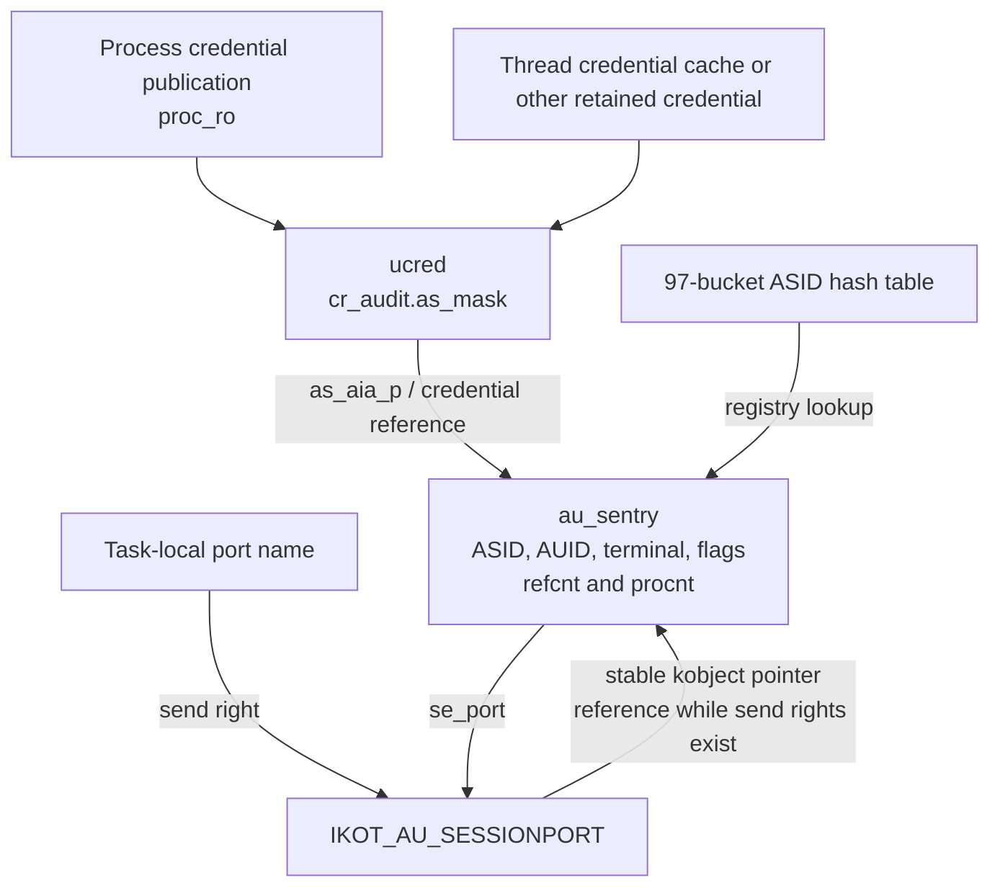
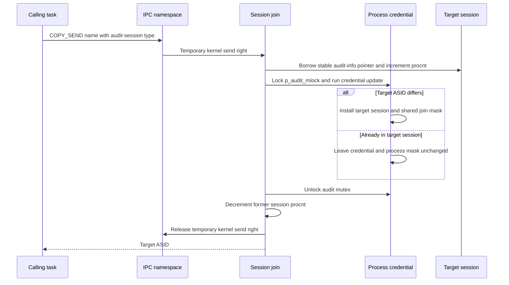
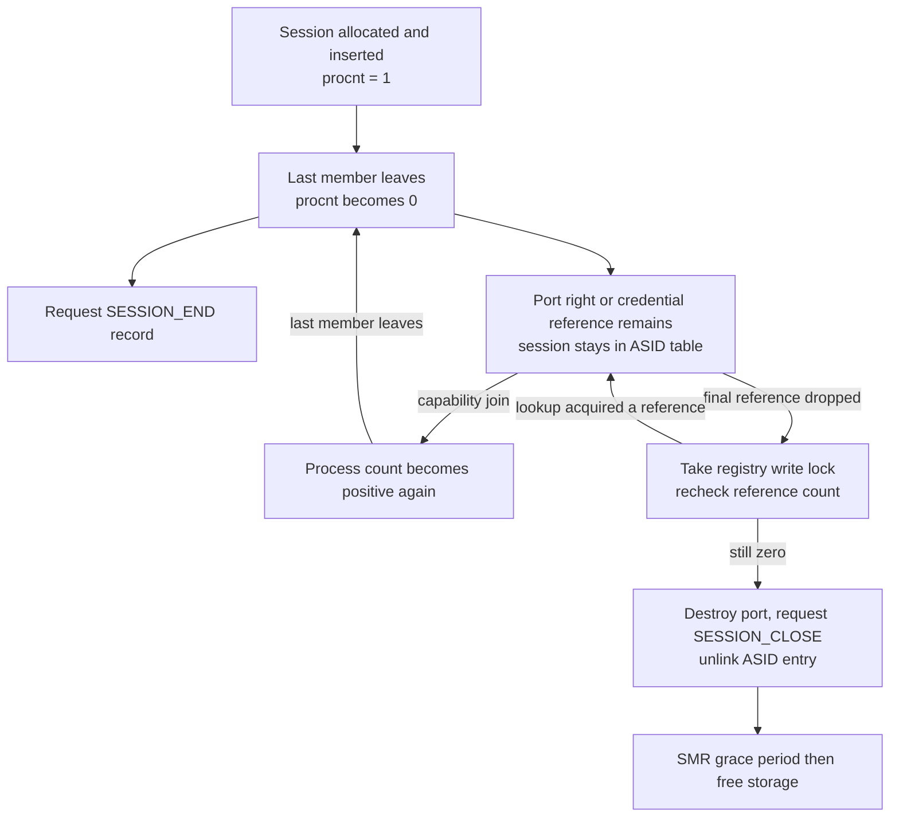

# Audit sessions, credential adoption and Mach capabilities

[Security](README.md) · [Audit records](audit.md) · [Audit delivery](audit-pipeline.md) · [Credential lifetimes](credential-and-policy-lifetimes.md) · [Personas](personas-and-membership-resolution.md) · [Port lifetimes](../ipc/ports-and-rights-lifecycle.md)

An audit session is a shared identity object referenced by credentials and, optionally, by a Mach capability. A process can join it by changing audit information through a privileged BSD interface or by presenting a send right to its session port. The latter lets an authorized holder transfer membership without handing out a general right to change POSIX credentials. This chapter traces those local XNU mechanisms, their two lifetime counts and the difference between session identity, process selection masks and audit-record delivery.

## 1. The ASID, credential and port refer to different objects

`ucred.cr_audit` contains a `struct au_session`: `as_aia_p` points to shared audit information, while `as_mask` stores this credential's success/failure selection masks. The containing `au_sentry` puts that public `auditinfo_addr_t` first, allowing `AU_SENTRY_PTR` to recover the owning object. It adds reference/process counts, an optional port and hash/SMR linkage. [Credential field](../../../xnu/bsd/sys/ucred.h#L180), [credential audit layout](../../../xnu/bsd/bsm/audit.h#L257-L261), [session object](../../../xnu/bsd/security/audit/audit_session.c#L68-L106).

[Exact session representation](../../../xnu/bsd/security/audit/audit_session.c#L72-L88):

<!-- source-excerpt: ../../../xnu/bsd/security/audit/audit_session.c#L72-L88 -->
```c
struct au_sentry {
	auditinfo_addr_t        se_auinfo;      /* Public audit session data. */
#define se_asid         se_auinfo.ai_asid
#define se_auid         se_auinfo.ai_auid
#define se_mask         se_auinfo.ai_mask
#define se_termid       se_auinfo.ai_termid
#define se_flags        se_auinfo.ai_flags

	long                    se_refcnt;      /* Reference count. */
	long                    se_procnt;      /* Processes in session. */
	ipc_port_t              se_port;        /* Session port. */
	union {
		LIST_ENTRY(au_sentry)   se_link;        /* Hash bucket link list (1) */
		struct smr_node         se_smr_node;
	};
};
typedef struct au_sentry au_sentry_t;
```

| Value or object | Role |
| --- | --- |
| `ai_auid` | Audit user identity. It is not the process's effective UID. |
| `ai_asid` | Numeric audit-session ID; selects a hash-table entry. It is neither a PID nor a Mach port name. |
| `ai_termid`, `ai_flags` | Shared terminal/address and session state. |
| `cr_audit.as_mask` | Process credential's audit selection mask. Two credentials in the same session may have different masks. |
| Shared `ai_mask` / `se_mask` | Session-level mask used when joining through a port and in session records; it is not continuously synchronized with every member's mask. |
| `se_port` | A kernel-owned port of type `IKOT_AU_SESSIONPORT`, lazily created and associated with the shared audit-info pointer. |
| User port name | Task-local name for a send right to that port. Sending or copying the right can give another process a membership capability. |

The default object has `AU_DEFAUDITID`, `AU_DEFAUDITSID` (zero), an IPv4-form empty terminal and permanent special handling in reference/count helpers. It is not a joinable session obtained through the ordinary self-port path. `AU_ASSIGN_ASID` is the request value `-1`, distinct from the default ASID. [Defaults](../../../xnu/bsd/security/audit/audit_session.c#L96-L106), [ID constants](../../../xnu/bsd/bsm/audit.h#L73-L77), [self admission](../../../xnu/bsd/security/audit/audit_session.c#L1232-L1243).



The diagram shows relationships, not a one-to-one count: multiple processes can share a uniqued credential, and a process can leave old credentials retained elsewhere. A credential's reference to a session is therefore not an accurate process count. [Credential construction/retirement](../../../xnu/bsd/kern/kern_credential.c#L3667-L3675), [session unref on credential retirement](../../../xnu/bsd/kern/kern_credential.c#L3806-L3815), [separate process hooks](../../../xnu/bsd/security/audit/audit_session.c#L1017-L1049).

## 2. BSD entry points create or update session identity

| Entry | Admission and effect |
| --- | --- |
| `setauid` | Copy in the AUID, run the MAC hook when configured, require `suser`, preserve current terminal/mask/flags, and request a fresh ASID when starting from the default session. |
| `setaudit_addr` | Copy bounded input into a zeroed structure, validate IPv4/IPv6 terminal type and ASID, run MAC and superuser checks, then update session/credential state. Default ASID is converted to `AU_ASSIGN_ASID`. |
| `auditon(A_SETPMASK)` | The command's ordinary superuser gate applies; find/reference a target process, snapshot its session information under SMR, replace the proposed process mask and call `audit_session_setaia`. |
| `auditon(A_SETSFLAGS)` | No blanket superuser requirement for this command; the session update policy restricts allowed flag changes. The syscall supplies its current audit identity and mask. |
| `auditon(A_GETSINFO_ADDR)` | Numeric-ASID lookup does not require superuser privilege, but non-root callers receive all-one masks rather than the stored mask. Reading metadata does not grant a join capability. |

Sources: [`setauid`](../../../xnu/bsd/security/audit/audit_syscalls.c#L1017-L1052), [`setaudit_addr`](../../../xnu/bsd/security/audit/audit_syscalls.c#L1097-L1161), [`auditon` validation/privilege switch](../../../xnu/bsd/security/audit/audit_syscalls.c#L367-L460), [target process mask](../../../xnu/bsd/security/audit/audit_syscalls.c#L772-L799), [session flag commands](../../../xnu/bsd/security/audit/audit_syscalls.c#L879-L900).

`audit_session_setaia` serializes with session-port join using `p_audit_mlock`. Its source explains the reason: credential publication and session lifetime have different bookkeeping, so the normal credential update mechanism alone is insufficient to serialize these two operations. The mutex is used in ordinary syscall and spawn contexts; it is not a global lock held by every audit-information reader. [Lock contract](../../../xnu/bsd/security/audit/audit_session.c#L1129-L1154).

The update path references the process credential, looks up the requested ASID, and applies `audit_session_update_check` if that session already exists. A non-default AUID and a non-default terminal identity are immutable. Allowed flag transitions are computed from bits newly set or cleared. The configured superuser masks permit changing graphic-access, console-access and authenticated flags; the member set mask is zero and the member clear mask permits clearing authenticated state. The member branch additionally compares the old and proposed ASIDs. These are session-update constraints, not a replacement for the calling syscall's admission checks. [Validation](../../../xnu/bsd/security/audit/audit_session.c#L1079-L1127), [flag masks](../../../xnu/bsd/security/audit/audit_session.c#L374-L377).

The process mask is copied aside before `audit_session_new` runs. A temporary session reference is obtained; `kauth_cred_proc_update(PROC_SETTOKEN_LAZY, ...)` installs a model containing the session pointer and saved process mask. The common credential update may retry if another credential replacement wins. The outer audit mutex excludes competing session-set/join operations, while unrelated credential changes still use their normal retry protocol. The temporary credential/session references and the old session's process accounting are released after publication. [Set/update body](../../../xnu/bsd/security/audit/audit_session.c#L1160-L1207), [model update](../../../xnu/bsd/kern/kern_credential.c#L4296-L4305), [credential publication](credential-and-policy-lifetimes.md#4-process-publication-is-a-retrying-compare-and-replace).

### Registry allocation, update and visibility

The ASID table has 97 buckets and a read/write lock. `audit_session_find` requires that lock and returns a reference, not a bare hash-table pointer. `audit_session_new` allocates a zeroed candidate with `Z_WAITOK | Z_NOFAIL` before taking the write lock. An assigned ID cycles through `ASSIGNED_ASID_MIN = PID_MAX + 1` through `0xfffffffe`, checking collisions and dropping the lookup references. [Table](../../../xnu/bsd/security/audit/audit_session.c#L111-L122), [referenced lookup](../../../xnu/bsd/security/audit/audit_session.c#L637-L658), [allocation/ID loop](../../../xnu/bsd/security/audit/audit_session.c#L824-L884), [range](../../../xnu/bsd/security/audit/audit_private.h#L481-L487).

For an existing ID, the candidate is freed and the referenced existing entry is reused. `audit_update_sentry` detects changes to AUID, terminal or flags; on one of those changes it copies the entire proposed audit-info structure. A mask-only change does **not** trigger that copy, even though the process's `as_mask` is separately replaced. Thus an `A_SETPMASK` operation must not be described as broadcasting new masks to all session members. [Existing-entry update](../../../xnu/bsd/security/audit/audit_session.c#L803-L822), [reuse path](../../../xnu/bsd/security/audit/audit_session.c#L885-L916).

For a new session, reference and process counts start at one; ASID/AUID/terminal/flags are populated, the entry is inserted under the write lock, and a START event is requested after unlocking. The zeroed object's shared mask initially remains zero. The implementation also zeroes the proposed input structure's mask; `setaia` has already saved the process mask. [New session publication](../../../xnu/bsd/security/audit/audit_session.c#L919-L943).

There is a detail worth retaining when tracing the count adjustments: the existing-entry branch tests `new_aia_p != old_aia_p`, and `setaia` later uses the same pointer comparison before decrementing the old count. `new_aia_p` is the caller's proposal buffer, not necessarily the public pointer returned for the selected session. Do not rewrite these tests as an ASID comparison when explaining the code. For the ordinary stack-proposal same-session case, the temporary increment and decrement balance. [Increment predicate](../../../xnu/bsd/security/audit/audit_session.c#L896-L904), [decrement predicate](../../../xnu/bsd/security/audit/audit_session.c#L1195-L1204).

### A result-copy fault can follow a committed identity change

When `setaudit_addr` requests an assigned ASID, it updates the credential first and then returns the new information to user memory. It takes a fresh process-credential reference because the thread's cached credential may still represent the earlier state. If this final copyout fails, the new session remains installed; the returned error is not rollback. The input copy uses `min(sizeof(aia), length)`, so this implementation must not be described as rejecting every non-exact structure size. [Copyin/validation](../../../xnu/bsd/security/audit/audit_syscalls.c#L1103-L1118), [post-update result copy](../../../xnu/bsd/security/audit/audit_syscalls.c#L1140-L1161).

`getaudit_addr` also distinguishes process and shared masks: root sees the credential's `as_mask`; a non-root caller gets all-one success/failure masks after the configured MAC check. [Getter](../../../xnu/bsd/security/audit/audit_syscalls.c#L1056-L1094).

## 3. Publishing a session capability

`audit_session_self` references the process credential, rejects the default session and creates a send right for its shared session. `audit_session_port` accepts `-1` or the caller's ASID without additional privilege; another existing ASID requires `priv_check_cred(..., PRIV_AUDIT_SESSION_PORT, ...)` and a referenced table lookup. These entry points create a right in the calling task's IPC space. They do not expose the kernel's `au_sentry *` or give the user a receive right. [Self](../../../xnu/bsd/security/audit/audit_session.c#L1223-L1269), [ASID acquisition](../../../xnu/bsd/security/audit/audit_session.c#L1294-L1387).

Before creating the first port, both bodies test `se_port == IPC_PORT_NULL` and copy the **calling credential's** process mask into the session mask. This also applies to a privileged `audit_session_port` caller requesting another session. Later joins through that capability copy the shared mask. The null-port test/mask copy is separate from the atomic port installation below; the source does not provide a separate lock around that mask-seeding pair. Avoid promising that a particular concurrent caller's mask always wins. Nor is the session mask permanently frozen: an existing-entry update of other shared fields can copy a new whole audit-info structure. [Self mask seed](../../../xnu/bsd/security/audit/audit_session.c#L1248-L1255), [ASID-port mask seed](../../../xnu/bsd/security/audit/audit_session.c#L1352-L1360), [shared update](../../../xnu/bsd/security/audit/audit_session.c#L803-L822).

The port does not take one session reference per send-right user reference. `audit_session_mksend` speculatively references the session, then asks the lazy kobject helper whether this operation started a send-right lifetime that needs that reference. Otherwise it releases the extra reference:

[Exact session reference transfer](../../../xnu/osfmk/kern/audit_sessionport.c#L57-L68):

<!-- source-excerpt: ../../../xnu/osfmk/kern/audit_sessionport.c#L57-L68 -->
```c
ipc_port_t
audit_session_mksend(struct auditinfo_addr *aia_p, ipc_port_t *sessionport)
{
	audit_session_aiaref(aia_p);
	if (!ipc_kobject_make_send_lazy_alloc_port(sessionport,
	    aia_p, IKOT_AU_SESSIONPORT)) {
		audit_session_aiaunref(aia_p);
	}

	return *sessionport;
}

```

`ipc_kobject_make_send_lazy_alloc_port` first checks the published pointer. If absent, it allocates a port with a send right and installs it with release compare-and-exchange. A losing allocator undoes the candidate's send-right state, releases/deallocates that candidate and uses the winning port. With an existing port, it makes the send right under the port's message-queue lock and returns true precisely when `ip_srights == 1`: this is the transition from no send rights to a new send-right lifetime. [Lazy creation and loser cleanup](../../../xnu/osfmk/kern/ipc_kobject.c#L944-L981).

The kobject policy declares movable send rights, a stable association and an `audit_session_no_senders` callback. That callback drops the session reference for the send-right lifetime that ended. New rights created after a no-senders notification was initiated have a separate protecting reference; the old callback cannot simply assume the port has never been rearmed. [Callback contract/body](../../../xnu/osfmk/kern/audit_sessionport.c#L98-L119), [policy registration](../../../xnu/osfmk/kern/audit_sessionport.c#L137-L140).

There are two publication stages: copy the kernel send right into a task's IPC namespace, then return its name to user memory. `audit_session_port` checks the namespace-copyout result and returns `EINVAL` for an invalid name. If the subsequent user copyout fails, it deallocates the name it already installed. `audit_session_self` returns the result of `ipc_port_copyout_send` directly without the matching explicit validity test; its implementation does not have the same error handling as the longer syscall. Generic comments mentioning `ENOMEM` are not evidence of a corresponding branch in these bodies. [Contrasting result paths](../../../xnu/bsd/security/audit/audit_session.c#L1257-L1269), [port-name rollback](../../../xnu/bsd/security/audit/audit_session.c#L1362-L1387).

## 4. Joining consumes a temporary kernel send right

`audit_session_join` copies a send right from the caller's namespace with required type `IKOT_AU_SESSIONPORT`. This is `MACH_MSG_TYPE_COPY_SEND`, so the original user name/right remains available. Wrong-type or invalid acquisition becomes `EINVAL`. The temporary kernel send right protects the kobject while `audit_session_porttoaia` returns its borrowed audit-info pointer. That conversion requires a held send right; it does not independently add an `au_sentry` reference. [Syscall](../../../xnu/bsd/security/audit/audit_session.c#L1475-L1495), [typed COPY_SEND helper](../../../xnu/osfmk/kern/ipc_kobject.c#L1004-L1029), [borrowed conversion](../../../xnu/osfmk/kern/audit_sessionport.c#L72-L95).

The internal join first increments the target's process count and then takes `p_audit_mlock`. The credential callback reads the former session from the current model, so it follows the credential actually being replaced across retries. If the ASIDs match it returns false: it does not refresh the process mask from the port's shared mask. Otherwise it copies that shared mask into `new_as.as_mask` and installs the target pointer. After unlocking, it decrements the former session's process count and returns the target ASID. The acquired send right is released on both success and failure. [Join body](../../../xnu/bsd/security/audit/audit_session.c#L1391-L1436).

[Exact same-session decision and mask adoption](../../../xnu/bsd/security/audit/audit_session.c#L1410-L1424):

<!-- source-excerpt: ../../../xnu/bsd/security/audit/audit_session.c#L1410-L1424 -->
```c
		struct au_session new_as;

		old_aia_p = model->cr_audit.as_aia_p;

		if (old_aia_p->ai_asid == new_aia_p->ai_asid) {
		        return false;
		}

		bcopy(&new_aia_p->ai_mask, &new_as.as_mask,
		sizeof(new_as.as_mask));
		new_as.as_aia_p = new_aia_p;

		return kauth_cred_model_setauditinfo(model, &new_as);
	});

```



For a same-session join, increment and decrement balance and avoid generating a false last-process transition. For a different session, possession of the typed send right is the admission mechanism in this join body; it does not repeat the superuser check required for arbitrary BSD identity setting. POSIX UID/GID and persona state are preserved by the audit-only credential model update. [Join/model fields](../../../xnu/bsd/security/audit/audit_session.c#L1404-L1425), [audit-only model setter](../../../xnu/bsd/kern/kern_credential.c#L4296-L4305).

Spawn's `PSPA_AU_SESSION` port action obtains a kernel send right through the port-action machinery and calls `audit_session_spawnjoin`, which shares this internal implementation and consumes the right. The port-action copyin initially uses `IOT_ANY`; the session conversion still requires the audit-session kobject association. A failed join releases the right before returning to the action loop. This does not make the whole sequence of spawn port actions an atomic transaction. [Port action dispatch](../../../xnu/bsd/kern/kern_exec.c#L3385-L3420), [spawn wrapper](../../../xnu/bsd/security/audit/audit_session.c#L1450-L1456).

## 5. Empty sessions can remain joinable

| Count or reference | What changes it | What zero means |
| --- | --- | --- |
| `se_procnt` | Process creation/exit and session changes | Request an `AUE_SESSION_END` record when the last process leaves. The object can remain alive. |
| `se_refcnt` | Credential construction/retirement, temporary lookups, a port send-right lifetime and other explicit holders | Try to remove the session from the ASID registry and eventually free it. |
| Port send-right count | IPC operations on the session port | No-senders drops the corresponding session reference; it does not directly decrement process membership. |

The process hooks use credentials stable during create/exit. Fork increments session process accounting, and failed child cleanup or reap decrements it. Credentials separately hold session references, including credentials retained after process publication changes. [Process hooks](../../../xnu/bsd/security/audit/audit_session.c#L1017-L1049), [fork accounting](../../../xnu/bsd/kern/kern_fork.c#L1095-L1103), [failed-fork cleanup](../../../xnu/bsd/kern/kern_fork.c#L852-L861), [reap](../../../xnu/bsd/kern/kern_exit.c#L2954-L2963), [reference adapters](../../../xnu/bsd/security/audit/audit_session.c#L974-L1010).

Consider a process that creates session B, obtains a send right to B, and then joins session A. B's last-process departure generates END, but the held send right keeps B discoverable by ASID and joinable. Joining B again raises its process count without allocating a different session object. Leaving it again and finally dropping the right permits removal once all remaining credential/temporary references are gone. The in-tree lifecycle test exercises this sequence explicitly. [Lifecycle test](../../../xnu/tests/audit_session.c#L987-L1057).



The last atomic decrement of `se_refcnt` calls `audit_session_remove`. It takes the registry write lock and **rechecks** the reference count because a table lookup may have acquired a reference before that lock was obtained. If revived, removal stops. Otherwise it destroys the session port, requests CLOSE, unlinks the hash entry and schedules `audit_session_free` through `smr_proc_task`. Logical removal and storage reclamation are distinct. [Reference/drop](../../../xnu/bsd/security/audit/audit_session.c#L717-L751), [locked recheck/removal/SMR](../../../xnu/bsd/security/audit/audit_session.c#L672-L711), [port destruction](../../../xnu/osfmk/kern/audit_sessionport.c#L121-L140).

The hash link and SMR node share a union because retirement starts after unlinking. Port destruction clears `se_port` and deallocates the stable kobject port with `IPC_KOBJECT_NO_MSCOUNT`; it runs only after session references, including the references protecting outstanding send-right lifetimes, have drained. [Union](../../../xnu/bsd/security/audit/audit_session.c#L84-L87), [destroy contract](../../../xnu/osfmk/kern/audit_sessionport.c#L121-L140).

## 6. Session events, configurations and inspection limits

START, UPDATE, END and CLOSE are lifecycle record requests, not interchangeable names for process exit:

| Event | Source transition |
| --- | --- |
| START | A newly allocated session is inserted. |
| UPDATE | Reusing an existing ASID changes shared AUID/terminal/flags according to `audit_update_sentry`. A mask-only process update does not meet this predicate. |
| END | Process count changes from one to zero. It may happen again if the surviving session was rejoined. |
| CLOSE | Final removal proceeds after the reference-count recheck. |

`audit_session_event` creates a record with no process argument, explicitly fills audit identity/terminal/mask/flags, and sets `AR_PRESELECT_FILTER`. Its subject POSIX IDs/PID are zeroed because the record represents the session. The “always generated” comment describes its selection intent; `audit_new` can return null, and successful queueing still is not evidence of durable trail storage. [Event construction](../../../xnu/bsd/security/audit/audit_session.c#L564-L621), [process-count transition](../../../xnu/bsd/security/audit/audit_session.c#L774-L795), [delivery pipeline](audit-pipeline.md).

| Configuration or test | What it establishes |
| --- | --- |
| `CONFIG_AUDIT` | Enables the registry/capability implementations. The disabled self/join/port syscalls return `ENOSYS`; the spawn action branch is also conditional. [Disabled bodies](../../../xnu/bsd/security/audit/audit_session.c#L2044-L2069). |
| `CONFIG_MACF` | Adds MAC admission checks around BSD audit getters/setters/control operations; policy implementation decisions are separate from session-reference mechanics. [Setter hook](../../../xnu/bsd/security/audit/audit_syscalls.c#L1120-L1126). |
| `tests/audit_session.c` | Contains session creation/flag/terminal, inheritance, self-port, join/lifetime and BSD-setting tests. Selected lifecycle bodies were read; tests were not executed here. [Inheritance](../../../xnu/tests/audit_session.c#L841), [self](../../../xnu/tests/audit_session.c#L959), [capability join](../../../xnu/tests/audit_session.c#L987). |
| `tests/invalid_setaudit_57414044.c` | Exercises invalid terminal-address type rejection. It is a regression test of input validation, not a full policy or concurrent-lifetime proof. [Test](../../../xnu/tests/invalid_setaudit_57414044.c#L16-L46). |

Read paths cover the shared representation, lookup/create/update, BSD admission and post-commit copyout, lazy kobject publication, typed join/spawn, credential/process reference separation, no-senders, removal and lifecycle-event submission. This chapter does not review every session-device read/ioctl path, every `auditon` command or external audit daemon behavior. The public source supplies the kernel capability and registry mechanisms; it does not establish which userspace service distributes those capabilities or how a product configures all MAC providers.

<!-- BEGIN PLATYDOC DOCUMENTATION LICENSE -->
Original Platydoc text and diagrams are licensed under [CC BY 4.0](https://creativecommons.org/licenses/by/4.0/). Quoted source code and third-party material retain their respective licenses.
<!-- END PLATYDOC DOCUMENTATION LICENSE -->
