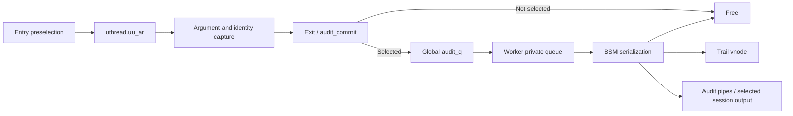

# Audit records and sessions

[Back to security](README.md)

For detailed ownership, backpressure, trail/pipe failure, rotation, and user-submitted record paths, read [Audit selection, queue ownership, and output](audit-pipeline.md). For shared identity, process masks, Mach-port membership, spawn and session lifetime, continue with [Audit-session capabilities](audit-session-capabilities.md).

## Selection begins before the operation

With `CONFIG_AUDIT`, syscall entry can call [`audit_syscall_enter()`](../../../platydoc-data/xnu/bsd/security/audit/audit.c#L608). It maps the syscall number through generated `sys_au_event[]` data from `syscalls.master`, skips invalid numbers and `AUE_NULL`, references the process credential, and selects an audit mask. Attributable subjects use the credential's audit mask; non-attributable subjects use `audit_nae_mask`.

Preselection considers the event's class and both possible outcomes because the syscall has not run yet. MAC audit hooks and audit-pipe selection can also require a record. The selected record is stored at `uthread.uu_ar`; argument hooks encountered inside the implementation fill it. Identity is captured before the operation, specifically to handle calls such as exec that change the process's executable identity.

[`audit_new()`](../../../platydoc-data/xnu/bsd/security/audit/audit.c#L382) checks enabled/suspended state with designated session-event exceptions, allocates the record, invokes construction/MAC initialization, and increments the outstanding pre-queue count. [`audit_record_ctor()`](../../../platydoc-data/xnu/bsd/security/audit/audit.c#L228) records start time and copies subject UID/group, PID, audit user ID, session ID, mask, and terminal-address information from a referenced credential. The snapshot remains meaningful if the credential changes later.

[`audit_record`](../../../platydoc-data/xnu/bsd/security/audit/audit_private.h#L215) holds the event, result/error, timestamps, subject data, `ar_valid_arg` bitmap, and many optional operation-specific arguments. [`kaudit_record`](../../../platydoc-data/xnu/bsd/security/audit/audit_private.h#L334) adds commit/destination flags, optional user record data, and queue linkage. The valid-argument bitmap tells serialization which fields were actually collected; zero-filled storage is not evidence that an argument was present.

## Commit transfers ownership and can wait

[`audit_syscall_exit()`](../../../platydoc-data/xnu/bsd/security/audit/audit.c#L714) derives the user-visible return value, runs postselection, and passes the record to `audit_commit()`. Once passed, the audit subsystem owns it; `uu_ar` is cleared. Mach traps have analogous entry/exit hooks. Spawn file/port actions can use subcall records rather than collapsing every action into one undifferentiated event.

[`audit_commit()`](../../../platydoc-data/xnu/bsd/security/audit/audit.c#L450) determines success/failure selection, refines generic event types such as open/fcntl/sysctl using captured arguments, computes destination flags, and frees records that no destination selected. For retained records it records error/return/end time and rechecks enabled/suspended state. Under `audit_mtx`, it waits while the committed queue reaches its high-water mark, enqueues the record, and signals the worker. Thus audit delivery is asynchronous, but committing a record can exert backpressure on the calling thread.

[`audit_worker()`](../../../platydoc-data/xnu/bsd/security/audit/audit_worker.c#L431) transfers batches from the global queue to a private worklist under the mutex and signals low-water waiters. It processes records outside the global queue lock. The source explicitly notes that the private worklist changes the effective bound on pending records; a global queue-length setting alone does not count all worker-held records.

[`audit_worker_process_record()`](../../../platydoc-data/xnu/bsd/security/audit/audit_worker.c#L322) handles optional submitted user records, converts kernel records through `kaudit_to_bsm()`, and writes selected output to the trail vnode, pipes, or session-related output. A separate worker/trail lock spans paired user/kernel writes so file rotation does not split them across trails. Finally the worker frees the record and all owned argument storage. Queuing and disk persistence are distinct stages.

[`kaudit_to_bsm()`](../../../platydoc-data/xnu/bsd/security/audit/audit_bsm.c#L610) builds typed BSM tokens: subject identity, event-specific arguments, return information, optional code identity/MAC data, and framing. Its large event switch is the place to determine exactly which captured fields a particular event emits. This chapter read the framing/subject/result path, not every event case.

## Sessions and control interfaces

`ucred.cr_audit` associates the process with shared audit session information and a per-credential selection mask. Audit user identity and session identity are separate from effective UID. [`audit_session_setaia()`](../../../platydoc-data/xnu/bsd/security/audit/audit_session.c#L1160) holds the process audit-session lock, checks permitted changes to an existing session, obtains a session reference, and replaces credential audit state through `kauth_cred_proc_update()`. It also adjusts session process counts and drops temporary references. Session Mach ports (`audit_session_self`, `audit_session_join`) provide another link to [IPC](../ipc/README.md): possession of the typed send right permits joining, and the port can keep an empty session alive. [The capability companion](audit-session-capabilities.md) follows admission, mask adoption, separate count lifetimes and no-senders cleanup.

| Interface | In-tree responsibility |
| --- | --- |
| [`audit()`](../../../platydoc-data/xnu/bsd/security/audit/audit_syscalls.c#L147) | Copy and submit userspace BSM data; root and entitled non-root callers have different allowed event categories |
| [`auditon()`](../../../platydoc-data/xnu/bsd/security/audit/audit_syscalls.c#L367) | Command-dependent audit configuration/query, with MAC checks, input validation, and permission logic |
| [`getaudit_addr()` / `setaudit_addr()`](../../../platydoc-data/xnu/bsd/security/audit/audit_syscalls.c#L1077) | Read/change audit identity/session data; setting validates structure and invokes MAC/privilege checks |
| [`auditctl()`](../../../platydoc-data/xnu/bsd/security/audit/audit_syscalls.c#L1170) | Open/check a replacement regular-file trail vnode and transfer referenced vnode/credential state to rotation |
| [`audit_pipe.c`](../../../platydoc-data/xnu/bsd/security/audit/audit_pipe.c) | Character-device consumers, queues, selection, reads/ioctls/readiness; independent selection can require records even without trail selection |

Audit records describe selected activity; they are not the authorization decision itself. A denied operation can be recorded, an allowed operation can be unselected, and session events have special handling. Configuration, failure policies, pipe selection, and the userspace service all affect observable output. The audit daemon and its persistence/rotation policy are outside this source trace.

<!-- BEGIN PLATYDOC DOCUMENTATION LICENSE -->
Original Platydoc text and diagrams are licensed under [CC BY 4.0](https://creativecommons.org/licenses/by/4.0/). Quoted source code and third-party material retain their respective licenses.
<!-- END PLATYDOC DOCUMENTATION LICENSE -->
