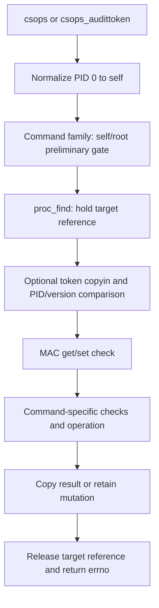
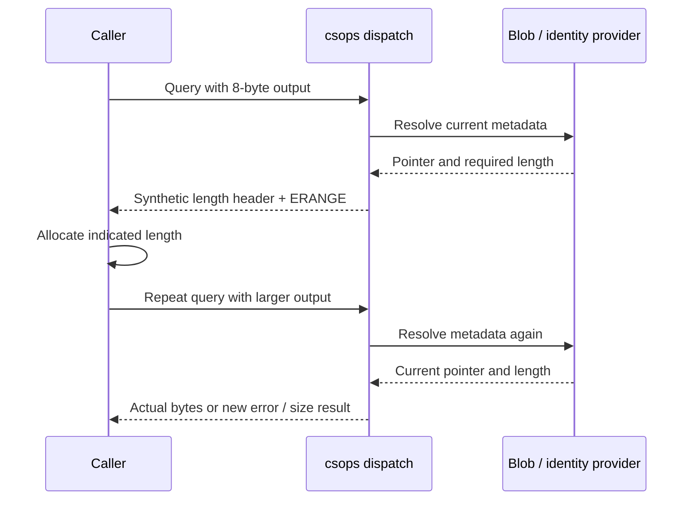
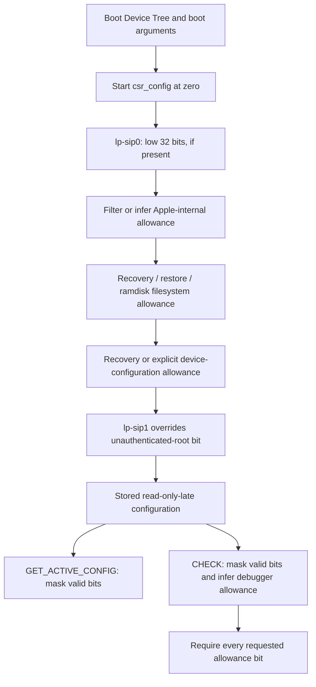

# Process code-signing controls and ARM64 CSR policy

`csops` observes or changes code-signing state attached to a process and its executable. `csrctl` exposes a separate boot-derived configuration used by selected policy checks. Neither interface installs a signature, authenticates a trust cache, or independently authorizes every executable mapping. This chapter traces the dispatch, identities, buffers, mutations and consumers implemented in `xnu-12377.121.6`, with ARM64 Device Tree CSR behavior. [Syscall entries](../../../xnu/bsd/kern/syscalls.master#L265-L266), [CSR entry](../../../xnu/bsd/kern/syscalls.master#L742-L747).

[Security guide](README.md) · [Code-signing overview](code-signing.md) · [Trust-cache control](trust-cache-control.md). Continue to [executable signature policy](executable-signature-policy.md), [page integrity](page-signature-validation.md), [task capabilities](task-and-thread-capabilities.md) and [credential/policy lifetimes](credential-and-policy-lifetimes.md) for the mechanisms these controls interact with.

## 1. State exists in the process, executable blob, task and VM map

The API does not return one universal security object. Its operations read different state:

| Object/field | Role in this chapter |
| --- | --- |
| `proc` and its PID/version | Referenced target process; PID alone is reusable, version distinguishes incarnations. |
| `proc_ro.p_csflags` | Stored 32-bit process signing flags. `proc_getcsflags()` returns them; update helpers use `zalloc_ro_update_field()` on `ZONE_ID_PROC_RO`. |
| `p_textvp`, `p_textoff` | Executable vnode and selected Mach-O slice offset. They locate the relevant UBC signature blob. |
| `cs_blob` | CodeDirectory hash/type, signature storage, identity/team identifier, interpreted entitlements and platform/validation-category state. |
| `task` | Process-associated execution object; platform status can be changed by the development-only platform-clear command. |
| `vm_map.cs_enforcement`, pmap enforcement field | Address-space enforcement state explicitly synchronized when `SET_STATUS` newly enables `CS_ENFORCEMENT`. |

Sources: [process protected fields](../../../xnu/bsd/sys/proc_ro.h#L69-L83), [flag access/update](../../../xnu/bsd/kern/kern_proc.c#L2205-L2243), [blob selection](../../../xnu/bsd/kern/kern_cs.c#L578-L594), [VM enforcement](../../../xnu/osfmk/vm/vm_map.c#L19913-L19925), [platform helper](../../../xnu/bsd/kern/kern_cs.c#L944-L967).

`csproc_get_blob()` requires a process, a text vnode and `CS_SIGNED`, then calls `ubc_cs_blob_get(p_textvp, -1, -1, p_textoff)`. This selects an already-attached signature. The API does not synthesize one when the executable is unsigned. `CS_VALID`, `CS_SIGNED` and `CS_DEBUGGED` have different roles: a process can retain signature metadata after invalidation, while selected queries permit a debugged process that no longer has `CS_VALID`. [Blob helper](../../../xnu/bsd/kern/kern_cs.c#L578-L594), [flag definitions](../../../xnu/osfmk/kern/cs_blobs.h#L32-L76), [query gate](../../../xnu/bsd/kern/kern_proc.c#L3904-L3921).

## 2. Syscall admission: identify the process before operating on it

Syscall 169 is `csops(pid, ops, useraddr, usersize)`; syscall 170 adds a user pointer to `audit_token_t`. Both reach `csops_internal()`. The audit-token variant rejects a null token pointer at its wrapper. PID zero is normalized to the caller's PID, and a matching PID sets `forself` and the local `mark_invalid_allowed` flag. [Declarations](../../../xnu/bsd/sys/codesign.h#L40-L73), [wrappers and normalization](../../../xnu/bsd/kern/kern_proc.c#L3651-L3666), [common entry](../../../xnu/bsd/kern/kern_proc.c#L3696-L3718).

Admission has three layers:

1. **Coarse operation gate.** Status, hash, offset, blob, entitlement, identity, team ID, validation-category queries and `CLEAR_LV` do not require root at this step. Other commands require either self or superuser credentials. This is not the final authorization rule.
2. **Target and optional incarnation check.** `proc_find(pid)` acquires a process reference or returns `ESRCH`. If a token was supplied, `copyin` reads it and compares `val[5]` with PID and `val[7]` with `proc_pidversion()`. Mismatch returns `ESRCH`.
3. **MAC operation check and command-specific gate.** With `CONFIG_MACF`, mutators call `mac_proc_check_set_cs_info`, while the other commands call `mac_proc_check_get_cs_info`. The helpers pass caller credentials, target and operation to registered policies. Additional self/entitlement/build/state checks remain inside the command implementation.

Sources: [coarse gate and reference](../../../xnu/bsd/kern/kern_proc.c#L3720-L3746), [token and MAC dispatch](../../../xnu/bsd/kern/kern_proc.c#L3747-L3778), [MAC helpers](../../../xnu/security/mac_process.c#L729-L769).

[`bsd/kern/kern_proc.c`, lines 3740–3757](../../../xnu/bsd/kern/kern_proc.c#L3740-L3757).

<!-- source-excerpt: ../../../xnu/bsd/kern/kern_proc.c#L3740-L3757 -->
```c
	pt = proc_find(pid);
	if (pt == PROC_NULL) {
		return ESRCH;
	}

	upid = proc_getpid(pt);
	uidversion = proc_pidversion(pt);
	if (uaudittoken != USER_ADDR_NULL) {
		error = copyin(uaudittoken, &token, sizeof(audit_token_t));
		if (error != 0) {
			goto out;
		}
		/* verify the audit token pid/idversion matches with proc */
		if ((token.val[5] != upid) || (token.val[7] != uidversion)) {
			error = ESRCH;
			goto out;
		}
	}
```

Only two token fields are compared here. The token supplies target identity evidence, not a transferable authorization credential; its UID/other fields are not used to replace the caller's credentials. A stale token protects against using a recycled PID, but it does not freeze the target's signing state across later calls or turn a size probe plus data fetch into one transaction.



Each failed gate exits at that stage; the diagram shows the successful admission route. Most commands release the target through `out:`. Offset/hash commands explicitly release after obtaining their kernel-local result and before final copyout. Process flags are protected by `proc_lock()` around the relevant reads/updates; copyout happens after dropping that lock. The process reference and individual lock regions are not a whole-call snapshot lock. [Offset/hash release paths](../../../xnu/bsd/kern/kern_proc.c#L3858-L3902), [common cleanup](../../../xnu/bsd/kern/kern_proc.c#L4191-L4198).

## 3. The complete command surface in this checkout

The table lists every defined `CS_OPS_*` command. Slot 4 is the retired `PIDPATH` comment, not an implemented case. An unknown operation reaches the default `EINVAL` only after applicable earlier gates; a caller can therefore receive `EPERM`, `ESRCH`, a copy fault or a MAC error first. [Command definitions](../../../xnu/bsd/sys/codesign.h#L40-L61), [default case](../../../xnu/bsd/kern/kern_proc.c#L4191-L4198).

### Queries and buffer representations

| ID / command | Result and input-size rule | Additional behavior |
| --- | --- | --- |
| 0 `STATUS` | Copies a native `uint32_t` if `useraddr` is non-null. This branch does not check `usersize`. | Synthesizes effective enforcement and blob platform flags; hides `CS_REQUIRE_LV` when `CS_FORCED_LV` is present. Null output still permits successful admission/status computation. |
| 5 `CDHASH` | Exactly `sizeof(hash)`, currently `CS_CDHASH_LEN` bytes, required; otherwise `EINVAL`. | Requires text vnode; `vn_getcdhash()` supplies the selected vnode/slice hash. |
| 6 `PIDOFFSET` | Native `off_t` from `p_textoff`; no size check in this branch. | Releases target before copying this local value to user memory. |
| 7 `ENTITLEMENTS_BLOB` | XML generic-blob bytes through the variable-length token protocol. | Requires `CS_VALID` or `CS_DEBUGGED` and a signature blob; XML is obtained from AMFI's entitlement object, then the returned allocation is freed. Missing entitlement object/provider result can return success without writing output. |
| 10 `BLOB` | Raw retained signature-storage bytes, using `csb_mem_size`, through the token protocol. | Requires valid or debugged state. No text vnode is `EINVAL`; no matching blob produces the protocol's zero header. |
| 11 `IDENTITY` | Synthetic 8-byte header plus NUL-terminated signing identity. | Requires valid or debugged state; no identity is `ENOENT`. Header is published before short-buffer `ERANGE`. |
| 14 `TEAMID` | Same synthetic header protocol for team identifier. | Same validity gate; no team identifier is `ENOENT`. |
| 16 `DER_ENTITLEMENTS_BLOB` | DER generic-blob bytes through token protocol. | Verifies stored DER against its special-slot hash, then may fall back to AMFI-transmuted entitlements. No fallback does not necessarily write a zero header. |
| 17 `VALIDATION_CATEGORY` | Native `unsigned int`; no size check in dispatch branch. | Helper requires valid or debugged state and a blob, returning `EINVAL`/`EBADEXEC` otherwise. |
| 18 `CDHASH_WITH_INFO` | Exactly `sizeof(csops_cdhash_t)` required. | Returns the hash bytes plus a one-byte hash-type discriminator. |

Sources: [status](../../../xnu/bsd/kern/kern_proc.c#L3781-L3805), [offset/hash](../../../xnu/bsd/kern/kern_proc.c#L3858-L3902), [entitlements/category](../../../xnu/bsd/kern/kern_proc.c#L3904-L3988), [blob/identity/team](../../../xnu/bsd/kern/kern_proc.c#L4074-L4141), [category helper](../../../xnu/bsd/kern/kern_cs.c#L1035-L1063), [raw blob helper](../../../xnu/bsd/kern/kern_cs.c#L1914-L1943).

The hash-with-info result has a concrete, small representation:

[`osfmk/kern/cs_blobs.h`, lines 324–327](../../../xnu/osfmk/kern/cs_blobs.h#L324-L327).

<!-- source-excerpt: ../../../xnu/osfmk/kern/cs_blobs.h#L324-L327 -->
```c
typedef struct _csops_cdhash {
	uint8_t hash[CS_CDHASH_LEN];
	uint8_t type;
} csops_cdhash_t;
```

The status word is not a literal copy of `p_csflags`: `cs_process_enforcement()` can report global enforcement even when the stored per-process flag is clear, and the platform bits can come from the selected `cs_blob`. The `CS_FORCED_LV` adjustment deliberately reports forced validation separately from explicitly requested validation. Consequently copying a status result into `SET_STATUS` cannot reproduce all observed state. [Status construction](../../../xnu/bsd/kern/kern_proc.c#L3781-L3803), [effective enforcement helper](../../../xnu/bsd/kern/kern_cs.c#L340-L366).

### Mutations and their extra gates

| ID / command | State transition | Gate or result that matters |
| --- | --- | --- |
| 1 `MARKINVALID` | If currently valid, clear `CS_VALID`, notify MAC, and if `CS_KILL` is set also set `CS_KILLED` and send `SIGKILL` after unlocking. | **Self only**, even if a non-self caller passed the initial root gate. Already-invalid state is a no-op. |
| 2 `MARKHARD` | Set `CS_HARD`. | If `CS_VALID` is clear, return `EINVAL` **after retaining the new bit**. |
| 3 `MARKKILL` | Set `CS_KILL`. | If already invalid, send `SIGKILL` after unlocking. This branch does not itself set `CS_KILLED`. |
| 8 `MARKRESTRICT` | Set `CS_RESTRICT`. | No validity check in this command body; initial and MAC gates still apply. |
| 9 `SET_STATUS` | OR an allowed subset into process flags; newly enabled enforcement also updates map/pmap. | At least 4 input bytes; copyin must succeed; target must have `CS_VALID`. Unsupported requested bits are masked away. |
| 12 `CLEARINSTALLER` | Clear `CS_INSTALLER`, `CS_DATAVAULT_CONTROLLER` and `CS_EXEC_INHERIT_SIP`. | Non-self caller must pass the initial root gate **and** possess `CS_INSTALLER` itself. Self can clear these flags without that extra privilege. |
| 13 `CLEARPLATFORM` | Clear process platform flags; if a selected blob exists, helper also clears its platform fields and task platform state. | Development/debug only, global process enforcement must be off, and with CSR the Apple-internal allowance must pass. Otherwise `ENOTSUP`. |
| 15 `CLEAR_LV` | Clear `CS_REQUIRE_LV` and `CS_FORCED_LV`. | macOS only; self plus clear-library-validation entitlement; reject installer state and non-null subsystem root. Other platforms return `ENOTSUP`. |

Sources: [invalid/hard/kill](../../../xnu/bsd/kern/kern_proc.c#L3806-L3856), [restrict/set](../../../xnu/bsd/kern/kern_proc.c#L3990-L4030), [clear LV](../../../xnu/bsd/kern/kern_proc.c#L4031-L4073), [installer/platform](../../../xnu/bsd/kern/kern_proc.c#L4143-L4189), [entitlement string](../../../xnu/bsd/sys/codesign.h#L35-L38).

## 4. Variable-length queries: an error can publish useful bytes

`csops_copy_token()` is shared by raw blob and entitlement outputs. It uses an 8-byte generic-blob-shaped header: the first word is zero for a synthetic response; the second word stores the required total byte length in network byte order. It does not return a native `size_t` and it does not allocate the caller's output buffer. [Helper](../../../xnu/bsd/kern/kern_proc.c#L3668-L3694).

[`bsd/kern/kern_proc.c`, lines 3674–3693](../../../xnu/bsd/kern/kern_proc.c#L3674-L3693).

<!-- source-excerpt: ../../../xnu/bsd/kern/kern_proc.c#L3674-L3693 -->
```c
	if (usize < sizeof(fakeheader)) {
		return ERANGE;
	}

	/* if no blob, fill in zero header */
	if (NULL == start) {
		start = fakeheader;
		length = sizeof(fakeheader);
	} else if (usize < length) {
		/* ... if input too short, copy out length of entitlement */
		uint32_t length32 = htonl((uint32_t)length);
		memcpy(&fakeheader[4], &length32, sizeof(length32));

		error = copyout(fakeheader, uaddr, sizeof(fakeheader));
		if (error == 0) {
			return ERANGE; /* input buffer to short, ERANGE signals that */
		}
		return error;
	}
	return copyout(start, uaddr, length);
```

The three cases are:

- Fewer than 8 supplied bytes: return `ERANGE` before writing.
- At least 8, but less than the real blob length: write a synthetic header carrying that length, then return `ERANGE` if copyout succeeded. A copy fault takes precedence over that size result.
- Enough space: copy exactly the selected length. If called with a null blob, copy an all-zero 8-byte header instead.

A worked example uses an illustrative 100-byte blob. A query with an 8-byte output gets bytes `00 00 00 00 00 00 00 64` and `ERANGE`; a 100-byte retry gets the actual blob and success, assuming the object/policy did not change. A 7-byte query gets `ERANGE` without a header. An invalid output mapping can yield a copy error, and copyout itself is not an atomic transaction that promises an untouched destination. The helper's header is a size-probe result, not a valid signature magic value.

Identity/team queries implement a related protocol directly: compute `strlen(identity)+1`, add 8, write the synthetic header, then decide whether to return `ERANGE` or copy the NUL-terminated string. If the string copy faults, the header may already be visible. Raw `BLOB` queries report the retained storage length, which can exceed the serialized blob's own internal length; clients must distinguish the size needed by this API from a nested blob header. [Identity implementation](../../../xnu/bsd/kern/kern_proc.c#L4094-L4141), [raw storage return](../../../xnu/bsd/kern/kern_cs.c#L1923-L1943), [test documenting the distinction](../../../xnu/tests/codesigntests.c#L59-L75).



This is two independent admitted operations. The API does not pin a result across them. The token-based PID/version check can prevent targeting a reused PID in either call, but cannot make them one snapshot.

## 5. XML and DER entitlement ownership differs

For XML, dispatch takes the process lock, checks valid/debugged state, obtains a blob, unlocks and fetches its OS entitlement object. If no blob exists it returns `EBADEXEC`; if no entitlement object exists or the AMFI XML conversion returns false, it goes to cleanup with the current zero error and does not call `csops_copy_token()`. Therefore the helper's null-blob zero-header behavior is **not** a guarantee for every “no entitlements” result. On XML success, AMFI supplies an allocated `CS_GenericBlob`, its length is decoded with `ntohl()`, dispatch copies it, and `kfree_data()` frees it even if copyout failed. [XML path](../../../xnu/bsd/kern/kern_proc.c#L3904-L3938).

DER first calls `csblob_get_der_entitlements()`. That helper initializes outputs to null/zero, checks hash-function availability, finds the DER special slot, distinguishes absent content from a nonzero expected hash, hashes present bytes, and compares the selected digest. The metadata result is not simply an unvalidated pointer returned from `csb_der_entitlements_blob`. [DER helper](../../../xnu/bsd/kern/ubc_subr.c#L879-L927).

If that helper returns an error or a null pointer, dispatch can ask AMFI for a transmuted blob through the OS entitlement object. A successful fallback reaches `csops_copy_token()` and overwrites `error` with the copy result. If fallback is unavailable/false, the existing helper error is preserved; a successful absence result can instead return zero without output. DER pointers in this branch are borrowed; unlike XML conversion, dispatch has no matching `kfree_data()` for them. [DER fallback](../../../xnu/bsd/kern/kern_proc.c#L3939-L3977).

These bodies expose ownership and error semantics, but the AMFI entitlement-object implementation and the reason it transmuted a specific entitlement representation are external. See [signature layout](signature-format-and-blob-validation.md) for generic-blob and special-slot formats and [vnode lifetime](vnode-signature-lifecycle.md) for protected blob publication.

## 6. Mutations are not uniformly transactional

`MARKHARD` is a compact example of why an error does not mean “nothing changed”:

[`bsd/kern/kern_proc.c`, lines 3834–3845](../../../xnu/bsd/kern/kern_proc.c#L3834-L3845).

<!-- source-excerpt: ../../../xnu/bsd/kern/kern_proc.c#L3834-L3845 -->
```c
	case CS_OPS_MARKHARD:
		proc_lock(pt);
		proc_csflags_set(pt, CS_HARD);
		if ((proc_getcsflags(pt) & CS_VALID) == 0) {
			/* @@@ allow? reject? kill? @@@ */
			proc_unlock(pt);
			error = EINVAL;
			goto out;
		} else {
			proc_unlock(pt);
		}
		break;
```

`MARKINVALID` has a different transition: only a valid self target is changed; clearing validity and invoking `cs_process_invalidated()` happen under the process lock, while `SIGKILL` is sent after releasing it. The notification helper dispatches `mac_proc_notify_cs_invalidated()` under `CONFIG_MACF`. The operation does not delete the vnode's `cs_blob` or erase its bytes. [Invalidation branch](../../../xnu/bsd/kern/kern_proc.c#L3806-L3832), [notification](../../../xnu/bsd/kern/kern_cs.c#L329-L338).

`SET_STATUS` copies a 32-bit input, then keeps only `CS_HARD`, `CS_EXEC_SET_HARD`, `CS_KILL`, `CS_EXEC_SET_KILL`, `CS_RESTRICT`, `CS_REQUIRE_LV`, `CS_ENFORCEMENT` and `CS_EXEC_SET_ENFORCEMENT`. It requires `CS_VALID` under the process lock and ORs these bits into existing state. It cannot set `CS_VALID`, confer platform status or clear arbitrary existing bits. [Mask and publication](../../../xnu/bsd/kern/kern_proc.c#L3996-L4029).

If enforcement is newly requested, `vm_map_cs_enforcement_set()` takes the map interlock, sets `map->cs_enforcement`, and calls `pmap_set_vm_map_cs_enforced()`. The SPTM pmap implementation validates mutable pmap state and writes `pmap_vm_map_cs_enforced`; the ordinary/PPL implementation selects its protected wrapper as configured. This is an explicit address-space update, not only a process flag change, and it does not walk all existing mappings to rehash them inside this setter. [Map operation](../../../xnu/osfmk/vm/vm_map.c#L19913-L19925), [SPTM pmap setter](../../../xnu/osfmk/arm64/sptm/pmap/pmap.c#L12095-L12110), [PPL/common setter](../../../xnu/osfmk/arm/pmap/pmap.c#L12762-L12781).

The `CS_EXEC_SET_*` bits defer selected effects to exec: the loader copies them into `ip_csflags` as `CS_HARD`, `CS_KILL` or `CS_ENFORCEMENT` on the new image. They differ from changing the current map immediately. [Exec inheritance](../../../xnu/bsd/kern/kern_exec.c#L2162-L2196).

`CLEAR_LV` removes only the two per-process library-validation bits after its gates. The local `cs_require_lv()` still reports true when global `cs_library_val_enable` is set, and MAC/monitor mapping checks have separate decisions. Clearing this state is not a promise that every future library will be accepted. `CLEARPLATFORM` reaches further: its helper updates the selected shared vnode blob's platform fields through the read-only zone API and updates task platform state. The helper returns immediately when no selected blob exists: process bits have already been cleared, but it does not update task platform state in that branch. When a blob exists, the side effect is broader than a private status word and is confined to the explicitly admitted development path. [LV helper](../../../xnu/bsd/kern/kern_cs.c#L398-L416), [platform helper](../../../xnu/bsd/kern/kern_cs.c#L944-L967).

## 7. CSR on ARM64: initialize a boot policy, then consult it

CSR uses a different state object: a `SECURITY_READ_ONLY_LATE(csr_config_t)` global. `csr_config_t` and `csr_op_t` are 32-bit values. ARM64 macOS configuration includes both `CONFIG_CSR` and `CONFIG_CSR_FROM_DT`; other builds must be read according to their selected configuration. This chapter follows the Device Tree implementation and common syscall wrappers, not the legacy architecture branch. [Types/flags](../../../xnu/bsd/sys/csr.h#L38-L69), [ARM64 macOS configuration](../../../xnu/config/MASTER.arm64.MacOSX#L95-L102), [state](../../../xnu/bsd/kern/kern_csr.c#L36-L50).

`csr_bootstrap()` is registered at `STARTUP(TUNABLES, STARTUP_RANK_FIRST, ...)`. Its comment explains why it runs before normal VM/pmap initialization and before consumers such as panic initialization: it may use stack, Device Tree and boot-argument parsing, but must not depend on dynamic allocation. The stored policy is then made read-only-late with the other protected globals. [Initialization contract and registration](../../../xnu/bsd/kern/kern_csr.c#L160-L230). See [ARM64 bootstrap and lockdown](../platform/bootstrap-memory-and-lockdown.md) for the surrounding memory transitions.

On the normal path with `/chosen/asmb` available, derivation is ordered:

1. Start with zero allowance bits. Read the 64-bit `lp-sip0` property and retain its low 32 bits; remember whether a custom configuration was supplied.
2. Determine internal hardware/software status from `/chosen/internal-use-only-unit` or `/chosen/manifest-properties/iuos`. Remove `CSR_ALLOW_APPLE_INTERNAL` on other systems. For an internal system without custom `lp-sip0`, infer that bit; with custom configuration, preserve its chosen value.
3. Add `CSR_ALLOW_UNRESTRICTED_FS` in recovery (`osenvironment == "recoveryos"`), restore (`-restore` boot argument) or `darwinos-ramdisk` environments.
4. Add `CSR_ALLOW_DEVICE_CONFIGURATION` when the helper returns true: **recovery environment or explicit `/chosen/csr-allow-device-configuration` property**.
5. Set or clear `CSR_ALLOW_UNAUTHENTICATED_ROOT` from the boolean `lp-sip1` property of the saved `/chosen/asmb` entry. This overrides the corresponding bit that might have come from `lp-sip0`.

Sources: [environment helpers](../../../xnu/bsd/kern/kern_csr.c#L106-L158), [derivation](../../../xnu/bsd/kern/kern_csr.c#L180-L229).

There are two details worth reading literally. The device-configuration helper comment says “restore”, but its body tests **recovery**, not the `-restore` helper. Also, `entry` is uninitialized at declaration and later reused unconditionally for `lp-sip1`; the earlier `/chosen/asmb` lookup does not guard that final call. `SecureDTLookupEntry()` writes its output only on success. Thus this body assumes the boot entry is available there; it does not demonstrate a safe missing-`/chosen/asmb` fallback merely because configuration starts at zero. [Helper discrepancy](../../../xnu/bsd/kern/kern_csr.c#L144-L158), [entry reuse](../../../xnu/bsd/kern/kern_csr.c#L182-L229), [Device Tree lookup](../../../xnu/pexpert/gen/device_tree.c#L452-L491).

Boolean Device Tree properties must be exactly 4 bytes; the policy integer must be exactly 8. A present property of the wrong size panics. String comparisons require the exact NUL-inclusive property length. These are early trusted-boot-input contracts, not user-space parser error returns. [Property readers](../../../xnu/bsd/kern/kern_csr.c#L52-L104).



The diagram assumes valid property sizes and the `/chosen/asmb` entry; it does not assert successful handling of malformed or missing bootstrap inputs.

## 8. Allowance bits, reported configuration and effective checks

A set `CSR_ALLOW_*` bit relaxes a particular restriction. Zero is restrictive. The current valid mask contains these 13 bits; their names are an ABI vocabulary, not proof that all associated policy implementations live in this repository. [Definitions and valid mask](../../../xnu/bsd/sys/csr.h#L41-L69).

| Bit | Allowance name | Local interpretation or boundary |
| --- | --- | --- |
| 0 | `UNTRUSTED_KEXTS` | Also makes `csr_check()` infer kernel-debugger allowance. Full kext approval policy is broader than this bit. |
| 1 | `UNRESTRICTED_FS` | Used by shared-cache/KC protected-file checks and selected filesystem-facing controls. |
| 2 | `TASK_FOR_PID` | Defined policy input; task acquisition still has its own credential, MAC and task-port conversion path. |
| 3 | `KERNEL_DEBUGGER` | Can be effective in checks without being present in the reported stored mask. |
| 4 | `APPLE_INTERNAL` | Filtered/inferred from boot inputs; consumed by development process controls and NVRAM/DTrace helpers. |
| 5 | `UNRESTRICTED_DTRACE` | `DESTRUCTIVE_DTRACE` is a deprecated alias for the same bit; also consulted for restricted-process environment readout. |
| 6 | `UNRESTRICTED_NVRAM` | Defined allowance; actual NVRAM permission logic combines variable policy, task entitlements and other state. |
| 7 | `DEVICE_CONFIGURATION` | Added by the recovery/explicit-property helper in the DT bootstrap path. |
| 8 | `ANY_RECOVERY_OS` | Consulted by local recovery-image setup and chunklist failure handling. |
| 9 | `UNAPPROVED_KEXTS` | Defined policy input; no complete approval-provider implementation is inferred here. |
| 10 | `EXECUTABLE_POLICY_OVERRIDE` | Defined policy input; does not itself implement an exec or signature bypass in `csr_check()`. |
| 11 | `UNAUTHENTICATED_ROOT` | Synthesized from `lp-sip1`; root-volume authentication policy is not fully present here. |
| 12 | `RESEARCH_GUESTS` | Defined policy input; guest policy/provider implementation is outside this chapter. |

`CSR_DISABLE_FLAGS` contains only bits 0–6; it is not an alias for all valid allowances. `CSR_ALWAYS_ENFORCED_FLAGS` and booter capability definitions are also in the header, but the DT `csr_check()` body does not use them as an additional shortcut. Do not import behavior from another backend based on a shared macro name. [Additional masks](../../../xnu/bsd/sys/csr.h#L71-L87).

`csr_get_active_config()` masks `csr_config` with `CSR_VALID_FLAGS`. `csr_check(mask)` then operates on that local copy, inferring the debugger allowance when either untrusted-kext or Apple-internal allowance is set:

[`bsd/kern/kern_csr.c`, lines 250–259](../../../xnu/bsd/kern/kern_csr.c#L250-L259).

<!-- source-excerpt: ../../../xnu/bsd/kern/kern_csr.c#L250-L259 -->
```c
	// CSR_ALLOW_KERNEL_DEBUGGER needs to be allowed when SIP is disabled
	// to allow 3rd-party developers to debug their kexts.  Use
	// CSR_ALLOW_UNTRUSTED_KEXTS as a proxy for "SIP is disabled" on the
	// grounds that you can do the same damage with a kernel debugger as
	// you can with an untrusted kext.
	if ((config & (CSR_ALLOW_UNTRUSTED_KEXTS | CSR_ALLOW_APPLE_INTERNAL)) != 0) {
		config |= CSR_ALLOW_KERNEL_DEBUGGER;
	}

	return ((config & mask) == mask) ? 0 : EPERM;
```

The final comparison requires **all** requested bits. Requesting zero succeeds. Requesting an unknown bit fails because that bit was removed from the effective configuration. A request combining FS and DTrace allowances fails if only FS is allowed; this is not an “any bit” query. As another illustrative case, stored `UNTRUSTED_KEXTS` alone causes `GET_ACTIVE_CONFIG` to report bit 0, while `CHECK(KERNEL_DEBUGGER)` succeeds through inference without modifying stored state. [Mask/read implementation](../../../xnu/bsd/kern/kern_csr.c#L232-L260).

## 9. `csrctl` is a read/check surface, not a setter

The syscall has two operations: `CSR_SYSCALL_CHECK` and `CSR_SYSCALL_GET_ACTIVE_CONFIG`. Both require a non-null user address and exactly `sizeof(csr_config_t)` bytes. CHECK copies in the requested mask and returns `csr_check()`'s result; GET obtains the stored valid mask and copies it out. Unknown operation returns `ENOSYS`. These wrappers contain no root gate, MAC hook or mutable-config operation. [Operation enum](../../../xnu/bsd/sys/csr.h#L91-L105), [syscall bodies](../../../xnu/bsd/kern/kern_csr.c#L349-L400).

The libsyscall `csr_check()` and `csr_get_active_config()` functions are thin wrappers over `__csrctl`, supplying the exact size. They expose the syscall convention to applications; the kernel's internal helpers return integer error codes directly. Neither wrapper edits Device Tree properties or persists a policy change for the next boot. [User-space wrappers](../../../xnu/libsyscall/wrappers/csr.c#L27-L40).

## 10. Follow a bit into a real consumer

The useful question is what a caller does after `csr_check()` returns, because the check itself only compares bits.

| Consumer | Decision taken in the local body | Independent restrictions remain |
| --- | --- | --- |
| Shared-cache file mapping | Without `UNRESTRICTED_FS`, fetch vnode flags and require `SF_RESTRICTED`. | MAC mmap, signature and other mapping checks are separate; trust-cache membership only affected the preceding owner check. |
| `vm.enforce_shared_cache_dir` handler | With CSR enabled, fail `EPERM` when `UNRESTRICTED_FS` is absent before calling the integer handler. | Sysctl dispatch and shared-region admission have their own checks. |
| `OSKext::mapKCFileSet` caller | Without `UNRESTRICTED_FS`, reject a KC vnode lacking `SF_RESTRICTED` before mapping the fileset. | KC format, signature and mapping policy do not disappear merely because this filesystem condition is relaxed. |
| Process argument/environment readout | `UNRESTRICTED_DTRACE` is one condition allowing environment variables from a restricted target to be included. | Self, development build, target restriction and entitlement checks form the other branches. |
| DTrace helpers | `UNRESTRICTED_DTRACE` controls `dtrace_is_restricted`; Apple-internal allowance can relax another helper. | FBT restriction still checks `ml_unsafe_kernel_text()` separately. |
| `CLEARPLATFORM` | Apple-internal allowance is required when CSR is enabled. | Development/debug build, global enforcement, coarse syscall and MAC gates still apply. |
| `IODTNVRAM::init` | On CSR-enabled macOS, derive `gInternalBuild` from Apple-internal allowance. | Per-variable internal-only checks and system entitlements also participate in subsequent NVRAM authorization. |
| Recovery setup / chunklist failure | `ANY_RECOVERY_OS` sets skip-signature/rooted-image choices; chunklist failure handling can clear the error and report not enforced. | This is the displayed recovery-image path, not a universal runtime signed-volume policy implementation. |

Sources: [shared-cache protection](../../../xnu/bsd/vm/vm_unix.c#L1677-L1705), [shared-cache sysctl](../../../xnu/bsd/vm/vm_unix.c#L792-L805), [KC vnode requirement](../../../xnu/libkern/c++/OSKext.cpp#L13559-L13584), [process environment](../../../xnu/bsd/kern/kern_sysctl.c#L1480-L1499), [DTrace helpers](../../../xnu/bsd/dev/dtrace/dtrace_subr.c#L414-L449), [platform command](../../../xnu/bsd/kern/kern_proc.c#L4168-L4189), [NVRAM initialization](../../../xnu/iokit/Kernel/IONVRAM.cpp#L1413-L1427), [NVRAM permission branches](../../../xnu/iokit/Kernel/IONVRAM.cpp#L650-L678), [recovery setup](../../../xnu/bsd/kern/bsd_init.c#L1367-L1370), [chunklist error handling](../../../xnu/bsd/kern/chunklist.c#L477-L491).

For example, an accepted static trust-cache entry can let an ARM64 macOS shared cache skip the root-owner requirement; it then reaches the CSR-controlled `SF_RESTRICTED` requirement. A `csops STATUS` platform bit is neither of those checks. This concrete chain keeps cache membership, process metadata and boot policy separate while showing where they meet. [Trust-cache caller](../../../xnu/bsd/vm/vm_unix.c#L1621-L1645), [CSR continuation](../../../xnu/bsd/vm/vm_unix.c#L1677-L1705).

## 11. Tests, inspection scope and unresolved policy

The supplied `tests/codesigntests.c` exercises variable-length probing, complete/oversized buffers, self/PID-zero routes, restricted status setting, both hash forms, invalidation-dependent behavior and the extra non-self installer privilege check. The test explicitly notes that raw signature storage can be larger than the internal serialized blob length. Its invalidation-test comment says “not HARD” while the body tests `CS_KILL`; the body is the evidence for which case is skipped. These tests were read, not run. [Buffer tests](../../../xnu/tests/codesigntests.c#L19-L87), [command tests](../../../xnu/tests/codesigntests.c#L94-L168), [installer privilege test](../../../xnu/tests/codesigntests.c#L170-L210).

The [platform-clear helper test](../../../xnu/tests/cs_helpers.c#L11-L43) treats `ENOTSUP` as a supported inability to perform that development operation. The [exec-notification test](../../../xnu/tests/test_note_exec.c#L55-L80) probes when a parent's `csops STATUS` can observe its child; it is not a proof that multiple independent queries form a snapshot. No dedicated CSR DT-derivation test was located in the supplied test sources.

Reviewed mechanisms are the full `csops_internal` command switch, shared copy protocol, selected signing/blob/VM helpers, ARM64 DT CSR derivation, common CSR syscall wrappers and the concrete consumers above. AMFI MAC policy bodies, OS entitlement construction/transmutation, firmware's derivation/authentication of local policy, and complete external kext/filesystem/root-volume policy implementations are absent or outside the inspected paths. No x86 path, kernel boot, signing-policy mutation or runtime security test was performed for this documentation.

<!-- BEGIN PLATYDOC DOCUMENTATION LICENSE -->
Original Platydoc text and diagrams are licensed under [CC BY 4.0](https://creativecommons.org/licenses/by/4.0/). Quoted source code and third-party material retain their respective licenses.
<!-- END PLATYDOC DOCUMENTATION LICENSE -->
