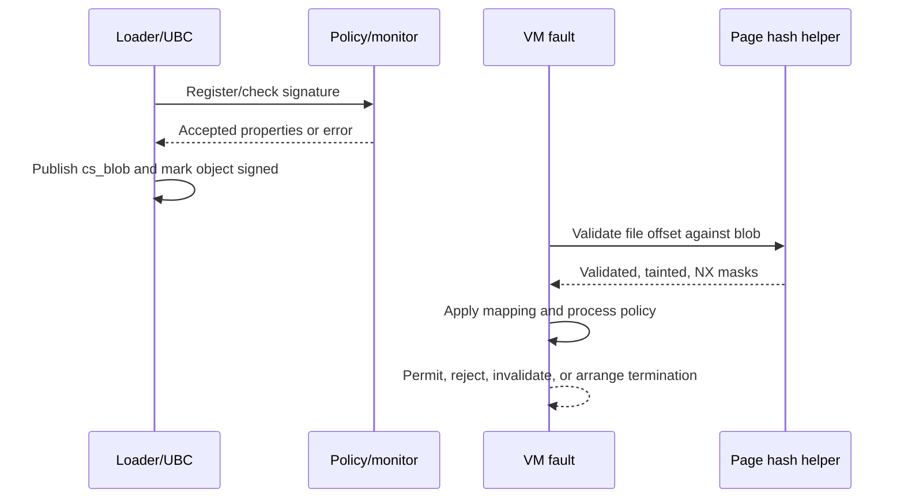

# Code signing and platform policy

[Back to security](README.md)

For the complete vnode-attachment path, read [signature format and blob validation](signature-format-and-blob-validation.md), then [vnode signature lifecycle](vnode-signature-lifecycle.md). These separate serialized layout and hash selection from input acquisition, policy/monitor checks, protected publication, revalidation, and cleanup.

Continue through [executable signing policy](executable-signature-policy.md) and [page integrity](page-signature-validation.md) to follow the attachment into exec, mappings, page faults, and pmap. The complete route is:

| Question | Detailed chapter |
| --- | --- |
| What do a SuperBlob, CodeDirectory, code hash, special slot, and CDHash contain? | [Signature format and blob validation](signature-format-and-blob-validation.md) |
| Who supplies signature bytes, where are they attached, and what survives failure or invalidation? | [Vnode signature lifecycle](vnode-signature-lifecycle.md) |
| When do the loader, MAC hooks, task-access service, and mapping monitor admit an image or mapping? | [Executable signing policy](executable-signature-policy.md) |
| When are resident bytes hashed, which results are cached, and what happens on mismatch or modification? | [Page integrity](page-signature-validation.md) |

For the data beneath those checks, read [file-data caching](../vfs/file-data-cache-and-read-path.md), [buffer-cache ownership](../vfs/buffer-cache-and-block-io.md), and [vnode identity and reuse](../vfs/vnode-cache-identity-and-reuse.md). A filesystem's `VNOP_VERIFY` completion protocol, a resident page's ordinary validity, and executable code-signing validation have distinct entry points and results.

The dedicated [TXM guide](txm.md) expands the protected-monitor path: call/return ABI, stacks and shared state, signature/profile/trust ownership, address-space association and executable-mapping decisions. The [cross-domain entry map](protected-execution.md) connects it to SPTM and Exclaves.

## Three decisions to keep separate

Executable handling must establish that signature data is structurally usable, determine the trust/policy attributed to that signature, and check that mapped bytes satisfy applicable integrity and mapping rules. These occur at different points. A validly laid-out CodeDirectory is not by itself a complete trust decision; `CS_VALID` and page-validation fields also have meanings that depend on their context.

The loader's [`load_code_signature()`](../../../platydoc-data/xnu/bsd/kern/mach_loader.c#L3765) reuses/revalidates a suitable vnode blob or reads signature bytes and calls `ubc_cs_blob_add()`. [Executable loading](../../cross-cutting/executable-loading.md) covers the Mach-O parser, segments, dyld, and the point where `LC_CODE_SIGNATURE` is processed.

## Signature state belongs to the file-backed VM connection

[`ubc_info`](../../../platydoc-data/xnu/bsd/sys/ubc_internal.h#L171) connects a vnode to its pager/control object and contains the `cs_blobs` list, validation generation, and recorded file modification time. A [`cs_blob`](../../../platydoc-data/xnu/bsd/sys/ubc_internal.h#L106) describes one signature's coverage and interpreted state:

| Fields | Meaning |
| --- | --- |
| `csb_vnode`, `csb_next`, `csb_ro_addr` | Vnode association, list linkage, and protected allocation identity |
| `csb_base_offset`, `csb_start_offset`, `csb_end_offset` | Slice offset in a fat file and covered range relative to that slice |
| `csb_mem_kaddr/size`, `csb_cd`, `csb_hashtype`, `csb_hash_pageshift` | Signature storage, CodeDirectory, and page-hash algorithm/granularity |
| `csb_cdhash` | Digest derived from the CodeDirectory, used as a code identity in other interfaces |
| `csb_flags`, `csb_signer_type`, `csb_teamid`, platform fields | Interpreted signing and policy properties |
| Entitlement blob pointers and `csb_entitlements` | Raw signed material versus the external AMFI-created entitlement object |
| Conditional `csb_csm_obj`, managed/trust fields | Code-signing-monitor association and ownership |

[`cs_blob_init_validated()`](../../../platydoc-data/xnu/bsd/kern/ubc_subr.c#L4031) takes ownership of signature storage by clearing the caller's address, including on error. It validates the container, selects a CodeDirectory/hash implementation, derives coverage and allowed Mach-O flags, and computes the CDHash. [`cs_validate_codedirectory()`](../../../platydoc-data/xnu/bsd/kern/ubc_subr.c#L359) checks supported page/hash formats and buffer bounds for code/special slots and scatter data. Raw entitlement subblob pointers are recorded at this stage; the source explicitly distinguishes finding them from validating their content.

[`ubc_cs_blob_add()`](../../../platydoc-data/xnu/bsd/kern/ubc_subr.c#L4737) constructs a temporary blob, prepares protected storage, and proceeds through reconstitution, optional monitor registration/main-binary checks, and `mac_vnode_check_signature()`. Policy can supply signing flags, signer type, and entitlement state. Optional monitor verification, further reconstitution, multilevel hashing, and auxiliary-blob checks follow. The temporary value is protected across selected blocking operations on PAC builds before publication into the read-only allocation.

Under the vnode lock it checks existing slices for compatible signer/platform/team state and overlapping coverage. An equivalent existing blob can be reused; conflicting content is rejected. It marks the memory object as having signed pages, updates the generation, publishes the completed blob in protected storage at the list head after a fence, and unlocks. Later authorized changes use protected-update interfaces. The insertion code's contract is that published list nodes are not removed individually while concurrent readers walk the list. This does not mean the storage survives the vnode/UBC object's teardown forever.

[`cs_blob_cleanup()`](../../../platydoc-data/xnu/bsd/kern/ubc_subr.c#L3955) invalidates/releases entitlement objects, disassociates profiles and unregisters monitor state where configured, and frees storage according to ownership. Monitor-managed memory can already have been freed by unregistration; selected monitor refusal paths prevent XNU from touching that storage further. A plain unconditional `kfree` would not describe this lifetime.

## A page fault checks bytes and mapping conditions

[`vm_fault_cs_check_violation()`](../../../platydoc-data/xnu/osfmk/vm/vm_fault.c#L2783) decides when VM validation is needed and evaluates code-signing mapping conditions. Configured monitor-backed executable mappings can defer integrity evaluation to the monitor; other cases call the VM validation path. It also checks conditions such as write access to protected immutable pages and execute access to pages marked NX. The [VM chapter](../vm/maps-and-faults.md) explains how this fits into fault resolution and pmap entry.

[`vm_page_validate_cs_mapped_slow()`](../../../platydoc-data/xnu/osfmk/vm/vm_fault.c#L8905) requires a busy page and exclusive object protection, obtains the vnode through the pager, translates the page offset by the object's paging offset, and calls `cs_validate_page()`. Results are accumulated into `vmp_cs_validated`, `vmp_cs_tainted`, and `vmp_cs_nx`.

[`cs_validate_hash()`](../../../platydoc-data/xnu/bsd/kern/ubc_subr.c#L5838) searches blob coverage, obtains the expected hash slot, hashes the bytes using `csb_hashtype`, and compares the digest. It handles signature-page granularity and partial final ranges, which can be marked NX. A crucial detail: its boolean `validated` means a hash was available and evaluated. A mismatch still returns true while setting `CS_VALIDATE_TAINTED`. Absence of a hash returns false. The caller must interpret the separate outputs together; treating the validated bit alone as proof of matching content would misread the code.

[`cs_validate_page()`](../../../platydoc-data/xnu/bsd/kern/ubc_subr.c#L6076) translates chunk results to VM subpage masks, accommodating 4 KiB signing chunks within larger pages. `cs_validate_range()` provides a range-based variant. Some comments/debug strings still say SHA1, but the implementation dispatches through the selected hash type rather than assuming that one algorithm.

For a violation, [`vm_fault_cs_handle_violation()`](../../../platydoc-data/xnu/osfmk/vm/vm_fault.c#L2935) can call [`cs_invalid_page()`](../../../platydoc-data/xnu/bsd/kern/kern_cs.c#L249). Under the process lock, `CS_KILL` arranges SIGKILL and rejection; `CS_HARD` rejects the mapping; other cases can clear `CS_VALID` and notify MAC policy of invalidation. VM has additional switched-map and protected-map handling. These are conditional mechanisms, so the simple rule “every bad hash immediately kills the process” is inaccurate.

## Trust caches and external policy

The [trust-cache control companion](trust-cache-control.md) expands this route through typed admission, payload ownership, runtime locking, queries, backend selection and unload. It distinguishes locally visible checks from the imported TrustCache and Image4 policy implementations.

[`load_trust_cache_with_type()`](../../../platydoc-data/xnu/bsd/kern/kern_trustcache.c#L893) validates pointer/length combinations and cache type, extracts Image4 components when necessary, checks type-specific entitlement requirements and execution-mode constraints, then chooses a backend: TXM for `CONFIG_SPTM`, PPL for its monitor configuration, or the ordinary XNU implementation. The ordinary query path [`xnu_query_trust_cache()`](../../../platydoc-data/xnu/bsd/kern/kern_trustcache.c#L731) holds the runtime read lock around `amfi->TrustCache.query`; loading takes exclusive protection. A cache lookup is a separate input to trust decisions, not a replacement for checking file pages.

The repository defines [`amfi_t` and entitlement/trust-cache interfaces](../../../platydoc-data/xnu/libkern/libkern/amfi/amfi.h), and [`amfi_interface_register()`](../../../platydoc-data/xnu/libkern/amfi/amfi.c#L9) installs a provider once. [`coretrust_t`](../../../platydoc-data/xnu/libkern/libkern/coretrust/coretrust.h) exposes certificate/CMS/provisioning-related operations and [`coretrust_interface_register()`](../../../platydoc-data/xnu/libkern/coretrust/coretrust.c#L12) similarly registers its provider. Their complete policy and cryptographic implementations are not supplied by these registration functions. `mac_vnode_check_signature()` is the policy callout, with structured fatal-error reporting; reading that wrapper cannot establish the entire AMFI decision.

## CSR/SIP is boot-derived configuration consumed by checks

The [process-control and CSR companion](code-signing-process-controls.md) traces `csops`/`csops_audittoken`, command-specific identity, authorization, output and mutation, then follows ARM64 CSR initialization and concrete consumers. These controls act on process or boot policy; they do not replace signature attachment and page validation.

[`kern_csr.c`](../../../platydoc-data/xnu/bsd/kern/kern_csr.c) has distinct Device Tree and legacy boot-argument implementations. With `CONFIG_CSR_FROM_DT`, early `csr_bootstrap()` starts from restrictive configuration, reads local policy properties, and derives selected environment-dependent flags before normal VM initialization. The legacy branch reads boot-argument state. `csr_get_active_config()` masks valid bits; `csr_check(mask)` evaluates the requested allowance bits with branch-specific rules.

CSR is therefore configuration consulted by security-sensitive operations, not a complete list of every protection in the system. Credential authorization, task-port conversion, MAC policies, code-signing enforcement, and hardware-protected memory have their own control paths. See [platform](../platform/README.md) for the lower-level PPL/SPTM and boot boundary.

<!-- BEGIN PLATYDOC DOCUMENTATION LICENSE -->
Original Platydoc text and diagrams are licensed under [CC BY 4.0](https://creativecommons.org/licenses/by/4.0/). Quoted source code and third-party material retain their respective licenses.
<!-- END PLATYDOC DOCUMENTATION LICENSE -->
