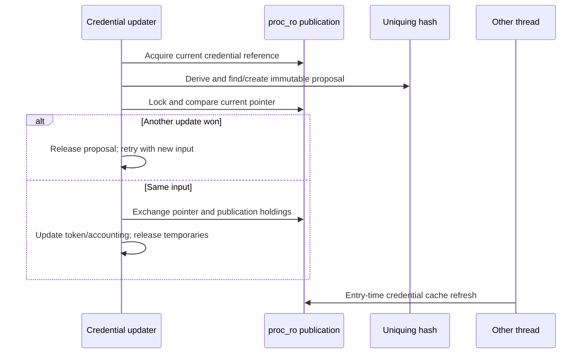

# Credential publication and authorization-policy lifetimes

[Security](README.md) · [Credential and task-right overview](credentials-and-policy.md) · [Audit pipeline](audit-pipeline.md)

Authorization operates on identity and policy objects whose lifetimes can exceed one syscall. This chapter follows three separate protocols: immutable credentials published to processes/threads, kauth scopes/listeners, and MAC policies/labels. They use different synchronization and result-combination rules. None of these registries supplies the implementation of every platform policy that participates in a decision.

## 1. A credential is a shared value with two kinds of holdings

`ucred` contains POSIX identity, a MAC-label pointer, and audit-session association. `cr_posix` includes effective/real/saved UID, group information, group-resolution UID, and flags. Group membership is not always resolved from the inline group array: `CRF_NOMEMBERD` and `cr_gmuid` affect external membership resolution. [Credential representation](../../../xnu/bsd/sys/ucred.h#L146).

The allocation lives in a read-only zone. Writable lifetime metadata lives separately:

| Field/object | Role |
| --- | --- |
| `ucred.cr_ref` | Count of long-term storage holdings, changed through protected atomic updates |
| `ucred.cr_rw` | Link to writable companion, checked against its backlink |
| `ucred_rw.crw_weak_ref` | Atomic lifetime reference count used by credential retain/release APIs |
| `crw_link` | Uniquing-hash membership |
| `crw_node` | Deferred SMR reclamation |
| `proc_ro.p_ucred` | Process publication pointer |
| `thread_ro.tro_realcred` / `tro_cred` | Cached process identity and current thread identity |

[Writable companion and hash traits](../../../xnu/bsd/kern/kern_credential.c#L3298). Despite the word “weak” in the field name, `kauth_cred_ref()` increments this count and final `kauth_cred_unref()` drives retirement. A normal API reference is not an unowned pointer that may be freed while used.

`kauth_cred_set()` manages a long-term pointer: retain the new credential and increment its protected holding count, assign the pointer, then drop the previous holding and reference. Ordinary temporary references do not increment `cr_ref`. Final freeing asserts that `cr_ref` is zero, so confusing temporary reference APIs with stored-pointer ownership can violate a separate invariant. [Temporary ref/unref](../../../xnu/bsd/kern/kern_credential.c#L4395), [long-term assignment](../../../xnu/bsd/kern/kern_credential.c#L4440).

## 2. Construction, deduplication, and retirement

`kauth_cred_derive()` starts with a private model containing the old credential's identity, label pointer, and audit association. The caller's derivation block changes this model and reports whether a new value is required. If no change is needed, derive returns a retained reference to the original credential. Returning the same pointer is therefore not an ownership-free result. [Derivation](../../../xnu/bsd/kern/kern_credential.c#L3907).

`kauth_cred_alloc()` first searches the SMR hash for an equivalent credential. If one exists, it returns that retained value and destroys a separately owned model label as needed. Otherwise it establishes ownership of a new label: if the model still shares the parent's label pointer, it allocates and associates a new credential label before publication. It references the audit session, creates the writable companion and read-only credential, initializes their backlinks, and attempts hash insertion. [Allocation and uniquing](../../../xnu/bsd/kern/kern_credential.c#L3673).

The insertion can race. If an equivalent entry wins while this thread allocates, the loser releases its new label, audit-session association, companion, and read-only allocation and returns the winner. Equality is defined by the credential hash traits, including relevant identity/audit/label state; it is not simply effective UID equality. [Hash and equality helpers](../../../xnu/bsd/kern/kern_credential.c#L4507).

On the last lifetime reference, `kauth_cred_retire()` removes the credential from the hash, releases the audit-session association, and schedules `kauth_cred_free()` through `smr_proc_task`. The callback frees the label and both allocations after the grace period. The older lifecycle comment in `ucred.h` names a credential-specific SMR domain; the executable code and hash traits use `smr_proc_task` in this checkout. [Retirement](../../../xnu/bsd/kern/kern_credential.c#L3812).

An SMR reader can therefore safely inspect the object during its protected section even if retirement has started. Keeping a pointer after that section requires an owned reference.

## 3. Taking a process credential reference races with replacement

`kauth_cred_proc_ref()` uses an optimistic path: enter SMR, load the process's published credential, and try to retain the companion. A zero-count object cannot be resurrected by that try-retain. If it loses the race, the function retries under the process credential lock:

[SMR acquisition and locked fallback](../../../xnu/bsd/kern/kern_credential.c#L3570):
<!-- source-excerpt: ../../../xnu/bsd/kern/kern_credential.c#L3570-L3583 -->
```c
	smr_proc_task_enter();
	cred = proc_ucred_smr(procp);
	if (!ucred_rw_tryref(kauth_cred_rw(cred))) {
		cred = NOCRED;
	}
	smr_proc_task_leave();

	if (__improbable(cred == NOCRED)) {
		proc_ucred_lock(procp);
		cred = proc_ucred_locked(procp);
		kauth_cred_ref(cred);
		proc_ucred_unlock(procp);
	}
	return cred;
```

The fallback reads the current publication rather than trying to reuse the failed old pointer. This protects credential lifetime; it does not by itself acquire a reference to the `proc` containing the publication slot. Callers must already satisfy the process-lifetime contract, or use helpers that first look up/reference the process.

`kauth_cred_get()` returns the current thread's existing credential association. `kauth_cred_get_with_ref()` adds a temporary reference when the caller must hold it independently. The distinction matters for operations that can sleep, store work, or return a credential to another owner. For example, [AIO requests](../processes/async-io.md) preserve their own VFS-context credential rather than repeatedly sampling whichever thread eventually executes the operation.

## 4. Process publication is a retrying compare-and-replace

`kauth_cred_proc_update()` references the current process credential, derives a proposal outside the publication lock, then locks and checks whether the process still points at the same input. If so it obtains the new publication holdings and atomically replaces `proc_ro.p_ucred` through the read-only allocator's update API:

[Credential publication](../../../xnu/bsd/kern/kern_credential.c#L3945):
<!-- source-excerpt: ../../../xnu/bsd/kern/kern_credential.c#L3945-L3957 -->
```c
		proc_ucred_lock(p);
		if (__probable(proc_ucred_locked(p) == cur_cred)) {
			kauth_cred_ref(new_cred);
			kauth_cred_hold(new_cred);

			zalloc_ro_update_field_atomic(ZONE_ID_PROC_RO, proc_get_ro(p),
			    p_ucred.__smr_ptr, ZRO_ATOMIC_XCHG_LONG, new_cred);

			kauth_cred_drop(cur_cred);
			ucred_rw_unref_live(cur_cred->cr_rw);

			proc_update_creds_onproc(p, new_cred);
			proc_ucred_unlock(p);
```

The old publication's long-term holding and lifetime reference are released while the derivation's temporary old reference is still owned. This explains the `ucred_rw_unref_live()` call: the old credential cannot reach zero at that particular release because the function still holds another reference.

If another updater won, the function references the newly published credential under the lock, unlocks, releases the rejected proposal and old input, and repeats derivation. The derivation block must tolerate another evaluation; it is not a one-shot callback guaranteed to run exactly once. Token-update modes also matter: `PROC_SETTOKEN_ALWAYS` can update Mach security state even when the proposed credential equals the old one, while `PROC_SETTOKEN_SETUGID` marks `P_SUGID` after an actual replacement. [Complete update loop](../../../xnu/bsd/kern/kern_credential.c#L3925).

`setuid()` is a concrete caller. It serializes through `setuid_lock`, records the requested UID for audit, invokes the MAC check, compares against real/saved UID and privilege, and derives effective-only or real/effective/saved changes. Group-resolution identity changes only under the relevant flags. On successful real-UID changes it adjusts user process counts, with persona handling affecting that accounting. [`setuid()`](../../../xnu/bsd/kern/kern_prot.c#L703). The derivation helper's “changed” boolean is distinct from the syscall's error variable; a rejected operation can return an unchanged credential and still report an authorization failure.



## 5. Thread identity caches preserve assumed identity

A thread stores both `tro_realcred`, its cached process credential, and `tro_cred`, its current identity. On kernel entry, `current_cached_proc_cred_update()` detects a changed process credential and runs the slow update. If the two thread pointers previously agreed, both are changed. If the thread had an independently assumed identity, only the cached real credential is replaced. The thread-ro credentials are published through a controlled update. [Cache refresh](../../../xnu/bsd/kern/kern_credential.c#L3499).

Thus process credential replacement does not require eagerly rewriting every thread's current identity under one global lock. It also does not mean a process snapshot and the current thread credential are interchangeable in authorization code. Read the wrapper to determine whether the intended subject is `kauth_cred_get()`, a process credential, or the credential already attached to a VFS context.

## 6. Kauth listener aggregation has its own lifetime contract

A kauth scope contains a primary callback and a bounded array of local listener records. Listener records cache callback and data pointers. Registration under the scope lock either attaches to an existing scope or queues a dangling listener until that scope appears; a full listener table rejects registration. [Scope/listener representation](../../../xnu/bsd/kern/kern_authorization.c#L70), [listener registration](../../../xnu/bsd/kern/kern_authorization.c#L275).

`kauth_authorize_action()` invokes the primary callback, then interested listeners. A `DENY` overrides prior allowance; `DEFER` permits a later result to decide; only explicit final `ALLOW` produces success. A scope with no decisive participant returns `EPERM`. The callback result algebra is distinct from errno aggregation in MAC. [Decision loop](../../../xnu/bsd/kern/kern_authorization.c#L372).

Authorization deliberately does not take the scope mutex. `kauth_unlisten_scope()` removes listener presence under the mutex but leaves cached callback/data pointers intact for the documented unlisten race. The source assigns provider-side quiescence responsibility: a provider must account for requests already executing or on their way to callback code before freeing code/data. Removing a listener is not a general synchronization barrier proving nobody can still invoke its former callback. [Lifetime commentary](../../../xnu/bsd/kern/kern_authorization.c#L78), [unlisten](../../../xnu/bsd/kern/kern_authorization.c#L312).

This is a statement about the implementation contract, not a claim that arbitrary kernel callback unregistration throughout XNU uses the same protocol.

## 7. MAC registration divides stable and dynamic policy entries

`mac_policy_conf` supplies a name, operations table, namespace list, optional label-slot output, and load/runtime flags. `mac_policy_register()` validates mandatory fields, rejects forbidden late loading, checks duplicate names, obtains a label slot if requested, selects a handle, publishes the entry, and invokes policy initialization callbacks. Missing required metadata is treated as a kernel integration error; duplicate names and exhausted slots have ordinary error paths. [Registration](../../../xnu/security/mac_base.c#L607).

The list maintains `staticmax`. Early policies and appropriately placed nonunloadable entries can extend the static prefix; iteration can call them without the dynamic busy count. Late dynamic list mutation uses `mac_policy_mtx` and waits for existing dynamic iterations:

[Exclusive registry acquisition](../../../xnu/security/mac_base.c#L271):
<!-- source-excerpt: ../../../xnu/security/mac_base.c#L271-L279 -->
```c
mac_policy_grab_exclusive(void)
{
	lck_mtx_lock(&mac_policy_mtx);
	while (mac_policy_busy != 0) {
		lck_mtx_sleep(&mac_policy_mtx, LCK_SLEEP_UNLOCK,
		    (event_t)&mac_policy_busy, THREAD_UNINT);
		lck_mtx_lock(&mac_policy_mtx);
	}
}
```

`MAC_POLICY_ITERATE` walks the static prefix, then conditionally increments the busy count and walks remaining entries before dropping it. The mutex is not held throughout every policy callback, but dynamic removal cannot pass its exclusive gate until busy iterations finish. [Iteration macro](../../../xnu/security/mac_internal.h#L222), [busy protocol](../../../xnu/security/mac_base.c#L291).

The backing list also differs by target. macOS can grow the allocated array; other targets use a fixed initial array and mark the list/storage read-only late in boot. The dispatch source alone does not establish that runtime policy loading exists on every product.

`mac_policy_unregister()` requires an unloadable policy, removes namespace/list membership, returns the label slot, invokes policy destruction, clears registration state, then releases exclusive access and copied module data. The busy protocol protects registry iteration/callback lifetime; policy-private objects and label contents still require the provider's own lifetime rules. [Unregistration](../../../xnu/security/mac_base.c#L779).

## 8. Check, grant, perform, and label ownership

`MAC_CHECK` starts with success and combines each implemented check's errno through `mac_error_select()`. The ordering gives selected errors precedence: deadlock, invalid argument, object visibility, access denial, and privilege errors precede generic alternatives. A successful policy cannot erase another policy's denial. `MAC_GRANT` instead starts with `EPERM` and succeeds if any participating policy grants. `MAC_PERFORM` invokes lifecycle/notification hooks without computing a permission result. [Dispatch macros](../../../xnu/security/mac_internal.h#L259), [error precedence](../../../xnu/security/mac_base.c#L856).

A wrapper therefore determines both the subject/context and the composition rule. For example, vnode-open checks supply the VFS-context credential and vnode label; process task-access checks supply requested task flavor; socket-send and IOKit wrappers have different object arguments. These wrappers are not the full policy modules. [Representative wrapper table](credentials-and-policy.md#kauth-scopes-and-mac-hooks-answer-different-questions).

Labels are read-only-zone objects with per-policy slots. Owned labels record the address of their owner pointer; `mac_label_verify()` checks allocation provenance and that backlink. Owned teardown performs extra deinitialization, clears the owner pointer with release ordering, and frees the label. Slot access encodes null with a sentinel, and setters use controlled field updates rather than direct stores. [Label allocation/ownership](../../../xnu/security/mac_label.c#L70), [verify and access](../../../xnu/security/mac_label.c#L133).

The credential publication rule forbids changing the published credential's identity/label pointer. Its label-seal check has a narrower implementation than the name alone suggests:

[Build-dependent seal assertion state](../../../xnu/security/mac_process.c#L113):
<!-- source-excerpt: ../../../xnu/security/mac_process.c#L113-L122 -->
```c
mac_cred_label_seal(struct ucred *cred)
{
#if DEVELOPMENT || DEBUG
	struct label **seal = (struct label **)-1;

	zalloc_ro_update_field(ZONE_ID_MAC_LABEL, cred->cr_label, l_owner, &seal);
#else
	(void)cred;
#endif
}
```

`mac_label_set()` checks the seal sentinel under the same debug/development condition. This diagnostic must not be described as an unconditional release-build runtime test. The read-only storage/update mechanism and the API's immutable-publication contract are separate from this assertion. Policy-private data reachable through a slot can also contain mutable caches with their own synchronization. [Slot setter](../../../xnu/security/mac_label.c#L198).

## Inspection scope

Read bodies cover credential companion/ref APIs, SMR acquisition/retirement, uniquing construction and insertion-race cleanup, process update retries, thread cache refresh, setuid, kauth registration/dispatch/removal, MAC registry/busy/iteration/error aggregation, and label ownership/seal/access. External membership service and policy implementations, all identity-changing syscalls, every MAC hook, personas, and a formal proof of callback-unload races remain outside this guide. Task-port acquisition/conversion is retained in the [existing overview](credentials-and-policy.md#task-rights-require-acquisition-and-conversion-checks).

<!-- BEGIN PLATYDOC DOCUMENTATION LICENSE -->
Original Platydoc text and diagrams are licensed under [CC BY 4.0](https://creativecommons.org/licenses/by/4.0/). Quoted source code and third-party material retain their respective licenses.
<!-- END PLATYDOC DOCUMENTATION LICENSE -->
