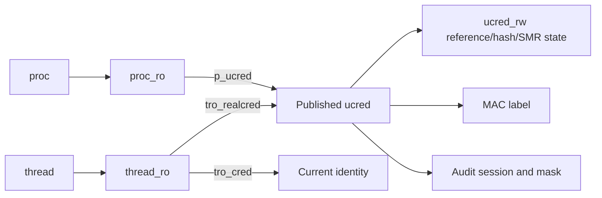

# Credentials, authorization, and task rights

[Back to security](README.md)

For the full reference/publication and policy registration protocols, continue to [Credential publication and authorization-policy lifetimes](credential-and-policy-lifetimes.md). This page retains the identity map and task-right acquisition/conversion route.

## Identity is a referenced value

[`ucred`](../../../xnu/bsd/sys/ucred.h#L146) holds `cr_posix`, a MAC `cr_label`, and audit association `cr_audit`. `posix_cred` contains effective, real, and saved user IDs; groups and real/saved group IDs; group-membership identity `cr_gmuid`; and flags such as `CRF_NOMEMBERD`. Group membership can require resolution beyond the inline group list. An effective UID alone is therefore insufficient to explain every authorization result.

The owning process publishes its credential through `proc_ro.p_ucred`, an SMR pointer in a read-only allocation. The current thread reaches identity through `thread_ro.tro_cred`; `tro_realcred` caches the process credential. Ordinarily the two agree. A thread that assumes an identity can have a different `tro_cred` while retaining the process identity in `tro_realcred`. [`kauth_cred_get()` and `current_cached_proc_cred_update()`](../../../xnu/bsd/kern/kern_credential.c#L3444) show this distinction directly. Entry code refreshes a stale process cache; it does not overwrite an independently assumed thread identity indiscriminately.

Construction is private; after publication the credential's identity and label pointer are immutable. [`kauth_cred_alloc()`](../../../xnu/bsd/kern/kern_credential.c#L3673) first searches the uniquing hash, otherwise prepares/seals the label, references the audit session, creates `ucred_rw` and the read-only `ucred`, then attempts insertion. A competing equivalent insertion can win; the loser frees its newly allocated resources and returns the existing credential. Many owners can consequently share one identity value.

The current implementation separates `ucred_rw.crw_weak_ref` from `ucred.cr_ref`, which tracks long-term holdings through protected updates. Use the credential APIs rather than guessing ownership from one field. [`kauth_cred_proc_ref()`](../../../xnu/bsd/kern/kern_credential.c#L3566) enters `smr_proc_task`, reads the process pointer, and attempts to acquire a reference; if that fails it retries under the process credential lock. [`kauth_cred_retire()`](../../../xnu/bsd/kern/kern_credential.c#L3812) removes the hash entry and schedules freeing after the SMR grace period. The implementation uses `smr_proc_task`, although the lifecycle comment in `ucred.h` still names an older credential-specific SMR domain. A pointer observed in an SMR section and a reference retained beyond that section have different lifetime contracts.

## A concrete credential update

[`setuid()`](../../../xnu/bsd/kern/kern_prot.c#L703) serializes its update, records its argument for audit, and supplies a derivation block to `kauth_cred_proc_update()`. The block checks `mac_proc_check_setuid()`, evaluates the requested UID against real/saved IDs and privilege, and prepares new POSIX fields. It can update effective UID alone or real/saved IDs as well, depending on those checks.

[`kauth_cred_proc_update()`](../../../xnu/bsd/kern/kern_credential.c#L3925) works as a retrying replacement:

1. Reference the current process credential and derive a proposed immutable replacement outside the credential publication lock.
2. Lock the process credential state and verify that the published pointer still equals the credential used for derivation.
3. If it matches, acquire the publication holdings, exchange `proc_ro.p_ucred` using the read-only allocator's update API, release old holdings, and update associated process accounting.
4. If another update won, reference the new current credential, drop the rejected proposal, and derive again.

The action argument controls security-token updates and `P_SUGID` marking. Callers must tolerate derivation being retried; directly mutating a shared published credential would corrupt other owners. Mach security/audit token propagation is another consequence of identity changes, not the storage location of the BSD credential itself. See [process lifecycle](../processes/lifecycle.md).

## Kauth scopes and MAC hooks answer different questions

[`kauth_authorize_action()`](../../../xnu/bsd/kern/kern_authorization.c#L372) calls a scope's primary callback, then registered listeners. Results are `ALLOW`, `DENY`, or `DEFER`; a denial wins over an allowance and a fully deferred decision fails because explicit allowance is required. Scopes organize operations such as process, generic, and file-operation authorization. Vnode access also has its substantial filesystem/ACL implementation; follow the [VFS chapter](../vfs/pathname-and-authorization.md).

The kauth listener implementation has a specific lifetime caveat: authorization deliberately avoids the scope mutex and the source assigns callback/data quiescence responsibility to listeners being removed. [`kern_authorization.c`'s synchronization commentary](../../../xnu/bsd/kern/kern_authorization.c#L78) and the authorization loop document this constraint. It is different from the MAC framework's dynamic-policy busy protocol and should not be described as if both use the same locking.

The MAC framework supplies a broad object-operation callback interface. A [`mac_policy_conf`](../../../xnu/security/mac_policy.h#L6432) names a policy, points to its `mac_policy_ops`, describes label namespaces, and optionally receives a label-slot index. [`mac_policy_register()`](../../../xnu/security/mac_base.c#L607) validates registration, rejects duplicate names, allocates a slot/handle, installs operations, and invokes policy initialization. Static entries below `staticmax` cannot unload. Dynamic iterations take a busy count; list mutation waits for that count to reach zero under `mac_policy_mtx`. Non-macOS builds also protect the policy list after initialization.

[`MAC_CHECK`, `MAC_GRANT`, and `MAC_PERFORM`](../../../xnu/security/mac_internal.h#L259) have distinct semantics. `MAC_CHECK` calls implemented checks and combines errors through `mac_error_select()`; one successful policy does not cancel another's denial. `MAC_GRANT` succeeds if any participating policy grants. `MAC_PERFORM` dispatches notifications or lifecycle operations without a combined permission result. A callback's name and macro therefore matter as much as its presence.

[`label`](../../../xnu/security/_label.h#L86) is a bounded array of per-policy values with ownership information. [`mac_labelzone_alloc_owned()` and `mac_label_verify()`](../../../xnu/security/mac_label.c#L109) establish/check owner association; `mac_label_get/set()` enforce the read-only allocation interface. Credential publication invokes the label-seal helper; its sentinel assertion is enabled only in debug/development builds. See [the build-dependent seal contract](credential-and-policy-lifetimes.md#8-check-grant-perform-and-label-ownership). Policy-private data referenced by a slot may have its own synchronization; immutability of the slot does not establish immutability of every reachable object.

Representative hook wrappers expose the object context actually supplied to policies:

| Wrapper | Inputs that establish the decision context |
| --- | --- |
| [`mac_vnode_check_open()`](../../../xnu/security/mac_vfs.c#L1657) | VFS-context credential, vnode, vnode label, access mode |
| [`mac_proc_check_get_task()`](../../../xnu/security/mac_process.c#L430) | Caller credential, process identity, requested task-port flavor |
| [`mac_socket_check_send()`](../../../xnu/security/mac_socket.c#L268) | Credential, socket, destination; this wrapper supplies a null socket label |
| [`mac_iokit_check_open_service()`](../../../xnu/security/mac_iokit.c#L68) | Credential, service object, user-client type |

These wrappers are dispatch mechanisms. They do not contain the full sandbox, AMFI, or platform-policy implementation. Ordinary Unix checks, MAC callbacks, entitlements, and object-specific invariants can all apply to one operation.

## Task rights require acquisition and conversion checks

[`task_for_pid()`](../../../xnu/bsd/kern/kern_proc.c#L5865) rejects PID zero, resolves its supplied task port and target process, performs POSIX checks, references the task, and drops the process reference before possible upcalls. It requires active task IPC before asking MAC policy about the target. For selected non-root foreign-task requests it consults the task-access server. Only then does it convert the referenced task to a port and copy out a send right, with a corpse check and cleanup paths.

The [`POSIX helper`](../../../xnu/bsd/kern/kern_proc.c#L5772) includes UID/group relationships, `P_SUGID`, self/root cases, and a specific debuggable-driver exception. Passing that helper is one stage, not a guarantee of a task-control right.

Separately, [`task_conversion_eval_internal()`](../../../xnu/osfmk/kern/ipc_tt.c#L2277) constrains conversion of task/thread control or read ports. It checks Developer Mode for foreign control access, kernel-task rules, self access, and platform/build-specific restrictions. Its branches distinguish incoming conversion from outgoing translation and corpse access. Port flavors and kernel-object type checks also constrain what an existing name can do. Neither a PID nor a task name/inspect right is interchangeable with a control right; [IPC rights](../ipc/names-and-rights.md) explains the underlying objects.

<!-- BEGIN PLATYDOC DOCUMENTATION LICENSE -->
Original Platydoc text and diagrams are licensed under [CC BY 4.0](https://creativecommons.org/licenses/by/4.0/). Quoted source code and third-party material retain their respective licenses.
<!-- END PLATYDOC DOCUMENTATION LICENSE -->
