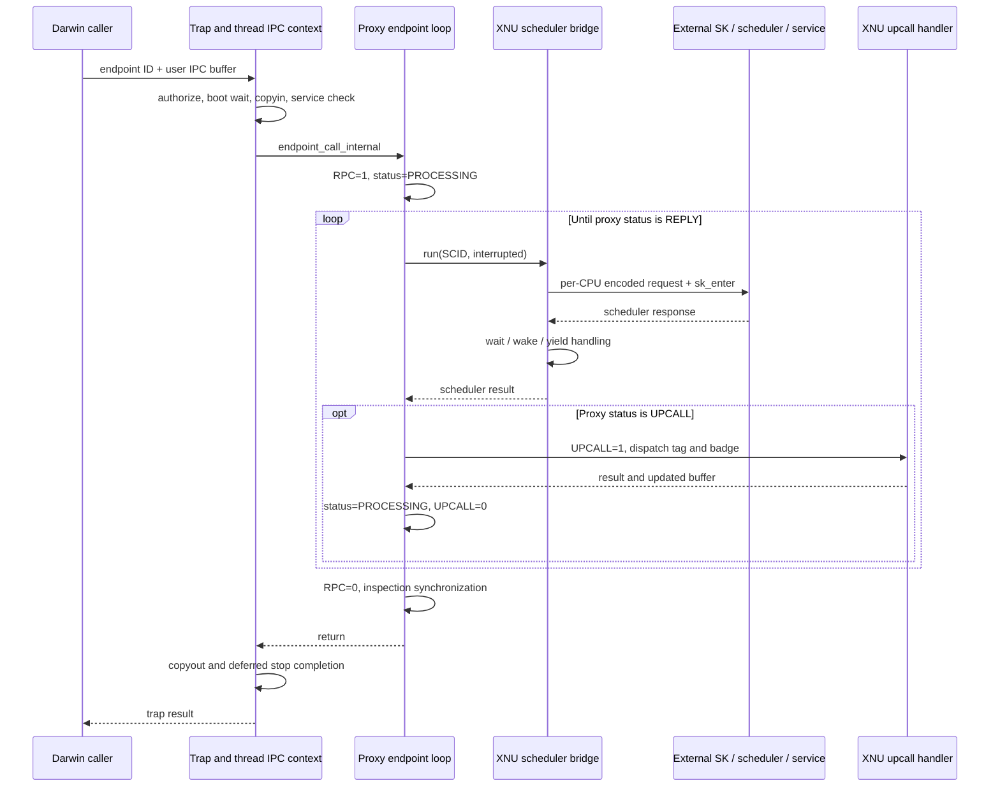
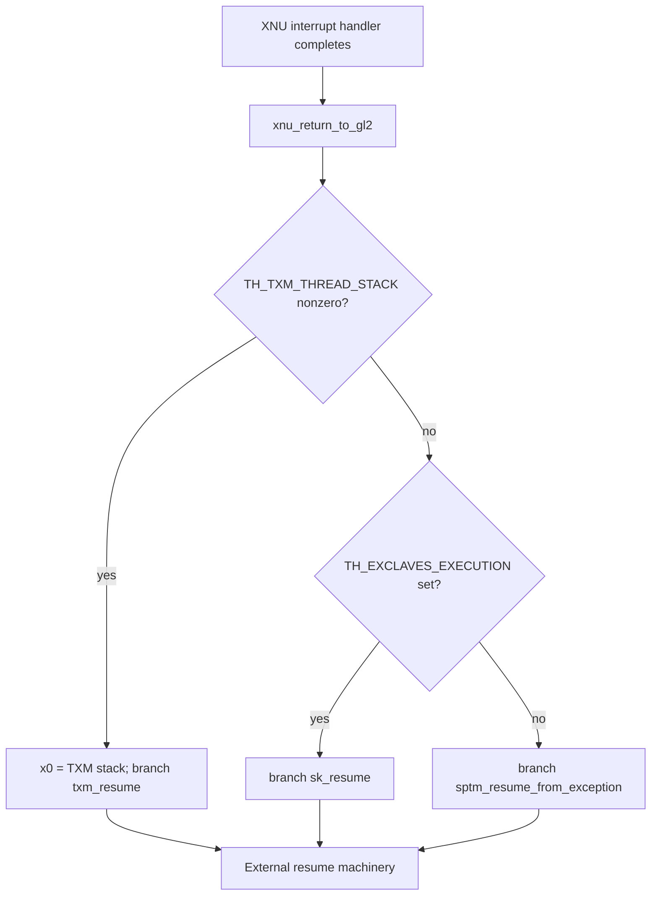

# Exclaves execution: traps, scheduler requests, upcalls, and interrupt return

[Exclaves overview](exclaves.md) · [Security guide](README.md) · [SPTM](sptm.md)

This chapter follows the XNU implementation in this checkout, from a Darwin userspace endpoint call through the secure scheduler boundary and back. The important unit is an **XNU thread carrying an Exclaves scheduling context**. Its ordinary kernel stack remains involved while the call alternates between external execution, local scheduler operations, and XNU upcall handlers. The external scheduler, secure kernel (SK), and service implementations are not present here.

Three distinct entry paths use related machinery:

| Entry | Local entry point | What XNU already knows |
|---|---|---|
| Darwin userspace endpoint RPC | `_exclaves_ctl_trap()` | A task, user IPC-buffer address, service ID, and operation; these require validation and copying |
| Kernel endpoint RPC or generated Tightbeam downcall | `exclaves_endpoint_call()` and external transport adapters | Kernel caller context and a thread IPC buffer; the public trap's checks/copies are not automatically repeated |
| Return carrying a secure-side upcall | `exclaves_xnuproxy_endpoint_call()` → `exclaves_call_upcall_handler()` | An RPC is already in progress; the proxy has returned an upcall ID, tag, badge, and payload in that RPC's buffer |

A hardware interrupt while secure execution is active is a fourth control transfer, but it is not a service upcall. Its return path uses `xnu_return_to_gl2` and `sk_resume`. Keeping these cases separate makes the state flags and return rules comprehensible.

## 1. The two protocols and their storage

An endpoint call is carried in an `Exclaves_L4_IpcBuffer_t` associated with the calling thread. Scheduler requests use separate `XrtHosted_Buffer_t` pointers stored per CPU. The first describes the RPC payload and proxy state; the second asks the external scheduler to resume a context, interrupt a wait, update clocks, or perform boot work. The scheduler can return a wait or wake operation while the endpoint RPC is still PROCESSING.

The [IPC-buffer definition](../../../xnu/osfmk/mach/exclaves_l4.h#L300) is small enough to read in full:

<!-- source-excerpt: ../../../xnu/osfmk/mach/exclaves_l4.h#L300-L307 -->
```c
typedef struct __Exclaves_L4_Packed {
	/* message registers */
	Exclaves_L4_Word_t mr[Exclaves_L4_IpcBuffer_Mrs];
	/* source capability registers */
	Exclaves_L4_Word_t scr[Exclaves_L4_IpcBuffer_Crs];
	/* destination capability registers */
	Exclaves_L4_Word_t dcr[Exclaves_L4_IpcBuffer_Crs];
} Exclaves_L4_IpcBuffer_t;
```

The preceding constants specify 56 message registers and four source and four destination capability registers. Here “register” means a slot in this memory structure. It does not mean an ARM general-purpose register. The [word type](../../../xnu/osfmk/mach/exclaves_l4.h#L48) is `unsigned long` under the LP64 interface, making this 64-word packed structure 512 bytes. The [message-register indices](../../../xnu/osfmk/mach/exclaves_l4.h#L314) reserve MR0 for the tag, MR1 for the badge, and start message data at MR2.

The public wrapper obtains the proxy return value from [`dcr[3]`](../../../xnu/osfmk/mach/exclaves_l4.h#L419). Endpoint/status/upcall-badge accessors are imported from `<xnuproxy/messages.h>`. The trap [asserts](../../../xnu/osfmk/kern/exclaves.c#L240) that the public return-value slot and external proxy definition agree. This is an ABI compatibility check, not a decoder for the external transport's full capability semantics.

The [per-thread context](../../../xnu/osfmk/mach/exclaves.h#L1479) is:

<!-- source-excerpt: ../../../xnu/osfmk/mach/exclaves.h#L1479-L1483 -->
```c
typedef struct {
	void *ipcb;
	unsigned long scid;
	uint64_t usecnt;
} exclaves_ctx_t;
```

`ipcb` is the kernel address used to access the buffer. `scid` identifies the external scheduling context that will be resumed. `usecnt` tracks local buffer users. The SCID is not a Mach port name, BSD PID, or XNU thread pointer. Scheduler requests pair it with an XNU compact thread ID, obtained through `thread_get_ctid()`, as `hostId`. The two identities let the response handlers associate external execution with the local waiting thread.

The [thread fields and access rules](../../../xnu/osfmk/kern/thread.h#L1111) distinguish three kinds of state:

<!-- source-excerpt: ../../../xnu/osfmk/kern/thread.h#L1111-L1127 -->
```c
#if CONFIG_EXCLAVES
	/* Per-thread IPC context for exclaves communication. Only modified by the
	 * current thread on itself. */
	exclaves_ctx_t      th_exclaves_ipc_ctx;
	/* Thread exclaves interrupt-safe state. Only mutated by the current thread
	 * on itself with interrupts disabled, and only ever read by the current
	 * thread (with no locking), including from interrupt context, or during
	 * debug/stackshot. */
	thread_exclaves_intstate_flags_t th_exclaves_intstate;
	/* Thread exclaves state. Only mutated by the current thread on itself, and
	 * only ever read by the current thread (with no locking). Unsafe to read
	 * from interrupt context. */
	thread_exclaves_state_flags_t th_exclaves_state;
	/* Thread stackshot state. Prevents returning to Exclave world until after
	 * an external agent has triggered inspection (likely via Exclave stackshot),
	 * and woken this thread. */
	thread_exclaves_inspection_flags_t _Atomic th_exclaves_inspection_state;
```

The IPC context and ordinary state belong to the current thread; no general thread mutex is taken around each update. The interrupt-safe state is mutated with interrupts disabled and is available to interrupt return. The atomic inspection state coordinates with other threads performing stackshot/kperf collection. It cannot be replaced by an ordinary local boolean.

`th_exclaves_state` also describes *why* the thread is participating. [The definitions](../../../xnu/osfmk/kern/thread.h#L298) identify RPC, UPCALL, SCHEDULER_REQUEST, direct XNUPROXY calls, direct SCHEDULER_CALLs, a pending stop upcall, expected secure thread creation, and panic-thread resumption. `TH_EXCLAVES_STATE_ANY` contains the active-call states, but excludes STOP_UPCALL_PENDING, SPAWN_EXPECTED, and AOE. Consequently an assertion involving ANY is narrower than “every Exclaves flag is zero.”

## 2. Darwin userspace reaches an ordinary Mach trap first

The [libsyscall endpoint wrapper](../../../xnu/libsyscall/wrappers/exclaves.c#L45) checks the exact IPC-buffer size, places the caller's tag in MR0, and invokes the control trap:

<!-- source-excerpt: ../../../xnu/libsyscall/wrappers/exclaves.c#L51-L61 -->
```c
	if (size != Exclaves_L4_IpcBuffer_Size) {
		return KERN_INVALID_ARGUMENT;
	}
	Exclaves_L4_IpcBuffer_t *ipcb;
	ipcb = Exclaves_L4_IpcBuffer_Ptr((void*)msg_buffer);
	ipcb->mr[Exclaves_L4_Ipc_Mr_Tag] = *tag;
	const uint32_t opf = EXCLAVES_CTL_OP_AND_FLAGS(ENDPOINT_CALL, 0);
	kr = EXCLAVES_CTL_TRAP(port, opf, endpoint_id, msg_buffer, size, 0, 0, 0);
	*tag = ipcb->mr[Exclaves_L4_Ipc_Mr_Tag];
	*error = EXCLAVES_XNU_PROXY_CR_RETVAL(ipcb);
	return kr;
```

Its `kern_return_t` and `*error` are separate results. The former describes local/trap execution; the latter is the proxy/L4 result stored in the returned IPC buffer. The wrapper reads the tag and error slots after the trap returns, so a caller must not interpret those slots as a successful remote reply when the trap failed before completing the operation.

[`EXCLAVES_CTL_OP_AND_FLAGS`](../../../xnu/osfmk/mach/exclaves.h#L1364) places the operation in the upper byte of a 32-bit word and flags in the lower 24 bits. ENDPOINT_CALL is operation 1. The eight [trap arguments](../../../xnu/osfmk/mach/mach_traps.h#L642) are name, operation/flags, identifier, buffer, size, param1, param2, and status. For this operation the wrapper supplies zero for the last three; other operations reuse those fields for different purposes.

The ARM64 path is concrete:

1. [`syscall_sw.h`](../../../xnu/osfmk/mach/syscall_sw.h#L167) defines `_exclaves_ctl_trap` as Mach trap −88 with eight LP64 arguments.
2. The [ARM64 trap stub macro](../../../xnu/osfmk/mach/arm/syscall_sw.h#L110) loads the trap number into `x16`, executes `svc #SWI_SYSCALL`, then returns. The eight function arguments occupy the ordinary argument registers `x0–x7`.
3. [`handle_svc()`](../../../xnu/osfmk/arm64/sleh.c#L2743) recognizes a negative trap number and calls `mach_syscall()`.
4. [`mach_syscall()`](../../../xnu/osfmk/arm64/bsd_arm64.c#L194) negates the number, checks the trap table, copies the saved register arguments through [`arm_get_mach_syscall_args()`](../../../xnu/osfmk/arm64/bsd_arm64.c#L87), applies configured Mach-trap filtering, and invokes the selected function.
5. [Table entry 88](../../../xnu/osfmk/kern/syscall_sw.c#L202) selects `_exclaves_ctl_trap`.

This first exception enters XNU. It does not immediately resume SK. XNU must authorize the operation, establish the IPC context, and construct a scheduler request before reaching the secure entry call. The common trap and exception machinery is described further in [process entry points](../processes/README.md) and [platform](../platform/README.md).

The LP64 wrapper is the supported path shown here. Its non-LP64 branch returns `KERN_NOT_SUPPORTED`. Likewise, [the kernel entry points](../../../xnu/osfmk/kern/exclaves.c#L1313) have explicit `!CONFIG_EXCLAVES` stubs; one should not infer that every XNU configuration implements this path from the existence of a trap number.

## 3. Authorization, readiness, and copying at the trap boundary

[`_exclaves_ctl_trap()`](../../../xnu/osfmk/kern/exclaves.c#L213) first rejects nonzero flags. It then selects operation-specific privilege rules. BOOT calls a separate helper immediately; it requires a null port and BOOT privilege. Indicator timing and daemon-notification operations have their own rules. General operations, including endpoint calls, require either an associated conclave, kernel-domain privilege, or the explicit relaxed-requirement case present in this source.

[`exclaves_has_priv()`](../../../xnu/osfmk/kern/exclaves.c#L3094) makes that gate concrete. Kernel-domain access accepts `kernel_task`, a cached `TFRO_HAS_KD_ACCESS` bit, or the relevant entitlement followed by caching that bit. Boot/spawn privileges have launchd and entitlement cases. The [entitlement helper](../../../xnu/osfmk/kern/exclaves.c#L3056) uses `IOTaskHasEntitlement()`; entitlement checks are enabled by default, with development/configuration controls visible in the source. This chapter describes the checks as implemented; it does not assume that all builds have identical policy settings.

The trap then waits for EXCLAVECORE. A task with an associated conclave also waits for EXCLAVEKIT. These waits establish service readiness, independently of authorization. Unsupported systems return `KERN_NOT_SUPPORTED`; a supported but not yet ready system can block. See [the boot wait implementation](../../../xnu/osfmk/kern/exclaves_boot.c#L339).

The endpoint operation adds these checks and actions:

| Step | Meaning |
|---|---|
| Require `name == MACH_PORT_NULL` | This endpoint interface does not translate the supplied name into a resource port |
| Require nonnull buffer and exact `Exclaves_L4_IpcBuffer_Size` | The operation copies a complete, fixed-size IPC buffer |
| Obtain or allocate current thread context | The userspace address is not installed as the active kernel IPC buffer |
| `copyin()` the entire structure | User payload becomes the thread's current kernel-side payload |
| Check `identifier < CONCLAVE_SERVICE_MAX` | Prevent an out-of-range service-bitmap lookup |
| Check `exclaves_conclave_has_service()` | Require membership in the task's associated service domain, or the kernel-domain service set for a null association |
| Call internal endpoint entry, then `copyout()` | Return the entire resulting buffer |
| Complete a pending conclave stop | Finish deferred process-side handling after the RPC has unwound |

The [allocation/copyin sequence](../../../xnu/osfmk/kern/exclaves.c#L390) contains an explicit lifetime note:

<!-- source-excerpt: ../../../xnu/osfmk/kern/exclaves.c#L390-L398 -->
```c
		Exclaves_L4_IpcBuffer_t *ipcb = exclaves_get_ipc_buffer();
		/* TODO (rdar://123728529) - IPC buffer isn't freed until thread exit */
		if (!ipcb && (error = exclaves_allocate_ipc_buffer((void**)&ipcb))) {
			return error;
		}
		assert(ipcb != NULL);
		if ((error = copyin(ubuffer, ipcb, usize))) {
			return error;
		}
```

Allocation happens before the service-ID check. Therefore even a later rejected endpoint attempt can leave a context attached to the thread. Successful calls also retain it; repeated trap calls reuse the pointer rather than incrementing the use count on every invocation.

The [return sequence](../../../xnu/osfmk/kern/exclaves.c#L429) copies the buffer even if the endpoint call reports an error, then invokes stop completion before returning a copyout error:

<!-- source-excerpt: ../../../xnu/osfmk/kern/exclaves.c#L429-L436 -->
```c
		kr = exclaves_endpoint_call_internal(IPC_PORT_NULL, identifier);
		error = copyout(ipcb, ubuffer, usize);
		/*
		 * Endpoint call to conclave may have trigger a stop upcall,
		 * check if stop upcall completion handler needs to run.
		 */
		task_stop_conclave_upcall_complete();
		if (error) {
```

The domain/resource association and service bitmap come from [Exclaves resource management](exclaves-resources-and-memory.md). Resource-port operations use normal Mach kobject rights elsewhere in the same trap; this particular endpoint operation instead uses a validated numeric service ID. It would be incorrect to describe its null name as a send right to an Exclave.

## 4. IPC-buffer and scheduling-context lifetime

Kernel callers use [`exclaves_allocate_ipc_buffer()`](../../../xnu/osfmk/kern/exclaves.c#L1344) and `exclaves_free_ipc_buffer()`. Allocate obtains a context if none exists, then increments `usecnt`. Free decrements the count and releases the context when the count becomes zero. The special inspection thread retains its buffer: its NOINSPECT flag causes the free helper to return without decrementing or freeing it.

[`exclaves_xnuproxy_ctx_alloc()`](../../../xnu/osfmk/kern/exclaves_xnuproxy.c#L288) first tries a global cache. A cache entry is an intrusive node stored in the otherwise unused IPC buffer itself, containing the next pointer and SCID. A spin lock protects the list and count. Taking a buffer out restores the context fields, starts `usecnt` at zero, and clears the cache metadata from the buffer.

On a cache miss, XNU cannot allocate a new SCID with `kalloc`. It makes the generated `xnuproxy_cmd_ipccontextalloc()` request:

1. Acquire `exclaves_xnuproxy_lock` and save the current thread's context.
2. Temporarily install the bootstrapped proxy context on the thread.
3. Save the thread's ordinary Exclaves state and add SPAWN_EXPECTED.
4. Make the generated command; its callback supplies a physical IPC-buffer address and SCID.
5. Convert the buffer address through `phystokv()`, restore the old state and thread context, and release the mutex.
6. Reject transport failure or a missing buffer; otherwise increment the allocated-context statistic and install the new context.

The [context substitution](../../../xnu/osfmk/kern/exclaves_xnuproxy.c#L69) is a local ownership operation:

<!-- source-excerpt: ../../../xnu/osfmk/kern/exclaves_xnuproxy.c#L74-L82 -->
```c
	lck_mtx_lock(&exclaves_xnuproxy_lock);

	thread_t thread = current_thread();

	*save_ctx = thread->th_exclaves_ipc_ctx;

	thread->th_exclaves_ipc_ctx = exclaves_bootstrap_ctx;

	LCK_MTX_ASSERT(&exclaves_xnuproxy_lock, LCK_MTX_ASSERT_OWNED);
```

The mutex serializes use of the one bootstrap scheduling context across XNU threads. It is deliberately held across the allocation downcall. This is different from the short spin-lock region used for the free-buffer list. The external Tightbeam adapter and XNU proxy execute the actual allocation protocol; no implementation of a secure scheduling-context allocator is present in this C function.

On release, [`exclaves_ipc_buffer_cache_free()`](../../../xnu/osfmk/kern/exclaves_xnuproxy.c#L202) zeros the whole IPC buffer before placing intrusive metadata in it, transfers its SCID into the node, and clears all fields of the caller's context. A subtle checkout-specific point is that the cache capacity rejection is disabled:

<!-- source-excerpt: ../../../xnu/osfmk/kern/exclaves_xnuproxy.c#L206-L217 -->
```c
	/* Zero out the IPC buffer to avoid having old IPC data lying around. */
	bzero(ctx->ipcb, Exclaves_L4_IpcBuffer_Size);

	lck_spin_lock(&exclaves_ipc_buffer_cache_lock);

#if 0 /* Removed with the fix for rdar://126257712 */
	/* Don't free into the cache if the cache has hit its limit. */
	if (exclaves_ipc_buffer_cache_count == exclaves_ipc_buffer_cache_max) {
		lck_spin_unlock(&exclaves_ipc_buffer_cache_lock);
		return false;
	}
#endif
```

The named cache “max,” defaulting to 16, controls [initial preallocation](../../../xnu/osfmk/kern/exclaves_xnuproxy.c#L239) here; the live free path always accepts another buffer. Do not describe it as an enforced cache size limit. The fallback [`ipccontextfree` RPC](../../../xnu/osfmk/kern/exclaves_xnuproxy.c#L348) remains in the source, but the current cache-free helper returns true, so ordinary frees stop at the cache. A context released by a thread therefore need not release its secure-side SCID immediately.

At thread termination, [`exclaves_thread_terminate()`](../../../xnu/osfmk/kern/exclaves.c#L1401) runs on the current thread, asserts both execution and ordinary state are zero, discards an abandoned local use count, and releases the context through the same cache path. [Thread destruction assertions](../../../xnu/osfmk/kern/thread.c#L685) require the context pointer, SCID, and Exclaves state to be empty. This closes the trap-retained context lifetime without claiming that returning from each RPC destroys the context.

## 5. An endpoint RPC is a resumable loop

The kernel [`exclaves_endpoint_call()`](../../../xnu/osfmk/kern/exclaves.c#L1313) assumes a nonnull current IPC buffer and null port, stores the tag, calls the internal endpoint routine, and reads back tag and error. It does not execute userspace `copyin/copyout` or repeat the public trap's entitlement and service-bitmap checks. Kernel call sites and their generated protocols must establish their own valid endpoint/context.

The internal function reaches [`exclaves_xnuproxy_endpoint_call()`](../../../xnu/osfmk/kern/exclaves_xnuproxy.c#L481). This sets the proxy endpoint ID and PROCESSING status in the current IPC buffer, asserts that no active Exclaves call state is set, and marks RPC. Its loop is the central transport control flow:

<!-- source-excerpt: ../../../xnu/osfmk/kern/exclaves_xnuproxy.c#L503-L523 -->
```c
	while (1) {
		kr = exclaves_run(thread, interrupted);
		assert(kr == KERN_SUCCESS || kr == KERN_ABORTED);

		/* A wait was interrupted. */
		interrupted = kr == KERN_ABORTED;

		status = (xnuproxy_msg_status_t)
		    XNUPROXY_CR_STATUS(ipcb);

		switch (status) {
		case XNUPROXY_MSG_STATUS_PROCESSING:
			exclaves_xnuproxy_endpoint_call_show_progress(call, yielded,
			    endpoint_id, scid, status);
			continue;

		case XNUPROXY_MSG_STATUS_REPLY:
			exclaves_xnuproxy_endpoint_call_show_progress(call, returned,
			    endpoint_id, scid, status);
			kr = KERN_SUCCESS;
			break;
```

A normal scheduler round trip can finish with PROCESSING still set. For example, a Wait response may have blocked the host thread and then returned after a wake. The next iteration resumes the same SCID and continues the same endpoint operation. REPLY ends the RPC. UPCALL executes a local handler, writes the handler result, resets PROCESSING, and resumes. An unknown message status returns `KERN_FAILURE`.

The loop's expected scheduler returns are SUCCESS and ABORTED, enforced by an assertion. ABORTED here records an interrupted local wait. It is **not** an immediate instruction to return to userspace or abandon the message buffer. The next request changes from ResumeWithHostId to InterruptWithHostId:

<!-- source-excerpt: ../../../xnu/osfmk/kern/exclaves.c#L2856-L2865 -->
```c
	XrtHosted_Response_t response = {};
	const XrtHosted_Request_t request = interrupted ?
	    XrtHosted_Request_InterruptWithHostIdMsg(
		.thread = ctx->scid,
		.hostId = ctid,
		) :
	    XrtHosted_Request_ResumeWithHostIdMsg(
		.thread = ctx->scid,
		.hostId = ctid,
		);
```

[`exclaves_run()`](../../../xnu/osfmk/kern/exclaves.c#L2961) is only a named wrapper around this request-resume function; it exists partly to make backtraces readable. The external scheduler decides how the supplied interruption affects the suspended secure computation. The XNU loop keeps handling the returned protocol until a reply or invalid status ends it.

`exclaves_scheduler_request_resume()` marks SCHEDULER_REQUEST only while processing the decoded response in XNU. That flag is cleared before it returns to the endpoint loop. It is not held throughout the secure entry. Reading the function names alone can be misleading: “scheduler request” names both the outbound exchange and the local handling phase, while the flag specifically protects the latter against reentry.



This diagram represents local calls and returns. The secure-side sequence between `sk_enter` and the scheduler response is an external implementation boundary, not an assertion that the service runs directly inside one XNU function.

## 6. Per-CPU scheduler exchange and the secure entry boundary

[`exclaves_scheduler_request()`](../../../xnu/osfmk/kern/exclaves.c#L2064) validates the request tag, disables interrupts, checks pending inspection work, and disables preemption without the usual timing measurements. Interrupts are expected to have been enabled on entry. The critical region is necessary because request and response buffers are per core.

If inspection is pending, it temporarily enables interrupts and runs `exclaves_inspection_check_ast()`, then disables interrupts again before rechecking. That ordering closes the race in which collection marks the thread just as it would otherwise enter secure execution. Inspection synchronization is therefore part of the execution protocol, not merely optional logging.

Before encoding most requests, the function checks absolute and continuous clock offsets. A stale offset returns `KERN_POLICY_LIMIT` after restoring preemption/interrupt state, without making a scheduler request and without producing a response. [The resume caller](../../../xnu/osfmk/kern/exclaves.c#L2867) handles that result by updating clocks and returning to the endpoint loop. [`exclaves_clocks_update()`](../../../xnu/osfmk/kern/exclaves.c#L2628) sends UpdateTimerOffset requests and reconciles the sent/latest offset fields atomically. UpdateTimerOffset and WatchdogPanic requests are exempt from this gate.

The actual exchange uses externally registered codecs around the local entry routine:

<!-- source-excerpt: ../../../xnu/osfmk/kern/exclaves.c#L2118-L2138 -->
```c
	XrtHosted_Buffer_t *request_buf = *PERCPU_GET(exclaves_request);
	assert3p(request_buf, !=, NULL);

	request_trace_start(request);

	exclaves_callbacks->v1.Request.encode(request_buf, request);
	exclaves_scheduler_debug_save_buffer(request_buf);

	kr = exclaves_enter();

	/* The response may have come back on a different core. */
	XrtHosted_Buffer_t *response_buf = *PERCPU_GET(exclaves_response);
	assert3p(response_buf, !=, NULL);

	exclaves_scheduler_debug_save_buffer(response_buf);
	exclaves_callbacks->v1.Response.decode(response_buf, response);

	request_trace_end(request);

	enable_preemption();
	(void) ml_set_interrupts_enabled_with_debug(istate, false);
```

Notice the response pointer is fetched *after* secure entry. The source explicitly permits returning on another core. Disabling ordinary XNU preemption around the call does not justify retaining the original CPU's response pointer. Initialization maps each external hardware ID to XNU's `cpu_phys_id` and installs the matching request/response pointers.

[`exclaves_enter()`](../../../xnu/osfmk/kern/exclaves.c#L1681) is the narrow C boundary. It rejects entry while UPCALL or SCHEDULER_REQUEST is set. It asserts that at least one allowed calling-state bit is present—RPC, XNUPROXY, SCHEDULER_CALL, or RESUME_PANIC_THREAD—and that EXECUTION is not already set. The comment asks for one and only one calling-state bit, but the actual assertion checks a nonzero mask; it is not a population-count test.

The entry prepares a zero-initialized `sptm_call_regs_t`, selects RINGGATE_EP_ENTER, saves relevant SME matrix state when present, requests debug return assertions, performs conditional MTE reseeding, and brackets the secure execution with recount accounting. Its key state transition is:

<!-- source-excerpt: ../../../xnu/osfmk/kern/exclaves.c#L1729-L1749 -->
```c
	recount_enter_secure();

	/* xnu_return_to_gl2 relies on this flag being present to correctly return
	 * to SK from interrupts xnu handles on behalf of SK. */
	thread->th_exclaves_intstate |= TH_EXCLAVES_EXECUTION;

	/*
	 * Bracket with labels so stackshot can determine where exclaves are
	 * entered from xnu.
	 */
	__asm__ volatile (
            "EXCLAVES_ENTRY_START:\n\t"
        );
	result = sk_enter(endpoint, &regs);
	__asm__ volatile (
            "EXCLAVES_ENTRY_END:\n\t"
        );

	thread->th_exclaves_intstate &= ~TH_EXCLAVES_EXECUTION;

	recount_leave_secure();
```

This is where the local source calls `sk_enter()`. The complete call-register type, transition implementation, and secure register/stack save machinery are supplied through [`<sptm/sptm_xnu.h>`](../../../xnu/osfmk/arm64/sptm/sptm.h#L36); they are not defined by the public XNU wrapper header. It would be unsupported to infer a full exception-level or register-save ABI from the C call's two arguments. [SPTM](sptm.md) describes the visible boot/entry interface and the distinctions between protection domains and ARM exception levels.

On normal return, XNU clears EXECUTION, accounts the return, restores matrix state, and invalidates CPU user-debug state when needed because secure execution may have changed debug registers. Ringgate SUCCESS maps to `KERN_SUCCESS`, ERROR to `KERN_FAILURE`, and PANIC to `KERN_ABORTED`. In this low-level case, [the scheduler exchange](../../../xnu/osfmk/kern/exclaves.c#L2142) waits for the other core's panic path rather than treating it as a normal interrupted endpoint wait.

## 7. Waits, wakes, and priority donation

A decoded Wait response contains an external queue ID, epoch, waiter identity, owner identity, and interruptibility. [`handle_response_wait()`](../../../xnu/osfmk/kern/exclaves.c#L2240) verifies the local host ID with assertions and refuses to let the special inspection thread wait. It maps the external interruptibility into XNU wait policy:

| External mode | XNU wait mode | Epoch-sync policy |
|---|---|---|
| None | `THREAD_UNINT` | `ESYNC_POLICY_KERNEL` |
| Voluntary | `THREAD_INTERRUPTIBLE` | `ESYNC_POLICY_KERNEL` |
| DynamicQueue | `THREAD_INTERRUPTIBLE` | `ESYNC_POLICY_USER` |

It then calls `esync_wait(ESYNC_SPACE_EXCLAVES_Q, queueId, epoch, counter, ownerHostId, policy, interruptible)`. AWAKENED and NOT_WAITING return SUCCESS; INTERRUPTED returns ABORTED for the endpoint loop to report in its next secure request.

Epoch synchronization exists because XNU cannot inspect the secure-side lock's state under a shared local lock. [The interface rationale](../../../xnu/osfmk/kern/epoch_sync.h#L40) describes an epoch counter advanced by the other side before wake requests. XNU uses that information to reject a wait that lost a race with a wake. The queues are local hashed `esync_t` objects, each carrying an ID, spin lock, turnstile, policy, and reference count. Queue and suspended-thread namespaces use separate hash tables.

[`esync_wait()`](../../../xnu/osfmk/kern/epoch_sync.c#L417) acquires a referenced sync object with its spin lock held. It updates/checks the epoch before translating the supplied compact owner ID into a thread:

<!-- source-excerpt: ../../../xnu/osfmk/kern/epoch_sync.c#L431-L445 -->
```c
	const bool fresh_epoch = esync_update_epoch(epoch, counter);
	if (!fresh_epoch) {
		KDBG_RELEASE(MACHDBG_CODE(DBG_MACH_EPOCH_SYNC,
		    MACH_EPOCH_SYNC_WAIT_STALE), unique_id, epoch, NULL);
		esync_put(ht, sync, to_be_freed);
		return THREAD_NOT_WAITING;
	}

	/*
	 * It is safe to lookup the thread from the ctid here as the lock is
	 * held and the epoch is fresh.
	 * ctid and hence tid may be 0.
	 */
	thread_t owner_thread = ctid_get_thread(owner_ctid);
	uint64_t tid = thread_tid(owner_thread);
```

An incoming epoch older than the stored counter makes the wait return NOT_WAITING. Equal or newer epochs are accepted by [`esync_update_epoch()`](../../../xnu/osfmk/kern/epoch_sync.c#L358). The freshness and lock ordering matter to owner lifetime: `ownerHostId` is not an indefinitely valid retained thread pointer. The Exclaves handler explicitly warns against dereferencing it before the locked freshness check.

For a valid wait, XNU prepares an epoch-kernel or epoch-user turnstile, sets its priority inheritor to the owner thread, asserts the wait on that turnstile's wait queue, and releases the sync lock. Only then does it complete the inheritor update and potentially block:

<!-- source-excerpt: ../../../xnu/osfmk/kern/epoch_sync.c#L466-L479 -->
```c
	wait_result_t wr = waitq_assert_wait64(&ts->ts_waitq,
	    CAST_EVENT64_T(sync), interruptible, TIMEOUT_WAIT_FOREVER);

	lck_spin_unlock(&sync->es_lock);

	turnstile_update_inheritor_complete(ts, TURNSTILE_INTERLOCK_NOT_HELD);

	if (wr == THREAD_WAITING) {
		wr = thread_block(THREAD_CONTINUE_NULL);
	}

	lck_spin_lock(&sync->es_lock);

	turnstile_complete((uintptr_t)sync, &sync->es_turnstile, NULL, tt);
```

After waking it completes the turnstile association and drops the sync object's reference through `esync_put()`, which also drops the lock and may free the object. This is the concrete bridge to XNU scheduling and priority donation. The secure scheduler's queue ID is converted into a host wait object; it is not itself a pointer to a `waitq`.

[`esync_wake()`](../../../xnu/osfmk/kern/epoch_sync.c#L495) first updates the epoch even if no local sync object exists. A wake with no current waiter need not allocate an object: the counter preserves the evidence needed for a later stale wait to return immediately. The wake variants then differ in both target and inheritor handling:

| Wake mode | Local effect |
|---|---|
| ONE | Wake one; the woken thread becomes the inheritor |
| ALL | Wake all; clear inheritor |
| ONE_WITH_OWNER | Wake one and explicitly set the supplied owner as inheritor |
| THREAD | Wake the specified compact-thread-ID target without choosing a new inheritor |

The [Wait/Wake response handlers](../../../xnu/osfmk/kern/exclaves.c#L2314) use the queue namespace. [Suspended](../../../xnu/osfmk/kern/exclaves.c#L2397) uses a separate thread namespace keyed by SCID, with an uninterruptible kernel-policy wait and no owner. Resumed wakes a specific host thread in that namespace. The response named [Interrupted](../../../xnu/osfmk/kern/exclaves.c#L2463) wakes a target in the queue namespace; it is a protocol response, not an ARM hardware interrupt.

## 8. Yield, spawn, and response handling limits

The external scheduler's response names do not imply that each has a complete corresponding XNU scheduling operation. [Yield handling](../../../xnu/osfmk/kern/exclaves.c#L2163) is a particularly useful example:

<!-- source-excerpt: ../../../xnu/osfmk/kern/exclaves.c#L2173-L2185 -->
```c
	/* TODO: 1. remember yielding scid if it isn't the xnu proxy's
	 * th_exclaves_scheduling_context_id so we know to resume it later
	 * 2. translate yield_to to thread_switch()-style handoff.
	 */
	if (!early) {
		assert3u(responding_scid, ==, scid);
		assert3u(yield->threadHostId, ==, ctid);
	}

	KDBG_RELEASE(MACHDBG_CODE(DBG_MACH_EXCLAVES_SCHEDULER,
	    MACH_EXCLAVES_SCHEDULER_YIELD), yielded_to_scid, early);

	return KERN_SUCCESS;
```

The handler traces the target and, outside early boot, checks the responding SCID and host ID. Translating `yieldTo` into a `thread_switch()`-style handoff is explicitly TODO. Thus a Yield response can cause another endpoint-loop iteration, but this implementation does not perform a local targeted thread handoff there. Actual blocking and priority donation happen in the epoch-sync paths above.

[Spawned](../../../xnu/osfmk/kern/exclaves.c#L2189) is accepted only with SPAWN_EXPECTED set, as during context allocation. Its handler validates identities and records the event; it does not allocate an XNU `thread_t` for the external thread. [Terminated](../../../xnu/osfmk/kern/exclaves.c#L2221) is reported as unexpected and returns `KERN_TERMINATED`. The endpoint loop's SUCCESS/ABORTED assertion shows that this is not an ordinary completion result for the RPC path.

Response sets are also operation-specific. The runtime resume function accepts Wait, Wake, Yield, Spawned, Terminated, WakeWithOwner, PanicWait, Suspended, Resumed, Interrupted, and Panicking; unrecognized or inappropriate tags fail. [Boot](../../../xnu/osfmk/kern/exclaves.c#L2752) additionally understands early page allocation, panic-buffer address, NothingScheduled, and AllExclavesBooted. [Timer updates](../../../xnu/osfmk/kern/exclaves.c#L2694) expect NothingScheduled. One should read the switch for the particular request rather than combine every enum tag into a universal reply protocol.

PanicWait enters the dedicated panic-thread wait path; Panicking waits for panic handling. This guide follows their execution boundaries but does not claim to explain all panic serialization, stackshot transport, or secure watchdog internals.

## 9. Upcalls execute on the in-progress XNU thread

The proxy UPCALL status is distinct from a scheduler Wait response. The endpoint loop sets UPCALL, obtains the upcall ID from the IPC buffer, and invokes the dispatcher. It then sets PROCESSING and maps the handler's local result into the proxy result field:

<!-- source-excerpt: ../../../xnu/osfmk/kern/exclaves_xnuproxy.c#L525-L541 -->
```c
		case XNUPROXY_MSG_STATUS_UPCALL:
			thread->th_exclaves_state |= TH_EXCLAVES_UPCALL;
			endpoint_id = XNUPROXY_CR_ENDPOINT_ID(ipcb);
			KDBG_RELEASE(MACHDBG_CODE(DBG_MACH_EXCLAVES, MACH_EXCLAVES_UPCALL)
			    | DBG_FUNC_START, scid, endpoint_id);
			exclaves_xnuproxy_endpoint_call_show_progress(upcall, entry,
			    endpoint_id, scid, status);
			kr = exclaves_call_upcall_handler(endpoint_id);
			XNUPROXY_CR_STATUS(ipcb) =
			    XNUPROXY_MSG_STATUS_PROCESSING;
			/* TODO: More state returned than Success or OperationInvalid? */
			XNUPROXY_CR_RETVAL(ipcb) =
			    (kr == KERN_SUCCESS) ? Exclaves_L4_Success :
			    Exclaves_L4_ErrorOperationInvalid;
			KDBG_RELEASE(MACHDBG_CODE(DBG_MACH_EXCLAVES, MACH_EXCLAVES_UPCALL)
			    | DBG_FUNC_END);
			thread->th_exclaves_state &= ~TH_EXCLAVES_UPCALL;
```

The surrounding loop resumes secure execution only after clearing UPCALL. That ordering is required by `exclaves_enter()`, which panics on attempted reentry from an upcall or scheduler-response handler. An upcall may perform permitted local kernel work, including service-specific operations, but it cannot recursively make another endpoint RPC using this same active call state.

[`exclaves_call_upcall_handler()`](../../../xnu/osfmk/kern/exclaves_upcalls.c#L680) asserts UPCALL, reads the current message tag and proxy badge, bounds-checks the ID, copies the registered handler/context pair, and calls `handler(context, &tag, badge)`. It writes the possibly changed tag back. An absent handler returns `KERN_INVALID_CAPABILITY`.

The registry is set up under `exclaves_boot_lock` by [`exclaves_register_upcall_handler()`](../../../xnu/osfmk/kern/exclaves_upcalls.c#L593). Registration asserts a valid ID, nonnull handler, and previously empty slot. [`exclaves_upcall_init()`](../../../xnu/osfmk/kern/exclaves_upcalls.c#L612) creates Tightbeam endpoints for legacy upcalls, v2 memory upcalls, and v2 general upcalls, then starts their generated servers using local handler tables. Those tables lead into the resource, storage, driver, memory, and other implementations described in [Exclaves services](exclaves-services.md).

The generic dispatcher is not another userspace trap and does not re-run the trap's caller-entitlement gate. The external protocol has returned a capability-oriented upcall identifier and badge; the generic layer validates registration and dispatches it, while individual handlers and external generated code supply further service-specific constraints. The source here does not establish that every handler interprets the badge identically or that the dispatcher alone provides complete authorization for every service.

On final RPC return, [the proxy loop](../../../xnu/osfmk/kern/exclaves_xnuproxy.c#L559) clears RPC, executes a compiler barrier, and checks inspection state. The comment explains the lifetime consequence: checking first could allow stackshot to place a still-RPC-marked thread on its list just as the caller became free to release its SCID. The ordering ensures collection finishes before that lifetime can end. [`exclaves_inspection_check_ast()`](../../../xnu/osfmk/kern/exclaves_inspection.c#L536) waits under `exclaves_collect_mtx` with priority inheritance to the collection thread; the kperf branch also queues and references the thread.

## 10. Hardware interrupts resume SK through an assembly selector

During `sk_enter()`, EXECUTION remains set even if secure execution is interrupted or preempted and XNU temporarily runs on its behalf. The [interrupt-safe flag definition](../../../xnu/osfmk/kern/thread.h#L290) explicitly includes that case. Clearing it at the first interrupt would lose the information required to return to the interrupted domain.

[`xnu_return_to_gl2`](../../../xnu/osfmk/arm64/locore.s#L1697) is the local assembly selector after XNU handles such an interrupt. It first checks `TH_TXM_THREAD_STACK`: if nonzero, it passes that stack in `x0` and branches to `txm_resume`. Otherwise, with Exclaves configured, it tests the current thread's execution flag:

<!-- source-excerpt: ../../../xnu/osfmk/arm64/locore.s#L1724-L1731 -->
```asm
1:
	mrs		x8, TPIDR_EL1
	ldr		x9, [x8, TH_EXCLAVES_INTSTATE]
	and		x9, x9, TH_EXCLAVES_EXECUTION
	cbz		x9, 1f
	b		EXT(sk_resume)
	/* Unreachable */
	b .
```

`TPIDR_EL1` supplies the current thread pointer; `x8` and `x9` are temporary registers in this selector. If the Exclaves flag is absent, the final branch goes to `sptm_resume_from_exception`. The selection order is TXM, then SK, then SPTM.

The actual `sk_resume` body is external to this checkout. The local branch proves which resume path XNU selects, but it does not expose how the external code restores all secure registers, stacks, address spaces, or exception return state. Similarly, the label's “GL2” terminology must not be mechanically equated with ARM EL2; use the [SPTM guide](sptm.md) for the visible protection-domain model and boot structures.



A normal scheduler return to the C call is different: `sk_enter()` returns, `exclaves_enter()` clears EXECUTION, and XNU decodes the response and may run a wait or upcall. Later, the endpoint loop clears RPC before the original trap can return to Darwin userspace. [Debug AST checking](../../../xnu/osfmk/kern/thread_act.c#L1482) asserts that active Exclaves state is absent; [the ARM64 userspace return path](../../../xnu/osfmk/arm64/locore.s#L1806) has a related assertion under `MACH_ASSERT`.

## 11. Stop completion and what “unwind” means here

A secure-side stop request cannot simply terminate the calling process while its endpoint protocol still owns active execution state. [`exclaves_conclave_stop_upcall()`](../../../xnu/osfmk/kern/exclaves_resource.c#L1398) takes the resource mutex, ignores a duplicate/already-stopped request, records an active stop call, and sets STOP_UPCALL_PENDING on the current thread. It returns success to the upcall path.

That allows the upcall to return its result, clear UPCALL, and resume the secure protocol until the endpoint call completes. Once RPC has cleared, the trap copies the IPC buffer back and calls [`task_stop_conclave_upcall_complete()`](../../../xnu/osfmk/kern/task.c#L10642). The resource completion helper clears the pending bit before process-side handling:

<!-- source-excerpt: ../../../xnu/osfmk/kern/exclaves_resource.c#L1429-L1438 -->
```c
	thread->th_exclaves_state &= ~TH_EXCLAVES_STOP_UPCALL_PENDING;

	exception_info_t info = {
		.os_reason = OS_REASON_GUARD,
		.exception_type = EXC_GUARD,
		.mx_code = GUARD_REASON_EXCLAVES,
		.mx_subcode = 0
	};

	exit_with_exclave_exception(get_bsdtask_info(task), info);
```

It then updates the resource state to STOPPED and clears outstanding requests under the resource mutex. Task/conclave ownership, downcall serialization, and detach are covered in [Exclaves resource management](exclaves-resources-and-memory.md). The ordering relevant here is that process-side stop completion occurs after the endpoint protocol and copyout attempt, even if copyout itself failed.

“Unwind” in this path means completing the control protocol and clearing local state before returning or tearing down the task. The inspected functions do not implement a universal `longjmp`-style unwinder that discards an arbitrary secure call stack. Interrupted waits are sent back to the external scheduler as InterruptWithHostId; stop requests are deferred until RPC return. How secure-side application frames unwind after those messages belongs to the external implementation.

Thread termination provides the last local cleanup boundary. It requires no active execution/call state, then releases any retained context. Combining these constraints explains why freeing the IPC buffer directly from an upcall or returning to userspace with RPC still set would violate the implementation's lifetime rules.

## 12. Boot establishes the data needed by every later transition

This implementation [requires CONFIG_SPTM when CONFIG_EXCLAVES is enabled](../../../xnu/osfmk/kern/exclaves.c#L49). Early startup [reads `SPTMArgs->sk_bootstrapped`](../../../xnu/osfmk/kern/exclaves_boot.c#L141) and marks Exclaves NOT_STARTED or NOT_SUPPORTED. XNU does not construct the secure kernel from these C files.

The EXCLAVECORE boot sequence under `exclaves_boot_lock` initializes local upcall servers first, then calls `exclaves_boot_early()`, runs ranked boot tasks, and publishes CORE readiness. Publishing [uses release ordering](../../../xnu/osfmk/kern/exclaves_boot.c#L174), paired with the lockless acquire load in boot wait, so a successful readiness check observes the initialized data. Waiters sleep on the boot-status event under the mutex. The designated boot thread may pass a CORE wait during boot tasks, avoiding self-deadlock while those tasks make Tightbeam calls.

[`exclaves_boot_early()`](../../../xnu/osfmk/kern/exclaves.c#L1468) obtains boot information through the ringgate INFO endpoint. An early-entry indicator can require an initial ringgate call on the boot CPU before scheduler setup. The boot-core binding also prevents cluster powerdown while that boot operation is in progress. It then initializes the scheduler, XNU proxy, resource tables, and dedicated panic thread.

[Scheduler initialization](../../../xnu/osfmk/kern/exclaves.c#L1858) requires previously registered XrtHosted callbacks. It validates the boot-information physical address, asks the callback layer to initialize against the expected version, walks the described shared frames, validates their physical addresses, and records aperture addresses in a permanently allocated pointer array. The callback receives that scattered mapping. The actual shared-format parsing and codecs live in the external callback implementation.

The initial scheduler boot runs on the boot CPU with boot-index request/response buffers. It exchanges BootExclaves requests until AllExclavesBooted, servicing permitted early allocation and panic-buffer responses. The result must advertise MulticoreMpidr support; XNU then [matches hardware IDs to per-CPU state](../../../xnu/osfmk/kern/exclaves.c#L1824). CPU online/offline [callbacks](../../../xnu/osfmk/kern/exclaves.c#L1646) use separate ringgate endpoints to notify the external side.

[XNU-proxy initialization](../../../xnu/osfmk/kern/exclaves_xnuproxy.c#L584) unmarshals boot information through generated code, checks the proxy protocol version, validates the bootstrap buffer physical address, installs bootstrap SCID/buffer/use count, creates the command endpoint, and prewarms the context cache. Only after those steps can a cache miss allocate a new thread context through the bootstrap command client.

EXCLAVEKIT readiness follows a separate stage. Its local FrameMint population call is an external-service boundary; this chapter does not infer a frame allocator implementation from that wrapper. Resource attachment, launching, memory handoff, and frame ownership are detailed by the [Exclaves resource and memory guide](exclaves-resources-and-memory.md). An XNU build with the C paths enabled still requires matching boot data, external components, and supported hardware/configuration before runtime endpoint calls can work.

## Reading route and inspected boundaries

For one complete trace, read the wrapper → trap → proxy loop → request-resume → scheduler exchange → entry function in that order. Next follow Wait into epoch sync and UPCALL into the dispatcher. Read `locore.s` separately after understanding EXECUTION: it handles an interrupt return inside secure execution, rather than the ordinary reply from a service.

| Source | Inspection in this chapter | Boundary or remaining work |
|---|---|---|
| [libsyscall wrapper](../../../xnu/libsyscall/wrappers/exclaves.c), [trap definitions](../../../xnu/osfmk/mach/syscall_sw.h), [ARM64 dispatch](../../../xnu/osfmk/arm64/bsd_arm64.c) | Endpoint arguments, packed operation, trap entry and dispatch read directly | Other user operations are covered by the resource guide |
| [`exclaves.c`](../../../xnu/osfmk/kern/exclaves.c) | Trap gates/copying, context API, boot setup, scheduler request/response handlers, entry, clock update, privilege implementation read in depth | Broad debug/test helpers and all panic diagnostics were not traced equally |
| [`exclaves_xnuproxy.c`](../../../xnu/osfmk/kern/exclaves_xnuproxy.c) | Bootstrap serialization, allocation/free/cache, complete endpoint loop and init read in depth | Generated command client and secure-side proxy implementation are external |
| [`thread.h`](../../../xnu/osfmk/kern/thread.h), [`thread.c`](../../../xnu/osfmk/kern/thread.c), [`thread_act.c`](../../../xnu/osfmk/kern/thread_act.c) | Exclaves fields, state bits, cleanup and return assertions | General scheduler/thread lifecycle is described in [runtime](../runtime/README.md) |
| [`epoch_sync.c`](../../../xnu/osfmk/kern/epoch_sync.c), [header](../../../xnu/osfmk/kern/epoch_sync.h) | Freshness, owner lookup, wait, wake, turnstile and reference completion read directly | Secure queue/lock implementation is unavailable; generic turnstile mechanics are a separate subject |
| [`exclaves_upcalls.c`](../../../xnu/osfmk/kern/exclaves_upcalls.c) | Registry, three server starts, dispatcher and loop contract | Service bodies vary; no claim that all badges have one universal interpretation |
| [`exclaves_boot.c`](../../../xnu/osfmk/kern/exclaves_boot.c) | Status publication, wait, CORE ordering and boot tasks | Secure boot and executable measurement are outside this execution trace |
| [`exclaves_inspection.c`](../../../xnu/osfmk/kern/exclaves_inspection.c) | Check-AST waiting and collection interaction | Full stackshot serialization and kperf result processing only surveyed |
| [`exclaves_resource.c`](../../../xnu/osfmk/kern/exclaves_resource.c), [`task.c`](../../../xnu/osfmk/kern/task.c) | Stop-upcall deferral and completion | Main resource/task lifecycle belongs to the companion guide |
| [`locore.s`](../../../xnu/osfmk/arm64/locore.s), [SPTM include boundary](../../../xnu/osfmk/arm64/sptm/sptm.h) | Complete TXM/SK/SPTM interrupt-return selector | `sk_enter`/`sk_resume` implementations and full secure saved context are external |
| [Tightbeam build integration](../../../xnu/makedefs/MakeInc.def#L1193) | SDK/KDK archive selection inspected | Tightbeam runtime, generated schemas, XrtHostedXnu, SK/L4 scheduler and services are not fully supplied in this tree |

The local evidence establishes a copied userspace IPC boundary, domain/service checks, thread-context ownership, external scheduler exchange, host wait/donation, controlled upcall dispatch, and domain-specific interrupt resumption. It does not by itself prove the secure environment's complete isolation, capability-transfer semantics, or scheduler implementation.

