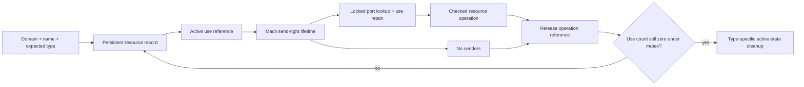
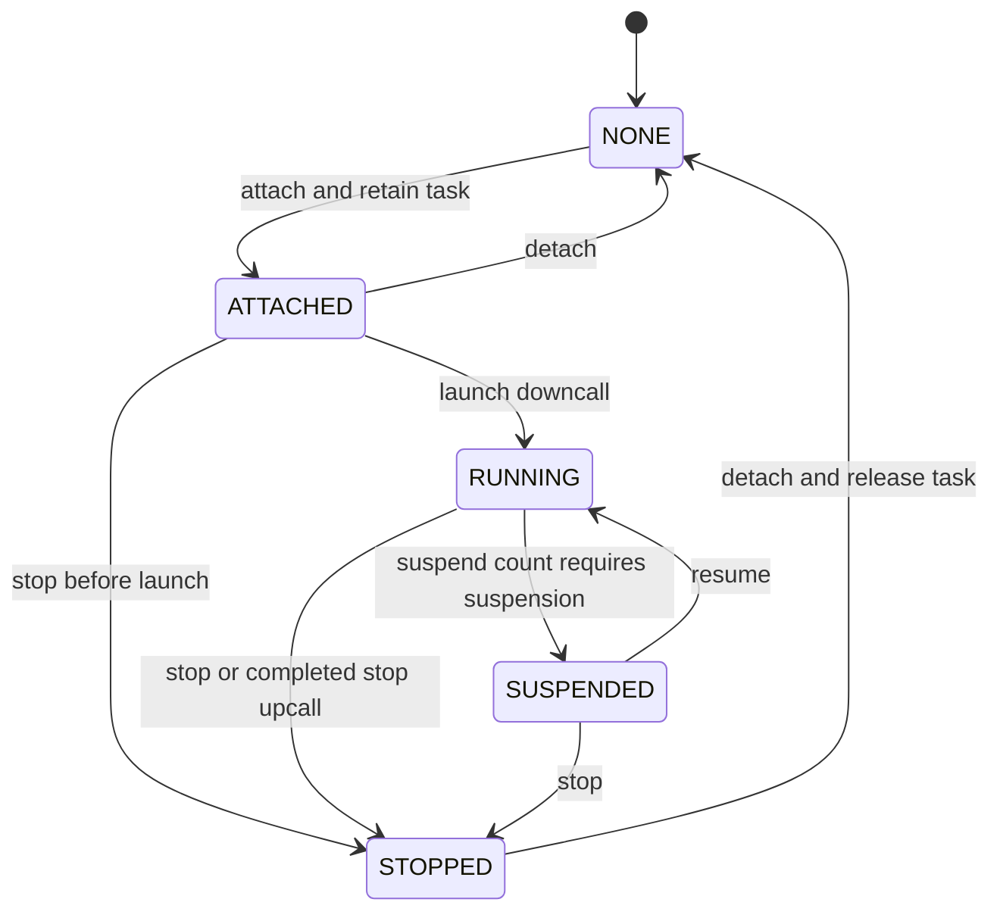
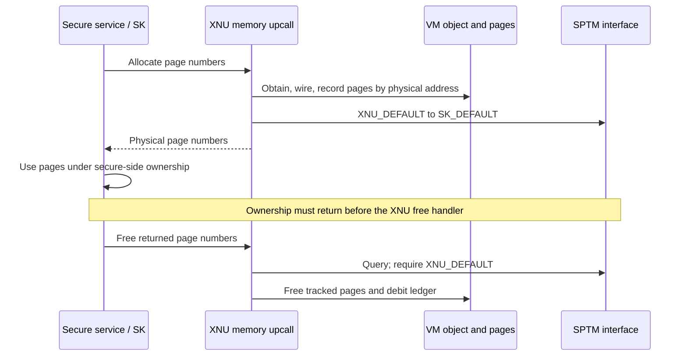

# Exclaves resources, task attachment, and physical-memory ownership

[Exclaves overview](exclaves.md) · [Execution and upcalls](exclaves-execution.md) · [SPTM](sptm.md) · [Service integration](exclaves-services.md)

Exclaves crosses several ownership boundaries at once. A task can be associated with a conclave, a Mach send right can name a resource, a secure service can authorize a shared segment, and SPTM can classify physical pages as secure-owned or shareable. These are separate checks and lifetimes. A resource name is not a physical-memory capability, and keeping a `vm_page` in an XNU object does not imply XNU is authorized to map its contents.

This page follows the local representations and transitions. The secure kernel, resource-provider implementations, framebank/FrameMint internals, and SPTM's validation code are external. Calls to them are identified at their XNU interface, without reconstructing their missing implementations.

## 1. Resource identity includes a domain and type

[`exclaves_resource_init`](../../../platydoc-data/xnu/osfmk/kern/exclaves_resource.c#L660-L729) obtains a resource inventory through `exclaves_xnuproxy_resource_info`. Each record supplies a name, scope/domain, type, numerical ID, and connection state. XNU builds a root domain table and per-domain name/ID tables. Name lookup also checks the resource type, so an identical string with another type is not interchangeable. [Table lookup](../../../platydoc-data/xnu/osfmk/kern/exclaves_resource.c#L313-L379), [domain construction](../../../platydoc-data/xnu/osfmk/kern/exclaves_resource.c#L381-L407).

| Structure | Fields that matter at the boundary |
| --- | --- |
| `exclaves_resource_t` | Name, `r_type`, `r_id`, atomic `r_usecnt`, stable kobject port, mutex, active/connected state, and type-specific union |
| `conclave_resource_t` | Lifecycle state and pending requests, active downcall/stop/detach state, control connection, task and downcall-thread references, permitted service bitmap |
| `shared_memory_resource_t` | Rounded size, copy direction, XNU address, secure-service mapping handle, and client connection |
| Notification resource state | Knotes or registered Mach send rights; distinct from an endpoint scheduling context |

The exact layouts are in [`exclaves_resource.h`](../../../platydoc-data/xnu/osfmk/kern/exclaves_resource.h#L131-L206). Resource creation allocates an `IKOT_EXCLAVES_RESOURCE` port even though its initial use count is zero. The boot inventory and port identity persist independently of one active user's reference. [Construction](../../../platydoc-data/xnu/osfmk/kern/exclaves_resource.c#L454-L520).

The name and ID tables are not identical indexes. Notifications and daemon notifications receive globally indexed IDs in the kernel domain; names in several domains can refer to the same underlying notification resource. Ordinary resources are principally found by name and type. A failed connected-state check normally hides a resource. Conclave-manager/service forwarding resources have a special name-lookup exception, with forwarding defined by IDs **greater than** `EXCLAVES_FORWARDING_RESOURCE_ID_BASE`; the local launch path separately rejects such a manager. [Index insertion and aliasing](../../../platydoc-data/xnu/osfmk/kern/exclaves_resource.c#L425-L479), [lookup filtering](../../../platydoc-data/xnu/osfmk/kern/exclaves_resource.c#L732-L787), [forwarding predicate](../../../platydoc-data/xnu/osfmk/kern/exclaves_resource.c#L1145-L1154), [launch gate](../../../platydoc-data/xnu/osfmk/kern/task.c#L10499-L10515).

Startup also constructs service-ID bitmaps. For a known conclave manager, eligible services in its domain set bits in `c_service_bitmap`; forwarding services are skipped. The kernel and Darwin domains contribute to the kernel bitmap. An unknown domain without the expected manager is not automatically granted equivalent access. `CONCLAVE_SERVICE_MAX` is 768 here. The endpoint-call path checks membership in these bitmaps, whereas buffer/sensor operations can consume resource-port names. [Bitmap construction](../../../platydoc-data/xnu/osfmk/kern/exclaves_resource.c#L536-L581), [membership test](../../../platydoc-data/xnu/osfmk/kern/exclaves_resource.c#L1451-L1471), [endpoint execution](exclaves-execution.md).

“Domain” in this resource lookup is a namespace and authorization context. It is not a statement that each domain corresponds to an ARM exception level or one physical page-table root.

## 2. Resource ports bridge into ordinary Mach capabilities

[`IPC_KOBJECT_DEFINE`](../../../platydoc-data/xnu/osfmk/kern/exclaves_resource.c#L523-L526) declares the resource kobject stable, permits movable send rights, and supplies a no-senders callback. A userspace port name is resolved in its IPC space; the caller cannot substitute a raw kernel resource address.

[`exclaves_resource_from_port_name`](../../../platydoc-data/xnu/osfmk/kern/exclaves_resource.c#L873-L908) rejects invalid names, translates a send right, checks `IKOT_EXCLAVES_RESOURCE`, and retains the resource while the port remains locked. It then drops the port lock and returns the referenced resource. The operation-specific handler still checks the expected resource type and permissions. Stable kobject identity and a valid send right do not make every resource operation legal.

The inverse helper consumes a use reference. It donates that reference to the first send-right lifetime, or releases the redundant reference if that lifetime is already established:

[Source: resource-reference donation](../../../platydoc-data/xnu/osfmk/kern/exclaves_resource.c#L920-L929)

<!-- source-excerpt: ../../../platydoc-data/xnu/osfmk/kern/exclaves_resource.c#L920-L929 -->
```c
	/*
	 * make a send right and donate our reference for
	 * exclaves_resource_no_senders if this is the first send right
	 */
	if (!ipc_kobject_make_send_lazy_alloc_port(&resource->r_port,
	    resource, IKOT_EXCLAVES_RESOURCE)) {
		exclaves_resource_release(resource);
	}

	*name = ipc_port_copyout_send(resource->r_port, space);
```

If copyout fails, the IPC helper releases the send right; this can trigger the no-senders callback. That callback releases the donated resource reference. Mach user-reference counts and the resource's active-use count are therefore related through a port lifetime, not equal counters. [Copyout cleanup and no-senders](../../../platydoc-data/xnu/osfmk/kern/exclaves_resource.c#L929-L950), [Mach rights background](../ipc/ports-and-rights-lifecycle.md).

`exclaves_resource_release` decrements atomically first. A nonfinal release needs no resource mutex, which matters to real-time buffer paths. The apparent last release takes the mutex and rechecks the count with acquire ordering: a new user may have arrived before the lock was obtained. Only a still-zero count runs type-specific cleanup, such as sensor reset, shared-memory teardown, or release of registered daemon-notification ports. It does not free the boot inventory entry itself. [Release protocol](../../../platydoc-data/xnu/osfmk/kern/exclaves_resource.c#L794-L870).



## 3. A conclave attaches to a task through a lifecycle protocol

`task_add_conclave` checks two different authorities: the initiating task needs conclave-spawn privilege, and the target executable vnode/slice must carry host or spawn privilege. It then asks `exclaves_conclave_attach` to associate the named manager. Inheritance across an exec task replacement separately checks the new executable's host privilege. [Attachment checks](../../../platydoc-data/xnu/osfmk/kern/task.c#L10474-L10496), [inheritance](../../../platydoc-data/xnu/osfmk/kern/task.c#L10520-L10546), [exec call site](../../../platydoc-data/xnu/bsd/kern/kern_exec.c#L5109).

Under the resource mutex, attachment requires state `NONE`, takes a task reference, sets `task->conclave` and `c_task`, and moves to `ATTACHED`. There is a deliberate missing-resource case: if the manager cannot be found, attach returns `KERN_SUCCESS` without setting that association; subsequent launch fails. A successful attach return alone is therefore insufficient evidence that the task has a usable manager. [Attachment body](../../../platydoc-data/xnu/osfmk/kern/exclaves_resource.c#L979-L1010).

The logical states are:



This shows stable states. Actual transitions have pending request bits and active-call fields so that XNU can handle an upcall or another task-lifecycle request while a control RPC is outstanding. [State fields](../../../platydoc-data/xnu/osfmk/kern/exclaves_resource.h#L96-L145).

`exclaves_conclave_launch` waits for the ExclaveKit boot stage and requires `ATTACHED` with no active downcall/stop call. It sets the launch request and enters `exclaves_update_state_machine_locked`. That helper records the executing thread and intended next state, then releases the mutex before invoking the external launcher:

[Source: launch handoff](../../../platydoc-data/xnu/osfmk/kern/exclaves_resource.c#L1176-L1185)

<!-- source-excerpt: ../../../platydoc-data/xnu/osfmk/kern/exclaves_resource.c#L1176-L1185 -->
```c
		if (conclave->c_request & CONCLAVE_R_LAUNCH_REQUESTED) {
			conclave->c_request &= ~CONCLAVE_R_LAUNCH_REQUESTED;
			assert3u(conclave->c_active_downcall, ==, 0);
			conclave->c_active_downcall = true;
			conclave->c_downcall_thread = current_thread();
			pending_state = CONCLAVE_S_RUNNING;
			lck_mtx_unlock(&resource->r_mutex);

			ret = exclaves_conclave_launcher_launch(conclave->c_control);
			assert3u(ret, ==, KERN_SUCCESS);
```

The generated `conclave_launcher_conclavecontrol_launch/stop/suspend` requests use `c_control`; their wrappers translate transport and typed result failures. Their implementations do not reveal how the manager launches secure-side code. On return, the state-machine helper reacquires the resource mutex, clears active-call bookkeeping, wakes a detacher if necessary, reconciles a concurrent stop, and processes further pending requests. Launch and stop failures are asserted in this helper; suspend's result is not exposed as an ordinary returned error by the state machine, which finishes with `KERN_SUCCESS`. [Control wrappers](../../../platydoc-data/xnu/osfmk/kern/exclaves_conclave.c#L78-L211), [reconciliation](../../../platydoc-data/xnu/osfmk/kern/exclaves_resource.c#L1165-L1260).

Suspend and resume both set `CONCLAVE_R_SUSPEND_REQUESTED`. The state machine reads the task's current `suspend_count` under its task lock to determine the desired direction; the pending bit is not itself an immutable “suspend” command. Stop can queue behind an active downcall, or move an unlaunched `ATTACHED` resource directly to `STOPPED`. [Suspend/resume/stop](../../../platydoc-data/xnu/osfmk/kern/exclaves_resource.c#L1284-L1395).

Detach waits for an active downcall using `c_downcall_thread` as the priority inheritor. It requires a stopped or never-launched attachment, checks pending-call invariants, tears down residual always-on state, clears both associations, moves back to `NONE`, and drops the task reference. Inheritance is permitted only before the conclave has started and with no conflicting active calls. [Detach](../../../platydoc-data/xnu/osfmk/kern/exclaves_resource.c#L1013-L1059), [inheritance restrictions](../../../platydoc-data/xnu/osfmk/kern/exclaves_resource.c#L1062-L1096).

A stop upcall sets `TH_EXCLAVES_STOP_UPCALL_PENDING` and defers final process termination. Completion calls `exit_with_exclave_exception` with `EXC_GUARD`/`GUARD_REASON_EXCLAVES`, then settles the resource in `STOPPED`. This differs from synchronously killing the process in the middle of arbitrary secure RPC state. The execution guide traces the matching unwind/return path. [Stop-upcall recording and completion](../../../platydoc-data/xnu/osfmk/kern/exclaves_resource.c#L1398-L1448), [execution](exclaves-execution.md).

XNU's task stop/suspend/resume wrappers temporarily set `current_thread()->conclave_stop_task`. This identifies the task on whose behalf teardown is running, including memory accounting performed by upcalls. The thread servicing teardown need not have that task's normal ledger as its own. [Task wrappers](../../../platydoc-data/xnu/osfmk/kern/task.c#L10575-L10627).

## 4. Physical-page donation keeps bookkeeping but changes authority

[`exclaves_object`](../../../platydoc-data/xnu/osfmk/vm/vm_object.c#L269-L274) and, with MTE, `exclaves_object_tagged` retain XNU's VM-page bookkeeping. Their special-object initialization uses `MEMORY_OBJECT_COPY_NONE`; the tagged object also records `VM_WIMG_MTE`. Their page offsets are physical addresses, not offsets into an application mapping. [Object initialization](../../../platydoc-data/xnu/osfmk/vm/vm_object.c#L612-L623).

Memory upcalls accept at most `EXCLAVES_MEMORY_MAX_REQUEST`, 64 page numbers per request. The v2 allocation handler explicitly panics on an oversized count and passes a temporary vector to its completion callback; free handlers visit the incoming vector into a bounded local array. These are trusted-service protocol checks, not a user API returning `EINVAL` for every malformed message. [Interface](../../../platydoc-data/xnu/osfmk/kern/exclaves_memory.h#L43-L65), [v2 upcalls](../../../platydoc-data/xnu/osfmk/kern/exclaves_memory.c#L489-L594).

`exclaves_memory_alloc`:

1. Requests VM pages with `KMA_NOFAIL`, selecting tagged allocation only when requested and MTE is actually enabled.
2. Excludes pages outside the ordinary `vm_pages` array from this handoff, holding them temporarily and returning them after enough suitable pages are obtained.
3. Wires each accepted page and inserts it in the selected Exclaves object at `ptoa(ppnum)`.
4. Requests SPTM retyping from `XNU_DEFAULT` to `SK_DEFAULT`.
5. Returns physical **page numbers**, then credits the appropriate conclave-memory ledger.

The ownership transition is explicit:

[Source: retain VM bookkeeping and hand ownership to SK](../../../platydoc-data/xnu/osfmk/kern/exclaves_memory.c#L201-L222)

<!-- source-excerpt: ../../../platydoc-data/xnu/osfmk/kern/exclaves_memory.c#L201-L222 -->
```c
			vm_page_lock_queues();
			vm_page_wire(mem, VM_KERN_MEMORY_EXCLAVES, FALSE);
			vm_page_unlock_queues();
			/* Insert the page into the exclaves object */
			vm_page_insert_wired(mem, vm_obj,
			    ptoa(VM_PAGE_GET_PHYS_PAGE(mem)),
			    VM_KERN_MEMORY_EXCLAVES);

			/* Retype via SPTM to SK owned */
			sptm_retype_params_t retype_params = {
				.raw = SPTM_RETYPE_PARAMS_NULL
			};
#if HAS_MTE
			if (kma_flags & KMA_TAG) {
				retype_params.sk_flags |= SPTM_SK_PAGE_FLAGS_TAGGABLE;
				pmap_unmake_tagged_page(VM_PAGE_GET_PHYS_PAGE(mem));
			}
#endif /* HAS_MTE */
			sptm_retype(ptoa(VM_PAGE_GET_PHYS_PAGE(mem)),
			    XNU_DEFAULT, SK_DEFAULT, retype_params);

			pages[p++] = VM_PAGE_GET_PHYS_PAGE(mem);
```

For tagged pages, it sets `SPTM_SK_PAGE_FLAGS_TAGGABLE` and adjusts XNU's tagged-page representation before retyping. The source comment explains why the tagged request is conditional on MTE being enabled: the protected domain needs suitable tag storage. The exact SPTM validation and secure-side treatment are external. [Allocation setup and loop](../../../platydoc-data/xnu/osfmk/kern/exclaves_memory.c#L158-L231), [SPTM frame ownership](sptm.md).

The accounting choice is orthogonal to the frame type. Root-domain requests charge `kernel_task`; conclave requests charge `conclave_stop_task` when present, otherwise the current thread's ledger. The kind must be recognized. The counter records `npages * PAGE_SIZE`, not a guarantee about which process can map the page. [Ledger selection](../../../platydoc-data/xnu/osfmk/kern/exclaves_memory.c#L131-L151), [credit](../../../platydoc-data/xnu/osfmk/kern/exclaves_memory.c#L239-L242).

The free path does **not** simply reverse that SPTM call. It looks up each page in the appropriate Exclaves VM object and requires its current SPTM frame type to already be `XNU_DEFAULT`:

[Source: ownership prerequisite before VM free](../../../platydoc-data/xnu/osfmk/kern/exclaves_memory.c#L259-L268)

<!-- source-excerpt: ../../../platydoc-data/xnu/osfmk/kern/exclaves_memory.c#L259-L268 -->
```c
		/* Find the page in the exclaves object. */
		vm_page_t m;
		m = vm_page_lookup(vm_obj, ptoa(pages[p]));

		/* Assert we found the page */
		assert(m != VM_PAGE_NULL);

		/* Via SPTM, verify the page type is something ownable by xnu. */
		assert3u(sptm_get_frame_type(ptoa(VM_PAGE_GET_PHYS_PAGE(m))),
		    ==, XNU_DEFAULT);
```

Only then does it restore tagged-page state where applicable, free the `vm_page` under VM's queue lock, and debit the ledger. The ownership return must have happened before this upcall; this XNU body does not contain the secure-side retype-back implementation. Treating `exclaves_memory_free` as a way to force reclaim of arbitrary `SK_DEFAULT` pages would invert its prerequisite. [Free body](../../../platydoc-data/xnu/osfmk/kern/exclaves_memory.c#L246-L290).



FrameMint is another external-service boundary. `exclaves_frame_mint_populate` resolves `com.apple.service.FrameMint` in the kernel resource domain, creates a Tightbeam client, requests `populate`, and checks transport plus typed success. ExclaveKit boot calls it and handles failure through the FRAMEBANK requirement. There is no FrameMint allocator, capability-minting algorithm, or complete framebank implementation in this wrapper. [FrameMint client](../../../platydoc-data/xnu/osfmk/kern/exclaves_frame_mint.c#L44-L111), [boot dependency](../../../platydoc-data/xnu/osfmk/kern/exclaves_boot.c#L251-L294).

## 5. Shared memory requires both service permission and a shareable frame type

An `SK_DEFAULT` donation is not automatically an XNU mapping. Shared-buffer setup first contacts the named segment's access service; separately, XNU checks each returned physical frame's sharing type before constructing a mapping.

`shared_memory_map` validates nonzero size and overflow-safe page rounding, then takes the resource mutex. If the resource is already active, the existing rounded size must be **at least** the requested size and the permission must match; it retains the existing mapping. The code's nearby “size must match” comment is broader than this actual inequality. [Existing-map check](../../../platydoc-data/xnu/osfmk/kern/exclaves_resource.c#L1940-L1983).

For a new mapping, it initializes the client using the resource ID, or the sensor-buffer endpoint for arbitrated memory. Userspace copy directions are translated into mapping permissions:

| Resource permission | Allowed user-buffer operation | Requested XNU mapping |
| --- | --- | --- |
| `EXCLAVES_BUFFER_PERM_WRITE` | Copy user input into the shared segment | Read/write |
| `EXCLAVES_BUFFER_PERM_READ` | Copy segment contents to user output | Read-only |

Thus an “inbound/write-only” API does not establish a hardware write-only kernel mapping. Its write-only property belongs to the exposed operation; the kernel mapping is readable and writable. [Translation](../../../platydoc-data/xnu/osfmk/kern/exclaves_resource.c#L1986-L2056).

The external service preflight requires the reported permission value to equal the requested value, permits XNU access, and checks the requested end page:

[Source: access-status validation](../../../platydoc-data/xnu/osfmk/kern/exclaves_shared_memory.c#L70-L83)

<!-- source-excerpt: ../../../platydoc-data/xnu/osfmk/kern/exclaves_shared_memory.c#L70-L83 -->
```c
		if (perm != result.permissions) {
		        kr = KERN_PROTECTION_FAILURE;
		        return;
		}

		if (!result.xnu) {
		        kr = KERN_FAILURE;
		        return;
		}

		if (endpage > result.segmentstatus.npages) {
		        kr = KERN_FAILURE;
		        return;
		}
```

`createxnumapping` then returns a nonzero mapping handle. `mappinggetphysicaladdresses` enumerates the segment's backing addresses. XNU asserts page alignment, that enumeration fits the expected array, and that the final count matches. Failed enumeration or failed XNU mapping invokes external teardown. A successful path stores the handle, retains the resource and publishes `r_active`. [Service setup](../../../platydoc-data/xnu/osfmk/kern/exclaves_shared_memory.c#L94-L148), [enumeration](../../../platydoc-data/xnu/osfmk/kern/exclaves_shared_memory.c#L272-L321), [publication and unwind](../../../platydoc-data/xnu/osfmk/kern/exclaves_resource.c#L2007-L2063).

`exclaves_memory_map` validates physical frame type against the requested write permission:

[Source: shareable-frame check](../../../platydoc-data/xnu/osfmk/kern/exclaves_memory.c#L294-L312)

<!-- source-excerpt: ../../../platydoc-data/xnu/osfmk/kern/exclaves_memory.c#L294-L312 -->
```c
validate_for_mapping(uint32_t page, vm_prot_t prot)
{
	const sptm_frame_type_t type = sptm_get_frame_type(ptoa(page));

	// Mapping RW and type is SK_SHARED_RW.
	if (type == SK_SHARED_RW && (prot & VM_PROT_WRITE) != 0) {
		return;
	}

	// Mapping RO and type is SK_SHARED_RW or SH_SHARED_RO
	if ((type == SK_SHARED_RW || type == SK_SHARED_RO) &&
	    (prot & VM_PROT_WRITE) == 0) {
		return;
	}

	// Mismatch of type and prot
	panic("trying to map exclaves memory (prot: %u) "
	    "but memory is of the wrong type (%u)", prot, type);
}
```

This helper checks whether write access is requested; it is not a general validator for all hypothetical VM protection bits. The resource caller supplies `READ` or `READ|WRITE`. It accepts `SK_SHARED_RW` for write mappings and either shared type for read mappings; other combinations panic.

The mapping itself uses a coherent device pager populated with the supplied physical page numbers. XNU creates a memory-entry port with the intended protection, maps it into `kernel_map` with matching current/maximum permissions, releases temporary pager/port references, and wires the range to populate it immediately. Failure to wire removes the range. These pages already have the separate wired ownership established by the allocation path. Device-pager mapping does not make them ordinary anonymous fault-created storage. [Complete map sequence](../../../platydoc-data/xnu/osfmk/kern/exclaves_memory.c#L315-L375), [pagers and UPL](../vm/pagers-and-upl.md).

## 6. Copy, unmap, and release are separate transitions

`exclaves_resource_shared_memory_copyin/copyout` require a live use reference and initialized mapping, reject a null userspace address or zero first length, check both offset-plus-length calculations for overflow and segment bounds, and enforce the resource's direction bit. The two ranges support split transfers from/to consecutive userspace bytes. A successful first copy followed by a failed second copy is not rolled back; the operation is not an atomic transaction over both ranges. [Copy bodies](../../../platydoc-data/xnu/osfmk/kern/exclaves_resource.c#L1856-L1937).

Arbitrated buffer copyout adds a service-mediated step first: `exclaves_sensor_buffer_id_copy` determines/authorizes the copy operation and can describe a second range. Only after that succeeds does the ordinary bounds-checked copyout run; status can be copied back separately. Read permission on the existing XNU mapping does not bypass that API-level arbitration. [Arbitrated copy](../../../platydoc-data/xnu/osfmk/kern/exclaves_resource.c#L2168-L2205), [service context](exclaves-services.md).

At last use, `shared_memory_resource_unmap` requires the mutex and a zero use count. It first unwires/removes the XNU mapping, then calls the external mapping-destroy operation. On success it clears shared-memory state and `r_active`. On external teardown failure it logs and returns without completing that reset; the local mapping may already have been removed. The earlier “never de-initialised” client comment should therefore not replace the actual successful cleanup body, which zeroes the shared-memory union. No external connection destructor implementation is visible here. [Resource cleanup](../../../platydoc-data/xnu/osfmk/kern/exclaves_resource.c#L2098-L2128), [VM unmap](../../../platydoc-data/xnu/osfmk/kern/exclaves_memory.c#L378-L395), [external mapping destroy](../../../platydoc-data/xnu/osfmk/kern/exclaves_shared_memory.c#L155-L184).

| Event | What it does not imply |
| --- | --- |
| Dropping one resource send right | Every use reference or mapping has disappeared |
| Last active-use cleanup | The persistent resource inventory record is freed |
| Removing XNU's shared mapping | Secure-side physical ownership has returned to XNU |
| Receiving a page-free upcall | It is valid to free before verifying XNU ownership |
| Stopping a conclave | Every outstanding control RPC and task reference is already gone |

## Sources inspected and limits

Resource table construction, lookup, port references, lifecycle transitions, shared-buffer setup/copy/teardown, and ordinary/extended memory upcalls were read through their allocation and cleanup paths. Task attachment, exec inheritance, stop/suspend context and memory ledgers were connected to those paths. FrameMint was inspected as a client/boot dependency. The allocation/tagging branches are configuration-dependent; no kernel was built, booted, or exercised.

The physical frame's type is queried through SPTM; the secure service's mapping and capability rules are reached through Tightbeam. Their server implementations are not present. This chapter establishes XNU's requests, validations and lifetime obligations, not a proof of the external enforcement or of all concurrent teardown combinations.

<!-- BEGIN PLATYDOC DOCUMENTATION LICENSE -->
Original Platydoc text and diagrams are licensed under [CC BY 4.0](https://creativecommons.org/licenses/by/4.0/). Quoted source code and third-party material retain their respective licenses.
<!-- END PLATYDOC DOCUMENTATION LICENSE -->
