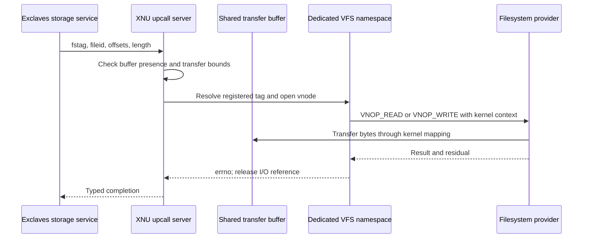

# Exclaves services: what an upcall can ask XNU to do

[Exclaves overview](exclaves.md) · [Execution and dispatch](exclaves-execution.md) · [Resources and memory](exclaves-resources-and-memory.md)

An Exclaves upcall enters a registered XNU handler through the proxy's RPC loop. Its payload is interpreted by a generated server and then by a local handler. The handler may use VFS, IOKit, task lifecycle, VM, or notification machinery before returning a typed completion result. It is not a syscall issued by an ordinary userspace process, and it need not use that process's file-descriptor table or credentials. [Upcall-server setup and dispatch](../../../xnu/osfmk/kern/exclaves_upcalls.c#L612-L707).

The local `.c` files expose the checks and downstream calls. Tightbeam-generated types and transport come from SDK modules; service policy, secure execution, and many hardware providers are external. The build assembles `exclaves.tightbeam.h/.c` from available modules rather than checking a complete generated server implementation into this tree. [Generation](../../../xnu/osfmk/kern/Makefile#L180-L203).

## Storage: a shared data buffer plus a separate file namespace

`exclaves_storage_init` maps the kernel-domain `com.apple.storage.backend` segment with write permission and keeps its kernel address as `storage_buffer`. The defined transfer area is 4 MiB. Restore/recovery/rooted-ramdisk and relaxed-requirement cases can let boot continue without that buffer; later I/O upcalls then fail. This is an explicit degraded mode, not successful initialization of an alternative private buffer. [Initialization and boot registration](../../../xnu/osfmk/kern/exclaves_storage.c#L270-L310), [size](../../../xnu/osfmk/kern/exclaves_storage.c#L45-L49).

The v2 read/write RPC carries `fstag`, `fileid`, and an I/O descriptor containing buffer offset, file offset, and length. XNU checks that the shared buffer exists and that buffer offset plus length fits it without overflow:

[Source: storage transfer bounds](../../../xnu/osfmk/kern/exclaves_storage.c#L57-L71)

<!-- source-excerpt: ../../../xnu/osfmk/kern/exclaves_storage.c#L57-L71 -->
```c
static int
verify_storage_buf_offset(uint64_t buf, uint64_t length)
{
	uint64_t off;
	if (__builtin_add_overflow(buf, length, &off)) {
		return ERANGE;
	}

	if (off > STORAGE_EXCLAVE_BUF_SIZE) {
		return ERANGE;
	}

	return 0;
}

```

It then calls `vfs_exclave_fs_read/write` with `storage_buffer + bufferoffset`. Errors are converted into the service's result enumeration and passed to the completion callback. A read places file bytes into the shared buffer; a write consumes bytes from it. The buffer offset is not an arbitrary XNU pointer accepted from the peer. Open/root handlers also require a terminator within their fixed-width string arrays. [Read/write handlers](../../../xnu/osfmk/kern/exclaves_storage.c#L702-L786), [string validation and open](../../../xnu/osfmk/kern/exclaves_storage.c#L51-L55), [open handler](../../../xnu/osfmk/kern/exclaves_storage.c#L614-L642).

The VFS layer defines `registered_fs_tag_t` and `open_vnode` records rather than resolving normal BSD file descriptors. Registration requires a started service, an APFS directory, suitable graft behavior, and a held vnode reference. Read-only tags query `FSIOC_EVAL_ROOTAUTH` to record sealing status. Only `EFT_EXCLAVE` and `EFT_EXCLAVE_MAIN` are considered writable by the local predicate. [Records](../../../xnu/bsd/vfs/vfs_exclave_fs.c#L50-L78), [registration](../../../xnu/bsd/vfs/vfs_exclave_fs.c#L510-L564), [writability](../../../xnu/bsd/vfs/vfs_exclave_fs.c#L279-L282).

`exclave_fs_open_internal` resolves either the registered base or an already-open root vnode. It uses `NOCROSSMOUNT`, chooses `NOFOLLOW` for writable tags and `FOLLOW` otherwise, and sets `ni_rootdir`, `NAMEI_ROOTDIR` and `USEDVP` before `vn_open_auth`. File creation unlinks an existing non-directory target first and then uses `O_EXCL`, preventing a concurrent replacement from being silently opened as the intended new file. These are the concrete pathname controls visible in this path; they should not be inflated into a proof of every filesystem/provider behavior. [Open path](../../../xnu/bsd/vfs/vfs_exclave_fs.c#L1005-L1134), [namei background](../vfs/pathname-and-authorization.md).

Open-vnode lookup uses the registered filesystem's device and inode/file ID, with graft-ID translation where required. Under `open_vnodes_mtx`, it acquires an I/O reference using `vnode_getwithref`. This is not a per-process descriptor lookup or a per-request check against the caller's Unix credentials. Resource-domain/secure-service authorization and this local vnode namespace play different roles. [Lookup](../../../xnu/bsd/vfs/vfs_exclave_fs.c#L858-L898), [open accounting](../../../xnu/bsd/vfs/vfs_exclave_fs.c#L904-L949).

The I/O body refuses writes to read-only tags, builds a `UIO_SYSSPACE` request, and invokes `VNOP_READ`/`VNOP_WRITE` with `vfs_context_kernel()`. A successful VNOP with residual bytes is translated to `EIO`; the vnode I/O reference is released on exit. Close decrements the tracked open count and calls `vn_close`. [I/O and wrappers](../../../xnu/bsd/vfs/vfs_exclave_fs.c#L1202-L1278), [close](../../../xnu/bsd/vfs/vfs_exclave_fs.c#L1165-L1199).



This path demonstrates why secure execution does not imply that XNU's entire VFS disappears from the service's dependency chain. The local code mediates storage and translates results. APFS implementation and the secure service's decisions about which requests to make are outside this inspection.

## Sensors and arbitrated buffers

Sensor use has two accounting layers: `r_sensor.s_startcount` tracks starts through one named resource record, shared by handles referring to that record, while `exclaves_sensor_t.s_startcount` tracks use of the underlying sensor. Resource open resolves a named SENSOR resource, initializes it, and retains it; start/stop serialize with its mutex and update the resource count only on success. Last-use cleanup attempts to balance its outstanding starts. [Resource operations](../../../xnu/osfmk/kern/exclaves_resource.c#L1476-L1590).

At the underlying layer, the first start calls the Exclaves indicator-controller interface; subsequent starts query status before incrementing the count. Intermediate stops query status and decrement; the last stop calls the controller, clears the underlying count, then queries status. The last status query can fail after the stop already happened, so a failure result does not imply that no state changed. A periodic status thread is awakened after the first start. [Sensor state machine](../../../xnu/osfmk/kern/exclaves_sensor.c#L495-L621), [controller request](../../../xnu/osfmk/kern/exclaves_sensor.c#L246).

These counters record successful API use and controller responses. The indicator hardware and the secure controller's enforcement are not implemented by these counters. Arbitrated sensor/audio buffers add a service copy/arbitration request before copying from an existing read-only shared mapping. That API control is distinct from whether XNU already has readable PTEs for the segment. [Arbitrated copyout](../../../xnu/osfmk/kern/exclaves_resource.c#L2168-L2205), [mapping permissions](exclaves-resources-and-memory.md#5-shared-memory-requires-both-service-permission-and-a-shareable-frame-type).

## Driver upcalls resolve an IOKit proxy

The v2 handlers in `exclaves_driverkit.c` convert generated request fields into local operation structs for interrupts, timers, work loops, asynchronous notifications, mapper activation and ANE/power requests. They pass a registry/service ID into IOKit and translate success/failure back into the generated result. The ID is not a userspace `io_connect_t`, and these calls do not go through an ordinary `IOUserClient::externalMethod`. [Interrupt handlers](../../../xnu/osfmk/kern/exclaves_driverkit.c#L550-L650), [timer handlers](../../../xnu/osfmk/kern/exclaves_driverkit.c#L652-L833), [mapper and ANE requests](../../../xnu/osfmk/kern/exclaves_driverkit.c#L902-L1054).

`getProxyStateFromRegistryID` looks up the registered proxy-state wrapper, verifies its dynamic type and nonnull state, and returns the associated service context. Interrupt/timer handlers retain the service during dispatch to its `exclave*` methods and release it afterward. This is an explicit XNU object-resolution/lifetime layer between the secure RPC and the provider. It does not by itself establish the secure side's authority to choose every registry ID. [Proxy lookup](../../../xnu/iokit/Exclaves/Exclaves.cpp#L319-L350), [interrupt dispatch](../../../xnu/iokit/Exclaves/Exclaves.cpp#L353-L389), [timer dispatch](../../../xnu/iokit/Exclaves/Exclaves.cpp#L392-L447).

Mapper activation obtains the service's provider, selects its `IOMapper` by index, and calls the platform's DART active-state function. This handler requests device-mapping state changes; it does not contain an IOMMU implementation or a proof that arbitrary secure pages are DMA-accessible. ANE requests similarly dispatch registered callbacks when present. [Mapper/ANE boundary](../../../xnu/iokit/Exclaves/Exclaves.cpp#L563-L650), [DMA ownership background](../drivers/memory-and-dma.md), [SPTM/IOMMU interface](sptm.md).

## Notifications leave the secure RPC through ordinary XNU event mechanisms

Kqueue notifications resolve their shared resource identity and call `KNOTE` under the resource mutex. The knote attach/detach/touch/process operations maintain the local listener state. This changes XNU event readiness; it is not a secure scheduling-context resume. [Filter operations](../../../xnu/osfmk/kern/exclaves_resource.c#L1609-L1728), [signal](../../../xnu/osfmk/kern/exclaves_resource.c#L1753-L1770).

Daemon notifications instead keep registered Mach send rights. The signal handler honors queue limits, removes inactive destinations, constructs header-only kernel messages with `COPY_SEND`, and calls `kernel_mach_msg_send_kmsg`. It logs send failures and continues; the function's `KERN_SUCCESS` does not guarantee every listener received a message. Removed destinations' resource references are released after unlocking, because final release can reacquire that mutex. [Complete signal path](../../../xnu/osfmk/kern/exclaves_resource.c#L1792-L1850).

Thus a secure-side event can follow `upcall → resource ID → XNU kqueue/Mach message → ordinary userspace receiver`. The Mach delivery path then has its usual queue, rights and receiver-lifetime rules. [Driver notification entry points](../../../xnu/osfmk/kern/exclaves_driverkit.c#L1057-L1110), [Mach delivery](../ipc/message-send-receive.md).

## Always-on work is another rendezvous protocol

Always-on Exclaves integration uses `aoe_item_t` entries on the conclave resource. They hold service IDs, message/messenger and work/worker counts, association state and power-assertion state. Startup creates a client for the named queue proxy when present. Legacy setup enables “free agent” workers; newer paths also select a service explicitly. [State](../../../xnu/osfmk/kern/exclaves_resource.h#L115-L126), [proxy setup](../../../xnu/osfmk/kern/exclaves_aoe.c#L51-L92), [conclave setup](../../../xnu/osfmk/kern/exclaves_aoe.c#L95-L176).

`exclaves_aoe_upcall_work_available` currently accepts the conclave-work variant, validates the service identifier, finds its associated initialized conclave, and posts a message. Posting increments a count and wakes threads waiting on that service's rendezvous. The claiming loop checks abort state, takes the resource mutex, consumes a queued message and increments messenger count, or installs an interruptible wait before dropping the lock and blocking. [Work upcall](../../../xnu/osfmk/kern/exclaves_aoe.c#L804-L842), [claim/post](../../../xnu/osfmk/kern/exclaves_aoe.c#L624-L679).

This permits work notification to be separate from the userspace thread that later enters an always-on work loop. The work-loop path marks `TH_EXCLAVES_AOE`, drives queue-proxy requests, and clears that state on its termination path. It does not create a universal right to run any secure service: setup and rendezvous use the attached conclave and its known services. [Worker loop](../../../xnu/osfmk/kern/exclaves_aoe.c#L465-L621), [execution state](exclaves-execution.md).

## Inspection, panic, and source-navigation tools

Inspection has its own coordinated entry boundary. Initialization selects the available stackshot-server variant, maps a read-only shared output buffer, and starts a collection thread. The collector requests results for scheduling-context IDs and copies bounded output into XNU storage. `exclaves_inspection_check_ast` can stop a thread from returning to Exclaves while stackshot/kperf inspection is pending, sleeping with the collection thread as inheritor. It is not an arbitrary debugger read of secure memory. [Initialization](../../../xnu/osfmk/kern/exclaves_inspection.c#L437-L520), [SCID collection](../../../xnu/osfmk/kern/exclaves_inspection.c#L232-L292), [return-path wait](../../../xnu/osfmk/kern/exclaves_inspection.c#L536-L564).

The panic service uses a dedicated XNU thread. It resolves `com.apple.service.PanicInit`, marks a spawn-expected phase, obtains a nonzero panic SCID, sets `TH_EXCLAVES_RESUME_PANIC_THREAD`, and repeatedly calls `exclaves_run`. This is a special persistent context and response protocol, not an ordinary user endpoint call or the SPTM panic-lockdown operation. [Panic context](../../../xnu/osfmk/kern/exclaves_panic.c#L89-L135), [thread creation](../../../xnu/osfmk/kern/exclaves_panic.c#L334-L351).

For a matching debug kernel, [`showallconclaves`, `showexclavesresourcetable -D <domain>`, and `showesynctable`](../../../xnu/tools/lldbmacros/exclaves.py) expose XNU task associations, local resource inventory and synchronization state. They do not dump the complete secure kernel. [`exclaves_tests.c`](../../../xnu/osfmk/kern/exclaves_tests.c), [daemon-notification tests](../../../xnu/tests/exclaves_daemon_notification_test.c), and [stackshot test support](../../../xnu/osfmk/kern/exclaves_test_stackshot.c) provide further entry points for reading expected protocols. None was executed during this documentation work.

## Inspection depth

Storage transfer validation, registration/open/I/O/close, resource and underlying sensor counters, representative IOKit dispatch, notification delivery, AOE work notification/claim, and inspection/panic handoffs were inspected. Other storage operations, all generated RPC branches, every provider callback, AOE power-state combinations and complete crash-buffer parsing were not audited exhaustively. The detailed execution guide covers how these handlers return to the secure caller; the resources guide covers the separate capability, mapping and physical-page lifetimes.

<!-- BEGIN PLATYDOC DOCUMENTATION LICENSE -->
Original Platydoc text and diagrams are licensed under [CC BY 4.0](https://creativecommons.org/licenses/by/4.0/). Quoted source code and third-party material retain their respective licenses.
<!-- END PLATYDOC DOCUMENTATION LICENSE -->
