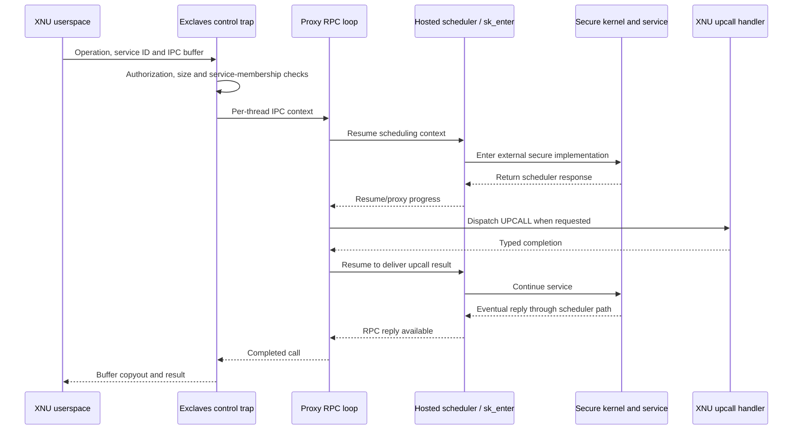

# Exclaves: execution, resources, and security boundaries

[Security index](README.md) · [SPTM/TXM/Exclaves entry map](protected-execution.md)

Under `CONFIG_EXCLAVES`, XNU coordinates work with the secure kernel and Exclaves services. It implements the userspace control trap, task associations, resource names and ports, RPC/upcall loops, host scheduling responses, VM-page donation, shared mappings, and bridges into VFS and IOKit. The secure kernel, Exclaves services, XrtHosted provider and parts of the transport are built elsewhere. The available source is rich enough to trace XNU's side of these interactions, including failure and return paths.

## Detailed reading route

| Guide | What it traces |
| --- | --- |
| [Execution, scheduler, and upcalls](exclaves-execution.md) | Trap authorization, per-thread IPC context/SCID, proxy protocol, per-core request/response buffers, `sk_enter`, epoch waits/wakes, upcall dispatch, interrupt resumption and cleanup |
| [Resources and physical memory](exclaves-resources-and-memory.md) | Resource-domain tables and send rights; task/conclave state machine; page donation and return; service permissions, SPTM frame types, device-pager mappings and copy bounds |
| [Services and diagnostics](exclaves-services.md) | Storage to VFS, sensor/arbitrated-buffer operations, driver upcalls, Mach/kqueue notifications, always-on work and inspection/panic contexts |

A *conclave* in this code is a resource associated with an XNU task and an external manager/control connection. Its local lifecycle is represented by `conclave_resource_t`; the task has an association with that resource. It is not itself the thread's IPC context or scheduling-context ID. [`conclave_resource_t`](../../../xnu/osfmk/kern/exclaves_resource.h#L131-L145), [`task attachment`](../../../xnu/osfmk/kern/exclaves_resource.c#L979-L1010).

## One endpoint call crosses several layers

Scheduler responses and RPC responses are distinct protocols. A scheduler wait can block an XNU thread and later resume the same secure context; an RPC `UPCALL` asks XNU to perform a particular service operation; an interrupt can temporarily enter XNU without completing either protocol. Follow [the execution guide](exclaves-execution.md) for the precise loops and state flags. The diagram omits failure and repeated scheduling steps.

## The objects are not interchangeable

| Object or identifier | Role |
| --- | --- |
| XNU task and attached conclave | Process lifecycle and resource-domain association |
| `exclaves_resource_t` and Mach port | Named/typed resource, active-use state and local capability lifetime |
| Thread IPC context and SCID | A communication buffer and external scheduling-context identity |
| Per-core hosted scheduler buffers | Request/response transport storage that requires CPU/interrupt discipline |
| Secure shared-memory handle | Service-issued mapping identity |
| Physical frame type | Monitor-level classification checked during donation, mapping and return |

Definitions and implementation: [resources](../../../xnu/osfmk/kern/exclaves_resource.h#L131-L206), [thread fields](../../../xnu/osfmk/kern/thread.h#L1111-L1129), [scheduler buffers](../../../xnu/osfmk/kern/exclaves.c#L1820-L1848), [shared-memory handle](../../../xnu/osfmk/kern/exclaves_shared_memory.c#L94-L148), [frame validation](../../../xnu/osfmk/kern/exclaves_memory.c#L294-L312).

For example, endpoint calls in this snapshot use an authorized service ID and require `MACH_PORT_NULL` in the port argument. Buffer and sensor operations instead resolve resource send rights. A valid buffer port does not turn its numerical name into an endpoint ID. Shared physical pages then require service-level mapping permission and a suitable SPTM shared-frame type before XNU creates PTEs. [Control trap](../../../xnu/osfmk/kern/exclaves.c#L213), [resource-port resolution](../../../xnu/osfmk/kern/exclaves_resource.c#L873-L908), [mapping trace](exclaves-resources-and-memory.md).

## Scope of the expanded reading

The detailed guides trace startup dependencies, trap and kernel downcalls, proxy/scheduler loops, memory/resource lifetimes, task state transitions, representative services, and interrupted-domain return. The secure-side implementations, complete generated transport, all provider policy and every timing combination remain outside this checkout's evidence. Runtime tests were not run.

Use [SPTM](sptm.md) for typed-memory and protected-call boundaries, [TXM](txm.md) for execution-policy requests, [Mach IPC](../ipc/README.md) for resource-port rights and notification delivery, and [ARM64 exception return](../platform/arm64-exception-return.md) for the ordinary XNU machinery surrounding protected-domain resumption.

<!-- BEGIN PLATYDOC DOCUMENTATION LICENSE -->
Original Platydoc text and diagrams are licensed under [CC BY 4.0](https://creativecommons.org/licenses/by/4.0/). Quoted source code and third-party material retain their respective licenses.
<!-- END PLATYDOC DOCUMENTATION LICENSE -->
