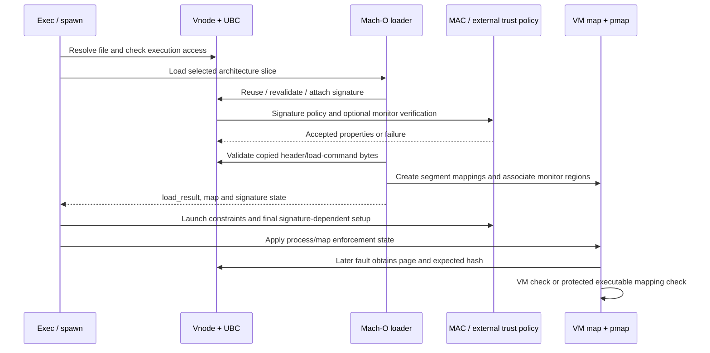

# From an attached signature to executable mappings and process policy

[Security](README.md) · [Signature format](signature-format-and-blob-validation.md) · [Vnode attachment](vnode-signature-lifecycle.md) · [Page validation](page-signature-validation.md) · [Mach-O loading](../../cross-cutting/executable-loading.md)

There is no single “check the signature” call covering the lifetime of an executable. XNU checks filesystem access, parses and accepts signature metadata, applies launch policy, creates VM mappings, validates the initially read load commands, establishes process signing state, and checks pages as mappings are installed. The same vnode can supply metadata and resident pages to several processes, while each process and map carries separate enforcement state. This chapter connects those stages and distinguishes the local code from external policy and cryptographic providers.

## 1. State moves across several objects

| Object | Relevant state | Transition it describes |
| --- | --- | --- |
| `image_params` | `ip_vp`, `ip_arch_offset`, `ip_csflags`, `ip_cs_error`, `ip_mac_return`, target thread/task context | An image being activated, including deferred fatal policy/signature results |
| `load_result_t` | `csflags`, `platform_binary`, `cs_end_offset`, entry point and mapping information | Results of parsing the selected Mach-O image and its loader |
| Vnode's `ubc_info` and `cs_blob` | Accepted file/slice signature metadata, coverage, generation and monitor identity | Shared file-level metadata, independent of one exec |
| Process state | `p_textvp`, `p_textoff`, signing flags through `proc_getcsflags`/update helpers | Main executable identity and process-level consequences |
| VM map/entry/pmap | Protections, enforcement, switch protection, COW backing, `csm_associated` | What this address space is allowed to map and which validation backend participates |
| Resident `vm_page` | Checked, tainted and NX masks, writable-mapping history | Cached evidence about a physical page's contents/exposure |

[Image parameters](../../../xnu/bsd/sys/imgact.h), [load result](../../../xnu/bsd/kern/mach_loader.h#L63), [UBC/blob structures](../../../xnu/bsd/sys/ubc_internal.h#L106-L195), [exec flag transfer](../../../xnu/bsd/kern/kern_exec.c#L2162-L2195), [final process setup](../../../xnu/bsd/kern/kern_exec.c#L8562-L8593), [VM page state](../../../xnu/osfmk/vm/vm_page.h#L390-L410).

`CS_SIGNED` explicitly permits the possibility that the process has since become invalid. `CS_VALID` describes dynamic validity at the layer storing it. `CS_HARD` and `CS_KILL` control invalid-page consequences; `CS_REQUIRE_LV` requests library validation; `CS_ENTITLEMENTS_VALIDATED` carries a distinct restricted-entitlement property. None is a replacement for checking whether a particular page's expected hash matches its bytes. [Flag definitions](../../../xnu/osfmk/kern/cs_blobs.h#L35-L75).



The sequence is an orientation view. The concrete final process routine sets map flags before its launch-constraint call, and parsing performs several passes; the sections below preserve those exact orderings.

## 2. Execution access is checked before signature acceptance

`exec_check_permissions()` requires a regular nonempty file, obtains ownership/mode/size attributes, checks that an execute bit exists for filesystems without opaque authorization, adjusts set-ID and spawn behavior, invokes `mac_vnode_check_exec()` and then `vnode_authorize(KAUTH_VNODE_EXECUTE)`. A traced image also requires read access. The function's old write-open/`ETXTBSY` check is inside `#if 0`; it must not be presented as the active generic defense against every concurrent write. [Permission path](../../../xnu/bsd/kern/kern_exec.c#L7385-L7495).

The exec MAC hook receives the vnode, possible script vnode and labels, execution label, component-name state, spawn-specific policy data and a pointer to `ip_csflags`. The wrapper iterates installed policy providers and combines errors. This is a launch/access-policy opportunity, separate from the later hook that receives a parsed `cs_blob`. Scripts also explain why “the path initially passed to exec” and “the Mach-O image ultimately loaded” need not be the same file. This chapter follows the Mach-O activation branch; interpreter selection and all script-policy combinations are not reconstructed here. [Exec hook dispatch](../../../xnu/security/mac_vfs.c#L1219-L1293), [image activation context](../../../xnu/bsd/kern/kern_exec.c#L1923).

A pathname/name-cache hit or cached authorization result does not supply signature hashes. Those caches can make object resolution or an access check cheaper, but the signature and page paths still operate on the vnode and VM relationships they return. [Vnode and authorization caches](../vfs/vnode-cache-identity-and-reuse.md).

## 3. The loader accepts signature metadata before mapping segments

`parse_machfile()` obtains the file's UBC control, checks that header plus load commands fit the selected slice, allocates a page-rounded kernel buffer and reads it through `vn_rdwr()`. An error or short read fails this initial load-command read. It scans commands in four passes: layout/platform information, thread/UUID/signature information, segments, then dynamic-linker/encryption-related work. `LC_CODE_SIGNATURE` is processed in pass 1, before segment mapping in pass 2. [Initial command read](../../../xnu/bsd/kern/mach_loader.c#L1374-L1415), [signature dispatch](../../../xnu/bsd/kern/mach_loader.c#L1750-L1782), [parser overview](../../cross-cutting/executable-loading.md).

`load_code_signature()` first asks UBC for a blob matching vnode, CPU context and slice offset. A valid, architecture-specific blob with a current generation can avoid rereading signature bytes. A stale or architecture-neutral blob goes through revalidation; a successful neutral-CPU revalidation updates the stored CPU information using the read-only zone update interface. `EAGAIN` specifically means reread and attempt attachment again; other revalidation errors fail. The new-data path checks command size and offset-plus-size bounds, allocates storage, reads exactly the command's signature byte count, and rejects a nonzero residual. [Cache/revalidation branch](../../../xnu/bsd/kern/mach_loader.c#L3787-L3848), [new read and add](../../../xnu/bsd/kern/mach_loader.c#L3850-L3903).

The cached success branch is short:

[Source: bsd/kern/mach_loader.c, lines 3810–3814](../../../xnu/bsd/kern/mach_loader.c#L3810-L3814)

<!-- source-excerpt: ../../../xnu/bsd/kern/mach_loader.c#L3810-L3814 -->
```c
		if (!anyCPU && ubc_cs_generation_check(vp) == 0) {
			/* No need to revalidate, we're good! */
			ret = LOAD_SUCCESS;
			goto out;
		}
```

The loader passes `CS_BLOB_ADD_ALLOW_MAIN_BINARY` to `ubc_cs_blob_add()`. That routine consumes signature storage, validates its structure, runs the appropriate MAC/monitor steps, resolves duplicate or conflicting attachment, and publishes accepted metadata. These operations and their failure ownership are covered in [vnode signature lifecycle](vnode-signature-lifecycle.md). On success the loader copies blob flags, platform status and signed end offset into `load_result_t`. That does not copy the blob into the process or eagerly validate every instruction page. [Attachment call](../../../xnu/bsd/kern/mach_loader.c#L3883-L3903), [result transfer](../../../xnu/bsd/kern/mach_loader.c#L3910-L3924).

There are two important enforcement distinctions in the parser. A signature-load failure can be changed back to `LOAD_SUCCESS` when global process enforcement is disabled; the parser does not set `got_code_signatures` on that failure path. After all passes, absence of accepted code-signature information fails the load when global enforcement is enabled. A deferred fatal reason in `ip_cs_error` is also handled later, so ignoring the immediate parser return is not a universal promise that launch proceeds. [Immediate failure handling](../../../xnu/bsd/kern/mach_loader.c#L1770-L1782), [missing signature](../../../xnu/bsd/kern/mach_loader.c#L1934-L1941), [deferred fatal reason](../../../xnu/bsd/kern/kern_exec.c#L8610-L8615).

## 4. Initial command bytes are validated separately from later faults

Once the signature has been accepted, the loader checks the already copied header/load-command buffer with `cs_validate_range()`. It iterates by VM pages, passing the slice file offset plus iteration offset and the corresponding kernel-buffer address. It treats either “no hash validated” or `CS_VALIDATE_TAINTED` as a problem, clears `CS_VALID`, and fails when global enforcement or the result's hard/kill/enforcement flags demand it. [Initial validation loop](../../../xnu/bsd/kern/mach_loader.c#L1784-L1816).

[Source: bsd/kern/mach_loader.c, lines 1797–1813](../../../xnu/bsd/kern/mach_loader.c#L1797-L1813)

<!-- source-excerpt: ../../../xnu/bsd/kern/mach_loader.c#L1797-L1813 -->
```c
						valid = cs_validate_range(vp,
						    NULL,
						    file_offset + off,
						    (const void *)((uintptr_t)addr + off),
						    MIN(PAGE_SIZE, cmds_size),
						    &tainted);
						if (!valid || (tainted & CS_VALIDATE_TAINTED)) {
							if (cs_debug) {
								printf("CODE SIGNING: %s[%d]: invalid initial page at offset %lld validated:%d tainted:%d csflags:0x%x\n",
								    vp->v_name, proc_getpid(p), (long long)(file_offset + off), valid, tainted, result->csflags);
							}
							if (cs_process_global_enforcement() ||
							    (result->csflags & (CS_HARD | CS_KILL | CS_ENFORCEMENT))) {
								ret = LOAD_FAILURE;
							}
							result->csflags &= ~CS_VALID;
						}
```

This check protects bytes the parser already consumed into a kernel buffer. It is not the resident-page mask update performed by `vm_page_validate_cs_mapped_slow()`, and it does not imply all mapped segments have been read. The code's `cs_validate_range()` Boolean and taint result must both be examined. In this loop NX alone is not the mismatch predicate; later execute mapping applies NX policy. [Hash result semantics](page-signature-validation.md#2-how-a-file-offset-becomes-a-hash-comparison).

`map_segment()` installs file-backed VM ranges through `vm_map_enter_mem_object_control()` with copy semantics, requested protections and `VM_INHERIT_DEFAULT`. Anonymous zero-fill uses a separate mapping path. On the OSX branch, it supplies an explicit signing-enforcement override derived from the **new image's** `load_result` because the current process does not yet have those new flags. Otherwise using the old process flags during image construction could apply the wrong policy. [Segment mapping](../../../xnu/bsd/kern/mach_loader.c#L2294-L2376).

[Source: bsd/kern/mach_loader.c, lines 2342–2347](../../../xnu/bsd/kern/mach_loader.c#L2342-L2347)

<!-- source-excerpt: ../../../xnu/bsd/kern/mach_loader.c#L2342-L2347 -->
```c
	if (result->csflags & CS_ENFORCEMENT) {
		vmk_flags.vmkf_cs_enforcement = TRUE;
	} else {
		vmk_flags.vmkf_cs_enforcement = FALSE;
	}
	vmk_flags.vmkf_cs_enforcement_override = TRUE;
```

`load_machfile()` marks the post-parse point as safe for vnode entitlement queries and then configures initial entitlement-based security state. The dynamic linker is itself parsed through the loader path, but the full user-space selection, dependency loading and linking algorithms are outside this checkout's kernel loader. [Post-parse setup](../../../xnu/bsd/kern/mach_loader.c#L872-L892), [dyld loading](../../../xnu/bsd/kern/mach_loader.c#L3390), [image loading guide](../../cross-cutting/executable-loading.md).

## 5. Exec publishes process flags and performs final launch checks

The Mach-O activator transfers a selected mask of signature flags into `ip_csflags` only when `load_result.csflags` contains `CS_VALID`; otherwise it clears validity. Parent-requested exec-hard, exec-kill and exec-enforcement flags can add restrictions independently. This is neither a blind copy of all signature fields nor proof that all flags originate inside a CodeDirectory. [Activator transfer](../../../xnu/bsd/kern/kern_exec.c#L2162-L2195).

Later `process_signature()` publishes `ip_csflags` under the process lock. It sets map switch protection for hard/kill policy and sets the map's signing enforcement from `CS_ENFORCEMENT`. It then handles saved MAC activation failure, a fatal signature reason, launch constraints, subsystem-root restrictions and selected platform checks. Only after those gates does `CS_SIGNED` from image activation skip the external-signature/task-access-port route. [Final setup](../../../xnu/bsd/kern/kern_exec.c#L8562-L8682).

[Source: bsd/kern/kern_exec.c, lines 8579–8593](../../../xnu/bsd/kern/kern_exec.c#L8579-L8593)

<!-- source-excerpt: ../../../xnu/bsd/kern/kern_exec.c#L8579-L8593 -->
```c
	proc_lock(p);
	proc_csflags_update(p, imgp->ip_csflags);
	proc_unlock(p);

	/* Set the switch_protect flag on the map */
	if (proc_getcsflags(p) & (CS_HARD | CS_KILL)) {
		vm_map_switch_protect(get_task_map(proc_task(p)), TRUE);
	}
	/* set the cs_enforced flags in the map */
	if (proc_getcsflags(p) & CS_ENFORCEMENT) {
		vm_map_cs_enforcement_set(get_task_map(proc_task(p)), TRUE);
	} else {
		vm_map_cs_enforcement_set(get_task_map(proc_task(p)), FALSE);
	}

```

The launch-constraint hook receives process/image context and can provide an exit reason. The local kernel wrapper establishes when it is called and how failure propagates; it does not disclose a complete platform launch policy. Likewise, successful signature attachment alone cannot establish that a later launch constraint or architecture-dependent task setup will succeed. [Constraint gate](../../../xnu/bsd/kern/kern_exec.c#L8617-L8622), [machine setup](../../../xnu/bsd/kern/kern_exec.c#L8488-L8525).

On the successful tail, `proc_process_signature()` invokes `machine_task_process_signature()` using the process platform and SDK, and `thread_process_signature()` updates the new main thread. Failure can create a reason and arrange termination. For the spawn branch, the routine can return zero after scheduling a kill on the new thread/process; therefore its integer return alone is not a complete description of whether the new image will execute. The enclosing exec/spawn lifecycle and its return gates remain necessary context. [Final thread/process setup and failure](../../../xnu/bsd/kern/kern_exec.c#L8770-L8825), [process transitions](../processes/process-transitions.md).

## 6. The external-signature route has narrower acceptance

For an image not marked `CS_SIGNED` by activation, `process_signature()` obtains the task access port. The visible `require_success` local starts false and is not made true in this body; an absent usable port can therefore end this portion successfully. It is inaccurate to summarize the routine as “every executable must receive taskgated approval.” Other parser, platform and mapping gates still apply. [Port branch](../../../xnu/bsd/kern/kern_exec.c#L8562-L8572), [port acquisition](../../../xnu/bsd/kern/kern_exec.c#L8683-L8700).

When a port exists, the explicit upcall wrapper calls `find_code_signature(port, pid)`. `KERN_SUCCESS` allows further processing; `KERN_FAILURE` represents a rejected signature; other transport/errors are treated as unexpected failures. The daemon implementation and generated server behavior are not reconstructed from this kernel client. [Upcall wrapper](../../../xnu/bsd/kern/kern_exec.c#L8471-L8481), [reply handling](../../../xnu/bsd/kern/kern_exec.c#L8702-L8728).

After that route, a vnode blob can confer `CS_SIGNED | CS_VALID` only under the visible restricted predicate:

1. Its generation is current or revalidation succeeds.
2. Its `CS_ALLOWED_MACHO` flags equal `CS_ADHOC`.
3. It has no CMS signature-wrapper subblob; the ad hoc flag alone is insufficient.
4. It is not a platform binary.
5. It has neither XML nor DER entitlement blob.

The code deliberately excludes a detached blob from recreating the full privileged embedded-signature path. If the predicate fails, this body logs that the detached signature is ignored; it does not itself turn that exact branch into a new unconditional launch failure. Other execution/mapping policy remains in force. [Detached acceptance](../../../xnu/bsd/kern/kern_exec.c#L8730-L8767).

[Source: bsd/kern/kern_exec.c, lines 8739–8767](../../../xnu/bsd/kern/kern_exec.c#L8739-L8767)

<!-- source-excerpt: ../../../xnu/bsd/kern/kern_exec.c#L8739-L8767 -->
```c
			if (
				/* Revalidate the blob if necessary through bumped generation count. */
				(ubc_cs_generation_check(p->p_textvp) == 0 ||
				ubc_cs_blob_revalidate(p->p_textvp, csb, imgp, 0, proc_platform(p)) == 0) &&
				/* Only CS_ADHOC, no CS_KILL, CS_HARD etc. */
				(csb->csb_flags & CS_ALLOWED_MACHO) == CS_ADHOC &&
				/* If it has a CMS blob, it's not adhoc. The CS_ADHOC flag can lie. */
				csblob_find_blob_bytes((const uint8_t *)csb->csb_mem_kaddr, csb->csb_mem_size,
				CSSLOT_SIGNATURESLOT,
				CSMAGIC_BLOBWRAPPER) == NULL &&
				/* It could still be in a trust cache (unlikely with CS_ADHOC), or a magic path. */
				csb->csb_platform_binary == 0 &&
				/* No entitlements, not even unrestricted ones. */
				csb->csb_entitlements_blob == NULL &&
				csb->csb_der_entitlements_blob == NULL) {
				proc_lock(p);
				proc_csflags_set(p, CS_SIGNED | CS_VALID);
				proc_unlock(p);
			} else {
				uint8_t cdhash[CS_CDHASH_LEN];
				char cdhash_string[CS_CDHASH_STRING_SIZE];
				proc_getcdhash(p, cdhash);
				cdhash_to_string(cdhash_string, cdhash);
				printf("ignoring detached code signature on '%s' with cdhash '%s' "
				    "because it is invalid, or not a simple adhoc signature.\n",
				    p->p_name, cdhash_string);
			}
		}
	}
```

This also distinguishes attaching a signature from granting process validity: `fcntl` can publish metadata on a vnode, but this later consumer decides what that metadata may do for the launching process. The [attachment chapter](vnode-signature-lifecycle.md) follows those file-control entry points and their post-publication copyout failures.

## 7. Mapping a library adds its own access and policy gates

The `mmap` file path derives maximum protections from descriptor access and mapping mode, runs the MAC file-mmap hook with a modifiable `maxprot`, and calls `VNOP_MMAP_CHECK`. For a private mapping it removes write from that filesystem check because later private writes target COW backing. These are admission checks; successful admission is not a digest comparison of all pages. [File mapping checks](../../../xnu/bsd/kern/kern_mman.c#L641-L693), [MAC mmap wrapper](../../../xnu/security/mac_file.c#L174-L187).

`ubc_map()` is a separate mapping-notification/lifetime path. Although it invokes `VNOP_MMAP`, the inspected body resets `error` to zero afterward. The earlier comment about propagating `EPERM` does not describe that current body. Use the actual `mac_file_check_mmap` and `VNOP_MMAP_CHECK` path above when identifying an admission rejection, and read UBC mapping state as a separate obligation. [UBC map behavior](../../../xnu/bsd/kern/ubc_subr.c#L2017-L2030), [UBC mapping lifetime](../vfs/file-data-cache-and-read-path.md).

`F_CHECK_LV` provides a separate explicit library-validation entry. `fcntl` requires a vnode-backed file descriptor, imports the 32/64-bit argument structure and forwards the fileglob, slice offset and user error-message buffer to `mac_file_check_library_validation()`. The wrapper dispatches `file_check_library_validation` through MAC. These local bodies do not implement a complete “same team / platform / exception entitlement” policy. Nor do they show every user-space loader call that chooses when to issue this command. [File-control path](../../../xnu/bsd/kern/kern_descrip.c#L4389-L4422), [policy dispatch](../../../xnu/security/mac_file.c#L154-L165).

For investigating a library, follow its own signature attachment and coverage, the caller's process policy, file-map admission, monitor association where configured, and eventual page faults. The main executable's `p_textvp` is not a list of every loaded library, and a successful main-image signature does not hash a library's unrelated contents.

## 8. VM connects a signed file interval to a monitor region

Under `CODE_SIGNING_MONITOR`, entry insertion calls `vm_map_entry_cs_associate()` before publishing the map-store slot. The caller shown in `vm_map_store.c` discards the function's integer result; the association function itself can remove execute from the entry's current and maximum protections on a real error. This is an important observable boundary: mapping construction and retaining executable permissions are not identical success conditions. [Entry insertion](../../../xnu/osfmk/vm/vm_map_store.c#L2752-L2760), [association result](../../../xnu/osfmk/vm/vm_map.c#L21185-L21242).

The helper skips submaps, missing pmaps/objects and exempt address spaces. It normally acts only on executable entries, with a debugger-style protection-copy exception. Debug and JIT association use their own calls. For ordinary file backing, it:

1. Takes the entry's VM object and offset.
2. Walks its shadow chain, adding shadow offsets while transferring object locks.
3. Adds the external object's paging offset.
4. Asks transformation pagers for an underlying backing object and repeats if necessary.
5. Obtains the vnode and its blob list.
6. Calls `cs_associate_blob_with_mapping()` with the pmap, virtual start/length and resulting file offset.

[Early branches](../../../xnu/osfmk/vm/vm_map.c#L21009-L21118), [object/backing traversal](../../../xnu/osfmk/vm/vm_map.c#L21119-L21182).

The UBC association requires a **single** blob covering the entire requested file interval, live signature storage and a monitor signature object. It passes `offset - (csb_base_offset + csb_start_offset)` as the segment offset into that signed region. Choosing a blob for one page hash and associating a whole virtual interval therefore use related but different coverage tests. [Range-to-blob association](../../../xnu/bsd/kern/ubc_subr.c#L6391-L6449).

On successful association, VM marks `csm_associated`; configured executable immutability can also mark the entry permanent. `KERN_NOT_SUPPORTED` leaves ordinary VM validation responsible. Other failures generally strip execute permissions, except for the explicitly documented immutable-overwrite case. A return through an early success branch is not automatically the same as reaching the final block that sets `csm_associated`. [Result handling](../../../xnu/osfmk/vm/vm_map.c#L21185-L21242).

[Source: osfmk/vm/vm_map.c, lines 21227–21237](../../../xnu/osfmk/vm/vm_map.c#L21227-L21237)

<!-- source-excerpt: ../../../xnu/osfmk/vm/vm_map.c#L21227-L21237 -->
```c
		if (vmk_flags.vmkf_overwrite_immutable) {
			/*
			 * We can get here when we remap an apple_protect pager
			 * on top of an already cs_associated executable mapping
			 * with the same code signatures, so we don't want to
			 * lose VM_PROT_EXECUTE in that case...
			 */
		} else {
			entry->protection &= ~VM_PROT_ALLEXEC;
			entry->max_protection &= ~VM_PROT_ALLEXEC;
		}
```

`vm_map_protect()` revisits association when an unassociated mapping becomes executable or an associated mapping becomes writable, using the debug/protection-copy contract. Fault lookup later copies `csm_associated` into fault information; JIT, explicitly exempt address spaces and resilient-code-signing entries have distinct bypass inputs. Neither association nor those fields should be described as a hash of a page that has not yet faulted in. [Protection change](../../../xnu/osfmk/vm/vm_map.c#L5997-L6036), [fault information](../../../xnu/osfmk/vm/vm_fault.c#L4773-L4789), [page/monitor check](page-signature-validation.md#6-monitor-association-and-executable-page-entry-are-separate-stages).

The [TXM chapter](txm.md) follows CSM into signature registration, verification, trusted-region association and protected calls. SPTM pmap insertion can then report a signing error for an actual physical mapping. The external monitor determines the protected implementation; XNU retains mapping, fault and lifetime bookkeeping.

## 9. Failure and cache-reuse checkpoints

| Checkpoint | What can already exist | Visible next action or failure |
| --- | --- | --- |
| Signature read/parse fails | Vnode and possibly resident file pages | Loader failure, or the explicitly configured immediate-error tolerance |
| Signature attachment succeeds, later output copy fails | Published vnode blob | Caller sees an error without automatic removal of the attached metadata |
| Header-buffer validation fails | Accepted blob and copied commands | Clear image validity; enforce load failure when required |
| Segment/monitor association fails | A VM entry under construction | Association error and normally removed execute protections; insertion caller need not return that error directly |
| Launch constraints/final machine setup fails | New image/process state may already be constructed | Exit reason and exec/spawn termination handling |
| Later executable page fails | Running process and shared file cache | Fault/mapping error, hard rejection, process invalidation or kill according to the selected path |
| Resident page is evicted | Vnode and blob can remain | Read and validate a replacement page, with the optional bitmap/backend distinctions |
| Vnode/UBC state is reclaimed | Earlier pages and signatures may have independent drains | Destroy attached metadata only through the documented reclaim/lifetime protocol |

[Attachment failure boundaries](vnode-signature-lifecycle.md), [initial validation](../../../xnu/bsd/kern/mach_loader.c#L1784-L1816), [map association](../../../xnu/osfmk/vm/vm_map.c#L21185-L21242), [exec completion](../../../xnu/bsd/kern/kern_exec.c#L8770-L8825), [page failure](page-signature-validation.md), [vnode reuse](../vfs/vnode-cache-identity-and-reuse.md).

For a concrete investigation, start with `(vnode identity, slice offset)`, then record the blob generation/coverage/flags, process signing flags, VM object's file offset, map-entry protections/association and page masks. A pathname alone is insufficient: replacement can produce a different vnode, different slices can select different metadata, and processes can share backing while applying separate policy.

## 10. Where the available implementation ends

| Boundary | What this tree demonstrates | What remains external or outside this trace |
| --- | --- | --- |
| AMFI/MAC signature and launch policy | Hook arguments, ordering, result propagation, allowed metadata updates and fatal reasons | Full platform trust rules, entitlement approval and launch-constraint algorithms |
| CoreTrust/cryptographic providers | Registered function tables and caller-visible interfaces | Complete certificate-chain/CMS/provisioning implementation |
| Trust caches | XNU query/load synchronization and backend selection, plus TXM/PPL-facing calls | Every provider's trust derivation and protected cache internals |
| Task access daemon | `find_code_signature` client call and local response handling | Daemon policy, user-space file/signature discovery and server implementation |
| User-space dynamic loader | Kernel Mach-O/dyld entry setup, mapping and library-validation interfaces | Complete library graph, loader scheduling and every invocation of those interfaces |
| Filesystem | Vnode operation dispatch, UBC backing and invalidation contracts | APFS-specific on-disk signature storage, inode cache and transaction/integrity implementation |
| Protected mapping monitor | Region association, fault deferral and pmap success/error handling | Monitor code, protected digest/trust enforcement and complete hardware transitions |

[AMFI interface](../../../xnu/libkern/libkern/amfi/amfi.h), [CoreTrust interface](../../../xnu/libkern/libkern/coretrust/coretrust.h), [trust-cache frontend](../../../xnu/bsd/kern/kern_trustcache.c#L731), [signature hook](../../../xnu/security/mac_vfs.c#L1316-L1424), [TXM](txm.md), [filesystem boundaries](../vfs/README.md).

Deep reads for this chapter cover the permission/MAC path, signature-command cache/read branch, initial-buffer check, segment mapping, process flag/constraint/task-access handling, detached acceptance, mmap/library-validation gates, VM association and its callers. The companion chapters supply blob parsing/publication and actual page hashing. No kernel or executable was run, and the guide does not infer absent policy from the existence of a hook.

<!-- BEGIN PLATYDOC DOCUMENTATION LICENSE -->
Original Platydoc text and diagrams are licensed under [CC BY 4.0](https://creativecommons.org/licenses/by/4.0/). Quoted source code and third-party material retain their respective licenses.
<!-- END PLATYDOC DOCUMENTATION LICENSE -->
