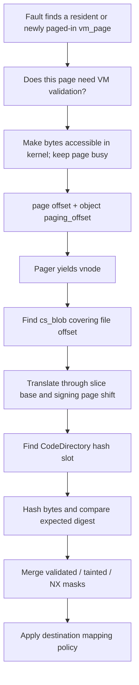

# File-page signature validation and cached integrity state

[Security](README.md) · [File-data cache](../vfs/file-data-cache-and-read-path.md) · [Vnode signature lifetime](vnode-signature-lifecycle.md) · [Executable policy](executable-signature-policy.md)

A resident file page and an accepted signature are separate cached objects. UBC connects the vnode to a file-backed VM object; its `cs_blobs` list supplies signature coverage and expected hashes. Each resident `vm_page` separately records whether its bytes were checked, whether they were found or considered tainted, and whether they must not execute. The VM fault path combines those records with the destination map's policy and requested protections. A code-signing monitor can own the executable-mapping decision instead. This chapter follows those paths and the events that invalidate their cached results. [UBC state](../../../platydoc-data/xnu/bsd/sys/ubc_internal.h#L106-L195), [page state](../../../platydoc-data/xnu/osfmk/vm/vm_page.h#L390-L410), [fault policy](../../../platydoc-data/xnu/osfmk/vm/vm_fault.c#L2702-L2930).

## 1. Four different kinds of validity

| State | Object and meaning | What it does not establish |
| --- | --- | --- |
| Accepted signature metadata | A published `cs_blob`, its selected CodeDirectory, policy-derived flags and optional monitor object | That all file contents are resident or have been hashed |
| Signed backing object | `vm_object::code_signed`, set through `memory_object_signed()` | That every offset has a usable hash or every page matches |
| Cached page result | `vmp_cs_validated`, `vmp_cs_tainted`, `vmp_cs_nx` | The process's trust status or permission to install every kind of mapping |
| Process/map policy | Process signing flags, pmap's map-enforcement state, map-entry protections and monitor association | An independent copy of each page's expected digest |

`memory_object_signed()` takes the object lock and changes its signed-object flag. Page-check results belong to the pages of that object, so different processes can encounter the same cached integrity result while applying different destination policy. The ordinary file mapping and COW paths determine whether they actually share a resident page. [Object flag](../../../platydoc-data/xnu/osfmk/vm/memory_object.c#L1786-L1828), [fault decision](../../../platydoc-data/xnu/osfmk/vm/vm_fault.c#L2848-L2930), [COW](../vm/fault-resolution.md).

The page fields are four-bit masks. `VMP_CS_ALL_TRUE` is `0xF`; `VMP_CS_FOR_OFFSET()` selects a bit by a 4 KiB offset. For a whole-page query, **validated requires every bit**, whereas **tainted or NX needs any bit**. Smaller-map queries select the relevant subpage. Do not interpret these fields as three ordinary Booleans or assume the signing chunk, VM page and mapping granule always have the same size. [Mask layout](../../../platydoc-data/xnu/osfmk/mach/memory_object_types.h#L487-L500), [query helpers](../../../platydoc-data/xnu/osfmk/vm/vm_page_internal.h#L208-L260).

For example, on a 16 KiB VM page with four 4 KiB signing chunks, suppose chunk 0 matches, chunk 1 mismatches, chunk 2 has no hash, and chunk 3 matches but ends at a partial signed boundary. The resulting masks can be `validated=1011`, `tainted=0010`, `nx=1000` in binary, with the least significant bit representing chunk 0. The whole page is not fully validated and is tainted/NX, while a 4 KiB access to chunk 0 sees its own bits. This is a worked interpretation of the mask-building code, not an executed test. [Result construction](../../../platydoc-data/xnu/bsd/kern/ubc_subr.c#L6123-L6175).

## 2. How a file offset becomes a hash comparison

The ordinary chain is:



`vm_page_validate_cs_mapped_slow()` requires a busy page, an exclusively locked external signed object, a ready pager and an active paging reference. It obtains the vnode from the pager and computes `page->vmp_offset + object->paging_offset`. That file offset is not a process virtual address. `cs_validate_hash()` subtracts each blob's `csb_base_offset` to obtain a slice-relative offset, checks `csb_start_offset..csb_end_offset`, skips blobs whose signature storage has been released, and locates a hash through the selected CodeDirectory. [VM-to-vnode handoff](../../../platydoc-data/xnu/osfmk/vm/vm_fault.c#L8905-L8950), [blob/slot search](../../../platydoc-data/xnu/bsd/kern/ubc_subr.c#L5838-L5911).

The `hashes()` helper accounts for ordinary slot indexing and scatter mappings; its bounds and format prerequisites are explained in [signature format and validation](signature-format-and-blob-validation.md). The page validator requires alignment to the blob's signing-page shift. A covering blob with a CodeDirectory ends this search even when the selected slot is absent; the code does not universally search every later overlapping signature for a preferred digest. [Search termination](../../../platydoc-data/xnu/bsd/kern/ubc_subr.c#L5878-L5911).

The expected digest is copied to a local array before computing the actual one. The selected `cs_hash` supplies initialization, update and finalization, and the comparison uses `cs_size`. For reconstituted multilevel signatures, it hashes each first-level chunk, feeds those chunk digests into a cumulative hash, and compares the cumulative result. Names such as `asha1` and a `"SHA1 OK"` debug string do not mean all signatures use SHA-1. [Digest computation](../../../platydoc-data/xnu/bsd/kern/ubc_subr.c#L5933-L5997), [format and hash selection](signature-format-and-blob-validation.md).

If the signing chunk crosses the CodeDirectory's `codeLimit`, the validator hashes only the final signed prefix and sets `CS_VALIDATE_NX`. `bytes_processed` still describes the signing chunk size. Matching the signed prefix therefore does not authorize execution of its unsigned tail. The inspected function uses the 32-bit `codeLimit` member; the existence of a newer format field does not change this body's arithmetic. [Partial final chunk](../../../platydoc-data/xnu/bsd/kern/ubc_subr.c#L5933-L5944).

The most consequential return convention is:

| Hash lookup/comparison | Boolean result | Other output |
| --- | --- | --- |
| No usable hash | False | No taint from this helper; `bytes_processed` stays at the caller's initial zero |
| Hash found and equal | True | No mismatch taint; partial coverage can still set NX |
| Hash found and unequal | True | `CS_VALIDATE_TAINTED` set; partial coverage can also set NX |

Thus “validated” means the hash was available and evaluated; it is not synonymous with “matched.” The mismatch assignment and unconditional checked result are visible in the selected excerpts:

[Source: bsd/kern/ubc_subr.c, lines 5983–5984](../../../platydoc-data/xnu/bsd/kern/ubc_subr.c#L5983-L5984)

<!-- source-excerpt: ../../../platydoc-data/xnu/bsd/kern/ubc_subr.c#L5983-L5984 -->
```c
			cs_validate_page_bad_hash++;
			*tainted |= CS_VALIDATE_TAINTED;
```

[Source: bsd/kern/ubc_subr.c, lines 5993–5997](../../../platydoc-data/xnu/bsd/kern/ubc_subr.c#L5993-L5997)

<!-- source-excerpt: ../../../platydoc-data/xnu/bsd/kern/ubc_subr.c#L5993-L5997 -->
```c
		validated = TRUE;
	}

	return validated;
}
```

`cs_validate_page()` starts with empty masks and walks a VM page. A missing hash advances by 4 KiB and leaves that subpage unchecked. A full-page signing chunk sets the whole mask; smaller chunks set individual bits. `cs_validate_range()` instead returns whether every processed subrange had a hash, ORs the taint flags and stops if the helper cannot make forward progress. Its caller still must test taint separately. Under `CONFIG_SUPPLEMENTAL_SIGNATURES`, a translated process can use the supplemental blob when the ordinary list is absent. Development/debug integrity-skip configuration supplies another explicit branch; it should not be silently included in production behavior. [Page loop](../../../platydoc-data/xnu/bsd/kern/ubc_subr.c#L6076-L6175), [range loop and build branches](../../../platydoc-data/xnu/bsd/kern/ubc_subr.c#L6000-L6073).

## 3. When the cached result avoids hashing

`vm_fault_cs_need_validation()` skips kernel-pmap accesses and objects not marked signed. For a whole page, it can skip a page already entirely tainted, or one fully validated and never mapped writable. For a subpage, it tests the selected bits. Skipping an already tainted page avoids redundant work; the later policy stage still sees the taint and can reject it. [Need-validation predicate](../../../platydoc-data/xnu/osfmk/vm/vm_fault.c#L2709-L2758).

The whole-page reuse condition is deliberately narrower than “resident in cache”:

[Source: osfmk/vm/vm_fault.c, lines 2734–2738](../../../platydoc-data/xnu/osfmk/vm/vm_fault.c#L2734-L2738)

<!-- source-excerpt: ../../../platydoc-data/xnu/osfmk/vm/vm_fault.c#L2734-L2738 -->
```c
		if (page->vmp_cs_validated == VMP_CS_ALL_TRUE &&
		    !page->vmp_wpmapped) {
			/* 4 - already fully validated and never mapped writable */
			return false;
		}
```

Inside `vm_page_validate_cs_fast()`, if the requested region is not already tainted, a page previously mapped writable is conservatively marked both checked and tainted for that region. This does not require hashing and observing a changed byte. Writable exposure is enough because the contents could be changed without a new filesystem read. Already checked/tainted results then terminate this fast path; for a whole-page query, existing taint in any subpage is enough for that exit. If an object is dead, terminating or lacks a pager, the helper cannot obtain another hash and returns without claiming new validation bits. Its Boolean result means “no slow validation needed/possible,” not “signature valid.” [Fast path](../../../platydoc-data/xnu/osfmk/vm/vm_fault.c#L8835-L8901).

If hashing is needed, `vm_page_map_and_validate_cs()` makes the page busy if necessary, begins an object paging reference, obtains a temporary kernel mapping for read access, and calls the slow validator. It restores the caller's busy-page state, unmaps if required and ends the paging reference. The selected call to `vm_paging_map_object()` disallows dropping the object lock; surrounding comments discuss more general locking possibilities, so the actual argument matters. The paging reference also protects object collapse/bypass and lifetime. [Mapping and ownership bracket](../../../platydoc-data/xnu/osfmk/vm/vm_fault.c#L8975-L9057).

The slow validator accumulates results; it does not erase previous taint:

[Source: osfmk/vm/vm_fault.c, lines 8948–8950](../../../platydoc-data/xnu/osfmk/vm/vm_fault.c#L8948-L8950)

<!-- source-excerpt: ../../../platydoc-data/xnu/osfmk/vm/vm_fault.c#L8948-L8950 -->
```c
	page->vmp_cs_validated |= validated;
	page->vmp_cs_tainted |= tainted;
	page->vmp_cs_nx |= nx;
```

This describes an event-driven cache of validation state. The source does not continuously hash pages after every CPU instruction or every read. Modification paths, writable mapping history, COW rules and protected mappings maintain the conditions under which a prior result may be reused.

## 4. The optional vnode bitmap survives individual resident pages

`CHECK_CS_VALIDATION_BITMAP` enables a second cache at the UBC level. A set bit records that the corresponding file page passed the selected validation path, allowing a later resident page to be marked fully validated without recomputing its digest. It is distinct from the per-`vm_page` masks, the blob generation and the pathname cache. The feature is selected by configuration; the ARM64 configuration files include it in their VM feature groups, but no particular kernel was built for this review. [Configuration option](../../../platydoc-data/xnu/config/MASTER#L390), [ARM64 feature group](../../../platydoc-data/xnu/config/MASTER.arm64#L69), [bitmap fast path](../../../platydoc-data/xnu/osfmk/vm/vm_fault.c#L8877-L8890).

The implementation restricts eligibility to a vnode on the root filesystem while `root_fs_upgrade_try` is false:

[Source: bsd/kern/ubc_subr.c, lines 6282–6282](../../../platydoc-data/xnu/bsd/kern/ubc_subr.c#L6282-L6282)

<!-- source-excerpt: ../../../platydoc-data/xnu/bsd/kern/ubc_subr.c#L6282-L6282 -->
```c
#define USE_CODE_SIGN_BITMAP(vp)        ( (vp != NULL) && (vp->v_mount != NULL) && (vp->v_mount->mnt_flag & MNT_ROOTFS) && !root_fs_upgrade_try)
```

Allocation sizes a zeroed bitmap from the rounded file size. The check/set/clear helper indexes it by file-page offset. When the slow validator obtains all validated bits and no taint, it can set a bitmap bit; the check path later sets all validated bits and clears taint. These operations rely on the restricted backing-store contract. They should not be generalized into a persistent validation cache for arbitrary writable files. [Allocation and bit operations](../../../platydoc-data/xnu/bsd/kern/ubc_subr.c#L6284-L6360), [recording success](../../../platydoc-data/xnu/osfmk/vm/vm_fault.c#L8952-L8959).

There are exact implementation limits worth retaining: the helper's range check is written `byte > cs_valid_bitmap_size`, not `>=`, and its bitmap update uses ordinary byte operations in this body. The fast bitmap acceptance does not import an NX mask. These observations delimit what this source demonstrates; they are not a reproduced failure or a claim that arbitrary offsets reach the helper. When the feature is disabled, allocation/check return `KERN_INVALID_ARGUMENT` and deallocation is a no-op. [Bounds and operations](../../../platydoc-data/xnu/bsd/kern/ubc_subr.c#L6326-L6352), [disabled stubs](../../../platydoc-data/xnu/bsd/kern/ubc_subr.c#L6370-L6387).

## 5. Mapping policy consumes all of the state

`vm_fault_validate_cs()` determines whether the thread is accessing a switched map, calls `vm_fault_cs_check_violation()`, and invokes the violation handler if required. The check first performs or delegates validation, then applies immutable-page and NX restrictions, then classifies remaining taint/enforcement cases. The order matters. [Wrapper](../../../platydoc-data/xnu/osfmk/vm/vm_fault.c#L3260-L3295).

| Condition in the inspected path | Outcome at this stage |
| --- | --- |
| Enforced, switched, switch-protected map requests write to a validated/immutable page | Immediate `KERN_CODESIGN_ERROR` |
| Enforced mapping requests execute on an NX page/subpage | Immediate `KERN_CODESIGN_ERROR` |
| `cs_bypass` for the later classification | Does not classify this access as a signing violation |
| Selected page/subpage already tainted | Violation, even before the “enforcement disabled” branch |
| No further map signing enforcement | No additional violation from the remaining checks |
| Enforced immutable page requested writable or previously writable | Violation |
| Unvalidated execute mapping without the enabled monitor alternative | Violation |

The local `vm_fault_cs_page_immutable()` currently tests the validated bits; its execute-protection test is commented out. Do not silently replace that body with the narrower historical explanation in adjacent comments. Likewise, `cs_bypass` is not an unconditional escape from every preceding NX or switched-map check. [Immutable predicate](../../../platydoc-data/xnu/osfmk/vm/vm_fault.c#L2761-L2774), [ordered decisions](../../../platydoc-data/xnu/osfmk/vm/vm_fault.c#L2848-L2930).

The violation handler treats switched maps separately, because invalidating the temporarily switching process would attribute execution to the wrong owner. Otherwise it calls `cs_invalid_page()` on the current process. Under the process lock:

- `CS_KILL` sets killed state, rejects the page and arranges `SIGKILL`.
- `CS_HARD` rejects the mapping.
- Without `CS_HARD`, the function clears `CS_VALID` if set and invokes the MAC invalidation notification. This can accompany the kill case as well.
- Without either hard or kill policy, the function can allow the access after invalidating the process.

These are independent flag tests, not an exclusive three-way choice. The MAC notification runs while process state is locked so a policy can respond before another thread consumes an accepted invalid page. [Process response](../../../platydoc-data/xnu/bsd/kern/kern_cs.c#L249-L340).

[Source: bsd/kern/kern_cs.c, lines 274–296](../../../platydoc-data/xnu/bsd/kern/kern_cs.c#L274-L296)

<!-- source-excerpt: ../../../platydoc-data/xnu/bsd/kern/kern_cs.c#L274-L296 -->
```c
	/* CS_KILL triggers a kill signal, and no you can't have the page. Nothing else. */
	if (flags & CS_KILL) {
		flags |= CS_KILLED;
		cs_procs_killed++;
		send_kill = 1;
		retval = 1;
	}

	/* CS_HARD means fail the mapping operation so the process stays valid. */
	if (flags & CS_HARD) {
		retval = 1;
		proc_csflags_update(p, flags);
	} else {
		if (flags & CS_VALID) {
			flags &= ~CS_VALID;
			cs_procs_invalidated++;
			verbose = 1;
			proc_csflags_update(p, flags);
			cs_process_invalidated(NULL);
		} else {
			proc_csflags_update(p, flags);
		}
	}
```

On rejection, VM gathers file/object/path and signing-state diagnostics, returns `KERN_CODESIGN_ERROR`, and can attach a codesigning exit reason when the process was directly killed. Diagnostic gathering can drop and reacquire locks; it is not the primary hash decision. When a violation is accepted, VM can mark previously untainted signed contents tainted and request disconnection of mappings. It deliberately avoids globally tainting some unsigned anonymous pages merely because execution was requested, so other processes inspecting those pages are not penalized as if they contained corrupt signed file data. [Rejection and reason construction](../../../platydoc-data/xnu/osfmk/vm/vm_fault.c#L2978-L3189), [accepted violation](../../../platydoc-data/xnu/osfmk/vm/vm_fault.c#L3190-L3235).

In the subsequent writable-entry path, an accepted newly tainted mapping can disconnect other mappings and remove execute permission from the installed protections, forcing a future execute access through validation again. A process-level invalidation and a page-level mapping disconnection solve different parts of the problem. [Fault entry follow-through](../../../platydoc-data/xnu/osfmk/vm/vm_fault.c#L4083-L4131).

## 6. Monitor association and executable page entry are separate stages

A `csm_associated` map entry records successful monitor association of a virtual region. It does not mean every physical page in the region has already been brought in and checked. The [executable-policy chapter](executable-signature-policy.md) follows association from the vnode blob through VM shadow/backing objects; [TXM](txm.md) follows the monitor ABI.

VM defers its own hash work only in the selected condition: the entry is associated, the monitor is enabled, `VMP_CS_VALIDATED` is false for the queried region, neither taint nor NX is present there, and both proposed and caller protections include execute. For a whole-page query, false `VMP_CS_VALIDATED` means the page is not fully validated; some subpage validation bits may already be set. For a smaller-map query, it means the selected subpage's bit is clear. Other paths can still use the VM validator. [Deferral condition](../../../platydoc-data/xnu/osfmk/vm/vm_fault.c#L2815-L2835), [whole-page/subpage predicates](../../../platydoc-data/xnu/osfmk/vm/vm_page_internal.h#L220-L260).

At the SPTM pmap insertion boundary, `SPTM_MAP_CODESIGN_ERROR` becomes `KERN_CODESIGN_ERROR`. Table allocation, physical-address conflicts and pending flushes have separate retry/error branches. XNU's caller can observe the protected check's result; this tree does not expose the complete monitor-side hashing, trust or mapping implementation. [SPTM result handling](../../../platydoc-data/xnu/osfmk/arm64/sptm/pmap/pmap.c#L6793-L6828).

There is a useful read-versus-execute distinction: if pmap reports a signing error, the monitor is enabled, the proposed protections include execute, but the caller did not actually ask to execute, `vm_fault_attempt_pmap_enter()` retries without execute permission. This permits a read access without presenting it as successful executable validation. [Retry body](../../../platydoc-data/xnu/osfmk/vm/vm_fault.c#L3813-L3866).

[Source: osfmk/vm/vm_fault.c, lines 3851–3860](../../../platydoc-data/xnu/osfmk/vm/vm_fault.c#L3851-L3860)

<!-- source-excerpt: ../../../platydoc-data/xnu/osfmk/vm/vm_fault.c#L3851-L3860 -->
```c
	if (kr == KERN_CODESIGN_ERROR &&
	    csm_enabled() &&
	    (*prot & VM_PROT_EXECUTE) &&
	    !(caller_prot & VM_PROT_EXECUTE)) {
		*prot &= ~VM_PROT_EXECUTE;
		kr = pmap_enter_options_check(pmap, vaddr,
		    fault_phys_offset,
		    m, *prot, fault_type,
		    wired, pmap_options);
	}
```

SPTM also couples execution to physical-page ownership. `vm_fault_pmap_validate_page()` rejects a page wired for I/O when the requested executable/debug mapping would retype it; a page being cleaned can instead make the fault wait. The object lock coordinates this with I/O wiring. This is additional mapping safety, not a digest comparison. [I/O wiring boundary](../../../platydoc-data/xnu/osfmk/vm/vm_fault.c#L3632-L3665).

## 7. Writes, COW and UPL completion change the cache

The VM page's dirty bit is not itself a signature verifier. `SET_PAGE_DIRTY` primarily sets dirty/hardware-modification state; the paths that modify signed contents must also handle validation and translation state. Three concrete mechanisms are visible:

| Operation | Signature-state consequence |
| --- | --- |
| Cached file write through `memory_object_control_uiomove()` | Marks dirty; for checked, untainted pages, clears validation and disconnects mappings before copying. SPTM executable pages receive a retyping disconnect first. |
| UPL completion after possible modification | Selected commit branches clear old validation and disconnect mappings. For signed backing objects, caller-supplied `UPL_COMMIT_CS_VALIDATED` is suppressed so VM performs its own validation. |
| Ordinary `vm_page_copy()` from a signed object | Validates the source first; propagates taint and NX to the copy, but does not propagate validated status. |

[Cached-write path](../../../platydoc-data/xnu/osfmk/vm/bsd_vm.c#L254-L286), [dirty macro](../../../platydoc-data/xnu/osfmk/vm/vm_page_internal.h#L1047-L1065), [UPL trust rule](../../../platydoc-data/xnu/osfmk/vm/vm_upl.c#L764-L780), [commit resets](../../../platydoc-data/xnu/osfmk/vm/vm_upl.c#L889-L912), [ordinary commit reset](../../../platydoc-data/xnu/osfmk/vm/vm_upl.c#L1034-L1049), [page copy](../../../platydoc-data/xnu/osfmk/vm/vm_resident.c#L7099-L7126).

The UPL rule is explicit:

[Source: osfmk/vm/vm_upl.c, lines 764–773](../../../platydoc-data/xnu/osfmk/vm/vm_upl.c#L764-L773)

<!-- source-excerpt: ../../../platydoc-data/xnu/osfmk/vm/vm_upl.c#L764-L773 -->
```c
	if (shadow_object->code_signed) {
		/*
		 * CODE SIGNING:
		 * If the object is code-signed, do not let this UPL tell
		 * us if the pages are valid or not.  Let the pages be
		 * validated by VM the normal way (when they get mapped or
		 * copied).
		 */
		flags &= ~UPL_COMMIT_CS_VALIDATED;
	}
```

And the ordinary copy preserves evidence of a problem without turning the destination into independently validated file backing:

[Source: osfmk/vm/vm_resident.c, lines 7118–7123](../../../platydoc-data/xnu/osfmk/vm/vm_resident.c#L7118-L7123)

<!-- source-excerpt: ../../../platydoc-data/xnu/osfmk/vm/vm_resident.c#L7118-L7123 -->
```c
	/*
	 * Propagate the cs_tainted bit to the copy page. Do not propagate
	 * the cs_validated bit.
	 */
	dest_m->vmp_cs_tainted = src_m->vmp_cs_tainted;
	dest_m->vmp_cs_nx = src_m->vmp_cs_nx;
```

These mechanisms explain why a clean/dirty transition, a cache hit, an I/O completion and a successful prior exec cannot substitute for one another. A file page may be resident but need another hash. A private COW page has different provenance from the file page. An already tainted page need not be repeatedly hashed merely to discover the same policy problem.

Transformation pagers deliberately implement a different protocol from ordinary `vm_page_copy()`. The Apple-protect, shared-region and dyld pagers validate original file pages, copy the source validation/taint/NX masks into their destination UPL page information, then decrypt or fix up destination bytes. They keep source pages busy and hold paging references while releasing the object lock around provider/transform work. This tracks validated source provenance across a designated transformation; it is not a fresh digest comparison of every transformed destination against the original CodeDirectory. [Decryption](../../../platydoc-data/xnu/osfmk/vm/vm_apple_protect.c#L509-L550), [shared-region sliding](../../../platydoc-data/xnu/osfmk/vm/vm_shared_region_pager.c#L676-L726), [dyld fixups](../../../platydoc-data/xnu/osfmk/vm/vm_dyld_pager.c#L1135-L1185). External decryption providers and all fixup formats remain separate implementations.

## 8. Three cache histories through the same file

**First read, then execute.** A filesystem using clustered UBC I/O can populate file pages for a read. That residency alone does not set every signing bit. After a signature is attached and the object is marked signed, an executable fault finds the page, performs the need-validation test, obtains its expected hash or delegates to the monitor, then decides whether the mapping may be installed. No second disk read is needed merely because hashing is newly required. [Read path](../vfs/file-data-cache-and-read-path.md), [need-validation test](../../../platydoc-data/xnu/osfmk/vm/vm_fault.c#L2709-L2758).

**Execute, reclaim a clean page, execute again.** Losing a resident page loses that particular `vm_page`'s cached result. The vnode and its signature list can outlive it, so a replacement page can be read and checked against the same accepted metadata. The optional root-filesystem bitmap can change whether the new page needs hashing. This is distinct from reclaiming the vnode and destroying its UBC/signature state. [VM reclaim](../vm/reclaim-and-pressure.md), [vnode reuse](../vfs/vnode-cache-identity-and-reuse.md), [blob teardown](vnode-signature-lifecycle.md).

**Modify cached bytes after a previous check.** The visible cached-write and UPL paths reset validation/disconnect mappings or classify writable exposure as taint. A later fault uses the resulting state and destination policy; changing a byte does not silently update the expected CodeDirectory hash. Filesystem/MAC rules can reject a write earlier, and monitor frame types can impose additional constraints. This example explains the generic mechanisms without claiming that every writable-executable-file combination is permitted. [Write reset](../../../platydoc-data/xnu/osfmk/vm/bsd_vm.c#L254-L286), [fault policy](../../../platydoc-data/xnu/osfmk/vm/vm_fault.c#L2873-L2930).

There is also a diagnostic recheck path, `revalidate_text_page()`, used after a fatal process error. It checks an executable vnode-backed signed page, forces another validation, and can discard a clean, unwired eligible corrupted page after disconnection so future users can refault it. Its success result can mean either valid or insufficient information to establish corruption. This is not an automatic repair of all signing violations or proof that the failed process continues. [Diagnostic revalidation](../../../platydoc-data/xnu/osfmk/vm/vm_fault.c#L9560-L9685).

## Sources inspected and boundaries

Deep inspection covers UBC hash/range/page helpers; VM validation predicates, busy/paging ownership, result masks, mapping-policy and invalid-process paths; optional bitmap behavior; representative cached-write, UPL and COW resets; monitor association/result boundaries; and selected transformation-pager handoffs. This is not a proof of every concurrent modification, specialized pager, platform configuration or physical-memory failure.

The local code provides expected-hash selection, digest dispatch and comparisons, state publication and mapping decisions. Certificate/CMS trust policy, complete AMFI behavior, protected monitor internals and filesystem-specific backing-store guarantees are not supplied by those interfaces. No kernel, executable, corrupted file or runtime fault was executed during this documentation work.

<!-- BEGIN PLATYDOC DOCUMENTATION LICENSE -->
Original Platydoc text and diagrams are licensed under [CC BY 4.0](https://creativecommons.org/licenses/by/4.0/). Quoted source code and third-party material retain their respective licenses.
<!-- END PLATYDOC DOCUMENTATION LICENSE -->
