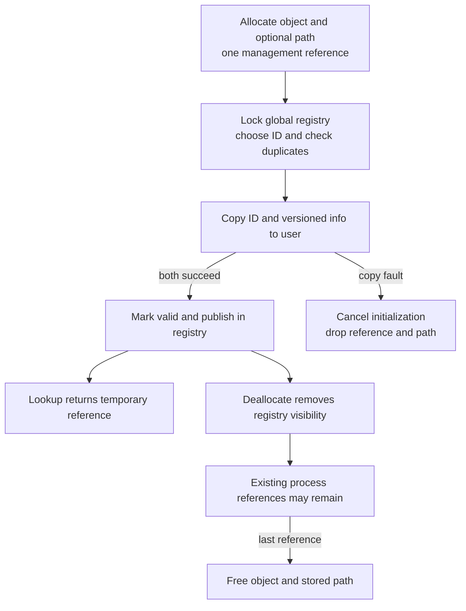
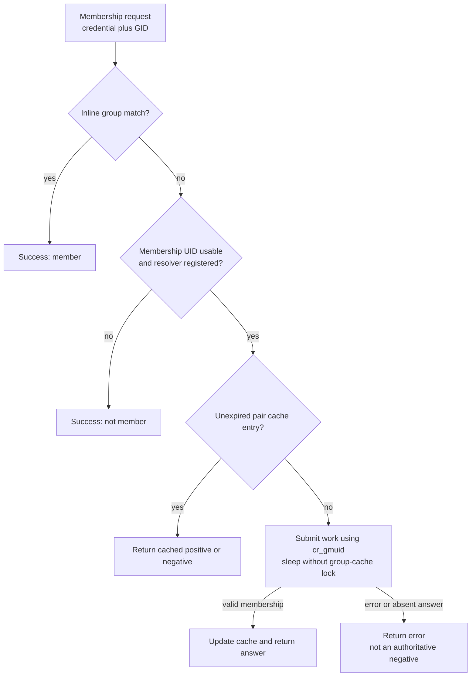
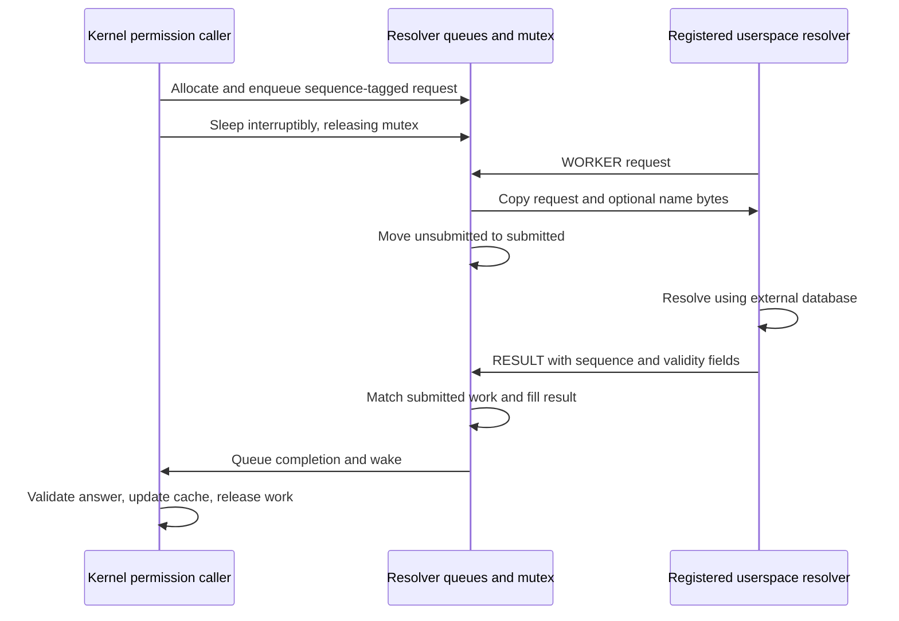

# Personas, process identity and external membership resolution

[Security](README.md) · [Credential lifetimes](credential-and-policy-lifetimes.md) · [Audit sessions](audit-session-capabilities.md) · [Bank accounts](../ipc/bank-accounts-and-charging.md) · [VFS permission checks](../vfs/permissions-and-acl-evaluation.md)

A persona associates a process or voucher with a named identity object. Group resolution answers a different question: whether a credential's membership UID belongs to a group, possibly using a userspace resolver. Neither operation can be understood by substituting “effective UID” for every identifier. This chapter follows the local `xnu-12377.121.6` persona registry, spawn/adoption, membership caches and resolver protocol. Directory-service databases and userspace policy deciding which personas to create are external.

## 1. Identify the subject before following a permission check

| Identity | Stored in | Meaning in these paths |
| --- | --- | --- |
| Persona ID | `persona.pna_id`, `proc.p_persona`, bank persona value | Selects a persona object and participates in process-count attribution. Its integer type is `uid_t`, but it is not automatically the process's effective UID. |
| Persona UID | `persona.pna_uid` | Optional association supplied by V2 management input and checked by bank adoption policy. V1 input defaults it to `KAUTH_UID_NONE`. |
| POSIX identity | `ucred.cr_posix` | Effective/real/saved UID/GID and inline group list used by authorization. |
| Membership UID | `cr_gmuid` | User whose external group membership is queried; can differ from effective UID or be `KAUTH_UID_NONE`. |
| Thread persona | Current Mach voucher's bank value, otherwise process persona | Attribution/adoption context returned by `current_persona_get_id`; it need not equal the process persona. |
| Audit identity/session | `ucred.cr_audit` | Audit user/session and selection state, covered by the separate [capability chapter](audit-session-capabilities.md). |

Sources: [persona and management layouts](../../../platydoc-data/xnu/bsd/sys/persona.h#L58-L74), [kernel persona](../../../platydoc-data/xnu/bsd/sys/persona.h#L279-L294), [credential representation](../../../platydoc-data/xnu/bsd/sys/ucred.h#L146-L184), [thread persona resolution](../../../platydoc-data/xnu/bsd/kern/kern_persona.c#L522-L554).

The management structure still contains `persona_gid`, `persona_ngroups`, `persona_groups` and `persona_gmuid`, explicitly marked unused. A persona object does not store a complete `ucred`. Credential overrides belong to the separate spawn-persona structure and are applied only for its selected flags. [Unused ABI fields](../../../platydoc-data/xnu/bsd/sys/persona.h#L58-L69), [spawn derivation](../../../platydoc-data/xnu/bsd/kern/kern_exec.c#L4000-L4028).

[Exact kernel persona fields](../../../platydoc-data/xnu/bsd/sys/persona.h#L279-L294):

<!-- source-excerpt: ../../../platydoc-data/xnu/bsd/sys/persona.h#L279-L294 -->
```c
struct persona {
	os_refcnt_t  pna_refcount;
	int32_t      pna_valid;

	uid_t        pna_id;
	persona_type_t pna_type;
	char         pna_login[MAXLOGNAME + 1];
	char         *pna_path;
	uid_t        pna_uid;

	LIST_ENTRY(persona) pna_list;

	/* this could go away if we used a coalition */
	LIST_HEAD(, proc)   pna_members;

	lck_mtx_t    pna_lock;
```

`pna_list` is global-registry membership. `pna_members` contains processes using the persona through `p_persona_list`; those processes hold references. `pna_lock` protects per-persona state, while the global persona mutex serializes registry lookup/publication. These lists are independent of Mach IPC spaces and audit-session hash buckets. [Registry lookup](../../../platydoc-data/xnu/bsd/kern/kern_persona.c#L375-L397), [process installation](../../../platydoc-data/xnu/bsd/kern/kern_persona.c#L702-L708).

## 2. Management: allocate privately, copy results, then publish

The `persona` syscall demultiplexes allocate/path-allocate, deallocate, get, getpath, info, PID-info and find operations. Allocation and deallocation require `com.apple.private.persona-mgmt`; info permits querying the current thread's persona and otherwise checks root or that entitlement. PID-info permits self or root. These checks are different from a general right to change UID. [Dispatch](../../../platydoc-data/xnu/bsd/kern/sys_persona.c#L468-L509), [management gate](../../../platydoc-data/xnu/bsd/kern/sys_persona.c#L124-L140), [info/PID-info](../../../platydoc-data/xnu/bsd/kern/sys_persona.c#L324-L396).

`kpersona_copyin` accepts versions 1 and 2, initializes fields absent from older versions and forces name termination. Allocation optionally copies a pathname into `ZV_NAMEI` storage, then transfers that buffer to the persona on success. `persona_alloc` validates name/type, allocates zeroed storage, enforces `MAX_PERSONAS` (512), initializes one reference and marks it with `PERSONA_ALLOC_TOKEN`. The pathname is stored; this code does not resolve it into a vnode, change a root directory or mount a filesystem. [Version handling](../../../platydoc-data/xnu/bsd/kern/sys_persona.c#L53-L85), [path ownership](../../../platydoc-data/xnu/bsd/kern/sys_persona.c#L145-L168), [private allocation](../../../platydoc-data/xnu/bsd/kern/kern_persona.c#L93-L152).

`persona_init_begin` takes the global registry lock, rejects a currently registered duplicate name or ID and selects an automatic ID when requested. Automatic IDs start at 501 and advance by 10, skipping collisions; an explicitly supplied nonzero/non-sentinel ID is accepted as input by this syscall despite the public header comment saying `persona_id` is ignored. On successful preparation it sets `PERSONA_INIT_TOKEN` and deliberately returns with the global lock held. [Constants](../../../platydoc-data/xnu/bsd/kern/kern_persona.c#L58-L69), [explicit ID input](../../../platydoc-data/xnu/bsd/kern/sys_persona.c#L142-L145), [uniqueness/preparation](../../../platydoc-data/xnu/bsd/kern/kern_persona.c#L172-L242).

The syscall copies the chosen ID and versioned information back to user memory **before** `persona_init_end` marks it valid and links it into `all_personas`. Either copyout failure calls the end routine with an error, adjusts the allocated-persona count and drops the object reference. The first copyout may already have changed user memory when the second fails; that ID is not proof of a published persona. The global lock remains held across this initialization/copyout interval. [Publication boundary](../../../platydoc-data/xnu/bsd/kern/sys_persona.c#L169-L204), [end/rollback](../../../platydoc-data/xnu/bsd/kern/kern_persona.c#L260-L286).



Find operations bound the output-array allocation to the configured maximum, collect references while matching name/ID/type, and release every collected reference on success or partial copyout failure. The returned count can exceed the supplied capacity. The final count copyout's error is ignored by this body, while an earlier ID copyout error is returned. [Find wrapper](../../../platydoc-data/xnu/bsd/kern/sys_persona.c#L400-L462), [matching/counting](../../../platydoc-data/xnu/bsd/kern/kern_persona.c#L444-L501).

## 3. Process adoption is a transition plus optional credential derivation

Spawn validates the management entitlement, optional group-count bound and existence of the selected persona. A non-root caller is rejected when the supplied UID or GID field is zero. Before image activation, the child looks the persona up again and calls `persona_proc_adopt`; validation does not retain a permanent guarantee that the registry entry stays valid. The main spawn path rejects this persona operation when its `spawn_no_exec` requirement is not met. [Validation](../../../platydoc-data/xnu/bsd/kern/kern_exec.c#L3967-L3996), [fresh lookup](../../../platydoc-data/xnu/bsd/kern/kern_exec.c#L4031-L4049), [placement before image activation](../../../platydoc-data/xnu/bsd/kern/kern_exec.c#L4963-L4983).

`persona_proc_adopt` consumes its input reference, including invalid-persona and failure paths. It locks the persona, verifies validity, and calls `proc_set_persona_internal`, which asserts that the current thread holds the process transition lock. Re-adopting the same object returns without changing the association. Changing personas temporarily removes the old process-list membership while retaining the old reference, dropping the new persona lock to acquire the old persona and process locks in order. [Adopt contract/body](../../../platydoc-data/xnu/bsd/kern/kern_persona.c#L713-L768), [transition assertion and removal](../../../platydoc-data/xnu/bsd/kern/kern_persona.c#L618-L650), [old/new lock handoff](../../../platydoc-data/xnu/bsd/kern/kern_persona.c#L566-L609).

Before deriving credentials, the code checks the process count charged to the new persona ID against `RLIMIT_NPROC`. The actual predicate is `chgproccnt(new_uid, 0) > nproc`, exempting ID zero; it is not a prospective `count + 1 >= limit` test. Failure returns `EACCES` and restores the old persona's membership. On success it optionally runs the credential-derivation callback, moves process accounting from the old persona ID or real UID to the new persona ID, sets `P_ADOPTPERSONA`, and installs a referenced persona in the process/member list. The public adopt routine then releases the consumed input and former persona reference. [Limit/rollback and publication](../../../platydoc-data/xnu/bsd/kern/kern_persona.c#L652-L709).

The spawn callback applies each requested field independently:

| Spawn flag | Credential-model change |
| --- | --- |
| `POSIX_SPAWN_PERSONA_UID` | Set real/effective/saved UID to the supplied UID and membership UID to `KAUTH_UID_NONE`. |
| `POSIX_SPAWN_PERSONA_GID` | Set real/effective/saved GID to the supplied GID. |
| `POSIX_SPAWN_PERSONA_GROUPS` | Set the explicit group array/count and supplied membership UID. This later step can opt external membership back in after the UID step. |

[Flag-specific changes](../../../platydoc-data/xnu/bsd/kern/kern_exec.c#L4000-L4028), [membership opt-out](../../../platydoc-data/xnu/bsd/kern/kern_credential.c#L4032-L4049), [group opt-in/out](../../../platydoc-data/xnu/bsd/kern/kern_credential.c#L4132-L4162). The callback is passed to the normal retrying `kauth_cred_proc_update(PROC_SETTOKEN_SETUGID, ...)`; it does not modify a published credential in place. See [credential publication](credential-and-policy-lifetimes.md#4-process-publication-is-a-retrying-compare-and-replace).

For example, a child may join persona ID 721 with `persona_uid = 501`, while UID/GID spawn overrides select 600/20. A later membership check can use `cr_gmuid = 501` if an explicit group override supplies it. The four numbers serve different roles. Without override flags, adoption can preserve inherited POSIX credentials while changing persona/process-count association; fork inheritance explicitly passes a null derivation callback. [Fork adoption](../../../platydoc-data/xnu/bsd/kern/kern_fork.c#L1189-L1205).

On iOS/XR multiuser builds, `persona_proc_adopt` also copies the persona login into the BSD session login field. This block follows the internal adoption call without checking its error result, so it should not be described as a strictly success-only side effect. This BSD login/session field is separate from the audit-session object. [Conditional login update](../../../platydoc-data/xnu/bsd/kern/kern_persona.c#L742-L759).

## 4. Invalidation, dropping membership and thread vouchers

Management deallocation removes the persona from the global list, decrements the active registry count and marks it invalid. It then drops the lookup reference and original management reference. Existing process references can retain the invalidated storage; new lookups cannot find it, and adoption rejects an invalid object. Invalidation does not walk existing members and restore their credentials. Final release removes a still-valid object if necessary, releases its pathname, asserts that the member list is empty and frees storage. [Invalidation](../../../platydoc-data/xnu/bsd/kern/kern_persona.c#L401-L427), [management releases](../../../platydoc-data/xnu/bsd/kern/sys_persona.c#L209-L237), [final release](../../../platydoc-data/xnu/bsd/kern/kern_persona.c#L320-L355).

`persona_proc_drop` starts from the process lock, which is the reverse of the usual persona-to-process order. It tries the persona lock; on contention it unlocks the process, backs off and retries. Once it has both, it removes list membership, clears `p_persona`, samples the real UID through SMR, and transfers process-count accounting back from persona ID to that UID. It drops the reference afterward. It deliberately leaves POSIX credentials unchanged. Exit/reap and failed-fork cleanup invoke it. [Drop/retry](../../../platydoc-data/xnu/bsd/kern/kern_persona.c#L772-L824), [reap](../../../platydoc-data/xnu/bsd/kern/kern_exit.c#L2954-L2963), [failed child cleanup](../../../platydoc-data/xnu/bsd/kern/kern_fork.c#L807-L815).

Thread persona lookup first gets a reference to the thread's Mach voucher and asks bank for its persona ID, releasing the voucher afterward. Without a voucher it uses the process persona. `current_persona_get` then resolves that numeric ID through the current persona registry, so an attribution ID and a currently discoverable persona object are not interchangeable. This path does not derive or install a new POSIX credential. [Current persona](../../../platydoc-data/xnu/bsd/kern/kern_persona.c#L522-L554).

Bank captures process identity, persona ID/UID and adoption eligibility when constructing `bank_task`. The local admission rules include the no-inherit entitlement, system/system-proxy persona types, and the macOS no-persona platform/entitlement case. `bank_task_can_adopt_persona` permits the same ID; otherwise it requires adoption eligibility and a compatible persona UID. The explicit MODIFY_PERSONA recipe additionally checks entitlement, recipe size, a valid registry persona and the bank holder's unique process ID, and rejects a bank-account input where a task value is required. [Captured state/admission](../../../platydoc-data/xnu/osfmk/bank/bank.c#L927-L1003), [modify recipe](../../../platydoc-data/xnu/osfmk/bank/bank.c#L340-L398), [UID compatibility](../../../platydoc-data/xnu/osfmk/bank/bank.c#L1974-L2009).

Voucher redemption can replace an inadmissible inherited persona with the receiving bank task's own identity. It does not blindly trust the sender's number. The [bank chapter](../ipc/bank-accounts-and-charging.md) supplies account/reference and billing mechanics; these persona checks are a distinct admission step. [Redeem fallback](../../../platydoc-data/xnu/osfmk/bank/bank.c#L469-L479).

## 5. Group membership: local positive, authoritative local negative, or resolver

`kauth_cred_ismember_gid` tests the credential's inline groups first. A match returns success with `*resultp = 1`. If no group matches and `cr_gmuid == KAUTH_UID_NONE`, the inline list is authoritative and it returns success with zero. With `CONFIG_EXT_RESOLVER`, a resolver that is not registered also makes this path return a local negative. Only the remaining case checks the membership cache or submits work. [Decision path](../../../platydoc-data/xnu/bsd/kern/kern_credential.c#L2993-L3034).

[Exact opt-out and resolver-registration branches](../../../platydoc-data/xnu/bsd/kern/kern_credential.c#L3015-L3034):

<!-- source-excerpt: ../../../platydoc-data/xnu/bsd/kern/kern_credential.c#L3015-L3034 -->
```c
	if (pcred->cr_gmuid == KAUTH_UID_NONE) {
		*resultp = 0;
		return 0;
	}

#if CONFIG_EXT_RESOLVER
	struct kauth_group_membership *gm;
	struct kauth_identity_extlookup el;
	int error;

	/*
	 * If the resolver hasn't checked in yet, we are early in the boot
	 * phase and the local group list is complete and authoritative.
	 */
	if (!kauth_resolver_registered) {
		*resultp = 0;
		return 0;
	}

	/* TODO: */
```

A cache key is `(cr_gmuid, requested_gid)`, not `(effective_uid, gid)` or `(persona_id, gid)`. `kauth_group_membership` stores that pair, expiration and an `ISMEMBER` bit. Both positive and negative answers are cached when the resolver supplies valid UID, GID and membership flags. Zero TTL means persistent; otherwise expiration is an uptime-seconds deadline, checked lazily. A hit promotes the entry in the mutex-protected LRU. [Cache structure](../../../platydoc-data/xnu/bsd/kern/kern_credential.c#L216-L235), [lookup](../../../platydoc-data/xnu/bsd/kern/kern_credential.c#L3043-L3066), [expiry](../../../platydoc-data/xnu/bsd/kern/kern_credential.c#L2807-L2821), [update](../../../platydoc-data/xnu/bsd/kern/kern_credential.c#L2865-L2929).

On a miss, the kernel drops the group lock, submits an extended-lookup request carrying the membership UID/GID and requester PID, then caches a valid response. A successful resolver transaction without `VALID_MEMBERSHIP` returns `ENOENT`; a resolver error propagates. Callers must distinguish a successful negative from an unavailable answer. New cache allocation happens outside the lock, and insertion permits duplicate keys after racing misses; the newly inserted entry wins list order and old entries age out. This is not an SMR credential-uniquing table. [Miss/result handling](../../../platydoc-data/xnu/bsd/kern/kern_credential.c#L3069-L3100), [allocation race and eviction](../../../platydoc-data/xnu/bsd/kern/kern_credential.c#L2904-L2929).



The diagram's no-resolver branch represents `kauth_cred_ismember_gid`; identity translation has a different miss path and must not inherit that behavior by analogy.

## 6. Identity translation has another cache and expiry policy

The identity cache maps UID or GID records to GUID, NT SID, name and optional supplementary groups. `ki_valid` says which values exist; GUID, SID and group-list data have separate expiry fields. UID and GID are mutually exclusive keys. Lookups copy usable fields under `kauth_identity_mtx`, promote LRU position and return a snapshot. Names use VFS's string cache, with speculative allocation before the identity lock and old-name release afterward. [Identity layout](../../../platydoc-data/xnu/bsd/kern/kern_credential.c#L170-L199), [lookup snapshot](../../../platydoc-data/xnu/bsd/kern/kern_credential.c#L1561-L1590), [update/name ownership](../../../platydoc-data/xnu/bsd/kern/kern_credential.c#L1246-L1339), [insertion race/merge](../../../platydoc-data/xnu/bsd/kern/kern_credential.c#L1139-L1220).

`kauth_cred_cache_lookup` selects the expiry rule from the requested output, or from GUID/SID input when translating back to numeric IDs. A miss or expired translation constructs a request asking for available UID/GID/GUID/SID information; supplementary groups and extended name buffers are requested only when needed. Successful responses can populate several associations even if the particular requested output remains unavailable. [Cache decisions](../../../platydoc-data/xnu/bsd/kern/kern_credential.c#L2472-L2613), [request construction](../../../platydoc-data/xnu/bsd/kern/kern_credential.c#L2626-L2724), [result/cache publication](../../../platydoc-data/xnu/bsd/kern/kern_credential.c#L2733-L2792).

Two comments need qualification against this body. The cached-field comment says a missing valid bit can suppress a resolver query, but `kauth_cred_cache_lookup` explicitly sets `ENOENT` when the requested `to` bit is absent and continues toward the resolver. Another comment proposes using an expired value if resolution fails; the implemented post-resolution error branch returns the error before `found`, so this path does not deliver that stale fallback. Likewise, the GUID-membership comment claiming no negative membership caching should not override the positive/negative pair-cache body above. [Missing-field branch](../../../platydoc-data/xnu/bsd/kern/kern_credential.c#L2516-L2528), [expired-value comment](../../../platydoc-data/xnu/bsd/kern/kern_credential.c#L2563-L2574), [actual error return](../../../platydoc-data/xnu/bsd/kern/kern_credential.c#L2747-L2755), [GUID comment and special handling](../../../platydoc-data/xnu/bsd/kern/kern_credential.c#L3122-L3189).

GUID membership recognizes well-known nobody/everybody GUIDs immediately. Otherwise it can identify a cached user GUID as not a group, or translate a group GUID to GID and reuse the membership decision above. `ENOENT` from GUID-to-GID conversion becomes a successful nonmember result; other errors are retained. Without `CONFIG_EXT_RESOLVER`, only selected numeric-ID/GUID compatibility-prefix translations exist, and missing inline GID membership returns false. This is an explicit build variant, not a reconstruction of directory-service behavior. [GUID membership](../../../platydoc-data/xnu/bsd/kern/kern_credential.c#L3122-L3192), [no-resolver translator](../../../platydoc-data/xnu/bsd/kern/kern_credential.c#L1961-L2021).

## 7. Resolver work crosses a userspace boundary

The resolver calls the `identitysvc` syscall to register, collect work and submit results. It needs the identity-service entitlement; registration also checks root authorization. Subsequent operations require effective UID zero and the registered PID. A new registered process moves old submitted requests back to the unsubmitted list, preserving requests for retry. Deregistration/fatal responses clear resolver authority and wake waiting clients/workers. [Admission/takeover](../../../platydoc-data/xnu/bsd/kern/kern_credential.c#L509-L575), [deregister/result/worker dispatch](../../../platydoc-data/xnu/bsd/kern/kern_credential.c#L612-L650).

Each `kauth_resolver_work` stores the wire `kauth_identity_extlookup`, an extension-buffer reference, sequence number, reference count, list-state flags and result. Under `kauth_resolver_mtx`, submit assigns a sequence, marks INPROG, links the request to `unsubmitted` and wakes a worker. It deliberately does not coalesce equal requests, because extension-buffer update and wakeup ordering would otherwise become ambiguous. The client sleeps interruptibly with the resolver timeout, releasing that mutex while blocked. [Work representation](../../../platydoc-data/xnu/bsd/kern/kern_credential.c#L121-L139), [submit](../../../platydoc-data/xnu/bsd/kern/kern_credential.c#L374-L405), [wait loop](../../../platydoc-data/xnu/bsd/kern/kern_credential.c#L256-L282).



Work is moved to `submitted` only after request copyout, including required extension data, succeeds. On result submission, the kernel finds the submitted sequence, records response/result state and handles requested extended-name copying before putting it on `done` and waking the requester. A response for an already-timed-out request can find no work and is tolerated. Extended-name copy failure is returned to the resolver by `kauth_resolver_complete`; its code assigns `kr_result` from the response status before that copy, so do not claim every later extension fault becomes the waiting client's same error. [Work copyout](../../../platydoc-data/xnu/bsd/kern/kern_credential.c#L737-L805), [response matching and extended data](../../../platydoc-data/xnu/bsd/kern/kern_credential.c#L947-L1033).

The client releases its work reference under the resolver mutex and removes it from the indicated queue when the reference count reaches zero, then frees storage after unlocking. If a request times out before any worker collects it, the kernel revokes resolver registration and wakes other queued clients. Failure codes distinguish interruption/timeouts, invalid responses and resolver failure (`EOWNERDEAD` on DEBUG/DEVELOPMENT, `EIO` otherwise). A missing resolver in the generic submit path waits briefly and returns `EWOULDBLOCK` if no resolver appeared. [Timeout and cleanup](../../../platydoc-data/xnu/bsd/kern/kern_credential.c#L352-L372), [failure/drain/free](../../../platydoc-data/xnu/bsd/kern/kern_credential.c#L411-L484), [build-specific failure code](../../../platydoc-data/xnu/bsd/kern/kern_credential.c#L145-L151).

The authenticated resolver can query, resize and clear the identity/membership caches; capacities default to 100 each and are capped at 10,000 by the setter. This clears cached associations, not published process credentials or persona membership. The protocol exposes validity and TTLs supplied by the external provider; it does not implement the provider's directory queries, nested-group policy or persistent database. [Cache controls](../../../platydoc-data/xnu/bsd/kern/kern_credential.c#L576-L613).

## 8. Configuration and verification routes

`CONFIG_PERSONAS`, `CONFIG_EXT_RESOLVER` and `CONFIG_AUDIT` are independent selections. Persona syscall selection is conditional in `syscalls.master`, while no-persona compatibility stubs remain for selected kernel exports. The common identity paths here do not depend on choosing the legacy/PPL/SPTM pmap backend. [Configuration](../../../platydoc-data/xnu/config/MASTER#L133), [persona selection](../../../platydoc-data/xnu/config/MASTER#L560), [syscall guard](../../../platydoc-data/xnu/bsd/kern/syscalls.master#L773-L777), [no-persona stubs](../../../platydoc-data/xnu/bsd/kern/kern_persona.c#L874-L962).

| Source test | Contract it helps inspect |
| --- | --- |
| [`tests/persona.c`](../../../platydoc-data/xnu/tests/persona.c#L58-L117) | V1/V2 output, explicitly supplied persona UID and V1 unset-UID behavior. |
| [`tests/rm/persona_adoption.c`](../../../platydoc-data/xnu/tests/rm/persona_adoption.c#L43-L106) | Voucher adoption with matching versus mismatched persona UID. |
| [`tests/rm/persona_adoption.c`](../../../platydoc-data/xnu/tests/rm/persona_adoption.c#L98-L129) | Current thread persona after voucher adoption, distinct from process spawning. |

These tests were read, not run. The chapter does not prove every resolver timeout/extension race, every identity-changing syscall, every persona invalidation schedule or the external service's policy. The credential and bank companions remain the authority for their underlying immutable-value and voucher-account lifetimes.

<!-- BEGIN PLATYDOC DOCUMENTATION LICENSE -->
Original Platydoc text and diagrams are licensed under [CC BY 4.0](https://creativecommons.org/licenses/by/4.0/). Quoted source code and third-party material retain their respective licenses.
<!-- END PLATYDOC DOCUMENTATION LICENSE -->
