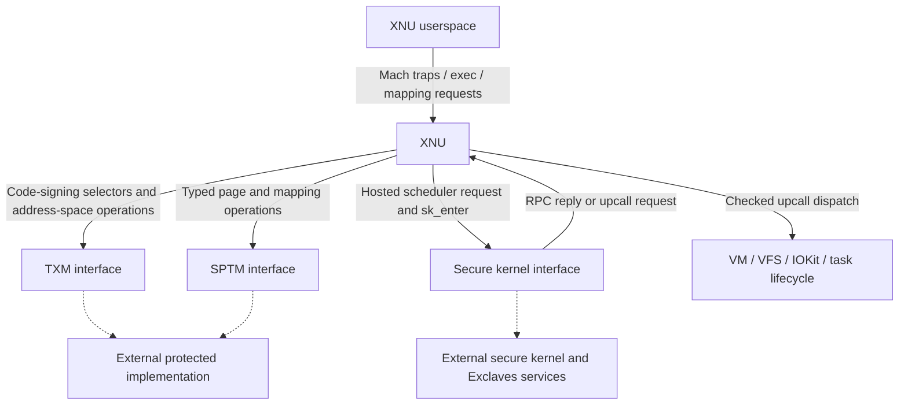

# SPTM, TXM, and Exclaves: security boundaries and entry/exit map

[Security index](README.md) · [ARM64 exception levels](../platform/exception-levels-and-monitors.md) · [VM and pmap](../vm/README.md)

This checkout contains substantial **XNU-side integration** for SPTM, TXM, and Exclaves. It shows the objects XNU supplies, the calls it makes, the state it preserves, and the checks it performs before accepting results. The production monitor/secure-kernel implementations and parts of their library interfaces are supplied separately. Reading a call site establishes its local contract, not the complete implementation of the destination.

## The mechanisms have different responsibilities

| Mechanism | Responsibility visible from XNU | Principal local source |
| --- | --- | --- |
| SPTM | Bootstrap protection contract; typed physical frames and page tables; validated mapping/retyping interfaces; protected-domain dispatch/resumption | [`arm64/sptm`](../../../xnu/osfmk/arm64/sptm), [`locore.s`](../../../xnu/osfmk/arm64/locore.s#L1696-L1743) |
| TXM | Code-signing and execution-policy operations; signature/profile/trust objects; address-space and executable-region association; protected state shared with XNU | [`code_signing/txm.c`](../../../xnu/bsd/kern/code_signing/txm.c), [`SPTM pmap integration`](../../../xnu/osfmk/arm64/sptm/pmap/pmap.c) |
| Exclaves / SK integration | Scheduling-context entry, RPC/upcalls, task/resource authorization, secure-memory handoff, shared buffers, and service access to XNU facilities | [`exclaves.c`](../../../xnu/osfmk/kern/exclaves.c), [`xnuproxy`](../../../xnu/osfmk/kern/exclaves_xnuproxy.c), [`resources`](../../../xnu/osfmk/kern/exclaves_resource.c) |

These interfaces cooperate. For example, XNU uses SPTM to transfer pages to TXM or SK; TXM associates executable policy with XNU address spaces; an Exclaves upcall can request VM pages or VFS I/O from XNU. The secure RPC protocol, physical frame type, and executable policy object are different kinds of state.



The dashed edges identify implementation boundaries, not a complete privilege hierarchy or a claim that every service directly calls every monitor.

## Detailed reading route

1. [SPTM](sptm.md): bootstrap contract, frame/table types, mapping operations, epochs and result buffers, call hooks, interrupts and lockdown.
2. [TXM](txm.md): stack/register ABI, return/error handling, shared data and page transfer, signature/trust lifecycle, address-space and executable mapping policy.
3. [Exclaves overview](exclaves.md), then [execution](exclaves-execution.md): the control trap, per-thread context, proxy RPC, hosted scheduler, secure entry, upcalls, waits and resumption.
4. [Exclaves resources and memory](exclaves-resources-and-memory.md): task attachment, resource capabilities, physical ownership and shared mappings.
5. [Exclaves services](exclaves-services.md): storage, sensors, driver callbacks, notifications, always-on work and diagnostics.

Keep the existing [exception-entry](../platform/arm64-exception-entry.md), [exception-return](../platform/arm64-exception-return.md), and [pmap lifetime](../vm/pmap-mapping-lifecycle.md) guides open when following these paths down to machine state.

## Kernel entry and exit points

“Entry” must identify the domain being entered. A userspace trap enters XNU; a library call exits XNU into a protected domain; an upcall returns service work to XNU; an interrupt temporarily re-enters XNU while a protected call remains active.

| Trigger | XNU-side path and boundary | Completion or return |
| --- | --- | --- |
| Initial SPTM bootstrap | `_start` in `start_sptm.s`; external `SPTM_LOAD_DISPATCH_ID` / `SPTM_DOMAIN_ENTER` | Assembly continues after fixup-completion call, then enters C bootstrap |
| SPTM operation during runtime | `sptm_*` API; `_sptm_pre_entry_hook` protects XNU state | `_sptm_post_exit_hook`; caller examines operation-specific outputs |
| TXM operation | `txm_kernel_call` → stack acquisition/register setup → `txm_enter` | Stack shared-return parsing, stack release, possible page-donation retry |
| XNU userspace requests Exclaves work | `_exclaves_ctl_trap` validates operation, authorization and inputs | Operation result and, for endpoint calls, IPC-buffer copyout |
| XNU executes a secure scheduling request | `exclaves_scheduler_request` → `exclaves_enter` → `sk_enter` | Ringgate status, response decode, host-side response handling |
| Secure RPC asks XNU to perform work | Proxy response reports `UPCALL`; `exclaves_call_upcall_handler` dispatches | Handler completion populates response; proxy loop resumes secure context |
| Interrupt during TXM | XNU handles interrupt; registered `xnu_return_to_gl2` sees `txm_thread_stack` | Tail branch to `txm_resume`, with stack in `x0` |
| Interrupt during Exclaves/SK | Dispatcher sees `TH_EXCLAVES_EXECUTION` after the TXM test | Tail branch to `sk_resume` |
| Interrupt during SPTM | Neither preceding protected-domain indicator matches | Tail branch to `sptm_resume_from_exception` |
| Protected-domain panic via the SPTM entry point | [`_start`](../../../xnu/osfmk/arm64/sptm/start_sptm.s#L72-L94) recognizes `SPTM_CPU_PANIC` and branches to `panic_from_sptm`; the source lists SPTM, TXM, and cL4 callers | Fatal XNU panic/reporting path |
| Exclaves panic service | Dedicated context marked `TH_EXCLAVES_RESUME_PANIC_THREAD` | Special scheduler/panic protocol; distinct from ordinary endpoint completion |

Sources: [SPTM boot](../../../xnu/osfmk/arm64/sptm/start_sptm.s#L146-L161), [entry/exit hooks](../../../xnu/osfmk/arm64/locore.s#L2676), [TXM call path](../../../xnu/bsd/kern/code_signing/txm.c#L319-L432), [control trap](../../../xnu/osfmk/kern/exclaves.c#L213), [scheduler request](../../../xnu/osfmk/kern/exclaves.c#L2064-L2168), [secure entry](../../../xnu/osfmk/kern/exclaves.c#L1681-L1785), [proxy loop](../../../xnu/osfmk/kern/exclaves_xnuproxy.c#L481), [resume selector](../../../xnu/osfmk/arm64/locore.s#L1696-L1743), [SPTM panic entry](../../../xnu/osfmk/arm64/sptm/start_sptm.s#L311), [Exclaves panic context](../../../xnu/osfmk/kern/exclaves_panic.c#L89-L135).

## Normal call completion differs from interrupt resumption

At bootstrap XNU registers the address of its protected-domain return dispatcher:

[Source: registered XNU return address](../../../xnu/osfmk/arm64/sptm/arm_init_sptm.c#L761-L763)

<!-- source-excerpt: ../../../xnu/osfmk/arm64/sptm/arm_init_sptm.c#L761-L763 -->
```c
	extern void xnu_return_to_gl2(void);
	const sptm_vaddr_t handler_addr = (sptm_vaddr_t) ptrauth_strip((void *)xnu_return_to_gl2, ptrauth_key_function_pointer);
	sptm_register_xnu_exc_return(handler_addr);
```

The interrupted-domain state remains associated with the current XNU thread. `thread->txm_thread_stack` identifies active TXM execution. Exclaves keeps an interrupt-safe state word separately from ordinary RPC/upcall state: the former may be read from interrupt context and is modified by the current thread with interrupts disabled. [Thread fields and synchronization contract](../../../xnu/osfmk/kern/thread.h#L1106-L1129).

`xnu_return_to_gl2` tests TXM first, SK second, and otherwise resumes SPTM. It uses tail branches, followed by unreachable loops. These are resume operations for an unfinished protected call; they are not normal C returns to the dispatcher. When the protected call eventually completes normally, the original call continuation performs its own cleanup and result handling. [Selector body](../../../xnu/osfmk/arm64/locore.s#L1705-L1743).

An interrupted saved state's PC can be a re-entry handler rather than the protected instruction that was interrupted. `ml_get_backtrace_pc` uses saved `x14` when its frame-pointer test recognizes a non-XNU stack. The stack-range helper checks bootstrap-supplied SPTM/TXM ranges; it is not a universal recognizer of every possible secure stack. A backtrace PC, an exception-return PC, and the C caller's continuation can therefore differ without describing three separate user requests. [Backtrace interpretation](../../../xnu/osfmk/arm64/machine_routines.c#L3145-L3194).

## Exception levels, guarded execution, and configuration

The SPTM assembly explicitly describes its initial transition as a trap to **GL2**. The entry macro is externally defined. This tree does not justify replacing that terminology with a guessed `hvc` instruction or a complete “XNU EL1 → monitor EL2” register sequence. Guest hypercalls, architectural exception levels, and Apple's guarded-domain interfaces have separate visible evidence; the existing [exception-level guide](../platform/exception-levels-and-monitors.md) distinguishes them.

Similarly, `sk_enter`, `txm_enter` and the three resume routines establish named library boundaries, but their bodies are not supplied here. The local C code shows arguments, thread state and results. It does not expose every privileged register save, secure page-table switch, capability check, or exception vector inside those destinations.

Build selection is part of the contract. `files.arm64` chooses SPTM-specific bootstrap/pmap files. `MakeInc.def` derives enablement from platform/device configuration, links `sptm_xnu` and `TrustedExecutionMonitor_Kernel`, and separately enables Exclaves configuration. Exclaves generated transport also depends on available SDK modules. Not every source branch appears in the same kernel binary. [Architecture files](../../../xnu/osfmk/conf/files.arm64#L10-L25), [build selection and archives](../../../xnu/makedefs/MakeInc.def#L1159-L1190), [Tightbeam generation](../../../xnu/osfmk/kern/Makefile#L180-L203).

## How to assess the security claims in these guides

The source supports concrete distinctions:

- A frame type constrains a memory use through the monitor contract; a Mach resource right selects a local object and lifetime.
- Signature registration, signature trust verification, address-space association, and installing an executable PTE occur at different points.
- A secure-service upcall can have powerful kernel effects, but each service path still has its own object resolution, bounds checks and cleanup.
- Holding XNU bookkeeping for a secure-owned physical page does not authorize XNU to map it.
- Successful RPC transport does not automatically imply the operation's typed result is successful.

The detailed pages identify the specific code establishing each distinction. They also identify absent headers/layouts, external implementation, configuration branches and stale comments where the executable bodies establish a different sequence. No monitor, kernel, hardware protection test or secure service was executed for this documentation.

<!-- BEGIN PLATYDOC DOCUMENTATION LICENSE -->
Original Platydoc text and diagrams are licensed under [CC BY 4.0](https://creativecommons.org/licenses/by/4.0/). Quoted source code and third-party material retain their respective licenses.
<!-- END PLATYDOC DOCUMENTATION LICENSE -->
