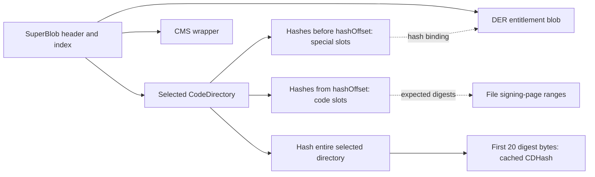

# Signature format, CodeDirectory selection, and blob validation

[Security](README.md) · [Signing overview](code-signing.md) · [Vnode attachment lifecycle](vnode-signature-lifecycle.md) · [Executable policy](executable-signature-policy.md) · [Page integrity](page-signature-validation.md)

A signature attached to a vnode has two representations: serialized signature bytes, and a kernel `cs_blob` describing selected parts of those bytes. XNU first checks whether the serialized offsets and formats are usable, selects a CodeDirectory, and derives cached state. Policy and monitor checks follow. The selected CodeDirectory then supplies expected hashes for file-backed page validation. These stages answer different questions; calculating a CodeDirectory digest is not certificate verification or a check of every file byte.

This chapter follows the parser and representation-changing helpers in `ubc_subr.c`. The companion [vnode lifecycle](vnode-signature-lifecycle.md) follows input acquisition, MAC/monitor calls, publication, revalidation, and destruction. [TXM](txm.md) covers protected monitor ownership and its external implementation boundary.

The [code-signature storage companion](../../structures/code-signature-blob-storage.md) follows the RO wrapper, serialized backing and interior views through allocation, relocation, accessors, protected mutation and cleanup. It also provides a numeric example separating file coverage from directory-relative buffer offsets.

## 1. Three layers of data and three kinds of offset

| Representation | Important fields | Coordinate system |
| --- | --- | --- |
| `CS_GenericBlob` | `magic`, `length`, trailing data | A serialized blob's declared extent |
| `CS_SuperBlob` and `CS_BlobIndex` | magic/length/count; index type/offset pairs | Each index offset is relative to the SuperBlob's beginning |
| `CS_CodeDirectory` | hash/identifier/scatter/team offsets, counts, code limit, hash/page format | Internal offsets are relative to that CodeDirectory |
| `struct cs_blob` | backing allocation, selected directory, hash operations, cached range and identity | The wrapper separately tracks vnode/fat-slice offsets and storage pointers |

Serialized multibyte integers are decoded with `ntohl()` or `ntohll()` at their uses; byte-sized hash and page fields are read directly. A blob's `length` includes its header. The allocation containing it may be larger, particularly after page rounding. Neither an index offset nor a CodeDirectory hash offset is a vnode file offset. [Serialized definitions](../../../platydoc-data/xnu/osfmk/kern/cs_blobs.h#L212), [kernel wrapper](../../../platydoc-data/xnu/bsd/sys/ubc_internal.h#L106).

The SuperBlob's index identifies roles independently of subblob magic. Slot zero is the primary CodeDirectory; alternate directories occupy the defined interval starting at `0x1000`. Entitlement slots are 5 for XML and 7 for DER; launch constraints occupy 8–10 and library constraints 11. The CMS signature wrapper has slot `0x10000`. The parser checks the relevant type/magic pairing for directories, entitlements, and constraints rather than treating every generic blob as the same data. [Slot and magic constants](../../../platydoc-data/xnu/osfmk/kern/cs_blobs.h#L92).

A top-level `CSMAGIC_EMBEDDED_SIGNATURE` SuperBlob and a raw `CSMAGIC_CODEDIRECTORY` are accepted by `cs_validate_csblob()`. The header also defines a detached-signature-container magic, but this routine does not accept that top-level magic. “Detached” in the `F_ADDSIGS` interface describes how bytes arrive, and the attached wrapper's architecture association; it does not mean every format bearing a detached-related constant is accepted here. [Top-level branches](../../../platydoc-data/xnu/bsd/kern/ubc_subr.c#L535), [raw-directory branch](../../../platydoc-data/xnu/bsd/kern/ubc_subr.c#L656), [input interface](vnode-signature-lifecycle.md#3-fcntl-registration-has-different-input-and-reuse-rules).

The fixed CodeDirectory prefix exposes the page-hash geometry:

[CodeDirectory prefix](../../../platydoc-data/xnu/osfmk/kern/cs_blobs.h#L212):
<!-- source-excerpt: ../../../platydoc-data/xnu/osfmk/kern/cs_blobs.h#L212-L226 -->
```c
typedef struct __CodeDirectory {
	uint32_t magic;                                 /* magic number (CSMAGIC_CODEDIRECTORY) */
	uint32_t length;                                /* total length of CodeDirectory blob */
	uint32_t version;                               /* compatibility version */
	uint32_t flags;                                 /* setup and mode flags */
	uint32_t hashOffset;                    /* offset of hash slot element at index zero */
	uint32_t identOffset;                   /* offset of identifier string */
	uint32_t nSpecialSlots;                 /* number of special hash slots */
	uint32_t nCodeSlots;                    /* number of ordinary (code) hash slots */
	uint32_t codeLimit;                             /* limit to main image signature range */
	uint8_t hashSize;                               /* size of each hash in bytes */
	uint8_t hashType;                               /* type of hash (cdHashType* constants) */
	uint8_t platform;                               /* platform identifier; zero if not platform binary */
	uint8_t pageSize;                               /* log2(page size in bytes); 0 => infinite */
	uint32_t spare2;                                /* unused (must be zero) */
```

Later fields add scatter vectors, team identity, a 64-bit code-limit field, executable-segment attributes, runtime/pre-encryption metadata, and linkage metadata. Their presence in the C declaration does not prove that every consumer uses them. In particular, the inspected `cs_blob` coverage initializer and multilevel conversion read the 32-bit `codeLimit`; they do not substitute `codeLimit64`. The directory validator also begins with `length >= sizeof(*cd)` in this checkout rather than choosing a shorter minimum from the declared version. [Versioned fields](../../../platydoc-data/xnu/osfmk/kern/cs_blobs.h#L233), [validator entry](../../../platydoc-data/xnu/bsd/kern/ubc_subr.c#L359), [coverage derivation](../../../platydoc-data/xnu/bsd/kern/ubc_subr.c#L4099).

## 2. Code hashes, special-slot hashes, and CDHash differ

`hashOffset` points to ordinary code slot zero. Code hashes advance from that point. Special-slot hashes precede it: special slot `s` is at `hashOffset - s * hashSize`, with no special slot zero. For contiguous coverage, ordinary slot `p` supplies the expected hash for signing page number `p`; scatter coverage adds another translation. These are expected digests stored in the signature, not proof that the corresponding data has already been read and compared. [Code-slot lookup](../../../platydoc-data/xnu/bsd/kern/ubc_subr.c#L263), [special-slot lookup](../../../platydoc-data/xnu/bsd/kern/ubc_subr.c#L749).



`struct cs_hash` deliberately separates effective slot size from native digest size. SHA-256-truncated computes a 32-byte digest but stores/compares a 20-byte slot. CDHash has its own fixed 20-byte size regardless of the selected algorithm. A SHA-384 directory therefore has 48-byte code slots and a 20-byte cached CDHash. [Hash operations and implementations](../../../platydoc-data/xnu/bsd/kern/ubc_subr.c#L143), [length constants](../../../platydoc-data/xnu/osfmk/kern/cs_blobs.h#L133).

| Hash type | Effective slot bytes | Native digest bytes | Selection rank in this source |
| --- | ---: | ---: | ---: |
| SHA-1 | 20 | 20 | 1 |
| SHA-256 truncated | 20 | 32 | 2 |
| SHA-256 | 32 | 32 | 3 |
| SHA-384 | 48 | 48 | 4 |

SHA-2 choices require `CRYPTO_SHA2` in `cs_find_md()`. Rank is the position in `hashPriorities`, not the numeric format code: SHA-256's format value is 2, while truncated SHA-256 is 3, but the full digest ranks higher. The local compatibility wrappers dispatch through `g_crypto_funcs` and CoreCrypto digest descriptors; the actual cryptographic provider implementation is not reconstructed here. [Hash choice](../../../platydoc-data/xnu/bsd/kern/ubc_subr.c#L200), [rank table](../../../platydoc-data/xnu/bsd/kern/ubc_subr.c#L228), [SHA-1 bridge](../../../platydoc-data/xnu/libkern/crypto/corecrypto_sha1.c#L40), [SHA-2 bridge](../../../platydoc-data/xnu/libkern/crypto/corecrypto_sha2.c#L37).

After structural selection, `cs_blob_init_validated()` hashes exactly the selected CodeDirectory's declared byte length and copies the first `CS_CDHASH_LEN` bytes:

[CDHash calculation](../../../platydoc-data/xnu/bsd/kern/ubc_subr.c#L4111):
<!-- source-excerpt: ../../../platydoc-data/xnu/bsd/kern/ubc_subr.c#L4111-L4119 -->
```c
		/* compute the blob's cdhash */
		md_base = (const unsigned char *) cd;
		md_size = ntohl(cd->length);

		blob->csb_hashtype->cs_init(&mdctx);
		blob->csb_hashtype->cs_update(&mdctx, md_base, md_size);
		blob->csb_hashtype->cs_final(hash, &mdctx);

		memcpy(blob->csb_cdhash, hash, CS_CDHASH_LEN);
```

This identity includes that directory's fields and hash table. It is not a digest of the whole SuperBlob, the CMS object, or the complete executable file. Later memory-saving transformations can change the in-memory directory while preserving the cached identity of the validated input; recomputing a digest over that transformed object need not reproduce the cached CDHash.

## 3. Generic length validation is only the first layer

The small generic validator checks that the supplied containing range can hold a generic header and the blob's declared length:

[Generic blob bounds check](../../../platydoc-data/xnu/bsd/kern/ubc_subr.c#L479):
<!-- source-excerpt: ../../../platydoc-data/xnu/bsd/kern/ubc_subr.c#L479-L486 -->
```c
static int
cs_validate_blob(const CS_GenericBlob *blob, size_t length)
{
	if (length < sizeof(CS_GenericBlob) || length < ntohl(blob->length)) {
		return EBADEXEC;
	}
	return 0;
}
```

It does not inspect magic, certificate contents, offset overlap, or hash tables. It also does not itself require the declared length to be at least the generic-header size; type-specific callers add their own requirements. Therefore, “`cs_validate_blob()` verifies a code signature” is much broader than its body. `cs_validate_csblob()` is the enclosing format parser, and `cs_validate_codedirectory()` validates the selected directory representation.

The enclosing parser zeroes all output pointers before work, validates the outer header, then uses the outer declared length as its bound. For a SuperBlob it requires the SuperBlob header and enough remaining bytes for `count` index entries. Division-based bounds checks avoid needing an unchecked `count * sizeof(index)` product. For each index it checks the offset against the outer length, validates a generic subblob inside the remaining extent, then uses that subblob's declared length for type-specific checking. Any failure immediately returns `EBADEXEC` or the nested validator's error. [Enclosing parser](../../../platydoc-data/xnu/bsd/kern/ubc_subr.c#L508).

Every encountered primary/alternate CodeDirectory is structurally checked, including a candidate that ultimately loses the ranking comparison. Thus an unusable alternate is not simply skipped in favor of a usable primary. The parser requires a primary directory slot somewhere in a SuperBlob and requires a nonnull selected directory before returning success. Unknown indexed types receive generic containment checking but are not interpreted by these branches. There is no general pairwise non-overlap pass over all subblob ranges in the inspected body. [Index loop and candidate handling](../../../platydoc-data/xnu/bsd/kern/ubc_subr.c#L554), [required primary](../../../platydoc-data/xnu/bsd/kern/ubc_subr.c#L652).

## 4. Selection chooses a directory, not a certificate trust result

The parser tracks a current best directory and rank. A higher-rank candidate replaces it; a candidate with the same rank as the current best is rejected:

[Candidate replacement and equal-rank rejection](../../../platydoc-data/xnu/bsd/kern/ubc_subr.c#L585):
<!-- source-excerpt: ../../../platydoc-data/xnu/bsd/kern/ubc_subr.c#L585-L597 -->
```c
				if (best_cd == NULL || rank > best_rank) {
					best_cd = candidate;
					best_rank = rank;

					if (cs_debug > 2) {
						printf("using CodeDirectory type %d (rank %d)\n", (int)best_cd->hashType, best_rank);
					}
					*rcd = best_cd;
				} else if (best_cd != NULL && rank == best_rank) {
					/* repeat of a hash type (1:1 mapped to ranks), illegal and suspicious */
					printf("multiple hash=%d CodeDirectories in signature; rejecting\n", best_cd->hashType);
					return EBADEXEC;
				}
```

The equality test is against `best_rank`, not a set recording every previously seen algorithm. Consequently, the precise local rule is not a general uniqueness check for all hash algorithms regardless of index order. This distinction matters when reading the diagnostic comment; it is not a claim about what an external signing tool or policy validator permits.

For XML/DER entitlements and each recognized constraint type, the parser checks the expected magic and rejects a second blob of that same role. It records entitlement pointers into the original allocation. It does not parse XML, decode DER claims, evaluate launch requirements, or validate CMS in this function. The output pointers' own source comments say the entitlement contents are not yet validated. [Entitlement/constraint branches](../../../platydoc-data/xnu/bsd/kern/ubc_subr.c#L598), [initial wrapper pointers](../../../platydoc-data/xnu/bsd/kern/ubc_subr.c#L4091).

This makes the boundary to later code explicit: directory selection determines which page/special-slot digest table XNU will use; MAC policy and monitor verification decide accepted signing properties; per-page validation compares file contents. A strong algorithm selection is not evidence that the selected signer is authorized. [Registration sequence](vnode-signature-lifecycle.md#4-the-new-blob-passes-through-a-staged-ownership-transfer), [page validation](page-signature-validation.md).

## 5. Directory validation constrains geometry but leaves explicit semantic limits

The directory validator requires CodeDirectory magic, a signing page shift equal to `PAGE_SHIFT_4K` or the kernel's `PAGE_SHIFT`, a supported hash implementation, and exact agreement between `hashSize` and that implementation's effective slot size. Although the public structure comment describes page-size zero as infinite, this parser's accepted-page-shift predicate rejects that representation. [Format checks](../../../platydoc-data/xnu/bsd/kern/ubc_subr.c#L359).

It checks `hashOffset <= length`; enough bytes must precede `hashOffset` for `nSpecialSlots`, and enough must follow for `nCodeSlots`. These are containment tests. They are not a statement that the parser has independently proven an exact relationship between every code slot and the file's code limit, nor a universal non-overlap layout validator. [Slot bounds](../../../platydoc-data/xnu/bsd/kern/ubc_subr.c#L382).

When the version permits scatter and `scatterOffset` is nonzero, it checks the offset and walks full `SC_Scatter` records until a zero count sentinel. Each record must fit, and addition to the accumulated page count must not wrap. The body explicitly leaves overlap checks as TODOs and compiles out the total-page-count equality test:

[Scatter validation limits](../../../platydoc-data/xnu/bsd/kern/ubc_subr.c#L419):
<!-- source-excerpt: ../../../platydoc-data/xnu/bsd/kern/ubc_subr.c#L419-L432 -->
```c
			if (nPages + scount < nPages) {
				return EBADEXEC;
			}
			nPages += scount;
			scatter++;

			/* XXX check that basees doesn't overlap */
			/* XXX check that targetOffset doesn't overlap */
		}
#if 0 /* rdar://12579439 */
		if (nPages != ntohl(cd->nCodeSlots)) {
			return EBADEXEC;
		}
#endif
```

`SC_Scatter` contains count, base page, target offset, and reserved storage. The page-hash locator uses `base` and `count` plus a cumulative hash-table index; it does not use `targetOffset` as a separate destination mapping operation. It rejects nonincreasing bases after progressing through a prior range, returns no hash for a gap, and checks the resulting digest pointer against supplied bounds. The locator's exact branch is `sbase + scount >= page`, followed by a final pointer-range test; it should not be rewritten in documentation as a stronger mathematical range proof that the source does not perform. Detailed page-consumption and mismatch results belong in [page integrity](page-signature-validation.md). [Scatter layout](../../../platydoc-data/xnu/osfmk/kern/cs_blobs.h#L293), [lookup loop](../../../platydoc-data/xnu/bsd/kern/ubc_subr.c#L278).

The identifier offset must be nonzero, within the directory, and lead to a terminating zero before the end. An optional team identifier gets equivalent termination checking when its version/offset indicate presence. Versioned linkage metadata checks its binary interval for wrap and containment. These checks make later borrowed string/data pointers usable within the retained allocation; they do not establish a trusted team identity. [String/linkage validation](../../../platydoc-data/xnu/bsd/kern/ubc_subr.c#L435).

## 6. Special-slot validation binds auxiliary bytes to the selected directory

`find_special_slot()` returns no hash for slot zero or a slot beyond `nSpecialSlots`. `csblob_find_special_slot_blob()` combines that result with a matching indexed blob. It distinguishes absence from inconsistency:

| Expected slot hash | Matching subblob | Result in the helper |
| --- | --- | --- |
| Absent | Absent | Success with null/zero outputs |
| Absent | Present | `EBADEXEC` |
| Present and all zero | Absent | Success with null/zero outputs |
| Present and nonzero | Absent | `EBADEXEC` |
| Present | Present | Hash the entire declared subblob, including header, and compare effective slot bytes |

[Slot helper](../../../platydoc-data/xnu/bsd/kern/ubc_subr.c#L749), [presence and digest checks](../../../platydoc-data/xnu/bsd/kern/ubc_subr.c#L761).

The digest comparison is separate from structural discovery:

[Auxiliary blob hash comparison](../../../platydoc-data/xnu/bsd/kern/ubc_subr.c#L799):
<!-- source-excerpt: ../../../platydoc-data/xnu/bsd/kern/ubc_subr.c#L799-L805 -->
```c
	csblob->csb_hashtype->cs_init(&context);
	csblob->csb_hashtype->cs_update(&context, blob, ntohl(blob->length));
	csblob->csb_hashtype->cs_final(computed_hash, &context);

	if (memcmp(computed_hash, embedded_hash, csblob->csb_hashtype->cs_size) != 0) {
		return EBADEXEC;
	}
```

`validate_auxiliary_signed_blobs()` applies this helper to self, parent, responsible-process, and library constraints after signature reconstitution/multilevel preparation. A failure becomes `EPERM`. This protects against dropping bytes that the selected directory expects to exist, including an accidental omission by a memory-saving transform. It still does not evaluate a constraint's semantic rules. [Auxiliary-presence enforcement](../../../platydoc-data/xnu/bsd/kern/ubc_subr.c#L4509).

`csblob_get_entitlements()` and `csblob_get_der_entitlements()` perform the analogous special-slot verification for their cached raw blob pointers, treating the pointer as absent if `CS_VALID` has been cleared. By contrast, `csblob_get_der_entitlements_unsafe()` returns a pointer after only the flag check; its name reflects a smaller contract. `csblob_find_blob_bytes()` also documents a prerequisite of prior structural validation, while `csblob_find_blob()` adds a `CS_VALID` gate. None of these borrowed pointers obtains an independent allocation lifetime. [XML retrieval](../../../platydoc-data/xnu/bsd/kern/ubc_subr.c#L816), [DER retrieval and unsafe accessor](../../../platydoc-data/xnu/bsd/kern/ubc_subr.c#L868), [lookup prerequisite](../../../platydoc-data/xnu/bsd/kern/ubc_subr.c#L674).

The raw blobs are distinct from `csb_entitlements`, the retained AMFI `OSEntitlements` object. Parsing, restricted-entitlement policy, and query acceleration use external interfaces; attaching that object does not transfer ownership of raw subblob bytes out of signature storage. The [lifecycle chapter](vnode-signature-lifecycle.md#5-policy-monitor-and-entitlement-objects-have-separate-results) follows both owners.

## 7. Initial wrapper state is derived before full policy acceptance

`cs_blob_init_validated()` zeroes the wrapper, adopts the allocation, selects the directory, and sets hash operations and page geometry. It starts flags with `(directory_flags & CS_ALLOWED_MACHO) | CS_VALID`; the allowed mask includes designated mode bits such as ad hoc, hard/kill, runtime, and library-validation requirements. It does not blindly import every process-signing bit from the serialized flags. Signer type and validation category begin unknown/invalid, and platform state starts clear. [Initialization](../../../platydoc-data/xnu/bsd/kern/ubc_subr.c#L4031), [allowed mask](../../../platydoc-data/xnu/osfmk/kern/cs_blobs.h#L57).

The coverage end is `codeLimit` rounded up to the signing page size. Coverage start is zero without scatter, or the first scatter base times signing page size. `csb_base_offset`, supplied later by the loader or fcntl caller, locates that coverage within the vnode's fat-file slice. A rounded coverage interval is a search envelope; scatter gaps or a partial final signing page still require the later page-hash logic. Attachment rejects empty/backward/negative effective ranges after transformations. [Derived range](../../../platydoc-data/xnu/bsd/kern/ubc_subr.c#L4099), [final attachment range check](../../../platydoc-data/xnu/bsd/kern/ubc_subr.c#L4955).

Under `CONFIG_SUPPLEMENTAL_SIGNATURES`, versioned linkage data with at least 20 bytes and a recognized linkage hash type becomes `csb_linkage` plus `csb_linkage_hashtype`. Those bytes identify another signature's CDHash; initialization does not yet search or authorize that original signature. The supplemental attachment path performs that comparison later. [Linkage extraction](../../../platydoc-data/xnu/bsd/kern/ubc_subr.c#L4121), [supplemental lifecycle](vnode-signature-lifecycle.md#9-supplemental-signatures-use-a-distinct-single-attachment-path).

## 8. Reconstitution preserves needed evidence while changing storage

The outer first-stage helper only performs reconstitution when `CONFIG_CODE_SIGNATURE_RECONSTITUTION` permits it. Without that configuration it returns success unchanged unless a code-signing monitor is actively enforcing, in which case the incompatible combination returns `EPERM`. Stage two also returns unchanged if the wrapper was never reconstituted. These gates prevent the transformation below from being read as a universal signature-storage format. [First-stage configuration](../../../platydoc-data/xnu/bsd/kern/ubc_subr.c#L4683), [second-stage prerequisite](../../../platydoc-data/xnu/bsd/kern/ubc_subr.c#L4603).

First-stage reconstitution creates a new SuperBlob containing the selected directory, DER entitlements, the four constraint blobs, XML entitlements, CMS, and—when necessary—the primary directory. This is an explicit retained subset, not a byte-preserving copy of arbitrary indexed content. The source explains why a primary directory may need to remain when a different algorithm won selection: the CMS verification input still needs the original primary directory. The external verifier's CMS/agility interpretation is not implemented by this copying routine. [Reconstitution ordering](../../../platydoc-data/xnu/bsd/kern/ubc_subr.c#L3314).

The routine calculates required storage, allocates it, writes new index offsets, and copies retained blobs in that deliberate order. The best directory is indexed as an alternate while a distinct primary is retained; otherwise it becomes primary. Ordinary reconstitution structurally validates the result before returning it. A special caller can request a zero-filled directory of a specified size instead, and then bears responsibility for filling and validating it. The old allocation is freed only after the outer helper has a successful replacement, after which `ubc_cs_blob_reconstruct()` refreshes directory and raw-entitlement pointers. [Construction/recheck](../../../platydoc-data/xnu/bsd/kern/ubc_subr.c#L3478), [pointer reconstruction](../../../platydoc-data/xnu/bsd/kern/ubc_subr.c#L3274), [outer replacement](../../../platydoc-data/xnu/bsd/kern/ubc_subr.c#L4670).

After policy verification, stage two retains the selected directory, DER entitlements, and constraints, removing XML entitlements, CMS, and an unneeded old primary. The local fallback updates SuperBlob count/length, promotes the retained directory's index to primary, allocates/copies the retained prefix, frees old storage, reconstructs pointers, and validates the result. A configured monitor instead performs its protected-storage operation and can return a releasable trailing range. `csb_reconstituted` records that the memory no longer preserves the original complete signature; inline policy revalidation then requests rereading with `EAGAIN`. [Local stage two](../../../platydoc-data/xnu/bsd/kern/ubc_subr.c#L3672), [monitor/fallback selection](../../../platydoc-data/xnu/bsd/kern/ubc_subr.c#L4591), [revalidation consequence](../../../platydoc-data/xnu/bsd/kern/ubc_subr.c#L5673).

## 9. Multilevel hashes are a constrained representation optimization

`setup_multilevel_hashing()` first rejects the transformation whenever the configured monitor type is not `CS_MONITOR_TYPE_NONE`, even beyond a simple runtime-enforcement test. The eligibility helper requires a platform binary without team ID, a kernel page larger than the signing page, integral groups of code hashes, aligned scatter bases/counts, and a code limit aligned to the new page size. It is not applied to every 4-KiB signature on a 16-KiB kernel. [Outer configuration gate](../../../platydoc-data/xnu/bsd/kern/ubc_subr.c#L4561), [geometry requirements](../../../platydoc-data/xnu/bsd/kern/ubc_subr.c#L3194).

The conversion requests a smaller directory, copies metadata and special slots up to `hashOffset`, reduces `nCodeSlots`, changes page shift, and scales scatter ranges. For each new slot it hashes a group of old digest bytes:

[Hashing a group of existing page hashes](../../../platydoc-data/xnu/bsd/kern/ubc_subr.c#L3904):
<!-- source-excerpt: ../../../platydoc-data/xnu/bsd/kern/ubc_subr.c#L3904-L3915 -->
```c
	uint32_t hash_index;
	for (hash_index = 0; hash_index < nCodeSlots; hash_index++) {
		union cs_hash_union     mdctx;

		uint32_t source_hash_len = old_cd->hashSize << hashes_per_new_hash_shift;
		const unsigned char *src = src_base + hash_index * source_hash_len;
		unsigned char *dst = dst_base + hash_index * new_cd->hashSize;

		blob->csb_hashtype->cs_init(&mdctx);
		blob->csb_hashtype->cs_update(&mdctx, src, source_hash_len);
		blob->csb_hashtype->cs_final(dst, &mdctx);
	}
```

For the 4-KiB-to-16-KiB example, a new expected slot represents `H(H(P0) || H(P1) || H(P2) || H(P3))`, where the inner hashes use the original signing chunks. It is not `H(P0 || P1 || P2 || P3)`. Page validation must reproduce that two-level operation. Conversion validates the new structure before replacing storage, saves the old signing shift in `csb_hash_firstlevel_pageshift`, updates the outer shift/range, and marks the wrapper reconstituted. It leaves the cached original CDHash unchanged. [Conversion body and state update](../../../platydoc-data/xnu/bsd/kern/ubc_subr.c#L3834), [page consumer](page-signature-validation.md).

## Sources inspected and limits

| Source | Depth in this chapter |
| --- | --- |
| `cs_blobs.h`, `ubc_internal.h` | Serialized formats, constants, wrapper storage and versioned fields |
| `ubc_subr.c` parser/navigation helpers | Generic/CD/SuperBlob checks, selection, scatter lookup, special-slot/entitlement checks, initializer/CDHash/linkage |
| `ubc_subr.c` representation transforms | First/second reconstitution, allocation replacement, multilevel eligibility and conversion |
| `corecrypto_sha1.c`, `corecrypto_sha2.c` | Local compatibility wrappers and provider dispatch, not cryptographic-provider internals |

No malformed-signature test, executable launch, kernel build, or cryptographic verification was executed. The described checks are the actual visible predicates, including disabled checks and incomplete semantic validation; this is not a proof that every possible format is accepted or rejected as intended. CMS/certificate trust, entitlement semantics, AMFI policy, and protected monitor validation require external implementations. Continue with [vnode attachment](vnode-signature-lifecycle.md), then [executable policy](executable-signature-policy.md) and [page integrity](page-signature-validation.md), to see when those separate decisions occur.

<!-- BEGIN PLATYDOC DOCUMENTATION LICENSE -->
Original Platydoc text and diagrams are licensed under [CC BY 4.0](https://creativecommons.org/licenses/by/4.0/). Quoted source code and third-party material retain their respective licenses.
<!-- END PLATYDOC DOCUMENTATION LICENSE -->
