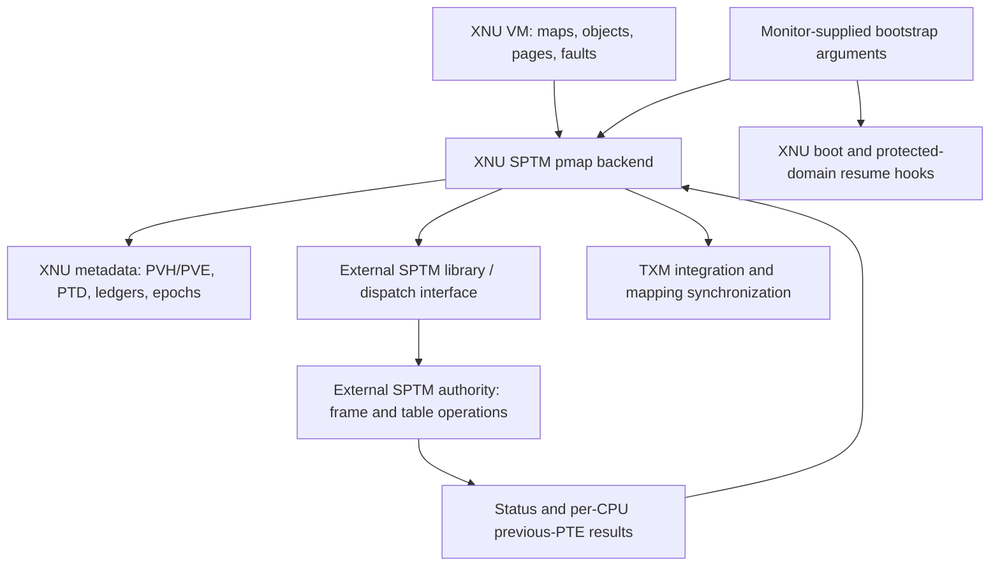
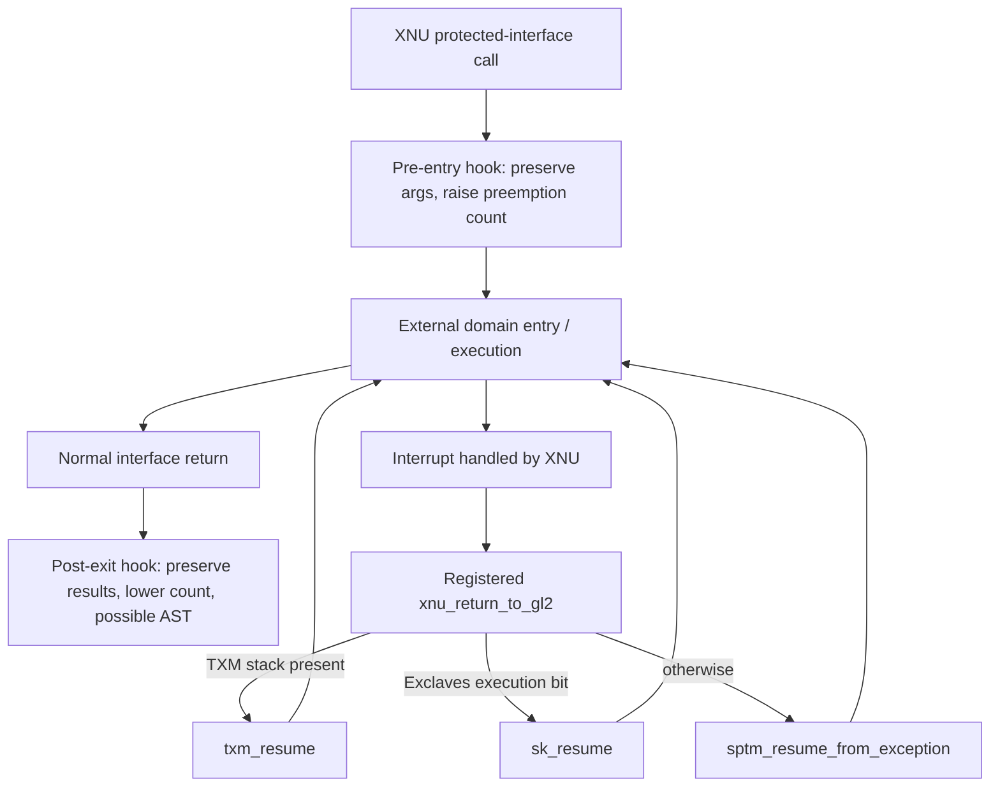
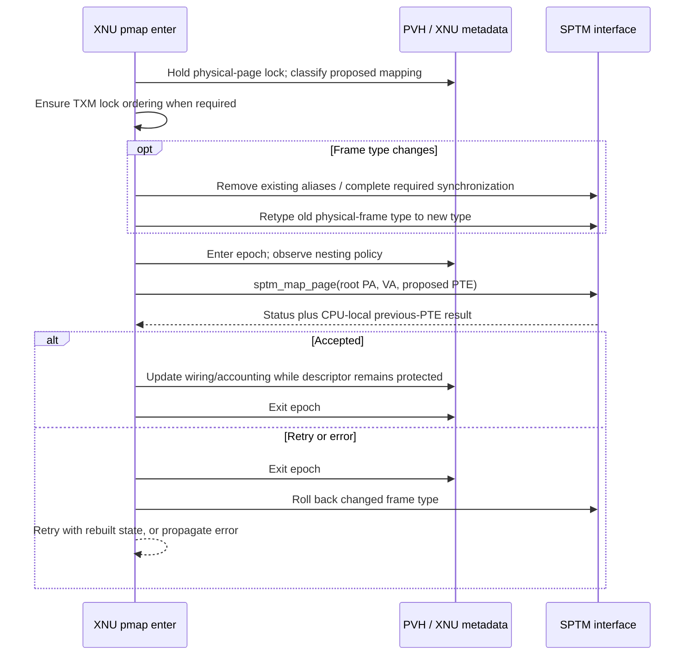

# SPTM: frame authority, protected transitions, and XNU's responsibilities

[Security overview](README.md) · [Exception levels and monitors](../platform/exception-levels-and-monitors.md) · [ARM64 pmap](../vm/pmap-arm64.md)

The Secure Page Table Monitor (SPTM) is an external authority that XNU's SPTM-specific ARM64 backend calls to change mappings, classify physical frames, activate translation roots, and complete selected bootstrap and panic transitions. XNU still allocates memory, manages address spaces, constructs proposed PTEs, tracks reverse mappings, and resolves races between its own threads. These are cooperating responsibilities: a valid VM operation must satisfy XNU's map/object rules, the pmap's synchronization rules, and the protected interfaces' mapping and frame-type contracts. The local code exposes the requests and their consequences for XNU; the monitor's complete validation and hardware implementation are not in this checkout. Start with [`pmap_enter_pte()`](../../../xnu/osfmk/arm64/sptm/pmap/pmap.c#L6355), [`sptm.h`](../../../xnu/osfmk/arm64/sptm/sptm.h#L30), and the [VM-to-pmap walkthroughs](../vm/mapping-walkthroughs.md).

This page concentrates on the boundary: what crosses it, which state must remain stable, and how execution gets back to XNU. Read [mapping lifecycle](../vm/pmap-mapping-lifecycle.md) for detailed reverse-map and PTE algorithms, [TLB and cache ordering](../vm/pmap-tlb-and-cache.md) for translation completion, [TXM](txm.md) for protected code-signing calls, and [Exclaves execution](exclaves-execution.md) for secure scheduler requests.

## What is present, and what the build supplies

`CONFIG_SPTM` selects a separate pmap implementation, boot assembly, and ARM initialization file. It is intended to be mutually exclusive with the older `config_pmap_ppl` backend; `CONFIG_EXCLAVES` requires SPTM. The build derives enablement from platform configuration and device-map properties, and adds the `TrustedExecutionMonitor_Kernel` and `sptm_xnu` libraries. The public source therefore does not contain a standalone implementation of the protected domains. See [`config/MASTER`](../../../xnu/config/MASTER#L320), [`files.arm64`](../../../xnu/osfmk/conf/files.arm64#L10), and [`MakeInc.def`](../../../xnu/makedefs/MakeInc.def#L1159).

The local umbrella header makes the dependency explicit:

[SPTM interface imports and boot-argument declaration](../../../xnu/osfmk/arm64/sptm/sptm.h#L35)

<!-- source-excerpt: ../../../xnu/osfmk/arm64/sptm/sptm.h#L35-L42 -->
```c
#include <sptm/debug_header.h>
#include <sptm/sptm_xnu.h>
#include <kern/debug.h>

#include <stdbool.h>

/* Bootstrapping arguments passed from the SPTM to XNU. */
extern const sptm_bootstrap_args_xnu_t *SPTMArgs;
```

Neither imported `sptm_xnu.h` nor `debug_header.h` is supplied here. `locore.s` also imports `sptm_common.h`. Consequently, the complete bootstrap structure, frame-type enum, dispatch numbers, transition macro expansion, and many library function bodies cannot be recovered from these local files. A call named `sptm_*` is an interface call; its name alone does not establish that it executes a particular trap instruction. Some functions queried through `libsptm` may have implementation details different from mapping dispatch. The chapter uses the exact call sites and visible consumers instead of inventing those bodies. See [`locore.s` imports](../../../xnu/osfmk/arm64/locore.s#L78) and [`sptm_get_frame_type()`](../../../xnu/osfmk/arm64/sptm/sptm.h#L84).

There is a second terminology boundary. Boot comments say that SPTM entry traps to **GL2**, the registered return function is named `xnu_return_to_gl2`, and the entry hook reads `CurrentG`. These are the source's guarded-domain terms. Architectural registers such as `VBAR_EL1`, `TPIDR_EL1`, `ELR_EL1`, `SPSR_EL1`, and `DAIF` also appear, but that does not make every use of “GL2” an architectural EL2 claim. In particular, the external `SPTM_DOMAIN_ENTER` macro's implementation is absent. The [platform exception-level guide](../platform/exception-levels-and-monitors.md) distinguishes this boundary from ordinary EL0/EL1 exception handling, older PPL entry, and a guest's hypercall path.



The diagram describes interfaces visible in this tree. It does not specify the monitor's address space, instruction-level transition mechanism, or internal locking.

## Bootstrap: establish the interface before ordinary VM initialization

### The assembly entry contract

The SPTM boot entry is `_start` in `start_sptm.s`. Its documented register contract distinguishes cold boot, warm boot, secondary CPU boot, hibernation exit, and a panic initiated by SPTM/TXM/cL4. In the normal cases, `x1` holds iBoot arguments and `x2` holds SPTM arguments. In the panic case, `x1` is a panic string and `x2` tells XNU whether attempting a local coredump is supported. The latter matters because dumping through an NVMe driver may itself require further SPTM calls. The assembly saves that flag and branches to `panic_from_sptm()`. See [`_start` contract and panic dispatch](../../../xnu/osfmk/arm64/sptm/start_sptm.s#L34).

The cold path clears thread-pointer registers, establishes exception and interrupt stacks using `SPSel`, preserves the boot arguments, rebases/signs the kernel image, and initializes static conditionals. The initial executable region is `__TEXT_BOOT_EXEC`; the source contract says the remaining code becomes executable after fixups complete. XNU installs its final vector base immediately before the first explicit bootstrap dispatch because the source says that dispatch validates and locks VBAR. See [`start_cold`](../../../xnu/osfmk/arm64/sptm/start_sptm.s#L123).

[Install VBAR and signal FIXUPS_COMPLETE](../../../xnu/osfmk/arm64/sptm/start_sptm.s#L151)

<!-- source-excerpt: ../../../xnu/osfmk/arm64/sptm/start_sptm.s#L151-L161 -->
```asm
	adrp	x9, EXT(ExceptionVectorsBase)@page
	add		x9, x9, EXT(ExceptionVectorsBase)@pageoff
	msr		VBAR_EL1, x9
	isb

	/**
	 * Call into the SPTM for the first time. This function traps to GL2 to
	 * signal the SPTM that the fixups phase has been completed.
	 */
	SPTM_LOAD_DISPATCH_ID SPTM_DOMAIN, SPTM_DISPATCH_TABLE_XNU_BOOTSTRAP, SPTM_FUNCTIONID_FIXUPS_COMPLETE
	SPTM_DOMAIN_ENTER	x16
```

The comment after this call says the RX region has been retyped to `SPTM_XNU_CODE`. That is the boot-side contract visible here, not an implementation of the retyping enforcement. Execution then branches into `arm_init()` or the KASAN initialization variant. The later `machine_lockdown()` call is a separate phase; fixups completion does not mean every late read-only allocation has already been sealed. See [`post-fixup handoff`](../../../xnu/osfmk/arm64/sptm/start_sptm.s#L163) and [`machine_lockdown()`](../../../xnu/osfmk/arm64/machine_routines.c#L558).

### Boot arguments are operational state, not just identification

`arm_init()` first registers `xnu_return_to_gl2` as the XNU exception-return handler, stripping function-pointer authentication from the address passed to the interface. It copies the iBoot and SPTM argument structures into XNU storage declared read-only-late and saves the protected panic-flag pointer. The copy is a structure assignment: pointers carried inside the bootstrap structure still identify the corresponding supplied objects. See [`arm_init()`](../../../xnu/osfmk/arm64/sptm/arm_init_sptm.c#L752) and [`const_sptm_args` storage](../../../xnu/osfmk/arm64/sptm/arm_init_sptm.c#L174).

[Copy bootstrap arguments and accept the monitor's physical-memory boundary](../../../xnu/osfmk/arm64/sptm/arm_init_sptm.c#L770)

<!-- source-excerpt: ../../../xnu/osfmk/arm64/sptm/arm_init_sptm.c#L770-L781 -->
```c
	/* If kernel integrity is supported, use a constant copy of the boot args. */
	const_boot_args = *args;
	BootArgs = args = &const_boot_args;
	const_sptm_args = *sptm_boot_args;
	SPTMArgs = sptm_boot_args = &const_sptm_args;
	sptm_xnu_triggered_panic_ptr = sptm_boot_args->xnu_triggered_panic;
	/*
	 * Initialize first_avail_phys from what the SPTM tells us.
	 * We're not using iBoot's topOfKernelData, as SPTM and other
	 * components have consumed pages themselves.
	 */
	first_avail_phys = sptm_boot_args->first_avail_phys;
```

The physical allocation boundary comes from SPTM because monitor components have already consumed pages beyond the iBoot kernel allocation. `libsptm_init()` consumes the provided library state and panics on failure. With KASAN, that setup happens early enough to support the sanitizer bootstrap; the ordinary path initializes the library inside `arm_init()`. See [`arm_init_kasan()`](../../../xnu/osfmk/arm64/sptm/arm_init_sptm.c#L731) and [`libsptm_init()` call](../../../xnu/osfmk/arm64/sptm/arm_init_sptm.c#L796).

The following are **consumed fields**, not a reconstructed ABI layout:

| Supplied state | Visible XNU consumer and implication |
| --- | --- |
| `first_avail_phys`, `physmap_base`, `physmap_end`, `libsptm_state.root_table_paddr` | [`arm_init()`](../../../xnu/osfmk/arm64/sptm/arm_init_sptm.c#L775) and [`arm_vm_init()`](../../../xnu/osfmk/arm64/sptm/arm_init_sptm.c#L1830) accept the already established physical aperture and root. The source itself marks reading the root directly from library state as a temporary interface choice. |
| `feature_flags`, `sptm_variant` | [`arm_init()` feature checks](../../../xnu/osfmk/arm64/sptm/arm_init_sptm.c#L978) reject incompatible large-memory settings; [`RELEASE` validation](../../../xnu/osfmk/arm64/sptm/arm_init_sptm.c#L1099) requires the release SPTM variant. |
| `num_asids` | [`pmap_bootstrap()`](../../../xnu/osfmk/arm64/sptm/pmap/pmap.c#L1670) obtains the available ASID count from SPTM. |
| `sptm_prev_ptes` | [`pmap_cpu_data_init_internal()`](../../../xnu/osfmk/arm64/sptm/pmap/pmap_data.c#L2075) selects a page of output records for each SPTM CPU ID. Mapping operations later read previous PTEs from it. |
| `cpu_stack_papt_start/end`, `txm_thread_stacks` | [`ml_addr_in_non_xnu_stack()`](../../../xnu/osfmk/arm64/machine_routines.c#L3146) recognizes protected-domain stacks for diagnostics; [TXM](txm.md) explains pooling and use of its boot-supplied thread stacks. |
| `sptm_pmap_io_ranges`, `sptm_pmap_io_filters`, and their counts | [`pmap data initialization`](../../../xnu/osfmk/arm64/sptm/pmap/pmap_data.c#L394) installs monitor-provided physical I/O metadata. |
| `first_tag_storage_paddr`, `n_tag_storage_frames` | [`MTE initialization`](../../../xnu/osfmk/arm64/sptm/pmap/pmap.c#L2423) accounts for optional tag-storage pages. |
| `xnu_triggered_panic`, `debug_header` | [`arm_init()`](../../../xnu/osfmk/arm64/sptm/arm_init_sptm.c#L775) saves the panic flag; [`debug-image setup`](../../../xnu/osfmk/arm64/sptm/arm_init_sptm.c#L2062) obtains information for SPTM/TXM diagnostics. |

XNU does not build every initial table from an empty hierarchy. `arm_vm_init()` takes `cpu_ttep` from the supplied root and creates XNU page-table descriptors for preexisting static mappings. The monitor-provided physical aperture is also accessed through `sptm_phystokv()` rather than assuming that all physical addresses are translated by one locally defined arithmetic offset. See [`root setup`](../../../xnu/osfmk/arm64/sptm/arm_init_sptm.c#L1852), [`static table descriptor initialization`](../../../xnu/osfmk/arm64/sptm/arm_init_sptm.c#L2080), and [`phystokv()`](../../../xnu/osfmk/arm64/sptm/arm_init_sptm.c#L1384).

### Secondary CPUs and warm return

The warm assembly path matches the physical CPU ID from `MPIDR_EL1` against `CpuDataEntries`, establishes that CPU's exception/interrupt stacks, and accepts only the expected reset handlers `arm_init_cpu` or `arm_init_idle_cpu`. Failure to find a valid entry/handler ends in a diagnostic spin. CPU startup and idle code arrange those reset handlers and the active thread in XNU state. See [`start_warm`](../../../xnu/osfmk/arm64/sptm/start_sptm.s#L179), [`cpu_start()` setup](../../../xnu/osfmk/arm64/cpu.c#L913), and [`idle reset setup`](../../../xnu/osfmk/arm64/cpu.c#L1270).

The boot comment says hibernation uses this warm path after SPTM restores `VBAR_EL1`; the local assembly does not provide `sptm_resume_cpu()`'s implementation. `arm_init_cpu()` handles the visible XNU side, including early preservation of hibernation handoff data, PAN/timer/register setup, CPU state, and installation of the current thread. This is sufficient to follow the handoff, but not to reconstruct the protected CPU-save format or every system register restored externally. See [`warm-path VBAR contract`](../../../xnu/osfmk/arm64/sptm/start_sptm.s#L114) and [`arm_init_cpu()`](../../../xnu/osfmk/arm64/sptm/arm_init_sptm.c#L1155).

## Runtime calls: thread state, per-CPU buffers, and interrupt return

### Ordinary call hooks

XNU supplies `_sptm_pre_entry_hook` and `_sptm_post_exit_hook` for the SPTM call interface. The pre-entry hook saves `x0`–`x7` and the function identifier in `x16`, then increments the current thread's preemption-disable count. A null `TPIDR_EL1` bypasses thread bookkeeping during early bootstrap. It also checks `CurrentG == 0`, spinning if called from the wrong guarded mode. Optional scheduler-hygiene instrumentation measures the outermost preemption-disabled interval. See [`_sptm_pre_entry_hook`](../../../xnu/osfmk/arm64/locore.s#L2681).

[Protect the thread's CPU residency on SPTM entry](../../../xnu/osfmk/arm64/locore.s#L2695)

<!-- source-excerpt: ../../../xnu/osfmk/arm64/locore.s#L2695-L2700 -->
```asm
	/* Increase the preemption count. */
	mrs		x9, TPIDR_EL1
	cbz		x9, Lskip_preemption_check_sptmhook
	ldr		w10, [x9, ACT_PREEMPT_CNT]
	add		w10, w10, #1
	str		w10, [x9, ACT_PREEMPT_CNT]
```

The hook restores arguments before returning to its external caller. It does not contain the transition itself, and increasing the preemption count is not the same operation as masking interrupts. That distinction explains why protected execution can be interrupted and later resumed.

The post-exit hook preserves return values in `x0`–`x7`, checks for preemption-count underflow, and decrements the count. If this leaves preemption enabled and IRQs are unmasked, it tests the current CPU's urgent AST bit. It masks exceptions around `ast_taken_kernel()` and restores `DAIF` afterward. The return values survive that processing. An ordinary C caller therefore cannot assume that the entire interval before and after a protected call remains on one CPU unless the caller supplies its own enclosing preemption protection. See [`_sptm_post_exit_hook`](../../../xnu/osfmk/arm64/locore.s#L2742).

[Process an urgent AST when the protected call releases preemption](../../../xnu/osfmk/arm64/locore.s#L2803)

<!-- source-excerpt: ../../../xnu/osfmk/arm64/locore.s#L2803-L2815 -->
```asm
	mrs		x20, DAIF
	tbnz	x20, #(DAIF_IRQF_SHIFT), Lsptm_skip_ast_taken_sptmhook

	/* IF there is no urgent AST, skip the AST. */
	ldr		x12, [x0, ACT_CPUDATAP]
	ldr		x14, [x12, CPU_PENDING_AST]
	tst		x14, AST_URGENT
	b.eq	Lsptm_skip_ast_taken_sptmhook

	/* Handle the AST. This call requires interrupts to be disabled. */
	msr		DAIFSet, #(DAIFSC_ALL)
	bl		EXT(ast_taken_kernel)
	msr		DAIF, x20
```

This distinction matters for pmap's batched operations: they often disable preemption before obtaining a per-CPU buffer and keep that protection through the monitor call and result consumption. The call hook adds its own nesting; it does not replace the caller's buffer lifetime.

### Per-CPU state exposed to the interface

`pmap_sptm_percpu_data_t` is an 8192-byte-aligned container whose size must fit in that alignment unit, with a compile-time assertion that the kernel page size is divisible by it. It contains operation arrays, corresponding physical addresses, output pointers, XNU bookkeeping arrays, epoch state, a guest-dispatch record, and SPTM CPU/trace state. The operation-array bound `SPTM_MAPPING_LIMIT` comes from the external interface; a fixed numeric value cannot be inferred from this checkout. See [`pmap_sptm_percpu_data_t`](../../../xnu/osfmk/arm64/sptm/pmap/pmap_data.h#L1173).

| Member | Role |
| --- | --- |
| `sptm_prev_ptes` | Supplied result area; a map call interprets it as `sptm_map_page_output_t`, including the previous PTE and PTE pointer. |
| `sptm_user_pointer_ops`, `sptm_ops`, `sptm_templates` / `sptm_paddrs` | Locally prepared operation payloads. Templates and PA lists share a union and cannot be independent concurrent scratch arrays on that CPU. |
| Corresponding `*_pa` fields | Physical addresses passed to protected interfaces rather than arbitrary XNU virtual pointers. |
| `sptm_ptds`, `sptm_ptd_info`, `sptm_acct_flags` | XNU's associated table-descriptor and accounting state for a batch. |
| `pmap_epoch` | Tracks operations whose observed mapping/table state must survive until they finish. |
| `sptm_iommu_scratch`, `sptm_guest_dispatch` | Interface storage for additional consumers; their presence does not establish the implementation of all IOMMU or guest services. |

These fields are initialized by [`pmap_cpu_data_init_internal()`](../../../xnu/osfmk/arm64/sptm/pmap/pmap_data.c#L2053). It translates each operation array to a physical address and converts the topology's physical CPU ID into an SPTM CPU ID. That ID selects scratch and previous-PTE storage; it should not be silently equated with XNU's logical `cpu_number`.

[Select interface buffers using the SPTM CPU ID](../../../xnu/osfmk/arm64/sptm/pmap/pmap_data.c#L2068)

<!-- source-excerpt: ../../../xnu/osfmk/arm64/sptm/pmap/pmap_data.c#L2068-L2076 -->
```c
	const uint16_t sptm_cpu_number = sptm_cpu_id(ml_get_topology_info()->cpus[cpu_number].phys_id);
	sptm_pcpu->sptm_cpu_id = sptm_cpu_number;

	const pmap_paddr_t iommu_scratch =
	    sptm_cpu_iommu_scratch_start + (sptm_cpu_number * PMAP_IOMMU_SCRATCH_SIZE);
	assert(iommu_scratch <= (sptm_cpu_iommu_scratch_end - PMAP_IOMMU_SCRATCH_SIZE));
	sptm_pcpu->sptm_iommu_scratch = (void*)phystokv(iommu_scratch);
	sptm_pcpu->sptm_prev_ptes = (sptm_pte_t *)((uintptr_t)(SPTMArgs->sptm_prev_ptes) + (PAGE_SIZE * sptm_cpu_number));
	sptm_pcpu->sptm_cpu_id = sptm_cpu_number;
```

### Interrupted protected execution has a separate return dispatcher

During boot, `arm_init()` registers the stripped address of `xnu_return_to_gl2`. Its assembly comment defines the case: XNU has handled an interrupt that occurred during SPTM, TXM, or secure-kernel runtime. The dispatcher checks the interrupted thread's state in this order:

1. A nonzero `thread->txm_thread_stack` selects `txm_resume`, passing the stack in `x0`.
2. With Exclaves enabled, `TH_EXCLAVES_EXECUTION` in `th_exclaves_intstate` selects `sk_resume`.
3. Otherwise it branches to `sptm_resume_from_exception`.

See [`handler registration`](../../../xnu/osfmk/arm64/sptm/arm_init_sptm.c#L761), [`dispatcher`](../../../xnu/osfmk/arm64/locore.s#L1696), and [`thread fields`](../../../xnu/osfmk/kern/thread.h#L1106). The TXM branch is:

[Resume TXM when the interrupted thread owns a TXM stack](../../../xnu/osfmk/arm64/locore.s#L1711)

<!-- source-excerpt: ../../../xnu/osfmk/arm64/locore.s#L1711-L1717 -->
```asm
	mrs		x8, TPIDR_EL1
	ldr		x8, [x8, TH_TXM_THREAD_STACK]
	cbz		x8, 1f
	mov		x0, x8
	b		EXT(txm_resume)
	/* Unreachable */
	b .
```

The secure-kernel and default SPTM branches follow in the same function. Their implementations are external. This is not a locally visible `eret` that directly restores a complete monitor register frame. The ordinary XNU exception-return code gets to a registered continuation, and that continuation delegates protected-domain resume.



Exclaves sets its execution-state bit around `sk_enter()`, and TXM keeps a stack assigned to the thread while a protected call is outstanding. Those state machines are described in [Exclaves execution](exclaves-execution.md) and [TXM](txm.md). They are stronger evidence for domain selection than the apparent interrupted PC.

The apparent PC is deliberately unusual. `ml_get_backtrace_pc()` explains that an interrupted non-XNU domain has a fixed re-entry handler in the saved PC, while the actual interrupted PC is carried in saved `x14`. It uses `ml_addr_in_non_xnu_stack()` to select this interpretation by the saved frame pointer. The stack detector consults the SPTM CPU-stack aperture bounds and supplied TXM stack addresses. This is a diagnostic convention visible to XNU, not a full published context-save ABI. See [`stack recognition`](../../../xnu/osfmk/arm64/machine_routines.c#L3146) and [`ml_get_backtrace_pc()`](../../../xnu/osfmk/arm64/machine_routines.c#L3175).

[Recover the diagnostic PC for an interrupted protected domain](../../../xnu/osfmk/arm64/machine_routines.c#L3188)

<!-- source-excerpt: ../../../xnu/osfmk/arm64/machine_routines.c#L3188-L3193 -->
```c
	if (ml_addr_in_non_xnu_stack(get_saved_state_fp(state))) {
		return saved_state64(state)->x[14];
	}
#endif /* CONFIG_SPTM */

	return get_saved_state_pc(state);
```

## Frame types: physical-page policy distinct from a mapping's permissions

A PTE describes a virtual mapping. An SPTM frame type classifies the underlying physical frame and constrains what XNU may ask the protected interface to do with it. A single physical page can have several aliases, so changing one PTE's permissions and changing the frame's type are different operations. The local wrappers query type, in-flight state, mapping counts, and table references through `libsptm`; failures of those queries panic. See [`sptm_get_frame_type()`](../../../xnu/osfmk/arm64/sptm/sptm.h#L84), [`sptm_paddr_is_inflight()`](../../../xnu/osfmk/arm64/sptm/sptm.h#L61), and [`sptm_get_page_table_refcnt()`](../../../xnu/osfmk/arm64/sptm/sptm.h#L130).

The table records types actually used at XNU call sites. It is not the monitor's complete type/permission matrix.

| Type or type family | Visible role and transition |
| --- | --- |
| `XNU_DEFAULT` | Ordinary starting/return type used by page allocation, explicit default mappings, and selected recycle paths. [`pmap_frame_type_for_pte()`](../../../xnu/osfmk/arm64/sptm/pmap/pmap.c#L6076) |
| `XNU_PAGE_TABLE`, `XNU_USER_ROOT_TABLE`, `XNU_SHARED_ROOT_TABLE` | Lower-level tables, ordinary user roots, and nested/shared roots; retype parameters communicate table level or root geometry/ASID. [`pmap_tt_allocate()`](../../../xnu/osfmk/arm64/sptm/pmap/pmap.c#L3353), [`root allocation`](../../../xnu/osfmk/arm64/sptm/pmap/pmap.c#L3120) |
| `XNU_SUBPAGE_USER_ROOT_TABLES` | Conditional support for several smaller roots in one backing page, with specific SURT operations and allocator bookkeeping. [Root geometry](../vm/pmap-arm64.md), [`root allocation`](../../../xnu/osfmk/arm64/sptm/pmap/pmap.c#L3120) |
| `XNU_USER_EXEC`, `XNU_USER_DEBUG`, `XNU_USER_JIT`, `XNU_USER_TPRO` | Mapping classification derived from requested permissions/options in the inferred path; user-executable types also interact with TXM synchronization. [`pmap_frame_type_for_pte()`](../../../xnu/osfmk/arm64/sptm/pmap/pmap.c#L6112) |
| `XNU_ROZONE`, `XNU_PAGE_TABLE_ROZONE` | Read-only zone pages and the table type used for their region. [`explicit RO mapping`](../../../xnu/osfmk/arm64/sptm/pmap/pmap.c#L6098), [`RO table setup`](../../../xnu/osfmk/arm64/sptm/pmap/pmap.c#L7350) |
| `XNU_KERNEL_RESTRICTED` | Explicit restricted mapping category when `use_xnu_restricted` is enabled; otherwise that request selects the default type. [`mapping classifier`](../../../xnu/osfmk/arm64/sptm/pmap/pmap.c#L6102), [allocator mapping categories](../vm/allocator-interfaces.md#mapping-restrictions-are-a-separate-layer-of-isolation) |
| `XNU_PAGE_TABLE_COMMPAGE`, `XNU_COMMPAGE_RW/RO/RX` | Dedicated table and data/text page types prepared for commpage mappings. [`commpage preparation`](../../../xnu/osfmk/arm64/sptm/pmap/pmap.c#L1797) |
| `XNU_TAG_STORAGE` | Optional MTE tag-storage allocation/release. [`tag-storage retyping`](../../../xnu/osfmk/arm64/sptm/pmap/pmap.c#L2340) |
| `XNU_PROTECTED_IO` | Physical I/O frames whose ordinary mapping permissions and protected writes are handled specially. [`permission adjustment`](../../../xnu/osfmk/arm64/sptm/pmap/pmap.c#L1329), [`protected write`](../../../xnu/osfmk/arm64/sptm/pmap/pmap.c#L12770) |
| `TXM_DEFAULT` | Memory handoff to the code-signing monitor; ownership preparation is separate from a user mapping's execute permission. [TXM memory ownership](txm.md), [`transfer helpers`](../../../xnu/osfmk/arm64/sptm/pmap/pmap.c#L12605) |

The root code also names `XNU_STAGE2_ROOT_TABLE`, but the checked-in `pmap_performs_stage2_translations()` returns false. Type names and reserved guest fields do not establish a working XNU stage-two translation service in this version. See [`root type selection`](../../../xnu/osfmk/arm64/sptm/pmap/pmap.c#L3325) and [`stage-two query`](../../../xnu/osfmk/arm64/sptm/pmap/pmap.c#L12750).

The mapping classifier has important ordering. Explicit default/RO-zone/restricted categories take their own branch. Otherwise JIT permissions are checked before the debug option, and debug before ordinary RX. For a writable user mapping of a previously executable page, the code can request a transition back to `XNU_DEFAULT`, excluding `XNU_USER_DEBUG`, which already permits that case. The comment explains the purpose: removing old aliases forces future execution back through faults and any required signing validation. Other incompatible frame-type requests are not all “repaired” by XNU; some are intentionally left for the SPTM interface to reject as violations. See [`pmap_frame_type_for_pte()`](../../../xnu/osfmk/arm64/sptm/pmap/pmap.c#L6093).

## A mapping operation across the boundary

`pmap_enter_pte()` is a compact place to see both authorities cooperate. Its caller has disabled preemption and holds the physical page's PVH lock. XNU has already constructed a proposed PTE. The function computes the old/new frame types and, when a user executable type is involved with the code-signing monitor enabled, ensures the appropriate TXM mapping lock is held. It first attempts a shared try-lock because blocking under the PVH lock would violate lock ordering and preemptibility. Failure records `PMAP_TXM_LOCK_STATE_NEEDED` and returns a retry status. See [`pmap_enter_pte()` preconditions and TXM lock](../../../xnu/osfmk/arm64/sptm/pmap/pmap.c#L6375).

This is a public-source layout limitation: the implementation accesses `pmap->txm_lck` and other TXM fields, but the checked-in `struct pmap` substitutes reserved fields in its TXM section. The missing definitions cannot be used to infer exact offsets or a complete buildable structure. The ordinary fields—root VA/PA, geometry, ledger, references, ASID, nesting state—are visible. There is no legacy general pmap rwlock in that published SPTM layout; isolated inherited comments mentioning a “pmap lock” should not be treated as its definition. See [`struct pmap`](../../../xnu/osfmk/arm64/sptm/pmap/pmap.h#L307), [`reserved TXM section`](../../../xnu/osfmk/arm64/sptm/pmap/pmap.h#L418), and [TXM](txm.md).

If the frame type changes, XNU removes existing mappings with `PMAP_OPTIONS_PPO_PENDING_RETYPE`. Holding the PVH lock prevents a new `pmap_enter()` on the page from racing that transition, but another CPU can already be clearing a mapping without that lock. The removal/retype machinery must also deal with in-flight operations. A long reverse-mapping list can put the PVH lock into sleep mode and re-enable preemption; if that happens, `pmap_enter_pte()` returns `SPTM_MAP_FLUSH_PENDING` so the caller rebuilds assumptions about its CPU-local state. It then reloads the actual old type before issuing the retype. See [`alias removal and migration retry`](../../../xnu/osfmk/arm64/sptm/pmap/pmap.c#L6400).

Next, XNU enters a pmap epoch before checking whether a nested mapping needs the non-global bit, then calls `sptm_map_page(root_pa, va, pte, flags)`. The epoch protects against concurrent leaf-table deletion and against nesting policy changing between observation and insertion. Both `SPTM_SUCCESS` and `SPTM_MAP_VALID` are accepted outcomes. Other returns cause epoch exit and rollback of a changed frame type, even for `SPTM_MAP_FLUSH_PENDING`, because the caller may drop the PVH lock before retrying. Leaving the new type installed could lose the record needed for later failure cleanup. See [`map call and rollback`](../../../xnu/osfmk/arm64/sptm/pmap/pmap.c#L6428).

The returned previous state comes from the CPU's protected-interface result buffer:

[Consume SPTM's previous-PTE result while CPU-local state is stable](../../../xnu/osfmk/arm64/sptm/pmap/pmap.c#L6471)

<!-- source-excerpt: ../../../xnu/osfmk/arm64/sptm/pmap/pmap.c#L6471-L6477 -->
```c
	assert(!preemption_enabled());
	const sptm_map_page_output_t *map_page_out = (const sptm_map_page_output_t *)
	    PERCPU_GET(pmap_sptm_percpu)->sptm_prev_ptes;

	pt_entry_t *pte_p;
	*old_pte = prev_pte = map_page_out->prev_pte;
	*out_pte_p = pte_p = (pt_entry_t*)(map_page_out->ptep);
```

XNU uses this result to update wiring/accounting consistently with what the operation actually replaced. It keeps the epoch through `wiredcnt` changes because those updates dereference a PTD that a removal path might otherwise delete. A successful call does not transfer responsibility for XNU's PV lists, accounting, or descriptor lifetime to the monitor. See [`wired count update and epoch exit`](../../../xnu/osfmk/arm64/sptm/pmap/pmap.c#L6479).



The diagram omits the surrounding VM fault and pmap retry loops. Those are traced in [fault resolution](../vm/fault-resolution.md) and [pmap mapping lifecycle](../vm/pmap-mapping-lifecycle.md).

## Epochs, table ownership, batches, and reuse

### Why an epoch is needed in addition to a PVH lock

An SPTM operation can already have observed a page/table while another CPU is trying to retype or reclaim it. A software lock acquired after that observation does not make the old operation disappear. `pmap_epoch_t` records each CPU's active sequence, its next sequence, a snapshot of remote sequences, and preparation/drain flags. Zero means inactive. Entry disables preemption, rejects primary interrupt context and nesting on the same CPU, publishes a new sequence, and issues a store-load fence before further accesses. Exit publishes zero with release ordering. See [`epoch structure`](../../../xnu/osfmk/arm64/sptm/pmap/pmap_data.h#L1113) and [`pmap_epoch_enter()`](../../../xnu/osfmk/arm64/sptm/pmap/pmap_data.h#L2077).

[Publish an operation before accessing state that retyping can invalidate](../../../xnu/osfmk/arm64/sptm/pmap/pmap_data.h#L2088)

<!-- source-excerpt: ../../../xnu/osfmk/arm64/sptm/pmap/pmap_data.h#L2088-L2098 -->
```c
	/* Must not already be in a pmap epoch on this CPU. */
	assert3u(pmap_epoch->local_seq, ==, 0);
	pmap_epoch->local_seq = ++pmap_epoch->next_seq;
	/* Unsigned 64-bit per-CPU integer should never overflow on any human timescale. */
	assert(pmap_epoch->local_seq != 0);

	/**
	 * Issue a store-load barrier to ensure that remote observers of any ensuing
	 * SPTM accesses will also observe the epoch update.
	 */
	os_atomic_thread_fence(seq_cst);
```

`pmap_epoch_prepare_drain()` samples remote active sequences; `pmap_epoch_drain()` waits until each sampled active sequence has ended or advanced. The two calls allow useful work between sampling and waiting. They do not wait for every future epoch forever. This works only if the caller has already changed the state future operations will observe and has prevented new conflicting operations. The header explicitly requires globally visible mapping changes, suitable exclusion against new mappings, and no preemptible operation between preparation and drain. For ordinary retyping, the PVH lock often supplies exclusion. See [`drain preconditions`](../../../xnu/osfmk/arm64/sptm/pmap/pmap_data.h#L2031), [`prepare`](../../../xnu/osfmk/arm64/sptm/pmap/pmap_data.h#L2149), and [`drain`](../../../xnu/osfmk/arm64/sptm/pmap/pmap_data.h#L2196).

An epoch drain is therefore neither a TLB invalidation nor a general object reference. In particular, `prepare_drain()` does not issue the barrier that makes earlier mapping writes globally visible before its scan; its caller must already supply the required ordering. The same mechanism also coordinates unnested-table policy, so “retype epoch” is a useful historical description but not its only use. See [`ordering warning`](../../../xnu/osfmk/arm64/sptm/pmap/pmap_data.h#L2139) and [`nested-bit observation inside the epoch`](../../../xnu/osfmk/arm64/sptm/pmap/pmap.c#L6428).

### Create a table, then reclaim it without confusing an old observer

`pmap_tt_allocate()` allocates a VM page and a PTD, with cleanup if either allocation fails. It locks the page's empty PVH, prepares an epoch drain, publishes the PTD association and accounting, drains old observers, and asks SPTM to change `XNU_DEFAULT` into the required table type with the table level in retype parameters. The later expansion code initializes descriptor state and maps the table into its parent. The initial drain also prevents an observer of a previously condemned table from mistaking newly installed backing at a different PA for the old table. See [`pmap_tt_allocate()`](../../../xnu/osfmk/arm64/sptm/pmap/pmap.c#L3353) and [`pmap_expand()`](../../../xnu/osfmk/arm64/sptm/pmap/pmap.c#L7250).

Table reclamation demonstrates why “reference count zero” is only an intermediate observation:

1. The remover holds an epoch while reading the parent TTE, rejects invalid/already-condemned entries, and checks the monitor's table mapping count.
2. `sptm_condemn_leaf_table()` elects one remover and prevents fresh insertions through that table; other contenders cannot simply assume they own it.
3. The winner leaves its observation epoch and drains earlier operations that could have inserted a mapping.
4. It checks the count again. A concurrent insertion that completed before condemnation means the table must be uncondemned, with an epoch protecting that operation.
5. Only an empty, successfully condemned table proceeds to unmapping/deallocation. Retyping back to `XNU_DEFAULT`, PTD teardown, PVH clearing, accounting removal, and returning the physical page are separate steps.

See [`leaf-table condemnation`](../../../xnu/osfmk/arm64/sptm/pmap/pmap.c#L4095), [`post-drain recheck`](../../../xnu/osfmk/arm64/sptm/pmap/pmap.c#L4151), and [`pmap_tt_deallocate()`](../../../xnu/osfmk/arm64/sptm/pmap/pmap.c#L3418). The code preserves preemption disablement while owning the condemned state so another mapping thread is not left retrying behind a descheduled owner.

The XNU PTD's wiring data is also distinct from the table mapping count queried from SPTM. A descriptor's lifetime, a table's mappings, an in-flight operation, and a physical page's frame type each answer a different question. [ARM64 pmap structures](../vm/pmap-arm64.md) and [table removal](../vm/pmap-mapping-lifecycle.md) cover these records in more detail.

There is a further lifetime check after removing the table from its parent. `pmap_tte_remove()` calls `sptm_unmap_table()`, then, on the draining path, waits for old epoch observers and checks the PTD's `wiredcnt`. A reader can pin a leaf table while inside an epoch and continue using its backing after leaving that epoch. Such a pin does not keep the table mapped, but it prevents immediate physical reuse: `pmap_tte_deallocate()` queues the backing for delayed freeing when the pin remains. “Unmapped,” “no monitor mapping references,” and “safe to free the PTD and physical page” therefore are three separate milestones. See [`unmap and pin check`](../../../xnu/osfmk/arm64/sptm/pmap/pmap.c#L3626), [`delayed-free choice`](../../../xnu/osfmk/arm64/sptm/pmap/pmap.c#L3675), and [`pmap_pin_leaf_table()`](../../../xnu/osfmk/arm64/sptm/pmap/pmap.c#L3704).

### Batching preserves references before the monitor call

Disjoint updates may describe aliases in different pmaps; region updates describe a contiguous VA interval in one target. `pmap_multipage_op_submit_disjoint()` passes the physical operation-array address and entry count to `sptm_update_disjoint_multipage()`. Its epoch covers construction as well as submission because the accumulated records already identify tables and mappings whose lifetime matters. Region submission creates an epoch around its SPTM call when no disjoint epoch is already active. Both use caller-held preemption protection around per-CPU payloads. See [`disjoint submission`](../../../xnu/osfmk/arm64/sptm/pmap/pmap.c#L4618) and [`region submission`](../../../xnu/osfmk/arm64/sptm/pmap/pmap.c#L4798).

Region updates request permission/access-flag changes with deferred TLB invalidation permitted:

[Submit region updates while protecting their in-flight references](../../../xnu/osfmk/arm64/sptm/pmap/pmap.c#L4815)

<!-- source-excerpt: ../../../xnu/osfmk/arm64/sptm/pmap/pmap.c#L4815-L4823 -->
```c
		pmap_epoch_t *const epoch = ((flush_range->pending_disjoint_entries == 0) ?
		    pmap_epoch_enter() : NULL);
		const sptm_return_t sptm_return = sptm_update_region(flush_range->ptfr_pmap->ttep,
		    flush_range->pending_region_start, flush_range->pending_region_entries,
		    PERCPU_GET(pmap_sptm_percpu)->sptm_templates_pa,
		    SPTM_UPDATE_PERMS_AND_WAS_WRITABLE | SPTM_UPDATE_AF | SPTM_UPDATE_DEFER_TLBI);
		if (epoch != NULL) {
			pmap_epoch_exit(epoch);
		}
```

An `SPTM_UPDATE_DELAYED_TLBI` result sets `ptfr_flush_needed`; it is not an ordinary failure. The range-level completion path submits remaining work, orders PTE writes with `FLUSH_PTE_STRONG()`, invokes the asynchronous range flush, and calls `sync_tlb_flush()`. This is a concrete example where an interface operation finishing and translation invalidation completing are different events. Reuse must respect the latter as well as any epoch/frame constraints. See [`delayed result handling`](../../../xnu/osfmk/arm64/sptm/pmap/pmap.c#L4833) and [`phys_attribute_clear` range completion](../../../xnu/osfmk/arm64/sptm/pmap/pmap.c#L7902).

Long operations have explicit preemptibility checks so repeated protected calls can allow urgent AST processing between bounded portions. That is consistent with the post-exit hook; it does not make an individual per-CPU operation buffer migratable while it is being used. See [`pmap_verify_preemptible()`](../../../xnu/osfmk/arm64/sptm/pmap/pmap_data.h#L2254).

### Return a data frame to VM

`pmap_is_page_free()` first waits out in-flight SPTM activity if necessary, issues an acquire fence, then asks whether the frame has no mappings under the `SPTM_REFCOUNT_NONE` query. The surrounding verification contract excludes the default physical-aperture mapping. `pmap_recycle_page()` panics if a mapping remains and converts selected frame types back to `XNU_DEFAULT`. It does not automatically retype every possible monitor-owned frame. See [`pmap_is_page_free()`](../../../xnu/osfmk/arm64/sptm/pmap/pmap_data.c#L2181), [`free-page verification contract`](../../../xnu/osfmk/arm64/sptm/pmap/pmap_data.c#L2206), and [`recycle path`](../../../xnu/osfmk/arm64/sptm/pmap/pmap_data.c#L2292).

[Types automatically restored when VM recycles a page](../../../xnu/osfmk/arm64/sptm/pmap/pmap_data.h#L2240)

<!-- source-excerpt: ../../../xnu/osfmk/arm64/sptm/pmap/pmap_data.h#L2240-L2246 -->
```c
static inline bool
pmap_type_requires_retype_on_recycle(sptm_frame_type_t frame_type)
{
	return sptm_type_is_user_executable(frame_type) ||
	       (frame_type == XNU_ROZONE) || (frame_type == XNU_KERNEL_RESTRICTED) ||
	       (frame_type == XNU_USER_TPRO);
}
```

TXM ownership transfer has additional preparation. Its pmap helper uses a default-to-default retype after removing mappings to clear deferred-TLBI history before transfer. The receiver's ownership and eventual relinquishment are separate from restoring an XNU writable mapping. Follow [TXM](txm.md) for that lifecycle rather than treating `TXM_DEFAULT` as another ordinary allocator page category. See [`TXM retype preparation`](../../../xnu/osfmk/arm64/sptm/pmap/pmap.c#L12613).

## Root activation and protected I/O

`pmap_switch_internal()` validates the selected address space's ASID, updates XNU's replacement bookkeeping, and calls `sptm_switch_root(pmap->ttep, ...)`. With MTE it may request the thread's tag-fault override; debug builds account for returned indications of an ASID TLB flush or restricted-context flush. The actual register write and protected activation policy are behind the interface. A source explanation that substitutes a direct local TTBR write for this call would miss the SPTM boundary. See [`pmap_switch_internal()`](../../../xnu/osfmk/arm64/sptm/pmap/pmap.c#L4353) and [activation/TLB guide](../vm/pmap-tlb-and-cache.md).

Other pmap interfaces preserve the same distinction between XNU bookkeeping and protected translation changes:

| Interface family | Visible caller responsibility |
| --- | --- |
| `sptm_unmap_region`, `sptm_unmap_disjoint` | Identify a VA interval or a physical page's aliases. Disjoint removal uses returned previous PTEs to determine accounting changes; constructing a removal request alone does not establish which valid mapping it replaced. [`region removal`](../../../xnu/osfmk/arm64/sptm/pmap/pmap.c#L3899), [`pmap_disjoint_unmap()`](../../../xnu/osfmk/arm64/sptm/pmap/pmap.c#L4485) |
| `sptm_map_table`, `sptm_unmap_table` | Publish/remove the parent-table relation after table preparation or before reclamation. XNU still owns the PTD and delayed-free protocol. [`table insertion`](../../../xnu/osfmk/arm64/sptm/pmap/pmap.c#L7405), [`table removal`](../../../xnu/osfmk/arm64/sptm/pmap/pmap.c#L3626) |
| `sptm_configure_shared_region`, `sptm_set_shared_region`, `sptm_nest_region`, `sptm_unnest_region` | Establish the allowed shared interval and parent/subordinate relationship, then attach or detach its table range. Root conversion uses `XNU_SHARED_ROOT_TABLE`; association takes the grand pmap's TXM lock exclusively and subordinate's shared. [`nested-root conversion`](../../../xnu/osfmk/arm64/sptm/pmap/pmap.c#L9407), [`shared-region setup`](../../../xnu/osfmk/arm64/sptm/pmap/pmap.c#L9812), [`nest contract`](../../../xnu/osfmk/arm64/sptm/pmap/pmap.c#L9871) |

Pointer authentication also has protected-interface helpers under `HAS_APPLE_PAC`. `pmap_sign_user_ptr()` and `pmap_auth_user_ptr()` mask interrupts, install the requested user JOP-key state, call the SPTM interface, restore that state, and restore the prior interrupt setting. Authentication failure becomes a poisoned pointer through `ml_poison_ptr()`. The batch-signing path accumulates operations in the per-CPU buffer, retains preemption protection across accumulation, submits on a full batch or explicit null-location flush, and copies results from `sptm_prev_ptes` to recorded destinations. These are visible key-context and buffer-lifetime rules; they do not reveal the external implementation of signing or authentication. See [`single-pointer operations`](../../../xnu/osfmk/arm64/sptm/pmap/pmap.c#L9610), [`batched operation`](../../../xnu/osfmk/arm64/sptm/pmap/pmap.c#L9663), and [`authentication failure`](../../../xnu/osfmk/arm64/sptm/pmap/pmap.c#L9742).

Protected I/O is a narrower visible example of authority over something other than user PTEs. On guarded-I/O-filter configurations, `pmap_iofilter_protected_write()` translates the address for read access, queries its physical frame type, and dispatches `XNU_PROTECTED_IO` writes through SPTM. Other valid addresses take direct volatile stores of supported widths. The ordinary mapping helper also downgrades writable requests for protected-I/O frames. See [`protected-I/O PTE adjustment`](../../../xnu/osfmk/arm64/sptm/pmap/pmap.c#L1329) and [`write dispatch`](../../../xnu/osfmk/arm64/sptm/pmap/pmap.c#L12767).

This function includes a hibernation-specific branch, but its local `is_hibernating` variable is initialized to false in this source. It should not be described as an active hibernation routing mechanism merely because that branch text exists. Similarly, IOMMU scratch fields and monitor-provided I/O ranges show an interface, not a complete audited DMA isolation implementation; the local SPTM `pmap_iommu.c` is a placeholder. See [`hibernation branch`](../../../xnu/osfmk/arm64/sptm/pmap/pmap.c#L12784) and [`pmap_iommu.c`](../../../xnu/osfmk/arm64/sptm/pmap/pmap_iommu.c).

## Boot lockdown and panic lockdown are different transitions

### Seal late bootstrap state

`machine_lockdown()` first finalizes VM protections and releases deferred pages. For SPTM with kernel integrity enabled, it prepares commpages and calls `sptm_lockdown_xnu()`. The call tells the monitor XNU is ready for RO memory to become read-only. It explicitly holds an extra preemption-disable level because retyping many bootstrap pages may take time, and it abandons the scheduler-hygiene latency measurement before releasing that level. System-register locking is also assigned to SPTM rather than XNU's ordinary `spr_lockdown()` path. See [`machine_lockdown()`](../../../xnu/osfmk/arm64/machine_routines.c#L558).

[Signal completion of the late writable bootstrap phase](../../../xnu/osfmk/arm64/machine_routines.c#L601)

<!-- source-excerpt: ../../../xnu/osfmk/arm64/machine_routines.c#L601-L607 -->
```c
	disable_preemption();
	/* Signal the SPTM that XNU is ready for RO memory to actually become read-only */
	sptm_lockdown_xnu();
#if SCHED_HYGIENE_DEBUG
	abandon_preemption_disable_measurement();
#endif /* SCHED_HYGIENE_DEBUG */
	enable_preemption();
```

This is a boot-stage contract. It is distinct from allocator type grouping, zone membership checks, and controlled writes to specific read-only-zone objects. The SPTM RO allocator backend has its own visible mutation implementation and external enforcement limits, described in [read-only and special zones](../vm/read-only-and-special-zones.md).

### Make selected failures irreversible before normal panic handling

The panic-lockdown comments state a security objective: a protected trapdoor panic bit makes selected fatal exceptions meaningful even if an attacker can write ordinary kernel memory. The intended cross-domain consequence is that TXM will refuse new code authorization. Locally, XNU stops dispatching synchronous exceptions from userspace once the supplied panic flag is set. The TXM refusal policy is a stated interface contract; its complete implementation is external. See [`panic-lockdown rationale`](../../../xnu/osfmk/arm64/locore.s#L81) and [TXM](txm.md).

The exception path performs the check before releasing the saved PC/FAR into the ordinary synchronous-handler state:

[Block new user synchronous exception dispatch after panic lockdown](../../../xnu/osfmk/arm64/locore.s#L1195)

<!-- source-excerpt: ../../../xnu/osfmk/arm64/locore.s#L1195-L1204 -->
```asm
	/* EL0 -- check if we're blocking sync exceptions due to lockdown */
	adrp	x4, EXT(sptm_xnu_triggered_panic_ptr)@page
	ldr		x4, [x4, EXT(sptm_xnu_triggered_panic_ptr)@pageoff]
	ldrb	w4, [x4]
	cbnz	w4, Lblocked_user_sync_exception

Lfleh_synchronous_continue:
	/* We've had our chance to lockdown, release PC/FAR */
	str		x25, [x0, SS64_PC]
	str		x2,  [x0, SS64_FAR]
```

For kernel-origin synchronous exceptions, `sleh_panic_lockdown_should_initiate_el1_sp0_sync()` classifies the saved syndrome and recovery context. PAC failures, instruction/PC alignment failures, and BTI failures are among the fatal cases. Data aborts require more care: recognized copy-I/O recovery may be legitimate, while tag faults or invalid authenticated addresses can demand lockdown. Debug/self-test recovery and early-boot state also change decisions. This is not “all faults cause lockdown”; ordinary recoverable VM faults must still reach their resolution path. See [`classification helper`](../../../xnu/osfmk/arm64/sleh.c#L3293) and [`assembly call before synchronous dispatch`](../../../xnu/osfmk/arm64/locore.s#L1217).

`BEGIN_PANIC_LOCKDOWN` ultimately calls `sptm_xnu_panic_begin()`, with development and XNUPOST branches for recording or expected-fault simulation. It preserves callee-saved registers but permits caller-saved clobbers, which explains the assembly's careful retention of exception arguments. Fatal SP1 handling has its own entry-side call sites. See [`macro`](../../../xnu/osfmk/arm64/locore.s#L104) and [`SP1 path`](../../../xnu/osfmk/arm64/locore.s#L1606).

Direct panic entry also calls `sptm_xnu_panic_begin()` from `debug_fatal_panic_begin()`, then checks the monitor's chosen panicking CPU. Its comment explicitly describes this direct panic-side call as best effort: security-critical exception paths are expected to initiate lockdown earlier, in the vector, before ordinary panic machinery is exposed. If a different CPU owns the panic, the caller must allow that CPU to proceed. See [`debug_fatal_panic_begin()`](../../../xnu/osfmk/kern/debug.c#L2549).

Conversely, SPTM/TXM/cL4 can enter XNU's `_start` panic route using the special sentinel described earlier. The local unwind directives and supplied dump-support flag help XNU diagnose the failure, but do not expose the protected domain's full call stack representation or prove that every failed monitor call is recoverable. See [`panic_from_sptm`](../../../xnu/osfmk/arm64/sptm/start_sptm.s#L90).

## Reading and auditing the boundary

For a practical source walk, follow these three routes:

| Question | Route |
| --- | --- |
| How does XNU become ready to make protected calls? | [`_start`](../../../xnu/osfmk/arm64/sptm/start_sptm.s#L71) → final VBAR/fixups dispatch → [`arm_init()`](../../../xnu/osfmk/arm64/sptm/arm_init_sptm.c#L752) → [`arm_vm_init()`](../../../xnu/osfmk/arm64/sptm/arm_init_sptm.c#L1771) → [`machine_lockdown()`](../../../xnu/osfmk/arm64/machine_routines.c#L558). |
| Why is changing an executable mapping more than writing a PTE? | [`pmap_frame_type_for_pte()`](../../../xnu/osfmk/arm64/sptm/pmap/pmap.c#L6067) → [`pmap_enter_pte()`](../../../xnu/osfmk/arm64/sptm/pmap/pmap.c#L6355) → PVH/alias removal → frame retype → epoch/map/result accounting → [TXM](txm.md). |
| Why can a physically empty table still be unsafe to reuse? | [`condemn/recheck path`](../../../xnu/osfmk/arm64/sptm/pmap/pmap.c#L4095) → [`epoch drain`](../../../xnu/osfmk/arm64/sptm/pmap/pmap_data.h#L2196) → [`table deallocation`](../../../xnu/osfmk/arm64/sptm/pmap/pmap.c#L3418) → [TLB completion](../vm/pmap-tlb-and-cache.md). |

When reading a new SPTM call site, identify the object passed by physical address, its current frame type, the lock/epoch or owning reference that keeps it stable, whether the call uses CPU-local payload/results, and what completion the return value actually promises. Keep ordinary map references, table wiring, protected mapping counts, in-flight operations, and frame ownership separate. The source uses each for a different part of the lifetime.

## Sources inspected and limits

| Area | Inspected depth | Limits |
| --- | --- | --- |
| Boot entry and arguments | Read `start_sptm.s`, early `arm_init()`/KASAN setup, feature checks, root/aperture setup, static PTD construction, relevant warm-CPU initialization, and `machine_lockdown()` | External bootstrap structure definition, monitor boot, complete register locking/restoration, and secure hibernation internals absent or not traced. |
| Runtime transitions | Read SPTM pre/post hooks, registered SPTM/TXM/SK resume dispatcher, stack/PC diagnostic helpers, selected thread/CPU fields and startup consumers | `SPTM_DOMAIN_ENTER`, `sptm_resume_from_exception`, `txm_resume`, and `sk_resume` implementation bodies are external. No invented architectural EL placement or complete register-save ABI. |
| Physical/page-table authority | Read frame classifier, mapping retype/rollback, query wrappers, table allocation/deallocation/condemnation, page recycle, root switch, and representative commpage/tag/RO/restricted consumers | Full frame enum and permission matrix, protected validation implementation, and all table geometries are outside this chapter; detailed common pmap behavior is covered by the VM guides. |
| Concurrency and completion | Read epoch implementation and requirements, table pin/delayed-free boundary, per-CPU initialization/layout, disjoint/region batching, deferred flush completion, user-pointer signing/authentication wrappers, and relevant TXM lock use | No whole-kernel concurrency proof. Some inherited comments refer to older locking; public TXM pmap fields/helpers are incomplete. |
| Lockdown and diagnostics | Read exception-side panic selection, assembly macro/call sites, user-sync gating, direct-panic ownership check, monitor panic entry | External protected panic-bit implementation and TXM authorization refusal are contracts, not audited bodies. Debug/test configurations alter paths. |
| I/O and adjacent domains | Read protected-I/O adjustment/write dispatch, supplied range/filter consumers; surveyed IOMMU/guest storage and TXM/Exclaves interface crossings | Complete IOMMU/DMA enforcement and protected guest runtime are not present here. TXM and Exclaves execution have separate guides. |
| Build dependencies | Read configuration selection and external library linkage; searched for imported ABI headers | This checkout does not supply the external headers/libraries needed to derive a complete monitor implementation or independently build every selected configuration. |

<!-- BEGIN PLATYDOC DOCUMENTATION LICENSE -->
Original Platydoc text and diagrams are licensed under [CC BY 4.0](https://creativecommons.org/licenses/by/4.0/). Quoted source code and third-party material retain their respective licenses.
<!-- END PLATYDOC DOCUMENTATION LICENSE -->
