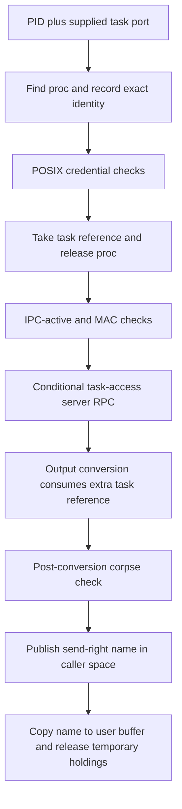
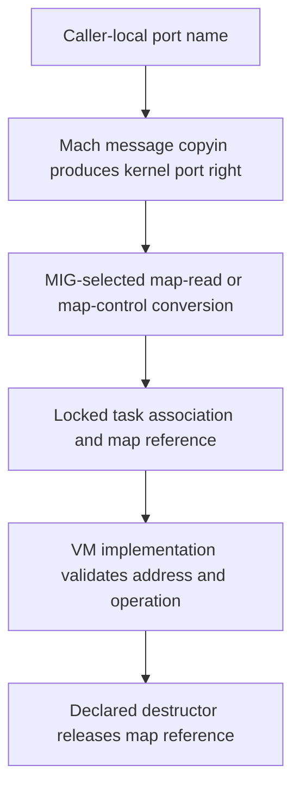

# Task and thread capabilities: acquisition, conversion and revocation

[Security guide](README.md) · [Credentials and policy](credentials-and-policy.md) · [Port rights](../ipc/names-and-rights.md) · [Kernel RPC](../ipc/kernel-rpc-and-exceptions.md) · [Suspension and execution control](../runtime/suspension-stop-and-abort.md)

A task-local port name reaches an operation only after namespace lookup, port-type conversion and any operation-specific checks. Acquiring a right from a PID is one path; converting a right already held by the caller is another. This chapter connects those stages, their references and their teardown. It does not treat a task pointer, a PID, an inspect right and a control right as interchangeable identities.

## 1. Flavor describes the authority accepted by a conversion

Tasks have control, read, inspect and name port flavors. Threads have control, read and inspect flavors. These are distinct kernel-object port types, even though the server-side C typedefs often resolve to pointers to the same task or thread structure. [`flavor constants`](../../../platydoc-data/xnu/osfmk/mach/mach_types.h#L359-L377), [`task port array`](../../../platydoc-data/xnu/osfmk/kern/task.h#L322-L341).

For the ordinary task conversion helper, the accepted port types are:

| Requested conversion | Control port | Read port | Inspect port | Name port |
| --- | --- | --- | --- | --- |
| `task_t` / control | Yes | No | No | No |
| `task_read_t` | Yes | Yes | No | No |
| `task_inspect_t` | Yes | Yes | Yes | No |
| `task_name_t` | Yes | Yes | Yes | Yes |

This table describes type compatibility, before the other gates. It follows the fall-through switch in [`task_port_kotype_valid_for_flavor`](../../../platydoc-data/xnu/osfmk/kern/ipc_tt.c#L2393-L2425). The thread helper has the analogous three-level hierarchy. [`thread type compatibility`](../../../platydoc-data/xnu/osfmk/kern/ipc_tt.c#L2900-L2930).

An interface can impose a stronger requirement based on its command. `task_info_from_user` requires read conversion for `TASK_DYLD_INFO`, and name conversion for its other flavors before calling `task_info`. The latter still checks its arguments and state. `task_threads_from_user` accepts inspect-or-stronger task types, but chooses control/read/inspect **thread** output according to the input port's actual type. Enumerating through an inspect port does not manufacture control-thread rights. [`task info gate`](../../../platydoc-data/xnu/osfmk/kern/task.c#L6417-L6437), [`thread enumeration gate`](../../../platydoc-data/xnu/osfmk/kern/task.c#L3949-L3981).

Similarly, the user-facing special-port wrappers preserve the input flavor and apply selector restrictions. A task read port can request read/inspect/name ports; an inspect port can request inspect/name. The thread selector has its corresponding smaller set. MAC and self movable-control rules add further checks. [`task selectors`](../../../platydoc-data/xnu/osfmk/kern/ipc_tt.c#L1887-L1988), [`thread selectors`](../../../platydoc-data/xnu/osfmk/kern/ipc_tt.c#L1590-L1685).

## 2. Objects and references at the boundary

| Object | What it owns or represents |
| --- | --- |
| Port name and namespace entry | A right in one task's IPC space; the same integer elsewhere can mean something else |
| Kernel-object port | Type and association with a task/thread, message-right state and optional substitution label |
| `task->itk_task_ports[]` / `thread->thread_ports[]` | Ports published by the owning object; lazy read/inspect creation is synchronized with death |
| Task/thread reference returned by input conversion | Temporary server ownership that must be released by the selected destructor or caller |
| `proc_ident` | Process identity supplied to checks after the original `proc` reference has been released |
| Task identity token | A separate referenced identity object; it is neither a task-control port nor a suspension token |

Task control/name ports are allocated during IPC initialization, while read/inspect ports start null and are created on demand. Task IPC activation is separate from allocation. [`initialization`](../../../platydoc-data/xnu/osfmk/kern/ipc_tt.c#L166-L212).

Ordinary task ports do **not** each own a permanent reference keeping the associated task alive. `ipc_task_disable` must stop lazy port creation and disconnect the kobjects before the task's storage can disappear. Input conversion stabilizes the association under the port lock and takes its own task reference; the task IPC lock coordinates creation and teardown. Thread lazy ports likewise rely on explicit owner synchronization. [`disable contract`](../../../platydoc-data/xnu/osfmk/kern/ipc_tt.c#L427-L463), [`input reference`](../../../platydoc-data/xnu/osfmk/kern/ipc_tt.c#L2491-L2509), [`thread lazy-port ownership`](../../../platydoc-data/xnu/osfmk/kern/ipc_tt.c#L3157-L3176).

## 3. Acquiring a control right from a PID

`task_for_pid` first rejects PID zero and converts its supplied `target_tport` to a task. The target process itself is found by `proc_find(pid)`; the supplied port is not the returned target object. The handler records exact process identity for later policy use and runs `task_for_pid_posix_check`. [`entry and lookup`](../../../platydoc-data/xnu/bsd/kern/kern_proc.c#L5865-L5928).

The POSIX helper rejects zombies. Root and self pass its early cases; the deny policy then restricts foreign requests. For other callers it compares target real/effective/saved UIDs against the caller's effective UID, checks target groups are a subset, and rejects `P_SUGID`. A third-party debuggable-driver exception skips the selected credential comparisons, but does not remove all later gates. [`POSIX decisions`](../../../platydoc-data/xnu/bsd/kern/kern_proc.c#L5772-L5833).

After obtaining the target task, the handler takes a task reference and drops the process reference before a possible userspace upcall. The task reference stabilizes kernel storage; it does not assert that the target remains active or passes later policy. [`reference transfer`, lines 5926–5930](../../../platydoc-data/xnu/bsd/kern/kern_proc.c#L5926-L5930):

<!-- source-excerpt: ../../../platydoc-data/xnu/bsd/kern/kern_proc.c#L5926-L5930 -->
```c
	task = proc_task(p);
	task_reference(task);

	proc_rele(p);
	p = PROC_NULL;
```

The remaining stages are:

1. Require active task IPC before invoking the MAC get-task hook; the comment connects that ordering to exec's code-signing metadata initialization.
2. Invoke the configured MAC check with the recorded process identity and `TASK_FLAVOR_CONTROL`.
3. For a non-root foreign request with a configured task-access port, call the external access server. A dead access port, interrupted reply and other failures have distinct return translations.
4. Take an extra task reference for output conversion. `convert_task_to_port` consumes it; the original temporary reference remains for cleanup.
5. Recheck corpsification **after** conversion, because creating a corpse control send right affects no-senders handling. On that rejection, release the new send right.
6. Copy the send right into the caller's IPC space, write the numeric name to the user result address, and release the temporary task/access-port references.

[`policy, upcall and grant`](../../../platydoc-data/xnu/bsd/kern/kern_proc.c#L5942-L6013).



This diagram follows the grant path. Each policy/lookup stage can reject; the body contains the corresponding reference cleanup. The external access server and MAC provider algorithms are outside this checkout.

## 4. Name, inspect and read acquisition have different gates

| Entry | Important differences from the control request |
| --- | --- |
| `task_name_for_pid` | Uses its own self/root/UID and safe-name-entitlement predicate, followed by the name-flavor MAC check. It does not run the same POSIX helper or task-access upcall sequence. Returns Mach status. |
| `task_inspect_for_pid` | Rejects PID zero, uses the shared POSIX helper and inspect-flavor MAC/access-server requests, checks corpse status before conversion, and uses copyout allowing the relevant immovable right. Returns BSD errno. |
| `task_read_for_pid` | Similar syscall structure, with read-flavor requests and output. Returns BSD errno. |

[`name acquisition`](../../../platydoc-data/xnu/bsd/kern/kern_proc.c#L6029-L6112), [`inspect acquisition`](../../../platydoc-data/xnu/bsd/kern/kern_proc.c#L6122-L6234), [`read acquisition`](../../../platydoc-data/xnu/bsd/kern/kern_proc.c#L6244-L6356).

Do not infer identical ordering merely because two entry points share a helper. The explicit `task_is_ipc_active` pre-MAC check shown in the control handler is not present at that same location in these inspect/read handlers; their output conversion still checks IPC activity. Corpse checks occur at different stages. A new release must be checked at each body rather than updated from a generic four-flavor template.

## 5. Input conversion checks type, association and policy

A user-name helper such as `port_name_to_task_grp` translates a send right in the caller's IPC space while keeping the port locked, then invokes the flavor conversion and obtains a task reference. The pinned-self name has an explicit fast path. Kernel-port conversions likewise have a self-control fast path before their general lock/type route. [`name translation`](../../../platydoc-data/xnu/osfmk/kern/ipc_tt.c#L3371-L3403), [`kernel-port conversion`](../../../platydoc-data/xnu/osfmk/kern/ipc_tt.c#L2524-L2548).

The general locked helper checks compatible kobject type, resolves the associated task, enforces corpse options, and runs `task_conversion_eval` unless the wrapper explicitly selects `PORT_INTRANS_SKIP_TASK_EVAL`. Name/inspect wrappers select that skip option; read/control wrappers normally do not. The skip does not bypass the type check or the interface's own command checks. [`locked helper`](../../../platydoc-data/xnu/osfmk/kern/ipc_tt.c#L2439-L2475), [`wrapper options`](../../../platydoc-data/xnu/osfmk/kern/ipc_tt.c#L2551-L2628).

For read/control conversions, `task_conversion_eval_internal` checks Developer Mode for foreign control access, kernel-task restrictions and selected platform/build rules. Its Developer Mode branch differs between macOS and other targets: the latter distinguishes denied outgoing translation from an invalid incoming control-port condition that panics. Self/kernel early returns occur **after** the initial Developer Mode predicate in this helper. The platform-binary comparison is separately compile-time guarded. This source is not one platform-independent “root may use any port” rule. [`policy body`](../../../platydoc-data/xnu/osfmk/kern/ipc_tt.c#L2277-L2370).

Thread conversion resolves the parent task and uses the same policy machinery, with additional options for excluding the current thread or requiring a thread in the current task. It takes a thread reference only after the selected checks. [`thread conversion`](../../../platydoc-data/xnu/osfmk/kern/ipc_tt.c#L2944-L2997).

Policy APIs have an explicit exception to the ordinary matrix: setting initially tries control conversion, getting tries inspect conversion, and the `com.apple.private.task_policy` entitlement permits a name-conversion fallback. These are specialized input translators, not a global upgrade of the held right. [`policy conversion`](../../../platydoc-data/xnu/osfmk/kern/ipc_tt.c#L2644-L2674).

## 6. A Mach VM request converts the capability into a map reference

The MIG declaration chooses the translator and destructor. `vm_map_read_t` requests use `convert_port_to_map_read` and release the resulting map reference through `vm_map_read_deallocate`; writable-map requests use the control-map translator. [`map type declarations`](../../../platydoc-data/xnu/osfmk/mach/mach_types.defs#L232-L252).

For example, `mach_vm_read_overwrite` declares a `vm_map_read_t` target, while `mach_vm_write` declares `vm_map_t`. The C server receives a referenced map after conversion, not a task-local integer name. [`read declaration`](../../../platydoc-data/xnu/osfmk/mach/mach_vm.defs#L284-L292), [`write declaration`](../../../platydoc-data/xnu/osfmk/mach/mach_vm.defs#L247-L253).

`convert_port_to_map_with_flavor` holds the port lock while validating its task association and taking the map reference. Its race argument depends on `ipc_task_disable` preceding map teardown; an unsynchronized `task->active` load alone would not establish lifetime. It also rejects a userspace kernel-map association with an assertion/panic path. [`map-reference acquisition`](../../../platydoc-data/xnu/osfmk/kern/ipc_tt.c#L2823-L2869).



The generated server artifacts are not all checked in. The `.defs` conversion/destructor contract, local converter and implementation bodies are the evidence for this route; this is not a claim to have executed a generated server stub. Continue with [VM transfer ownership](../vm/wiring-and-memory-entries.md) and [copy-overwrite/remap](../vm/copy-overwrite-and-remap.md) for what the map operation does.

There is no working inspect-map conversion hidden behind its name: `convert_port_to_map_inspect` returns `VM_MAP_INSPECT_NULL` in this snapshot. [`inspect-map stub`](../../../platydoc-data/xnu/osfmk/kern/ipc_tt.c#L2888-L2894).

## 7. Output conversion consumes a reference and may return no usable right

`convert_task_to_port_with_flavor` takes the task IPC lock, checks `ipc_active`, applies outgoing policy for control, and selects the port. Control/name use their existing port; read/inspect may allocate a lazy port and no-senders machinery. It unlocks and consumes the supplied task reference on every exit. Policy denial can yield `IP_DEAD`; inactive state can yield `IP_NULL`. [`output conversion`](../../../platydoc-data/xnu/osfmk/kern/ipc_tt.c#L3561-L3640).

The consumption is explicit. [`exit`, lines 3637–3640](../../../platydoc-data/xnu/osfmk/kern/ipc_tt.c#L3637-L3640):

<!-- source-excerpt: ../../../platydoc-data/xnu/osfmk/kern/ipc_tt.c#L3637-L3640 -->
```c
exit:
	itk_unlock(task);
	task_deallocate_grp(task, grp);
	return port;
```

Thread output has analogous consumption, under the thread mutex. Read-port creation can attach a label enabling owner-space substitution for an in-process exception handler when Developer Mode is off. Flavor identity at this point is therefore not the entire copyout story; the existing [label-substitution explanation](../ipc/guards-and-policy-enforcement.md) follows the actual port substitution. [`thread output`](../../../platydoc-data/xnu/osfmk/kern/ipc_tt.c#L3113-L3177), [`task read label`](../../../platydoc-data/xnu/osfmk/kern/ipc_tt.c#L3611-L3632).

### Result-buffer failure is not uniformly rolled back

The PID-based handlers inspected above call user `copyout` with its return explicitly discarded. In `task_for_pid`, successful right-name publication is followed by `error = KERN_SUCCESS`, and the common exit performs `(void) copyout`. This body does not undo the installed right because that final write faulted; it also does not check the returned name for validity before choosing success. [`grant and common exit`](../../../platydoc-data/xnu/bsd/kern/kern_proc.c#L5997-L6015).

The corresponding inspect/read/name exits have the same ignored-copyout pattern. A successful handler status therefore cannot be used as proof that the caller's output buffer was written or that every failure after conversion restored namespace state. Compare the explicit fileport rollback in [descriptor lifetimes](../processes/descriptors-ipc.md). These are source-level interface distinctions, not a promise about every wrapper or policy configuration.

## 8. Lazy-port no-senders is separate from task death

When the last send right to a task read/inspect port goes away, the callback first checks the make-send generation under the port lock and temporarily references the associated task. It then acquires the task IPC lock and port lock, rechecks that the owner slot still names this port and the generation is current, clears the slot, and deallocates the port. A concurrent sender or termination can make the notification stale. [`task flavor callback`](../../../platydoc-data/xnu/osfmk/kern/task.c#L2697-L2757).

The second validation is essential. [`lines 2741–2754`](../../../platydoc-data/xnu/osfmk/kern/task.c#L2741-L2754):

<!-- source-excerpt: ../../../platydoc-data/xnu/osfmk/kern/task.c#L2741-L2754 -->
```c
	if (task->itk_task_ports[flavor] != port ||
	    !ipc_kobject_is_mscount_current_locked(port, mscount)) {
		ip_mq_unlock(port);
		itk_unlock(task);
		task_deallocate(task);
		return;
	}

	task->itk_task_ports[flavor] = IP_NULL;
	itk_unlock(task);

	ipc_kobject_dealloc_port_and_unlock(port, mscount, kotype);

	task_deallocate(task);
```

The thread callback follows the equivalent owner-slot/generation protocol under its mutex. Neither callback means ordinary last-send destruction terminates the live task/thread. Corpse control-port no-senders is a distinct callback with additional destruction behavior, explained in [corpse lifetime](../../development/corpses-and-process-core-dumps.md). [`thread callback`](../../../platydoc-data/xnu/osfmk/kern/thread.c#L3981-L4042), [`corpse control callback`](../../../platydoc-data/xnu/osfmk/kern/task.c#L2618-L2686).

During task death, `ipc_task_disable` first clears `ipc_active`, disables the control/name/read/inspect associations, and disables any resume-port association. Later teardown can destroy the ports and space. Existing send rights cannot recreate a valid task association merely by keeping the port allocation alive. [`disable`](../../../platydoc-data/xnu/osfmk/kern/ipc_tt.c#L427-L483), [`termination`](../../../platydoc-data/xnu/osfmk/kern/ipc_tt.c#L495-L623).

`ipc_task_reset`, used by the selected sugid/corpsify paths, replaces the control port, clears lazy read/inspect slots, disables/deallocates the old ports, and removes selected unprivileged exception/debug state. The name port is not replaced by that routine. Reset is therefore more specific than “all ports for the task are revoked,” and it is not identical to disabling the whole IPC space. [`reset and publication`](../../../platydoc-data/xnu/osfmk/kern/ipc_tt.c#L643-L740), [`old port disposal`](../../../platydoc-data/xnu/osfmk/kern/ipc_tt.c#L765-L782).

## 9. Identity tokens resolve identity without becoming unconditional authority

`task_create_identity_token` records an exact `proc_ident` for an active ordinary task, or a task unique ID for a corpse. It creates a separate reference-counted token, whose port/no-senders lifetime owns token storage. Ordinary token identity is resolved later with `proc_find_ident`, not a bare PID lookup; corpse identity uses the corpse lookup. Neither form guarantees the target remains findable forever. [`creation`](../../../platydoc-data/xnu/osfmk/kern/task_ident.c#L126-L163), [`resolution`](../../../platydoc-data/xnu/osfmk/kern/task_ident.c#L167-L198).

`task_identity_token_get_task_port` validates the requested flavor, restricts corpse tokens to control, resolves a referenced task, then applies the selected conversion/MAC checks before producing a send right. It has a self-control fast path. The final conversion consumes the temporary task reference; the token reference is not consumed by this operation. [`token to capability`](../../../platydoc-data/xnu/osfmk/kern/task_ident.c#L202-L263).

A token is useful for stable identity and controlled later access, not as an exemption from authority checks. Suspension tokens have a different kernel-object type, send-once protocol and hold ownership; follow [suspension and resume](../runtime/suspension-stop-and-abort.md).

## Configuration, tests and remaining boundaries

| Source evidence | What it establishes |
| --- | --- |
| [`task_info_28439149.c`](../../../platydoc-data/xnu/tests/task_info_28439149.c#L28-L77) | Exercises basic information through a task-name right and rejects `TASK_DYLD_INFO` through it; requires its configured privileged test environment. |
| [`task_ident_test.c`](../../../platydoc-data/xnu/tests/task_ident_test.c#L22-L69) | Resolves self identity into each task flavor and rejects a non-token port. This is not a foreign-task authorization matrix. |
| [`task_policy.c`](../../../platydoc-data/xnu/tests/task_policy.c#L21-L74) and its [entitled cases](../../../platydoc-data/xnu/tests/task_policy.c#L312-L364) | Separates operation-specific policy conversion from the ordinary flavor hierarchy. |
| `CONFIG_MACF`, `CONFIG_CSR`, `SECURE_KERNEL`, `XNU_TARGET_OS_OSX`, Developer Mode | Affect provider checks, settable self state, kernel-task export and foreign-control rules. See the actual predicates in the cited bodies, not only flag names. |

The source review covers the selected acquisition/conversion/reference, selector, identity-token, lazy-port and reset paths. Tests were read, not run. External task-access services and MAC/AMFI policy are not reconstructed. Full special-port selectors, every thread-state flavor, and every reset/termination interleaving remain additional detail; the [Mach interface catalog](../../interfaces/mach-messages/README.md) maps their declarations and local receivers.

<!-- BEGIN PLATYDOC DOCUMENTATION LICENSE -->
Original Platydoc text and diagrams are licensed under [CC BY 4.0](https://creativecommons.org/licenses/by/4.0/). Quoted source code and third-party material retain their respective licenses.
<!-- END PLATYDOC DOCUMENTATION LICENSE -->
