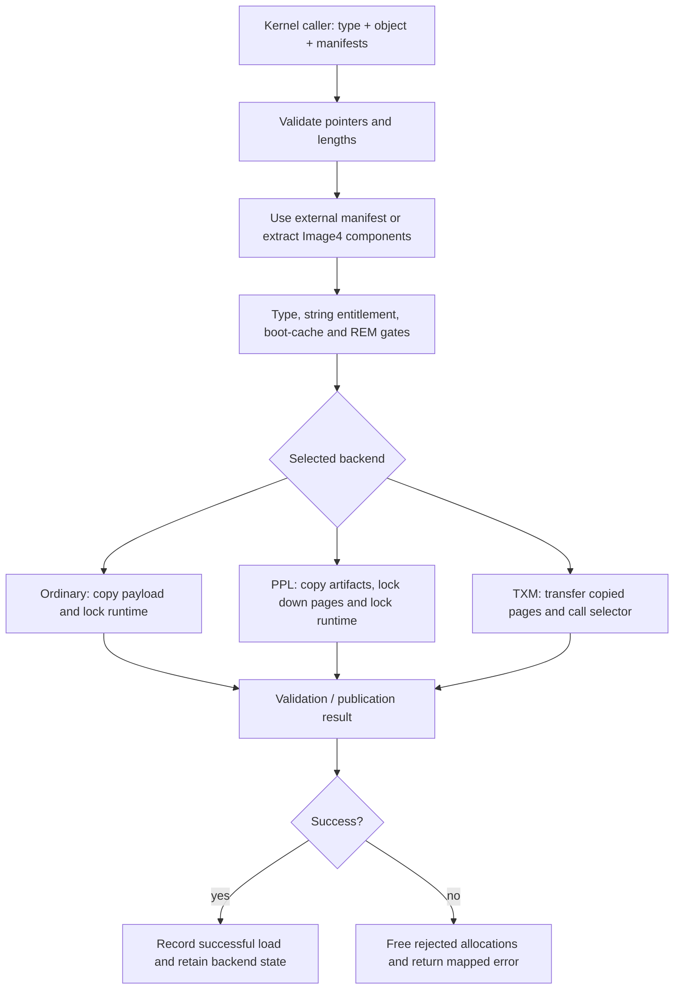
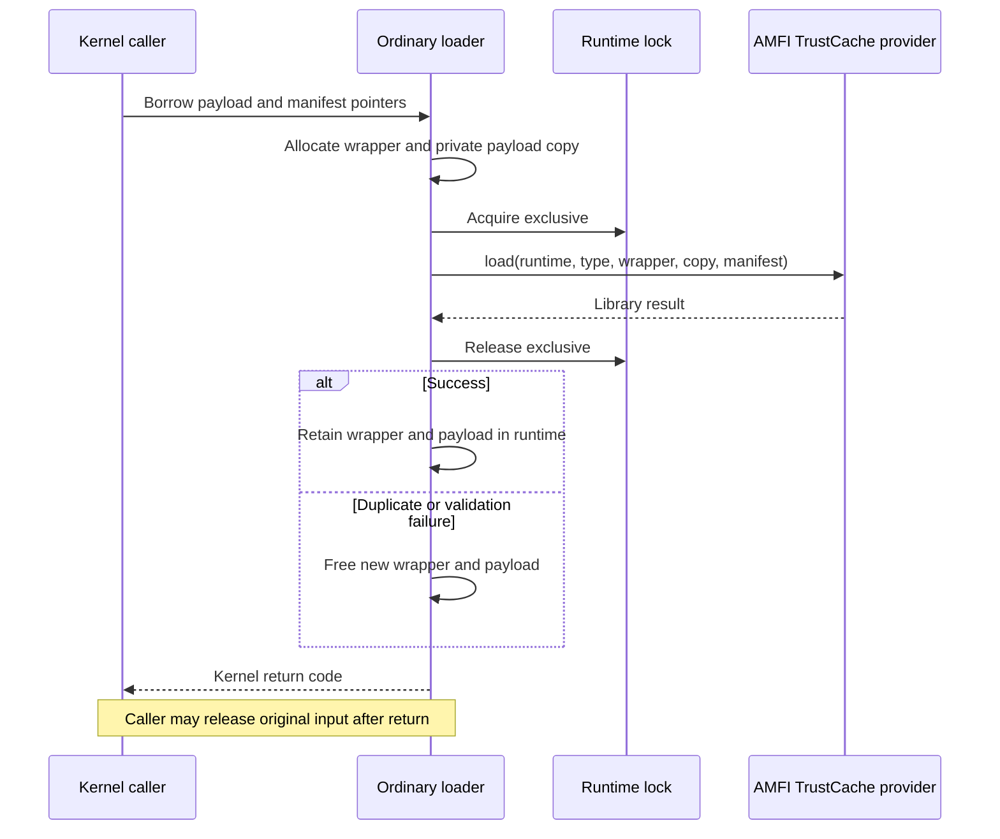
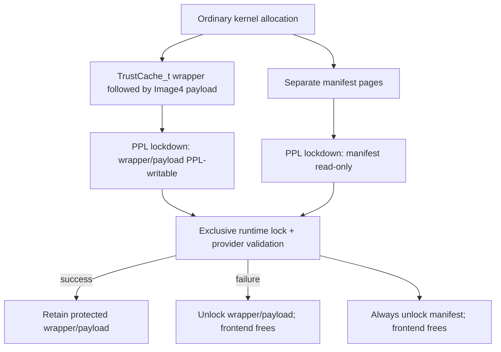

# Trust-cache admission, runtime ownership and lookup

A trust cache supplies trust information indexed by a code identity, the CDHash. Loading one establishes a runtime entry and a lifetime for its payload; querying one returns a match and optionally a token describing the cache and entry. Neither operation hashes a resident executable page. This chapter follows the common kernel interfaces and their ordinary XNU, PPL and TXM implementations in `xnu-12377.121.6`. [Interfaces](../../../platydoc-data/xnu/bsd/sys/trust_caches.h#L88-L180), [common dispatch](../../../platydoc-data/xnu/bsd/kern/kern_trustcache.c#L892-L1115).

[Security guide](README.md) · [Code-signing overview](code-signing.md) · [Process controls and CSR](code-signing-process-controls.md). Read [signature representation](signature-format-and-blob-validation.md), [vnode attachment](vnode-signature-lifecycle.md) and [page checks](page-signature-validation.md) for the other parts of executable validation. [TXM](txm.md) describes the protected call transport and page transfer in greater detail.

## 1. The entry points and the missing library boundary

These are kernel APIs receiving kernel pointers, not implementations of a public trust-cache syscall. The visible header promises that the typed loader creates its own allocations, allowing the caller to release its input after return. Pointer overflow therefore triggers a kernel panic in several argument checks; it is not translated into an ordinary user-memory fault. The caller's current task is nevertheless relevant: admission checks its entitlement before choosing a backend. [Loader contract](../../../platydoc-data/xnu/bsd/sys/trust_caches.h#L130-L149), [range and entitlement checks](../../../platydoc-data/xnu/bsd/kern/kern_trustcache.c#L906-L987).

| Entry | Input and result | Important boundary |
| --- | --- | --- |
| `trust_cache_runtime_init()` | Establish the runtime or obtain TXM boot information | Requires Image4 and AMFI registration; initialization precedes subsystem lockdown. |
| `load_static_trust_cache()` | Boot-provided memory range and offset table | Separate boot path; it does not use dynamic typed-load admission. |
| `load_trust_cache_with_type()` | Cache type, Image4 payload/object, optional external and auxiliary manifests | Preferred dynamic loader; common admission followed by backend validation/publication. |
| `load_trust_cache()` | Object plus optional external manifest | Deprecated type-probing loop; stops at success or duplicate, and cannot supply an auxiliary manifest. |
| `load_legacy_trust_cache()` | Bare module bytes | Supported only by the selected ordinary BridgeOS path; unsupported paths panic. |
| `query_trust_cache()` | Query category and CDHash; optional token output | Match/failure is a kernel return value; token accessors interpret the result. |
| `check_trust_cache_runtime_for_uuid()` | Cache UUID | Checks an already-loaded cache identity; it is not a reservation against a later load. |
| `unload_trust_cache()` | Cache UUID | Requires a distinct entitlement; only TXM implements this operation here. |
| `query_trust_cache_for_rem()` | CDHash; optional byte of restricted-execution permissions | TXM-only route, with a feature-gated selector. |

Sources: [startup order](../../../platydoc-data/xnu/osfmk/kern/startup.c#L864-L872), [boot loader](../../../platydoc-data/xnu/bsd/kern/kern_trustcache.c#L1166-L1303), [public wrappers](../../../platydoc-data/xnu/bsd/kern/kern_trustcache.c#L802-L1115), [availability macros](../../../platydoc-data/xnu/bsd/sys/trust_caches.h#L34-L49).

The tree includes the AMFI function-pointer interface but **does not include `TrustCache/API.h`, the `TCTypeConfig` table definition, or libTrustCache's parser, lookup algorithm and authenticated-loading bodies**. It would be incorrect to reconstruct a complete serialized cache layout or a type-to-entitlement-string catalog from the calls alone. The local evidence establishes these objects and fields:

| Object | What this checkout exposes |
| --- | --- |
| `TrustCacheRuntime_t` | Runtime passed to load/query operations; initialized with a separate mutable runtime and allowed static/engineering/legacy options. Boot code reads `allowSecondStaticTC` and `allowEngineeringTC`. |
| `TrustCacheMutableRuntime_t` | Separately allocated mutable runtime storage, under ordinary or PPL ownership. Its list/index layout is external. |
| `TrustCache_t` | Wrapper allocated for a cache and passed with retained module/payload storage. Its internal link and parser fields are external. |
| `TrustCacheQueryToken_t` | TXM fills `trustCache` and `trustCacheEntry` pointers. AMFI accessors extract type, capabilities, hash type, flags, constraint category and UUID. |
| `TCReturn_t` | Local callers interpret `error` and log `component`/`uniqueError`; specific library errors map to kernel success, duplicate, not-found or failure. |
| `pmap_img4_payload_t` | Local PPL allocation layout: `TrustCache_t trust_cache` followed by `uint8_t img4_payload[0]`. |
| `DTTrustCacheRange`, `trust_cache_offsets_t` | Local boot ABI: physical base plus length; packed count plus offsets relative to the table start. |

Sources: [AMFI trust-cache interface](../../../platydoc-data/xnu/libkern/libkern/amfi/amfi.h#L136-L251), [runtime storage and initialization](../../../platydoc-data/xnu/bsd/kern/kern_trustcache.c#L551-L604), [token assignments](../../../platydoc-data/xnu/bsd/kern/kern_trustcache.c#L257-L287), [boot structures](../../../platydoc-data/xnu/bsd/sys/trust_caches.h#L53-L72), [PPL payload](../../../platydoc-data/xnu/osfmk/vm/pmap_cs.h#L114-L129).

## 2. Three backends, three protection and reclamation contracts

The selection order is `CONFIG_SPTM`, then `PMAP_CS_PPL_MONITOR`, then ordinary XNU. The same distinction appears in the general code-signing-monitor prefix definitions. It is a build selection, not a per-call choice made from the cache type. [Trust-cache selection](../../../platydoc-data/xnu/bsd/kern/kern_trustcache.c#L1002-L1020), [monitor selection](../../../platydoc-data/xnu/bsd/sys/code_signing_internal.h#L43-L66).

| Property | Ordinary XNU | PPL | TXM / SPTM |
| --- | --- | --- | --- |
| Runtime | Kernel storage; immutable portion read-only-late, mutable portion writable | PPL runtime and PPL-owned mutable state | Monitor initializes its runtime; local runtime pointers remain null |
| Serialization | Sleeping reader/writer lock around library load/query | Spin-form reader/writer operations inside PPL | Monitor-side synchronization is external |
| Payload publication | Separately allocated wrapper and copied payload | Page-aligned wrapper+payload allocation locked down, PPL-writable | Page-owned transfer; monitor may retain pages or copy payload elsewhere |
| Manifest | Borrow caller's manifest for synchronous validation | Copied allocation locked down during validation, then unlocked/freed | Copied allocation transferred, then reclaimed/freed |
| Successful unload | Unsupported | Unsupported | Monitor selector; may remove or tombstone according to external implementation |
| Auxiliary manifest | Ignored | Copied by frontend but ignored by PPL implementation | Ignored; zero arguments passed for auxiliary data |

Sources: [ordinary runtime and loader](../../../platydoc-data/xnu/bsd/kern/kern_trustcache.c#L544-L675), [PPL allocation and cleanup](../../../platydoc-data/xnu/bsd/kern/kern_trustcache.c#L434-L515), [PPL validation](../../../platydoc-data/xnu/osfmk/arm/pmap/pmap.c#L13089-L13205), [TXM runtime/load](../../../platydoc-data/xnu/bsd/kern/kern_trustcache.c#L81-L247), [unload contract](../../../platydoc-data/xnu/bsd/sys/trust_caches.h#L112-L118).

An ordinary [reader/writer lock](../runtime/reader-writer-locks.md) protects concurrent runtime operations; it does not protect the runtime against an arbitrary kernel write. PPL separately changes ownership and writable mappings before calling the same library interface. TXM moves validation and retained state across a monitor boundary. These are distinct guarantees, even when they return the same `KERN_SUCCESS`.

## 3. Typed dynamic loading: admission precedes authenticated publication

`load_trust_cache_with_type()` performs the following ordered work:

1. Require non-null, nonempty `img4_object`. Validate optional manifests when their lengths are nonzero. Address+length overflow panics.
2. If an external manifest is supplied, interpret the object as the payload directly. Otherwise require Image4 interface version at least 15 and call `img4_get_payload()` and `img4_get_manifest()` to locate embedded components. Missing components return `KERN_NOT_FOUND`; an old interface returns `KERN_NOT_SUPPORTED`.
3. Reject the static, engineering and legacy categories on this route, and reject `type >= kTCTypeTotal`. Those categories have separate loading paths.
4. If `TCTypeConfig[type].entitlementValue` is non-null, require a matching string value in `com.apple.private.pmap.load-trust-cache` on the calling task. A type whose table value is null has no additional check in this branch; other validation still follows.
5. Reject a repeated `kTCTypeCryptex1BootOS` or `kTCTypeCryptex1BootApp` load according to the frontend's remembered successful-load booleans. Reject a load when `restricted_execution_mode_state()` returns `KERN_SUCCESS`.
6. Dispatch to the chosen backend. Only backend success sets the corresponding boot-cache boolean and increments `num_loadable_trust_caches` with a relaxed atomic add. A duplicate is returned to the caller without this increment.

Sources: [input extraction](../../../platydoc-data/xnu/bsd/kern/kern_trustcache.c#L906-L967), [admission](../../../platydoc-data/xnu/bsd/kern/kern_trustcache.c#L969-L1000), [publication accounting](../../../platydoc-data/xnu/bsd/kern/kern_trustcache.c#L1002-L1034).

The type entitlement is checked before the protected load, but the cache payload and manifest must still pass backend validation. Conversely, merely extracting components from an Image4 object does not establish their authenticity. The authenticated implementation belongs to libTrustCache/Image4 or TXM.



Argument/admission failures exit before the backend; the diagram groups those early returns into their named steps. The boot-cache booleans are ordinary frontend state outside the backend lock. Their checks are not a proof of atomic uniqueness across concurrent callers. Duplicate handling under runtime/monitor serialization remains a separate mechanism. [Boolean declarations](../../../platydoc-data/xnu/bsd/kern/kern_trustcache.c#L51-L56), [gates and updates](../../../platydoc-data/xnu/bsd/kern/kern_trustcache.c#L989-L1030).

The deprecated untyped interface probes types from `kTCTypeLTRS` through the valid range and optionally tries `kTCTypeDTRS` on internal builds. Each attempt repeats the typed loader's checks. It returns immediately on success or `KERN_ALREADY_IN_SET`; it is not a cheap discovery operation. [Probe loop](../../../platydoc-data/xnu/bsd/kern/kern_trustcache.c#L859-L889).

## 4. Ordinary runtime: allocate outside the lock, publish under it

The ordinary initializer requires `img4if`, AMFI and AMFI TrustCache interface version at least 2. It supplies `IMG4_RUNTIME_DEFAULT` to `trustCacheInitializeRuntime()`. Build options enable a second static cache, internal engineering caches and BridgeOS legacy loading independently; the read/write lock is initialized afterward. [Initialization](../../../platydoc-data/xnu/bsd/kern/kern_trustcache.c#L563-L604).

`xnu_load_trust_cache()` allocates a zeroed `TrustCache_t` wrapper with `kalloc_type(..., Z_WAITOK_ZERO)` and a payload with `kalloc_data(..., Z_WAITOK)`, asserts both, and copies payload bytes before acquiring the runtime lock. These allocations are not modeled as recoverable null-return branches in this function. The manifest remains borrowed because validation is synchronous and the loader's contract retains only payload storage. [Allocation and borrowing](../../../platydoc-data/xnu/bsd/kern/kern_trustcache.c#L612-L642).

The protected operation is small in the visible implementation; the library supplies most of its behavior:

[`bsd/kern/kern_trustcache.c`, lines 643–659](../../../platydoc-data/xnu/bsd/kern/kern_trustcache.c#L643-L659).

<!-- source-excerpt: ../../../platydoc-data/xnu/bsd/kern/kern_trustcache.c#L643-L659 -->
```c
	/* Exclusively lock the runtime */
	lck_rw_lock_exclusive(&trust_cache_rt_lock);

	TCReturn_t tc_ret = amfi->TrustCache.load(
		trust_cache_rt,
		type,
		trust_cache,
		(const uintptr_t)payload, img4_payload_len,
		(const uintptr_t)img4_manifest, img4_manifest_len);

	/* Unlock the runtime */
	lck_rw_unlock_exclusive(&trust_cache_rt_lock);

	if (tc_ret.error == kTCReturnSuccess) {
		ret = KERN_SUCCESS;
	} else if (tc_ret.error == kTCReturnDuplicate) {
		ret = KERN_ALREADY_IN_SET;
```

On ordinary failure, including a duplicate, the new payload and wrapper are freed after unlocking. On success neither is freed: they now back the installed cache. The local ordinary unload function always returns `KERN_NOT_SUPPORTED`, so there is no normal per-cache free path to trace after successful publication in this backend. This does not reveal the runtime's internal container or lookup algorithm. [Failure cleanup](../../../platydoc-data/xnu/bsd/kern/kern_trustcache.c#L656-L674), [unload stub](../../../platydoc-data/xnu/bsd/kern/kern_trustcache.c#L606-L610).



A concrete duplicate scenario is therefore: caller A installs payload UUID U; caller B later allocates another wrapper/copy for U; the provider reports `kTCReturnDuplicate` while B holds exclusive protection; B unlocks, maps this to `KERN_ALREADY_IN_SET`, and frees only B's candidate allocations. The installed A allocation remains. The UUID duplicate criterion itself is supplied by the external library; the frontend does not compare cache bytes or build a local UUID index. [Duplicate and cleanup body](../../../platydoc-data/xnu/bsd/kern/kern_trustcache.c#L646-L674), [UUID provider interface](../../../platydoc-data/xnu/libkern/libkern/amfi/amfi.h#L148-L160).

Legacy loading, when supported, is the same ownership pattern with `loadModule(..., kTCTypeLegacy, ...)` and a copied bare module rather than an Image4 payload+manifest. It is not a way to bypass the normal typed loader on a platform that does not support legacy modules: the other implementations panic. [Legacy path](../../../platydoc-data/xnu/bsd/kern/kern_trustcache.c#L677-L728), [common legacy entry](../../../platydoc-data/xnu/bsd/kern/kern_trustcache.c#L1037-L1067).

## 5. PPL: the wrapper and bytes share a protected allocation

The frontend computes `sizeof(pmap_img4_payload_t) + payload_len` with overflow checking, rounds it and the manifest allocations to pages, copies data, then calls `pmap_load_trust_cache_with_type()`. This wrapper+payload layout matters because PPL must mutate the wrapper while keeping ordinary kernel mappings from modifying admitted bytes:

[`osfmk/vm/pmap_cs.h`, lines 123–129](../../../platydoc-data/xnu/osfmk/vm/pmap_cs.h#L123-L129).

<!-- source-excerpt: ../../../platydoc-data/xnu/osfmk/vm/pmap_cs.h#L123-L129 -->
```c
typedef struct _pmap_img4_payload {
	/* The trust cache data structure which wraps the payload */
	TrustCache_t trust_cache;

	/* The actual image4 trust cache payload */
	uint8_t img4_payload[0];
} pmap_img4_payload_t;
```

The PPL implementation rechecks invalid types and the type-specific string entitlement when `PMAP_CS_INCLUDE_CODE_SIGNING` and `pmap_cs` select enforcement; violations panic at this inner trust boundary. It reserves a spare PPL page for Image4/CoreCrypto before locking down input. If that reservation returns `KERN_RESOURCE_SHORTAGE`, the outer wrapper allocates a page for PPL and retries. Because the shortage is returned before lockdown/publication, the retry is not a second load of an already-installed candidate. [Protected admission and reserve](../../../platydoc-data/xnu/osfmk/arm/pmap/pmap.c#L13107-L13137), [retry](../../../platydoc-data/xnu/osfmk/arm/pmap/pmap.c#L13208-L13235).

After address assertions, PPL locks the combined allocation with the writable-for-PPL flag and the manifest without that flag. It obtains a writable physical-map alias to the wrapper with `phystokv(kvtophys_nofail(...))`, subtracts wrapper size to recover the actual payload length, then calls the provider under `lck_rw_lock_exclusive_spin()`. [Lockdown and alias](../../../platydoc-data/xnu/osfmk/arm/pmap/pmap.c#L13139-L13179).

On success the combined allocation stays protected and retained. On failure PPL unlocks it; in either case it unlocks the manifest and returns its reserved page. Back in ordinary kernel context the frontend always frees manifest copies and frees the combined payload only on failure. The auxiliary manifest is copied/freed by the frontend but explicitly ignored by the PPL body. [Protected cleanup](../../../platydoc-data/xnu/osfmk/arm/pmap/pmap.c#L13181-L13205), [frontend cleanup](../../../platydoc-data/xnu/bsd/kern/kern_trustcache.c#L477-L514).



The PPL transition wrappers and dispatch table are visible in this checkout; the cryptographic validator reached through `amfi->TrustCache.load` is not. [Generated PPL wrappers](../../../platydoc-data/xnu/osfmk/arm/pmap/pmap.c#L1221-L1238), [dispatch entries](../../../platydoc-data/xnu/osfmk/arm/pmap/pmap.c#L1415-L1416). See [protected execution](protected-execution.md) for how that boundary differs from TXM.

## 6. TXM: retained payload pages versus a monitor-owned copy

TXM runtime initialization validates the interface prerequisites and asks `GetTrustCacheInfo` for static cache count/capabilities. Although the first return word contains a monitor runtime reference, XNU intentionally does not use it; its `trust_cache_rt` and mutable-runtime pointers remain null. Consequently the common boot loader marks initialization and returns without walking the Device Tree table on this backend. [TXM initialization](../../../platydoc-data/xnu/bsd/kern/kern_trustcache.c#L92-L141), [boot early return](../../../platydoc-data/xnu/bsd/kern/kern_trustcache.c#L1175-L1181).

Dynamic loading allocates and copies payload and manifest, transfers both to TXM ownership, and calls `kTXMKernelSelectorLoadTrustCache` with type and lengths. The two auxiliary argument slots are zero. Duplicate monitor errors are mapped to `KERN_ALREADY_IN_SET`. A successful first output word says whether XNU should reclaim the original payload because TXM copied it into its own allocation. [Allocation and call](../../../platydoc-data/xnu/bsd/kern/kern_trustcache.c#L162-L216).

[`bsd/kern/kern_trustcache.c`, lines 218–245](../../../platydoc-data/xnu/bsd/kern/kern_trustcache.c#L218-L245).

<!-- source-excerpt: ../../../platydoc-data/xnu/bsd/kern/kern_trustcache.c#L218-L245 -->
```c
	/*
	 * Most trust cache payloads are small. In order to conserve memory, TXM will
	 * prefer creating its own allocation, and copying the contents of the payload
	 * into that allocation. When this happens, the payload is returned back to be
	 * reclaimed by the kernel.
	 */
	if (ret == KERN_SUCCESS) {
		reclaim_payload = txm_call.return_words[0] != 0;
	}

out:
	if (manifest_addr != 0) {
		/* Reclaim the manifest region */
		txm_reclaim_region(manifest_addr, img4_manifest_len);

		/* Free the manifest region */
		kmem_free(kernel_map, manifest_addr, img4_manifest_len);
		manifest_addr = 0;
	}

	if (((ret != KERN_SUCCESS) || (reclaim_payload == true)) && (payload_addr != 0)) {
		/* Reclaim the payload region */
		txm_reclaim_region(payload_addr, img4_payload_len);

		/* Free the payload region */
		kmem_free(kernel_map, payload_addr, img4_payload_len);
		payload_addr = 0;
	}
```

This yields three different outcomes:

| Result | Payload copy created by XNU | Manifest copy |
| --- | --- | --- |
| Failure | Reclaim and free if allocated | Reclaim and free if allocated |
| Success, reclaim flag set | Reclaim and free; monitor has its own retained copy | Reclaim and free |
| Success, reclaim flag clear | Monitor retains backing pages | Reclaim and free |

The enclosing [TXM chapter](txm.md#3-shared-memory-readable-references-and-ownership-transfer) explains `txm_transfer_region()` and `txm_reclaim_region()`. This selector's success flag is an ownership result, not another authentication result. XNU cannot inspect the monitor's internal allocation, parser or reclamation algorithm from this interface.

## 7. Query results are tokens, not executable mappings

The common query requires a non-null CDHash, then selects the backend. Ordinary XNU additionally rejects an out-of-range query category, holds the runtime shared lock across `amfi->TrustCache.query()`, unlocks, and maps success/not-found/other errors. There is no token retain/release operation around that call. Successful ordinary allocations are persistent in the visible backend, but the exact token ABI and any restrictions imposed by the external library still come from that provider. [Common query](../../../platydoc-data/xnu/bsd/kern/kern_trustcache.c#L1069-L1090), [ordinary query](../../../platydoc-data/xnu/bsd/kern/kern_trustcache.c#L731-L768).

PPL copies the CDHash into protected stack storage, performs its shared-spin-lock query, then pins the kernel output pages before copying the local token out and unpins them afterward. The local token is zero-initialized and the copy occurs whenever an output pointer is supplied, even if the query failed. TXM instead writes token fields only on success from two returned words. A caller must use the return code, not assume every backend zeroes an output token on failure. [PPL query](../../../platydoc-data/xnu/osfmk/arm/pmap/pmap.c#L13238-L13315), [TXM query](../../../platydoc-data/xnu/bsd/kern/kern_trustcache.c#L257-L287).

[`bsd/kern/kern_trustcache.c`, lines 269–277](../../../platydoc-data/xnu/bsd/kern/kern_trustcache.c#L269-L277).

<!-- source-excerpt: ../../../platydoc-data/xnu/bsd/kern/kern_trustcache.c#L269-L277 -->
```c
	kern_return_t ret = txm_kernel_call(&txm_call, query_type, cdhash);

	if (ret == KERN_SUCCESS) {
		if (query_token) {
			query_token->trustCache = (const TrustCache_t*)txm_call.return_words[0];
			query_token->trustCacheEntry = (const void*)txm_call.return_words[1];
		}
		return KERN_SUCCESS;
	}
```

The returned cache reference identifies a cache; the returned entry reference identifies the matching entry. Accessors such as `queryGetTCType`, `queryGetFlags`, `queryGetHashType` and `queryGetUUID` interpret the token. They are separate provider calls, not fields XNU lays out or independently validates here. [Accessor declarations](../../../platydoc-data/xnu/libkern/libkern/amfi/amfi.h#L201-L228).

Two local consumers show why that distinction matters:

- ARM64 pmap compatibility lookup for loadable caches asks for `kTCQueryTypeLoadable` without a token and turns success into `true`. The static-cache lookup asks for `kTCQueryTypeStatic`, obtains flags and hash type, and packs a compatibility result with a found bit and truncated flag byte. It is a query wrapper, not insertion of an executable PTE. [SPTM pmap wrappers](../../../platydoc-data/xnu/osfmk/arm64/sptm/pmap/pmap.c#L12855-L12892), [PPL/common equivalents](../../../platydoc-data/xnu/osfmk/arm/pmap/pmap.c#L14362-L14453).
- ARM64 macOS shared-cache mapping asks for `kTCQueryTypeAll`, then accepts only `Cryptex1BootOS`, static or engineering types for bypassing the **root ownership check**. A match in some other cache type does not satisfy this condition. Earlier MAC mapping checks and the later SIP-protected-file check remain separate. [Shared-cache trust decision](../../../platydoc-data/xnu/bsd/vm/vm_unix.c#L1574-L1645), [subsequent CSR check](../../../platydoc-data/xnu/bsd/vm/vm_unix.c#L1677-L1705).

An illustrative shared-cache decision is: signed vnode → selected `cs_blob` → its CDHash → successful cache query → token says static → skip `va_uid == 0` requirement → still evaluate subsequent mapping constraints. A query hit therefore supplies one fact to a caller-specific policy decision; it does not grant every use of those bytes.

## 8. Boot caches use a physical range and offsets

For a local ordinary/PPL runtime, `load_static_trust_cache()` reads `chosen/memory-map` / `TrustCache`. The property must have exactly `sizeof(DTTrustCacheRange)` bytes. The physical address becomes a kernel virtual address through ARM64 `phystokv()`. The leading packed offset table gives the number of modules and their offsets from the table base. [Boot input handling](../../../platydoc-data/xnu/bsd/kern/kern_trustcache.c#L1166-L1198), [structure declarations](../../../platydoc-data/xnu/bsd/sys/trust_caches.h#L61-L72).

The code checks contradictory zero-size/count cases, count multiplication/addition overflow, table size, each module-address addition and whether each start lies before the region end. Each `loadModule()` receives the bytes from that module start to the end of the **whole region**, not a length inferred from the next offset. Module-format parsing must bound the actual module inside that supplied span. The frontend is not a substitute for the missing module parser. [Bounds checks](../../../platydoc-data/xnu/bsd/kern/kern_trustcache.c#L1200-L1244), [provider call](../../../platydoc-data/xnu/bsd/kern/kern_trustcache.c#L1270-L1274).

Module zero uses the static wrapper `trust_cache_static0`. When the configured runtime permits a second static cache, module one uses `trust_cache_static1`; remaining modules are engineering candidates. Disallowed engineering candidates are skipped, permitted ones allocate wrappers dynamically. Failure loading a static module panics. Engineering failure logs and continues; the displayed failure branch does **not** free its newly allocated wrapper, so this boot path must not be described using the ordinary dynamic loader's failure cleanup. [Selection and failures](../../../platydoc-data/xnu/bsd/kern/kern_trustcache.c#L1246-L1284).

Successful modules update static/engineering counters and `trust_cache_static_loaded`. `static_trust_cache_capabilities()` clears its outputs, requires that initialization ran, then either supplies TXM-reported values or asks the provider about the static wrapper(s). Boot imports are performed before subsystem lockdown; the loader does not take the ordinary dynamic runtime lock in this bootstrap path. [Accounting/capabilities](../../../platydoc-data/xnu/bsd/kern/kern_trustcache.c#L1287-L1349), [startup order](../../../platydoc-data/xnu/osfmk/kern/startup.c#L864-L872).

## 9. UUID checks, unloading and validation generations

`check_trust_cache_runtime_for_uuid()` rejects a null UUID and routes to the backend. Ordinary/PPL implementations hold shared runtime protection while calling `checkRuntimeForUUID`; TXM uses a selector. Success means that the queried UUID is represented at that instant. The check neither reserves space nor makes a subsequent load immune to a duplicate race. [Common UUID wrapper](../../../platydoc-data/xnu/bsd/kern/kern_trustcache.c#L802-L821), [ordinary implementation](../../../platydoc-data/xnu/bsd/kern/kern_trustcache.c#L770-L798), [PPL implementation](../../../platydoc-data/xnu/osfmk/arm/pmap/pmap.c#L13052-L13087).

Unload logs the UUID and requires `com.apple.private.unload-trust-cache` on the current task. Ordinary/PPL return `KERN_NOT_SUPPORTED`; TXM maps a provider not-found result to `KERN_NOT_FOUND`. The public contract explicitly allows the implementation to tombstone rather than physically free a cache. No local monitor-side lifetime proof establishes that returned query pointers stay dereferenceable after unload. [Unload admission/result](../../../platydoc-data/xnu/bsd/kern/kern_trustcache.c#L823-L857), [TXM unload](../../../platydoc-data/xnu/bsd/kern/kern_trustcache.c#L143-L159), [contract](../../../platydoc-data/xnu/bsd/sys/trust_caches.h#L112-L118).

Only successful unload calls `cs_blob_reset_cache()`. That function adds two to the global odd validation generation; it does not walk all vnodes, free their blobs, rehash every page or synchronously kill processes using the cache. Subsequent signature-cache generation checks drive revalidation. See [vnode signature lifecycle](vnode-signature-lifecycle.md) for those checks. [Reset trigger](../../../platydoc-data/xnu/bsd/kern/kern_trustcache.c#L849-L854), [generation update](../../../platydoc-data/xnu/bsd/kern/ubc_subr.c#L5733-L5739).

The `security.codesigning.trustcaches.num_loadable` sysctl reflects the frontend's successful dynamic-load increments. This unload path does not decrement it, so it must not be interpreted as an exact current inventory after unloads. Static and engineering counts follow their separate bootstrap paths. [Counters/sysctls](../../../platydoc-data/xnu/bsd/kern/kern_trustcache.c#L51-L79), [load increment](../../../platydoc-data/xnu/bsd/kern/kern_trustcache.c#L1022-L1031).

## 10. Inspection scope and remaining boundaries

This chapter reviews the full common trust-cache frontend, ordinary load/query/UUID/failure paths, ARM64 boot import, PPL protected load/query and reserve/retry paths, TXM allocation/result/reclaim interfaces, and selected pmap/shared-region consumers. It does not reconstruct libTrustCache types or search algorithms, Image4 authentication policy, the exact `TCTypeConfig` entitlement strings, TXM's allocator/unload policy, or a user-space service that invokes the kernel KPI. Their implementations are absent from the inspected source.

No direct trust-cache unit test for these loaders was located in the supplied `tests/` sources. The visible development metrics and counters are observations, not tests of authenticity, duplicate serialization or unloading. Documentation validation checks the excerpts, links and diagrams; it does not execute a kernel, install a trust cache or assert that every backend/configuration has been exercised.

<!-- BEGIN PLATYDOC DOCUMENTATION LICENSE -->
Original Platydoc text and diagrams are licensed under [CC BY 4.0](https://creativecommons.org/licenses/by/4.0/). Quoted source code and third-party material retain their respective licenses.
<!-- END PLATYDOC DOCUMENTATION LICENSE -->
