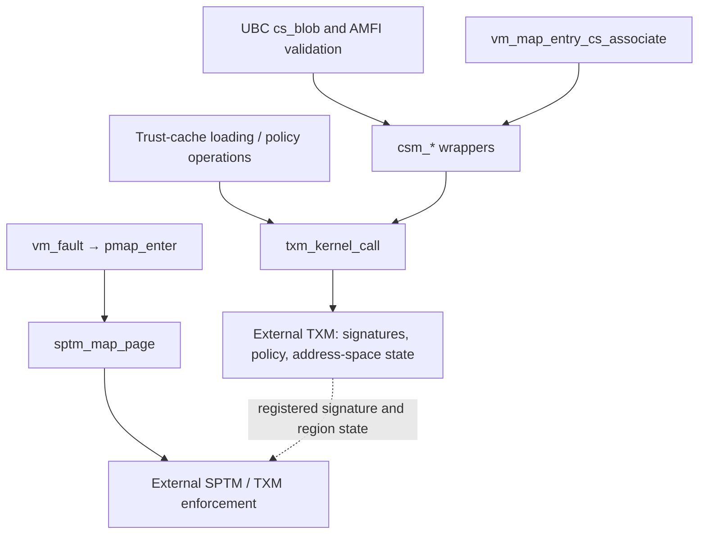
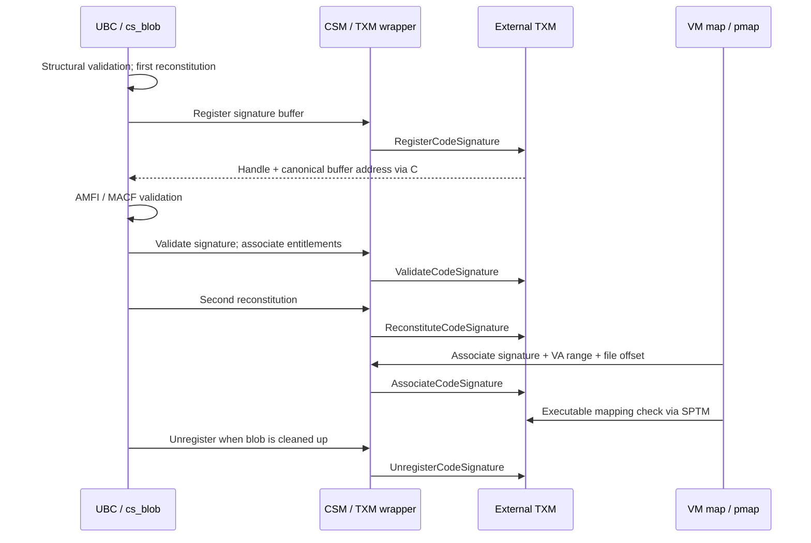

# TXM: signatures, protected ownership, and executable mappings

The Trusted Execution Monitor (TXM) is the code-signing monitor selected by `CONFIG_SPTM`. XNU supplies signatures, trust-cache payloads, address-space identifiers, and mapping ranges. TXM returns protected object references and policy results. SPTM controls the page types and page-table operations through which those decisions become enforceable. The local implementation contains substantial coordination code, but the monitor's validator, allocator, policy engine, and entry/return transport are external. [Backend selection](../../../xnu/bsd/sys/code_signing_internal.h#L43-L66), [TXM's stated role](../../../xnu/bsd/kern/code_signing/txm.c#L53-L70), [SPTM mapping call](../../../xnu/osfmk/arm64/sptm/pmap/pmap.c#L6451-L6473).

Read [code-signing.md](code-signing.md) for the surrounding exec, AMFI, and UBC paths; [sptm.md](sptm.md) for frame and translation authority; and [exception levels and monitors](../platform/exception-levels-and-monitors.md) for the distinction between architectural exception levels and Apple's guarded domains. This guide follows the XNU side of TXM in this checkout. It does not infer the missing transport instructions or reproduce the monitor's signature-verification algorithm.

## 1. The boundary: what XNU implements and what it imports

`CSM_PREFIX(name)` expands to `txm_name` under `CONFIG_SPTM`, to `ppl_name` under `PMAP_CS_PPL_MONITOR`, and otherwise to `xnu_name`. This is compile-time backend selection, not dynamic routing of each call between monitors. The public `csm_*` wrappers also test runtime code-signing enablement where appropriate. For example, signature registration returns `KERN_NOT_SUPPORTED` if `csm_enabled()` is false. [Selection macros](../../../xnu/bsd/sys/code_signing_internal.h#L43-L66), [runtime enablement](../../../xnu/bsd/kern/kern_codesigning.c#L1094-L1106), [registration wrapper](../../../xnu/bsd/kern/kern_codesigning.c#L1205-L1225).

The dependencies are concrete. `trusted_execution_monitor.h` includes `<TrustedExecutionMonitor/API.h>`; SPTM's wrapper includes `<sptm/sptm_xnu.h>`. Those imported definitions and monitor bodies are not present here. The build derives SPTM/TXM enablement from device-map properties, a named kernel configuration, or platform lists, and adds `-lTrustedExecutionMonitor_Kernel` and `-lsptm_xnu`. The library names establish a link dependency; they do not reveal the implementation of each imported symbol. [TXM header dependency](../../../xnu/bsd/sys/trusted_execution_monitor.h#L24-L37), [SPTM header dependency](../../../xnu/osfmk/arm64/sptm/sptm.h#L30-L42), [build selection](../../../xnu/makedefs/MakeInc.def#L1158-L1187).

Two gaps matter when following references:

* `txm_enter()` and `txm_resume` are called or branched to locally, but their implementations are absent. XNU exposes their arguments and the shared result area, not the instruction sequence that crosses domains.
* The SPTM pmap implementation accesses `txm_addr_space`, `txm_trust_level`, and `txm_lck`, but the published `struct pmap` has reserved fields in the corresponding TXM-commented area. The local tree also lacks definitions for the used `pmap_txmlock_init/destroy` helpers. Accordingly, fields below are described from their uses, not presented as a complete binary layout. The SPTM `pmap_cs.c` file itself contains only its introductory material; the active integration is in `pmap.c`. [Entry call](../../../xnu/bsd/kern/code_signing/txm.c#L334-L347), [resume branch](../../../xnu/osfmk/arm64/locore.s#L1705-L1717), [published pmap fields](../../../xnu/osfmk/arm64/sptm/pmap/pmap.h#L414-L424), [pmap field accessors](../../../xnu/osfmk/arm64/sptm/pmap/pmap.c#L12438-L12486), [SPTM pmap_cs.c](../../../xnu/osfmk/arm64/sptm/pmap/pmap_cs.c).

The two main routes meet at a process's address space:



The last relation represents the interface contract visible in XNU's association and executable-mapping code. The cross-monitor implementation is external. [VM association](../../../xnu/osfmk/vm/vm_map.c#L21009-L21241), [fault deferral](../../../xnu/osfmk/vm/vm_fault.c#L2815-L2836), [mapping result handling](../../../xnu/osfmk/arm64/sptm/pmap/pmap.c#L6795-L6828).

### Initialization and shared state

`kernel_bootstrap()` calls `code_signing_init()` before `task_init()` and `thread_init()`. The TXM version sets up its stack pool and log lock, asks TXM for log and code-signing information, then initializes the compilation-service and unregistration mutexes. It enables `cs_debug_fail_on_unsigned_code` when TXM code-signing enforcement is enabled. [Bootstrap ordering](../../../xnu/osfmk/kern/startup.c#L625-L639), [TXM initialization](../../../xnu/bsd/kern/code_signing/txm.c#L635-L660).

`GetCodeSigningInfo` expects at least six return words. The current body uses word 0 for `txm_rw_data`, word 1 for `developer_mode_enabled`, word 3 for the managed-signature size, and word 5 for `txm_ro_data`. It derives the metrics pointer from the read-write structure and code-signing configuration from the read-only structure. The comment saying word 0 is unused is stale relative to the assignments immediately below it. `SECURITY_READ_ONLY_LATE` protects the pointer variables after lockdown; it does not turn the pointed-to monitor metrics or developer-mode state into immutable values. [Information acquisition and assignments](../../../xnu/bsd/kern/code_signing/txm.c#L556-L632).

## 2. A TXM call: stack borrowing, register arguments, and shared results

These are the principal local and imported objects:

| Object or field | Meaning visible in XNU |
|---|---|
| `txm_call_t` | Caller-owned descriptor: selector, input/output counts, fatal/silent/logging policy, structured result, and copied return words. |
| `txm_thread_stack_t` | XNU pool node containing a physical-aperture virtual address, stack physical address, pointer to imported `TXMThreadStack_t`, and list link. |
| `TXMThreadStack_t.sharedData` | Imported shared context containing `txmReturnCode`, `txmNumReturnWords`, and `txmReturnWords`, read after the entry call returns. |
| `sptm_call_regs_t` | Imported register bank zero-initialized by XNU; `x0` holds the stack physical address and `x1`–`x7` hold selector arguments. |
| `thread.txm_thread_stack` | Physical address identifying the current thread's active TXM stack; also selects TXM during interrupted-domain resume. |
| `pmap->txm_addr_space` | Monitor address-space object associated with that pmap; the local accessor also supports a null sentinel for monitor-side current-address-space resolution. |

Sources: [local descriptor definitions](../../../xnu/bsd/sys/trusted_execution_monitor.h#L58-L86), [register and return handling](../../../xnu/bsd/kern/code_signing/txm.c#L247-L367), [thread field](../../../xnu/osfmk/kern/thread.h#L1106-L1109), [pmap accessor](../../../xnu/osfmk/arm64/sptm/pmap/pmap.c#L12438-L12452).

### The stack pool can block

The implementation does not allocate and free a physical stack for each call. `setup_thread_stacks()` constructs `MAX_CPUS` pool nodes from boot-supplied `SPTMArgs->txm_thread_stacks[]`. Each boot entry is a physical-aperture virtual address. XNU obtains its physical address with `kvtophys_nofail()` and locates the shared structure at `stack_virtual + PAGE_SIZE - 1024`. The imported stack structure's full layout is unavailable here; the fixed local offset is nevertheless explicit. [Pool construction](../../../xnu/bsd/kern/code_signing/txm.c#L75-L114).

`acquire_thread_stack()` locks the pool mutex and sleeps uninterruptibly while the list is empty. After removing a node it unlocks the pool, associates the physical address with the current thread, and returns the node. This is a shared pool, not a permanently assigned per-CPU stack. `thread_associate_txm_thread_stack()` panics if a stack is already associated; its counterpart requires the same nonzero physical address. These checks detect nested or mismatched use of this association. [Acquisition and release](../../../xnu/bsd/kern/code_signing/txm.c#L117-L169), [thread association checks](../../../xnu/osfmk/kern/thread.c#L4210-L4245).

The wait is on stack availability, before the monitor entry:

[txm.c, lines 124–130](../../../xnu/bsd/kern/code_signing/txm.c#L124-L130)

<!-- source-excerpt: ../../../xnu/bsd/kern/code_signing/txm.c#L124-L130 -->
```c
	while (SLIST_EMPTY(&thread_stacks_head) == true) {
		lck_mtx_sleep(
			&thread_stacks_lock,
			LCK_SLEEP_DEFAULT,
			&thread_stack_event,
			THREAD_UNINT);
	}
```

`release_thread_stack()` clears the thread association first, then reinserts the node under the mutex and calls `thread_wakeup()` on the event. Callers must therefore account for a potentially sleeping operation even before TXM begins its work. The monitor's own execution and callbacks are a separate part of the contract. [Release sequence](../../../xnu/bsd/kern/code_signing/txm.c#L151-L169).

### The visible argument ABI

`txm_kernel_call_registers_setup()` accepts zero through seven `uintptr_t` arguments. It fills the corresponding `x1`–`x7` slots and panics on any larger count. Its comment explains that SPTM dispatch supplies `x0`–`x7` and that `x0` is reserved for the TXM stack. The selector is a separate argument to the imported `txm_enter()` function; this source does not show which physical register or dispatch encoding the library uses for that selector. [Argument switch](../../../xnu/bsd/kern/code_signing/txm.c#L247-L316).

The entry operation is bracketed by secure-execution accounting. The result is then read from shared stack memory, not inferred from the C function's return value:

[txm.c, lines 334–347](../../../xnu/bsd/kern/code_signing/txm.c#L334-L347)

<!-- source-excerpt: ../../../xnu/bsd/kern/code_signing/txm.c#L334-L347 -->
```c
	/* Setup argument registers */
	txm_registers.x0 = thread_stack->thread_stack_phys;
	txm_kernel_call_registers_setup(parameters, &txm_registers, args);

	/* Track resource usage */
	recount_enter_secure();

	/* Call into TXM */
	txm_enter(parameters->selector, &txm_registers);

	recount_leave_secure();

	txm_ret = (TXMReturn_t){.rawValue = shared_context_data->txmReturnCode};
	parameters->txm_ret = txm_ret;
```

On success, XNU rejects a return-word count above `kTXMStackReturnWords`, then copies the words into the caller's `txm_call_t` before releasing the pooled stack. The outer wrapper rejects fewer than the selector's expected output words, but accepts more for compatibility with newer monitor interfaces. Outputs should only be consumed on success; failed calls do not populate a fresh success-output array. [Result copying and release](../../../xnu/bsd/kern/code_signing/txm.c#L349-L367), [minimum output check](../../../xnu/bsd/kern/code_signing/txm.c#L405-L430).

### Failure policy and two different retry loops

The generic wrapper maps success, out-of-memory, not-found, and unsupported statuses to Mach return codes. API version 6 and later also map `kTXMReturnTryAgain` to `KERN_OPERATION_TIMED_OUT`; other monitor statuses become `KERN_FAILURE`, while the structured TXM result remains in the descriptor for selector-specific interpretation. `failure_fatal` turns any non-success into a panic. `failure_silent`, `failure_code_silent`, and `skip_logs` control different logging behavior and do not turn failure into success. [Return translation](../../../xnu/bsd/kern/code_signing/txm.c#L171-L196), [wrapper policy](../../../xnu/bsd/kern/code_signing/txm.c#L393-L430).

Out-of-memory has a generic recovery path:

[txm.c, lines 380–388](../../../xnu/bsd/kern/code_signing/txm.c#L380-L388)

<!-- source-excerpt: ../../../xnu/bsd/kern/code_signing/txm.c#L380-L388 -->
```c
	do {
		txm_ret = txm_kernel_call_internal(parameters, args);
		if (txm_ret.returnCode == kTXMReturnOutOfMemory) {
			if (parameters->selector == kTXMKernelSelectorAddFreeListPage) {
				panic("received out-of-memory error when adding a free page to TXM");
			}
			txm_add_page();
		}
	} while (txm_ret.returnCode == kTXMReturnOutOfMemory);
```

`txm_add_page()` obtains a physical page from `pmap_txm_allocate_page()` and invokes `AddFreeListPage` as a fatal one-argument operation. The failed inner call has already released its stack before this recursive wrapper call starts; it does not copy success outputs on that failure. Thus page donation does not retain the failed call's stack while acquiring another. Out-of-memory from `AddFreeListPage` itself panics rather than recursively donating again. There is no retry bound in this wrapper. [Page donation](../../../xnu/bsd/kern/code_signing/txm.c#L228-L243), [stack release before return](../../../xnu/bsd/kern/code_signing/txm.c#L349-L367).

The donor temporarily enables VM privilege, grabs a VM page, wires it with the security allocation tag, inserts it into `txm_vm_object` at physical-address-relative offset, restores the thread's prior privilege, and retypes the page from `XNU_DEFAULT` to `TXM_DEFAULT`. This page is retained as TXM memory; there is no corresponding per-call free. [Donor implementation](../../../xnu/osfmk/arm64/sptm/pmap/pmap.c#L12673-L12720).

`TryAgain` is different. The generic wrapper returns it as `KERN_OPERATION_TIMED_OUT`; `txm_associate_code_signature()` explicitly loops on that result while retaining its exclusive TXM address-space lock. It does not insert a sleep or backoff. The source comments acknowledge the possibility of CPU consumption. This is an association-specific policy, not a promise that every monitor operation retries timeout results. [Association retry loop](../../../xnu/bsd/kern/code_signing/txm.c#L1254-L1319).

### Returning after an interrupt in TXM

An ordinary completed call returns through the external entry routine to `txm_kernel_call_internal()`. An interrupt that XNU services while a protected domain is executing has a separate resume route. `xnu_return_to_gl2` reads the current thread via `TPIDR_EL1`; a nonzero `TH_TXM_THREAD_STACK` takes precedence over the Exclaves and plain-SPTM cases:

[locore.s, lines 1711–1717](../../../xnu/osfmk/arm64/locore.s#L1711-L1717)

<!-- source-excerpt: ../../../xnu/osfmk/arm64/locore.s#L1711-L1717 -->
```asm
	mrs		x8, TPIDR_EL1
	ldr		x8, [x8, TH_TXM_THREAD_STACK]
	cbz		x8, 1f
	mov		x0, x8
	b		EXT(txm_resume)
	/* Unreachable */
	b .
```

This supplies the associated stack physical address in `x0` and branches to imported `txm_resume`. The branch is expected not to fall through. It is not a new signature request and does not re-run the C selector wrapper. The local source establishes the resume selection and argument, but not the monitor-side continuation restoration or final crossing instruction. See [protected-domain interrupt return](../platform/exception-levels-and-monitors.md#resume-a-protected-domain-after-xnu-handles-its-interrupt). [Complete selector](../../../xnu/osfmk/arm64/locore.s#L1696-L1742).

## 3. Shared memory: readable references and ownership transfer

XNU passes different kinds of memory across this interface. They should not be conflated:

| Memory kind | Visible contract |
|---|---|
| Call stack/shared context | Boot-supplied, temporarily borrowed from the pool; copied results outlive that borrowing. |
| Small signature or trust-cache input | Monitor may copy into its own allocation; XNU then frees the original input when instructed. |
| Bulk signature or retained trust-cache payload | XNU transfers page ownership and keeps a read-only reference while the monitor retains the payload. |
| Manifest/profile input | Explicit transfer and later reclaim; a manifest can be temporary call input, while a registered profile persists until unregistration. |
| Returned identifier, entitlement context, or monitor object | Pointer/reference into a longer-lived object; returning a pointer is not a new caller-owned allocation. |

Sources: [stack handling](../../../xnu/bsd/kern/code_signing/txm.c#L319-L367), [signature registration](../../../xnu/bsd/kern/code_signing/txm.c#L999-L1049), [trust-cache ownership](../../../xnu/bsd/kern/kern_trustcache.c#L161-L245), [profile lifetime](../../../xnu/bsd/kern/code_signing/txm.c#L789-L882), [identifier/entitlement returns](../../../xnu/bsd/kern/code_signing/txm.c#L1540-L1628).

`txm_transfer_region()` requires a page-aligned address, rounds size to pages, and checks addition overflow. It first requests read-only protection on the kernel mapping, then transfers each page. The helper returns `void`; the current body does not inspect the return value of `vm_protect()`. It relies on the lower-level transfer and monitor checks rather than returning a recoverable protection-update error to its caller. [Region helper](../../../xnu/bsd/kern/code_signing/txm.c#L433-L455).

The pmap transfer is more than changing the current mapping's permission. It must eliminate writable translations that could survive ownership change:

[pmap.c, lines 12654–12670](../../../xnu/osfmk/arm64/sptm/pmap/pmap.c#L12654-L12670)

<!-- source-excerpt: ../../../xnu/osfmk/arm64/sptm/pmap/pmap.c#L12654-L12670 -->
```c
	/* Lock the PVH lock to prevent concurrent updates to the mappings during the self retype below. */
	locked_pvh_t locked_pvh = pvh_lock(pai);

	/* Disconnect the mapping to assure SPTM of no pending TLBI. */
	pmap_page_protect_options_with_flush_range((ppnum_t)atop(pa), VM_PROT_NONE,
	    PMAP_OPTIONS_PPO_PENDING_RETYPE, &locked_pvh, NULL);

	/* Self retype to clear the SPTM internal flags tracking delayed TLBIs for revoked writes. */
	_pmap_txm_retype_prepare(pa);

	pvh_unlock(&locked_pvh);

	/* XNU needs to hold an RO reference to the page despite the ownership being transferred to TXM. */
	pmap_enter_addr(kernel_pmap, addr, pa, VM_PROT_READ, VM_PROT_NONE, 0, true, PMAP_MAPPING_TYPE_INFER);

	/* Finally, retype the page to TXM_DEFAULT. */
	_pmap_txm_transfer_page(pa);
```

The PVH lock serializes mapping updates while existing mappings are disconnected with `PMAP_OPTIONS_PPO_PENDING_RETYPE`. `_pmap_txm_retype_prepare()` then requests `XNU_DEFAULT → XNU_DEFAULT`. Its comment explains the purpose: clear SPTM's tracking of previously deferred TLB invalidations only after outstanding mappings have been removed. XNU reinstalls its read-only mapping and finally requests `XNU_DEFAULT → TXM_DEFAULT`. The security requirement is that a former writable translation must not remain usable after the page belongs to another domain; the actual SPTM bookkeeping is external. [Self-retype rationale](../../../xnu/osfmk/arm64/sptm/pmap/pmap.c#L12597-L12639), [transfer sequence](../../../xnu/osfmk/arm64/sptm/pmap/pmap.c#L12640-L12671), [TLB guide](../vm/pmap-tlb-and-cache.md).

Reclaim is deliberately asymmetric:

[txm.c, lines 472–477](../../../xnu/bsd/kern/code_signing/txm.c#L472-L477)

<!-- source-excerpt: ../../../xnu/bsd/kern/code_signing/txm.c#L472-L477 -->
```c
	/*
	 * We can only reclaim once TXM has transferred the memory range back to the
	 * kernel. Hence, we simply try and switch permissions to read-write. If TXM
	 * hasn't transferred pages, this then should panic.
	 */
	vm_protect(kernel_map, addr, size_aligned, false, VM_PROT_READ | VM_PROT_WRITE);
```

`txm_reclaim_region()` does not itself issue a `TXM_DEFAULT → XNU_DEFAULT` retype or free memory. It assumes the preceding monitor operation has already returned page ownership and restores the XNU mapping's write permission. The caller must separately perform `kmem_free()` or the relevant signature deallocation. This distinction explains why a failed registration can reclaim its input, why successful bulk registration must retain it, and why free cannot safely proceed when unregistration is skipped. [Reclaim helper](../../../xnu/bsd/kern/code_signing/txm.c#L457-L478), [signature cleanup](../../../xnu/bsd/kern/ubc_subr.c#L3954-L4001).

## 4. A signature's lifetime, from UBC input to final cleanup

Three separate events are easy to mistake for one:

1. **Registration** makes signature storage available under the monitor's ownership rules and returns an object handle.
2. **Verification** asks the monitor to validate the registered signature and supplies a trust classification.
3. **Association** tells the monitor which address-space region and file offset the verified signature covers.

Only after association can the fault/mapping route use that region's monitor state. A registered signature is not itself an executable mapping. [Registration and validation](../../../xnu/bsd/kern/code_signing/txm.c#L999-L1127), [association](../../../xnu/bsd/kern/code_signing/txm.c#L1237-L1338), [UBC verification contract](../../../xnu/bsd/kern/ubc_subr.c#L4260-L4292).



### UBC registration and canonical storage

`ubc_cs_blob_add()` constructs a mutable `tmp_blob` using structural validation, performs first-stage reconstitution, allocates a `ZONE_ID_CS_BLOB` read-only wrapper, and registers signature storage with the monitor. It subsequently invokes MACF signature policy, performs monitor verification, performs second-stage reconstitution, and accelerates entitlement queries after pointer-moving work has finished. This order keeps registration, AMFI policy, monitor verification, and the final immutable wrapper distinct. Pointer-authentication handling protects important temporary fields across selected blocking operations when configured. [Initial sequence](../../../xnu/bsd/kern/ubc_subr.c#L4737-L4852), [MACF and monitor verification](../../../xnu/bsd/kern/ubc_subr.c#L4858-L4920), [later preparation](../../../xnu/bsd/kern/ubc_subr.c#L4921-L4992).

`register_code_signature_monitor()` optionally obtains a vnode path, passes the buffer, size, and CodeDirectory offset through CSM, then frees the temporary path allocation. TXM's implementation ignores the supplied CodeDirectory offset: the local comment says the monitor selects the best directory itself. If the signature exceeds `txm_managed_code_signature_size()`, XNU transfers the buffer's pages before calling TXM; smaller inputs are submitted without that pre-transfer. The threshold is returned at initialization, not fixed by a constant in this source. [UBC registration helper](../../../xnu/bsd/kern/ubc_subr.c#L4300-L4380), [size threshold and ignored offset](../../../xnu/bsd/kern/code_signing/txm.c#L999-L1049).

The ownership branch is small but decisive:

[txm.c, lines 1022–1028](../../../xnu/bsd/kern/code_signing/txm.c#L1022-L1028)

<!-- source-excerpt: ../../../xnu/bsd/kern/code_signing/txm.c#L1022-L1028 -->
```c
	/*
	 * If the signature is large enough to not fit within TXM's managed signature
	 * size, then we need to transfer it over so it is owned by TXM.
	 */
	if (signature_size > txm_managed_code_signature_size()) {
		txm_transfer_region(signature_addr, signature_size);
	}
```

Success returns both a signature object and the canonical signature address. UBC compares the returned address with its old allocation. If they differ, it deallocates the old allocation, reconstructs the `cs_blob`'s internal pointers against the returned storage, and sets `csb_csm_managed`. Thus the decisive UBC managed-storage test is the returned address, not an independently repeated size heuristic. On failed large-signature registration, the TXM wrapper restores write permission; it leaves final deallocation to UBC's error cleanup. [Canonical address handling](../../../xnu/bsd/kern/ubc_subr.c#L4335-L4376), [registration failure reclaim](../../../xnu/bsd/kern/code_signing/txm.c#L1030-L1049).

The key UBC fields are `csb_csm_obj` for the monitor handle, `csb_csm_managed` for who frees signature storage, `csb_csm_trust_level` for the validation result, and `csb_mem_kaddr/csb_mem_size` for the currently retained buffer. Their ownership behavior is clearer in the registration and cleanup bodies than in a list of names. [Initialization](../../../xnu/bsd/kern/ubc_subr.c#L4044-L4067), [verification](../../../xnu/bsd/kern/ubc_subr.c#L4269-L4292), [cleanup](../../../xnu/bsd/kern/ubc_subr.c#L3954-L4001).

### Verification, profiles, and second-stage reconstitution

`txm_verify_code_signature()` invokes `ValidateCodeSignature`. On success, it reads `((TXMCodeSignature_t *)sig_obj)->sig.trustLevel`; the source explicitly acknowledges this direct access to a private imported structure rather than an accessor API. The local code does not show how that trust level was derived. UBC then disassociates any provisioning profile used during verification and associates the signature with its `OSEntitlements` object. A monitor verification error other than unsupported becomes `EPERM` in this UBC helper. [TXM validation](../../../xnu/bsd/kern/code_signing/txm.c#L1107-L1127), [UBC verification sequence](../../../xnu/bsd/kern/ubc_subr.c#L4269-L4292).

Second-stage reconstitution can discard signature material no longer required after validation. The TXM operation returns an unneeded address and size and restores write access to that returned range. UBC frees it and subtracts its size from `csb_mem_size`. If the monitor is unsupported, UBC has a local fallback; other monitor failures terminate validation. The operation only runs if first-stage reconstitution occurred. This is a separate lifetime transition from final signature unregistration. [TXM reconstitution](../../../xnu/bsd/kern/code_signing/txm.c#L1130-L1159), [UBC reconstitution handling](../../../xnu/bsd/kern/ubc_subr.c#L4591-L4656).

### Final cleanup and the shutdown exception

`cs_blob_cleanup()` invalidates and releases the kernel entitlement object, disassociates any profile, and unregisters the monitor signature. For monitor-managed signatures, successful unregistration means the monitor freed storage, so UBC clears its buffer pointer and size. For bulk input, the TXM unregister wrapper receives the returned range and reclaims it; UBC subsequently deallocates its retained buffer. The TXM wrapper itself does not perform that final `kmem_free`. [UBC cleanup](../../../xnu/bsd/kern/ubc_subr.c#L3954-L4001), [TXM unregister](../../../xnu/bsd/kern/code_signing/txm.c#L1051-L1104).

There is an intentional shutdown leak:

[txm.c, lines 1076–1082](../../../xnu/bsd/kern/code_signing/txm.c#L1076-L1082)

<!-- source-excerpt: ../../../xnu/bsd/kern/code_signing/txm.c#L1076-L1082 -->
```c
	if ((cs_obj->referenceCount > 0) && (get_system_inshutdown() != 0)) {
		printf("TXM [XNU]: unregistration of signature skipped as system is in shutdown\n");
		return KERN_ABORTED;
	}

	/* Check if the signature memory is TXM managed */
	txm_managed = cs_obj->sptmType != TXM_BULK_DATA;
```

If the imported signature object's reference count is nonzero and shutdown is underway, TXM unregistration returns `KERN_ABORTED` without entering the monitor. UBC responds by clearing its pointer and size so it will not free memory whose ownership was not returned. This is a documented attempt to avoid monitor lock contention during volume unmount on shutdown, not a general-purpose recoverable unregister path. Otherwise the unregister selector is marked fatal and serialized by `unregister_sync_lock`. [Shutdown rationale and serialization](../../../xnu/bsd/kern/code_signing/txm.c#L1067-L1104), [caller handling](../../../xnu/bsd/kern/ubc_subr.c#L3970-L3994).

## 5. Address spaces, regions, and executable page enforcement

### Pmap lifetime and a conflicting header comment

After constructing a non-stage-2 pmap and its root, `pmap_create_options_internal()` initializes the TXM lock, registers the software ASID and TXM flags, and initializes cached trust to `kCSTrustUntrusted`. The TXM call is fatal on failure and stores the returned `TXMAddressSpace_t *` through `pmap_txm_set_addr_space()`. That setter prevents overwriting an existing nonnull handle or clearing an already-null handle. [Pmap creation](../../../xnu/osfmk/arm64/sptm/pmap/pmap.c#L2829-L2845), [registration](../../../xnu/bsd/kern/code_signing/txm.c#L1163-L1185), [setter](../../../xnu/osfmk/arm64/sptm/pmap/pmap.c#L12454-L12471).

Follow executable statements when tracing destruction. After the final pmap reference is released, the current body does this:

[pmap.c, lines 3001–3008](../../../xnu/osfmk/arm64/sptm/pmap/pmap.c#L3001-L3008)

<!-- source-excerpt: ../../../xnu/osfmk/arm64/sptm/pmap/pmap.c#L3001-L3008 -->
```c
	if (!is_stage2_pmap) {
		/*
		 * Complete all clean up required for TXM. This needs to happen before the
		 * SW ASID has been unregistered with the SPTM.
		 */
		txm_unregister_address_space(pmap);
		pmap_txmlock_destroy(pmap);
	}
```

Ordinary valid mappings must already have been removed before this final destruction call. The body drains relevant pmap operations, removes the remaining commpage mapping, tears down the table hierarchy, and eventually returns the ASID to the allocator. The public TXM header says address-space unregistration must occur **after** SPTM has unregistered the address-space ID; this disagrees with the current pmap body and its comment. The order documented here is the body order. `free_asid()` itself exchanges the ASID to zero and returns its bitmap slot; do not invent an absent monitor call inside that helper. [Destruction precondition and body](../../../xnu/osfmk/arm64/sptm/pmap/pmap.c#L2976-L3085), [conflicting header contract](../../../xnu/bsd/sys/trusted_execution_monitor.h#L137-L146), [ASID freeing](../../../xnu/osfmk/arm64/sptm/pmap/pmap.c#L1252-L1270).

Stage-2 exemption is an interface concept, not a working hypervisor implementation demonstrated by this file. `txm_address_space_exempt()` tests `pmap_performs_stage2_translations()`, but the latter returns false in this published SPTM backend, and the destroy path locally sets `is_stage2_pmap = false`. Likewise, `txm_fork_prepare()` is an explicit TODO that returns success without work. Do not infer monitor state cloning from that return value. [Exemption and fork stub](../../../xnu/bsd/kern/code_signing/txm.c#L1514-L1538), [stage-2 helper](../../../xnu/osfmk/arm64/sptm/pmap/pmap.c#L12752-L12757), [destroy local state](../../../xnu/osfmk/arm64/sptm/pmap/pmap.c#L2992-L2999).

### Associating a file-backed mapping

`vm_map_entry_cs_associate()` first excludes entries such as submaps, absent objects, and exempt address spaces. It normally cares about executable mappings; debugger-style protection-copy operations are an exception. For a normal file-backed association, it follows object shadows and pager backing-object relationships, accumulates offsets, obtains vnode code-signature blobs, and calls `cs_associate_blob_with_mapping()`. That UBC function chooses a blob covering the entire requested file range, requires a monitor object, computes the offset relative to the blob's signed start, and passes pmap, virtual start, size, and segment offset to CSM. [VM traversal](../../../xnu/osfmk/vm/vm_map.c#L21009-L21189), [blob selection](../../../xnu/bsd/kern/ubc_subr.c#L6391-L6449).

`txm_associate_code_signature()` takes the pmap's TXM lock exclusively. For a shared-region address-space object, it adds the monitor's `baseAddr` to the submitted address to normalize VM's association coordinates against the actual mapping coordinates. It then calls the association selector, with the timeout retry discussed above. It observes whether the call established the previously absent `mainRegion`; if so, it caches the signature's trust level in the pmap. The setter rejects replacing a previously non-untrusted value. This cached value supports local diagnostics; it is not an independent permission to write a PTE. [Association normalization and main region](../../../xnu/bsd/kern/code_signing/txm.c#L1237-L1338), [trust setter](../../../xnu/osfmk/arm64/sptm/pmap/pmap.c#L12473-L12486).

On successful association, VM sets `entry->csm_associated`; unsupported results leave VM responsible for its normal checks. A real error generally removes execute permission from both current and maximum protections, with an explicit immutable-overwrite exception for the documented remapping case. The function's early successful returns do not all pass through the final `csm_associated` assignment: returning success for an irrelevant region is different from recording a monitor association. [Final result handling](../../../xnu/osfmk/vm/vm_map.c#L21190-L21241).

### The fault check and SPTM mapping call

Within `vm_fault_cs_check()`'s outer `!cs_bypass && vm_fault_cs_need_validation(...)` branch, page validation is deferred only under a specific predicate: the fault is associated with CSM, CSM is enabled, the page is not already validated/tainted/NX for the relevant subpage, and both effective and caller protections include execute. Other cases within that branch still call `vm_page_validate_cs()`. Thus “TXM replaces all VM code-signature checking” is too broad. [Outer and monitor predicates](../../../xnu/osfmk/vm/vm_fault.c#L2803-L2836), [fault-resolution guide](../vm/fault-resolution.md).

The eventual pmap operation constructs a PTE and asks `sptm_map_page()` to install it. Executable frame types require coordination with TXM address-space state. While holding a PVH lock, `pmap_enter_pte()` cannot block for the TXM lock because it is non-preemptible and would violate lock order. Instead it tries the lock:

[pmap.c, lines 6392–6398](../../../xnu/osfmk/arm64/sptm/pmap/pmap.c#L6392-L6398)

<!-- source-excerpt: ../../../xnu/osfmk/arm64/sptm/pmap/pmap.c#L6392-L6398 -->
```c
	if (__improbable((pmap != kernel_pmap) && (*inout_txm_lock_state == PMAP_TXM_LOCK_STATE_NOT_HELD) && csm_enabled() &&
	    (sptm_type_is_user_executable(new_frame_type) || sptm_type_is_user_executable(sptm_get_frame_type(pa))))) {
		*inout_txm_lock_state = (lck_rw_try_lock_shared(&pmap->txm_lck) ? PMAP_TXM_LOCK_STATE_HELD : PMAP_TXM_LOCK_STATE_NEEDED);
		if (__improbable(*inout_txm_lock_state == PMAP_TXM_LOCK_STATE_NEEDED)) {
			return SPTM_MAP_FLUSH_PENDING;
		}
	}
```

If the try-lock fails, `SPTM_MAP_FLUSH_PENDING` makes the outer mapping loop release PVH and retry. Its next iteration acquires the TXM lock shared before reacquiring page-mapping locks. The condition covers either the proposed executable type or the physical page's existing executable type, not merely a new PTE with execute permission. [Lock-order explanation](../../../xnu/osfmk/arm64/sptm/pmap/pmap.c#L6384-L6398), [blocking retry before PVH](../../../xnu/osfmk/arm64/sptm/pmap/pmap.c#L6683-L6705), [retry and unlock](../../../xnu/osfmk/arm64/sptm/pmap/pmap.c#L6817-L6824).

SPTM's code-signing failure becomes `KERN_CODESIGN_ERROR`; pmap releases the TXM lock before printing monitor logs. If a tentative frame retype preceded a failed mapping call, `pmap_enter_pte()` restores the previous frame type, including on the retryable pending-flush result. Only successful mapping results proceed to the associated reverse-mapping and accounting commit. These are visible XNU transaction boundaries; signature hashing and final approval inside the monitor are not. [SPTM call and retype rollback](../../../xnu/osfmk/arm64/sptm/pmap/pmap.c#L6451-L6473), [error conversion and commit](../../../xnu/osfmk/arm64/sptm/pmap/pmap.c#L6795-L6840), [final lock/log handling](../../../xnu/osfmk/arm64/sptm/pmap/pmap.c#L6996-L7006).

A code-signing mapping error does not invariably kill a process at that call site. If the requested mapping included execute permission but the faulting access did not require execution, `vm_fault_attempt_pmap_enter()` removes execute permission and retries. This permits read access to bytes that cannot be accepted as code. For an unresolved user execute fault, the ARM64 abort path calls `csm_code_signing_violation()` before delivering the exception. That wrapper returns when CSM is disabled or the address space is considered debugged; otherwise it calls `exit_with_mach_exception()` with a code-signing invalid-page reason. The abort-side trigger is an unresolved executable VM fault, not solely a comparison against `KERN_CODESIGN_ERROR`. [Read-only retry](../../../xnu/osfmk/vm/vm_fault.c#L3839-L3863), [abort-side enforcement](../../../xnu/osfmk/arm64/sleh.c#L2062-L2072), [process outcome](../../../xnu/bsd/kern/kern_codesigning.c#L1154-L1202).

## 6. Locking is part of the monitor contract

The top-of-file comment says TXM uses try-locks internally and can panic on contention, so XNU takes locks to avoid incompatible concurrent operations. This does not mean one global lock surrounds every TXM call. Different operations serialize against different resources. [Concurrency contract](../../../xnu/bsd/kern/code_signing/txm.c#L54-L67).

| XNU lock | Selected operations and purpose |
|---|---|
| `thread_stacks_lock` | Pool insertion/removal and waiting for a stack; released before entry. |
| `pmap->txm_lck`, exclusive | Signature/JIT/debug region association, invalid-code permission, and nested address-space setup. |
| `pmap->txm_lck`, shared | Executable page mapping, entitlement resolution, debug-state inspection, and the allow-JIT query. |
| `unregister_sync_lock` | Signature unregistration, address-space unregistration, and profile disassociation serialize against each other. |
| `profiles_lock` | XNU's UUID-indexed profile list; registration/trust/collection are exclusive, association holds it shared. |
| `compilation_service_lock` | Setting and matching the compilation-service CDHash. |
| `log_lock` | Reserves a range of circular log slots for printing; actual printing happens after unlock. |

Sources: [pool](../../../xnu/bsd/kern/code_signing/txm.c#L117-L169), [address-space operations](../../../xnu/bsd/kern/code_signing/txm.c#L1187-L1485), [signature unregistration](../../../xnu/bsd/kern/code_signing/txm.c#L1084-L1095), [profile disassociation](../../../xnu/bsd/kern/code_signing/txm.c#L897-L917), [profile locks](../../../xnu/bsd/kern/kern_codesigning.c#L656-L902), [compilation service](../../../xnu/bsd/kern/code_signing/txm.c#L920-L954), [logging](../../../xnu/bsd/kern/code_signing/txm.c#L511-L550).

A null pmap has intentional semantics in selected interfaces: `pmap_txm_addr_space(NULL)` forwards null so TXM can resolve its own current address space. The lock helpers independently resolve null to `current_pmap()`, skipping locking if that resolves to `kernel_pmap`. This is an API-specific current-context convention; it does not make every direct dereference of a returned address-space pointer null-safe. [Handle convention](../../../xnu/osfmk/arm64/sptm/pmap/pmap.c#L12438-L12452), [lock resolution](../../../xnu/osfmk/arm64/sptm/pmap/pmap.c#L12540-L12595).

Nested pmap operations also participate. Converting a user pmap into a nested pmap takes its TXM lock exclusively while retyping the root to `XNU_SHARED_ROOT_TABLE`; attaching a shared region takes the grand pmap's lock exclusively and subordinate pmap's lock shared. Read those call sites alongside the region setup wrapper when reasoning about shared-region updates. [Nested-root conversion](../../../xnu/osfmk/arm64/sptm/pmap/pmap.c#L9404-L9424), [nest locking](../../../xnu/osfmk/arm64/sptm/pmap/pmap.c#L9857-L9864), [region setup](../../../xnu/bsd/kern/code_signing/txm.c#L1216-L1234).

## 7. Profiles, entitlements, trust caches, and policy controls

### Provisioning profiles: two layers of lifetime

XNU maintains `cs_profile_t` wrappers indexed by UUID. Registration rejects duplicates, setting the existing wrapper's `skip_collector` flag so it survives the next collection pass. For a new profile, TXM's wrapper allocates page-backed kernel memory, copies the profile, transfers the range, and registers it. On failure it reclaims and frees that range; on success the wrapper stores the returned monitor profile object. These XNU wrapper and monitor payload lifetimes are separate. [UUID registration](../../../xnu/bsd/kern/kern_codesigning.c#L656-L718), [TXM profile registration](../../../xnu/bsd/kern/code_signing/txm.c#L789-L833).

Trusting a profile is distinct from registering it. XNU looks up the wrapper under its exclusive profile lock, calls the monitor if the wrapper is not already trusted, and records success. The TXM trust selector is compiled only for kernel API version 7 or later; the older branch returns success without issuing that selector. This is a build-version compatibility behavior, not evidence of the older monitor's verification implementation. [XNU trust state](../../../xnu/bsd/kern/kern_codesigning.c#L720-L771), [versioned TXM trust](../../../xnu/bsd/kern/code_signing/txm.c#L835-L852).

Associating a profile with a signature looks up the UUID under a shared profile lock, sends both monitor handles, and sets `skip_collector` on success. After signature verification UBC disassociates it. Collection skips and clears recently used wrappers, otherwise attempts monitor unregister; `KERN_FAILURE` means the profile is still used, while an unexpected result panics. Successful TXM unregister returns its backing address/size so XNU can reclaim and free the payload, then free its wrapper. [Association](../../../xnu/bsd/kern/kern_codesigning.c#L773-L822), [collector and expected failure](../../../xnu/bsd/kern/kern_codesigning.c#L841-L902), [payload reclamation](../../../xnu/bsd/kern/code_signing/txm.c#L854-L882).

### Entitlement references and accelerated queries

The signature stores an association with a kernel `OSEntitlements` object through `AssociateKernelEntitlements`. Resolving entitlements for a process takes a reference on its task's VM map, obtains the pmap, asks the backend, and releases the map reference afterward. TXM resolution uses the pmap's shared TXM lock and returns an opaque pointer; it explicitly rejects `kernel_pmap`. The wrapper neither allocates nor retains a new entitlement object for the returned pointer. Do not free it as a newly returned buffer. [Kernel association and resolution](../../../xnu/bsd/kern/code_signing/txm.c#L1563-L1608), [process-to-pmap lifetime](../../../xnu/bsd/kern/kern_codesigning.c#L978-L1017).

`AccelerateEntitlements` returns a `const CEContext_t *`, and `AcquireSigningIdentifier` returns a `const char *`. Both are references associated with registered monitor state. UBC intentionally accelerates queries after reconstitution and multilevel-hash setup have stopped moving signature pointers. Full entitlement interpretation and AMFI's object implementation are outside the local TXM wrapper. [Returned references](../../../xnu/bsd/kern/code_signing/txm.c#L1540-L1560), [acceleration](../../../xnu/bsd/kern/code_signing/txm.c#L1610-L1628), [UBC ordering](../../../xnu/bsd/kern/ubc_subr.c#L4932-L4944).

### Trust caches: payload retention differs from manifest retention

The common `load_trust_cache_with_type()` validates ranges, extracts payload and manifest when needed, rejects static/engineering/legacy types on this dynamic path, checks the type-specific `com.apple.private.pmap.load-trust-cache` entitlement, restricts repeated boot-cache loads, and refuses loads after restricted execution mode becomes active. These local checks precede the TXM loader; they are not the monitor's trust-validation algorithm. [Common loader and policy](../../../xnu/bsd/kern/kern_trustcache.c#L892-L1000).

The TXM loader allocates separate kernel buffers for payload and manifest, copies them, transfers both, then sends seven inputs to `LoadTrustCache`. The auxiliary-manifest arguments are currently ignored and two zeros are sent in their place. A structured duplicate result becomes `KERN_ALREADY_IN_SET`. On success, the returned word tells XNU whether TXM copied the payload into its own storage. [TXM load operation](../../../xnu/bsd/kern/kern_trustcache.c#L161-L224).

The cleanup rules are explicit:

[kern_trustcache.c, lines 229–245](../../../xnu/bsd/kern/kern_trustcache.c#L229-L245)

<!-- source-excerpt: ../../../xnu/bsd/kern/kern_trustcache.c#L229-L245 -->
```c
	if (manifest_addr != 0) {
		/* Reclaim the manifest region */
		txm_reclaim_region(manifest_addr, img4_manifest_len);

		/* Free the manifest region */
		kmem_free(kernel_map, manifest_addr, img4_manifest_len);
		manifest_addr = 0;
	}

	if (((ret != KERN_SUCCESS) || (reclaim_payload == true)) && (payload_addr != 0)) {
		/* Reclaim the payload region */
		txm_reclaim_region(payload_addr, img4_payload_len);

		/* Free the payload region */
		kmem_free(kernel_map, payload_addr, img4_payload_len);
		payload_addr = 0;
	}
```

The manifest is always reclaimed and freed when allocated. The payload is reclaimed and freed on failure or when the success result requests it; otherwise the successful monitor retains its backing memory. Query operations return a trust-cache pointer and an entry pointer in a query token. Runtime UUID lookup and unloading are separate selectors, with structured not-found handling. Boot cache counts and capabilities come from `GetTrustCacheInfo`; they are not constructed by walking a local TXM trust-cache implementation. [Query/unload interfaces](../../../xnu/bsd/kern/kern_trustcache.c#L103-L158), [query results](../../../xnu/bsd/kern/kern_trustcache.c#L256-L339).

### JIT, debugging, developer mode, and lockdown

| Operation | Visible behavior and qualification |
|---|---|
| Allow JIT / associate JIT | Separate selectors: an allow query under shared lock, and a range association under exclusive lock. |
| Allow invalid code | Selector under exclusive address-space lock; this requests a monitor decision rather than writing a local permission bit directly. |
| Debugged state | `txm_address_space_debugged()` reads `allowsInvalidCode` atomically under shared lock without entering TXM. The public process-level predicate additionally requires developer mode. |
| Debug-region association | API ≥ 10 uses a range selector; older builds only query the address-space debug state and ignore range arguments. |
| Developer mode | Toggle requests go to TXM; the shared pointer returned at boot exposes state for local queries. |
| Restricted execution mode | Enable is a selector; state comes from a supported shared restricted-mode object, otherwise `KERN_NOT_SUPPORTED`. |
| Lockdown | A dedicated TXM selector is called when the common lockdown check sees lockdown enabled; local JIT availability is then adjusted from monitor configuration. |
| Local signing / compilation service | Public-key, authorized-CDHash, and compilation-service CDHash interfaces exist; the corresponding cryptographic and entitlement policy remains external. |

Sources: [JIT/debug operations](../../../xnu/bsd/kern/code_signing/txm.c#L1340-L1485), [process-level developer-mode requirement](../../../xnu/bsd/kern/kern_codesigning.c#L1024-L1040), [developer/restricted mode](../../../xnu/bsd/kern/code_signing/txm.c#L710-L748), [lockdown](../../../xnu/bsd/kern/code_signing/txm.c#L663-L671), [common lockdown/JIT handling](../../../xnu/bsd/kern/kern_codesigning.c#L1108-L1123), [local signing and compilation service](../../../xnu/bsd/kern/code_signing/txm.c#L920-L996).

VM treats debugger-style protection copies before JIT association. Its comment explains the need for `USER_DEBUG` handling for legacy macOS mappings that alternate writable and executable permissions. The implementation marks `vme_xnu_user_debug` even when the monitor is unsupported, but does not mark the entry CSM-associated merely for that reason. This separates page-type handling from whether VM may defer signature validation. [VM debug-before-JIT handling](../../../xnu/osfmk/vm/vm_map.c#L21051-L21119).

Panic lockdown is a different mechanism from the user-facing lockdown-mode selector. ARM64 entry assembly describes a protected panic bit: setting it prevents further code authorization according to the TXM contract and makes XNU refuse selected user synchronous exceptions. The local macro and XNU checks are visible; TXM's refusal implementation is not. [Panic-lockdown contract and macro](../../../xnu/osfmk/arm64/locore.s#L80-L102), [exception entry guide](../platform/arm64-exception-entry.md).

### Image4 and secure-channel interfaces

TXM exposes nonce, release-type, boot-nonce-shadow, monitor-export, and generic Image4 dispatch operations. Older `txm_image4_execute_object()` and `copy_object()` wrappers return `ENOSYS`; the generic `Image4Dispatch` selector accepts a subselector, input address, input size, and two null output arguments. It returns an errno embedded in the structured TXM result when available, otherwise `EPERM`. Memory transfer/reclaim helpers only act on the locally recognized subselectors under `kTXMImage4APIVersion >= 1`. [Legacy and new interfaces](../../../xnu/bsd/kern/code_signing/txm.c#L1631-L1851).

For image activation, the common CSM wrapper copies payload and manifest into separate allocations. Success transfers payload lifetime onward; failure reclaims and frees it. The manifest is reclaimed and freed after the call in either case. This resembles trust-cache loading but uses its own contract; do not assume every selector retains its first buffer. [Image activation ownership](../../../xnu/bsd/kern/kern_codesigning.c#L1545-L1606).

`GetSecureChannelAddr`, compiled for kernel API version 5 or later, returns a physical address and size. Unsupported is a normal result; other failures panic. This is an address-discovery interface in the inspected code, not a locally implemented message protocol. Device-state and completed-security-boot-mode selectors are separately gated at API version 6. [Secure channel](../../../xnu/bsd/kern/code_signing/txm.c#L673-L706), [boot state updates](../../../xnu/bsd/kern/code_signing/txm.c#L750-L775).

## 8. Observability, reading route, and limits

TXM logging uses a monitor-owned circular buffer with no acknowledgment back to the producer. XNU reserves a start/end interval under `log_lock`, updates its local head, unlocks, performs an acquire load of the synchronization word, and prints slots. The comment explicitly admits lost logs if TXM wraps before XNU consumes them. This is best-effort diagnostic output, not an audit log. Structured errors use `IOLog` because the wrapper wants release-build error reporting even where `printf` is compiled out. [Ring-buffer behavior](../../../xnu/bsd/kern/code_signing/txm.c#L488-L550), [error logging](../../../xnu/bsd/kern/code_signing/txm.c#L198-L224).

Development/debug builds expose `txm.metrics.*` sysctls backed by relaxed reads of imported metrics: memory consumption, allocator buckets, acceleration, and trust caches. These expose monitor-reported values; their presence does not expose the monitor allocator's implementation. An MTE development test exercises pointer tags passed through a version-gated selector. Neither the sysctls nor that test were run for this documentation. [Metrics](../../../xnu/bsd/kern/code_signing/txm.c#L1853-L1918), [MTE test](../../../xnu/bsd/kern/code_signing/txm.c#L1920-L2005).

A useful reading order is:

1. Read `txm_call_t`, the stack pool, and `txm_kernel_call_internal()` to understand what every wrapper shares.
2. Follow `txm_register_code_signature()` into UBC's canonical-address handling and cleanup. Track the handle and backing allocation separately.
3. Read `vm_map_entry_cs_associate()`, UBC blob selection, and `txm_associate_code_signature()` to connect file offsets to address-space regions.
4. Follow the CSM predicate in `vm_fault_cs_check()` into `pmap_enter_pte()`. Watch the TXM/PVH lock retry and mapping-error conversion.
5. Read one secondary ownership protocol—profile registration or trust-cache loading—before expanding into Image4 and policy selectors.

| Sources inspected | Depth and limits |
|---|---|
| [`bsd/kern/code_signing/txm.c`](../../../xnu/bsd/kern/code_signing/txm.c) and [`trusted_execution_monitor.h`](../../../xnu/bsd/sys/trusted_execution_monitor.h) | Reviewed call/stack/return bodies, initialization, transfer/reclaim, signature and address-space lifetimes, profiles, entitlements, policy and Image4 wrappers; metrics/test code surveyed as diagnostics. Imported type definitions and monitor bodies are absent. |
| [`kern_codesigning.c`](../../../xnu/bsd/kern/kern_codesigning.c), [`code_signing_internal.h`](../../../xnu/bsd/sys/code_signing_internal.h) | Reviewed backend selection, CSM signature interfaces, profile registry/collection, entitlement resolution, debug-state gates, and image-activation ownership. Not an audit of every boot policy or syscall. |
| [`ubc_subr.c`](../../../xnu/bsd/kern/ubc_subr.c) | Reviewed signature registration/verification helpers, selected `ubc_cs_blob_add` stages, reconstitution, cleanup, and mapping association. AMFI and CoreTrust implementation bodies are external; complete CodeDirectory parsing is covered only by the surrounding guide. |
| [`sptm/pmap/pmap.c`](../../../xnu/osfmk/arm64/sptm/pmap/pmap.c) | Reviewed selected create/destroy, TXM accessors/locks, mapping lock/retry/result paths, and physical-page transfer/donation bodies. Public pmap layout/helper omissions and the unregister comment mismatch are called out above. |
| [`vm_map.c`](../../../xnu/osfmk/vm/vm_map.c), [`vm_fault.c`](../../../xnu/osfmk/vm/vm_fault.c) | Reviewed region association and fault validation deferral, not the whole VM subsystem. See the [VM guides](../vm/README.md) for surrounding object, fault, and pmap lifetimes. |
| [`kern_trustcache.c`](../../../xnu/bsd/kern/kern_trustcache.c) | Reviewed TXM loader/query/unload boundaries and common dynamic-loader policy. Monitor-side trust-cache parsing, authentication, storage, and teardown are unavailable. |
| [`thread.c`](../../../xnu/osfmk/kern/thread.c), [`locore.s`](../../../xnu/osfmk/arm64/locore.s), [`startup.c`](../../../xnu/osfmk/kern/startup.c), [`MakeInc.def`](../../../xnu/makedefs/MakeInc.def) | Reviewed association checks, protected-domain resume selector, initialization ordering, and external link dependencies. No reconstruction of imported `txm_enter`, `txm_resume`, or hidden monitor exception handling. |

This is a source-level account of the published checkout. No TXM binary was disassembled, no monitor execution was observed, and no kernel build or hardware test was performed.
