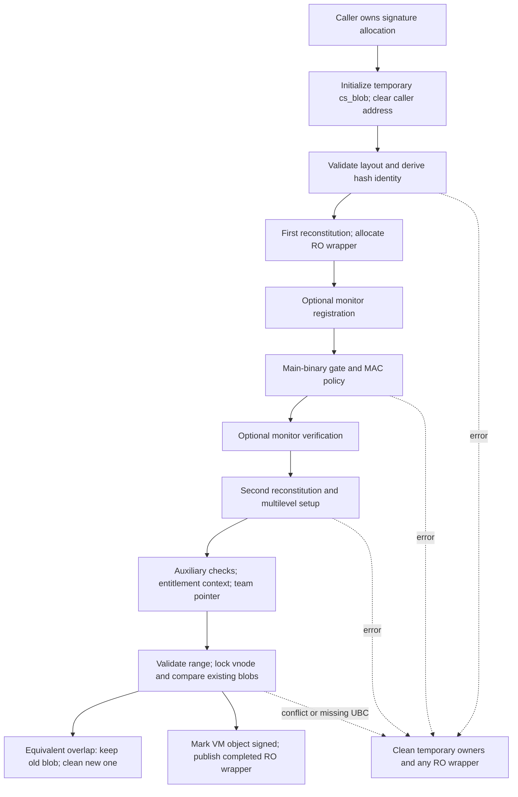
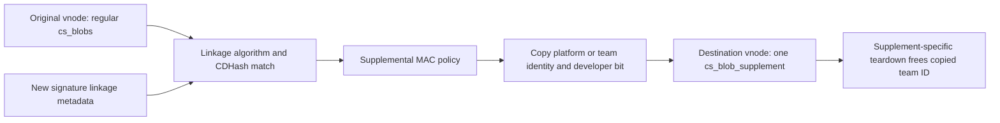

# Vnode signature attachment, revalidation, and destruction

[Security](README.md) · [Signing overview](code-signing.md) · [Signature format](signature-format-and-blob-validation.md) · [Executable policy](executable-signature-policy.md) · [Page integrity](page-signature-validation.md)

A vnode's signature state outlives the system call that supplies it. The UBC connection owns a list of `cs_blob` objects; each combines file coverage, parsed signature storage, accepted signing properties, and optional monitor/entitlement objects. A loader or fcntl caller supplies bytes, but successful registration changes the file-backed VM object's state. Later mappings can find the attachment without rereading its serialized signature.

This chapter follows that ownership transition and the cases where an old attachment is reused, revalidated, invalidated, or freed. It covers the visible XNU call sequence. AMFI policy, certificate trust, and monitor internals remain external boundaries. [Format validation](signature-format-and-blob-validation.md) covers the binary representation; [executable policy](executable-signature-policy.md) and [page integrity](page-signature-validation.md) cover the downstream decisions.

## 1. The UBC object owns a list, not a process-local signature cache

[`ubc_info`](../../../xnu/bsd/sys/ubc_internal.h#L171) connects a vnode to `ui_pager`, `ui_control`, and its file size. Its signing state comprises `cs_blobs`, `cs_add_gen`, and `cs_mtime`; conditional fields hold one supplemental attachment and a validation bitmap. `cs_add_gen` is a vnode-wide generation, not a counter on each slice. `cs_mtime` records the file modification time when the first regular blob was loaded. These fields are separate from per-page VM validation state.

[`struct cs_blob`](../../../xnu/bsd/sys/ubc_internal.h#L106) carries several kinds of ownership:

| Fields | Meaning and lifetime |
| --- | --- |
| `csb_next`, `csb_vnode`, `csb_ro_addr` | List membership, owning vnode association, and protected wrapper address |
| Grouped `csb_cpu_info` and `csb_signer_info` | Architecture association and mutable signing metadata, updated through RO-allocation helpers after publication |
| `csb_base_offset`, `csb_start_offset`, `csb_end_offset` | Fat-file slice origin and relative coverage interval; their sums locate bytes in the vnode |
| `csb_mem_kaddr`, `csb_mem_size`, `csb_cd` | Owned backing signature allocation and selected directory within it |
| `csb_teamid`, raw XML/DER entitlement pointers | Borrowed subranges of retained signature storage; storage transformations must reconstruct them |
| `csb_entitlements` | Separately retained AMFI `OSEntitlements` object, with its own invalidation/release operations |
| `csb_csm_obj`, `csb_csm_managed`, trust level | Optional monitor registration and whether the monitor owns replacement backing storage |
| `csb_supplement_teamid` | Conditional, separately allocated copy of another attachment's team ID |

A borrowed `cs_blob *` is not a standalone retained object. `ubc_cs_blob_get()` takes the vnode spin lock while searching, then returns the pointer after unlocking. Its search accepts an architecture match **or** an offset covered by a blob; those are alternative branches, not a combined CPU-and-range predicate. Loader callers therefore perform further checks before reuse. [Lookup](../../../xnu/bsd/kern/ubc_subr.c#L5499).

`ubc_get_cs_blobs()` is the lockless list accessor. Its contract requires a vnode reference plus protection against reclaim: page faults hold VM `paging_in_progress`, while other callers need suitable protection, such as the vnode lock. It checks the head's protected allocation/vnode association. Adding at the head preserves existing nodes during permitted traversal; whole-list teardown is governed by a different lifecycle. An arbitrary saved pointer after dropping these protections has no promised lifetime. [Accessor contract](../../../xnu/bsd/kern/ubc_subr.c#L5741), [vnode ownership](../vfs/vnode-cache-identity-and-reuse.md).

## 2. The Mach-O loader acquires or reuses an attachment

`load_code_signature()` receives an already located `LC_CODE_SIGNATURE` command, vnode, Mach-O slice offset/size, CPU identity, and `image_params`. It first asks UBC for an existing blob. Its concrete mismatch test combines CPU-type and subtype differences with `&&`, then separately rejects a different base offset or cleared `CS_VALID`; the loader does not simply assume the lookup performed every compatibility check. [Reuse checks](../../../xnu/bsd/kern/mach_loader.c#L3790).

For an architecture-specific attachment, a matching global validation generation permits immediate reuse. An attachment with `CPU_TYPE_ANY` always goes through revalidation here. Successful revalidation of that generic attachment replaces its grouped CPU type/subtype under the vnode spin lock. A failure other than `EAGAIN` becomes `LOAD_FAILURE`; `EAGAIN` discards the local pointer and falls through to reread the serialized signature. It does not detach the old list node. [Generation/revalidation route](../../../xnu/bsd/kern/mach_loader.c#L3809).

If input must be read, the loader requires the exact `linkedit_data_command` size and uses checked addition to prove `dataoff + datasize` lies within the selected Mach-O slice. It allocates signature storage, then reads exactly `datasize` bytes at `macho_offset + dataoff`. Both an I/O error and a nonzero residual are `LOAD_IOERROR`. The registration call supplies the **logical `datasize`**, the CPU association, `image_params`, and `CS_BLOB_ADD_ALLOW_MAIN_BINARY`. [Input bounds, allocation, and read](../../../xnu/bsd/kern/mach_loader.c#L3849).

[Loader's exact-length read and failure condition](../../../xnu/bsd/kern/mach_loader.c#L3867):
<!-- source-excerpt: ../../../xnu/bsd/kern/mach_loader.c#L3867-L3881 -->
```c
	resid = 0;
	error = vn_rdwr(UIO_READ,
	    vp,
	    (caddr_t) addr,
	    lcp->datasize,
	    macho_offset + lcp->dataoff,
	    UIO_SYSSPACE,
	    0,
	    kauth_cred_get(),
	    &resid,
	    current_proc());
	if (error || resid != 0) {
		ret = LOAD_IOERROR;
		goto out;
	}
```

After `ubc_cs_blob_add()` consumes the address, the loader must not deallocate it again. On success, it merges blob flags into the load result and records platform status and the relative signed end offset; that is an input to later executable policy, not proof that all mapped pages have already been hashed. The surrounding Mach-O passes, detached-signature fallback, and process policy are covered in [executable loading](../../cross-cutting/executable-loading.md) and [executable signing policy](executable-signature-policy.md). [Call and output ownership](../../../xnu/bsd/kern/mach_loader.c#L3883).

## 3. fcntl registration has different input and reuse rules

The `F_ADDSIGS`/`F_ADDFILESIGS` family in `sys_fcntl_nocancel()` obtains the vnode from a `DTYPE_VNODE` file object, drops the process descriptor lock, and obtains a vnode iocount through `vnode_getwithref()`. It copies the relevant ABI input prefix, converting 32-bit fields when supported. `F_ADDFILESIGS_INFO` rejects a 32-bit process. The user structures deliberately contain compatibility boundaries between input fields and optional outputs. [Dispatch and ABI copying](../../../xnu/bsd/kern/kern_descrip.c#L4060), [signature structures](../../../xnu/bsd/sys/fcntl.h#L509).

`fs_file_start` is the slice's origin in the file. For `F_ADDSIGS`, `fs_blob_start` is a userspace address; for file-based commands it is an offset added to `fs_file_start`. Before allocating, these commands search for a blob covering `fs_file_start`, with CPU wildcards. An existing blob normally bypasses rereading and registration entirely. Only `F_ADDFILESIGS_FOR_DYLD_SIM` explicitly revalidates it in this branch, interpreting `EAGAIN` as a reread request. There is no general generation check at this fcntl reuse point. [Existing-blob route](../../../xnu/bsd/kern/kern_descrip.c#L4124).

The dyld-simulator command also sets the caller's `CS_KILL` bit before obtaining the vnode iocount or copying the signature request, and passes `MAC_VNODE_CHECK_DYLD_SIM`. Later errors do not undo that early process-flag update. The new-attachment path additionally requires the resulting blob to be a platform binary for this command. [Early process flag](../../../xnu/bsd/kern/kern_descrip.c#L4088), [platform requirement](../../../xnu/bsd/kern/ubc_subr.c#L4898).

| Input route | Read size and residual behavior | Registration arguments |
| --- | --- | --- |
| `F_ADDSIGS` | `copyin()` of user-requested `fs_blob_size` into zeroed storage | CPU wildcards; slice base from request; allocation size |
| `F_ADDFILESIGS` family | `vn_rdwr()` of allocated size, which may be page-rounded; successful short read zero-fills residual tail | CPU wildcards; slice base from request; allocation size |
| `LC_CODE_SIGNATURE` | Exact command `datasize`; any residual fails | Specific CPU/subtype, Mach-O base, logical `datasize`, main-binary permission |

The fcntl path imposes a 40 MiB input limit and maps allocation failure to `ENOMEM`. Its short-read handling accommodates a signature at end of file when allocation was rounded. That code does not itself prove that all bytes described by nested signature lengths were read; the subsequent format/policy checks operate on the supplied, possibly zero-filled range. [Size limit and allocation](../../../xnu/bsd/kern/kern_descrip.c#L4142), [input read and zero fill](../../../xnu/bsd/kern/kern_descrip.c#L4167).

`F_ADDFILESIGS_RETURN`, the dyld-simulator variant, and INFO overwrite the request's first `off_t` with `csb_end_offset`, relative to the slice, not `base_offset + end_offset`. INFO can then copy out the 20-byte CDHash and algorithm identifier if its structure-size input permits. Each output copy can fail after a new attachment has already been published. The vnode reference is dropped, but there is no signature rollback; INFO can also leave an earlier output successfully copied before a later copy fails. [Return-value writes](../../../xnu/bsd/kern/kern_descrip.c#L4225).

[Attachment precedes this potentially failing output copy](../../../xnu/bsd/kern/kern_descrip.c#L4232):
<!-- source-excerpt: ../../../xnu/bsd/kern/kern_descrip.c#L4232-L4241 -->
```c
			off_t end_offset = 0;
			if (blob) {
				end_offset = blob->csb_end_offset;
			}
			error = copyout(&end_offset, argp, sizeof(end_offset));

			if (error) {
				vnode_put(vp);
				goto outdrop;
			}
```

## 4. The new blob passes through a staged ownership transfer

`ubc_cs_blob_allocate()` chooses a data allocation or a page allocation according to `ubc_cs_blob_pagewise_allocate()`. On monitor-enabled configurations the page route applies when the monitor is active and size exceeds its signature-size limit; it rounds size and uses `kmem_alloc` with data, kernel-object, and zeroing flags. The other route uses zeroed `kalloc_data_tag` storage. The matching deallocator uses the same predicate. This is not a universal rule that every signature resides in monitor-owned pages. [Allocation predicate](../../../xnu/bsd/kern/ubc_subr.c#L931), [allocation/deallocation](../../../xnu/bsd/kern/ubc_subr.c#L3131).

`ubc_cs_blob_add()` first initializes a temporary wrapper on its stack. The initializer adopts storage before structural validation by zeroing the caller's address. Failure after that point cleans through the wrapper, including when the initializer itself rejects the container:

[Ownership transfer before parsing](../../../xnu/bsd/kern/ubc_subr.c#L4068):
<!-- source-excerpt: ../../../xnu/bsd/kern/ubc_subr.c#L4068-L4076 -->
```c
	/* Transfer ownership. Even on error, this function will deallocate */
	*addr = 0;

	/*
	 * Validate the blob's contents
	 */
	length = (size_t) size;
	error = cs_validate_csblob((const uint8_t *)blob->csb_mem_kaddr,
	    length, &cd, &entitlements, &der_entitlements);
```

On success it fills architecture/base-offset state, calls the configuration-dependent first-stage reconstitution helper, allocates `ZONE_ID_CS_BLOB` through `zalloc_ro()`, and records its protected address plus vnode backpointer. An initial RO copy exists so AMFI can refer to stable storage during preparation; this is **not yet publication in the vnode list**. The temporary wrapper continues accumulating accepted state. [Start of registration](../../../xnu/bsd/kern/ubc_subr.c#L4737), [protected wrapper preparation](../../../xnu/bsd/kern/ubc_subr.c#L4819).



After optional monitor verification, stage two drops now-unneeded signature material; optional multilevel setup can further move or shrink storage. Auxiliary signed-blob checks then verify that security-relevant constraint material remains bound to the selected directory. Entitlement-query acceleration and parsing the borrowed team-ID pointer occur only after these transformations, so cached pointers refer to final storage. The [format chapter](signature-format-and-blob-validation.md#8-reconstitution-preserves-needed-evidence-while-changing-storage) details these representation changes. [Final preparation order](../../../xnu/bsd/kern/ubc_subr.c#L4907).

## 5. Policy, monitor, and entitlement objects have separate results

`register_code_signature_monitor()` passes backing address/size, selected-directory offset, and an optional vnode path to `csm_register_code_signature()`. Path lookup failure leaves a null path rather than immediately failing registration. The helper relies on caller-established vnode/iocount protection and deliberately avoids recursively acquiring another reference. If the monitor returns a different canonical address, XNU deallocates the old storage, reconstructs interior pointers at the returned address, and marks the wrapper monitor-managed. `KERN_NOT_SUPPORTED` permits the nonmonitor route; other registration failures become `EPERM`. [Monitor registration](../../../xnu/bsd/kern/ubc_subr.c#L4300).

The main-binary gate runs after this storage lockdown. It is a no-op for `XNU_TARGET_OS_OSX`; elsewhere a caller with `CS_BLOB_ADD_ALLOW_MAIN_BINARY` passes, while an ordinary caller's primary and alternate directories are inspected for `CS_EXECSEG_MAIN_BINARY`. The loader sets the allow flag. A development/debug fcntl command sets it explicitly; normal production fcntl registration does not receive it simply because its bytes describe an executable. [Main-binary policy helper](../../../xnu/bsd/kern/ubc_subr.c#L4379), [development command](../../../xnu/bsd/kern/kern_descrip.c#L4060).

Under `CONFIG_MACF`, `mac_vnode_check_signature()` dispatches the vnode label, wrapper, architecture context, flags, platform, and mutable signing-property outputs to policies. After success, registration stores the returned flags/signer type and derives platform bits. The wrapper itself does not implement CMS trust or the complete AMFI decision. Its visible reporting work converts a fatal-description result into an `OS_REASON_CODESIGNING` reason on `image_params` when available. A fcntl caller supplies no `image_params`, so the wrapper returns its failure without that exec-owned reason attachment. It frees the temporary path and policy description before returning. [MAC dispatch and reporting](../../../xnu/security/mac_vfs.c#L1316), [accepted properties](../../../xnu/bsd/kern/ubc_subr.c#L4860).

Monitor verification follows MAC policy. It records monitor trust level, disassociates any provisioning profile no longer needed for verification, and associates the kernel entitlement object. Unsupported operations are accepted at the documented fallback points; verification/association failures otherwise become `EPERM`. Profile disassociation additionally accepts `KERN_NOT_FOUND`. These are explicit XNU result translations; they do not reveal the monitor's internal verification algorithm. [Verification and association](../../../xnu/bsd/kern/ubc_subr.c#L4267), [TXM interface](txm.md).

The AMFI object has an independent reference contract:

[Entitlement installation and copying retain the object](../../../xnu/bsd/kern/kern_cs.c#L805):
<!-- source-excerpt: ../../../xnu/bsd/kern/kern_cs.c#L805-L823 -->
```c
void
csblob_os_entitlements_set(struct cs_blob *csblob, void * entitlements)
{
	assert(csblob->csb_entitlements == NULL);
	if (entitlements) {
		osobject_retain(entitlements);
	}
	csblob->csb_entitlements = entitlements;
}

void *
csblob_os_entitlements_copy(struct cs_blob *csblob)
{
	if (!csblob->csb_entitlements) {
		return NULL;
	}
	osobject_retain(csblob->csb_entitlements);
	return csblob->csb_entitlements;
}
```

The setter requires no prior object, retains the supplied object, and stores it. The `copy` accessor returns a retained reference; `get` is borrowed. Registration's entitlement-acceleration helper connects raw signed material, AMFI/CoreEntitlements contexts, and optional monitor metadata only after storage has stopped moving. The legacy dictionary-set interface in this checkout panics as unsupported. Thus “entitlements” may mean raw serialized bytes, a parsed object, or an accelerated query context, with different owners. [Borrowed get](../../../xnu/bsd/kern/kern_cs.c#L825), [acceleration branches](../../../xnu/bsd/kern/ubc_subr.c#L4428).

## 6. List compatibility and publication are a separate commit point

After preparation, registration computes absolute coverage as `base + start` and `base + end`, rejecting an empty/backward interval or invalid negative effective range. It then takes the vnode lock and requires an existing UBC connection. For **every** existing regular blob, even one covering a disjoint slice, it checks compatible signer type and platform/team identity: all platform slices agree, nonplatform team IDs agree, and a no-team signature cannot mix with a team/platform signature. [Coverage and list checks](../../../xnu/bsd/kern/ubc_subr.c#L4955).

Disjoint coverage can be added. For overlapping coverage, the accepted duplicate predicate is precise:

[Equivalent-overlap predicate](../../../xnu/bsd/kern/ubc_subr.c#L5030):
<!-- source-excerpt: ../../../xnu/bsd/kern/ubc_subr.c#L5030-L5039 -->
```c
			if (blob_start_offset == oblob_start_offset &&
			    blob_end_offset == oblob_end_offset &&
			    tmp_blob.csb_mem_size == oblob->csb_mem_size &&
			    tmp_blob.csb_flags == oblob->csb_flags &&
			    (tmp_blob.csb_cpu_type == CPU_TYPE_ANY ||
			    oblob->csb_cpu_type == CPU_TYPE_ANY ||
			    tmp_blob.csb_cpu_type == oblob->csb_cpu_type) &&
			    !bcmp(tmp_blob.csb_cdhash,
			    oblob->csb_cdhash,
			    CS_CDHASH_LEN)) {
```

It compares effective start/end, retained storage size, flags, compatible CPU **type**, and CDHash. It does not compare every byte of the SuperBlob, require equal CPU subtypes, or separately compare the base offset when effective ranges match. An accepted duplicate keeps the old attachment, optionally supplies a previously wildcard CPU type, updates the vnode generation, and returns the old pointer. Internally it selects `EAGAIN` solely to run new-wrapper cleanup; the outer tail normalizes that value to success. This `EAGAIN` is not exposed as the revalidation helper's reread request. Other overlaps return `EALREADY`. [Duplicate update and cleanup](../../../xnu/bsd/kern/ubc_subr.c#L5040), [error normalization](../../../xnu/bsd/kern/ubc_subr.c#L5164).

All structural, policy, monitor, and transformation work has already happened before this duplicate comparison. It is distinct from the earlier loader/fcntl reuse shortcut. This ordering permits a reread after a generation change to obtain fresh acceptance, then discard the newly built wrapper in favor of a matching published node.

For a new attachment, `memory_object_signed(ui_control, TRUE)` must succeed before publication; failure becomes `ENOENT`. XNU records whether this is the first blob, sets the current generation, authenticates the prepared temporary state after blocking work, updates advisory statistics, and links `tmp_blob.csb_next` to the old head. [VM marker and generation](../../../xnu/bsd/kern/ubc_subr.c#L5074).

PAC builds separately sign entitlement and monitor pointers using their eventual RO field addresses. The whole temporary wrapper is signed before the vnode-lock/list/VM-object operations and authenticated afterward. Before the final RO copy, `memcpy` installs the field-address-diversified pointers; ordinary assignments would cause compiler signing for the stack object's fields. These operations protect the preparation path; normal synchronization and caller lifetime rules still remain necessary. [PAC preparation](../../../xnu/bsd/kern/ubc_subr.c#L4797), [blocking-operation authentication](../../../xnu/bsd/kern/ubc_subr.c#L4970), [pointer installation](../../../xnu/bsd/kern/ubc_subr.c#L5104).

The publication order is explicit:

[Complete the RO wrapper, fence, then expose the list head](../../../xnu/bsd/kern/ubc_subr.c#L5117):
<!-- source-excerpt: ../../../xnu/bsd/kern/ubc_subr.c#L5117-L5129 -->
```c
	zalloc_ro_update_elem(ZONE_ID_CS_BLOB, blob_ro, &tmp_blob);

	/* Add a fence to ensure writes to the blob are visible on all threads */
	os_atomic_thread_fence(seq_cst);

	/*
	 * Add the cs_blob to the front of the list of blobs for this vnode. We
	 * add to the front of the list, and we never remove a blob from the list
	 * which means ubc_cs_get_blobs can return whatever the top of the list
	 * is, while still keeping the list valid. Useful for if we validate a
	 * page while adding in a new blob for this vnode.
	 */
	uip->cs_blobs = blob_ro;
```

Only after unlocking does the first-blob path obtain `vnode_mtime()` into `cs_mtime`. The returned blob pointer is borrowed from the vnode-owned list. `cs_mtime` is therefore a recorded timestamp, not a continuously maintained proof that contents still match, and its fetch is not part of the locked pointer-publication operation. [Unlock, timestamp, and return](../../../xnu/bsd/kern/ubc_subr.c#L5152).

## 7. Generation refresh and invalidation answer different questions

The global `cs_blob_generation_count` starts at 1; `cs_blob_reset_cache()` adds 2 so zero remains reserved. The reset does not free attachments, clear each blob's flags, reread file bytes, or hash pages. `ubc_cs_generation_check()` only compares the vnode's `cs_add_gen` with the global value under its spin lock, returning `ENEEDAUTH` on mismatch. [Global state](../../../xnu/bsd/kern/ubc_subr.c#L109), [check/reset](../../../xnu/bsd/kern/ubc_subr.c#L5619).

`ubc_cs_blob_revalidate()` first refuses a regular blob whose `CS_VALID` has already been cleared, returning `EPERM`. It structurally rechecks retained storage and reconstructs local flags from the selected directory plus `CS_VALID`. A `csb_reconstituted` blob returns `EAGAIN`: some original verification evidence was discarded or transformed, so the caller must reread it instead of treating the reduced representation as the original signed input. This does not mean the retained page hashes are unusable. [Revalidation entry and reread case](../../../xnu/bsd/kern/ubc_subr.c#L5635).

For an unreconstituted attachment it invokes the MAC signature hook again. The grouped signer-info update happens even when that call returns an error; the generation becomes current only on success and zero on failure:

[Revalidation publishes signer results and success-dependent generation](../../../xnu/bsd/kern/ubc_subr.c#L5712):
<!-- source-excerpt: ../../../xnu/bsd/kern/ubc_subr.c#L5712-L5727 -->
```c
	/* update generation number if success */
	vnode_lock_spin(vp);
	struct cs_signer_info signer_info = {
		.csb_flags = cs_flags,
		.csb_signer_type = signer_type
	};
	zalloc_ro_update_field(ZONE_ID_CS_BLOB, blob, csb_signer_info, &signer_info);
	if (UBCINFOEXISTS(vp)) {
		if (error == 0) {
			vp->v_ubcinfo->cs_add_gen = cs_blob_generation_count;
		} else {
			vp->v_ubcinfo->cs_add_gen = 0;
		}
	}

	vnode_unlock(vp);
```

Consequently, generation match, the blob's `CS_VALID`, the process's `CS_VALID`, and a VM page's validation/taint bits cannot be used interchangeably. The first describes cached policy acceptance, the next is attachment validity, the process flag is process policy state, and VM fields describe page-check results. The recorded mtime is yet another state. None substitutes for the [page-integrity check and mapping policy](page-signature-validation.md).

`csblob_invalidate_flags()` clears `CS_VALID` through an RO update when acting on the protected wrapper and invalidates the associated entitlement object. `csvnode_invalidate_flags()` walks regular blobs, marks `UI_CSBLOBINVALID` once under the vnode lock, and invalidates each one. The revalidation comment associates this with opening a file for writing; the supplied tree exposes these invalidation interfaces but does not provide a local callsite reconstructing that entire external policy-triggered chain. The concrete visible result is flag/object invalidation plus eligibility for later drained-list cleanup. [Invalidation bodies](../../../xnu/bsd/kern/kern_cs.c#L494).

## 8. Destruction waits for the vnode lifecycle and respects monitor ownership

`ubc_cs_free_and_vnode_unlock()` is called with the vnode locked in the reference-draining inactive paths. If `UI_CSBLOBINVALID` is absent, it simply unlocks. Otherwise it clears that marker, detaches the regular head and optional supplement, frees the optional bitmap, and unlocks before destroying the detached wrappers. The VFS callsites arrange the surrounding iocount/usecount conditions and inactive processing. These constraints are why the list accessor's head-only-addition comment cannot be read as “no cs_blob is ever freed.” [Detach helper](../../../xnu/bsd/kern/ubc_subr.c#L5539), [release/inactive callsite](../../../xnu/bsd/vfs/vfs_subr.c#L2754), [put/inactive callsite](../../../xnu/bsd/vfs/vfs_subr.c#L6447).

[Detach protected lists before unlocked destruction](../../../xnu/bsd/kern/ubc_subr.c#L5550):
<!-- source-excerpt: ../../../xnu/bsd/kern/ubc_subr.c#L5550-L5564 -->
```c
	uip->ui_flags &= ~UI_CSBLOBINVALID;

	cs_blobs = uip->cs_blobs;
	uip->cs_blobs = NULL;

#if CHECK_CS_VALIDATION_BITMAP
	ubc_cs_validation_bitmap_deallocate( uip );
#endif

#if CONFIG_SUPPLEMENTAL_SIGNATURES
	struct cs_blob  *cs_blob_supplement = uip->cs_blob_supplement;
	uip->cs_blob_supplement = NULL;
#endif

	vnode_unlock(vp);
```

`ubc_info_free()` also calls `ubc_cs_free()` during UBC destruction, releasing the full regular list, supplement, and bitmap regardless of the selective-invalid-cleanup entry point. Each regular wrapper is copied to mutable stack storage because cleanup clears fields; after cleaning its owners, `cs_blob_ro_free()` frees the original RO object. Statistics are decremented when published blobs are destroyed. [UBC teardown](../../../xnu/bsd/kern/ubc_subr.c#L1198), [full list free](../../../xnu/bsd/kern/ubc_subr.c#L5585), [RO wrapper free](../../../xnu/bsd/kern/ubc_subr.c#L4004).

`cs_blob_cleanup()` first invalidates/releases the retained entitlement object. For a monitor object it disassociates provisioning state and unregisters the signature. Successful unregistration of monitor-managed storage means that storage has already been freed by the monitor, so XNU clears its address and size. If unregistration returns `KERN_ABORTED`, the monitor has refused release: XNU likewise clears its own address/size to avoid touching memory it cannot reclaim. It then clears the monitor reference and deallocates only remaining XNU-owned signature storage. [Cleanup body](../../../xnu/bsd/kern/ubc_subr.c#L3955).

[Monitor refusal suppresses later XNU storage deallocation](../../../xnu/bsd/kern/ubc_subr.c#L3979):
<!-- source-excerpt: ../../../xnu/bsd/kern/ubc_subr.c#L3979-L3988 -->
```c
		} else if (kr == KERN_ABORTED) {
			/*
			 * The code-signing-monitor refused to unregister the code signature. It means
			 * whatever memory was backing the code signature may not have been released, and
			 * attempting to free it down below will not be successful. As a result, all we
			 * can do is prevent the kernel from touching the data.
			 */
			blob->csb_mem_kaddr = NULL;
			blob->csb_mem_size = 0;
		}
```

The optional `CHECK_CS_VALIDATION_BITMAP` cache has a smaller, separate lifecycle. Allocation checks the actual `USE_CODE_SIGN_BITMAP` predicate: a vnode on `MNT_ROOTFS`, no `root_fs_upgrade_try`, and an existing UBC connection. It allocates zeroed bits for the current file size at kernel-page granularity and saves the allocation size separately so later size changes do not change the free size. Loader/fcntl callers do not turn allocation failure into signature-registration failure. Whole-list invalidation cleanup and UBC teardown deallocate it and clear its pointer. The read/check/reset conditions and VM interactions are detailed in [page integrity](page-signature-validation.md). [Allocation](../../../xnu/bsd/kern/ubc_subr.c#L6271), [deallocation and disabled stubs](../../../xnu/bsd/kern/ubc_subr.c#L6357).

## 9. Supplemental signatures use a distinct single-attachment path

Under `CONFIG_SUPPLEMENTAL_SIGNATURES`, `F_ADDFILESUPPL` accepts a 64-bit request carrying another file descriptor for the original signature. It requires both file objects to be vnodes, obtains their iocounts, applies the size limit, and reads the supplemental bytes using the file-signature allocation/residual-zero-fill pattern. The cleanup labels release whichever vnode counts and original-file reference have been obtained. [Syscall route and cleanup](../../../xnu/bsd/kern/kern_descrip.c#L4275), [request fields](../../../xnu/bsd/sys/fcntl.h#L552).

`ubc_cs_blob_add_supplement()` adopts and structurally parses the allocation through the shared initializer, but then follows its own policy path. Under the original vnode lock it requires linkage metadata and finds a regular original blob whose hash-operations type and 20-byte CDHash match that linkage. No match is `ESRCH`; a matched original with cleared `CS_VALID` is `EPERM`; missing usable linkage is `EINVAL`. The original vnode/iocount remains protected by the caller while its attachment is used after unlocking. [Linkage search](../../../xnu/bsd/kern/ubc_subr.c#L5225).

It allocates an RO wrapper and calls `mac_vnode_check_supplemental_signature()` with both vnodes and the matched original wrapper. After acceptance it copies platform status, or allocates its own copy of the original's team-ID string. It replaces `csb_flags` with **only the original's `CS_DEV_CODE` bit**. The regular blob's `CS_VALID` predicate therefore cannot be blindly imposed on the supplemental representation. [Supplemental MAC and identity transfer](../../../xnu/bsd/kern/ubc_subr.c#L5284).

[The supplemental flags assignment is deliberately narrower](../../../xnu/bsd/kern/ubc_subr.c#L5313):
<!-- source-excerpt: ../../../xnu/bsd/kern/ubc_subr.c#L5313-L5322 -->
```c
	} else if (orig_blob->csb_teamid != NULL) {
		vm_size_t teamid_size = strlen(orig_blob->csb_teamid) + 1;
		tmp_blob.csb_supplement_teamid = kalloc_data(teamid_size, Z_WAITOK);
		if (tmp_blob.csb_supplement_teamid == NULL) {
			error = ENOMEM;
			goto out;
		}
		strlcpy(tmp_blob.csb_supplement_teamid, orig_blob->csb_teamid, teamid_size);
	}
	tmp_blob.csb_flags = (orig_blob->csb_flags & CS_DEV_CODE);
```

The destination owns exactly one `cs_blob_supplement`. An existing supplement with the same hash type and CDHash causes new-wrapper cleanup and normalized success; another identity yields `EALREADY`. Unlike the regular duplicate branch, this path does not put the existing pointer in `ret_blob`, which was initialized null. For a new supplement, it validates range, marks the memory object signed, sets `csb_next` null, performs an RO copy and fence, and publishes the single slot. [Duplicate and publication paths](../../../xnu/bsd/kern/ubc_subr.c#L5324).



This visible body does not run the regular add helper's monitor registration/verification, reconstitution, entitlement-acceleration, generation update, or first-blob mtime recording sequence. Its single-slot getter checks coverage when an offset is supplied; it does not add a regular `CS_VALID` gate. Final supplemental destruction explicitly frees `csb_supplement_teamid` before common RO cleanup. The add-error tail, by contrast, calls common `cs_blob_cleanup()` directly; that helper does not contain a supplemental-team-ID free. The source therefore does not support claiming fully symmetric cleanup for every post-copy supplemental failure branch. This is a bounded reading of the visible helpers, not a reconstruction of external supplemental-signature policy. [Supplement getter](../../../xnu/bsd/kern/ubc_subr.c#L5461), [supplement-specific free](../../../xnu/bsd/kern/ubc_subr.c#L4200), [add-error tail](../../../xnu/bsd/kern/ubc_subr.c#L5400).

## Sources inspected and limits

| Source | Inspected mechanisms |
| --- | --- |
| `ubc_internal.h` | UBC/blob fields, grouped protected updates, optional supplemental and bitmap storage |
| `mach_loader.c:load_code_signature()` | Cache/revalidation/reread branches, input bounds and residual behavior, ownership and load-result outputs |
| `kern_descrip.c` signature commands; `fcntl.h` | Descriptor/vnode protection, ABI variants, input acquisition, output-after-commit failures, supplemental cleanup labels |
| `ubc_subr.c` registration helpers | Allocation, temporary ownership, reconstitution/monitor/MAC ordering, duplicate tests, protected publication, generation, invalidation teardown, supplement and bitmap lifecycles |
| `kern_cs.c`; `mac_vfs.c` | Invalidation, entitlement retain/copy/get, signature policy dispatch and fatal-reason reporting |
| `vfs_subr.c` inactive paths | The immediate refcount/lifecycle context of invalid-list destruction; not every filesystem's inactive implementation |

No kernel execution, signing-tool experiment, malformed-input test, or build was performed. These chapters document the checked-out implementation rather than proving all configurations or external policies. AMFI/CoreTrust validation, monitor memory protection and cryptographic internals, and the external callers of exported invalidation interfaces remain explicit limits. The next steps in the live path are [exec/load policy](executable-signature-policy.md), [VM page validation](page-signature-validation.md), and [TXM mapping decisions](txm.md).
