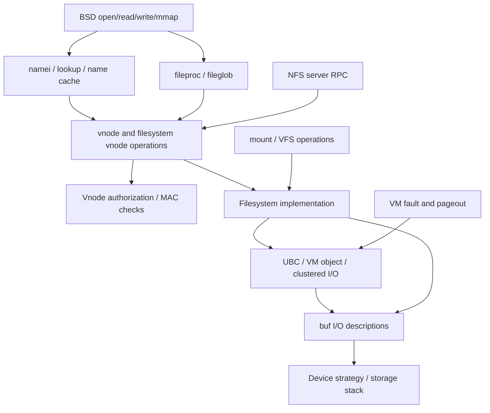

# VFS, filesystems, and storage I/O

[Guide index](../../README.md) · [Architecture](../../architecture.md)

The virtual filesystem layer connects BSD file operations, pathname resolution, filesystem implementations, VM-backed file contents and device I/O. Its central object is the **vnode**: an in-memory handle for a filesystem object, with an operation vector and filesystem-private state. A vnode can represent a regular file, directory, device, FIFO, socket or other supported object; it is not synonymous with an on-disk inode.

Read [vnodes, mounts and dispatch](vnodes-mounts-and-dispatch.md) first. Then follow [pathname lookup and authorization](pathname-and-authorization.md), [file data and I/O completion](io-and-cache.md), and the [in-tree filesystems and NFS survey](filesystems-and-nfs.md). The [VM chapter](../vm/README.md) covers the other side of file-backed mappings and page faults.

The [mapped-file worked operation](../../cross-cutting/mapped-file-to-arm64-fault.md) connects these paths: descriptor lookup and release, vnode/UBC/pager identity, a cold read fault, private COW write, ARM64 translation and unmapping. Its file coordinate remains explicit across clustered page-in and changing VM object offsets.

Continue into the detailed implementation chapters:

| Chapter | Main questions answered |
| --- | --- |
| [Vnode permissions and ACL evaluation](permissions-and-acl-evaluation.md) | How do action masks, mount/immutable restrictions, ordered ACEs, group resolution, POSIX fallback, parent deletion rights and inheritance determine authorization? |
| [Name-cache validation and vnode reclamation](name-cache-and-vnode-reclaim.md) | How do SMR snapshots become generation-checked I/O references? How are names published and invalidated? What drains, cleans and recycles a vnode? |
| [Vnode cache identity and reuse](vnode-cache-identity-and-reuse.md) | What remains cached after close? How do free/age/dead lists, identity generations, filesystem lookup and authorization caching interact? |
| [File-data cache and read paths](file-data-cache-and-read-path.md) | How do UBC, the vnode pager and VM pages supply resident reads, cache misses, read-ahead, mappings, truncation and invalidation? |
| [Buffer cache and block I/O](buffer-cache-and-block-io.md) | How do buffer hashes, busy ownership, free queues, backing storage, delayed writes and completion differ from cached file pages? |
| [Mount publication, traversal and unmount](mount-lifecycle.md) | Why do busy locks, ordinary references, iteration references and cross-references differ? How does lookup cross a mount, and what survives a failed unmount? |
| [Clustered writes, dirty tracking and I/O completion](clustered-writeback.md) | How are writes grouped or tracked sparsely? Why are UPLs released and reacquired? How do direct writes, buffer callbacks, partial failures and synchronous pushes complete? |
| [Namespace mutations and compound operations](namespace-mutations.md) | How do create, link, unlink and rename authorize changes, relookup after locking, continue compound lookup and publish identity/events? |
| [Device nodes, specfs and named FIFOs](device-nodes-and-fifos.md) | How do devfs names become vnodes, clone devices get instances, device aliases reach the switch, and FIFO socket pairs open and close? |
| [Stacked filesystems](stacked-filesystems.md) | How do bindfs/nullfs retain lower vnodes, resolve alias-creation races, synthesize identity, forward page-in and unmount? |
| [NFS server requests](nfs-server-requests.md) | How do socket records become requests, bounded replay caches filter duplicates, file handles resolve, and READ/WRITE/gather/COMMIT complete? |
| [Attribute lists and extended attributes](metadata-and-extended-attributes.md) | How are metadata bitmaps authorized, fetched, packed and set? How do native xattrs and the DoubleAgent fallback transfer data and references? |
| [Advisory locks and leases](advisory-locks-and-leases.md) | Who owns a byte-range lock, how are intervals and waiters updated, and how do lease breaks notify, wait, time out and reclaim? |
| [Filesystem event queues](filesystem-event-queues.md) | How do producers, shared events, per-watcher rings, coalescing, loss markers, record copies and close interact? |
| [Compressed file data](compressed-file-data.md) | How do decmpfs headers/providers, cnode state, resident pages, UPL completion and conversion to ordinary backing work? |
| [Quota records and cache lifetime](quota-cache-and-filesystem-boundaries.md) | How do quota-file exclusion, record lookup/reuse, on-disk hashing, dirty orphan writeback and filesystem callbacks fit together? |

For signed files, continue from those caches into [signature format and structural checks](../security/signature-format-and-blob-validation.md) → [attachment to the vnode's UBC state](../security/vnode-signature-lifecycle.md) → [exec and mapping policy](../security/executable-signature-policy.md) → [page hashing and cached validation](../security/page-signature-validation.md). A name-cache hit, a resident data page, an accepted `cs_blob`, and an executable mapping are separate results.

## The main boundaries

The filesystem decides whether and how to use clustered I/O. A generic `VNOP_READ` wrapper does not automatically invoke the buffer cache, and a read can finish entirely from resident UBC pages. Device and network-backed objects take different routes.

| Layer | Principal source | What to look for |
|---|---|---|
| Syscalls and open files | [`vfs_syscalls.c`](../../../xnu/bsd/vfs/vfs_syscalls.c), [`sys_generic.c`](../../../xnu/bsd/kern/sys_generic.c), [`vfs_vnops.c`](../../../xnu/bsd/vfs/vfs_vnops.c) | Path-based setup, fileglob operations, shared offsets and stored credentials |
| Pathnames | [`vfs_lookup.c`](../../../xnu/bsd/vfs/vfs_lookup.c), [`vfs_cache.c`](../../../xnu/bsd/vfs/vfs_cache.c), [`nameidata`](../../../xnu/bsd/sys/namei.h#L99) | Component lookup, mount/symlink traversal, positive and negative cache entries |
| Vnode lifecycle | [`vnode`](../../../xnu/bsd/sys/vnode_internal.h#L159), [`vfs_subr.c`](../../../xnu/bsd/vfs/vfs_subr.c) | I/O references, persistent references, identity generations, inactive/reclaim |
| Mounts and registration | [`mount`](../../../xnu/bsd/sys/mount_internal.h#L108), [`vfs_init.c`](../../../xnu/bsd/vfs/vfs_init.c), [`kpi_vfs.c`](../../../xnu/bsd/vfs/kpi_vfs.c) | Filesystem instance vs filesystem type; mount operations vs vnode operations |
| File contents | [`ubc_info`](../../../xnu/bsd/sys/ubc_internal.h#L171), [`ubc_subr.c`](../../../xnu/bsd/kern/ubc_subr.c), [`vfs_cluster.c`](../../../xnu/bsd/vfs/vfs_cluster.c) | File VM object, UPLs, read-ahead, write-behind, extent mapping |
| Buffer/device I/O | [`buf`](../../../xnu/bsd/sys/buf_internal.h#L107), [`vfs_bio.c`](../../../xnu/bsd/vfs/vfs_bio.c), [`spec_vnops.c`](../../../xnu/bsd/miscfs/specfs/spec_vnops.c) | Buffer ownership, submission, completion and device-switch dispatch |
| Remote requests | [`nfs_syscalls.c`](../../../xnu/bsd/nfs/nfs_syscalls.c), [`nfs_socket.c`](../../../xnu/bsd/nfs/nfs_socket.c), [`nfs_serv.c`](../../../xnu/bsd/nfs/nfs_serv.c) | NFS server requests translated into local VFS operations |

## What this tree contains

The checkout supplies the generic VFS infrastructure and small filesystems/layers under `bsd/miscfs`. It does **not** supply the APFS filesystem implementation or a complete physical storage-driver stack. Calls through registered `vfsops`, vnode operation vectors and block/character device switches cross those boundaries. The presence of APFS-specific integration or ioctl names elsewhere in XNU does not expose APFS's allocation, transaction or on-disk algorithms.

Likewise, the available `bsd/nfs` implementation is chiefly the NFS server, RPC and GSS support. There is no client `nfs_vfsops.c` or `nfs_vnops.c` here. [`nfs_register_hooks`](../../../xnu/bsd/nfs/nfs_syscalls.c#L175) exposes integration hooks for externally supplied behavior. The final chapter distinguishes what can actually be traced from this checkout from those missing implementations.

## Useful reading routes

* **Opening `/a/b`:** `openat_internal` → `open1at`/`open1` → `vn_open_auth` → `namei`/`lookup` → cache or `VNOP_LOOKUP` → authorization/open → a vnode-backed fileglob.
* **Reading an open file:** `read_internal` → `readv_internal` → `fp_readv` → `fo_read` → `vn_read` → `VNOP_READ` → the selected filesystem's read method.
* **Reading missing file data:** a filesystem using `cluster_read` obtains UPL pages, maps file extents, sends strategy requests and commits completed pages. A mapping fault arrives through the vnode pager and `VNOP_PAGEIN` instead.
* **Reclaiming a vnode:** drain active I/O references → clean buffers/UBC as required → `VNOP_INACTIVE`/`VNOP_RECLAIM` → remove cached identity and replace operations with dead-vnode behavior.

These are reading routes, not exhaustive call graphs: compound operations, retries, cached fast paths and configuration branches alter the sequence.

## Sources inspected and limits

“Deep” means the named structures and selected multi-stage paths were read; it does not mean every branch of these large files was audited.

| Area | Inspection | Coverage and limits |
|---|---|---|
| Vnode/mount/open-file model | Deep structure definitions and selected reference/drain/inactive/clean/reclaim code in `vnode_internal.h`, `mount_internal.h`, `file_internal.h`, `vnode.h`, `vfs_subr.c` | Allocation holds versus I/O/use references and identity; drain admission variants, callback lock release, dead-state installation and reuse ordering; not every revoke/reference race |
| Open/read/write and namespace dispatch | Deep selected `vfs_syscalls.c`, `vfs_vnops.c`, `vfs_subr.c`, `sys_generic.c`, `kpi_vfs.c` | Create/mkdir/link/unlink/rename authorization, compound continuation, lock/relookup/retry and cleanup; read/offset/credential/vector paths; not every ioctl, `fcntl`, event or metadata syscall |
| Lookup and authorization | Deep `nameidata`/cache structures, component/mount/symlink handling, SMR and locked cache lookup, publication counters, generation-checked insertion, invalidation, open/search authorization; local ACL ordering, residual POSIX checks, deletion and creation inheritance | Common route, negative entries, reference conversion and retry; external filesystem storage, membership-service databases, complete named-stream and MAC-provider behavior remain boundaries |
| UBC/cluster/buffer I/O | Deep UBC/pager/object lifetime, resident-copy and missing-page reads, read-ahead decisions, mapping/last-unmap, size/truncation and invalidation; buffer hash/busy/free/storage/GC state; write classification/copy/zeroing, dirty tracking, UPL gathering, strategy transactions and completion | File-page and buffer-header/storage caches kept separate; complete vector-UPL internals, external filesystem/verification providers and every throttling/read-ahead combination remain narrower |
| Mount lifecycle, boot and registration | Deep selected root mount, `mount_common` publication/rollback, `lookup_traverse_mountpoints`, `vfs_busy`, `dounmount`, `vflush`, reference drains, filesystem registration and operation vectors | Mount failure and force/device branches included; product-specific root-volume policy and every nested-mount/trigger race are not fully traced |
| Small filesystems and special nodes | Deep selected devfs registration/lookup/clone/refcount/mount lifecycle, specfs alias/open/data/close dispatch, FIFO activation/peer/close, bindfs/nullfs alias hash/lookup/synthetic namespace/context/page-in/unmount | Four concrete lifecycle implementations; routefs and mockfs remain surveys, not a complete audit of every filesystem |
| NFS | Deep selected socket/upcall/framing/parser/worker ownership, replay cache, file-handle/mount/credential conversion, READ/WRITE/gather/COMMIT and shutdown; existing `fhopen`, GSS and registration-hook survey | Current NFSv2/v3 server paths and limits; no complete RPC/security audit and no absent NFS client implementation inferred |
| Metadata, locks and events | Attribute packing/bulk progress/set ordering, native and DoubleAgent xattrs, lockf ranges/waiters/close, lease breaks, event watcher publication/delivery/loss/close | External filesystem metadata storage and DoubleAgent service bodies remain boundaries |
| Compressed files and quota infrastructure | decmpfs header/provider/UBC/UPL/conversion paths, quota cache identity/refcounts/disk records/writeback | Most codecs, APFS methods and filesystem quota charging are external; generic callbacks do not reveal those implementations |

Useful adjacent originals are the [VM pageout description](../../../xnu/doc/vm/pageout_scan.md) and [startup description](../../../xnu/doc/lifecycle/startup.md). The [devfs README](../../../xnu/bsd/miscfs/devfs/README) explicitly identifies itself as inherited FreeBSD 3.1 commentary: use current source, rather than that historical feature list, for this version's behavior.

<!-- BEGIN PLATYDOC DOCUMENTATION LICENSE -->
Original Platydoc text and diagrams are licensed under [CC BY 4.0](https://creativecommons.org/licenses/by/4.0/). Quoted source code and third-party material retain their respective licenses.
<!-- END PLATYDOC DOCUMENTATION LICENSE -->
