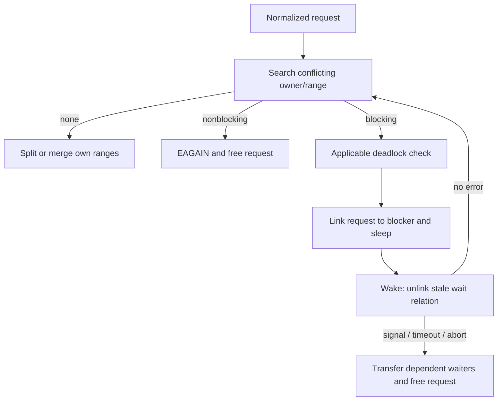

# Advisory byte-range locks and file leases

[VFS](README.md) · [Descriptors](../processes/descriptors-ipc.md) · [UNIX rights](../processes/pipes-and-unix-socket-rights.md) · [Namespace changes](namespace-mutations.md)

Advisory locks coordinate owners of file byte ranges. File leases notify a holder when another operation needs conflicting access. Their state, ownership and wakeup protocols are different even though both can make a file operation wait.

## Which owner survives dup, fork and close?

`fcntl` selects POSIX or open-file-description semantics before `VNOP_ADVLOCK`. POSIX requests use the process as identity; OFD requests derive identity from the fileglob. `flock` also uses fileglob identity but sets its own whole-file semantics. Duplicated descriptors can therefore share an OFD/flock owner while process locks have a process-based release rule. [fcntl dispatch](../../../xnu/bsd/kern/kern_descrip.c#L3206-L3279), [flock dispatch](../../../xnu/bsd/kern/kern_descrip.c#L5984-L6044).

`struct lockf` records inclusive start/end (`-1` means EOF), type, identity, semantics flags, vnode/list backpointers and a queue of requests blocked by this lock. `lf_owner` is a process only where ownership can be established safely: ordinary POSIX locks, or confined OFD cases. The list hangs from `vnode.v_lockf` and is protected by `v_lock`. [Structure](../../../xnu/bsd/sys/lockf.h#L87-L104), [admission/owner setup](../../../xnu/bsd/kern/kern_lockf.c#L203-L347).

## Normalize, find conflicts and edit intervals

`lf_advlock` converts a `flock` range to inclusive bounds. The caller has already adjusted `SEEK_CUR`; `SEEK_END` obtains current vnode size with overflow checks. Zero length extends to EOF, negative length covers bytes before the supplied start, and invalid negative/overflowing ranges fail. It allocates a request and invokes the set/clear/get operation under `v_lock`. [Normalization](../../../xnu/bsd/kern/kern_lockf.c#L229-L302).

`lf_getblock` locates overlapping conflicting owners/types. A nonblocking conflicting set frees its request and returns `EAGAIN`. After conflicts are gone, `lf_setlock` handles six overlap cases with the same owner's existing ranges: none, exact equality, either containment, and overlap at either end. It can split, replace, shorten or merge intervals and move/wake blocked requests. Unlock uses corresponding interval editing. [Conflict and insertion](../../../xnu/bsd/kern/kern_lockf.c#L522-L986), [clear](../../../xnu/bsd/kern/kern_lockf.c#L988), [split](../../../xnu/bsd/kern/kern_lockf.c#L1397).

Illustrative operation: owner A holds write range `[0,99]`, then unlocks `[40,59]`. Its state becomes `[0,39]` and `[60,99]`; a waiter for byte 50 may now proceed while a waiter for byte 70 remains blocked. An interval is not tied to the descriptor number used for that individual request.

## Sleep and deadlock checks

A blocking request is linked on the conflicting lock's `lf_blkhd`, with `lf_next` identifying the blocker, then sleeps while releasing `v_lock`. POSIX deadlock detection examines process thread wait channels and related blocking state under `lf_dead_lock`. If inspecting another vnode would require a conflicting mutex, the code drops locks, pauses and restarts the scan. OFD locks do not implement this same deadlock check. [Detection and retry](../../../xnu/bsd/kern/kern_lockf.c#L565-L698).



Wakeup is not automatically a grant. A spurious wake must remove the old queue link before retrying, otherwise a second insertion could create a cycle. Interrupted/timed-out requests adjust any donation and transfer/wake requests blocked behind them. `F_ABORT` becomes `EBADF`; timeout sleep errors become `ETIMEDOUT`. [Wake cleanup](../../../xnu/bsd/kern/kern_lockf.c#L762-L832).

[bsd/kern/kern_lockf.c, lines 790–797](../../../xnu/bsd/kern/kern_lockf.c#L790-L797):
<!-- source-excerpt: ../../../xnu/bsd/kern/kern_lockf.c#L790-L797 -->
```c
			TAILQ_REMOVE(&lock->lf_next->lf_blkhd, lock, lf_block);
#if IMPORTANCE_INHERITANCE
			/*
			 * Adjust the boost on lf_next.
			 */
			lf_adjust_assertion(lock->lf_next);
#endif /* IMPORTANCE_INHERITANCE */
			lock->lf_next = NULL;
```

## Closing a file and disposing a transferred reference

Descriptor close can release POSIX locks for the process even when other references keep the fileglob alive. OFD/flock release belongs to open-file ownership. The process context passed to a drop therefore matters: failed SCM_RIGHTS externalization uses `UNP_FG_NOPROC` so discarding an undelivered message reference does not accidentally act like the recipient closing an already open file. [Process lock cleanup](../../../xnu/bsd/kern/kern_descrip.c#L244-L289), [failed receive disposal](../../../xnu/bsd/kern/uipc_usrreq.c#L2462-L2474). This is a useful example of why reducing every cleanup to “decrement the reference count” loses behavior.

## Lease state and break requests

Under `CONFIG_FILE_LEASES`, each vnode has `file_lease` records containing fileglob, owning PID, read/write type, pending flags and separate release/downgrade timestamps. `vnode_setlease` checks admission policy and calls acquisition or release. Leases are not entries in `v_lockf`. [Representation](../../../xnu/bsd/sys/vnode_internal.h#L139-L148), [lease entry](../../../xnu/bsd/vfs/vfs_subr.c#L12990-L13003).

`vnode_breaklease` derives access from open flags, applies special dataless/read-context exemptions and checks whether another process holds conflicting lease state. A read can require downgrade of an exclusive lease; a write/truncate can require release. It marks pending state and posts `NOTE_LEASE_DOWNGRADE` or `NOTE_LEASE_RELEASE`. A holder can receive both with different start times when later access escalates. [Conflict and notification](../../../xnu/bsd/vfs/vfs_subr.c#L13223-L13301).

For an `O_NONBLOCK` breaker the event has already been sent when `EWOULDBLOCK` is returned. A blocking breaker waits for release/downgrade; timeout handling can force the pending change. Success is not unconditional veto power for the original holder. [Wait selection](../../../xnu/bsd/vfs/vfs_subr.c#L13303-L13322), [timeout transitions](../../../xnu/bsd/vfs/vfs_subr.c#L13073-L13121).

Directory mutation calls `vnode_breakdirlease` and may obtain the parent from cached identity or a filesystem parent-ID lookup. That helper explicitly makes a best-effort parent lookup. Vnode reclaim calls `vnode_revokelease`, removes all records and wakes breakers. [Directory and reclaim](../../../xnu/bsd/vfs/vfs_subr.c#L13370-L13444). Remote/filesystem-specific lock providers can override VNOP behavior; this chapter explains the local generic `lockf` implementation and VFS lease protocol rather than an absent network lock manager.

<!-- BEGIN PLATYDOC DOCUMENTATION LICENSE -->
Original Platydoc text and diagrams are licensed under [CC BY 4.0](https://creativecommons.org/licenses/by/4.0/). Quoted source code and third-party material retain their respective licenses.
<!-- END PLATYDOC DOCUMENTATION LICENSE -->
