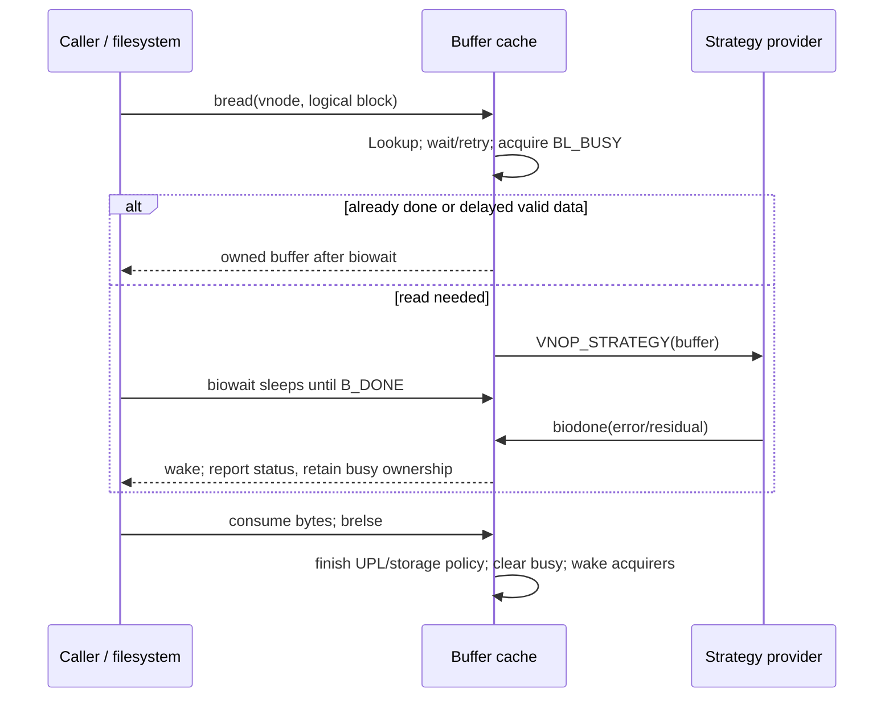

# Buffer-cache identity, block I/O, and completion ownership

[VFS](README.md) · [File-data cache](file-data-cache-and-read-path.md) · [Clustered writeback](clustered-writeback.md) · [Special-device vnodes](device-nodes-and-fifos.md)

XNU's `buf` is both a cache descriptor and a transfer descriptor, depending on how it was allocated. Cached headers are hashed by vnode/logical block and move among free queues. Cluster I/O obtains separate temporary headers and attaches a UPL. Metadata buffers can own allocated bytes, while regular-file buffers can map VM's cached pages temporarily. Those cases share flags and completion APIs, but they do not share every storage or release rule. [`struct buf`](../../../xnu/bsd/sys/buf_internal.h#L107), [`buf_getblk`](../../../xnu/bsd/vfs/vfs_bio.c#L3245), [`alloc_io_buf`](../../../xnu/bsd/vfs/vfs_bio.c#L4613)

This chapter follows cached-header acquisition, byte storage, reads/writes, completion and reclaim. The [file-data chapter](file-data-cache-and-read-path.md) follows the UBC resident/missing-page decision, and [clustered writeback](clustered-writeback.md) explains how multiple strategy buffers form one UPL transaction. Filesystems choose their own helpers and logical-block conventions; the generic code does not reveal APFS's complete metadata cache, transaction model or on-disk layout.

## 1. One structure participates in several independent lists

| Fields | Meaning |
|---|---|
| `b_hash`, `b_vp`, `b_lblkno` | Cached identity: vnode plus logical block. Hash membership alone does not establish valid bytes or ownership. |
| `b_vnbufs` | Membership on a vnode's clean/dirty buffer list, used for flush/invalidation. This can represent an accounting association distinct from the buffer's original I/O vnode. |
| `b_freelist`, `b_whichq`, `b_timestamp` | Reuse queue membership and age. Busy cached buffers are off these queues. |
| `b_lflags` | Local ownership/lifecycle flags such as `BL_BUSY`, `BL_WANTED`, `BL_IOBUF`, `BL_SHADOW`; inspected/updated under `buf_mtx` where that protocol applies. |
| `b_flags` | I/O/data policy: read versus write, done, delayed-write, metadata, invalid, error, asynchronous, callback/filter, and more. |
| `b_bcount`, `b_bufsize`, `b_resid` | Requested transfer count, allocated/backing size and remaining I/O. They answer different size questions. |
| `b_datap`, `b_upl` | CPU data address and optional UPL. A header need not own a permanent CPU mapping. |
| `b_blkno`, `b_dev`, `b_vnop_vp` | Current physical-block mapping, device number, and vnode on which strategy dispatch is being performed. |
| `b_iodone`, `b_transaction` | One-shot completion/filter function and argument. |
| Dirty/valid offsets, credentials and attributes | Byte-range hints, retained read/write credentials, verification/content-protection/throttle properties. |

The concrete layout and aliases are in [`buf_internal.h`](../../../xnu/bsd/sys/buf_internal.h#L107-L190). Cluster buffers repurpose fields through aliases such as `b_uploffset`, `b_trans_head`, `b_trans_next`, `b_iostate` and `b_cliodone`. They are not simultaneously ordinary free-list/credential fields in that use. Read the buffer kind before interpreting a pointer or count.

The header explicitly distinguishes local flags from the externally visible flags. `BL_BUSY` means the buffer is owned, including the interval before I/O submission and after synchronous completion. It is not interchangeable with `B_DONE`, and `B_LOCKED` is a retention/transaction constraint, not the mutex that arbitrates acquisition. `B_CACHE` records that `getblk` found a header in the cache; it is not an immutable assertion that VM still contains all its file bytes. [`flag definitions`](../../../xnu/bsd/sys/buf_internal.h#L177-L245)

The free queues are `BQ_LOCKED`, `BQ_LRU`, `BQ_AGE`, `BQ_EMPTY`, `BQ_META` and `BQ_LAUNDRY`. “Free” means available to the relevant queue protocol, not that storage was necessarily freed. A metadata buffer on `BQ_META` can still own its contents; laundry holds delayed work; empty headers have no useful data association. [`queue enum`](../../../xnu/bsd/sys/buf_internal.h#L307-L315), [`buf_brelse` selection](../../../xnu/bsd/vfs/vfs_bio.c#L3079-L3123)

## 2. Acquisition must revalidate identity after any wait

`buf_getblk` computes `BUFHASH(vp, blkno)` and searches under `buf_mtx`. `incore_locked` requires matching vnode and logical block and rejects `B_INVAL`. On a busy hit, normal read/write/metadata operations set `BL_WANTED`, sleep, and restart the lookup. Callers opting into interruptible/timed failure can receive null. Waking does not reserve the old pointer for the waiter; it must search again. [`hash/key`](../../../xnu/bsd/vfs/vfs_bio.c#L145-L151), [`incore_locked`](../../../xnu/bsd/vfs/vfs_bio.c#L3191), [`busy-hit path`](../../../xnu/bsd/vfs/vfs_bio.c#L3264-L3312)

On an available hit, the function marks `BL_BUSY`, increments the busy count, sets `B_CACHE`, removes free-list membership and drops the mutex before resizing storage or acquiring UPLs. This is the ownership handoff: other cache consumers can find the identity, but must wait for its busy owner. An idle cached file-data header is not supposed to retain an outstanding UPL; finding one is a panic condition. [`hit acquisition`](../../../xnu/bsd/vfs/vfs_bio.c#L3314-L3343)

A miss calls `getnewbuf`, which may sleep, allocate or schedule dirty work. After it returns, the caller searches the hash **again** because another thread might have created the same identity while the lock was dropped. A losing candidate goes to the invalid hash and is released, then acquisition restarts. The winner publishes the new key in the hash before any further blocking operation. [`miss revalidation`](../../../xnu/bsd/vfs/vfs_bio.c#L3431-L3488)

[A newly obtained header loses if another thread published the key](../../../xnu/bsd/vfs/vfs_bio.c#L3453-L3461)

<!-- source-excerpt: ../../../xnu/bsd/vfs/vfs_bio.c#L3453-L3461 -->
```c
		if (incore_locked(vp, blkno, dp)) {
			SET(bp->b_flags, B_INVAL);
			binshash(bp, &invalhash);

			lck_mtx_unlock(&buf_mtx);

			buf_brelse(bp);
			goto start;
		}
```

`BLK_ONLYVALID` prevents allocating a missing identity and suppresses the ordinary resizing path. It must still be interpreted with the operation-specific VM checks: a buffer header and resident file pages are different resources. Similarly, `buf_acquire_locked`, used by list walkers, returns `EAGAIN` after successfully sleeping on a busy buffer rather than claiming it; the caller must rescan because the lists and buffer identity could have changed. `BAC_NOWAIT` returns `EBUSY`, while locked/nonlocked selection can return `EDEADLK` as a skip result. [`only-valid miss`](../../../xnu/bsd/vfs/vfs_bio.c#L3431-L3439), [`resize suppression`](../../../xnu/bsd/vfs/vfs_bio.c#L3333-L3368), [`buf_acquire_locked`](../../../xnu/bsd/vfs/vfs_bio.c#L4246-L4292)

## 3. Metadata owns storage; file-data buffers borrow VM pages

On a miss, a non-regular vnode or a vnode without UBC is forced to `BLK_META`. Thus `B_META` selects buffer-owned storage in more cases than on-disk filesystem metadata: a block-device vnode read also uses that storage regime. In contrast, regular-file `BLK_READ`/`BLK_WRITE` can obtain a UPL for `ubc_blktooff(vp, b_lblkno)` and map it into `b_datap`. [`storage selection`](../../../xnu/bsd/vfs/vfs_bio.c#L3434-L3440), [`file-data UPL`](../../../xnu/bsd/vfs/vfs_bio.c#L3511-L3607)

`allocbuf` rounds ordinary backing size to at least a page and rejects requests over `MAXBSIZE`. For metadata it rounds to 512-byte units. Allocations up to 16 KiB use `KHEAP_VFS_BIO`, a data-shared heap; larger allocations use `kmem_alloc` with the shown kernel-object/data-shared flags. Growing metadata copies the old bytes before freeing the old store; a smaller requested transfer can retain the larger allocation while changing `b_bcount`. For non-metadata buffers, `allocbuf` primarily records size: the subsequent UPL supplies the actual file pages. [`allocator constants/heap`](../../../xnu/bsd/vfs/vfs_bio.c#L2405-L2408), [`allocbuf`](../../../xnu/bsd/vfs/vfs_bio.c#L3763-L3835)

The small metadata allocator first tries no-page-wait allocation with VM privilege temporarily removed. On failure it tries recycling an existing clean metadata allocation of the exact size, then permits a blocking allocation with the privilege handling shown in the body. This avoids assuming that every buffer allocation can wait for VM pageout while itself holding resources needed to make pageout progress. [`recycle_buf_from_pool`](../../../xnu/bsd/vfs/vfs_bio.c#L3678-L3699), [`grab_memory_for_meta_buf`](../../../xnu/bsd/vfs/vfs_bio.c#L3708)

For file data, `BLK_WRITE` adds `UPL_WILL_MODIFY`; reads and writes request `UPL_PRECIOUS`. A cache-hit header is checked against current UPL page state. If its first page is no longer valid, the code clears done/cache/was-dirty/delayed-write indications; a new header can conversely become a VM cache hit when its gathered page is already valid. In that case it can reconstruct the disk mapping, retaining it only when the returned extent covers the buffer. The existing UBC read/write compatibility path should not be generalized into the principal path of every modern filesystem: development checks explicitly reject selected Apple filesystems using it. [`hit page-state checks`](../../../xnu/bsd/vfs/vfs_bio.c#L3370-L3415), [`new-header VM hit`](../../../xnu/bsd/vfs/vfs_bio.c#L3520-L3604)

Metadata size increases have another obligation. If a previously valid smaller metadata buffer has delayed writes pending, `getblk` writes it first and retries before expanding the valid-byte request. Otherwise it clears `B_DONE` so a following read obtains the newly requested bytes. Resizing allocation alone does not make newly covered disk bytes valid. [`metadata growth`](../../../xnu/bsd/vfs/vfs_bio.c#L3340-L3370)

## 4. Reads return an owned buffer; read-ahead transfers ownership

`bio_doread` obtains a busy buffer and issues `VNOP_STRATEGY` only if neither `B_DONE` nor `B_DELWRI` indicates existing data. It records read direction, optionally retains credentials, and charges the operation. `buf_bread`/`buf_meta_bread` then wait using `buf_biowait`; the returned `bpp` is still the caller's buffer, including on an I/O error, and the caller must release it. [`bio_doread`](../../../xnu/bsd/vfs/vfs_bio.c#L2411-L2464), [`read wrappers`](../../../xnu/bsd/vfs/vfs_bio.c#L2498-L2522)

An asynchronous `bio_doread` returns null instead of handing a pointer back: the completion path will release that buffer. If data was already cached, it releases immediately and also returns null. `buf_breadn` first starts the requested synchronous read, then starts asynchronous reads for uncached requested read-ahead blocks, and finally waits for the primary buffer. This is the traditional buffer read-ahead mechanism, distinct from UBC's page-range predictor. [`async ownership`](../../../xnu/bsd/vfs/vfs_bio.c#L2438-L2459), [`do_breadn_for_type`](../../../xnu/bsd/vfs/vfs_bio.c#L2473-L2489)

`buf_biowait` loops on `B_DONE`. It takes `buf_mtx`, rechecks, and registers sleep before dropping the lock, matching the completion-side done/wakeup protocol. On completion it reports `B_EINTR` first, then `b_error` or fallback `EIO` when `B_ERROR` is set. `B_DONE` means completion happened, not success; the error flags still matter. [`buf_biowait`](../../../xnu/bsd/vfs/vfs_bio.c#L4300-L4324)



## 5. Strategy dispatch crosses filesystem and device boundaries

A filesystem's `VNOP_STRATEGY` may call `buf_strategy(devvp, ap)`. This helper expects the original `b_vp` to be a file-style vnode, records the device, and for non-cluster UPL-backed buffers calls `cluster_bp` to handle filesystem-block/page-size mismatches. Otherwise, when physical mapping is unresolved, it converts the logical block to a file offset and asks `VNOP_BLOCKMAP` for a physical block and contiguous byte count. [`buf_strategy`](../../../xnu/bsd/vfs/vfs_bio.c#L1587-L1662)

The conventional-buffer helper's hole behavior differs from the clustered engine: `buf_strategy` treats block -1 **or a zero contiguous length** as a clear/completion case, whereas `cluster_io` rejects a successful zero-length extent. Do not silently transfer the clustered helper's exact validation contract to every caller. A short contiguous extent goes through `buf_strategy_fragmented`, which uses a temporary I/O buffer and repeated block mapping/strategy operations, accumulating errors/residuals before completing the original buffer. [`hole/fragment branch`](../../../xnu/bsd/vfs/vfs_bio.c#L1645-L1673), [`fragmented helper`](../../../xnu/bsd/vfs/vfs_bio.c#L1471-L1582), [cluster extent rules](clustered-writeback.md)

Before device dispatch the helper supplies selected content-protection attributes, sets `b_vnop_vp` to the device vnode, invokes that vnode's operation vector and clears the temporary field. `spec_strategy` then performs its device-layer accounting/policy and calls the block-device switch's `d_strategy`. A device driver eventually calls the completion interface. Filesystem block mapping, driver transport, DMA preparation and hardware queue scheduling are separate responsibilities; generic buffers alone do not establish an APFS transaction or device persistence guarantee. [`device dispatch`](../../../xnu/bsd/vfs/vfs_bio.c#L1720-L1735), [`spec_strategy`](../../../xnu/bsd/miscfs/specfs/spec_vnops.c#L2569), [IOKit memory/DMA](../drivers/memory-and-dma.md)

## 6. Dirty, submitted and durable are different states

`buf_bdwrite` marks a buffer delayed-write once, increments delayed accounting and moves its vnode-list membership to the dirty list. Normally it marks `B_DONE` and releases the buffer without submitting I/O. Above the delayed-write threshold—75% of the configured header count in this test—it can instead throttle and issue asynchronous writeback, unless `B_LOCKED` says the transaction cannot yet be written. The internal error-return variant can report `EAGAIN` before relinquishing ownership; callers must respect that distinction. [`bdwrite_internal`](../../../xnu/bsd/vfs/vfs_bio.c#L2641-L2693)

`buf_bwrite` may first recover unmapped file data. It records whether the buffer was delayed/asynchronous, clears read/done/error/delayed flags, updates delayed accounting, increments the vnode's outstanding output count and submits strategy. A synchronous call waits, reassigns accounting as needed, releases the buffer and returns status. An asynchronous call returns after submission; the later completion owns release. `buf_bawrite` sets asynchronous mode and routes through `VNOP_BWRITE`, allowing filesystem behavior at that operation boundary. [`buf_bwrite`](../../../xnu/bsd/vfs/vfs_bio.c#L2548-L2618), [`bawrite_internal`](../../../xnu/bsd/vfs/vfs_bio.c#L2711-L2740)

When a file-data buffer has no `b_datap`, `brecover_data` gathers a new UPL and requires **every** page to be valid and dirty. If those conditions no longer hold, it aborts the new UPL, invalidates/releases the header and reports that no buffer write remains to issue. `buf_bwrite` then returns zero. Thus success can mean that this stale delayed-buffer description no longer needs its own I/O, not that this call just wrote `b_bcount` bytes to storage. [`brecover_data`](../../../xnu/bsd/vfs/vfs_bio.c#L4876-L4931)

The vnode's dirty-buffer list is useful for flush/invalidate walks but is not the entire UBC dirty-page set. `buf_flushdirtyblks_skipinfo` prepares a serialized list iteration, acquires eligible buffers without waiting on busy ones, submits writes outside `buf_mtx`, and optionally waits for vnode output before rescanning busy leftovers. Its return reports skipped locked buffers, not an aggregate storage error code; several write-return values are deliberately discarded. Filesystem fsync logic must provide its larger error and ordering contract. [`flush walk`](../../../xnu/bsd/vfs/vfs_bio.c#L2051-L2160), [`iteration protocol`](../../../xnu/bsd/vfs/vfs_bio.c#L2170-L2214)

## 7. `biodone` and `brelse` finish different obligations

`buf_biodone` rejects a second completion, updates mount pending-I/O and throttle accounting, clears stale per-transfer attributes and calls `vnode_writedone` for ordinary writes. It then chooses one of three ownership paths:

| Completion mode | Who finishes release? |
|---|---|
| `B_CALL` callback | The callback receives ownership. `biodone` marks done before calling it and skips ordinary release/wakeup handling afterward. |
| `B_FILTER` callback | The callback inspects/updates completion, but `biodone` continues its own cleanup. |
| No owning callback | Asynchronous buffers are marked done and released; synchronous buffers are marked done under `buf_mtx` and waiters are awakened while the owner remains busy. |

[`buf_biodone`](../../../xnu/bsd/vfs/vfs_bio.c#L4343-L4518)

[A one-shot owning completion replaces ordinary buffer cleanup](../../../xnu/bsd/vfs/vfs_bio.c#L4464-L4479)

<!-- source-excerpt: ../../../xnu/bsd/vfs/vfs_bio.c#L4464-L4479 -->
```c
		CLR(bp->b_flags, (B_CALL | B_FILTER));  /* filters and callouts are one-shot */
		bp->b_iodone = NULL;
		bp->b_transaction = NULL;

		if (callout) {
			SET(bp->b_flags, B_DONE);       /* note that it's done */
		}
		(*iodone_func)(bp, arg);

		if (callout) {
			/*
			 * assumes that the callback function takes
			 * ownership of the bp and deals with releasing it if necessary
			 */
			goto biodone_done;
		}
```

The synchronous wake does not transfer buffer ownership to every awakened thread. A `getblk` waiter sees `BL_BUSY` still set and sleeps again until the original owner calls `buf_brelse`. That separation is why `B_DONE` cannot replace the busy flag. The mutex/recheck around `biowait` prevents the classic completion-before-sleep lost wakeup. [`synchronous done/wakeup`](../../../xnu/bsd/vfs/vfs_bio.c#L4492-L4515)

`buf_brelse` first verifies it owns a busy buffer off the free queues. Temporary I/O buffers go back to the separate I/O pool, with shadow/storage handling where applicable. For ordinary file-data buffers, it unmaps a UPL mapping and commits or aborts page state before clearing `b_upl`. An error or invalidation on a read/invalidation path dumps pages; write-error cleanup has different abort flags. Successful delayed/previously dirty data is committed dirty, while other successful data is committed clear-dirty. This is a VM ownership transition, not merely inserting a header on a list. [`release entry`](../../../xnu/bsd/vfs/vfs_bio.c#L2885-L2927), [`UPL release`](../../../xnu/bsd/vfs/vfs_bio.c#L2951-L3023)

[UPL release distinguishes invalid data from retained dirty data](../../../xnu/bsd/vfs/vfs_bio.c#L2985-L3005)

<!-- source-excerpt: ../../../xnu/bsd/vfs/vfs_bio.c#L2985-L3005 -->
```c
		if (upl) {
			if (bp->b_flags & (B_ERROR | B_INVAL)) {
				if (bp->b_flags & (B_READ | B_INVAL)) {
					upl_flags = UPL_ABORT_DUMP_PAGES;
				} else {
					upl_flags = 0;
				}

				ubc_upl_abort(upl, upl_flags);
			} else {
				if (ISSET(bp->b_flags, B_DELWRI | B_WASDIRTY)) {
					upl_flags = UPL_COMMIT_SET_DIRTY;
				} else {
					upl_flags = UPL_COMMIT_CLEAR_DIRTY;
				}

				ubc_upl_commit_range(upl, 0, bp->b_bufsize, upl_flags |
				    UPL_COMMIT_INACTIVATE | UPL_COMMIT_FREE_ON_EMPTY);
			}
			bp->b_upl = NULL;
		}
```

After UPL cleanup, no-cache/error buffers become invalid, with a special locked-error rule. Invalid, empty or requested-for-deallocation clean buffers detach from vnode/hash identity, release credentials and metadata storage, and move to the empty/invalid lists. Valid buffers move to locked, metadata, age or LRU queues. Only then does the code clear `BL_BUSY | BL_WANTED`, drop `buf_mtx` and wake waiters. [`queue/state completion`](../../../xnu/bsd/vfs/vfs_bio.c#L3026-L3160)

Shadow buffers add another lifetime: a non-copying shadow points at its master's data and increments `b_shadow_ref`. The master cannot free/reuse that storage merely because its own busy operation ended. Release holds it off reusable queues, or defers invalidation cleanup with `BL_WAITSHADOW`, until the last shadow completes. `buf_brelse_shadow` removes the relation and can hand the master back for final cleanup. The guide covers that shared-storage boundary, not every optional `BUF_MAKE_PRIVATE` copy-on-write variant. [`shadow creation`](../../../xnu/bsd/vfs/vfs_bio.c#L1069-L1101), [`shadow release`](../../../xnu/bsd/vfs/vfs_bio.c#L2771-L2877)

## 8. Reuse, invalidation and pressure collection have different policies

`getnewbuf` selects empty or reusable queue entries, can grow the header supply, and uses age/LRU/metadata timestamp heuristics when recycling. It excludes locked/busy candidates. `bcleanbuf` moves a delayed-write candidate to laundry instead of overwriting it; otherwise it owns, unhashes and disassociates the buffer, drops the mutex for freeing metadata/credentials, then either returns a reset busy header or installs an empty header. The lock is held again when the successful reusable header is returned. [`getnewbuf`](../../../xnu/bsd/vfs/vfs_bio.c#L3860-L4030), [`bcleanbuf`](../../../xnu/bsd/vfs/vfs_bio.c#L4041-L4143)

The laundry thread acquires each queued buffer, drops the global mutex and tries asynchronous writeback without waiting at the vnode throttle. A throttle/error return requeues it, clears busy and yields or sleeps after repeated failures. This worker separation avoids recursive writeback from the allocator's own call stack and associated deadlocks. Delayed write is therefore a state that must make progress through another execution context before the header becomes safely reusable. [`laundry rationale`](../../../xnu/bsd/vfs/vfs_bio.c#L4779-L4787), [`bcleanbuf_thread`](../../../xnu/bsd/vfs/vfs_bio.c#L4803-L4870)

`buf_invalidateblks` is an explicit vnode-scoped operation. It walks both clean and dirty lists with iteration ownership, optionally skips metadata or locked entries, and reacquires/rescans after dropping `buf_mtx`. Dirty buffers are written before disposal only when `BUF_WRITE_DATA` requests it; otherwise invalidation can discard them. `buf_invalblkno` similarly offers a specific-block wait-or-`EBUSY` acquisition before marking invalid. Neither function should be summarized as an unconditional flush of all file data. [`vnode invalidation`](../../../xnu/bsd/vfs/vfs_bio.c#L1855-L2039), [`single block`](../../../xnu/bsd/vfs/vfs_bio.c#L4150-L4204)

Pressure collection is narrower. `buffer_cache_gc` scans **`BQ_META`**, because that storage is allocated by the buffer layer; it does not walk all file VM pages. Normal collection selects older-than-30-second candidates and limits a pass to 64. `all` removes the age threshold and repeats full batches, but still only visits eligible metadata-queue entries and retains the timestamp predicate. Dirty candidates move to laundry with `BL_WANTDEALLOC`; clean candidates are unhashed/disassociated under the mutex, freed in a private batch outside it, then returned to empty headers. [`GC constants`](../../../xnu/bsd/sys/buf_internal.h#L194-L195), [`buffer_cache_gc`](../../../xnu/bsd/vfs/vfs_bio.c#L4979-L5108)

[Pressure reclaim schedules dirty metadata instead of dropping it](../../../xnu/bsd/vfs/vfs_bio.c#L5021-L5029)

<!-- source-excerpt: ../../../xnu/bsd/vfs/vfs_bio.c#L5021-L5029 -->
```c
			/* If dirty, move to laundry queue and remember to do wakeup */
			if (ISSET(bp->b_flags, B_DELWRI)) {
				SET(bp->b_lflags, BL_WANTDEALLOC);

				bmovelaundry(bp);
				need_wakeup = TRUE;

				continue;
			}
```

GC also invokes registered filesystem cache-cleanup callbacks, whose internal caches are outside this implementation. Its Boolean return reports a particular large heap/zone free, not the total bytes reclaimed. VM's garbage collector uses that result when deciding whether to repeat buffer collection and zone trimming while free pages remain below target. This connects buffer metadata pressure to allocator reclaim without confusing it with the UBC pageout algorithm. [`filesystem callbacks`](../../../xnu/bsd/vfs/vfs_bio.c#L4935-L4976), [`VM GC caller`](../../../xnu/osfmk/vm/vm_pageout.c#L5591-L5605)

## 9. Header counts do not cap all cached file data

Boot sizing derives default cached-header counts from a page count based on 2% of sane physical memory, with a normal cap of 16,384 and configured minima; explicit `nbuf`/build settings alter the choice. It separately computes I/O-header count and hash size. These are counts for descriptor infrastructure, not a guarantee that file-data cache capacity equals 2% of RAM. VM manages cached file pages independently. [`header sizing`](../../../xnu/bsd/dev/unix_startup.c#L69-L128), [`hash sizing`](../../../xnu/bsd/dev/unix_startup.c#L140-L155), [`boot override`](../../../xnu/bsd/kern/bsd_init.c#L1226)

`bufinit` initializes the hash and cache queues, installs the preallocated headers, builds a separate I/O-header pool, starts laundry and registers the VM cleanup callback. `getnewbuf` can allocate temporary headers even when its nominal target has been reached and no reusable candidate exists; the source specifically describes the disk-image deadlock/overcommit motivation. Do not turn `max_nbuf_headers` into an absolute memory ceiling. [`bufinit`](../../../xnu/bsd/vfs/vfs_bio.c#L2344-L2400), [`temporary headers`](../../../xnu/bsd/vfs/vfs_bio.c#L3884-L3948)

The temporary I/O-buffer pool is different. `alloc_io_buf` serializes through `iobuffer_mtxp`, waits for available headers and applies ordinary-caller reserve and virtual-device thresholds. VM-privileged requests bypass selected ordinary limits but still need an available header. The shown reserve is 128, and virtual-device accounting has both per-mount and aggregate thresholds. After allocation, the buffer is private with `BL_BUSY | BL_IOBUF`; the caller must already preserve its vnode lifetime. `free_io_buf` clears its association/attributes, returns it to the pool, updates counts and wakes waiters outside the lock. [`pool limits and allocation`](../../../xnu/bsd/vfs/vfs_bio.c#L4607-L4705), [`pool return`](../../../xnu/bsd/vfs/vfs_bio.c#L4709-L4773)

## 10. A concrete block-device read and partial write

The included `spec_read` block-device branch computes a device block and transfer window, chooses `buf_breadn` for a sequential pattern or `buf_bread` otherwise, clips the copy to the requested block size minus the residual, copies into the `uio`, and releases the buffer. Because this vnode is a block device rather than a UBC regular file, a miss is handled as buffer-owned storage even though the public helper is named `buf_bread`. [`spec_read`](../../../xnu/bsd/miscfs/specfs/spec_vnops.c#L571-L652)

For a partial block-device write, `spec_write` reads the existing buffer before modifying a subsection, preserving the bytes outside the write. It uses `buf_getblk` without the preliminary read when the selected write covers the whole buffer (`n == bsize`); a partial buffer takes `buf_bread`. After copying, `IO_SYNC` selects `buf_bwrite`; other cases can choose asynchronous or delayed writeback. A successful copy followed by delayed release means the cache owns dirty bytes, while later strategy completion determines the storage result. [`spec_write`](../../../xnu/bsd/miscfs/specfs/spec_vnops.c#L750-L826)

This concrete path connects the abstract flags to byte preservation, busy ownership and device completion. It should not be substituted for a regular file's inode, allocation, journal and filesystem synchronization rules.

## Sources inspected and limits

| Source | Inspection |
|---|---|
| `buf_internal.h`, selected `buf.h` API contracts | Structure/list aliases, flags, queues, allocator limits and operation distinctions. |
| `vfs_bio.c` | Deep lookup/acquisition, metadata allocation, file UPL association, bread/write/brelse/biodone, block mapping, invalidation/flush, reuse/laundry, I/O-header pool and metadata GC. Shadow storage inspected; optional private-shadow variants not exhaustively traced. |
| `unix_startup.c`, `bsd_init.c`, `vm_pageout.c` | Default/configured header sizing and VM-to-buffer reclaim registration/call path. |
| `spec_vnops.c`, `vfs_cluster.c` | Selected concrete block-device consumer and boundaries with clustered buffers, extent handling and UPL completion. |
| External filesystem/storage providers | APFS transactions/cache callbacks, controller queues, durable media semantics and all verification/content-protection algorithms are outside this trace. |

No block-device write, cache-pressure workload or injected I/O failure was executed. Claims here concern the inspected ownership and control paths.
