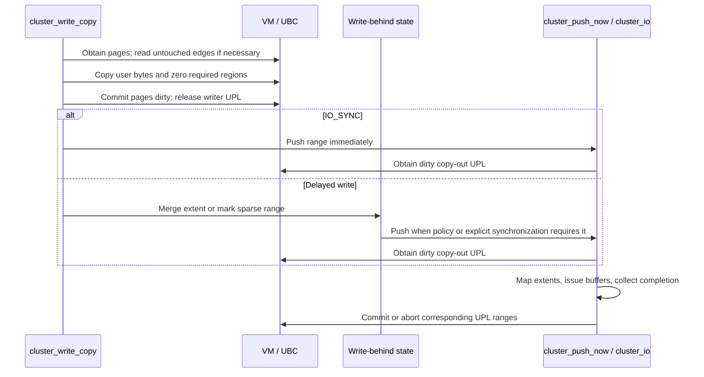

# Clustered writes, dirty tracking and I/O completion

[VFS guide](README.md) · [File I/O and cache overview](io-and-cache.md) · [VM pagers and UPLs](../vm/pagers-and-upl.md) · [Mount lifecycle](mount-lifecycle.md)

The clustered I/O layer turns file ranges and UPL-backed pages into filesystem strategy requests. For buffered writes it also decides when to write dirty data and how to group it. A successful copy into the file cache, a completed device buffer, a committed UPL and a completed filesystem synchronization are distinct events. Their order determines which caller may release memory and which error can still be reported.

This chapter follows `cluster_write_ext`, write-behind tracking, `cluster_push_now`, `cluster_io` and their completion/error paths. It supplements the existing cached-read and vnode-pager explanations. A filesystem must choose to use these helpers; `VNOP_WRITE` does not universally route every filesystem through them.

## State carried across the layers

| State | Purpose |
| --- | --- |
| `uio` | Caller buffers, current file offset and residual byte count. It advances as individual portions are consumed. |
| `ubc_info` and file VM object | Association between a vnode and cached file contents. |
| `upl_t` and `upl_page_info_t` | A selected range of VM pages and their per-page state, retained while an operation owns those pages. |
| `cl_extent`, `cl_wextent` | Half-open file-page intervals `[b_addr, e_addr)`; write extents also retain selected I/O flags. These are logical page indices, not device block numbers. |
| `cl_writebehind` | Per-vnode dirty-range scheduling state, serialized by `cl_lockw`. |
| `vfs_drt_clustermap` | Sparse dirty-region tracking when a small array of extents is insufficient. |
| `buf` | One strategy request: block address, length/residual, UPL offset, flags, completion callback and transaction links. |
| `clios` | Byte counts and first error for a stream of asynchronous requests. |

The write-behind structure makes the two range representations explicit:

[Source: ubc_internal.h, lines 91–100](../../../platydoc-data/xnu/bsd/sys/ubc_internal.h#L91-L100)

<!-- source-excerpt: ../../../platydoc-data/xnu/bsd/sys/ubc_internal.h#L91-L100 -->
```c
struct cl_writebehind {
	lck_mtx_t       cl_lockw;
	void    *       cl_scmap;                       /* pointer to sparse cluster map */
	off_t           cl_last_write;                  /* offset of the end of the last write */
	off_t           cl_seq_written;                 /* sequentially written bytes */
	int             cl_sparse_pushes;               /* number of pushes outside of the cl_lockw in progress */
	int             cl_sparse_wait;                 /* synchronous push is in progress */
	int             cl_number;                      /* number of packed write behind clusters currently valid */
	struct cl_wextent cl_clusters[MAX_CLUSTERS];    /* packed write behind clusters */
};
```

[`cluster_get_wbp`](../../../platydoc-data/xnu/bsd/vfs/vfs_cluster.c#L548) lazily allocates and publishes this state. Allocation and lock initialization happen before taking the vnode lock; concurrent installers are resolved under that lock and the unused candidate is destroyed. Callers requesting `CLW_RETURNLOCKED` receive the installed object's write-behind lock held.

The stream accounting object is much smaller:

[Source: vfs_cluster.c, lines 142–148](../../../platydoc-data/xnu/bsd/vfs/vfs_cluster.c#L142-L148)

<!-- source-excerpt: ../../../platydoc-data/xnu/bsd/vfs/vfs_cluster.c#L142-L148 -->
```c
struct clios {
	lck_mtx_t io_mtxp;
	u_int  io_completed;       /* amount of io that has currently completed */
	u_int  io_issued;          /* amount of io that was successfully issued */
	int    io_error;           /* error code of first error encountered */
	int    io_wanted;          /* someone is sleeping waiting for a change in state */
};
```

`io_issued` and `io_completed` count bytes, not requests. [`cluster_iostate_wait`](../../../platydoc-data/xnu/bsd/vfs/vfs_cluster.c#L632) waits while the difference exceeds a caller-supplied target, sets the wanted flag under the mutex and rechecks after waking.

## Selecting the write path

[`cluster_write_ext`](../../../platydoc-data/xnu/bsd/vfs/vfs_cluster.c#L2986) receives old/new EOF values, optional head/tail zero-fill boundaries, a `uio`, flags and an optional completion callback.

* A vnode with `VNOCACHE_DATA` adds the no-cache request.
* A null `uio` requests zero-filling through the copy path.
* Eligible no-cache userspace buffers are classified for direct or physically contiguous I/O; explicit no-direct flags and buffer constraints can force copying.
* Direct I/O combined with head/tail zero-fill goes through the copy path. The contiguous path has its own synchronized zero-fill handling.
* A direct-write `ENOTSUP` can fall back to copying. A no-cache request is not a guarantee that no file-cache operation occurs.
* Large copies are split into bounded chunks. Only the appropriate first/last chunk receives the head/tail zero-fill responsibility.

See [classification](../../../platydoc-data/xnu/bsd/vfs/vfs_cluster.c#L3010), [the path-selection loop](../../../platydoc-data/xnu/bsd/vfs/vfs_cluster.c#L3045), and [direct fallback and offset progression](../../../platydoc-data/xnu/bsd/vfs/vfs_cluster.c#L3115). After progress, `oldEOF` is advanced as required so a later vector's alignment handling cannot zero data successfully written by an earlier vector.

The `uio` residual is therefore essential to interpreting an error. A later failure does not undo bytes copied or issued earlier.

## Buffered copying preserves untouched data

[`cluster_write_copy`](../../../platydoc-data/xnu/bsd/vfs/vfs_cluster.c#L4163) divides work into page-rounded UPL ranges while tracking the exact user-data and zero-fill portions.

There is a fast resident-cache copy for eligible asynchronous writes without special zero-fill work. Otherwise the code obtains a UPL that can include previously absent pages. An unaligned write into existing file data may need to read the first or last page before copying so the untouched bytes survive. Those preliminary reads do not transfer final UPL completion ownership to the I/O helper. The writer still needs the pages for the subsequent copy.

The routine then performs requested head zeroing, copies user data and zeroes the requested tail. Extending EOF can require zeroing the remaining bytes in the last page; the source has a narrower APFS shrinking-file exception. A copy failure aborts the acquired range according to the UPL contract. See [first/last-page reads](../../../platydoc-data/xnu/bsd/vfs/vfs_cluster.c#L4360), [copy and zero handling](../../../platydoc-data/xnu/bsd/vfs/vfs_cluster.c#L4460), and [EOF-tail handling](../../../platydoc-data/xnu/bsd/vfs/vfs_cluster.c#L4515).

The writer releases its UPL **before** updating write-behind state:

[Source: vfs_cluster.c, lines 4547–4558](../../../platydoc-data/xnu/bsd/vfs/vfs_cluster.c#L4547-L4558)

<!-- source-excerpt: ../../../platydoc-data/xnu/bsd/vfs/vfs_cluster.c#L4547-L4558 -->
```c
			 * 4) we don't want to hold pages busy in a UPL and then block on the cluster lock... if a flush
			 *    of this vnode is in progress, we will deadlock if the pages being flushed intersect the pages
			 *    we hold since the flushing context is holding the cluster lock.
			 */
			ubc_upl_commit_range(upl, 0, (upl_size_t)upl_size,
			    UPL_COMMIT_SET_DIRTY | UPL_COMMIT_INACTIVATE | UPL_COMMIT_FREE_ON_EMPTY);
check_cluster:
			/*
			 * calculate the last logical block number
			 * that this delayed I/O encompassed
			 */
			cl.e_addr = (daddr64_t)((upl_f_offset + (off_t)upl_size) / PAGE_SIZE_64);
```

There are two reasons. First, taking `cl_lockw` while holding pages busy can deadlock against a flusher that already holds that lock and needs those pages. Sparse-map insertion can itself trigger a flush, creating the same dependency. Second, the UPL used to populate missing pages has dirty-bit completion semantics unsuitable for later writeback concurrent with `mmap` stores.

For `IO_SYNC`, the writer immediately calls `cluster_push_now`, which reacquires pages with the appropriate copy-out semantics and waits for the issued I/O. Otherwise it records the range through `cluster_update_state_internal`, taking account of `MNT_DEFWRITE`. See [the branch after UPL release](../../../platydoc-data/xnu/bsd/vfs/vfs_cluster.c#L4560).



## Packed extents and sparse dirty regions

[`cluster_update_state_internal`](../../../platydoc-data/xnu/bsd/vfs/vfs_cluster.c#L3899) keeps a bounded array of write extents when that representation works well.

It updates sequential-write tracking, tries to merge the new range into an existing extent without exceeding the maximum cluster size, and can consume only part of a range before continuing. An extent can cover gaps; it is a scheduling description, not proof that every included page is dirty. Actual writeback re-examines VM page state.

When there is no usable merge, the routine can push old extents according to sequential progress, device characteristics, saturation limits and deferred-write policy. If a slot becomes available, it records a new extent and its no-cache/passive flags. Otherwise it converts to sparse tracking. A no-cache write can force existing sparse work to be pushed before establishing new packed state. See [merge decisions](../../../platydoc-data/xnu/bsd/vfs/vfs_cluster.c#L3940) and [push/sparse fallback](../../../platydoc-data/xnu/bsd/vfs/vfs_cluster.c#L4050).

[`cluster_try_push`](../../../platydoc-data/xnu/bsd/vfs/vfs_cluster.c#L6732) sorts a local copy of the extents and clears the public count so new ranges can be developed where locking permits. Under `PUSH_DELAY`, a full array that does not resemble adjacent, full sequential clusters can be left unpushed to trigger sparse conversion; virtual devices have an exception. Successful ranges are removed. Failed or unselected ranges are merged back, switching to sparse tracking if the old and newly accumulated ranges no longer fit.

[`sparse_cluster_switch`](../../../platydoc-data/xnu/bsd/vfs/vfs_cluster.c#L7137) checks the file pages and records dirty ones. [`sparse_cluster_add`](../../../platydoc-data/xnu/bsd/vfs/vfs_cluster.c#L7247) marks a range; if the map cannot represent all of it, it pushes work and retries the remainder.

The sparse representation is a hash table of region addresses and per-page bitvectors:

[Source: vfs_cluster.c, lines 7754–7764](../../../platydoc-data/xnu/bsd/vfs/vfs_cluster.c#L7754-L7764)

<!-- source-excerpt: ../../../platydoc-data/xnu/bsd/vfs/vfs_cluster.c#L7754-L7764 -->
```c
struct vfs_drt_clustermap {
	u_int32_t               scm_magic;      /* sanity/detection */
#define DRT_SCM_MAGIC           0x12020003
	u_int32_t               scm_modulus;    /* current ring size */
	u_int32_t               scm_buckets;    /* number of occupied buckets */
	u_int32_t               scm_lastclean;  /* last entry we cleaned */
	u_int32_t               scm_iskips;     /* number of slot skips */

	struct vfs_drt_hashentry scm_hashtable[0];
};

```

[`vfs_drt_hashentry`](../../../platydoc-data/xnu/bsd/vfs/vfs_cluster.c#L7709) stores the control/address/count state and bits. Table sizes and memory thresholds depend on the target configuration. [`vfs_drt_do_mark_pages`](../../../platydoc-data/xnu/bsd/vfs/vfs_cluster.c#L8092) can return partial success and reports the number of newly marked pages. [`vfs_drt_get_cluster`](../../../platydoc-data/xnu/bsd/vfs/vfs_cluster.c#L8256) finds a contiguous run of set bits, removes that run from the tracking map and returns its byte range. Exhaustion frees the empty map and reports that no cluster was found.

Removal from this map means the range has been selected for processing; it does not clean the VM pages. [`sparse_cluster_push`](../../../platydoc-data/xnu/bsd/vfs/vfs_cluster.c#L7176) restores the tracking bits after a failed push when it still owns the same sparse map. The VM-initiated path drops `cl_lockw` for the push and reacquires it afterward; if the map pointer changed meanwhile, it breaks before that restoration branch rather than marking a replacement map. See [map revalidation and error handling](../../../platydoc-data/xnu/bsd/vfs/vfs_cluster.c#L7218-L7232).

## Picking up the right pages for writeback

[`cluster_push_now`](../../../platydoc-data/xnu/bsd/vfs/vfs_cluster.c#L6938) clips a selected range against the current EOF. A range entirely beyond a truncated EOF requires no I/O. VM-initiated requests take a vnode-pageout route; ordinary clustered writeback obtains a new UPL:

[Source: vfs_cluster.c, lines 7019–7034](../../../platydoc-data/xnu/bsd/vfs/vfs_cluster.c#L7019-L7034)

<!-- source-excerpt: ../../../platydoc-data/xnu/bsd/vfs/vfs_cluster.c#L7019-L7034 -->
```c
	if ((vp->v_flag & VNOCACHE_DATA) || (flags & IO_NOCACHE)) {
		upl_flags = UPL_COPYOUT_FROM | UPL_RET_ONLY_DIRTY | UPL_SET_LITE | UPL_WILL_BE_DUMPED;
	} else {
		upl_flags = UPL_COPYOUT_FROM | UPL_RET_ONLY_DIRTY | UPL_SET_LITE;
	}

	kret = ubc_create_upl_kernel(vp,
	    upl_f_offset,
	    upl_size,
	    &upl,
	    &pl,
	    upl_flags,
	    VM_KERN_MEMORY_FILE);
	if (kret != KERN_SUCCESS) {
		panic("cluster_push: failed to get pagelist");
	}
```

The intended dirty-state protocol is stated directly in the preceding source comment: gathering pages clears the hardware dirty state and preserves dirty responsibility in software; successful copy-out completion clears the software dirty state without erasing a new hardware modification made while I/O was in flight. An abort retains the dirty responsibility.

Even a dirty-only UPL can contain non-dirty precious pages. The routine releases such pages unchanged, groups consecutive dirty pages and issues each group through `cluster_io`. It first locates the last present page because committing or aborting the last owned range with `FREE_ON_EMPTY` can destroy the UPL. Continuing to inspect its page list after that would be invalid. See [UPL scanning and release](../../../platydoc-data/xnu/bsd/vfs/vfs_cluster.c#L7039) and [dirty-run submission](../../../platydoc-data/xnu/bsd/vfs/vfs_cluster.c#L7088).

## Mapping file ranges into buffer transactions

[`cluster_io`](../../../platydoc-data/xnu/bsd/vfs/vfs_cluster.c#L1511) has several independent responsibilities:

1. Limit request size and vector count using mount/device capabilities, page boundaries and throttling policy.
2. Translate internal flags into buffer flags. `CL_COMMIT` becomes `B_COMMIT_UPL`, transferring responsibility for the selected UPL ranges to completion/error handling.
3. Call `VNOP_BLOCKMAP` to translate a file offset into a device block and contiguous extent length. A zero-length extent cannot make progress and returns `EINVAL`.
4. Handle holes. A read can zero-fill a hole; a write can require nested vnode pageout to arrange backing. A hole reported while already on the pageout path is an error in the described branch.
5. Allocate and initialize strategy buffers, attach UPL offsets and callbacks, chain them into a transaction and account for issued bytes.
6. Mark a complete transaction with `B_EOT` and submit buffers through `VNOP_STRATEGY`.

See [flag translation](../../../platydoc-data/xnu/bsd/vfs/vfs_cluster.c#L1701), [block mapping and hole handling](../../../platydoc-data/xnu/bsd/vfs/vfs_cluster.c#L1845), and [buffer construction](../../../platydoc-data/xnu/bsd/vfs/vfs_cluster.c#L2210).

The transaction links are `b_trans_head` and `b_trans_next`. `B_EOT` distinguishes a chain that has been fully constructed from one whose already-issued buffers happened to finish early. `B_TDONE` records individual completion. This protocol allows the completion side to observe early device completions without treating an unfinished chain as a complete operation.

For writes, `vnode_startwrite` occurs before `VNOP_STRATEGY`. Completion later decrements that outstanding-write accounting. The strategy dispatch crosses into filesystem/device code; its return is not the universal completion signal. See [submission ordering](../../../platydoc-data/xnu/bsd/vfs/vfs_cluster.c#L2379).

## Completion has several layers

[`buf_biodone`](../../../platydoc-data/xnu/bsd/vfs/vfs_bio.c#L4343) records the device-buffer result and updates throttling/accounting. For non-raw writes it calls `vnode_writedone`. It then handles the completion contract:

[Source: vfs_bio.c, lines 4455–4479](../../../platydoc-data/xnu/bsd/vfs/vfs_bio.c#L4455-L4479)

<!-- source-excerpt: ../../../platydoc-data/xnu/bsd/vfs/vfs_bio.c#L4455-L4479 -->
```c
	if (ISSET(bp->b_flags, (B_CALL | B_FILTER))) {  /* if necessary, call out */
		void    (*iodone_func)(struct buf *, void *) = bp->b_iodone;
		void    *arg = bp->b_transaction;
		int     callout = ISSET(bp->b_flags, B_CALL);

		if (iodone_func == NULL) {
			panic("biodone: bp @ %p has NULL b_iodone!", bp);
		}

		CLR(bp->b_flags, (B_CALL | B_FILTER));  /* filters and callouts are one-shot */
		bp->b_iodone = NULL;
		bp->b_transaction = NULL;

		if (callout) {
			SET(bp->b_flags, B_DONE);       /* note that it's done */
		}
		(*iodone_func)(bp, arg);

		if (callout) {
			/*
			 * assumes that the callback function takes
			 * ownership of the bp and deals with releasing it if necessary
			 */
			goto biodone_done;
		}
```

A `B_CALL` callback takes buffer ownership. A filter callback does not; ordinary asynchronous buffers are released by the generic path, and synchronous owners are awakened after `B_DONE` is set. The callback flags are one-shot.

For clustered asynchronous I/O, [`cluster_iodone`](../../../platydoc-data/xnu/bsd/vfs/vfs_cluster.c#L1031) marks the buffer `B_TDONE` and checks the chain under `cl_transaction_mtxp`. It cannot finalize until every constituent buffer is done and the chain has an end marker. A special `CLUSTER_IO_WAITING` tail lets an error/unwind caller wait for an incomplete asynchronous chain without ordinary completion freeing it first. [`cluster_wait_IO`](../../../platydoc-data/xnu/bsd/vfs/vfs_cluster.c#L1407) installs and removes that sentinel under the same transaction lock.

Synchronous paths wait for the buffers and use [`cluster_complete_transaction`](../../../platydoc-data/xnu/bsd/vfs/vfs_cluster.c#L1467) to enter the common completion processing. Configured content verification can add another worker/callback stage before finalization.

[`cluster_iodone_finish`](../../../platydoc-data/xnu/bsd/vfs/vfs_cluster.c#L1109) aggregates the first buffer error, residual bytes, actual I/O bytes and UPL span. A nonzero residual without another error becomes `EIO`. It releases applicable associated-UPL ranges and invokes the optional `b_cliodone` filesystem callback only if no buffer/residual error has accumulated; that callback can itself return an error. It then performs zero-fill/verification work and records stream progress/error. Only then does it commit or abort the main UPL range:

[Source: vfs_cluster.c, lines 1229–1250](../../../platydoc-data/xnu/bsd/vfs/vfs_cluster.c#L1229-L1250)

<!-- source-excerpt: ../../../platydoc-data/xnu/bsd/vfs/vfs_cluster.c#L1229-L1250 -->
```c
	if (b_flags & B_COMMIT_UPL) {
		pg_offset   = upl_offset & PAGE_MASK;
		commit_size = (pg_offset + transaction_size + (PAGE_SIZE - 1)) & ~PAGE_MASK;

		if (error) {
			upl_set_iodone_error(upl, error);

			upl_flags = cluster_ioerror(upl, upl_offset - pg_offset, commit_size, error, b_flags, vp);
		} else {
			upl_flags = UPL_COMMIT_FREE_ON_EMPTY;

			if ((b_flags & B_PHYS) && (b_flags & B_READ)) {
				upl_flags |= UPL_COMMIT_SET_DIRTY;
			}

			if (b_flags & B_AGE) {
				upl_flags |= UPL_COMMIT_INACTIVATE;
			}

			ubc_upl_commit_range(upl, upl_offset - pg_offset, commit_size, upl_flags);
		}
	}
```

Finally it releases the transaction buffers and, if this operation was servicing an original `real_bp`, completes that buffer. The UPL span can differ from the sum of bytes actually transferred when a transaction contains holes.

The ordering is significant: `clios.io_completed` is updated before the later main-UPL commit and buffer frees. It is a stream-accounting completion condition, not a universal proof that every instruction in the completion routine has returned.

## Direct writes still synchronize with the file cache

Direct I/O uses the caller's pages, but cached mappings of the same file can still exist. The direct-write portion of [`cluster_io`](../../../platydoc-data/xnu/bsd/vfs/vfs_cluster.c#L1742) obtains an associated UPL covering the file range. Its purpose is to keep cached file pages busy while the direct operation overwrites storage, then discard stale cached contents.

Wired cache pages cannot simply be discarded. This case returns `ENOTSUP`, allowing the higher-level write path to fall back to copying. Partially overwritten dirty first/last pages must be synchronized before discarding them; the code releases the temporary UPL, performs that synchronization and retries acquisition.

[`cluster_handle_associated_upl`](../../../platydoc-data/xnu/bsd/vfs/vfs_cluster.c#L651) releases the associated file range as corresponding portions of the caller UPL complete. Different user-buffer and file-offset alignments mean adjacent transactions can share a cached page. The implementation coordinates their completion so the first completed transaction does not release the shared page prematurely.

[`cluster_write_direct`](../../../platydoc-data/xnu/bsd/vfs/vfs_cluster.c#L3155) waits for its asynchronous stream before destroying its local accounting lock or returning, selects the recorded stream error where appropriate, and can finish a remaining tail through the copy path. See [the final stream wait](../../../platydoc-data/xnu/bsd/vfs/vfs_cluster.c#L3579). “Direct” describes a data-transfer path, not absence of VM ownership or completion synchronization.

## Failure, synchronization and durability boundaries

If block mapping or setup fails after some buffers have been submitted, [`cluster_io`'s error path](../../../platydoc-data/xnu/bsd/vfs/vfs_cluster.c#L2420) waits for the outstanding partial transaction, releases associated ranges, frees its buffers, adjusts stream accounting and handles the remaining UPL ownership. It cannot merely free everything on the first error while a device still owns a request.

[`cluster_ioerror`](../../../platydoc-data/xnu/bsd/vfs/vfs_cluster.c#L989) chooses between committing caller-owned direct-I/O pages and aborting cached/page-in/page-out ranges. Cached-preservation and transient write errors generally leave pages available and dirty as appropriate; page-in failures can mark an error. These decisions depend on buffer flags and the error, including `ENXIO` and swap exceptions.

[`cluster_push_err`](../../../platydoc-data/xnu/bsd/vfs/vfs_cluster.c#L6545) serializes synchronous pushes using `cl_sparse_wait`. A synchronous caller first waits for existing detached sparse pushes. Sparse maps can be detached from `cl_writebehind` while pushed outside its lock, permitting new writes to build another map; `cl_sparse_pushes` bounds that concurrency. After issuing the requested work, `IO_SYNC` waits for outstanding vnode writes before releasing its serialization token.

The function's return is not simply an errno: it describes its push/slot result, while the optional `err` output reports the encountered error. Its error handling explicitly discusses a failed detached map coexisting with a new map. Some recovery paths discard only tracking storage while keeping dirty VM pages intact for a later explicit synchronization/close or shutdown attempt. See [sparse-push error handling](../../../platydoc-data/xnu/bsd/vfs/vfs_cluster.c#L6625).

Completion at this layer establishes the software I/O/UPL conditions described above. It does not by itself prove persistence across power loss: filesystem metadata ordering, filesystem synchronization semantics, device-cache flushes and storage hardware behavior lie beyond a successful generic buffer completion.

This chapter expands buffered writeback, sparse tracking, direct-write coherence and generic completion. It does not reconstruct APFS transactions, every read-ahead/throttling heuristic, every verification provider, vector-UPL internals or the physical device's implementation.

<!-- BEGIN PLATYDOC DOCUMENTATION LICENSE -->
Original Platydoc text and diagrams are licensed under [CC BY 4.0](https://creativecommons.org/licenses/by/4.0/). Quoted source code and third-party material retain their respective licenses.
<!-- END PLATYDOC DOCUMENTATION LICENSE -->
