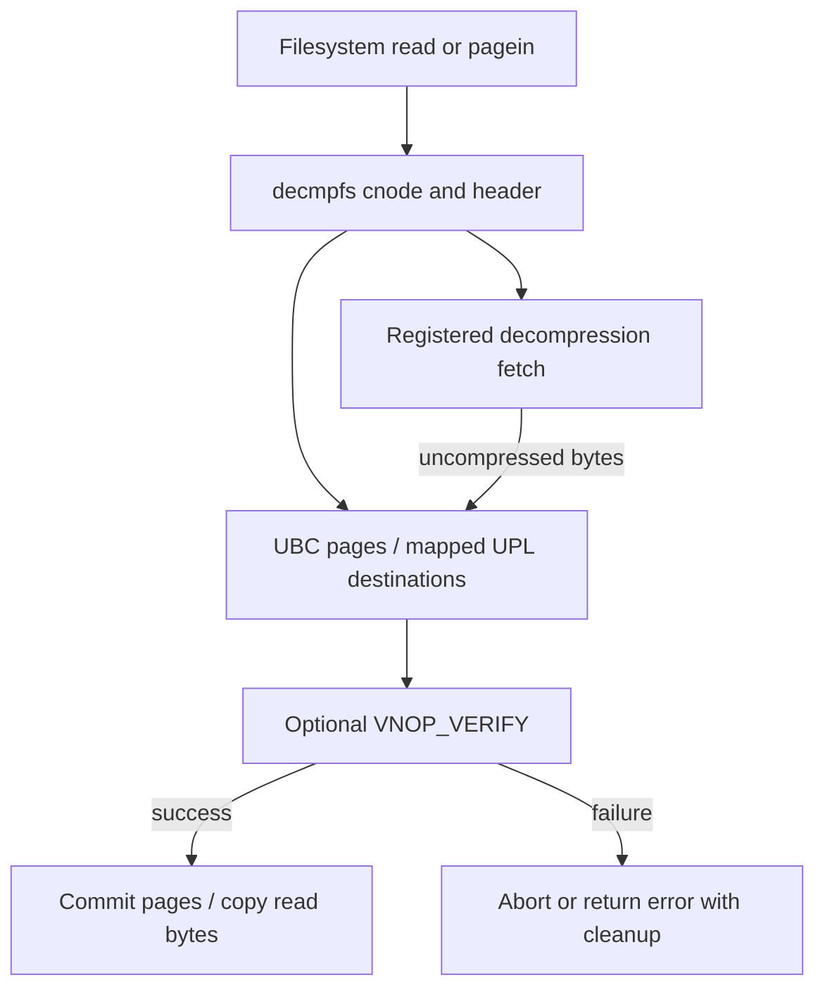

# Compressed file data, decmpfs state and UPL completion

[VFS](README.md) · [Extended attributes](metadata-and-extended-attributes.md) · [File-data cache](file-data-cache-and-read-path.md) · [UPLs](../vm/pagers-and-upl.md)

`decmpfs` lets a filesystem expose uncompressed bytes while storing data through a registered compression format. It is separate from the VM compressor for anonymous pages. The generic framework, UBC integration, state changes and a type-1 inline-data provider are in this tree; most compression providers and APFS vnode methods are external.

## The compressed cnode and its metadata

`decmpfs_cnode` holds cached compression state/type, logical uncompressed size, minimal-header knowledge, package/dataless metadata, decompression flags and a compressed-data rwlock with owner/count state. It is filesystem-associated state, distinct from `vnode` and from the UBC VM object. `FILE_TYPE_UNKNOWN`, `FILE_IS_COMPRESSED`, `FILE_IS_CONVERTING` and `FILE_IS_NOT_COMPRESSED` govern what later operations may assume. [State fields](../../../xnu/bsd/sys/decmpfs.h#L186-L200), [cached-state helpers](../../../xnu/bsd/kern/decmpfs.c#L649-L692).

`decmpfs_fetch_compressed_header` obtains `com.apple.decmpfs` through `vn_getxattr`, bounds attribute size, checks the actual returned length, converts little-endian fields and validates magic/type. If the cnode knows the attribute contains only a minimal header, it synthesizes the equivalent in-memory header from cached fields. Dataless types are deliberately valid without an ordinary decompressor table entry. [Header retrieval](../../../xnu/bsd/kern/decmpfs.c#L501-L646).

## Providers, locks and the fetch contract

Registration indexes a `decmpfs_registration` by compression type. Callbacks include fetch, validation and optional range adjustment/freeing. `decompressorsLock` protects access to the registered functions. `_decmp_get_func` can discover an IOKit provider that advertises a type and wait for its resource; it releases the shared lock while waiting so registration can acquire it, then reacquires and rechecks. Absence of a provider is a real `ENOTSUP` boundary, not an invitation to infer its algorithm. [Lookup/wait](../../../xnu/bsd/kern/decmpfs.c#L206-L259), [register/unregister](../../../xnu/bsd/kern/decmpfs.c#L1091-L1167).

`decmpfs_fetch_uncompressed_data` takes an uncompressed file offset/length and a vector of kernel destination buffers. It clips at logical EOF, initializes bytes-read to zero, calls the selected provider under the shared registry lock and applies configured cache-flush handling after successful fetch. The provider decides how compressed storage is read and decoded. [Fetch contract](../../../xnu/bsd/kern/decmpfs.c#L1171-L1248).



## Ordinary reads try resident data first

`decmpfs_read_compressed` takes the compressed-data lock, clips to cached size and first calls `cluster_copy_ubc_data`. A cache hit needs no decompressor. For remaining bytes it reads the header, asks an optional provider to widen the fetch region, queries verification alignment, rounds the region and creates bounded UPLs. The caller's byte range and the fetched/cache range therefore need not be identical. [Read setup](../../../xnu/bsd/kern/decmpfs.c#L1649-L1795).

The loop examines UPL page validity, fills missing regions through the provider, verifies as needed, copies the requested bytes to `uio`, and commits or aborts its UPL work during cleanup. Existing valid file pages must not be overwritten just because a larger compression/verification unit was requested. [Read loop and cleanup](../../../xnu/bsd/kern/decmpfs.c#L1796-L2040).

## Page-in keeps three offsets distinct

`decmpfs_pagein_compressed` receives a filesystem-created UPL. `a_f_offset` is the logical file position, `a_pl_offset` the offset within that UPL, and the mapped `data` pointer starts at the UPL's first page. The output vector begins at `data + pl_offset`, not `data + f_offset`. Page-in uses a try-lock and returns `EAGAIN` if compressed-data serialization is unavailable. Offset/size alignment, logical EOF, provider availability and verification block sizes are checked before filling. [Admission and mapping](../../../xnu/bsd/kern/decmpfs.c#L1279-L1418).

[bsd/kern/decmpfs.c, lines 1420–1425](../../../xnu/bsd/kern/decmpfs.c#L1420-L1425):
<!-- source-excerpt: ../../../xnu/bsd/kern/decmpfs.c#L1420-L1425 -->
```c

decompress:
	/* the mapped data pointer points to the first page of the page list, so we want to start filling in at an offset of pl_offset */
	vec = (decmpfs_vector) {
		.buf = (char*)data + pl_offset,
		.size = size,
```

For illustration with 16-KiB pages: a UPL may map file offset 64 KiB at its own offset 16 KiB. The decompressor reads logical byte 64 KiB into mapped UPL pointer plus 16 KiB. Confusing these address spaces would fill the wrong page.

When a verification unit exceeds the page size, the code scans valid/invalid runs and fetches only absent pages. It zero-fills the tail beyond logical EOF where needed and asks `VNOP_VERIFY` to validate the resulting verification range. A concurrent conversion can cause a retry or set `*is_compressed = 0` so the filesystem resumes its ordinary path. [Run scanning and conversion interaction](../../../xnu/bsd/kern/decmpfs.c#L1444-L1591).

After unmapping, successful ranges are committed with clear-dirty and written-by-kernel flags; pages beyond the EOF-containing range are aborted. Error cleanup unmaps any remaining mapping, frees the header and unlocks compressed state. The supplied UPL and caller flags must be followed through the actual path: the error exit does not unconditionally abort the supplied UPL, so the filesystem caller still has to honor the completion contract. [Commit helper](../../../xnu/bsd/kern/decmpfs.c#L1252-L1275), [page-in completion](../../../xnu/bsd/kern/decmpfs.c#L1592-L1646).

## Converting the whole file changes backing state

`decmpfs_decompress_file` takes exclusive compressed-data access unless already held, resolves unknown state and clips the requested conversion size. It allocates a buffer capped at 64 KiB, creates a write `uio`, resets UBC size and marks `FILE_IS_CONVERTING`. It repeatedly fetches uncompressed bytes and writes them to the ordinary data fork through `VNOP_WRITE`, verifies produced length and calls `VNOP_FSYNC`. The converting state also handles recursive page-in while those writes populate data. [Conversion](../../../xnu/bsd/kern/decmpfs.c#L2043-L2216).

Only after successful data work does it unset the compressed flag and free compressed backing. The implementation deliberately returns success even if that final cleanup reports failure, because the data fork was successfully populated. A failed conversion instead resets cached compression state to unknown, invalidates/restores UBC size and wakes threads waiting on conversion; truncating partially written data is conditional on `truncate_okay`. [Final-state policy](../../../xnu/bsd/kern/decmpfs.c#L2218-L2284).

[bsd/kern/decmpfs.c, lines 2223–2236](../../../xnu/bsd/kern/decmpfs.c#L2223-L2236):
<!-- source-excerpt: ../../../xnu/bsd/kern/decmpfs.c#L2223-L2236 -->
```c

	/* free the compressed data associated with this file */
	err = decmpfs_free_compressed_data(vp, cp);
	if (err != 0) {
		ErrorLogWithPath("decmpfs_free_compressed_data err %d\n", err);
	}

	/*
	 *  even if free_compressed_data or vnode_getattr/vnode_setattr failed, return success
	 *  since we succeeded in writing all of the file data to the data fork
	 */
	err = 0;

	/* if we got this far, the file was successfully decompressed */
```

This path is not a generic atomic filesystem transaction. It contains real partial writes and best-effort cleanup decisions. `FS_COMPRESSION` selects the implementation; absent external codecs, filesystem methods and verification providers remain explicit call boundaries. The local [type-1 callback](../../../xnu/bsd/kern/decmpfs.c#L2295) gives a concrete inline-data example without pretending the other codecs are supplied.

<!-- BEGIN PLATYDOC DOCUMENTATION LICENSE -->
Original Platydoc text and diagrams are licensed under [CC BY 4.0](https://creativecommons.org/licenses/by/4.0/). Quoted source code and third-party material retain their respective licenses.
<!-- END PLATYDOC DOCUMENTATION LICENSE -->
