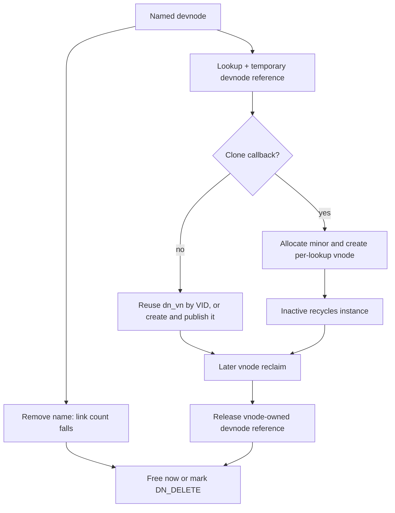

# Device nodes, specfs, and named FIFOs

[Filesystem guide](README.md) · [Namespace mutations](namespace-mutations.md) · [Driver runtime](../drivers/README.md) · [Socket ownership](../networking/socket-lifecycle-and-io.md)

A pathname such as a device entry names an object in a filesystem, but opening and reading it eventually invoke device operations. XNU separates these responsibilities: devfs maintains names and filesystem attributes; specfs handles character/block device vnode operations; the device switch selects the actual driver. Named FIFOs have filesystem names too, but their active byte stream is backed by local sockets. The operation vectors show these combinations directly. [`devfs_spec_vnodeop_entries`](../../../platydoc-data/xnu/bsd/miscfs/devfs/devfs_vnops.c#L1754), [`fifo_vnodeop_entries`](../../../platydoc-data/xnu/bsd/miscfs/fifofs/fifo_vnops.c#L84)

## 1. Devfs has a namespace before it has a vnode

The devfs objects are not interchangeable:

| Structure/state | Meaning |
|---|---|
| `devdirent` | A directory name: parent pointer, name, node pointer, directory-list linkage, and hard-link linkage. |
| `devnode` | Type, ownership/mode, timestamps, link count, device number or directory/symlink payload, clone callback, mount-plane and equivalent-node links. |
| `dn_vn` | The cached vnode representing a non-cloning node, when one exists. It may disappear while the devnode remains named. |
| `dn_refcount` | Keeps devnode memory alive across vnode ownership and temporary lock drops. A lookup of an existing vnode does not create another permanent vnode-to-devnode reference. |
| `devfsmount` | The VFS mount and the root of its devfs plane. |
| `DN_DELETE`, `DN_CREATE`, `DN_CREATEWAIT` | Deferred deletion and serialized vnode-creation state. |

[`devfsdefs.h` layouts](../../../platydoc-data/xnu/bsd/miscfs/devfs/devfsdefs.h#L104)

`devfs_make_node` validates character versus block type and forwards to `devfs_make_node_internal`. The latter formats the path, allocates event-log capacity, then takes `DEVFS_LOCK`. It finds or creates intermediate directories, adds the entry, installs UID/GID/mode and an optional clone callback, associates a MAC label when configured, and propagates the new entry to mounted planes. Notifications are collected under the lock and delivered after dropping it. The log allocation is rechecked against the current number of mount planes because that number can change while the lock is not held. [`devfs_make_node`](../../../platydoc-data/xnu/bsd/miscfs/devfs/devfs_tree.c#L1542), [`devfs_make_node_internal`](../../../platydoc-data/xnu/bsd/miscfs/devfs/devfs_tree.c#L1565)

Mounting devfs allocates a `devfsmount` and duplicates a plane under `DEVFS_LOCK`. It does not eagerly create a vnode for every entry. Root acquisition goes through the same `devfs_dntovn` conversion used by lookup. A non-root mount request has `MNT_IGNORE_OWNERSHIP` cleared so that this flag cannot bypass the relevant revoke permission checks. Unmount flushes vnodes, frees the plane under the devfs mutex, and frees mount-private state. [`devfs_mount`](../../../platydoc-data/xnu/bsd/miscfs/devfs/devfs_vfsops.c#L172), [`devfs_unmount`](../../../platydoc-data/xnu/bsd/miscfs/devfs/devfs_vfsops.c#L251), [`devfs_root`](../../../platydoc-data/xnu/bsd/miscfs/devfs/devfs_vfsops.c#L285)

## 2. Lookup converts a named devnode into a usable vnode

`devfs_lookup` checks the directory type, takes the devfs mutex, temporarily terminates the supplied component for `dev_findname`, restores the component buffer, and calls `devfs_dntovn` before releasing the mutex. Missing final components in create/rename lookup return `EJUSTRETURN`; ordinary missing lookups return `ENOENT`. The actual lock calls matter here: old comments referring broadly to a locked directory do not mean the global devfs mutex remains held on return. [`devfs_lookup`](../../../platydoc-data/xnu/bsd/miscfs/devfs/devfs_vnops.c#L334)

`devfs_dntovn` requires the devfs lock on entry and adds a temporary devnode reference. There are two acquisition protocols:

- **Existing non-clone vnode:** save its VID, hold its storage, drop the devfs mutex, call `vnode_getwithvid_drainok`, drop the hold, and reacquire the devfs mutex. Then check whether the devnode was deleted during the gap. A deleted node becomes `ENOENT`, and an acquired vnode iocount is put. Recycle races are retried up to `DEV_MAX_VNODE_RETRY`; a filesystem-unmount `ENODEV` becomes `ENOENT`.
- **No current vnode:** if another creator has `DN_CREATE`, set `DN_CREATEWAIT`, sleep with the mutex released, and retry. Otherwise set `DN_CREATE`, prepare vnode parameters, drop the mutex for `vnode_create_ext`, and publish the result after reacquiring it.

[`devfs_dntovn`](../../../platydoc-data/xnu/bsd/miscfs/devfs/devfs_tree.c#L1124)

The drain-aware acquisition is especially relevant for tty nodes, which can be reclaimed through revoke or controlling-process exit while the device namespace still contains the name. A failed acquisition can mean the next lookup should instantiate a replacement vnode, not that the device name permanently vanished. [`existing-vnode retry logic`](../../../platydoc-data/xnu/bsd/miscfs/devfs/devfs_tree.c#L1152)

[Serialize vnode creation while permitting mutex-dropping allocation](../../../platydoc-data/xnu/bsd/miscfs/devfs/devfs_tree.c#L1230)

<!-- source-excerpt: ../../../platydoc-data/xnu/bsd/miscfs/devfs/devfs_tree.c#L1230-L1236 -->
```c
	if (dnp->dn_lflags & DN_CREATE) {
		dnp->dn_lflags |= DN_CREATEWAIT;
		msleep(&dnp->dn_lflags, &devfs_mutex, PRIBIO, 0, 0);
		goto retry;
	}

	dnp->dn_lflags |= DN_CREATE;
```

Successful vnode creation adds a devnode reference that persists until `VNOP_RECLAIM`, distinct from the temporary reference taken at function entry. The function clears creation flags, wakes waiters, then releases its temporary reference. On failure that final release can free the devnode, so callers must not continue dereferencing it. The vnode is created with the devfs-selected operation vector and `VNFS_NOCACHE | VNFS_CANTCACHE`. [`vnode creation and publication`](../../../platydoc-data/xnu/bsd/miscfs/devfs/devfs_tree.c#L1254), [`final temporary-reference release`](../../../platydoc-data/xnu/bsd/miscfs/devfs/devfs_tree.c#L1349)

## 3. Clone devices deliberately do not cache one vnode

For a cloning node, `devfs_dntovn` calls `dn_clone(..., DEVFS_CLONE_ALLOC)` to obtain a minor number. It combines that minor with the original major and creates a vnode for the instance. A clone vnode is deliberately not stored in `dn_vn`: another lookup can create another instance. If vnode creation fails after minor allocation, the callback receives the free action. Once vnode creation succeeds, later release of device-specific state follows the device's normal close/lifetime contract. [`clone allocation and failed-create cleanup`](../../../platydoc-data/xnu/bsd/miscfs/devfs/devfs_tree.c#L1265)

The devfs inactive callback recycles clone vnodes because they are not attached as the reusable `dn_vn`. Reclaim clears the filesystem-private vnode pointer and releases the vnode's devnode reference. This is separate from removing the common directory entry that made cloning possible. [`devfs_inactive`](../../../platydoc-data/xnu/bsd/miscfs/devfs/devfs_vnops.c#L1651), [`devfs_reclaim`](../../../platydoc-data/xnu/bsd/miscfs/devfs/devfs_vnops.c#L1568)



Driver-side `devfs_remove` removes the registered node and its propagated names/plane siblings, collecting deletion and parent-change events. This is distinct from the filesystem's `devfs_vnop_remove`, which looks up the named entry under the mutex, checks protected names and directory restrictions, and removes that entry. It is also distinct from `devfs_mknod`, which supports character/block nodes, adds an entry, obtains its vnode, and installs supported ownership/mode attributes. [`devfs_remove_safe`](../../../platydoc-data/xnu/bsd/miscfs/devfs/devfs_tree.c#L800), [`devfs_vnop_remove`](../../../platydoc-data/xnu/bsd/miscfs/devfs/devfs_vnops.c#L897), [`devfs_mknod`](../../../platydoc-data/xnu/bsd/miscfs/devfs/devfs_vnops.c#L1372)

When link count reaches zero, `devfs_dn_free` frees the node only if the initial allocation reference is the only remaining reference. Otherwise it sets `DN_DELETE`. `devfs_rele_node` later detects the transition back to that last reference, drops it, and frees memory. Thus a removed name and an extant vnode can coexist without freeing the vnode's devnode underneath it. This code does not by itself demonstrate how every driver reacts to physical device removal; that behavior lies past the device-operation boundary. [`devfs_dn_free`](../../../platydoc-data/xnu/bsd/miscfs/devfs/devfs_tree.c#L678), [`devfs_rele_node`](../../../platydoc-data/xnu/bsd/miscfs/devfs/devfs_tree.c#L1375)

## 4. Specfs identity is the device number and type

A special vnode has `specinfo`: device number, alias-chain links, open count, block size, last-read block, cached device size, mount flags and I/O-throttling information. The hash matches both `dev_t` and vnode type, so corresponding character and block interfaces are not identical hash entries. [`specinfo`](../../../platydoc-data/xnu/bsd/miscfs/specfs/specdev.h#L77), [`checkalias`](../../../platydoc-data/xnu/bsd/vfs/vfs_subr.c#L2175)

`checkalias` holds an existing candidate under the special-device hash lock, drops that lock, then obtains an iocount by VID. Unused aliases can be reclaimed and the search restarted. New entries initialize their own `specinfo`; a race recheck occurs before insertion, and simultaneously active aliases are marked `SI_ALIASED`. A special `VT_NON` block-device vnode can be returned for adoption by vnode creation. The caller then replaces its temporary candidate and carefully changes the existing vnode's operation/private state. This is more precise than assuming one device number always means one vnode. [`checkalias`](../../../platydoc-data/xnu/bsd/vfs/vfs_subr.c#L2175), [`vnode_create` special-device adoption](../../../platydoc-data/xnu/bsd/vfs/vfs_subr.c#L7122)

The count used for device last-close decisions is also special. `vcount` returns `si_opencount` for an unaliased special vnode and sums open counts across matching aliases otherwise. It walks with holds and generation-checked acquisitions outside the hash mutex, restarting when an identity race invalidates the traversal. Ordinary vnode usecounts are not a substitute for this device-open accounting. [`vcount`](../../../platydoc-data/xnu/bsd/vfs/vfs_subr.c#L3524)

## 5. Open, data transfer, and last close reach the device switch

`spec_open` rejects `MNT_NODEV`, validates the major index, and applies its character/block-specific security and mounted-device checks. It calls `cdevsw[major].d_open` or `bdevsw[major].d_open` under `devsw_lock`, incrementing `si_opencount` only on success. Block-device setup queries block geometry and device size; failure to restore a temporarily changed block size triggers an explicit close and `ENXIO`. Character disk devices also collect selected throttle/SSD information. [`spec_open`](../../../platydoc-data/xnu/bsd/miscfs/specfs/spec_vnops.c#L352)

For character reads and writes, specfs calls the corresponding `cdevsw` routine with the device number, `uio`, and flags, with surrounding tracing/throttle accounting where applicable. Block-special I/O uses buffers: reads compute block and intra-buffer offsets, choose read-ahead versus ordinary `buf_bread`, copy with `uiomove`, and release the buffer. Writes use a full-block acquisition or read-modify-write path, then choose synchronous `buf_bwrite`, asynchronous `buf_bawrite`, or delayed `buf_bdwrite` according to flags and coverage. [`spec_read`](../../../platydoc-data/xnu/bsd/miscfs/specfs/spec_vnops.c#L523), [`spec_write`](../../../platydoc-data/xnu/bsd/miscfs/specfs/spec_vnops.c#L665)

A filesystem's block request eventually reaches `spec_strategy`, which derives device and buffer attributes, accounts I/O policy, and calls the block driver's `d_strategy`. Its special BootCache return-value handling changes throttling decisions; the function returning zero is not proof that the hardware transfer has completed. Completion belongs to the buffer/driver contract explained in [clustered I/O](clustered-writeback.md). [`spec_strategy`](../../../platydoc-data/xnu/bsd/miscfs/specfs/spec_vnops.c#L2569), [`d_strategy` dispatch](../../../platydoc-data/xnu/bsd/miscfs/specfs/spec_vnops.c#L2808)

Character close decrements its open count and calls the driver's close on aggregate last close or revoke; tty handling coordinates controlling-terminal state and revoke serialization. A block close with other opens remaining only adjusts accounting. The last-close path synchronizes and invalidates buffered blocks before decrementing the final open count and invoking the block driver's close. Errors in those flushing stages are returned. Devfs's close wrapper performs its timestamp work and delegates to specfs; it does not replace device close semantics. [`spec_close_internal`](../../../platydoc-data/xnu/bsd/miscfs/specfs/spec_vnops.c#L2845), [`devfsspec_close`](../../../platydoc-data/xnu/bsd/miscfs/devfs/devfs_vnops.c#L766)

## 6. Named FIFO activation creates a local stream transport

Generic vnode creation allocates a zeroed `fifoinfo` for `VFIFO`. It contains flags, read/write sockets, reader/writer counts and auxiliary count state. The filesystem still supplies the named object and namespace/attribute behavior; fifo vnode operations provide the active stream behavior. [`VFIFO` initialization](../../../platydoc-data/xnu/bsd/vfs/vfs_subr.c#L7181), [`fifoinfo`](../../../platydoc-data/xnu/bsd/miscfs/fifofs/fifo.h#L75)

The first `fifo_open` serializes creation under `vp->v_lock` using `FIFO_INCREATE` and `FIFO_CREATEWAIT`. It drops the vnode lock while creating two `AF_LOCAL`, `SOCK_STREAM` sockets and connecting the write side to the read side. It configures the writer as unable to receive, the reader as unable to send, and sets the writer's send low-water mark to `PIPE_BUF`. Only after both sockets exist does it reacquire the vnode lock, publish the socket pointers, set `FIFO_CREATED`, and wake creation waiters. Failures close any sockets already created and clear the in-progress state. [`fifo_open`](../../../platydoc-data/xnu/bsd/miscfs/fifofs/fifo_vnops.c#L152)

[Publish a newly created FIFO socket pair under the vnode lock](../../../platydoc-data/xnu/bsd/miscfs/fifofs/fifo_vnops.c#L213)

<!-- source-excerpt: ../../../platydoc-data/xnu/bsd/miscfs/fifofs/fifo_vnops.c#L213-L223 -->
```c
			vnode_lock(vp);
			fip->fi_readsock = rso;
			fip->fi_writesock = wso;

			fip->fi_flags |= FIFO_CREATED;
			fip->fi_flags &= ~FIFO_INCREATE;

			if ((fip->fi_flags & FIFO_CREATEWAIT)) {
				fip->fi_flags &= ~FIFO_CREATEWAIT;
				wakeup(&fip->fi_flags);
			}
```

Reader and writer counters describe open directions, not socket object references. The first reader re-enables sends on the writer socket; the first writer re-enables receives on the reader socket. Blocking opens sleep for a peer; a nonblocking write open with no readers fails with `ENXIO`. An interrupted/open-failure path calls `fifo_close_internal` to undo direction counts already installed. An open with neither read nor write flag is treated as a read open by this code. [`FIFO peer synchronization`](../../../platydoc-data/xnu/bsd/miscfs/fifofs/fifo_vnops.c#L225)

Reads call `soreceive` and writes call `sosend`, mapping non-delay I/O to `MSG_NBIO`. The no-writers read path checks for an empty receive buffer and returns EOF without blocking; the code clears the socket EOF indication after a read that transferred no bytes so a later writer can make the named FIFO usable again. Writes post vnode events on success and on the specific partial-progress/`EWOULDBLOCK` case. The socket layer supplies byte queues and backpressure; disk block mapping and UPL page-in are not involved in this transport. [`fifo_read`](../../../platydoc-data/xnu/bsd/miscfs/fifofs/fifo_vnops.c#L315), [`fifo_write`](../../../platydoc-data/xnu/bsd/miscfs/fifofs/fifo_vnops.c#L374)

## 7. FIFO close ends an active instance, not the name

`fifo_close_internal` updates counts under the vnode lock. Losing the last reader marks the write socket unable to send; losing the last writer marks the read socket unable to receive. If either count remains nonzero, it leaves the socket pair active. When both reach zero, it removes the pointers from `fifoinfo`, clears `FIFO_CREATED`, and closes both sockets. The ordinary entry acquires/releases the vnode lock itself; the `locked` variant used for open rollback preserves the caller's lock ownership, including across the close calls. [`fifo_close_internal`](../../../platydoc-data/xnu/bsd/miscfs/fifofs/fifo_vnops.c#L480)

A later open can therefore build a new pair for the same named FIFO vnode. The vnode's `fifoinfo` allocation has a longer lifetime than one active socket pair and is freed in vnode teardown. Removing the filesystem name, closing the last stream endpoint, and reclaiming the vnode remain three separate events. [`FIFO allocation and teardown`](../../../platydoc-data/xnu/bsd/vfs/vfs_subr.c#L6911)

Sources inspected and limits:

| Source | Inspection |
|---|---|
| `devfs_tree.c`, `devfsdefs.h` | Deep registration, conversion/creation races, clone handling, removal, reference release; propagation helpers surveyed. |
| `devfs_vnops.c`, `devfs_vfsops.c` | Deep lookup, mknod/remove, inactive/reclaim, mount/unmount and operation vectors; selected timestamp wrappers. |
| `spec_vnops.c`, `specdev.h`, `vfs_subr.c` | Deep open/read/write/close, alias and aggregate-open accounting; strategy dispatch and policy setup inspected. Full throttle algorithm and every ioctl/filter/revoke branch not audited. |
| `fifo_vnops.c`, `fifo.h` | Deep socket-pair creation, open rendezvous, read/write, close and vnode allocation/free. Event-filter and ioctl details surveyed only. |
| Driver implementation | Actual device removal, DMA and hardware completion vary by driver and are not established by the device-switch interface alone. |

<!-- BEGIN PLATYDOC DOCUMENTATION LICENSE -->
Original Platydoc text and diagrams are licensed under [CC BY 4.0](https://creativecommons.org/licenses/by/4.0/). Quoted source code and third-party material retain their respective licenses.
<!-- END PLATYDOC DOCUMENTATION LICENSE -->
