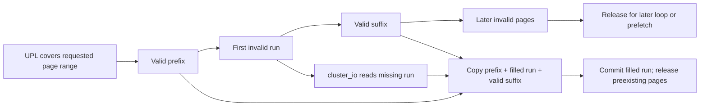

# File-data caching, read decisions, and UBC lifetime

[VFS](README.md) · [I/O overview](io-and-cache.md) · [Clustered writeback](clustered-writeback.md) · [Buffer cache](buffer-cache-and-block-io.md) · [VM pager and UPL mechanisms](../vm/pagers-and-upl.md)

For a regular file using XNU's unified buffer cache, the cached bytes live in pages of a file-backed VM object. A `read` can copy those pages without issuing storage I/O; a mapping can fault on the same backing object; a clustered write can modify its pages and defer writeback. The vnode's `ubc_info` connects this object to filesystem identity, size and cluster state. A traditional `buf` may describe a transfer involving those pages, but it is not a second mandatory storage location through which every cached read passes. [`ubc_info`](../../../platydoc-data/xnu/bsd/sys/ubc_internal.h#L171), [`cluster_copy_ubc_data_internal`](../../../platydoc-data/xnu/bsd/vfs/vfs_cluster.c#L7479), [`cluster_write_copy`](../../../platydoc-data/xnu/bsd/vfs/vfs_cluster.c#L4163)

This chapter follows ordinary cached reads in depth and then explains the lifetime, resizing and coherence rules that make them meaningful. [Clustered writeback](clustered-writeback.md) already traces dirty-range scheduling and device completion; [VM pagers and UPLs](../vm/pagers-and-upl.md) follows demand faults and the VM-side page ownership. APFS and most production filesystem implementations are outside this source tree. The included `mockfs_read` is a concrete caller of `cluster_read`, not evidence that every `VNOP_READ` follows this route. [`mockfs_read`](../../../platydoc-data/xnu/bsd/miscfs/mockfs/mockfs_vnops.c#L208)

The signature paths are developed separately: [vnode signature attachment and lifetime](../security/vnode-signature-lifecycle.md), [page-byte validation and invalidation](../security/page-signature-validation.md), and [executable mapping policy](../security/executable-signature-policy.md). A valid cache page, a matching signature hash and permission to execute are separate decisions.

The [UBC and vnode-pager structure companion](../../structures/ubc-and-vnode-pagers.md) follows the allocation, field access, named-object ownership and staged destruction behind these data paths. [Signature storage](../../structures/code-signature-blob-storage.md) separates its RO wrappers from retained byte buffers and provider objects.

## 1. Keep file identity, VM contents and transfers separate

| Representation | Important state | Lifetime or interpretation |
|---|---|---|
| `vnode` | `v_ubcinfo`, identity/type/mount, I/O/use counts, `VNAMED_UBC` | Filesystem identity and admission to operations; name lookup is a separate cache. |
| `ubc_info` | `ui_vnode`, `ui_pager`, `ui_control`, `ui_size`, `ui_flags` | The file-to-VM association and cached size. Also owns credentials, read-ahead/write-behind structures and signature attachments. |
| `vnode_pager` | `vn_pgr_hdr`, pager reference count, `vnode_handle` | Implements the VM memory-object operations for a vnode. Its final deallocation tears down the UBC association. |
| VM object/pages | Object offset, resident-page lookup, busy/absent/dirty state, copy relationship | Own the cached file bytes and coordinate page-level access, mapping and I/O. |
| UPL | Selected range plus participating-page metadata and completion state | Temporarily holds the pages needed by one operation. “Page present in UPL” and “valid file bytes” are different predicates. |
| `uio` | File offset, caller vectors, residual | Records bytes already transferred. A later error does not undo earlier progress. |
| Cluster state | `cl_readahead`, `cl_writebehind`, `clios` | Prediction, dirty scheduling and in-flight byte/error accounting, respectively. |

See [`ubc_info`](../../../platydoc-data/xnu/bsd/sys/ubc_internal.h#L171-L207), [`vnode_object_create`](../../../platydoc-data/xnu/osfmk/vm/bsd_vm.c#L926), [`resident copy`](../../../platydoc-data/xnu/osfmk/vm/bsd_vm.c#L161), and [`cluster state`](../../../platydoc-data/xnu/bsd/sys/ubc_internal.h#L83-L100). The [name-cache/reclaim guide](name-cache-and-vnode-reclaim.md) covers pathname lookup and vnode reuse. Evicting cached file data need not evict the pathname or reclaim the vnode.

`ubc_info_init_internal` installs or reuses `v_ubcinfo`, creates a vnode pager, and calls `memory_object_create_named`. That creates the named object association while taking its own pager reference; UBC then drops the setup reference, stores the control and sets `UI_HASOBJREF`. It obtains the real file size only after establishing the association, because a filesystem size operation can reenter invalidation. The named association is recorded by `VNAMED_UBC`. [`initialization`](../../../platydoc-data/xnu/bsd/kern/ubc_subr.c#L1096-L1180)

The pager's `init` stores the control and requests delayed-copy/cacheable backing. It also supplies a one-page `cluster_size` and `temporary = TRUE`, but this snapshot's `MEMORY_OBJECT_ATTRIBUTE_INFO` handler consumes only `copy_strategy` and `may_cache_object`. The control-reference helper called during initialization is a no-op; lifetime comes from the surrounding object/pager protocol. Fault clustering is selected separately by `vnode_pager_data_request`. [`vnode_pager_init`](../../../platydoc-data/xnu/osfmk/vm/bsd_vm.c#L400-L439), [attribute handler](../../../platydoc-data/xnu/osfmk/vm/memory_object.c#L1191-L1205), [control helpers](../../../platydoc-data/xnu/osfmk/vm/memory_object.c#L1882-L1898), [fault clustering](../../../platydoc-data/xnu/osfmk/vm/bsd_vm.c#L647-L675)

## 2. The first decision is which read mechanism applies

`cluster_read_ext` merges vnode policy into the request: `VNOCACHE_DATA` adds `IO_NOCACHE`, and `VRAOFF` or globally disabled speculative reads adds `IO_RAOFF`. The normal path is `IO_COPY`. No-cache user buffers, explicitly permitted no-cache kernel buffers, and encrypted-data requests can be classified for direct or physically contiguous I/O. That classification examines the target mapping through the UPL query interface. Small-map-page configurations can force an otherwise direct request back to copying. [`dispatch`](../../../platydoc-data/xnu/bsd/vfs/vfs_cluster.c#L4601-L4691), [`cluster_io_type`](../../../platydoc-data/xnu/bsd/vfs/vfs_cluster.c#L6250)

These distinctions prevent two common errors:

- `IO_NOCACHE` is not a universal guarantee that no UBC page is touched. The direct path first consumes resident file pages when it is not reading raw encrypted data, and alignment/tail cases can use the copy path.
- `IO_RAOFF` disables speculative read-ahead policy, not the required demand read or every form of pipelining within a large requested range.

The controlling branches are in [`cluster_read_copy`](../../../platydoc-data/xnu/bsd/vfs/vfs_cluster.c#L4713-L4808) and [`cluster_read_direct`](../../../platydoc-data/xnu/bsd/vfs/vfs_cluster.c#L5588-L5650). Encrypted-byte requests deliberately avoid normal UBC contents; the copy path panics if asked to cache such blocks. Content-protection transforms and filesystem verification remain separate provider contracts.

The outer loop handles bounded request chunks while the `uio` has residual bytes and its offset is below the supplied file size. That `filesize` argument bounds this invocation. It is not a lock on the inode or an independent protocol for racing truncates: the filesystem must supply its own operation serialization and keep UBC's size consistent. [`cluster_read_ext` loop](../../../platydoc-data/xnu/bsd/vfs/vfs_cluster.c#L4658), [`ubc_setsize_ex`](../../../platydoc-data/xnu/bsd/kern/ubc_subr.c#L1250)

## 3. A resident hit still has an ownership protocol

`cluster_copy_ubc_data_internal` obtains the UBC control, temporarily changes the `uio` segment type to the corresponding physical-copy form, and calls `memory_object_control_uiomove`. It computes progress from the change in residual and restores the original segment type. A zero return does not alone mean all requested bytes were copied: an unchanged/nonzero residual can mean a cache miss that the caller must service. [`copy wrapper`](../../../platydoc-data/xnu/bsd/vfs/vfs_cluster.c#L7479-L7548)

The VM helper locks the external object and looks up pages by object offset. Missing pages end the optimized run. Error/restart pages produce `EIO`; busy or cleaning pages require care. With no pages already collected, it sleeps and retries. With a partial run already marked busy, it processes that run instead of waiting on another busy page while holding several pages unavailable. This is a page-level deadlock-avoidance rule, not merely a copy optimization. [`memory_object_control_uiomove`](../../../platydoc-data/xnu/osfmk/vm/bsd_vm.c#L161-L247)

[A busy page ends a partial batch or causes a wait before collecting one](../../../platydoc-data/xnu/osfmk/vm/bsd_vm.c#L231-L244)

<!-- source-excerpt: ../../../platydoc-data/xnu/osfmk/vm/bsd_vm.c#L231-L244 -->
```c
			if (dst_page->vmp_busy || dst_page->vmp_cleaning) {
				/*
				 * someone else is playing with the page... if we've
				 * already collected pages into this run, go ahead
				 * and process now, we can't block on this
				 * page while holding other pages in the BUSY state
				 * otherwise we will wait
				 */
				if (cur_run) {
					break;
				}
				vm_page_sleep(object, dst_page, THREAD_UNINT, LCK_SLEEP_EXCLUSIVE);
				continue;
			}
```

For each selected page it sets `vmp_busy`, then drops the object lock before `uiomove64` accesses the physical bytes and caller memory. It relocks afterward, updates page LRU/clustered state as policy permits, and calls `vm_page_wakeup_done` for every page collected, including cleanup after a copy error. No object lock is held across a potentially faulting user copy. Busy ownership keeps the chosen pages stable during that interval. [`busy batch and physical copy`](../../../platydoc-data/xnu/osfmk/vm/bsd_vm.c#L285-L359)

The helper also supports writes, which exposes the coherence constraints shared by the read cache. A write abandons this fast path if the object has a copy object: the ordinary path must honor COW first. It rechecks that condition while building later runs, since the object lock was dropped between batches. Selected writes dirty the page and, when appropriate, reset code-signing validation and disconnect mappings; SPTM adds a retype-related disconnect for executable pages. A fast resident copy is therefore not permission to overwrite a shared executable or COW page without VM coordination. [`COW fallback`](../../../platydoc-data/xnu/osfmk/vm/bsd_vm.c#L188-L219), [`dirty/signature handling`](../../../platydoc-data/xnu/osfmk/vm/bsd_vm.c#L250-L288)

For a normal read, the cluster layer repeatedly uses this helper while resident data remains available. Once it has started fetching a large request, it limits copy chunks so it can notice that the I/O pipeline is running low and launch another prefetch while copying prior data. This is different from blindly submitting disk I/O for the whole syscall first. [`resident streaming loop`](../../../platydoc-data/xnu/bsd/vfs/vfs_cluster.c#L4822-L4938)

## 4. A miss gathers a mixed range rather than discarding resident pages

After a resident-prefix miss, `cluster_read_copy` recomputes the remaining size from the advanced `uio`, aligns the UPL base down to a page, rounds the extent up and caps its size. It obtains a lite UPL using `UPL_FILE_IO | UPL_SET_LITE`. `ubc_create_upl_kernel` adds the internal/no-sync/clean-in-place semantics for this ordinary request and calls `memory_object_upl_request`. The helper checks a 4 KiB multiple and maximum size; the cluster caller itself uses the kernel's actual `PAGE_SIZE` alignment. [`miss preparation`](../../../platydoc-data/xnu/bsd/vfs/vfs_cluster.c#L4939-L5013), [`flag normalization`](../../../platydoc-data/xnu/bsd/kern/ubc_subr.c#L2577-L2658)

The scan finds the first invalid page and then the first following valid page. Only that contiguous missing run is submitted. Valid leading/trailing pages can still contribute to this round's copy, while a later missing run is released for another round or prefetch. A single UPL can thus describe a mixture of cache hits and pages needing I/O. [`run selection`](../../../platydoc-data/xnu/bsd/vfs/vfs_cluster.c#L5014-L5047)



Filesystem verification can affect which ranges may remain held while prefetch proceeds. `VNOP_VERIFY` is first queried for verification support; when that branch applies, leftover missing pages are released before the read is issued. This call does not itself verify the requested file bytes. The actual completion machinery invokes the filesystem's verification protocol and can turn completion into an error. This is also distinct from executable-page signature validation at VM fault time. [`verification-aware range release`](../../../platydoc-data/xnu/bsd/vfs/vfs_cluster.c#L5041-L5064), [`completion verification`](../../../platydoc-data/xnu/bsd/vfs/vfs_cluster.c#L1185-L1208)

The demand read is submitted asynchronously to allow overlap, but **without `CL_COMMIT`**. `cluster_read_copy` retains responsibility for its UPL because it must still copy those pages into the caller. It waits for the per-stream `clios` before that copy, incorporates `io_error`, and waits again on final exit before destroying the stream mutex. A setup error after some transfers were issued cannot free stack-backed completion state early. [`submission`](../../../platydoc-data/xnu/bsd/vfs/vfs_cluster.c#L5071-L5072), [`wait and copy`](../../../platydoc-data/xnu/bsd/vfs/vfs_cluster.c#L5171-L5190), [`final drain`](../../../platydoc-data/xnu/bsd/vfs/vfs_cluster.c#L5283-L5294)

Completion divides the UPL range into three cases:

| Range/outcome | Action in the cached-read owner |
|---|---|
| Newly read pages, I/O success | Commit clear-dirty; inactivate for ordinary referenced reads, or speculate when policy avoids a reference. |
| Newly read pages, I/O failure or no-cache request | Abort with dump-pages and free-on-empty. |
| Pages already valid when gathered | Release without changing their data validity; optional reference hint. |
| Later missing pages not read this round | Release so another acquisition/prefetch can fill them. |

[`range completion`](../../../platydoc-data/xnu/bsd/vfs/vfs_cluster.c#L5197-L5268), [`cluster_read_upl_release`](../../../platydoc-data/xnu/bsd/vfs/vfs_cluster.c#L4695)

The code distinguishes I/O error from the user-copy result. If the device read succeeded but copying to user memory failed, the newly filled file pages can still be committed as valid cache contents; the function returns the copy error. Conversely, bytes transferred in earlier rounds remain reflected in the `uio` after a later error. A cache population, a user-visible read and a UPL release are three separate outcomes.

## 5. Read-ahead is predictive and disposable

`cl_readahead` tracks the last requested file page, the last prefetched page and the previous prefetch length. `cluster_get_rap` allocates a candidate outside the vnode lock, publishes the winner under that lock, and disposes of a losing candidate. It then only **tries** the read-ahead mutex. Contention returns null, so the caller proceeds without that predictor rather than serializing all reads behind its lock. [`cl_readahead`](../../../platydoc-data/xnu/bsd/sys/ubc_internal.h#L83-L89), [`cluster_get_rap`](../../../platydoc-data/xnu/bsd/vfs/vfs_cluster.c#L503-L532)

[Prediction-state contention is allowed to disable read-ahead](../../../platydoc-data/xnu/bsd/vfs/vfs_cluster.c#L526-L530)

<!-- source-excerpt: ../../../platydoc-data/xnu/bsd/vfs/vfs_cluster.c#L526-L530 -->
```c
	if (lck_mtx_try_lock(&rap->cl_lockr) == TRUE) {
		return rap;
	}

	return (struct cl_readahead *)NULL;
```

`cluster_read_ahead` recognizes continuing/adjacent page ranges. A discontinuity resets its history; repeated access within one page does not grow the window. It checks whether enough previous read-ahead remains and whether the next page is already resident. For a qualifying stream it doubles the prior window up to the mount/policy maximum, also considering the current request size, then records the requested prefetch frontier. [`cluster_read_ahead`](../../../platydoc-data/xnu/bsd/vfs/vfs_cluster.c#L2571-L2647)

Prefetch within the current syscall and speculative reading beyond its end use related helpers but have different purposes. `cluster_read_prefetch` clips to EOF, calls `advisory_read_ext`, and returns the number of pages in the proposed range. It does not propagate that helper's return value as a demand-read failure. The predictor's frontier is therefore a scheduling estimate, not proof that every page has arrived; a later unexpected miss resets the read-ahead pipeline. [`prefetch helper`](../../../platydoc-data/xnu/bsd/vfs/vfs_cluster.c#L2543-L2566), [`pipeline reset`](../../../platydoc-data/xnu/bsd/vfs/vfs_cluster.c#L5070-L5084)

`advisory_read_ext` skips a resident prefix with `UPL_ROP_PRESENT`, then gathers only absent pages. Here a **present UPL slot** means a page selected to be filled; it does not mean the file data was already valid. It trims the iteration to the last participating slot so it will not access UPL metadata after asynchronous completion frees the last participating range. Runs are submitted with `CL_ASYNC | CL_READ | CL_COMMIT | CL_AGE`: unlike the demand-copy owner, this caller delegates UPL completion to cluster I/O. [`advisory read`](../../../platydoc-data/xnu/bsd/vfs/vfs_cluster.c#L6335-L6523)

[Advisory I/O transfers UPL completion responsibility to cluster I/O](../../../platydoc-data/xnu/bsd/vfs/vfs_cluster.c#L6502-L6503)

<!-- source-excerpt: ../../../platydoc-data/xnu/bsd/vfs/vfs_cluster.c#L6502-L6503 -->
```c
				retval = cluster_io(vp, upl, upl_offset, upl_f_offset + upl_offset, io_size,
				    CL_ASYNC | CL_READ | CL_COMMIT | CL_AGE | bflag, (buf_t)NULL, (struct clios *)NULL, callback, callback_arg);
```

Throttling can reduce request sizes and disable prefetch/read-ahead. `IO_RETURN_ON_THROTTLE` can return `EAGAIN` after checking whether the requested I/O is in the boot cache, allowing the filesystem caller to drop its locks before throttling. Lower I/O tiers and no-cache reads also avoid ordinary reference promotion. These policies influence retention and progress; they do not change which filesystem supplies the block mapping. [`policy selection`](../../../platydoc-data/xnu/bsd/vfs/vfs_cluster.c#L4751-L4800), [`throttle return`](../../../platydoc-data/xnu/bsd/vfs/vfs_cluster.c#L4940-L4961)

## 6. Direct reads still need a coherence boundary

When direct reads are eligible, the non-encrypted path first tries to copy already resident UBC pages. It then checks absent ranges before issuing storage I/O into the caller's pages. A per-vnode hashed read/write lock can protect the interval from that absence check to I/O submission; cooperating clients take it exclusively. The source explicitly says not all clients participate, and the reader releases it before waiting for storage completion. It is not a universal file lock covering the entire direct read. [`resident-first direct path`](../../../platydoc-data/xnu/bsd/vfs/vfs_cluster.c#L5588-L5625), [`absence lock`](../../../platydoc-data/xnu/bsd/vfs/vfs_cluster.c#L5690-L5730), [`unlock/drain`](../../../platydoc-data/xnu/bsd/vfs/vfs_cluster.c#L5890-L5949)

The destination UPL comes from `vm_map_create_upl`, with I/O wiring and internal/lite flags, rather than from the vnode's file object. The I/O owns caller pages for transfer, while the file range is mapped through filesystem operations. Alignment, verification-block size and tail handling can require cached copying. The direct path drains all outstanding reads before return and before destroying `clios`; the remaining ordinary tail can then use `cluster_read_copy`. Raw-encrypted requests reject a fallback that would contaminate UBC. [`destination UPL`](../../../platydoc-data/xnu/bsd/vfs/vfs_cluster.c#L5755-L5790), [`completion and tail`](../../../platydoc-data/xnu/bsd/vfs/vfs_cluster.c#L5920-L6005)

For direct writes, the inverse coherence problem is documented in [clustered writeback](clustered-writeback.md): dirty resident data, overwrite invalidation and caller-page completion must be coordinated. “Direct” describes the selected data-transfer route; it does not waive cache or mapping obligations.

## 7. Mappings keep the vnode alive, but private copies can diverge

`vnode_pager_map` and `vnode_pager_last_unmap` call `ubc_map`/`ubc_unmap`. `ubc_map` obtains a pager-specific I/O count, serializes mapping notification with `UI_MAPBUSY` under the vnode lock, calls `VNOP_MMAP` without holding that lock, records current/historical mapping flags, and obtains one forced vnode use reference on the first mapped transition. This keeps `open` → `mmap` → `close` from losing the backing vnode merely because the descriptor closed. [`pager notifications`](../../../platydoc-data/xnu/osfmk/vm/bsd_vm.c#L731-L766), [`ubc_map`](../../../platydoc-data/xnu/bsd/kern/ubc_subr.c#L1970-L2090)

The body deliberately discards `VNOP_MMAP`'s error, including the formerly propagated `EPERM`. Its older interface comment does not describe current rejection behavior. Mapping authorization and later executable-page policy must be traced at their actual enforcement points; this callback cannot be treated as a reliable rejection gate. [`error normalization`](../../../platydoc-data/xnu/bsd/kern/ubc_subr.c#L2016-L2029)

`ubc_unmap` serializes with the same busy flag and invokes `VNOP_MNOMAP` before clearing mapped flags, allowing that callback to query whether the vnode was mapped writable. It drops the mapping use reference after that notification, then clears the mapped/busy flags under the vnode lock before dropping the pager I/O count. Writable-mapping notification can conservatively generate a content-modified event even without proof that the mapping wrote bytes. [`ubc_unmap`](../../../platydoc-data/xnu/bsd/kern/ubc_subr.c#L2239-L2363)

A shared file mapping and ordinary cached I/O use common backing pages, while a private mapping can acquire COW pages above that backing. Therefore a private modified page need not reflect later file-cache writes. Conversely, modifying file backing must preserve existing copy obligations; that is why the resident-write shortcut checks `vo_copy`. The trusted-object decision in `ubc_map` also distinguishes root/reliable media from backing that might change outside ordinary COW observation. It supports additional VM protection behavior; it is not a statement that all externally changed files are automatically coherent. [`trusted backing decision`](../../../platydoc-data/xnu/bsd/kern/ubc_subr.c#L2055-L2087), [VM objects and copy relationships](../vm/objects-and-pages.md)

## 8. Size changes and invalidation operate on page ranges

`ubc_setsize_ex` rejects negative sizes and missing UBC state. With `UBC_SETSIZE_NO_FS_REENTRY`, a shrink returns `EAGAIN` before changing size. Otherwise it publishes `ui_size = nsize` **before** VM work. Growth returns after the size update/extension notification; it does not eagerly populate or zero every new file page. The filesystem's allocation/write/truncate protocol must establish the new contents. [`ubc_setsize_ex`](../../../platydoc-data/xnu/bsd/kern/ubc_subr.c#L1250-L1290)

For shrink, it acquires the new partial EOF page with `UPL_WILL_MODIFY`; if already valid, it zeroes the tail. It then releases that UPL without treating absent bytes as a disk-read requirement. Whole pages beyond the rounded new EOF are invalidated with `memory_object_lock_request`, using flush-all when the range begins at zero and return-none semantics. Subsequent page-ins see the already reduced size and can zero the tail consistently. An invalidation failure is returned, but the body does not restore the old `ui_size`. [`tail and flush`](../../../platydoc-data/xnu/bsd/kern/ubc_subr.c#L1292-L1342)

[Truncation invalidates beyond-EOF pages without returning their data](../../../platydoc-data/xnu/bsd/kern/ubc_subr.c#L1333-L1339)

<!-- source-excerpt: ../../../platydoc-data/xnu/bsd/kern/ubc_subr.c#L1333-L1339 -->
```c
		kret = memory_object_lock_request(control,
		    (memory_object_offset_t)lastpg,
		    (memory_object_size_t)(olastpgend - lastpg), NULL, NULL,
		    MEMORY_OBJECT_RETURN_NONE, flags, VM_PROT_NO_CHANGE);
		if (kret != KERN_SUCCESS) {
			printf("ubc_setsize: invalidate failed (error = %d)\n", kret);
		}
```

`ubc_msync_internal` is a different interface. It rounds the range to pages and translates independent flags: invalidate requests data flush/no-change; push-dirty requests dirty page return; push-all requests dirty and precious pages; sync requests waiting for I/O completion. Invalidation alone is not equivalent to “write everything then discard,” and synchronous VM I/O is not a complete filesystem transaction/durable-device guarantee. [`ubc_msync_internal`](../../../platydoc-data/xnu/bsd/kern/ubc_subr.c#L1858-L1917)

Cache reclamation likewise has distinct levels. VM can reclaim clean file pages and later ask the pager to repopulate them while the vnode, object association and read-ahead state remain. At vnode teardown, `vclean` destroys the named object before `VNOP_RECLAIM`. Final pager deallocation calls `vnode_pager_vrele`, clears `VNAMED_UBC`, performs a last unmap if needed for forced-unmount ordering, detaches `v_ubcinfo`, and frees its credentials, control, cluster state and signature attachments. The small pager `terminate` method itself is a no-op; final pager reference release is the important cleanup edge. [`vclean`](../../../platydoc-data/xnu/bsd/vfs/vfs_subr.c#L3130-L3169), [`pager deallocation/terminate`](../../../platydoc-data/xnu/osfmk/vm/bsd_vm.c#L695-L727), [`vnode_pager_vrele`](../../../platydoc-data/xnu/bsd/vfs/vfs_subr.c#L4422-L4452), [`ubc_info_free`](../../../platydoc-data/xnu/bsd/kern/ubc_subr.c#L1198)

## 9. Work through a mixed resident/missing read

Assume a filesystem calls `cluster_read` for a range spanning pages A–D, with A resident, B missing, C resident and D missing. Ignore readahead initially and use the actual build's page size.

1. The resident-copy helper marks A busy, drops the object lock for the user copy, and releases it afterward. The `uio` now begins in B.
2. The miss path gathers a bounded UPL. If B–D fit, it identifies B as the first invalid run and C as its following valid suffix. D is released for later processing.
3. It submits B's read without `CL_COMMIT`, allowing its callback to finish the I/O accounting while the caller retains the UPL. It may prefetch D in parallel through a separately owned advisory UPL.
4. After B's I/O succeeds, the caller copies B and C, commits B as valid/clean cache data and releases C without overwriting its prior page state. The loop then reaches D, which may now be resident or in progress.
5. A failed copy into the caller after B's successful read can still leave B cached. A storage failure for B instead aborts its newly filled range. Earlier bytes copied from A remain consumed in the `uio`.

These steps follow [`resident streaming`](../../../platydoc-data/xnu/bsd/vfs/vfs_cluster.c#L4822), [`mixed-range scan`](../../../platydoc-data/xnu/bsd/vfs/vfs_cluster.c#L5014), and [`wait/copy/completion`](../../../platydoc-data/xnu/bsd/vfs/vfs_cluster.c#L5086-L5268). Extent layout, holes, block verification and device limits may split B's storage transfer further; their provider path is in [clustered writeback's common I/O machinery](clustered-writeback.md) and the [buffer-cache chapter](buffer-cache-and-block-io.md).

## Sources inspected and limits

| Source | Inspection |
|---|---|
| `ubc_subr.c`, `ubc_internal.h` | Deep setup/free, map/unmap, size/shrink, msync and UPL flag normalization; code-signing storage fields identified, full signing policy delegated to its dedicated guide. |
| `bsd_vm.c`, selected `vfs_subr.c` | Deep resident copy, pager creation/reference/final deallocation, control setup and vnode-side destruction. VM fault traversal and generic object destruction are crosslinked rather than repeated. |
| `vfs_cluster.c` | Deep copy read, range completion, read-ahead/advisory, predictor locking and direct-read cache checks/drain; selected common completion and write/COW interactions. |
| Filesystem and device implementations | `mockfs_read` supplies a visible caller. Production APFS extent, inode locking, content-protection and integrity algorithms, remote-cache coherence and storage hardware are not reconstructed from these generic helpers. |

No read/truncate race workload, filesystem corruption test or storage fault injection was run. The diagrams describe the inspected paths, not a guarantee that every filesystem dispatches through them.

<!-- BEGIN PLATYDOC DOCUMENTATION LICENSE -->
Original Platydoc text and diagrams are licensed under [CC BY 4.0](https://creativecommons.org/licenses/by/4.0/). Quoted source code and third-party material retain their respective licenses.
<!-- END PLATYDOC DOCUMENTATION LICENSE -->
