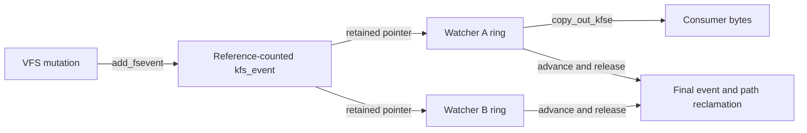

# Filesystem events: production, watcher queues and delivery

[VFS](README.md) · [Namespace mutations](namespace-mutations.md) · [Metadata](metadata-and-extended-attributes.md) · [Kqueue](../processes/kqueue-and-workloops.md)

The kernel FSEvents path packages filesystem activity into per-watcher queues. It is distinct from vnode knote notifications and from userspace FSEvents persistence, replay and directory-tree interpretation. This chapter follows the `CONFIG_FSE` implementation, including queue loss and close.

## Shared events and private watcher state

`kfs_event` carries type, PID, timestamp, reference count, flags and type-specific data. Regular events contain a path and filesystem identity; rename/clone can link a destination event. `fs_event_watcher` contains interests, excluded devices, a circular queue of event pointers, read/write positions, reader/blocker counts, dropped flags and its handle. `fsevent_handle` connects that watcher to fileops/select/knotes and tracks active operations. [Event/watcher representations](../../../platydoc-data/xnu/bsd/vfs/vfs_fsevents.c#L60-L188), [read wrapper](../../../platydoc-data/xnu/bsd/vfs/vfs_fsevents.c#L2182-L2206).



Watch-table membership, event recycling and the buffer/list paths have different locks. A reference keeps a queued event alive across delivery; it does not make the event an immutable historical filesystem transaction. The read path rechecks type/state because recycling/coalescing can change what the queued pointer represents.

## Registering a watcher creates a new descriptor

The clonable API is an ioctl on the FSEvents device, not ordinary reads from the original device node. `FSEVENTS_CLONE` bounds and copies the interest array, wires the user's fd-result storage with `vslock`, creates the watcher, allocates a fileproc and publishes `fsevents_fops`. Wiring makes the final fd copyout safe while the descriptor lock is held. Failure unwinds the watcher, allocations and wiring. [Clone transaction](../../../platydoc-data/xnu/bsd/vfs/vfs_fsevents.c#L2780-L2899).

`add_watcher` bounds queue depth, masks specially entitled event categories and publishes the watcher in the bounded table while updating per-type interest counts. The system-service entitlement changes treatment of a lagging watcher and path filtering; it should not be described as a universal guarantee of event access. [Admission and publication](../../../platydoc-data/xnu/bsd/vfs/vfs_fsevents.c#L1293-L1407).

## Production and coalescing

`add_fsevent` checks event type and returns early if nobody is interested. For eligible repeated events it compares event type, process, time interval and vnode identity/generation or path. Several operations, including rename/delete/create and access-granted, are explicitly excluded from that coalescing fast path. It then constructs type-specific data and fans out to interested watchers, subject to device and event filters. [Production](../../../platydoc-data/xnu/bsd/vfs/vfs_fsevents.c#L377-L505).

A repeated content-modification notification therefore need not produce one queue entry for every write syscall. Conversely, an event does not prove disk durability. The producer runs at a particular VFS operation boundary, and later user behavior can alter names before an observer acts on them.

## Queue pressure is observable loss

`watcher_add_event` requires the watch-table lock. The ring leaves one slot empty to distinguish full from empty. On enqueue it increments the event reference before publishing the new write index. A full ring marks dropped events, wakes the watcher and returns `ENOSPC`. A non-system-service queue beyond three quarters of its capacity can be drained deliberately, releasing every queued reference and reporting drops. Smaller batches use the delayed delivery timer; sufficiently large batches wake immediately. [Enqueue and drop policy](../../../platydoc-data/xnu/bsd/vfs/vfs_fsevents.c#L1532-L1590), [delayed wake](../../../platydoc-data/xnu/bsd/vfs/vfs_fsevents.c#L1484-L1525).

[bsd/vfs/vfs_fsevents.c, lines 1538–1551](../../../platydoc-data/xnu/bsd/vfs/vfs_fsevents.c#L1538-L1551):
<!-- source-excerpt: ../../../platydoc-data/xnu/bsd/vfs/vfs_fsevents.c#L1538-L1551 -->
```c
	if (((watcher->wr + 1) % watcher->eventq_size) == watcher->rd) {
		watcher->flags |= WATCHER_DROPPED_EVENTS;
		fsevents_wakeup(watcher);
		return ENOSPC;
	}

	OSAddAtomic(1, &kfse->refcount);
	watcher->event_queue[watcher->wr] = kfse;
	OSSynchronizeIO();
	watcher->wr = (watcher->wr + 1) % watcher->eventq_size;

	//
	// wake up the watcher if there are more than MAX_NUM_PENDING events.
	// otherwise schedule a timer (if one isn't already set) which will
```

For a hypothetical depth-8 ring only seven entries fit. An eighth event cannot silently overwrite the unread oldest slot: the kernel records a drop condition. Consumers must treat a dropped marker as incomplete history, not merely a cosmetic warning.

## Reading complete event records

`fmod_watch` requires a buffer of at least 2,048 bytes and permits one active reader per watcher; a competing reader gets `EAGAIN`. Empty live queues sleep interruptibly. Before ordinary records it emits `FSE_EVENTS_DROPPED` if needed. It then holds the shared event-handling lock while checking and serializing queued events. [Read admission/drop marker](../../../platydoc-data/xnu/bsd/vfs/vfs_fsevents.c#L1958-L2023).

`copy_out_kfse` writes type/PID, typed length/value fields, optional rename destination, timestamp and terminator. Compact/extended formats influence fields and flags. The wrapper remembers the residual at the last complete event. If the next record cannot fit or copying fails, it resets the reported residual to that boundary and normally leaves the current queue entry for retry. This does not undo bytes already copied into the user buffer; it controls which bytes the syscall reports as a complete result. [Serializer](../../../platydoc-data/xnu/bsd/vfs/vfs_fsevents.c#L1662-L1950), [delivery loop](../../../platydoc-data/xnu/bsd/vfs/vfs_fsevents.c#L2025-L2094).

After consuming/skipping an event it clears the slot, advances `rd` and releases the event reference. `release_event_ref` removes final events from global bookkeeping and captures path/destination allocations so freeing can proceed outside the event-list lock. Rename destination ownership is released separately. [Final release](../../../platydoc-data/xnu/bsd/vfs/vfs_fsevents.c#L1196-L1289).

## Close, readiness and unmount

Readiness reports queued data, while revoke hints set EOF/one-shot behavior for knotes. Close sets `FSEH_CLOSING`, waits for active handle operations, detaches the handle's watcher and invokes `remove_watcher`. That function removes it from the table first, lowers interest counts, marks closing, wakes/waits for readers, drains queued references under exclusive event handling protection and frees interest/device/ring storage. Publication stops before the storage disappears. [Close](../../../platydoc-data/xnu/bsd/vfs/vfs_fsevents.c#L2374-L2392), [watcher removal](../../../platydoc-data/xnu/bsd/vfs/vfs_fsevents.c#L1412-L1481), [readiness](../../../platydoc-data/xnu/bsd/vfs/vfs_fsevents.c#L2415-L2468).

Unmount adds another coordination path: `fsevent_unmount` notifies relevant watchers and tracks acknowledgments so consumers can release volume resources. It is not the complete filesystem unmount transaction. [Unmount handshake](../../../platydoc-data/xnu/bsd/vfs/vfs_fsevents.c#L2102-L2178). Userspace indexing, durable event logs and replay APIs are external implementations; the per-watcher kernel queue and its losses are fully visible here.

<!-- BEGIN PLATYDOC DOCUMENTATION LICENSE -->
Original Platydoc text and diagrams are licensed under [CC BY 4.0](https://creativecommons.org/licenses/by/4.0/). Quoted source code and third-party material retain their respective licenses.
<!-- END PLATYDOC DOCUMENTATION LICENSE -->
