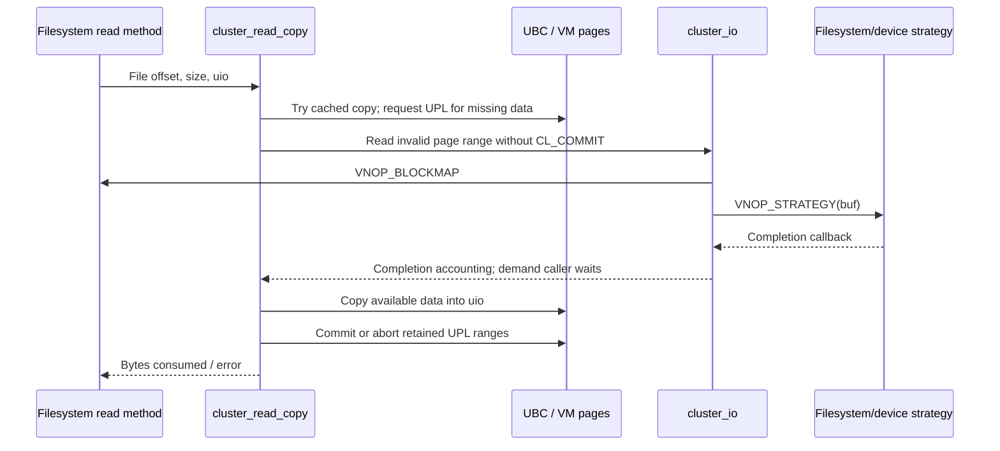

# UBC, clustered I/O, buffers, and storage completion

For write-path decisions, dirty tracking, direct-write coherence and transaction completion, continue with [clustered writeback](clustered-writeback.md).

For the resident/missing-page read decision, read-ahead, mapping lifetime and truncation, see [file-data caching and reads](file-data-cache-and-read-path.md). For hashed buffer ownership, metadata storage, strategy completion and reclaim, see [buffer cache and block I/O](buffer-cache-and-block-io.md).

[VFS index](README.md) · [VM pager/UPL chapter](../vm/pagers-and-upl.md)

## One file, several representations

The unified buffer cache associates file contents with a VM object. [`ubc_info`](../../../xnu/bsd/sys/ubc_internal.h#L171) carries `ui_pager`, `ui_control`, owning vnode, size and mapping flags, read-ahead/write-behind state and code-signing data. [`ubc_info_init_internal`](../../../xnu/bsd/kern/ubc_subr.c#L1096) creates the vnode pager and named VM-object association. File VM pages can serve both ordinary cached reads and mappings.

The traditional [`buf`](../../../xnu/bsd/sys/buf_internal.h#L107) describes block or transfer state: vnode/device, logical and physical block numbers, byte count/residual, flags/error, data address or UPL, completion callback, queue links and filesystem/driver-private state. A `buf` does not necessarily own a separate copy of file data. Cluster I/O buffers often describe VM pages through `b_upl`; metadata buffers can have their own allocated storage. The implementations are related, not two independent universal caches through which every read passes.

| Cached state | What a hit establishes | Detailed route |
| --- | --- | --- |
| Name-cache entry | A candidate name-to-vnode relationship, still subject to identity and authorization checks | [Name-cache lookup](name-cache-and-vnode-reclaim.md) |
| Vnode / authorization state | An object identity protected by the right references; separately, successful actions for a credential under cache predicates | [Vnode reuse and authorization](vnode-cache-identity-and-reuse.md) |
| File-object resident page | File bytes can be available without another storage read | [File-data cache](file-data-cache-and-read-path.md) |
| Hashed buffer | A matching buffer descriptor; busy, validity, storage, and completion still have separate rules | [Buffer cache](buffer-cache-and-block-io.md) |
| Vnode `cs_blob` | Retained signature metadata and cached policy properties for a covered range | [Signature attachment](../security/vnode-signature-lifecycle.md) |
| VM signing masks / optional UBC bitmap | Results reusable under the applicable validation predicates | [Page-signature validation](../security/page-signature-validation.md) |

These states can survive different events. Closing one descriptor need not reclaim the vnode or evict file pages; evicting a page need not discard its signature metadata; clearing a signing generation does not itself reread file contents. Follow the lifetime and invalidation rules in the corresponding chapter rather than treating these as one cache.

## Trace a cached read through an included filesystem

[`mockfs_read`](../../../xnu/bsd/miscfs/mockfs/mockfs_vnops.c#L208) provides a compact concrete example: for a regular vnode it calls `cluster_read` with file size and I/O flags. This is an example filesystem route, not a claim that every filesystem uses the same helper.

[`cluster_read_ext`](../../../xnu/bsd/vfs/vfs_cluster.c#L4601) selects cached-copy, direct or physically-contiguous paths according to flags and the `uio`. The ordinary copy path, [`cluster_read_copy`](../../../xnu/bsd/vfs/vfs_cluster.c#L4713), first tries copying resident UBC data. It tracks read-ahead/streaming state so I/O for future portions can overlap copying already available bytes.

On a miss it aligns a request around the file offset, bounds its size, and obtains a UPL using `ubc_create_upl_kernel`. It examines the UPL's per-page validity and submits runs of missing pages rather than re-reading every resident page. A UPL holds the page-transfer state needed to finish or abort; it is not just a scatter/gather address array.

The sequence shows the demand-copy owner and omits parallel requests and special paths. Its `cluster_io` submission omits `CL_COMMIT`; the caller waits, copies, and finishes its retained UPL. Advisory read-ahead delegates completion with `CL_COMMIT`. Cached reads can finish before the extent/device stages; direct I/O uses caller-owned memory and has different rounding and page-lifetime requirements. See [demand submission](../../../xnu/bsd/vfs/vfs_cluster.c#L5071-L5072), [wait/copy/completion](../../../xnu/bsd/vfs/vfs_cluster.c#L5171-L5255), and the [detailed read route](file-data-cache-and-read-path.md).

## Extents and device constraints

[`cluster_io`](../../../xnu/bsd/vfs/vfs_cluster.c#L1511) bounds transfers by mount/device limits and asks [`VNOP_BLOCKMAP`](../../../xnu/bsd/vfs/kpi_vfs.c#L6374) to map file offsets to device block numbers and contiguous lengths. The filesystem owns that mapping. A hole is represented by block number `-1` with nonzero extent length; a zero-length successful result is rejected because no progress is possible. Read holes and write allocation requirements require distinct handling.

Cluster I/O prepares buffer descriptions and calls [`VNOP_STRATEGY`](../../../xnu/bsd/vfs/kpi_vfs.c#L6423), dispatching through the buffer's vnode operation vector. A local filesystem can forward through [`buf_strategy`](../../../xnu/bsd/vfs/vfs_bio.c#L1587) to its device. The included [`mockfs_strategy`](../../../xnu/bsd/miscfs/mockfs/mockfs_vnops.c#L273) shows this explicitly. At the special-device layer, [`spec_strategy`](../../../xnu/bsd/miscfs/specfs/spec_vnops.c#L2569) performs policy/accounting and calls the block-device switch's `d_strategy`. Hardware-driver queueing and DMA lie beyond generic VFS.

Page size, filesystem block size and device transfer limits are independent. `cluster_io` may round cached page I/O but explicitly avoids extending direct/device-memory requests into pages that do not belong to it. `VNOP_BLOCKMAP` caps a filesystem's returned run to the requested size. These checks explain why a single userspace read may split into several device requests even without errors.

## Completion returns ownership

[`buf_biodone`](../../../xnu/bsd/vfs/vfs_bio.c#L4343) records completion, updates pending-I/O and throttle state, handles vnode write completion, and invokes configured one-shot callbacks or wakes/releases ordinary buffer waiters. A `B_CALL` callback takes ownership of the buffer; a `B_FILTER` callback leaves final cleanup to `buf_biodone`. Calling completion twice is a panic condition.

Cluster callbacks reach [`cluster_iodone_finish`](../../../xnu/bsd/vfs/vfs_cluster.c#L1109). It aggregates errors/residuals across a transaction, updates `clios` completion state under its mutex and wakes waiters. When the transaction owns UPL completion, success commits the range with appropriate flags; error processing calls `cluster_ioerror` and abort/commit handling as required. It then frees the I/O-buffer descriptions. Disk completion alone is insufficient: without UPL completion pages can remain busy or otherwise unavailable to VM.

VM page-in arrives through the vnode pager and `vnode_pagein`/`VNOP_PAGEIN`; filesystems can call [`cluster_pagein`](../../../xnu/bsd/vfs/vfs_cluster.c#L2736). Pageout similarly reaches [`cluster_pageout`](../../../xnu/bsd/vfs/vfs_cluster.c#L2651) through filesystem methods. The [VM pager chapter](../vm/pagers-and-upl.md) explains busy pages, object activity references and the pager-side relookup needed when locks are dropped.

## Writes, delayed work, and the buffer cache

[`cluster_write_ext`](../../../xnu/bsd/vfs/vfs_cluster.c#L2986) receives old/new EOF and optional head/tail zero-fill ranges in addition to data. It chooses copy/direct/contiguous paths. Cached writes can dirty UBC pages and accumulate write-behind work. In [`cluster_write_copy`](../../../xnu/bsd/vfs/vfs_cluster.c#L4541), `IO_SYNC` bypasses normal deferred accumulation and uses `cluster_push_now` to wait for issued I/O. This is an I/O-path property; durable filesystem transaction semantics still depend on filesystem and device behavior.

For conventional buffers, [`buf_getblk`](../../../xnu/bsd/vfs/vfs_bio.c#L3245) hashes by vnode and logical block, marks a found buffer busy under `buf_mtx`, or sleeps/retries if another caller owns it. Buffer-cache presence is not equivalent to valid bytes; `B_DONE`, dirty ranges, requested size and associated UPL state matter.

[`buf_bread`](../../../xnu/bsd/vfs/vfs_bio.c#L2498) starts or finds a read and waits for it. [`buf_bwrite`](../../../xnu/bsd/vfs/vfs_bio.c#L2548) submits a strategy request and waits unless asynchronous. [`buf_bdwrite`](../../../xnu/bsd/vfs/vfs_bio.c#L2696) marks delayed dirty work without immediate submission; [`buf_bawrite`](../../../xnu/bsd/vfs/vfs_bio.c#L2738) submits asynchronously, with limits on outstanding vnode writes. `buf_brelse` relinquishes buffer ownership; it is not a durability operation.

These paths share mount I/O constraints, VM resources, vnode write accounting and completion rules. No-cache/direct requests, compressed-file helpers, verification, content protection and I/O throttling add substantial branches. Their existence is recorded here, but their complete algorithms were not audited.

<!-- BEGIN PLATYDOC DOCUMENTATION LICENSE -->
Original Platydoc text and diagrams are licensed under [CC BY 4.0](https://creativecommons.org/licenses/by/4.0/). Quoted source code and third-party material retain their respective licenses.
<!-- END PLATYDOC DOCUMENTATION LICENSE -->
