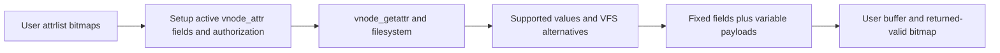
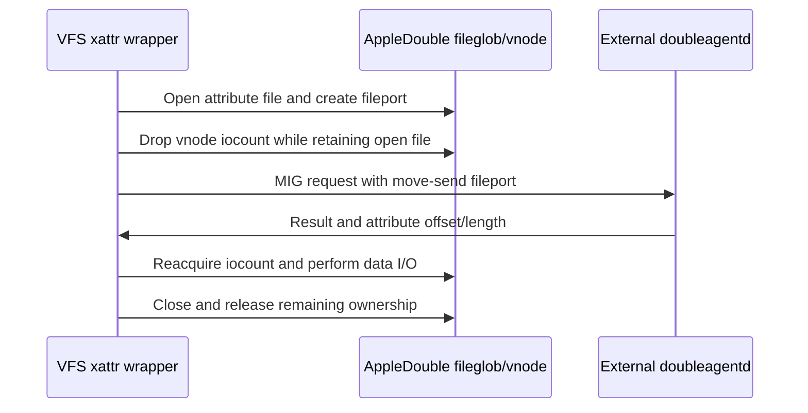

# Attribute lists, extended attributes and property transfer

[VFS](README.md) · [Authorization](pathname-and-authorization.md) · [Leases](advisory-locks-and-leases.md) · [Events](filesystem-event-queues.md)

Metadata calls translate a requested schema into filesystem operations and a packed userspace representation. A filesystem can support only part of that schema. Extended attributes add another boundary: this snapshot's default AppleDouble path delegates parsing to a userspace service through Mach IPC.

## Attribute selection becomes a vnode request

`getattrlist_internal` validates buffer capacity and `attrlist.bitmapcount`, distinguishes volume from file/directory requests and checks option-dependent reuse of attribute bits. `getattrlist_setupvattr` computes the fixed result size, activates the necessary `vnode_attr` fields and derives authorization actions. MAC checks and `vnode_authorize` precede filesystem retrieval. The vnode type is captured for consistent packing decisions. [Dispatch and validation](../../../xnu/bsd/vfs/vfs_attrlist.c#L3285-L3460).

`va_active` means requested; `va_supported` means supplied. Those masks must not be conflated with the user's bitmap. Some fields come from VFS state or alternate queries, and the packer records the actual and valid attribute sets separately. `ATTR_CMN_RETURNED_ATTRS` asks the result to state what is valid; `FSOPT_PACK_INVAL_ATTRS` requires that bitmap and reserves positions for unsupported fields. Zeroing of the request structure in that path prevents uninitialized output slots. [Packing flags](../../../xnu/bsd/vfs/vfs_attrlist.c#L3400-L3413), [retrieval and packing call](../../../xnu/bsd/vfs/vfs_attrlist.c#L3460-L3517).



## Packed layout and a concrete relative-offset example

`_attrlist_buf` maintains `base`, `fixedcursor`, `varcursor`, allocated size, required size and actual/valid bitmaps. Scalars occupy the fixed area; a string or ACL uses an `attrreference` in that area pointing into variable bytes. The offset is relative to the address of the reference itself, not the start of the whole result. Variable data is rounded to four-byte alignment. [Buffer state](../../../xnu/bsd/vfs/vfs_attrlist.c#L79-L91), [variable packing](../../../xnu/bsd/vfs/vfs_attrlist.c#L185-L230).

[bsd/vfs/vfs_attrlist.c, lines 192–199](../../../xnu/bsd/vfs/vfs_attrlist.c#L192-L199):
<!-- source-excerpt: ../../../xnu/bsd/vfs/vfs_attrlist.c#L192-L199 -->
```c
	/*
	 * Pack the fixed-width component to the variable object.
	 * Note that we may be able to pack the fixed width attref, but not
	 * the variable (if there's no room).
	 */
	ar.attr_dataoffset = (int32_t)(ab->varcursor - ab->fixedcursor);
	ar.attr_length = (u_int32_t)(count + extcount);
	attrlist_pack_fixed(ab, &ar, sizeof(ar));
```

Illustrative layout: if a reference starts at byte 12 and its string starts at byte 40, `attr_dataoffset` is 28. A six-byte string gives length 6 while the next variable field begins at byte 48 after alignment. These are example positions; actual fixed fields depend on requested bits and ABI widths.

The packer tracks needed bytes independently of copied bytes. `FSOPT_REPORT_FULLSIZE` controls whether the leading length reports required size or the bounded emitted size. A caller must not treat a full-size value as proof that all bytes fit. `uio` residuals determine actual transfer, and returned validity governs which attributes have meaningful values. [Length and validity publication](../../../xnu/bsd/vfs/vfs_attrlist.c#L3120-L3155).

## Bulk directory enumeration is stateful

`getattrlistbulk` starts from a directory descriptor and checks a required bitmap, directory-list permission and, for attributes requiring deeper lookup, search permission. `fd_vn_data` owns a traversal offset, buffered directory records and EOF state under `FV_LOCK`; resetting the fileglob offset to zero resets that cached traversal. [Bulk admission/state](../../../xnu/bsd/vfs/vfs_attrlist.c#L4254-L4391).

A native `VNOP_GETATTRLISTBULK` can supply records. Expensive attribute combinations or a missing object-type request choose the fallback, and `ENOTSUP` also invokes `readdirattr`, which combines directory enumeration and per-entry retrieval. If at least one entry was produced, the code publishes count/offset and returns successful progress; an empty non-EOF result with no other error becomes `ERANGE`. This is why a short batch is not necessarily an enumeration failure. [Native/fallback and progress](../../../xnu/bsd/vfs/vfs_attrlist.c#L4393-L4488).

## Attribute setting is ordered work, not one universal transaction

`setattrlist_internal` copies the request bitmap and packed buffer, bounds its total size and validates allowed attributes. Fixed fields are unpacked according to the process ABI; ACL references are checked for nonnegative offset, magic, size, entry count and buffer bounds. Chmod/chown-related changes acquire the vnode busy serialization before `vnode_authattr`, preventing an authorization-to-update race in those fields. [Input and ACL checks](../../../xnu/bsd/vfs/vfs_attrlist.c#L4526-L4740), [serialization and authorization](../../../xnu/bsd/vfs/vfs_attrlist.c#L4795-L4834).

Finder Info and ordinary attributes can require separate VNOPs. When removing owner write permission, Finder Info is set first; otherwise it can follow `vnode_setattr`. Volume renaming is another call. An error in a later operation does not undo an earlier successful modification. Cleanup releases the chmod/chown busy state and copied buffer. [Ordering and cleanup](../../../xnu/bsd/vfs/vfs_attrlist.c#L4836-L4926).

## Extended-attribute syscall to VNOP

Path and fd variants acquire a vnode through different reference paths, construct a `uio` and call `vn_getxattr`, `vn_setxattr`, `vn_removexattr` or `vn_listxattr`. The wrappers enforce supported vnode types, named-stream constraints, attribute naming, MAC/vnode authorization, and resource-fork-only nonzero offsets. Set rejects simultaneous `XATTR_CREATE|XATTR_REPLACE`. Internal `XATTR_NOSECURITY` bypasses selected user authorization checks; it does not mean every other validation disappears. [Wrappers](../../../xnu/bsd/vfs/vfs_xattr.c#L128-L392), [set syscall](../../../xnu/bsd/vfs/vfs_syscalls.c#L13986).

`VNOP_GETXATTR`/`SETXATTR` first ask the filesystem. `ENOTSUP` can fall back unless `XATTR_NODEFAULT` is set. Native and default storage can coexist; the `DUAL_EAS` branch coordinates create/replace checks for that case. Successful set can notify MAC policy and update a multilabel vnode label. APFS storage internals are not in this checkout.

## AppleDouble fallback crosses into DoubleAgent

`CONFIG_APPLEDOUBLE` selects the default backend. The source describes the `._` file format, but the current `default_*xattr` routines get a `doubleagentd` port and call `default_*xattr_doubleagent`. Do not read the format comments as an in-kernel parser implementation. [Backend selection and format](../../../xnu/bsd/vfs/vfs_xattr.c#L1296-L1394), [service dispatch](../../../xnu/bsd/vfs/vfs_xattr.c#L1552-L1644).



For get, the kernel opens the attribute file with shared locking, exports a fileport, drops the vnode iocount before the upcall and sends a move-send right consumed by MIG. It receives an offset/length, reacquires the vnode with `vnode_getwithref`, checks output capacity and reads the selected bytes. Transport failure becomes `EIO`; `close_xattrfile` knows whether an iocount is still held. [Get and cleanup](../../../xnu/bsd/vfs/vfs_xattr.c#L1651-L1745), [close/export](../../../xnu/bsd/vfs/vfs_xattr.c#L2377-L2506).

[bsd/vfs/vfs_xattr.c, lines 1680–1697](../../../xnu/bsd/vfs/vfs_xattr.c#L1680-L1697):
<!-- source-excerpt: ../../../xnu/bsd/vfs/vfs_xattr.c#L1680-L1697 -->
```c
	/* Drop the iocount before upcalling to doubleagentd. */
	vnode_put(xvp);
	have_iocount = false;

	(void)strlcpy(cName, name, XATTR_MAXNAMELEN + 1);

	/*
	 * Call doubleagentd to look up the xattr.  The fileport argument
	 * is declared move-send, so the Mig stub consumes it.
	 */
	kr = doubleagent_lookup_xattr(doubleagentd_port, fileport, fsize, cName,
	    &error, &value_offset, &value_length);
	if (kr != KERN_SUCCESS) {
		error = EIO;
	}
	if (error == 0) {
		error = vnode_getwithref(xvp);
	}
```

List preserves any count already produced by native attributes and appends service results. Set/remove have their own file-locking and cleanup paths; missing service yields backend-specific `ENOATTR` or an empty default list. The external service's parsing/authorization implementation cannot be reconstructed from these call sites. The kernel-side ownership and byte-transfer contract is present and can be followed exactly.

<!-- BEGIN PLATYDOC DOCUMENTATION LICENSE -->
Original Platydoc text and diagrams are licensed under [CC BY 4.0](https://creativecommons.org/licenses/by/4.0/). Quoted source code and third-party material retain their respective licenses.
<!-- END PLATYDOC DOCUMENTATION LICENSE -->
