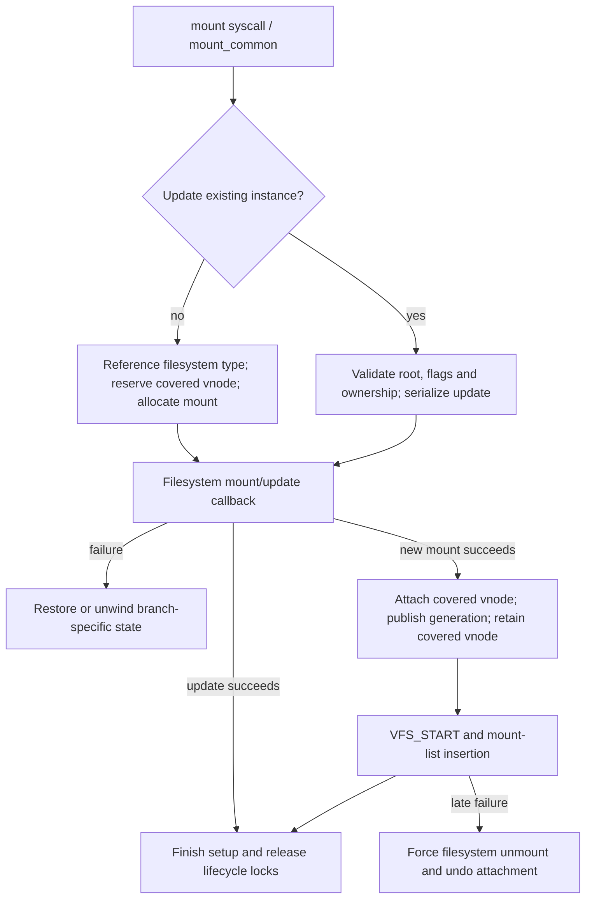
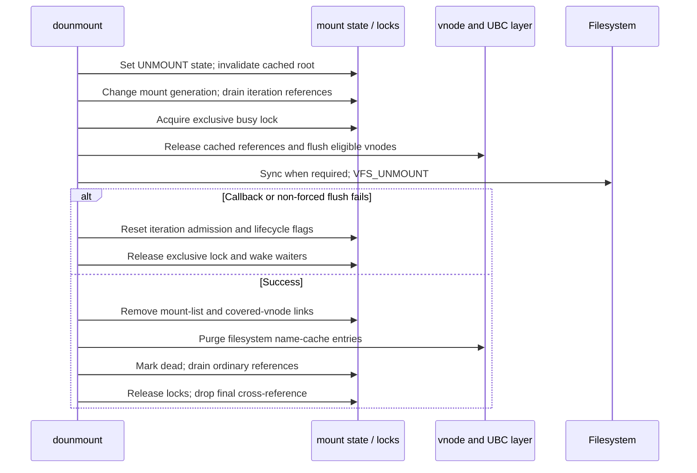

# Mount publication, traversal and unmount

[VFS guide](README.md) · [Vnodes and operation dispatch](vnodes-mounts-and-dispatch.md) · [Name cache and reclaim](name-cache-and-vnode-reclaim.md)

A `mount` represents one filesystem instance. The filesystem-type registration supplies its `vfsops`; vnodes belonging to the instance carry filesystem-specific vnode operations. Mounting must initialize that instance, connect it to a covered vnode, and make it visible to traversal. Unmounting must close admission, drain several kinds of users, reclaim filesystem objects, detach the namespace connection and eventually free the mount allocation. These are separate stages.

## One mount, several lifetime mechanisms

The [mount definition](../../../xnu/bsd/sys/mount_internal.h#L108) documents different lock domains. In particular:

| Mechanism | Protected relationship | Main operations |
| --- | --- | --- |
| `mnt_mlock`, lifecycle flags | Mount state, reference count and wait conditions | `mount_lock`, `mount_unlock` |
| `mnt_rwlock` | Shared busy users versus exclusive mount/unmount work | `vfs_busy`, `vfs_unbusy`; exclusive acquisition by lifecycle code |
| `mnt_count` | Ordinary mount references | `mount_ref`, `mount_drop`, `mount_refdrain` |
| `mnt_crossref` | Traversal and detachment through the covered vnode | Increment under the covered vnode's lock; `mount_dropcrossref` |
| `mnt_iterref` | Participation in mount-list iteration/lookup | `mount_iterref`, `mount_iterdrop`, `mount_iterdrain`, `mount_iterreset` |
| Vnode-list iteration lock | Stable progress through vnode flushing/iteration | Mount iteration helpers and `vflush` |
| `mnt_realrootvp`, root generation, mount generation | Cached shortcut to the filesystem root | Lookup publication/validation; invalidation during mount changes |

The cached root does not carry a persistent root-vnode reference. A mount reference also does not grant a busy lock, and holding a cross-reference does not mean filesystem callbacks remain admissible.

See [ordinary and iteration references](../../../xnu/bsd/vfs/vfs_subr.c#L919), [iteration drain/reset](../../../xnu/bsd/vfs/vfs_subr.c#L983), and [ordinary-reference drain](../../../xnu/bsd/vfs/vfs_subr.c#L1002). Iteration drain waits until the count reaches zero and makes it negative to reject new iteration references. Failed unmount must explicitly reset that admission state.

## Mount and update enter through different branches

[`mount_common`](../../../xnu/bsd/vfs/vfs_syscalls.c#L1154) handles both a new mount and `MNT_UPDATE`.

For an update, the supplied vnode must be the filesystem root. The code serializes against mount/unmount, records `MNT_LMOUNT`, takes the mount's exclusive lock and validates allowed flag changes. Reload is restricted to a read-only filesystem; some security and volume properties cannot simply be removed by changing flags. Ownership, privilege and MAC checks occur before invoking filesystem behavior. The previous flags are retained for the update error path.

A new mount looks up the filesystem type and takes its registration reference, marks the covered vnode as being mounted on, allocates and initializes a mount, prepares filesystem/device state and calls `VFS_MOUNT` or the selected specialized role operation. Non-root callers receive additional mount restrictions. These decisions live in [the setup portion](../../../xnu/bsd/vfs/vfs_syscalls.c#L1200) and [the filesystem handoff](../../../xnu/bsd/vfs/vfs_syscalls.c#L1670).

The filesystem operation is only one stage in publication. Device I/O attributes and configured late MAC checks precede covered-vnode publication. Generic VFS then attaches `v_mountedhere`, marks the covered vnode, wakes mount waiters, updates the name-cache mount generation and obtains the persistent covered-vnode reference. It updates directory references as required, calls `VFS_START`, and adds the mount to the global list. This body discards the `VFS_START` result, while a failed list insertion enters cleanup with `EBUSY`. Later capability queries and notifications complete the common path. See [publication and finalization](../../../xnu/bsd/vfs/vfs_syscalls.c#L1800).



There are failures after the filesystem's mount callback succeeds. The `out4` cleanup path calls `VFS_UNMOUNT` with force, marks the instance dead, closes/releases device state as applicable, detaches the covered vnode and arranges deferred allocation release. The earlier failure path has different assumptions, including an empty vnode list. See [mount failure paths](../../../xnu/bsd/vfs/vfs_syscalls.c#L1930). This is staged resource cleanup, not a generic transaction that can undo arbitrary filesystem-internal side effects.

## Crossing a mount during lookup

[`lookup_traverse_mountpoints`](../../../xnu/bsd/vfs/vfs_lookup.c#L1922) starts with a directory vnode carrying an I/O reference. It respects `NOCROSSMOUNT` and other lookup constraints. While holding the directory vnode lock, it reads `v_mountedhere` and increments that mount's cross-reference.

This closes the allocation-lifetime gap between reading the pointer and trying to busy the mount. It does not skip the busy operation:

1. Acquire the cross-reference through the covered vnode.
2. Enforce lookup restrictions and forced-unmount conditions.
3. Call `vfs_busy`.
4. Call `VFS_ROOT` while the mount is busy.
5. Drop the cross-reference and busy lock.
6. Replace the old directory I/O reference with the returned root I/O reference, or propagate/retry the failure as required.

The function can repeat across nested mounts and trigger resolution. `VFS_ROOT` is a filesystem operation; it is not a pointer load from the generic mount structure.

Successful traversal can populate a cached real-root pointer plus its vnode generation and the mount-generation snapshot. The [cache fast path](name-cache-and-vnode-reclaim.md#walking-several-cached-components) must validate those values and acquire a usable vnode reference. Unmount clears the root cache and changes the global mount generation to invalidate those shortcuts.

## What `vfs_busy` actually guarantees

`vfs_busy` admits a shared user only when the mount is neither dead nor being unmounted. It checks both before and after acquiring the shared lock, because state can change while waiting for that lock:

[Source: vfs_subr.c, lines 1064–1076](../../../xnu/bsd/vfs/vfs_subr.c#L1064-L1076)

<!-- source-excerpt: ../../../xnu/bsd/vfs/vfs_subr.c#L1064-L1076 -->
```c

	lck_rw_lock_shared(&mp->mnt_rwlock);

	/*
	 * Until we are granted the rwlock, it's possible for the mount point to
	 * change state, so re-evaluate before granting the vfs_busy.
	 */
	if (mp->mnt_lflag & (MNT_LDEAD | MNT_LUNMOUNT)) {
		lck_rw_done(&mp->mnt_rwlock);
		goto restart;
	}
	return 0;
}
```

When it encounters `MNT_LUNMOUNT`, a nowait caller fails immediately. A waiting caller sets `MNT_LWAIT`, sleeps, and **returns `ENOENT` after waking**; it does not promise a successful busy acquisition after the sleep:

[Source: vfs_subr.c, lines 1046–1061](../../../xnu/bsd/vfs/vfs_subr.c#L1046-L1061)

<!-- source-excerpt: ../../../xnu/bsd/vfs/vfs_subr.c#L1046-L1061 -->
```c
	if (mp->mnt_lflag & MNT_LUNMOUNT) {
		if (flags & LK_NOWAIT || mp->mnt_lflag & MNT_LDEAD) {
			mount_unlock(mp);
			return ENOENT;
		}

		/*
		 * Since all busy locks are shared except the exclusive
		 * lock granted when unmounting, the only place that a
		 * wakeup needs to be done is at the release of the
		 * exclusive lock at the end of dounmount.
		 */
		mp->mnt_lflag |= MNT_LWAIT;
		msleep((caddr_t)mp, &mp->mnt_mlock, (PVFS | PDROP), "vfsbusy", NULL);
		return ENOENT;
	}
```

This matters for traversal: the caller must re-evaluate the mounted-here relationship or return according to its own nowait/error contract. Waking is an instruction to reconsider state, not proof that the old mount relationship survived.

`vfs_unbusy` releases the shared mount lock. It does not drop an ordinary mount reference or traversal cross-reference.

## Unmount closes admission before draining

[`safedounmount`](../../../xnu/bsd/vfs/vfs_syscalls.c#L2942) performs privilege/ownership and mount-role restrictions, including root/system/backing-root constraints. It enters [`dounmount`](../../../xnu/bsd/vfs/vfs_syscalls.c#L3012) with a reference that the latter consumes according to `withref`. A forced unmount does not override another mount or unmount already in progress: the conflict returns `EBUSY`.

The initial state change is visible before expensive cleanup:

[Source: vfs_syscalls.c, lines 3057–3067](../../../xnu/bsd/vfs/vfs_syscalls.c#L3057-L3067)

<!-- source-excerpt: ../../../xnu/bsd/vfs/vfs_syscalls.c#L3057-L3067 -->
```c
	mp->mnt_kern_flag |= MNTK_UNMOUNT;
	mp->mnt_lflag |= MNT_LUNMOUNT;
	mp->mnt_flag &= ~MNT_ASYNC;
	/*
	 * anyone currently in the fast path that
	 * trips over the cached rootvp will be
	 * dumped out and forced into the slow path
	 * to regenerate a new cached value
	 */
	mp->mnt_realrootvp = NULLVP;
	mount_unlock(mp);
```

For a forced unmount, child mounts may also be visited; the source explicitly allows failed child unmounts to remain dangling. The common path increments `mount_generation`, drains mount-list iteration references and obtains the exclusive busy lock. It drops the input ordinary reference before eventually draining the remaining references.

For a non-forced unmount, cached vnode references are released with `ubc_umount`, and a writable filesystem is synchronized with `VFS_SYNC`. Then generic VFS notifies IOKit, handles configured triggers, flushes eligible vnodes and invokes `VFS_UNMOUNT`. See [drain and synchronization](../../../xnu/bsd/vfs/vfs_syscalls.c#L3075) and [vnode flush and filesystem unmount](../../../xnu/bsd/vfs/vfs_syscalls.c#L3120).



The diagram groups vnode work for readability; the source performs non-forced `VFS_SYNC` before the later generic `vflush`.

## `vflush` distinguishes busy vnodes and device aliases

[`vflush`](../../../xnu/bsd/vfs/vfs_subr.c#L2811) takes the mount's vnode-iteration lock and walks its vnode lists. It cannot retain only a raw vnode pointer while dropping the mount lock: it records identity, locks the vnode and rechecks membership, generation and termination state.

Flags select exemptions such as system, swap and root vnodes. `WRITECLOSE` has additional type/write-reference selection. For a vnode with no disqualifying use references, the walker acquires its own I/O count and hold, reclaims the vnode, then releases those protections in the required order.

Without force, remaining busy vnodes can make the operation return `EBUSY`. The walker can repeat when previous reclaim made progress or new vnode-list state needs processing. With force, ordinary vnodes can have locks aborted and be reclaimed despite use references. Block and character device vnodes have a special path: they can be cleaned and retained with special-device operations and `VDEVFLUSH` handling. “Forced unmount destroys every vnode identically” would misdescribe this code.

See [selection and reclaim decisions](../../../xnu/bsd/vfs/vfs_subr.c#L2880) and [device/force handling and retry](../../../xnu/bsd/vfs/vfs_subr.c#L2940). Filesystem-specific `VFS_UNMOUNT` can also perform its own flushing; generic VFS cannot infer the internals of an absent implementation.

## Successful detach still leaves lifetime work

After successful filesystem unmount, the generic code handles device references, temporarily drops the exclusive lock to remove the mount from the global mount list, reacquires it, and detaches the covered vnode under that vnode's lock. It takes a cross-reference before clearing the link so the mount allocation cannot disappear during the remaining cleanup.

It decrements the filesystem-type reference, purges cached names for the mount, marks the mount dead and wakes busy waiters before draining ordinary references. [`mount_refdrain`](../../../xnu/bsd/vfs/vfs_subr.c#L1002) waits for `mnt_count == 0` and checks that the vnode list is empty. See [the success teardown sequence](../../../xnu/bsd/vfs/vfs_syscalls.c#L3160).

Actual allocation release can occur in `mount_dropcrossref`:

[Source: vfs_syscalls.c, lines 3368–3396](../../../xnu/bsd/vfs/vfs_syscalls.c#L3368-L3396)

<!-- source-excerpt: ../../../xnu/bsd/vfs/vfs_syscalls.c#L3368-L3396 -->
```c
mount_dropcrossref(mount_t mp, vnode_t dp, int need_put)
{
	vnode_hold(dp);
	vnode_lock(dp);
	mp->mnt_crossref--;

	if (mp->mnt_crossref < 0) {
		panic("mount cross refs -ve");
	}

	if ((mp != dp->v_mountedhere) && (mp->mnt_crossref == 0)) {
		if (need_put) {
			vnode_put_locked(dp);
		}
		vnode_drop_and_unlock(dp);

		if (nc_smr_enabled) {
			vfs_smr_synchronize();
		}

		mount_lock_destroy(mp);
#if CONFIG_MACF
		mac_mount_label_destroy(mp);
#endif
		zfree(mount_zone, mp);
		return;
	}
	if (need_put) {
		vnode_put_locked(dp);
```

The free condition requires both detachment from the covered vnode and zero cross-references. With SMR enabled, a grace period precedes lock destruction and freeing. The persistent covered-vnode reference and the temporary I/O reference are released separately by the unmount path. Root mounts without a covered vnode have a separate release branch.

This is why detaching a namespace pointer, finishing `VFS_UNMOUNT`, reaching zero ordinary references and freeing the mount are different events.

## Failed unmount is not a rewind

`VFS_SYNC`, non-forced `vflush`, or `VFS_UNMOUNT` may fail. The corresponding branches reset the negative iteration-reference state, clear unmount/force flags, release locks and wake waiters. Trigger callback handling also distinguishes replacement after a failed flush from release after success. See [error exits and common cleanup](../../../xnu/bsd/vfs/vfs_syscalls.c#L3120) and [the common `out` path](../../../xnu/bsd/vfs/vfs_syscalls.c#L3220).

Some work has already happened: file data may have been written, caches purged, vnodes reclaimed, and `MNT_ASYNC` cleared. Restoring admission permits further use of the still-mounted filesystem; it does not reconstruct the exact pre-call cache or vnode population.

These paths explain the generic mount lifecycle and its main failure points. Filesystem transaction semantics, APFS container/volume management, every trigger/submount interaction and all product-specific mount-role policy remain outside the implementation supplied here.
