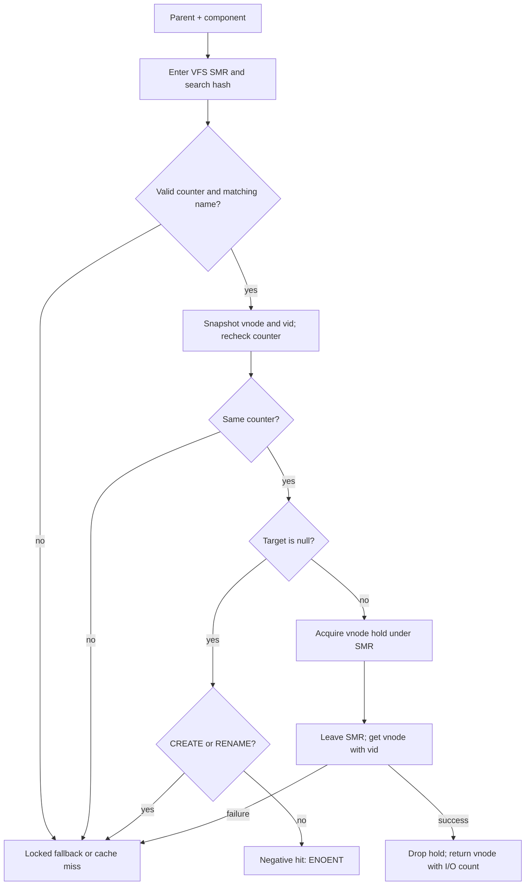
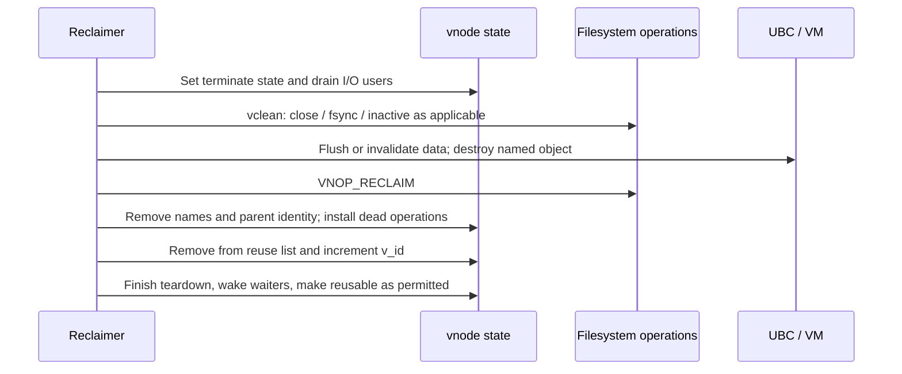

# Name-cache validation and vnode reclamation

[VFS guide](README.md) · [Pathname lookup](pathname-and-authorization.md) · [Mount lifecycle](mount-lifecycle.md)

The name cache answers a namespace question: which vnode, if any, does a component name designate in a particular directory? Its answer can become stale independently of the memory containing the cache entry, the allocation containing the vnode, and the filesystem identity currently assigned to that vnode. XNU therefore uses several different protections. This chapter follows the common lookup and reclaim paths in this checkout, including the transitions between those protections.

[Vnode cache identity and reuse](vnode-cache-identity-and-reuse.md) extends these paths with free/rage/dead queue selection, actual vnode deallocation, filesystem-side pointer recovery, and credential/TTL authorization-cache invalidation.

## The identities and references involved

| Object or field | Meaning and protection |
| --- | --- |
| `namecache.nc_dvp`, `nc_name`, `nc_hashval` | Parent directory and component key. Cache writers serialize with the name-cache lock; SMR readers validate publication state. |
| `nc_vp`, `nc_vid` | Target vnode and the identity generation observed when the entry was created. A null target represents a negative entry. |
| `nc_counter` | Entry publication/reuse counter: odd means valid. A reader must observe a valid counter and then the same counter after reading the entry. |
| Vnode hold count | Keeps the vnode allocation available while transitioning to a stronger reference. It does not certify that the filesystem identity is still the requested one. |
| Vnode I/O count | Keeps the vnode usable for the current operation, subject to the rules of the particular acquisition interface. Released with `vnode_put`. |
| Vnode use count | A longer-lived association, for example an open-file or covered-mount reference. It is distinct from an I/O reference. |
| `v_id` | Vnode identity generation. Reclamation changes it so stale pointer/generation pairs fail validation. |
| `v_nc_generation` | Cache-related namespace generation used to reject an insertion based on an obsolete directory lookup. It is not `v_id`. |

The cache entry contains links for hash lookup, parent-child enumeration and either positive target names or the negative-entry queue:

[Source: namei.h, lines 243–260](../../../xnu/bsd/sys/namei.h#L243-L260)

<!-- source-excerpt: ../../../xnu/bsd/sys/namei.h#L243-L260 -->
```c
struct  namecache {
	TAILQ_ENTRY(namecache)  nc_entry;       /* chain of all entries */
	TAILQ_ENTRY(namecache)  nc_child;       /* chain of ncp's that are children of a vp */
	union {
		LIST_ENTRY(namecache)  nc_link; /* chain of ncp's that 'name' a vp */
		TAILQ_ENTRY(namecache) nc_negentry; /* chain of ncp's that 'name' a vp */
	} nc_un;
	struct smrq_link        nc_hash;        /* hash chain */
	uint32_t                nc_vid;         /* vid for nc_vp */
	uint32_t                nc_counter;     /* flags */
	vnode_t                 nc_dvp;         /* vnode of parent of name */
	vnode_t                 nc_vp;          /* vnode the name refers to */
	unsigned int            nc_hashval;     /* hashval of stringname */
	const char              *nc_name;       /* pointer to segment name in string cache */
};

#define NC_VALID 0x01  /* counter value with this bit set (i.e. odd number) represents an valid/in-use namecache struct */

```

See the complete [vnode layout and lock domains](../../../xnu/bsd/sys/vnode_internal.h#L150) and the [reference acquisition implementation](../../../xnu/bsd/vfs/vfs_subr.c#L6703). “Referenced vnode” is insufficiently precise when reasoning about these paths: allocation lifetime, I/O lifetime and identity validation solve different problems.

## A single-component cache lookup

[`cache_lookup_ext`](../../../xnu/bsd/vfs/vfs_cache.c#L2705) returns three kinds of result:

* `-1`: positive hit; the returned vnode carries an I/O reference.
* `0`: miss or a result that could not safely be used; the caller must continue lookup.
* `ENOENT`: a usable negative hit.

The SMR path enters the VFS SMR domain, finds an entry in the parent/name hash chain, checks an odd publication counter, matches the name, snapshots the target and its generation, and rechecks the counter with acquire ordering. A changed counter forces fallback. A valid snapshot is still not an I/O reference.

The conversion from snapshot to usable vnode is explicit:

[Source: vfs_cache.c, lines 2780–2800](../../../xnu/bsd/vfs/vfs_cache.c#L2780-L2800)

<!-- source-excerpt: ../../../xnu/bsd/vfs/vfs_cache.c#L2780-L2800 -->
```c
	if (vp) {
		bool holdcount_acquired = vnode_hold_smr(vp);

		vfs_smr_leave();

		if (!holdcount_acquired) {
			goto out_fallback;
		}

		if (vnode_getwithvid(vp, vid) != 0) {
			vnode_drop(vp);
			goto out_fallback;
		}
		vnode_drop(vp);
		NCHSTAT(ncs_goodhits);

		*vpp = vp;
		NC_SMR_STATS(cl_smr_hits);
		return -1;
	}

```

`vnode_hold_smr` bridges the protected lookup to the period after leaving SMR. `vnode_getwithvid` then validates identity while obtaining an I/O reference. The temporary hold is dropped on both success and failure. On failure, the code retries through the locked fallback rather than returning the stale target.



A cached absence cannot decide a create or rename operation. Those operations take the fallback path, which can remove the negative entry under exclusive cache locking. The [locked fallback](../../../xnu/bsd/vfs/vfs_cache.c#L2600) also handles lock upgrades by repeating the lookup; it does not assume the previously inspected entry survived the lock transition.

`cache_lookup_smr` is a lower-level interface with a different contract: it returns a pointer/generation pair while the caller remains in the SMR domain. Its caller must perform the necessary reference conversion. Do not transfer `cache_lookup_ext`'s returned-I/O-reference contract to it. See [`cache_lookup_smr`](../../../xnu/bsd/vfs/vfs_cache.c#L2485).

## Walking several cached components

[`cache_lookup_path`](../../../xnu/bsd/vfs/vfs_cache.c#L1788) attempts to consume several pathname components before returning to filesystem lookup. It saves the starting `nameidata` and component state because some conditions require restarting the fast path under a shared name-cache lock.

The walk is more than repeated hash lookup:

1. It parses and hashes the next component, compresses separators, and marks the last component and `..`.
2. It checks whether the directory's cached authorization applies to the current credentials and requested search. Opaque filesystem authorization caches also have freshness constraints.
3. It stops or changes paths for operation-dependent final-component rules, explicit cache bypass, root/chroot boundaries, parent traversal, hard links and other special cases.
4. It validates parent and child identities while traversing cached names.
5. It may cross a mounted filesystem using a cached root only if the root generation and mount-generation checks remain valid.
6. Before leaving protection, it acquires the necessary holds and converts them into I/O references. It can retain a valid parent and fall back to filesystem lookup when a child cannot be acquired.

See the [full fast-walk body](../../../xnu/bsd/vfs/vfs_cache.c#L1788), [reference conversion and output handling](../../../xnu/bsd/vfs/vfs_cache.c#L2220), and [restart restoration](../../../xnu/bsd/vfs/vfs_cache.c#L2439). The parent I/O reference is conditionally avoidable on a final-component hit; it is not omitted for all cache hits.

Cached search authorization does not remove every authorization boundary. [`lookup_authorize_search`](../../../xnu/bsd/vfs/vfs_lookup.c#L940) can skip the ordinary vnode authorization when the fast path already established it, while the configured MAC lookup check remains a separate call. The fast walk also has a MAC check before publishing its result. A cache hit is therefore neither a blanket permission grant nor a guarantee that no policy callback runs.

Mount-root caching is deliberately weak: the mount records a root pointer, vnode generation and mount generation without keeping a permanent root reference. See [mount traversal](mount-lifecycle.md#crossing-a-mount-during-lookup). The source contains special handling and an explicit residual race discussion around the mounted-here field; this chapter describes those checks, not a proof that every possible mount/reclaim interleaving is excluded.

## Publishing, deleting and purging names

An insertion based on a filesystem lookup must not publish a result after a relevant namespace change. [`lookup_consider_update_cache`](../../../xnu/bsd/vfs/vfs_lookup.c#L970) carries the saved directory generation into [`cache_enter_with_gen`](../../../xnu/bsd/vfs/vfs_cache.c#L2861). The final comparison occurs under the cache's exclusive lock:

[Source: vfs_cache.c, lines 2861–2874](../../../xnu/bsd/vfs/vfs_cache.c#L2861-L2874)

<!-- source-excerpt: ../../../xnu/bsd/vfs/vfs_cache.c#L2861-L2874 -->
```c
cache_enter_with_gen(struct vnode *dvp, struct vnode *vp, struct componentname *cnp, int gen)
{
	if (cnp->cn_hash == 0) {
		cnp->cn_hash = hash_string(cnp->cn_nameptr, cnp->cn_namelen);
	}

	NAME_CACHE_LOCK();

	if (dvp->v_nc_generation == gen) {
		(void)cache_enter_locked(dvp, vp, cnp, NULL);
	}

	NAME_CACHE_UNLOCK();
}
```

[`cache_enter_locked`](../../../xnu/bsd/vfs/vfs_cache.c#L2904) prepares the entry, obtains the name-string ownership, holds a positive target vnode, records its `v_id`, installs the list/hash links, and finally advances `nc_counter` from invalid to valid with release ordering. The publication counter protects reuse of the cache entry; it does not replace the target vnode's generation check.

Positive entries participate in the target's name list and the parent's children list. Negative entries participate in the global negative queue and are placed at the head of the parent's children list. Positive entries are placed at the tail. This arrangement lets [`cache_purge_negatives`](../../../xnu/bsd/vfs/vfs_cache.c#L3357) stop at the first positive child.

Deletion invalidates the counter before unlinking or releasing the fields:

[Source: vfs_cache.c, lines 3243–3275](../../../xnu/bsd/vfs/vfs_cache.c#L3243-L3275)

<!-- source-excerpt: ../../../xnu/bsd/vfs/vfs_cache.c#L3243-L3275 -->
```c
cache_delete(struct namecache *ncp, int free_entry)
{
	NCHSTAT(ncs_deletes);

	/*
	 * See comment at the end of cache_enter_locked expalining the usage of
	 * nc_counter.
	 */
	uint32_t old_count = os_atomic_inc_orig(&ncp->nc_counter, release);
	if (!(old_count & NC_VALID)) {
		/* This should be a valid to invalid transition */
		panic("Incorrect state for old nc_counter(%d), should be odd", old_count);
	}

	if (ncp->nc_vp) {
		LIST_REMOVE(ncp, nc_un.nc_link);
	} else {
		TAILQ_REMOVE(&neghead, ncp, nc_un.nc_negentry);
		ncs_negtotal--;
	}
	TAILQ_REMOVE(&(ncp->nc_dvp->v_ncchildren), ncp, nc_child);

	smrq_serialized_remove((NCHHASH(ncp->nc_dvp, ncp->nc_hashval)), &ncp->nc_hash);

	const char *nc_name = ncp->nc_name;
	ncp->nc_name = NULL;
	vfs_removename(nc_name);
	if (ncp->nc_vp) {
		vnode_t vp = ncp->nc_vp;

		ncp->nc_vp = NULLVP;
		vnode_drop(vp);
	}
```

The remainder of [`cache_delete`](../../../xnu/bsd/vfs/vfs_cache.c#L3276) either frees the entry using the appropriate SMR-aware mechanism or leaves its storage available for reuse. The odd/even counter transition and repeated reader observation explain why an address that still exists is not sufficient evidence of a valid entry.

[`cache_purge_locked`](../../../xnu/bsd/vfs/vfs_cache.c#L3294) removes names pointing at the vnode and cached children beneath it, updates the relevant parent cache generation, and clears cached credentials/actions. Credential release is deferred to the caller outside the cache lock. [`cache_purgevfs`](../../../xnu/bsd/vfs/vfs_cache.c#L3381) removes entries whose parent belongs to the filesystem being purged.

## Draining a vnode is a state transition

Reclamation must prevent new operations from continuously replenishing the I/O count while it tears down filesystem state. The relevant flags include `VL_DRAIN`, `VL_TERMINATE`, `VL_TERMWANT`, `VL_DEAD` and the deferred `VL_MARKTERM`; consult [the definitions](../../../xnu/bsd/sys/vnode_internal.h) and [`vnode_getiocount`](../../../xnu/bsd/vfs/vfs_subr.c#L6703).

[`vnode_drain`](../../../xnu/bsd/vfs/vfs_subr.c#L6652) sets the drain owner and waits until the I/O count is at most the reclaimer's own reference. Ordinary acquisitions may sleep or fail depending on their flags. The owner and specially authorized acquisitions have exceptions; it is incorrect to model drain as an unconditional prohibition on every acquisition.

Two similarly named interfaces have an especially important distinction:

[Source: vfs_subr.c, lines 6362–6383](../../../xnu/bsd/vfs/vfs_subr.c#L6362-L6383)

<!-- source-excerpt: ../../../xnu/bsd/vfs/vfs_subr.c#L6362-L6383 -->
```c
/*
 * vnode_getwithvid() cuts in line in front of a vnode drain (that is,
 * while the vnode is draining, but at no point after that) to prevent
 * deadlocks when getting vnodes from filesystem hashes while holding
 * resources that may prevent other iocounts from being released.
 */
int
vnode_getwithvid(vnode_t vp, uint32_t vid)
{
	return vget_internal(vp, vid, (VNODE_NODEAD | VNODE_WITHID | VNODE_DRAINO));
}

/*
 * vnode_getwithvid_drainok() is like vnode_getwithvid(), but *does* block behind a vnode
 * drain; it exists for use in the VFS name cache, where we really do want to block behind
 * vnode drain to prevent holding off an unmount.
 */
int
vnode_getwithvid_drainok(vnode_t vp, uint32_t vid)
{
	return vget_internal(vp, vid, (VNODE_NODEAD | VNODE_WITHID));
}
```

`vnode_getwithvid` is allowed ahead of a drain to avoid lock/resource cycles involving filesystem hashes. `vnode_getwithvid_drainok`, used by the name-cache path where appropriate, can wait behind the drain so lookup does not indefinitely hold up unmount. While waiting, the code also detects an unmount case and can return `ENODEV`; the pathname caller translates or retries according to its own contract.

[`vnode_put_internal_locked`](../../../xnu/bsd/vfs/vfs_subr.c#L6426) handles more than decrementing a counter. At the last relevant reference it can run `VNOP_INACTIVE`, then retry its state inspection because the callback ran without the vnode lock. A marked vnode can be reclaimed immediately or placed on an asynchronous reclaim list when reclaiming from the pager would create a dependency cycle.

[`vnode_recycle`](../../../xnu/bsd/vfs/vfs_subr.c#L3281) therefore has deferred behavior: when use or I/O references prevent immediate work, it marks the vnode for later reclamation. A request to recycle is not proof that `VNOP_RECLAIM` has already executed.

## Cleaning filesystem state and changing identity

The common reclaim route is:



[`vclean`](../../../xnu/bsd/vfs/vfs_subr.c#L3012) drops the vnode lock around filesystem/VM callbacks. Its behavior depends on close/revoke flags, object type and UBC state:

* Active references can require `VNOP_CLOSE`; buffers and dirty file data may require filesystem synchronization, buffer invalidation and UBC synchronization.
* Active or pending-inactive state requires `VNOP_INACTIVE`. This callback is not equivalent to reclaim.
* Destruction of the named VM object occurs before `VNOP_RECLAIM`; the reason distinguishes ordinary reclaim, unmount, forced unmount and the relevant revoke/ungraft case.
* `VNOP_RECLAIM` must complete successfully on this path; a nonzero result panics.
* Identity caches are removed. The vnode stays findable on the mount's vnode list until the callback work has finished, allowing unmount to observe termination in progress.
* The cleaned vnode receives dead operations and a dead-mount association, and its filesystem-private data is cleared.

See [UBC destruction and filesystem reclaim](../../../xnu/bsd/vfs/vfs_subr.c#L3100) and [the final dead-state installation](../../../xnu/bsd/vfs/vfs_subr.c#L3160). Forced reclaim does not authorize arbitrary continued filesystem access through a surviving use count.

[`vnode_reclaim_internal`](../../../xnu/bsd/vfs/vfs_subr.c#L6841) then invalidates old pointer/generation pairs under the vnode-list lock:

[Source: vfs_subr.c, lines 6905–6911](../../../xnu/bsd/vfs/vfs_subr.c#L6905-L6911)

<!-- source-excerpt: ../../../xnu/bsd/vfs/vfs_subr.c#L6905-L6911 -->
```c

	vnode_list_remove_locked(vp);
	vp->v_id++;

	vnode_list_unlock();

	if (isfifo) {
```

Removing the vnode from a reusable list before changing its generation prevents the allocator from selecting it in an incompletely reclaimed state. Final cleanup includes type-specific state, event notification, waking termination waiters and controlled re-entry into vnode lists. See [the end of reclaim](../../../xnu/bsd/vfs/vfs_subr.c#L6913).

## What these checks do and do not establish

A valid cache counter establishes a stable entry snapshot. A vnode hold preserves storage during reference conversion. A successful generation-checked I/O acquisition establishes the requested live identity for an operation. Directory generations prevent selected stale cache insertions. Mount generations invalidate cached traversal shortcuts. None of these is interchangeable with the others.

This chapter follows ordinary name-cache lookup, publication and vnode reclaim in detail. Firmlink traversal, trigger recursion, every named-stream path, all filesystem-specific authorization caches and every forced-revoke race remain narrower source-reading topics. The generic callbacks are visible here; APFS's implementation of those callbacks is not supplied.
