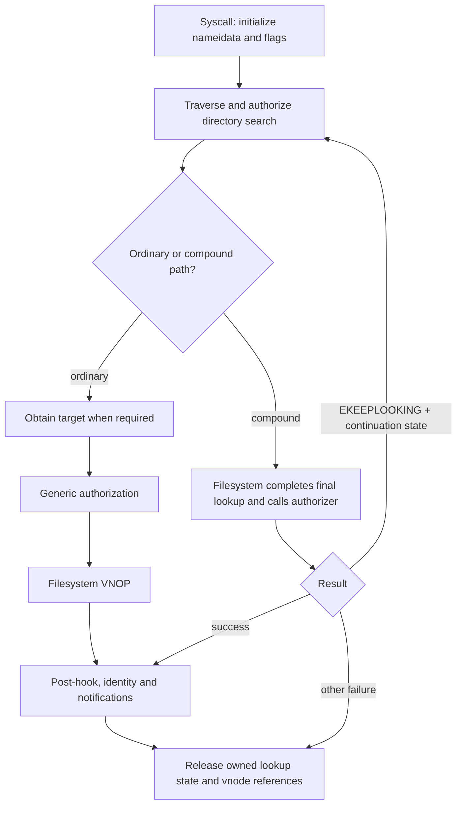

# Namespace mutations: lookup, authorization, and publication

[Filesystem guide](README.md) · [Path lookup](pathname-and-authorization.md) · [Name cache and reclaim](name-cache-and-vnode-reclaim.md)

A namespace operation changes directory entries. The vnode used to perform it can survive the change, and its cached `v_name` and `v_parent` are not the directory entry itself. This distinction explains why unlink schedules later inactivity, why rename updates identity after the filesystem operation, and why hard links complicate authorization. This chapter follows the generic VFS implementation; the directory transaction and on-disk crash-consistency implementation of APFS are outside this checkout. The useful starting points are [`unlinkat_internal`](../../../xnu/bsd/vfs/vfs_syscalls.c#L6419), [`renameat_internal`](../../../xnu/bsd/vfs/vfs_syscalls.c#L9522), and [`vn_create`](../../../xnu/bsd/vfs/vfs_subr.c#L8015).

## 1. The objects carried through an operation

| Object | Role during a mutation |
|---|---|
| `nameidata` | Carries pathname traversal state, parent/result vnodes, operation flags, and the component buffer. The buffer and saved lookup state need `nameidone`, separately from releasing vnode iocounts. |
| `componentname` | Identifies the final component and operation (`CREATE`, `DELETE`, `RENAME`); `cn_ndp` lets compound-operation authorization recover the surrounding lookup. |
| Parent vnode | Selects the filesystem operation vector and supplies the directory against which additions/deletions are authorized. |
| Target vnode | Identifies an existing object. It may initially be absent when a filesystem completes lookup inside a compound operation. |
| `vnode_attr` | Describes requested creation attributes or optional attributes that a compound operation can return for notifications. Active and supported attribute masks matter. |
| `vfs_context` | Supplies the credential and process context to lookup, authorization, and the filesystem callback. |

These are visible together in the [unlink setup and cleanup](../../../xnu/bsd/vfs/vfs_syscalls.c#L6419), [compound-open argument construction](../../../xnu/bsd/vfs/kpi_vfs.c#L3601), and [attribute preparation and fallback](../../../xnu/bsd/vfs/vfs_subr.c#L8015). An iocount makes a vnode usable during the operation; it neither freezes a directory's contents nor replaces filesystem-specific locking. The [vnode lifetime guide](vnodes-mounts-and-dispatch.md) explains the separate usecount and identity generation.

## 2. Ordinary and compound operations

The ordinary shape is `namei/nameiat → authorize → VNOP_*`. The compound shape passes pointers to result vnodes and authorization callbacks into a filesystem operation, allowing that filesystem to finish the final lookup while holding its own relevant locks. Availability comes from the mount's advertised `mnt_compound_ops` bits, not merely a non-null function pointer. [`vnode_compound_*_available`](../../../xnu/bsd/vfs/kpi_vfs.c#L2532)

There is an important checkout-specific detail: the local `namei_compound_available` helper recognizes `NAMEI_COMPOUNDOPEN`. Other operations have their own compound flags and availability checks in their syscall and VNOP paths; do not infer that this one helper handles every compound operation. At the final component, the open path can authorize directory search, record the directory's name-cache generation, set `NAMEI_UNFINISHED`, and return a parent iocount without obtaining the target. [`namei_compound_available`](../../../xnu/bsd/vfs/vfs_lookup.c#L883), [final-component early return](../../../xnu/bsd/vfs/vfs_lookup.c#L1647)

[Final-component compound lookup handoff](../../../xnu/bsd/vfs/vfs_lookup.c#L1657)

<!-- source-excerpt: ../../../xnu/bsd/vfs/vfs_lookup.c#L1657-L1669 -->
```c
	/*
	 * Now that we've authorized a lookup, can bail out if the filesystem
	 * will be doing a batched operation.  Return an iocount on dvp.
	 */
#if NAMEDRSRCFORK
	if ((cnp->cn_flags & ISLASTCN) && namei_compound_available(dp, ndp) && !(cnp->cn_flags & CN_WANTSRSRCFORK)) {
#else
	if ((cnp->cn_flags & ISLASTCN) && namei_compound_available(dp, ndp)) {
#endif /* NAMEDRSRCFORK */
		ndp->ni_flag |= NAMEI_UNFINISHED;
		ndp->ni_ncgeneration = dp->v_nc_generation;
		return 0;
	}
```

A compound operation receives generic authorizers explicitly. For example, compound open supplies separate callbacks for creation and opening an existing object; compound remove supplies `vn_authorize_unlink`; compound rename supplies `vn_authorize_rename`. Those callbacks preserve VFS/MAC/kauth policy while allowing filesystem-controlled lookup and locking. They do not prove how an external filesystem implements its transaction. [`VNOP_COMPOUND_OPEN`](../../../xnu/bsd/vfs/kpi_vfs.c#L3601), [`VNOP_COMPOUND_REMOVE`](../../../xnu/bsd/vfs/kpi_vfs.c#L4438), [`VNOP_COMPOUND_RENAME`](../../../xnu/bsd/vfs/kpi_vfs.c#L4964)



`EKEEPLOOKING` is a protocol result, not a normal userspace errno to return immediately. The syscall validates compound support and `NAMEI_CONTLOOKUP`, preserves the relevant `nameidata`, and resumes traversal. In contrast, a full retry first releases buffers and references and then starts again. For a completed compound lookup, `lookup_compound_vnop_post_hook` performs the appropriate cache/identity and audit work; it leaves continuation work alone on `EKEEPLOOKING`. [`unlinkat_internal` continuation](../../../xnu/bsd/vfs/vfs_syscalls.c#L6588), [`lookup_compound_vnop_post_hook`](../../../xnu/bsd/vfs/vfs_lookup.c#L2579)

## 3. Create and mkdir: a successful creation is a distinct event

For `open(..., O_CREAT)`, `vn_open_auth_do_create` sets the requested type to `VREG`, maps exclusive creation to `VA_EXCLUSIVE`, and decides whether creation/opening is compound. The ordinary path runs `vn_authorize_create`; `vn_create` then prepares attributes and invokes the relevant operation. Compound open reports separate `COMPOUND_OPEN_STATUS_DID_CREATE` state: an existing object can be opened without having been created, and the caller must distinguish both outcomes. On `EKEEPLOOKING`, creation must not already have occurred. [`vn_open_auth_do_create`](../../../xnu/bsd/vfs/vfs_vnops.c#L213)

`vn_authorize_create` validates an unfinished creation path when needed, runs the MAC creation check when configured, and asks for `KAUTH_VNODE_ADD_FILE` on the parent. Resource-fork creation has additional extended-attribute authorization. Filesystem creation is preceded by `vn_attribute_prepare`, which handles the attribute preparation/inheritance contract; `vn_create` dispatches regular files to `vn_create_reg`, directories to `vn_mkdir`, and special types to `VNOP_MKNOD`. [`vn_authorize_create`](../../../xnu/bsd/vfs/vfs_subr.c#L8488), [`vn_create`](../../../xnu/bsd/vfs/vfs_subr.c#L8015)

The operation is not over immediately after a successful VNOP. VFS can apply unsupported attributes with `vnode_setattr_fallback`, associate a MAC label, and update a missing vnode name or parent. An error in post-creation attribute work does not mean the filesystem never created the entry. In the compound regular-file case, `vn_create` closes an already opened vnode on this failure path; the ordinary path drops and clears its result vnode. This is reference/open-state cleanup, not a generic namespace rollback. [`vn_create` post-operation work](../../../xnu/bsd/vfs/vfs_subr.c#L8070), [`vn_open_auth_do_create` identity repair](../../../xnu/bsd/vfs/vfs_vnops.c#L285)

`mkdir1at` uses `CREATE`, `WILLBEDIR`, and `NAMEI_COMPOUNDMKDIR`. An existing target is `EEXIST`. The actual body calls `vn_authorize_mkdir` before `vn_create`, including when compound mkdir is available; the nearby broad comment about bypassing authorization must not replace reading this call. On an `EACCES` or `EPERM` authorization result, it repeats an ordinary lookup to determine whether `EEXIST` is the more appropriate result. It also handles compound continuation and repairs missing name/parent identity after creation. [`mkdir1at`](../../../xnu/bsd/vfs/vfs_syscalls.c#L10386), [`vn_authorize_mkdir`](../../../xnu/bsd/vfs/vfs_subr.c#L8792)

The [permissions and ACL companion](permissions-and-acl-evaluation.md#8-creation-composes-a-new-acl-with-explicit-ownership) follows attribute preparation: direct versus inherited ACE order, propagation flags, defaulted UID/GID/mode, composed-ACL ownership and restoration of the caller's attributes. [Delete authorization](permissions-and-acl-evaluation.md#7-delete-permission-is-a-two-object-decision) explains why a victim ACL, parent `DELETE_CHILD` permission and sticky bit are evaluated separately during unlink and rename.

## 4. Hard links and unlink: names and object lifetime separate

The hard-link syscall first resolves the source according to its follow flags, then looks up the new name using creation semantics. Directories are normally rejected, with a specific `MNTK_DIR_HARDLINKS` exception that also requires ownership for a non-root caller. It takes `vnode_link_lock` on the source, runs the MAC link check and `KAUTH_VNODE_LINKTARGET`, rejects an existing destination, verifies the mounts agree, and authorizes `KAUTH_VNODE_ADD_FILE` on the destination directory. Only then does it break the relevant directory lease and invoke `VNOP_LINK`. [`linkat_internal`](../../../xnu/bsd/vfs/vfs_syscalls.c#L5966)

On success, VFS clears the `VE_NOT_HARDLINK` identity hint and reports file-operation/FSEvents notifications. An `ENOENT` race can cause a bounded restart. The link lock and both lookup references must be unwound before restarting. This is a useful example of authorization tied to an object's current links: lookup alone does not make the source's relationship to the namespace immutable. [`link authorization, dispatch, and retry`](../../../xnu/bsd/vfs/vfs_syscalls.c#L6033)

Unlink has a parallel but not identical path:

1. Initialize `DELETE` lookup state and `NAMEI_COMPOUNDREMOVE`; resolve the parent and possibly the target.
2. Reject prohibited roots/mount crossings and protected swap objects in the applicable configuration.
3. On the ordinary path, hold the target's link lock while `vn_authorize_unlink` and removal run. The authorizer rejects ordinary directory unlink, performs the MAC check, and uses `KAUTH_VNODE_DELETE` with both target and parent.
4. Call `vn_remove`, which chooses the ordinary or compound remove operation. A compound operation can return a target vnode through the pointer.
5. Handle continuation or bounded authorization-related `ENOENT` retries; on success deliver notifications and adjust identity as needed.
6. Call `nameidone` before dropping the parent iocount, then release the target and any remaining temporary state.

[`unlinkat_internal`](../../../xnu/bsd/vfs/vfs_syscalls.c#L6419), [`vn_authorize_unlink`](../../../xnu/bsd/vfs/vfs_subr.c#L8291), [`vn_remove`](../../../xnu/bsd/vfs/kpi_vfs.c#L5984)

The VNOP wrapper marks a successfully removed target as needing inactivity and emits vnode events. It does not unconditionally reclaim the vnode or invalidate every open descriptor. The filesystem must reconcile link count, open references, and eventual inactive/reclaim processing. Compound remove also owns an important error rule: except for continuation, a returned target on failure is put and cleared. [`VNOP_REMOVE`](../../../xnu/bsd/vfs/kpi_vfs.c#L4405), [`VNOP_COMPOUND_REMOVE`](../../../xnu/bsd/vfs/kpi_vfs.c#L4438)

## 5. Rename: two lookups, one serialization decision, several retry classes

`renameat_internal` carries two `nameidata` objects. The source uses delete semantics; the destination uses rename semantics. Flags such as swap and exclusive rename add existence constraints. Both parent mounts and any resolved targets must agree; cross-filesystem rename returns `EXDEV`. Case-sensitive same-object cases can become no-ops, but the cleanup path still performs the required authorization. There is also a tightly constrained mount-point rename path using the covered vnode and separate authorization identity; it is not permission to rename arbitrary mounted roots. [`renameat_internal` lookup and validation](../../../xnu/bsd/vfs/vfs_syscalls.c#L9522)

A cross-parent directory rename requires mount-level rename serialization. Crucially, the code does not acquire that lock while retaining its first set of vnode iocounts: it retains the mount, releases lookup state and vnodes, takes `mount_lock_renames`, and restarts lookup. The second pass revalidates both namespace positions under the chosen serialization. If the fresh result no longer needs that lock, it releases it. This avoids treating stale lookup results as sufficient after a potentially blocking lock acquisition. [`rename lock acquisition and relookup`](../../../xnu/bsd/vfs/vfs_syscalls.c#L9875-L9925)

Authorization checks both removal and addition. Moving a directory to a different parent also requires permission to rewrite its parent relationship. Overwriting a non-directory target requires deletion authorization for that target. Swap authorization checks both sides and their corresponding add permissions. The generic code rejects certain direct cycles, such as using the source as the destination parent, but this is not a complete filesystem ancestry algorithm. [`vn_authorize_renamex_with_paths`](../../../xnu/bsd/vfs/vfs_subr.c#L8554)

`vn_rename` selects compound rename, `VNOP_RENAMEX` for flags, or legacy `VNOP_RENAME`. A specific secluded-rename fallback exists when the filesystem advertises the legacy support flag. The operation can have post-rename work, including inherited restricted flags; as with creation, a later failure should not be casually interpreted as proof that nothing changed. [`vn_rename` dispatch and postprocessing](../../../xnu/bsd/vfs/kpi_vfs.c#L4648)

| Result | Generic response |
|---|---|
| `EKEEPLOOKING` | Validate continuation state and resume the relevant lookup without treating it as an unrelated fresh operation. |
| `ERECYCLE` | Clean up and retry, bounded by `MAX_RENAME_ERECYCLE_RETRIES`; exhaustion becomes `ENOENT`. |
| Authorization-related `ENOENT` | Retry within a separate bounded authorization retry policy. |
| `EDATALESS` | Release rename serialization, materialize the reparent operation, then retry with `VFS_RENAME_DATALESS`; a repeated dataless result becomes `EIO`. |
| Success | Notify observers, update affected mount-path bookkeeping where applicable, and repair cached vnode identity. |

These cases are adjacent in the [post-`vn_rename` result handling](../../../xnu/bsd/vfs/vfs_syscalls.c#L10022). The lock is released before dataless materialization; otherwise a potentially blocking materialization path would run inside the rename serialization interval.

On successful compound rename, the wrapper marks a replaced vnode for inactivity, posts directory write/link events, target deletion, and source rename events. A non-continuation error releases and nulls both returned vnode pointers. The syscall's final identity update is intentionally conditional: ordinary rename updates when the old cached name/parent still match, whereas compound handling has its own update condition. A cached identity is useful but is not a globally authoritative unique path for a hard-linked object. [`VNOP_COMPOUND_RENAME`](../../../xnu/bsd/vfs/kpi_vfs.c#L4964), [identity update and cleanup](../../../xnu/bsd/vfs/vfs_syscalls.c#L10220)

[Compound rename failure releases returned target references](../../../xnu/bsd/vfs/kpi_vfs.c#L5041)

<!-- source-excerpt: ../../../xnu/bsd/vfs/kpi_vfs.c#L5041-L5050 -->
```c
	if (_err && _err != EKEEPLOOKING) {
		if (*fvpp) {
			vnode_put(*fvpp);
			*fvpp = NULLVP;
		}
		if (*tvpp) {
			vnode_put(*tvpp);
			*tvpp = NULLVP;
		}
	}
```

## 6. What “publication” means here

There are several observable transitions: the filesystem changes a directory; the VNOP wrapper emits vnode events; the syscall emits file-operation and FSEvents notifications; the name cache and vnode identity are updated or invalidated. Their existence does not establish an on-disk journal commit boundary. Likewise, an unlink event is not a vnode reclaim event. To follow actual namespace storage, cross the selected `v_op` entry into the relevant filesystem; for an in-tree example, continue with [devfs mutation and node lifetime](device-nodes-and-fifos.md). For references that outlive a name, continue with [reclaim](name-cache-and-vnode-reclaim.md).

Sources inspected and limits:

| Source | Inspection |
|---|---|
| `vfs_syscalls.c` link, unlink, mkdir, rename bodies | Deep reads of lookup, authorization, lock/retry, identity and cleanup paths; selected event details. |
| `vfs_subr.c` create and mutation authorizers | Deep reads of dispatch, policy calls and fallback cleanup; the [ACL companion](permissions-and-acl-evaluation.md) now develops attribute inheritance, permission decisions and ownership. |
| `kpi_vfs.c`, `vfs_lookup.c` | Compound argument construction, post-hook, result ownership, final-component early return. |
| External filesystem bodies | Not present for APFS. No claim about journal transactions, crash recovery, or all filesystem locking implementations. |
| Optional branches | Resource forks, AppleDouble, MAC and dataless interfaces identified; not every branch independently traced. |

<!-- BEGIN PLATYDOC DOCUMENTATION LICENSE -->
Original Platydoc text and diagrams are licensed under [CC BY 4.0](https://creativecommons.org/licenses/by/4.0/). Quoted source code and third-party material retain their respective licenses.
<!-- END PLATYDOC DOCUMENTATION LICENSE -->
