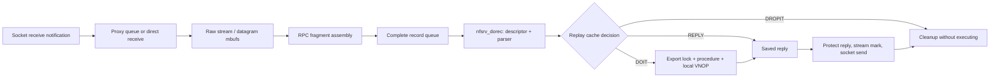

# NFS server requests: transport, replay, file handles, and writes

[Filesystem guide](README.md) · [Filesystem and daemon inventory](filesystems-and-nfs.md) · [Socket I/O](../networking/socket-lifecycle-and-io.md) · [Clustered writeback](clustered-writeback.md)

The substantial NFS implementation available here is a server that turns RPC requests into operations on local vnodes. Its parser accepts NFS versions 2 and 3. The client filesystem's mount/vnode implementation is absent; hooks and daemon interfaces do not supply that missing implementation. This chapter follows the server's socket/request ownership, selected READ/WRITE/COMMIT paths and duplicate-request handling. It does not claim to audit every RPC, credential mechanism, export option or malformed-message case. [`nfsrv_getreq`](../../../platydoc-data/xnu/bsd/nfs/nfs_socket.c#L724), [configuration and external boundaries](filesystems-and-nfs.md)

## 1. The state objects and locks

| Object | State carried between stages |
|---|---|
| `nfsrv_sock` | Retained socket, peer address, raw stream mbufs, fragment and complete-record chains, service-queue links, flags and worker reference count. `ns_rwlock` protects most fields. |
| `nfsrv_sock` write-gather fields | `ns_wgmutex`, deadline, time queue and per-file-handle hash chains hold requests whose writes/replies are deferred. |
| `nfsd` | A worker's queue membership, `NFSD_REQINPROG`, assigned server socket and request descriptor. |
| `nfsrv_descript` | XID/procedure/version/status, parsing chain, peer address, credential/security context, file handle and optional write-gather/coalescing state. |
| `nfsm_chain` | Head/current mbuf, current byte pointer and remaining length for RPC dissection/building. |
| `nfsrvcache` | Recent-request key, in-progress/done state, LRU/hash links and optional saved reply/status. |

[`nfsrv_sock`, `nfsd`, `nfsrv_descript`](../../../platydoc-data/xnu/bsd/nfs/nfs.h#L1127), [`nfsm_chain`](../../../platydoc-data/xnu/bsd/nfs/nfs.h#L1082), [`nfsrvcache`](../../../platydoc-data/xnu/bsd/nfs/nfsrvcache.h#L89)

These locks cover different relationships. `nfsd_mutex` coordinates worker/socket lists and reference transitions; the per-socket rwlock coordinates transport state; the gather mutex serializes pending-write state; `nfsrv_reqcache_mutex` protects replay entries; a shared `nfsrv_export_rwlock` surrounds procedure dispatch. The last lock keeps export policy available while a request resolves its file handle and uses the export. It is not a replacement for vnode or underlying filesystem synchronization. [`nfssvc_nfsd`](../../../platydoc-data/xnu/bsd/nfs/nfs_syscalls.c#L904), [`nfsrv_writegather`](../../../platydoc-data/xnu/bsd/nfs/nfs_serv.c#L1526), [`nfsrv_getcache`](../../../platydoc-data/xnu/bsd/nfs/nfs_srvcache.c#L226)

## 2. A user-supplied socket becomes server-owned transport

The `NFSSVC_ADDSOCK` and `NFSSVC_NFSD` operations require superuser, followed by the configured MAC system check. ADDSOCK obtains the socket from a file descriptor, copies an optional connected-peer address, and calls `nfssvc_addsock`. That function retains the socket independently; afterward the syscall drops its temporary file-descriptor iocount. Closing the daemon's descriptor therefore does not immediately remove the server's transport. [`nfssvc`](../../../platydoc-data/xnu/bsd/nfs/nfs_syscalls.c#L589)

`nfssvc_addsock` accepts the implemented IPv4/IPv6 UDP/TCP combinations and the local-domain case. It prevents duplicate UDP sockets for each IP family, including a recheck under `nfsd_mutex`. Stream sockets are checked against address-allowing export policy. It configures buffer sizes, keepalive and selected protocol/timeouts, allocates the server socket and its locks, publishes it on the socket list, retains the socket, installs the upcall, and marks `SLP_VALID | SLP_NEEDQ` before waking workers. Several socket-option errors are logged without aborting registration; do not infer every requested option was successfully installed merely from ADDSOCK success. [`nfssvc_addsock`](../../../platydoc-data/xnu/bsd/nfs/nfs_syscalls.c#L682)

[Socket retention, receive callback setup, and work publication](../../../platydoc-data/xnu/bsd/nfs/nfs_syscalls.c#L849)

<!-- source-excerpt: ../../../platydoc-data/xnu/bsd/nfs/nfs_syscalls.c#L849-L863 -->
```c
	sock_retain(so); /* grab a retain count on the socket */
	slp->ns_so = so;
	slp->ns_sotype = sotype;
	slp->ns_nam = mynam;

	/* set up the socket up-call */
	nfsrv_uc_addsock(slp, first);

	/* mark that the socket is not in the nfsrv_sockwg list */
	slp->ns_wgq.tqe_next = SLPNOLIST;

	slp->ns_flag = SLP_VALID | SLP_NEEDQ;

	nfsrv_wakenfsd(slp);
	lck_mtx_unlock(&nfsd_mutex);
```

Receive notification can be indirect. `nfsrv_uc_addsock` installs a proxy when receive-upcall threads are available, otherwise the direct receive function. The proxy queues an argument once under its queue lock and wakes the queue's worker. That worker clears queued state, marks receive-in-progress, drops the queue lock, executes `nfsrv_rcv`, then clears receive state and wakes drain waiters. This is distinct from the nfsd worker that executes filesystem procedures. [`nfsrv_uc_addsock`](../../../platydoc-data/xnu/bsd/nfs/nfs_upcall.c#L375), [`nfsrv_uc_proxy`](../../../platydoc-data/xnu/bsd/nfs/nfs_upcall.c#L327), [`nfsrv_uc_thread`](../../../platydoc-data/xnu/bsd/nfs/nfs_upcall.c#L96)

## 3. Raw stream bytes become complete RPC records

`nfsrv_rcv_locked` receives mbufs with `MSG_DONTWAIT`. For streams, it first checks whether complete records are already queued; if so it defers more receive work and leaves feedback to the transport rather than endlessly consuming input. New bytes append to `ns_raw`, with `ns_cc` and `ns_rawend` tracking the partial stream. `nfsrv_getstream` then parses Sun RPC record marks. Datagram receives preserve the sender in an address mbuf and append complete packet records directly. [`nfsrv_rcv_locked`](../../../platydoc-data/xnu/bsd/nfs/nfs_socket.c#L352)

The stream record mark gives a fragment length and last-fragment bit. The parser handles a mark split across mbufs, validates the length against `NFS_MAXPACKET`, and checks configured unprocessed-RPC memory accounting before accepting it. It waits for sufficient raw bytes; it may split an mbuf at the fragment boundary; then it appends that fragment to `ns_frag`. Only a last fragment moves the accumulated record to `ns_rec` and makes it eligible for procedure parsing. Allocation/splitting pressure can return `EWOULDBLOCK`; malformed framing or memory-limit failure takes a different error route that can mark the transport for disconnection. [`nfsrv_getstream`](../../../platydoc-data/xnu/bsd/nfs/nfs_socket.c#L501)

The flags identify work, not a single linear connection state: `SLP_NEEDQ` means more receive work; `SLP_DOREC` means complete records; `SLP_DISCONN` requests shutdown; `SLP_DOWRITES` requests delayed-write service. Wait/work queue bits track scheduling membership separately. In the non-wait receive path, the function releases the socket rwlock before attempting to wake workers under `nfsd_mutex`. The wait-capable worker path retains the lock for its caller to release. [`receive lock handoff`](../../../platydoc-data/xnu/bsd/nfs/nfs_socket.c#L467), [`SLP_*` definitions](../../../platydoc-data/xnu/bsd/nfs/nfs.h#L1155)



## 4. Worker ownership and two kinds of error

An nfsd worker selects a socket under `nfsd_mutex`, checks work/validity under the socket rwlock, increments `ns_sref`, records the assignment in `nfsd_slp`, and moves the socket through service/LRU queues. It can receive more data or zap a disconnected socket, then calls `nfsrv_dorec`. That helper removes one record from the socket queue, separates its optional address mbuf, allocates a descriptor, initializes the dissection chain, and parses the RPC header. Successful return transfers that request to the worker. [`nfssvc_nfsd` socket assignment](../../../platydoc-data/xnu/bsd/nfs/nfs_syscalls.c#L960), [`nfsrv_dorec`](../../../platydoc-data/xnu/bsd/nfs/nfs_socket.c#L664)

`nfsrv_getreq` validates RPC call/version/program, NFS version and procedure, and authentication length. Some protocol errors are represented by a successful parser return with `nd_repstat` set and `nd_procnum = NFSPROC_NOOP`, so the server can construct an RPC error reply. A parsing failure instead cleans up the request chain and returns an error; selected GSS failures mean drop, with stream shutdown handled by the worker. This separation also appears later: a filesystem operation's errno normally becomes `nd_repstat`, while the procedure's C return value describes whether reply construction/processing itself failed. [`nfsrv_getreq`](../../../platydoc-data/xnu/bsd/nfs/nfs_socket.c#L724), [`nfsrv_write` reply assembly](../../../platydoc-data/xnu/bsd/nfs/nfs_serv.c#L1461)

AUTH_SYS constructs a credential from wire UID/GIDs with explicit count/length handling. RPCSEC_GSS delegates to its credential/context routine. These input credentials are not yet the final local authorization decision: export policy and mapping follow file-handle resolution. A worker chooses the per-request datagram address or the connected socket address, checks replay state, optionally enforces reserved-source-port policy, then dispatches under the shared export lock. [`credential parse`](../../../platydoc-data/xnu/bsd/nfs/nfs_socket.c#L790), [`worker dispatch`](../../../platydoc-data/xnu/bsd/nfs/nfs_syscalls.c#L1075)

For fairness, the worker can continue with another record from its current socket while the new-work queue is empty and its operation count is below eight. Otherwise it drops the assignment and socket reference. This is a local batching rule, not a guarantee of ordering between all requests on a connection or all workers. [`worker continuation`](../../../platydoc-data/xnu/bsd/nfs/nfs_syscalls.c#L1263)

## 5. The replay cache is a bounded duplicate filter

The current request cache immediately returns `RC_DOIT` when `nd_nam2` is absent, bypassing this cache for the connected-request case. Its lookup key compares XID, procedure and client network address; the IPv4/IPv6 comparison is host-address based, not a full request-body hash. It is therefore incorrect to describe this structure as a universal exactly-once RPC implementation. [`nfsrv_getcache`](../../../platydoc-data/xnu/bsd/nfs/nfs_srvcache.c#L226), [`netaddr_match`](../../../platydoc-data/xnu/bsd/nfs/nfs_srvcache.c#L184)

| Cache result/state | Action |
|---|---|
| Matching `RC_INPROG` | Return `RC_DROPIT`; another worker/request instance is already executing it. |
| Done with saved status | Build a reply header using the cached status. |
| Done with saved mbuf reply | Copy the saved reply chain for this transmission. |
| Done without saved reply | Mark in progress and execute again. |
| Miss | Allocate or reuse an LRU entry, mark in progress, then execute. If no entry can be used, execute without caching. |

Entries have `RC_LOCKED`/`RC_WANTED` in addition to the cache mutex; a waiter sleeps and relooks up the key after waking. The source comment mentions a completion-time delay, but the inspected lookup body has no elapsed-time test: the table above follows the actual branches. Cache size is initialized from `NFSRVCACHESIZ`, defined here as 64, and is bounded. LRU reuse can lose duplicate history. The update path explicitly handles a request completing more than once after cache pressure. [`nfsrv_getcache`](../../../platydoc-data/xnu/bsd/nfs/nfs_srvcache.c#L226), [`nfsrv_updatecache`](../../../platydoc-data/xnu/bsd/nfs/nfs_srvcache.c#L374), [`NFSRVCACHESIZ`](../../../platydoc-data/xnu/bsd/nfs/nfsrvcache.h#L87)

[Cache update acknowledges that bounded caching can permit repeated execution](../../../platydoc-data/xnu/bsd/nfs/nfs_srvcache.c#L397-L409)

<!-- source-excerpt: ../../../platydoc-data/xnu/bsd/nfs/nfs_srvcache.c#L397-L409 -->
```c
			if (rp->rc_state == RC_DONE) {
				/*
				 * This can occur if the cache is too small.
				 * Retransmits of the same request aren't
				 * dropped so we may see the operation
				 * complete more then once.
				 */
				if (rp->rc_flag & RC_REPMBUF) {
					mbuf_freem(rp->rc_reply);
					rp->rc_flag &= ~RC_REPMBUF;
				}
			}
			rp->rc_state = RC_DONE;
```

On a valid completed request, `nfsrv_updatecache` saves replies only for procedures classified as non-idempotent by its local table; some NFSv2 operations need only a status value, while other saved replies use an mbuf copy. An invalid reply marks completion without creating a valid saved response. A retransmission of a done entry without a saved reply can therefore execute again. Replay retention and socket-send success are separate: the worker updates the cache before transmitting the reply. [`nonidempotent` table](../../../platydoc-data/xnu/bsd/nfs/nfs_srvcache.c#L110), [`cache completion`](../../../platydoc-data/xnu/bsd/nfs/nfs_srvcache.c#L414), [`worker cache update/send`](../../../platydoc-data/xnu/bsd/nfs/nfs_syscalls.c#L1138)

## 6. File handles resolve an export and a local vnode

A server file handle includes an export header and filesystem-specific file-ID bytes. `nfsrv_fhtovp` checks format version, size and invalid-handle flag; resolves the export; chooses export options for the client address; and validates the request security flavor, with explicit procedure exceptions used for mounting-related operations. An offline or missing exported mount maps to `ESTALE` or the NFSv3 retry-later error according to the request. [`nfsrv_fhtovp`](../../../platydoc-data/xnu/bsd/nfs/nfs_subs.c#L2296)

Mount lookup by exported mount path takes a busy reference before use; the helper drops its iteration reference separately. It can also iterate mounts and compare resolved root paths when the direct mount-name lookup does not find one. `VFS_FHTOVP` converts the filesystem-specific identifier, then `vfs_unbusy` releases mount admission protection. The returned vnode iocount remains the procedure's responsibility. A file handle is not a retained vnode pointer and does not skip mount/export validation. [`nfsrv_getvfs_by_mntonname`](../../../platydoc-data/xnu/bsd/nfs/nfs_subs.c#L2269), [`VFS_FHTOVP` handoff](../../../platydoc-data/xnu/bsd/nfs/nfs_subs.c#L2400)

`nfsrv_credcheck` applies configured all-user or root mapping by retaining the export credential, releasing the incoming credential reference, updating `nd_cr`, and assigning it to the context used by local VFS calls. `nfsrv_authorize` enforces read-only exports for relevant object types, calls vnode authorization, and has a specific owner override for `EACCES` when requested by callers such as READ/WRITE. The read procedure can retry read-data authorization with execute authorization. These are visible server policy choices; describing the path simply as a local `open` on behalf of the wire UID would miss them. [`nfsrv_credcheck`](../../../platydoc-data/xnu/bsd/nfs/nfs_subs.c#L2420), [`nfsrv_authorize`](../../../platydoc-data/xnu/bsd/nfs/nfs_serv.c#L5242), [`READ authorization`](../../../platydoc-data/xnu/bsd/nfs/nfs_serv.c#L977)

## 7. READ fills reply mbufs through a kernel-space uio

`nfsrv_read` decodes the file handle, offset and requested length, bounds the length, resolves the vnode/export and maps the credential. It requires a regular file, performs vnode and configured MAC checks, and obtains attributes to bound the read against file size. It allocates an mbuf chain for data and a kernel-space `uio` whose vectors point into those mbufs, then invokes `VNOP_READ` with `IO_NODELOCKED`. The flag is part of the filesystem call contract; it is not evidence that the caller holds the generic `v_lock` throughout the read. [`nfsrv_read`](../../../platydoc-data/xnu/bsd/nfs/nfs_serv.c#L914)

After the operation it obtains the appropriate attributes, releases the vnode, computes actual bytes from `uio_resid`, trims/pads the data chain for XDR, and builds the reply's attributes/count/EOF fields. Successful chaining transfers the data mbufs into the reply and clears the local `mread` variable. Cleanup frees a still-local data chain, frees a heap uio when used, releases any vnode still held, and destroys the reply on a reply-construction error. This is a concrete network/VFS boundary: the filesystem read fills network reply storage, without requiring a temporary userspace buffer. [`READ transfer and reply cleanup`](../../../platydoc-data/xnu/bsd/nfs/nfs_serv.c#L1024)

## 8. WRITE stability becomes local I/O flags

`nfsrv_write` decodes offset, stability and payload length, trims the request data to the declared write and rejects oversized, negative or short payloads. It resolves and authorizes the vnode as a regular file, collects pre-operation attributes for NFSv3, and builds a kernel-space write `uio` pointing into request mbufs. The request owns those bytes while `VNOP_WRITE` consumes the uio; freeing the temporary uio does not itself free the request chain. [`nfsrv_write`](../../../platydoc-data/xnu/bsd/nfs/nfs_serv.c#L1301)

| Requested stability | Local flags in this body |
|---|---|
| `NFS_WRITE_UNSTABLE` | `IO_NODELOCKED` |
| `NFS_WRITE_DATASYNC` | `IO_SYNC | IO_NODELOCKED` |
| Other/file-sync case | `IO_METASYNC | IO_SYNC | IO_NODELOCKED` |

[`WRITE flags and dispatch`](../../../platydoc-data/xnu/bsd/nfs/nfs_serv.c#L1424)

The reply contains weak-cache-consistency attributes, reported byte count, stability and the export's timestamp-based write verifier. The direct-write body reports unstable only when requested and `nfsrv_async` is false; otherwise it reports file-sync. It explicitly describes async mode as pretending unstable writes were file-sync. The default `nfsrv_async` is zero, but it is exposed through a sysctl. Therefore the protocol reply, policy setting and lower filesystem's durability implementation must be kept distinct. [`WRITE reply`](../../../platydoc-data/xnu/bsd/nfs/nfs_serv.c#L1461), [defaults](../../../platydoc-data/xnu/bsd/nfs/nfs_serv.c#L165), [server sysctls](../../../platydoc-data/xnu/bsd/nfs/nfs_syscalls.c#L138)

The generic server passes synchronous flags into the filesystem; it cannot show an external filesystem's journal or device-cache guarantees. The [clustered writeback guide](clustered-writeback.md) traces the generic I/O machinery where a filesystem chooses to use it.

## 9. Delayed writes transfer descriptor ownership into gather queues

Write gathering is selected when the applicable delay is positive. The checked-in defaults enable a one-millisecond NFSv2 delay and set the NFSv3 delay to zero; both are configurable. `nfsrv_writegather` takes ownership by saving `*ndp` and setting the caller's pointer to null. It records a deadline, file handle and byte range, and inserts the descriptor into socket-local timer/hash lists under `ns_wgmutex`. The worker must not immediately free a descriptor that it has handed into this queue. [`write-gather defaults`](../../../platydoc-data/xnu/bsd/nfs/nfs_serv.c#L165), [`NFSRV_WGATHERDELAY`](../../../platydoc-data/xnu/bsd/nfs/nfs.h#L125), [`nfsrv_writegather`](../../../platydoc-data/xnu/bsd/nfs/nfs_serv.c#L1526)

Coalescing requires overlapping/contiguous ranges on the same file handle and the implementation's credential comparison. That macro compares credential storage, and its own comment warns that it does not account for MAC-label scoping. This chapter describes the mechanism without claiming a complete security equivalence test. `nfsrv_wg_coalesce` removes the secondary request from queues, joins or discards its data mbufs according to overlap, raises the aggregate stability requirement when necessary, and retains the secondary descriptor on a coalesced-request list so it can still receive its own reply. [`coalescing predicates`](../../../platydoc-data/xnu/bsd/nfs/nfs_serv.c#L1511), [`nfsrv_wg_coalesce`](../../../platydoc-data/xnu/bsd/nfs/nfs_serv.c#L1865)

Due requests are removed from the pending lists, resolved/authorized, written, and given replies. The gather mutex remains held across this selected processing path, including its VNOP write; the surrounding worker also holds the shared export lock. Replies for the aggregate and its coalesced requests are queued individually. A later phase returns one reply and its descriptor to the worker through `mrepp`/`ndp`, reestablishing the worker's normal cleanup ownership. The deadline timer sets `SLP_DOWRITES` and wakes nfsd rather than performing filesystem writes directly in the timer callback. [`gather execution and reply return`](../../../platydoc-data/xnu/bsd/nfs/nfs_serv.c#L1664), [`nfsrv_wg_timer`](../../../platydoc-data/xnu/bsd/nfs/nfs_serv.c#L1915)

## 10. COMMIT is a vnode-wide fsync in this implementation

`nfsrv_commit` parses the NFSv3 offset/count but explicitly does not pass a range onward because `VNOP_FSYNC` has no offset/count parameters. It resolves the export/vnode, maps credentials, requires a regular file, captures pre-operation attributes, calls `VNOP_FSYNC(vp, MNT_WAIT, ctx)`, obtains post-operation attributes, releases the vnode, and returns consistency data and the export verifier on success. This path does not repeat the READ/WRITE `nfsrv_authorize` call; its visible checks are the ones just listed. [`nfsrv_commit`](../../../platydoc-data/xnu/bsd/nfs/nfs_serv.c#L4771)

[COMMIT performs a synchronous vnode-wide filesystem sync and releases its vnode](../../../platydoc-data/xnu/bsd/nfs/nfs_serv.c#L4820)

<!-- source-excerpt: ../../../platydoc-data/xnu/bsd/nfs/nfs_serv.c#L4820-L4831 -->
```c
	nfsm_srv_pre_vattr_init(&preattr);
	preattrerr = vnode_getattr(vp, &preattr, ctx);

	error = VNOP_FSYNC(vp, MNT_WAIT, ctx);

	nfsm_srv_vattr_init(&postattr, 1);
	postattrerr = vnode_getattr(vp, &postattr, ctx);

nfsmerr:
	if (vp) {
		vnode_put(vp);
	}
```

The MNT_WAIT call is a stronger, different operation than the system-wide best-effort sync request discussed in [sleep and wake](../drivers/system-sleep-and-wake.md). Neither source exposes the implementation of an external filesystem's stable-storage boundary. A successful socket send is later still: it communicates the constructed reply and does not itself make the disk more durable.

## 11. Reply transmission and shutdown finish ownership

Before sending, the worker can protect a GSS reply, computes reply length, and adds a stream record mark when needed. `nfsrv_send` hands the mbuf chain to the socket send API. A stream send timeout is mapped to `EPIPE`, causing the worker to zap the connection. Other selected soft errors are normalized by the helper. The worker then releases the request chain, per-request address, credential and GSS context, and frees the descriptor; interrupt/restart exits have their own equivalent cleanup. [`worker reply/send cleanup`](../../../platydoc-data/xnu/bsd/nfs/nfs_syscalls.c#L1153), [`nfsrv_send`](../../../platydoc-data/xnu/bsd/nfs/nfs_socket.c#L291)

Zapping and freeing are separate. `nfsrv_zapsock` clears validity/work flags, removes the callback, shuts down the socket and drains/removes queued upcall work. A worker may still hold `ns_sref`. `nfsrv_slpderef_locked` frees an invalid server socket only after that reference count reaches zero, first removing service/global/gather-list membership. `nfsrv_slpfree` releases the retained socket, buffered transport data, pending timer-queue descriptors and their resources, then destroys locks and frees the server object. The last nfsd thread invokes server cleanup, including socket shutdown, receive-worker cleanup, GSS cleanup and replay-cache destruction. [`nfsrv_zapsock`](../../../platydoc-data/xnu/bsd/nfs/nfs_syscalls.c#L1722), [`nfsrv_slpderef_locked`](../../../platydoc-data/xnu/bsd/nfs/nfs_syscalls.c#L1805), [`nfsrv_slpfree`](../../../platydoc-data/xnu/bsd/nfs/nfs_syscalls.c#L1749), [`nfsrv_cleanup`](../../../platydoc-data/xnu/bsd/nfs/nfs_syscalls.c#L1925)

Sources inspected and limits:

| Source | Inspection |
|---|---|
| `nfs_syscalls.c`, `nfs.h` | Deep socket registration, worker selection/dispatch/send cleanup, socket invalidation/reference free, server/request layouts; export administration surveyed. |
| `nfs_socket.c`, `nfs_upcall.c` | Deep selected receive/framing/parser/upcall queue and drain bodies. Not an exhaustive malformed-RPC or every callback-race audit. |
| `nfs_srvcache.c`, `nfsrvcache.h` | Deep key comparison, in-progress/done handling, LRU reuse and reply retention. Current body distinguished from historical comments. |
| `nfs_subs.c`, `nfs_serv.c` | Deep file-handle conversion, mount busy/reference conversion, credential mapping, READ/WRITE/COMMIT and selected gather/coalescing/timer flow. |
| GSS, lockd, other procedures | Interface boundaries and request cleanup reviewed; cryptography, daemon exchanges, every mutation RPC and complete lock service are outside this chapter. |
| Missing implementations | No NFS client filesystem bodies or APFS disk transaction implementation inferred from server interfaces. |

<!-- BEGIN PLATYDOC DOCUMENTATION LICENSE -->
Original Platydoc text and diagrams are licensed under [CC BY 4.0](https://creativecommons.org/licenses/by/4.0/). Quoted source code and third-party material retain their respective licenses.
<!-- END PLATYDOC DOCUMENTATION LICENSE -->
