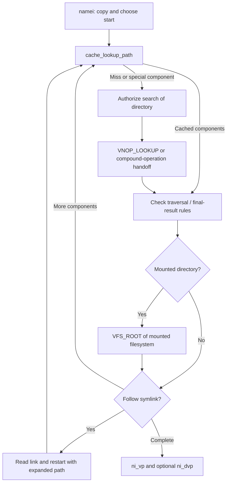

# Pathname resolution, name caching, and authorization

Continue with [cache validation, publication and vnode reclamation](name-cache-and-vnode-reclaim.md) for the reference-conversion, generation and drain protocols behind this overview.

[VFS index](README.md) · [Vnode lifetimes](vnodes-mounts-and-dispatch.md)

## A pathname lookup is a stateful operation

[`struct nameidata`](../../../xnu/bsd/sys/namei.h#L99) carries the pathname pointer and address-space type, starting/root directory, results `ni_vp` and `ni_dvp`, remaining path length, next component, symlink count, flags and `componentname`. [`componentname`](../../../xnu/bsd/sys/vnode.h#L191) carries the operation (`LOOKUP`, `CREATE`, `DELETE`, `RENAME`), component bytes/length/hash, flags and context. Looking up an existing file and locating a parent for creation have different valid outcomes.

[`namei`](../../../xnu/bsd/vfs/vfs_lookup.c#L265) copies the pathname into kernel storage, chooses the starting/root directories, invokes component lookup and handles restart conditions. It begins with an inline `PATHBUFLEN` buffer; longer supported paths allocate larger storage, and this checkout has process-dependent long-path handling. `ni_segflg` determines whether copying uses `copyinstr` or `copystr`. Never treat an input user pointer as a stable, already trusted kernel string.

For `openat`, [`open1at`](../../../xnu/bsd/vfs/vfs_syscalls.c#L5218) prepares directory-fd handling because the eventual `namei` invocation occurs deeper inside `vn_open_auth`. Absolute paths, current-directory lookups and directory-relative lookups have distinct start rules. The `NAMEI_ROOTDIR`, `NAMEI_RESOLVE_BENEATH`, `NAMEI_NODOTDOT`, `NAMEI_LOCAL`, `NAMEI_NODEVFS` and related flags constrain traversal; they are not all enabled for ordinary `open`.

## Component traversal and fast paths

[`lookup`](../../../xnu/bsd/vfs/vfs_lookup.c#L1427) calls `cache_lookup_path`, which can consume cached components and report whether directory search has already been authorized. A miss continues through directory/type checks, search authorization and filesystem lookup. For a normal non-compound component, the route reaches `VNOP_LOOKUP`; successful results then pass through handling for mountpoints, links and cache updates.

`..` is not a string deletion. [`lookup`](../../../xnu/bsd/vfs/vfs_lookup.c#L1525) must honor the logical root, prevent prohibited escapes and potentially move from a mounted filesystem root to the covered directory in its parent filesystem. [`lookup_traverse_mountpoints`](../../../xnu/bsd/vfs/vfs_lookup.c#L1922) takes a mount crossing reference, obtains `vfs_busy`, calls `VFS_ROOT`, then releases crossing/busy state while replacing the directory iocount. It also handles forced-unmount and traversal restrictions.

[`lookup_handle_symlink`](../../../xnu/bsd/vfs/vfs_lookup.c#L2066) checks the symlink limit, performs the MAC readlink check, obtains link bytes through `VNOP_READLINK`, combines them with the unconsumed path and chooses a new starting directory. Relative targets restart at the link's directory; absolute targets require root handling. A symlink is processed by lookup policy rather than blindly treated as another ordinary directory entry.

## Name cache entries are validated identities

[`struct namecache`](../../../xnu/bsd/sys/namei.h#L243) stores parent vnode `nc_dvp`, name/hash, target `nc_vp`, target identity `nc_vid`, and `nc_counter`. A null target can represent a negative result: a known absent name. The cache has links for parent children, target names and hash lookup. Multiple names can refer to the same vnode, which is another reason `v_name` is not a unique canonical pathname.

[`cache_lookup_ext`](../../../xnu/bsd/vfs/vfs_cache.c#L2705) has an SMR path: safe memory reclamation lets it inspect hash entries without holding the global cache lock for the entire read. It reads `nc_counter`, validates the entry, snapshots vnode/vid, and checks that the counter stayed unchanged. For a positive result it obtains a vnode hold, exits the SMR section, reacquires an iocount with the saved vid, then drops the hold. Each mechanism solves a different race: cache-entry reclamation, vnode allocation lifetime and vnode incarnation.

The API's return convention is unusual: `-1` means a positive hit with `*vpp` populated, `0` means miss/fallback needed, and `ENOENT` means a negative hit. Negative entries are handled differently for create/rename so an old absence does not prevent a new object being created. Cache insertion uses directory generations to avoid publishing results that became stale while filesystem work was in progress; see [`lookup_consider_update_cache`](../../../xnu/bsd/vfs/vfs_lookup.c#L970).

The multi-component fast path has additional authorization and mount-root caching. This chapter describes its interface and the single-component SMR mechanism, not every fast-path restart. Namespace mutation, unmount and hard links mean a reconstructed path can change even while the underlying vnode remains valid; the [comment before filesystem lookup](../../../xnu/bsd/vfs/vfs_lookup.c#L1675) explains this limitation explicitly.

## Authorization happens at several boundaries

[`lookup_authorize_search`](../../../xnu/bsd/vfs/vfs_lookup.c#L940) checks `KAUTH_VNODE_SEARCH` unless an appropriate cached authorization applies, and invokes `mac_vnode_check_lookup` when configured. Reaching the final vnode does not itself authorize opening its data. [`vn_authorize_open_existing`](../../../xnu/bsd/vfs/vfs_subr.c#L8340) checks object/open compatibility, MAC policy and requested actions, distinguishing read, write, append, execute and directory search.

[`vnode_authorize`](../../../xnu/bsd/vfs/vfs_subr.c#L8997) calls the vnode kauth scope using the operation context. The internal authorization callback gathers attributes and evaluates the applicable rights, ownership/group, ACL, immutable and mount restrictions. Parent-directory information matters for operations such as deletion. Authorization is therefore not just comparing the current process UID with a file owner.

Opaque-authorization filesystems can make the final decision themselves. [`vnode_authorize_opaque`](../../../xnu/bsd/vfs/vfs_subr.c#L9967) tries `VNOP_ACCESS`; if unsupported, many operations rely on the filesystem's inline authorization. It treats advisory access checks and execute specially. Do not assume that a generic permission-cache hit overrides server-side authorization on a remote filesystem, or that every kernel caller of `VNOP_READ` automatically passes through the same authorization as a userspace `open`.

## Compound operations and cleanup

When the filesystem supports the intended compound operation, [`lookup`](../../../xnu/bsd/vfs/vfs_lookup.c#L1663) can stop before the final component, set `NAMEI_UNFINISHED`, and return enough state for a combined lookup/create/open or mutation. [`vn_open_auth`](../../../xnu/bsd/vfs/vfs_vnops.c#L395) handles `EKEEPLOOKING` and continuation when the filesystem encounters a symlink, mountpoint or other case requiring generic resolution. This reduces separate lookup/mutation work and lets the filesystem coordinate its own namespace locks.

Finally, [`nameidone`](../../../xnu/bsd/vfs/vfs_lookup.c#L2332) frees allocated pathname storage. It does **not** release the returned vnode iocounts. Read each caller's success and failure paths for `vnode_put(ni_vp)` and any parent/start-directory references; confusing these cleanup responsibilities leaks active vnodes or accesses recycled state.
