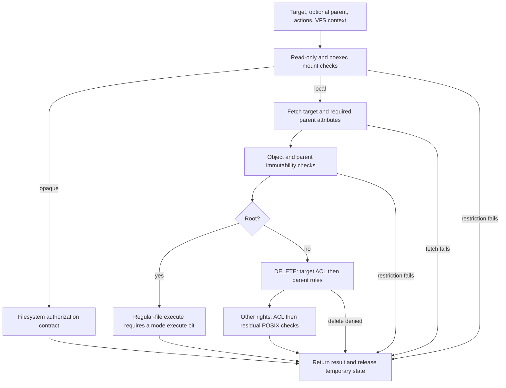
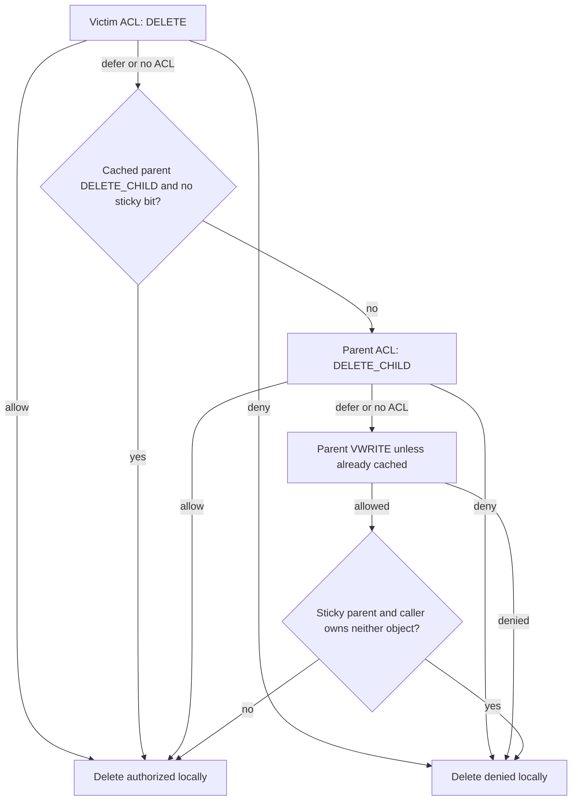
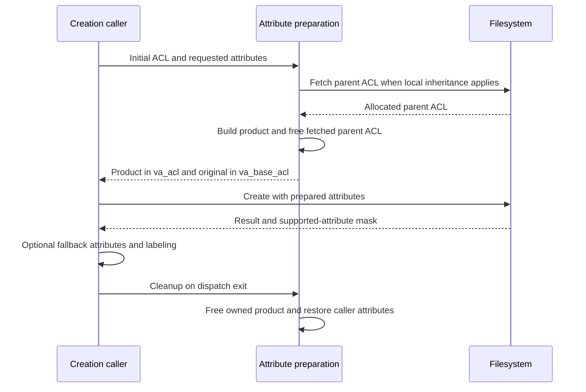

# Vnode permissions, ACL evaluation and inheritance

A vnode authorization request asks whether one credential may perform a set of actions on an object, sometimes with a separate parent directory. XNU first establishes the applicable mount and object restrictions, then evaluates ACL entries and any remaining POSIX permissions. Creation follows a second path that composes inherited ACLs and validates the proposed attributes before filesystem dispatch. This chapter follows those local mechanisms in `xnu-12377.121.6`.

[VFS index](README.md) · [Pathname lookup](pathname-and-authorization.md) · [Namespace mutations](namespace-mutations.md) · [Metadata interfaces](metadata-and-extended-attributes.md) · [Credential lifetime](../security/credential-and-policy-lifetimes.md)

## 1. The request is an action mask plus an execution context

`vnode_authorize(vp, dvp, action, ctx)` receives the target vnode, an optional directory, a `kauth_action_t` mask and the VFS context. It passes the context's credential and all three request arguments through the vnode kauth scope. `vnode_authorize_init` registers `vnode_authorize_callback` as that scope's main callback. A `VBAD` vnode is allowed through this authorization wrapper so the subsequent dead-vnode operation can return its own appropriate failure; this is not a successful access to a live file. [`registration and context`](../../../platydoc-data/xnu/bsd/vfs/vfs_subr.c#L8127-L8146), [`vnode_authorize`](../../../platydoc-data/xnu/bsd/vfs/vfs_subr.c#L8997-L9020).

The callback returns `KAUTH_RESULT_ALLOW`, `DENY` or `DEFER`, while its `errorp` argument can carry a more specific errno. `kauth_authorize_action` then visits listeners: a listener denial overrides an earlier allowance, and an unresolved defer is failure. Its public result is zero or `EPERM`; `vnode_authorize` translates the generic `EPERM` to `EACCES`, unless the callback supplied a more informative error such as `EROFS`. A successful main callback is therefore only one part of the kauth decision. MAC checks at the operation's caller remain additional checks. [`scope and listener combination`](../../../platydoc-data/xnu/bsd/kern/kern_authorization.c#L372-L410), [policy lifetime and dispatch](../security/credential-and-policy-lifetimes.md).

The same numeric action has different names for files and directories:

| Action bits | Regular-file interpretation | Directory interpretation |
| --- | --- | --- |
| `KAUTH_VNODE_READ_DATA` / `LIST_DIRECTORY` | Read file contents | Enumerate directory entries |
| `WRITE_DATA` / `ADD_FILE` | Write file contents | Add a non-directory entry |
| `EXECUTE` / `SEARCH` | Execute a regular file | Traverse the directory during lookup |
| `APPEND_DATA` / `ADD_SUBDIRECTORY` | Append to a file | Add a directory |
| `DELETE` | Remove this object from its parent | Remove this directory from its parent |
| `DELETE_CHILD` | A distinct bit, mainly meaningful on a parent | Remove a child from this directory |
| `READ/WRITE_ATTRIBUTES`, `READ/WRITE_EXTATTRIBUTES` | Basic metadata or extended attributes | Same categories on a directory |
| `READ/WRITE_SECURITY`, `TAKE_OWNERSHIP` | Security metadata and ownership changes | Same categories on a directory |

These aliases and the generic-right expansion masks are defined in [`kauth.h`](../../../platydoc-data/xnu/bsd/sys/kauth.h#L889-L1003). `KAUTH_VNODE_ACCESS` marks an advisory access check; `KAUTH_VNODE_NOIMMUTABLE` requests the restricted flag-changing exception described below. The slow callback extracts those two control bits before evaluating rights. `LINKTARGET` and `CHECKIMMUTABLE` participate in preliminary restrictions and are removed after those checks. They are not ordinary ACL permissions requiring a matching ACE. [`control-bit extraction`](../../../platydoc-data/xnu/bsd/vfs/vfs_subr.c#L10276-L10300), [`preliminary rights`](../../../platydoc-data/xnu/bsd/vfs/vfs_subr.c#L10141-L10178).

### Open and later flag changes choose different masks

For an existing object, `vn_authorize_open_existing` turns `FREAD` into `READ_DATA`; a writable, nontruncating `O_APPEND` open requests `APPEND_DATA`, while other writable or truncating opens request `WRITE_DATA`. `FSEARCH`/`FEXEC` selects directory search or execution. Earlier type and MAC checks are still part of open. [`open mask construction`](../../../platydoc-data/xnu/bsd/vfs/vfs_subr.c#L8444-L8470).

An already open writable vnode can encounter a new authorization request: `fcntl(F_SETFL)` changing from nonappend to append obtains a vnode iocount and requests `APPEND_DATA` before changing the flags. Failure releases the iocount and exits without installing that change. Clearing append has a separate append-only-object check. The implementation also contains a warning about concurrent `F_SETFL`/`ioctl` operations sharing a fileglob; this authorization check does not resolve that broader concurrency limitation. [`F_SETFL`](../../../platydoc-data/xnu/bsd/kern/kern_descrip.c#L2955-L2994).

Authorization runs in the calling operation's context. Attribute retrieval can call a filesystem and membership resolution can submit work to a user service. It cannot be modeled as an always nonblocking comparison of cached integers. The caller's vnode references, operation serialization and VFS context remain necessary; the stack-allocated authorization context does not acquire a replacement lifetime for every object it mentions.

## 2. Attributes and temporary state used by the evaluator

The main local state is deliberately small. [`The authorization context`](../../../platydoc-data/xnu/bsd/vfs/vfs_subr.c#L8127-L8140) contains borrowed vnode/context pointers and per-evaluation owner/group answers:

<!-- source-excerpt: ../../../platydoc-data/xnu/bsd/vfs/vfs_subr.c#L8127-L8140 -->
```c
typedef struct _vnode_authorize_context {
	vnode_t         vp;
	struct vnode_attr *vap;
	vnode_t         dvp;
	struct vnode_attr *dvap;
	vfs_context_t   ctx;
	int             flags;
	int             flags_valid;
#define _VAC_IS_OWNER           (1<<0)
#define _VAC_IN_GROUP           (1<<1)
#define _VAC_IS_DIR_OWNER       (1<<2)
#define _VAC_IN_DIR_GROUP       (1<<3)
#define _VAC_NO_VNODE_POINTERS  (1<<4)
} *vauth_ctx;
```

| Representation | Relevant contents and ownership |
| --- | --- |
| `vfs_context_t` | Supplies `vc_ucred`, the credential being evaluated. This need not be reduced to a PID or to an assumed process-wide effective UID. |
| `struct vnode_attr` | `va_active` says which attributes the caller wants or supplies; `va_supported` says which attributes were returned/handled. `va_uid`, `va_gid`, `va_mode`, `va_flags`, `va_type` and `va_acl` feed authorization. |
| `struct kauth_ace` | `ace_applicable` is a GUID; `ace_flags` encodes permit/deny and inheritance; `ace_rights` contains scope-specific and generic rights. |
| `struct kauth_acl` | An entry count, ACL flags and an ordered ACE array. A null ACL and an allocated zero-entry ACL are distinguishable representations. |
| `struct kauth_acl_eval` | Input ACE array/count, original `ae_requested`, mutable `ae_residual`, result, `ae_found_deny`, owner/group options and generic-right expansion masks. |
| `flags` / `flags_valid` in `vauth_ctx` | Cache owner and group answers within this evaluation, separately for target and parent. These are not the persistent vnode authorization cache. |

Definitions: [`vnode_attr`](../../../platydoc-data/xnu/bsd/sys/vnode.h#L690-L745), [`attribute-mask helpers`](../../../platydoc-data/xnu/bsd/sys/vnode.h#L506-L518), [`ACE and ACL`](../../../platydoc-data/xnu/bsd/sys/kauth.h#L585-L651), [`ACL evaluator`](../../../platydoc-data/xnu/bsd/sys/kauth.h#L740-L757), [`cached owner/group helpers`](../../../platydoc-data/xnu/bsd/vfs/vfs_subr.c#L9152-L9284).

For ordinary non-root local evaluation, `vnode_authorize_callback_int` asks for mode, flags, UID, GID and ACL on the target, and on the parent when deleting. It sets the type from the vnode. Root's remaining checks only need mode and flags. The fetched ACL buffers are freed on the common exit path, including failures after one fetch succeeded and a later fetch failed. A named-stream parent reference acquired by this path is also released. [`attribute gathering and cleanup`](../../../platydoc-data/xnu/bsd/vfs/vfs_subr.c#L10363-L10447).

`vnode_getattr` is more than a direct `VNOP_GETATTR` call. It clears extended-security requests on filesystems lacking that support; when supported attributes are requested but not supplied by the filesystem, it can retrieve a filesec through the fallback path and copy the ACL into an independently allocated buffer. It frees an unsolicited ACL that the caller did not request. UID/GID normalization, missing flag defaults and type population happen here as well. [`getattr and ACL fallback`](../../../platydoc-data/xnu/bsd/vfs/kpi_vfs.c#L2859-L2957), [`normalization and defaults`](../../../platydoc-data/xnu/bsd/vfs/kpi_vfs.c#L2981-L3010).

The ownership comparison uses a supported numeric `va_uid` as authoritative; the code does not substitute a stored owner UUID when that comparison fails. `vnode_attr_handle_uid_and_gid` can present mount-derived or caller-derived ownership for `MNT_IGNORE_OWNERSHIP` and UID/GID 99 cases. Consequently an authorization input can differ from the filesystem's raw on-disk owner. [`owner predicate`](../../../platydoc-data/xnu/bsd/vfs/vfs_subr.c#L9063-L9079), [`UID/GID normalization`](../../../platydoc-data/xnu/bsd/vfs/kpi_vfs.c#L2802-L2847).

There is also an attribute-only interface for callers already holding suitable metadata. `vnode_attr_authorize_init` selects required attributes; `vnode_attr_authorize` runs the shared local evaluator with null vnode pointers and no persistent vnode-cache updates. Missing requested security fields can trigger its completeness panic checks. This is a kernel caller contract, not a user-input parser or a way to bypass fetching coherent metadata. [`attribute-only entry`](../../../platydoc-data/xnu/bsd/vfs/vfs_subr.c#L10455-L10568).

## 3. Mount, immutable, root and opaque-filesystem decisions

On a cache miss, the ordinary callback follows this simplified order. The diagram shows non-root requests and root requests needing write/execute checks; the earlier root shortcut for other requests is described below. Caller MAC checks and kauth listeners surround this route, and the later filesystem operation can still fail.



`MNT_RDONLY` rejects write-right requests with `EROFS` for regular files, directories, symlinks, complex vnodes, and deletion actions. It does not blanket-ban data I/O to a device node merely because the device's name lives on a read-only filesystem. `MNT_NOEXEC` rejects regular-file execution with `EACCES`. These gates precede the local ACL and root shortcuts. [`mount gates`](../../../platydoc-data/xnu/bsd/vfs/vfs_subr.c#L10302-L10322).

`vnode_authorize_checkimmutable` then checks write-like actions. For sockets, FIFOs and character/block devices, it removes `WRITE_DATA` from this particular immutability decision because endpoint data writes do not modify filesystem data. `MNT_NOUSERXATTR` can forbid extended-attribute writes. `vnode_immutable` starts from immutable and append-only flags: append-compatible requests may ignore the append-only part, but not immutable flags. For directories, adding files/subdirectories and writing extended attributes form the permitted append-compatible write subset; for nondirectories, appending and extended-attribute writes form that subset. Deleting a child also checks parent immutability unless an applicable cached parent authorization already supplies that preliminary result. [`immutable wrapper`](../../../platydoc-data/xnu/bsd/vfs/vfs_subr.c#L9873-L9949), [`flag masks`](../../../platydoc-data/xnu/bsd/vfs/vfs_subr.c#L9033-L9060), [`parent check`](../../../platydoc-data/xnu/bsd/vfs/vfs_subr.c#L10149-L10166).

`KAUTH_VNODE_NOIMMUTABLE` is used when changing flags so a caller can clear flags it is permitted to change. The `ignore` path removes all inhibiting flag bits at `securelevel <= 0`, but at a higher securelevel ignores only user immutable/append bits. `chflags0` derives the required actions, adds this control bit, authorizes, and only then calls its setter. This is not unconditional permission to clear any flag. The owner-with-ignore-permissions context has its own restricted retry through the same ignore logic. [`chflags0`](../../../platydoc-data/xnu/bsd/vfs/vfs_syscalls.c#L7870-L7920), [`owner retry`](../../../platydoc-data/xnu/bsd/vfs/vfs_subr.c#L9926-L9945).

Root bypasses ordinary local ACL/POSIX evaluation, but still encounters mount and relevant immutability checks. A regular-file execute request additionally requires at least one of the mode's three execute bits when mode is supported. Non-write, non-execute requests can take the earlier root shortcut without fetching attributes. These statements concern the local VFS authorizer; they do not cancel MAC or filesystem-specific enforcement. [`root shortcut`](../../../platydoc-data/xnu/bsd/vfs/vfs_subr.c#L10350-L10361), [`root execute check`](../../../platydoc-data/xnu/bsd/vfs/vfs_subr.c#L10193-L10210).

For `MNTK_AUTH_OPAQUE`, `vnode_authorize_opaque` handles a different contract. Local endpoint types still fall back to local checks. Advisory access requests also fall back if the filesystem does not advertise reliable opaque access checks. Otherwise `VNOP_ACCESS` supplies the result; `ENOTSUP` means the implementation expects enforcement during the real operation. In that unsupported case, regular-file execution attempts a read-only `VNOP_OPEN`/`VNOP_CLOSE` before accepting this preliminary check. A zero result here is not proof that the later remote request will succeed. [`opaque authorization`](../../../platydoc-data/xnu/bsd/vfs/vfs_subr.c#L9967-L10028).

## 4. Ordered ACL evaluation: requested rights and residual rights differ

`kauth_acl_evaluate` starts with `ae_residual = ae_requested` and visits ACEs in stored order. It skips `ONLY_INHERIT` entries, expands generic rights using the caller's masks, and ignores unsupported ACE kinds. Audit/alarm kinds are declared but do not implement a second auditing engine here. The caller's rights can be satisfied incrementally by multiple permit entries. [`initialization and scan`](../../../platydoc-data/xnu/bsd/kern/kern_authorization.c#L608-L692).

The relevant-entry test deliberately differs between permit and deny. Permit cares about rights still missing; deny cares about the original request. `ae_found_deny` is set for a relevant deny before testing whether its principal matches this credential. [`Relevant ACE selection`](../../../platydoc-data/xnu/bsd/kern/kern_authorization.c#L677-L692):

<!-- source-excerpt: ../../../platydoc-data/xnu/bsd/kern/kern_authorization.c#L677-L692 -->
```c
		switch (ace->ace_flags & KAUTH_ACE_KINDMASK) {
		case KAUTH_ACE_PERMIT:
			if (!(eval->ae_residual & rights)) {
				continue;
			}
			break;
		case KAUTH_ACE_DENY:
			if (!(eval->ae_requested & rights)) {
				continue;
			}
			eval->ae_found_deny = TRUE;
			break;
		default:
			/* we don't recognise this ACE, skip it */
			continue;
		}
```

After matching the principal, permit clears granted residual bits and immediately returns ALLOW when the residual becomes zero. Deny immediately returns DENY for any overlap with the original requested mask. If the list ends with unresolved rights, the result is DEFER, allowing the caller to consider another mechanism. A successful C return value from `kauth_acl_evaluate` means an evaluation result is available; inspect `ae_result` to learn whether access was allowed. [`Result application`](../../../platydoc-data/xnu/bsd/kern/kern_authorization.c#L755-L781):

<!-- source-excerpt: ../../../platydoc-data/xnu/bsd/kern/kern_authorization.c#L755-L781 -->
```c
		switch (ace->ace_flags & KAUTH_ACE_KINDMASK) {
		case KAUTH_ACE_PERMIT:
			/* satisfy any rights that this ACE grants */
			eval->ae_residual = eval->ae_residual & ~rights;
			KAUTH_DEBUG("    ACL[%d] - rights %x leave residual %x", i, rights, eval->ae_residual);
			/* all rights satisfied? */
			if (eval->ae_residual == 0) {
				eval->ae_result = KAUTH_RESULT_ALLOW;
				return 0;
			}
			break;
		case KAUTH_ACE_DENY:
			/* deny the request if any of the requested rights is denied */
			if (eval->ae_requested & rights) {
				KAUTH_DEBUG("    ACL[%d] - denying based on %x", i, rights);
				eval->ae_result = KAUTH_RESULT_DENY;
				return 0;
			}
			break;
		default:
			KAUTH_DEBUG("    ACL - unknown entry kind %d", ace->ace_flags & KAUTH_ACE_KINDMASK);
			break;
		}
	}
	/* if not permitted, defer to other modes of authorisation */
	eval->ae_result = KAUTH_RESULT_DEFER;
	return 0;
```

This is not a full-list union of all permits minus all denies. Nor does a permit permanently protect an individual bit from every subsequent deny while other bits remain unresolved.

### Worked ordering examples

These are illustrative ACLs using `R = READ_DATA` and `W = WRITE_DATA`. Assume a non-root caller, every displayed ACE applies, no inheritance-only entries, and no earlier mount/immutable denial.

| Request and ordered entries | Evaluator state and result |
| --- | --- |
| Request `R`; permit `R`; deny `R` | First entry clears the entire residual and returns ALLOW. The later deny is not visited. |
| Request `R|W`; permit `R`; deny `R`; permit `W` | After the first entry, residual is `W`. The deny still intersects original `R|W`, so evaluation returns DENY before the last permit. |
| Request `R|W`; permit `R`; permit `W` | Residual changes from `R|W` to `W` to zero: ALLOW. |
| Request `R|W`; permit `R`; end of list | DEFER with residual `W`; the local vnode authorizer can require POSIX write permission for that residual. |
| Request `R`; inherit-only deny `R`; no other entries | The deny is skipped: DEFER with residual `R`, which proceeds to the caller's fallback. |

The source establishes these particular transitions. It does not say that arbitrary user tooling preserves the entry order supplied in these examples; parser and filesystem storage are separate boundaries.

## 5. Principal matching and incomplete group information

ACE principals are GUIDs. `kauth_acl_evaluate` first attempts to obtain the caller's GUID through `kauth_cred_getguid`, which translates the credential's numeric UID. Failure does not immediately abort the whole ACL scan; it records that no caller GUID is available. The evaluator handles well-known owner, group, everybody and nobody GUIDs before ordinary GUID matching. [`GUID preparation`](../../../platydoc-data/xnu/bsd/kern/kern_authorization.c#L635-L644), [`matching`](../../../platydoc-data/xnu/bsd/kern/kern_authorization.c#L697-L750), [`credential GUID`](../../../platydoc-data/xnu/bsd/kern/kern_credential.c#L2341-L2345).

| Principal | Matching decision |
| --- | --- |
| Owner | Uses `KAUTH_AEVAL_IS_OWNER`, derived from numeric vnode ownership by this caller. |
| Owning group | Uses `KAUTH_AEVAL_IN_GROUP` when GUID/group information is known. If the caller GUID is unavailable or group membership was marked unknown, permit does not apply and deny does. |
| Everybody / nobody | Always applies / never applies. |
| Other GUID | Match the caller's GUID directly; otherwise ask `kauth_cred_ismember_guid` whether it denotes a group containing this credential. |

For an ordinary GUID membership error inside this evaluator, the code makes the same conservative selection: skip a permit, apply a deny. This changes the ACL decision instead of returning the resolver error unchanged. [`Membership-error branch`](../../../platydoc-data/xnu/bsd/kern/kern_authorization.c#L723-L743).

There is a separate earlier lookup. The vnode authorizer calls `vauth_file_ingroup` or `vauth_dir_ingroup` to prepare owning-group options. `vauth_node_group` translates `ENOENT` to the caller-selected `idontknow` result. ACL callers deliberately use `ENOENT` to set `IN_GROUP_UNKNOWN`; other errors from that preparation can terminate authorization before `kauth_acl_evaluate` runs. It would be wrong to describe every group-service error as reaching the conservative ACE branch. [`group preparation`](../../../platydoc-data/xnu/bsd/vfs/vfs_subr.c#L9098-L9149), [`ACL options`](../../../platydoc-data/xnu/bsd/vfs/vfs_subr.c#L9709-L9734).

`kauth_cred_ismember_gid` first examines groups stored in the credential. If there is no group-membership UID, that list is authoritative. With `CONFIG_EXT_RESOLVER`, a registered resolver permits cached and external membership lookups; a valid `(cr_gmuid, gid)` cache entry supplies the result, otherwise the code prepares `kauth_identity_extlookup` and submits a resolver request after dropping the group-cache lock. The GUID variant can recognize a cached user identity as not-a-group, translate a GUID to a GID, then use the GID mechanism. [`GID lookup`](../../../platydoc-data/xnu/bsd/kern/kern_credential.c#L2993-L3095), [`GUID lookup`](../../../platydoc-data/xnu/bsd/kern/kern_credential.c#L3122-L3190).

This chapter follows the consumer's decisions and the local lookup boundary. It does not reconstruct the external directory service's database, nested-group policy or every resolver/cache lifecycle. Those are separate from credential publication and from filesystem ACL storage.

## 6. How unresolved ACL rights become POSIX checks

`vnode_authorize_simple` first removes `WRITE_SECURITY` for the file owner. A request containing both `TAKE_OWNERSHIP` and `WRITE_SECURITY` can also drop the latter because taking ownership would make that permission implicit. If no rights remain, it succeeds before scanning the ACL. Otherwise an ACL ALLOW succeeds, a DENY normally returns `EACCES`, and DEFER continues with residual rights. Selected owner contexts that ignore node permissions can override the local ACL denial. These are explicit branches, not universal owner access. [`initial adjustments and ACL handling`](../../../platydoc-data/xnu/bsd/vfs/vfs_subr.c#L9673-L9765).

On the fallback path, preauthorized bits are removed, and the owner receives residual `WRITE_ATTRIBUTES` if an earlier ACL denial did not stop the operation. Remaining `CHANGE_OWNER` or `WRITE_SECURITY` cannot be granted by POSIX mode bits and cause `EACCES`. Other residual bits map as follows. [`Residual processing`](../../../platydoc-data/xnu/bsd/vfs/vfs_subr.c#L9767-L9835):

| Residual rights | POSIX request |
| --- | --- |
| `READ_DATA` / `LIST_DIRECTORY`, `READ_EXTATTRIBUTES` | `VREAD` |
| `WRITE_DATA` / `ADD_FILE`, `ADD_SUBDIRECTORY` / `APPEND_DATA`, `DELETE_CHILD`, `WRITE_ATTRIBUTES`, `WRITE_EXTATTRIBUTES` | `VWRITE` |
| `EXECUTE` / `SEARCH` | `VEXEC` |
| Remaining rights with no POSIX mapping in this function | Do not add a POSIX requirement; if no mapped requirements remain, this fallback returns success. |

The append bit's appearance through its directory alias matters: a deferred `APPEND_DATA` request still maps to POSIX write permission. Generic read/write ACL entries expand to several metadata rights as well as data rights; an example using just `READ_DATA` is narrower than `GENERIC_READ`.

`vnode_authorize_posix` computes whether the **entire requested action** is satisfied by each mode class, then avoids membership lookup when all classes agree. Otherwise it selects owner first, group second, and world last. It does not combine a missing owner permission with a world permission to make a more permissive result. For a nonowner, identical group/world answers avoid the potentially expensive group query. [`mode evaluation`](../../../platydoc-data/xnu/bsd/vfs/vfs_subr.c#L9303-L9445).

Membership failure is handled conservatively when group and world disagree. If the group class denies, an unresolved/error result is treated as membership and denied; if the group class permits but world denies, failure leaves the nonmembership/world denial route. Thus uncertainty does not choose whichever class grants access. This is distinct from simply propagating the original resolver errno. An object with no supported group owner has its own default nonmembership handling. [`membership fallback`](../../../platydoc-data/xnu/bsd/vfs/vfs_subr.c#L9407-L9445).

For example, an owner requesting read on mode `004` is denied by owner mode `0` even though other users may read. A nonowner requesting read on mode `004` must establish that the denying group class does not apply; failed membership resolution is not sufficient. On mode `044`, a nonowner's group/world read results agree, so no group query is needed for that request. These are local POSIX-stage examples, after any ACL and earlier restrictions.

## 7. Delete permission is a two-object decision

Deletion uses `vnode_authorize_delete`, with the victim's attributes and the containing directory's attributes. The earlier immutable checks still apply to the victim and applicable parent. The function then evaluates only `DELETE` against the victim ACL first. An explicit target ALLOW succeeds here; a target DENY fails here, subject to the specific owner-context override. Only DEFER or no target ACL continues to parent handling. The generic implementation therefore must not be described as always allowing a parent `DELETE_CHILD` ACE to override a victim deny. [`victim decision`](../../../platydoc-data/xnu/bsd/vfs/vfs_subr.c#L9501-L9558).

The rest of the path is:



The diagram omits the special owner-with-ignore-permissions overrides and earlier failures, not their existence. Its arrows describe the selected helper's result, before additional kauth listeners or the filesystem mutation.

A cached parent `DELETE_CHILD` authorization allows a shortcut only when the directory is not sticky. With a sticky parent, the cache cannot reveal whether its allowance came from an explicit ACL permit or POSIX write permission. The code must inspect the parent ACL again because an explicit `DELETE_CHILD` permit succeeds before the sticky-bit fallback. [`The cache distinction`](../../../platydoc-data/xnu/bsd/vfs/vfs_subr.c#L9561-L9574):

<!-- source-excerpt: ../../../platydoc-data/xnu/bsd/vfs/vfs_subr.c#L9561-L9574 -->
```c
	/*
	 * Without a sticky bit, a previously authorized delete child is
	 * sufficient to authorize this delete.
	 *
	 * If the sticky bit is set, a directory ACL which allows delete child
	 * overrides a (potential) sticky bit deny. The authorized delete child
	 * cannot tell us if it was authorized because of an explicit delete
	 * child allow ACE or because of POSIX permisions so we have to check
	 * the directory ACL everytime if the directory has a sticky bit.
	 */
	if (!(dvap->va_mode & S_ISTXT) && cached_delete_child) {
		KAUTH_DEBUG("%p    ALLOWED - granted by directory ACL or POSIX permissions and no sticky bit on directory", vcp->vp);
		return 0;
	}
```

A parent ACL DENY fails; ALLOW caches the parent right when useful and returns success. If the ACL defers, the code requires parent `VWRITE` unless already cached, then requires the caller to own either the victim or the directory when `S_ISTXT` is set. It can cache successful parent write/delete-child permission even when this particular victim is subsequently rejected by sticky rules. The cache entry does not mean every child is removable. [`parent ACL and sticky fallback`](../../../platydoc-data/xnu/bsd/vfs/vfs_subr.c#L9576-L9667).

Three illustrative cases make the distinction concrete. With an unprivileged caller owning neither object and a mode `01777` directory: no applicable ACL permits means the sticky check denies; an explicit parent `DELETE_CHILD` ACL permit succeeds in this helper; a preceding victim `DELETE` ACL deny stops evaluation before that parent permit is considered. Existing directory search authorization and mutation-specific rules remain separate; the helper itself checks parent write permission at this stage, not a fresh complete pathname traversal.

Rename and unlink compose these requests in their callers. Cross-directory directory moves, replacement targets and swap rename require additional actions and retries described in [namespace mutations](namespace-mutations.md). A permission decision on one pair of vnodes is not authorization for a different pair obtained after a restart.

## 8. Creation composes a new ACL with explicit ownership

`vn_create` calls `vn_attribute_prepare` before dispatching create/mkdir/mknod. Unless `VA_NOINHERIT` is set and when the mount supports extended security, preparation saves the caller's initial ACL, calls `kauth_acl_inherit`, and installs the result in `va_acl`; `va_base_acl` remembers the original when a product exists. It then validates/defaults the other new-object attributes. [`create ordering`](../../../platydoc-data/xnu/bsd/vfs/vfs_subr.c#L8016-L8068), [`attribute preparation`](../../../platydoc-data/xnu/bsd/vfs/vfs_subr.c#L8153-L8195).

`kauth_acl_inherit` fetches a parent ACL only when there is a parent, authorization is local, and the initial ACL does not set `KAUTH_ACL_NO_INHERIT`. It first counts inheritable entries and supplied initial entries for allocation, then constructs the product as **direct entries from the initial ACL followed by selected inherited parent entries**, preserving order within those groups. Initial entries already marked `INHERITED` are omitted from the product. A `KAUTH_FILESEC_NOACL` initial count becomes no initial ACL. [`input selection and allocation`](../../../platydoc-data/xnu/bsd/kern/kern_authorization.c#L794-L878), [`composition`](../../../platydoc-data/xnu/bsd/kern/kern_authorization.c#L880-L932).

| Parent ACE / target | Result in this local composition |
| --- | --- |
| Target directory | Only parent ACEs with `DIRECTORY_INHERIT` are copied. |
| Target nondirectory | Only parent ACEs with `FILE_INHERIT` are copied. |
| Copied ACE | Set `INHERITED`; clear `ONLY_INHERIT`, making the copied entry eligible to apply to the new object. |
| Copied ACE has `LIMIT_INHERIT`, or target is nondirectory | Clear every inheritance-control flag, preventing further propagation through that product. |
| Initial `NO_INHERIT` | Suppress fetching/inheriting parent entries in this helper; direct initial ACEs can still be copied. |
| No initial ACL and no eligible entries | Return a null product. An explicitly supplied empty initial ACL instead leads to an allocated empty product. |

The inheritance transformation is visible directly in [`kern_authorization.c`](../../../platydoc-data/xnu/bsd/kern/kern_authorization.c#L905-L920):

<!-- source-excerpt: ../../../platydoc-data/xnu/bsd/kern/kern_authorization.c#L905-L920 -->
```c
			if (inherit->acl_ace[i].ace_flags & (isdir ? KAUTH_ACE_DIRECTORY_INHERIT : KAUTH_ACE_FILE_INHERIT)) {
				result->acl_ace[index] = inherit->acl_ace[i];
				result->acl_ace[index].ace_flags |= KAUTH_ACE_INHERITED;
				result->acl_ace[index].ace_flags &= ~KAUTH_ACE_ONLY_INHERIT;
				/*
				 * We do not re-inherit inheritance flags
				 * if the ACE from the container has a
				 * KAUTH_ACE_LIMIT_INHERIT, OR if the new
				 * object is not itself a container (since
				 * inheritance is always container-based).
				 */
				if ((result->acl_ace[index].ace_flags & KAUTH_ACE_LIMIT_INHERIT) || !isdir) {
					result->acl_ace[index].ace_flags &=
					    ~(KAUTH_ACE_INHERIT_CONTROL_FLAGS);
				}
				index++;
```

For an illustrative parent ACE containing `DIRECTORY_INHERIT | FILE_INHERIT | ONLY_INHERIT`, a new directory receives an applicable inherited entry with both propagation bits retained. A new regular file receives an applicable inherited entry with the propagation bits cleared. An ACE carrying only `FILE_INHERIT` is not copied to a new directory by this helper; do not substitute a different ACL inheritance specification for this source's predicate.

Several implementation limits deserve explicit treatment:

- The introductory comment mentions a process “umask ACL”, but the body leaves obtaining it as a TODO. The ordinary numeric mode umask is implemented elsewhere in new-attribute defaults; it is not an implemented process ACL here.
- `kauth_acl_alloc` rejects counts outside `0..KAUTH_ACL_MAX_ENTRIES` (128), and inheritance reports a null allocation as `ENOMEM`. Its preliminary allocation count includes all initial entries, even initial inherited entries later omitted from the output. Do not equate that error only with physical memory exhaustion.
- The allocation is zero-filled. This helper fills output ACEs and final entry count, but does not copy `initial->acl_flags` into the resulting header. The local `NO_INHERIT` input gate therefore does not, by itself, prove that the resulting header retains that flag for future descendants. Filesystem handling beyond this helper must be inspected separately.
- An opaque-authorization parent does not supply locally composed inherited entries; its provider owns that inheritance enforcement.

Evidence: [`umask-ACL TODO and counting`](../../../platydoc-data/xnu/bsd/kern/kern_authorization.c#L803-L878), [`output fields`](../../../platydoc-data/xnu/bsd/kern/kern_authorization.c#L880-L932), [`bounded zeroed allocation`](../../../platydoc-data/xnu/bsd/kern/kern_authorization.c#L1153-L1161).

`vnode_authattr_new_internal` independently defaults owner to the context UID, group to the parent group or caller group, and absent mode to `ACCESSPERMS & ~fd_cmask`; mount ignore-ownership settings can supply explicit mount owners instead. It validates requested field kinds and extended-security support. For local nonprivileged creation, explicit ownership/group and set-ID choices are checked rather than accepted just because parent add permission succeeded. Selected parent flags (`UF_DATAVAULT | SF_RESTRICTED`) are inherited separately from the ACL. [`defaults`](../../../platydoc-data/xnu/bsd/vfs/vfs_subr.c#L10585-L10707), [`attribute legality and final flags`](../../../platydoc-data/xnu/bsd/vfs/vfs_subr.c#L10709-L10818).

### Cleanup restores the caller's representation

The ACL returned by inheritance is a temporary creation attribute. `vn_attribute_cleanup` restores `va_base_acl` when present, otherwise clears the active ACL bit, and frees the composed buffer under the `VA_FILESEC_ACL` ownership rules. It also clears mode/UID/GID fields that preparation defaulted. Preparation invokes cleanup if subsequent new-attribute validation fails; `vn_create` invokes it after filesystem dispatch and postprocessing. The separately fetched parent ACL is freed by `kauth_acl_inherit`, not retained as the child's storage. [`inheritance exit`](../../../platydoc-data/xnu/bsd/kern/kern_authorization.c#L924-L933), [`attribute cleanup`](../../../platydoc-data/xnu/bsd/vfs/vfs_subr.c#L8198-L8240), [`create exit`](../../../platydoc-data/xnu/bsd/vfs/vfs_subr.c#L8072-L8118).

The sequence shows successful preparation followed by dispatch and cleanup. Preparation errors unwind before filesystem creation; the final cleanup is also needed when dispatch or postprocessing fails.



Filesystem creation and fallback metadata installation are distinct stages. A failure applying fallback attributes or labeling after the create VNOP succeeded does not imply that no namespace object was created. The existing [creation and compound-operation chapter](namespace-mutations.md#3-create-and-mkdir-a-successful-creation-is-a-distinct-event) explains that partial-progress boundary.

## 9. Updating security attributes and invalidating cached decisions

An ACL update has at least three questions: is the metadata input well formed, is this credential authorized to change security state, and can the filesystem store the new attributes? For extended-file-security input, `kauth_copyinfilesec` copies a fixed header, checks its magic and bounded count, allocates from that captured count, copies the ACE body and publishes the resulting pointer only after successful copying. Copy faults free the buffer. The `KAUTH_FILESEC_NOACL` sentinel changes the copied body size. This boundary validates the container; it does not run each ACE as an access decision. [`filesec copyin`](../../../platydoc-data/xnu/bsd/kern/kern_authorization.c#L966-L1010).

For an existing vnode, `vnode_authattr` fetches the old attributes needed to compare the change and computes a required action mask. Adding/removing an ACL, changing its ACE count or changing ACE bytes requires `WRITE_SECURITY`. The inspected comparison does not compare `acl_flags` when count/ACE contents are unchanged; do not describe it as an unconditional comparison of every ACL-header byte. Its common exit frees the old fetched ACL and publishes the action only on success. [`old-ACL request`](../../../platydoc-data/xnu/bsd/vfs/vfs_subr.c#L10916-L10922), [`ACL comparison and result`](../../../platydoc-data/xnu/bsd/vfs/vfs_subr.c#L11322-L11371).

The chmod/chown/ACL common syscall path performs relevant MAC checks, acquires `vnode_chmod_chown_busy`, runs `vnode_authattr` followed by `vnode_authorize`, then calls `vnode_setattr`. It translates authorization `EACCES` to the interface's `EPERM` at this point. Its busy/unbusy pairing serializes these competing security-attribute updates; it is different from a lock held across every pathname operation. The resulting `WRITE_SECURITY` request still goes through the owner and immutability rules already described. [`serialized update`](../../../platydoc-data/xnu/bsd/vfs/vfs_syscalls.c#L8070-L8133), [`setattr dispatch`](../../../platydoc-data/xnu/bsd/vfs/kpi_vfs.c#L3107-L3274).

The persistent vnode cache stores positive actions for a credential and selected globally usable search state; it is not a copy of the ACL or a cache of every failure. The outer vnode callback checks it for simple one-vnode requests, while two-vnode requests defer to the detailed path and may use a separate parent delete-child cache. Successful scope-callback results can update the cache before kauth listeners make the final combined decision. Local named streams normally associate cached rights with the data-fork parent; opaque streams have their own cache rules. [`callback and cache`](../../../platydoc-data/xnu/bsd/vfs/vfs_subr.c#L10047-L10137).

`VNOP_SETATTR` invalidates cached rights after a successful change with supported security-related attributes; `VNOP_SETXATTR` invalidates after success. The setattr wrapper also handles the relevant opaque named stream. The detailed credential matching, timestamps, opaque-filesystem TTL and vnode-reference protocol are already covered in [vnode identity and authorization caching](vnode-cache-identity-and-reuse.md). The successful-search path can synthesize `SEARCHBYANYONE` using its `found_deny` result and all three mode execute bits (or unsupported mode); root sets `found_deny` to avoid deriving that result from its ACL bypass. This optimization must be understood from the actual evaluator's early-return behavior, not as a claim that every request scans every ACE. [`cache implementation`](../../../platydoc-data/xnu/bsd/vfs/vfs_cache.c#L1547-L1691), [`setattr invalidation`](../../../platydoc-data/xnu/bsd/vfs/kpi_vfs.c#L3981-L4000), [`setxattr invalidation`](../../../platydoc-data/xnu/bsd/vfs/kpi_vfs.c#L6178-L6186), [`search synthesis`](../../../platydoc-data/xnu/bsd/vfs/vfs_subr.c#L10423-L10440).

## 10. Configuration, tests and boundaries

| Source or condition | What it establishes here |
| --- | --- |
| Mount extended-security support | Controls whether ACL/GUID attributes are requested and whether local creation preparation composes an ACL. Unsupported extended-security input is rejected rather than silently installed. |
| `MNTK_AUTH_OPAQUE`, opaque-access capability | Selects provider enforcement versus local attribute evaluation, including advisory requests and execution fallback. |
| `MNT_RDONLY`, `MNT_NOEXEC`, `MNT_IGNORE_OWNERSHIP`, `MNT_NOUSERXATTR` | Separate mount restrictions or identity presentation; these should not be conflated with an ACL deny. |
| `CONFIG_EXT_RESOLVER` | Controls external identity/group machinery. The ACE evaluator's own decisions remain visible independently of the unavailable user service. |
| `CONFIG_MACF`, named-stream options, `DIAGNOSTIC` | Select caller policy checks, resource-fork paths and contract assertions; no assumption that every product build enables every branch. |
| [`append_acl.c`](../../../platydoc-data/xnu/tests/vfs/append_acl.c#L43-L48), [direct append open](../../../platydoc-data/xnu/tests/vfs/append_acl.c#L93-L131), [later `F_SETFL`](../../../platydoc-data/xnu/tests/vfs/append_acl.c#L133-L178) | A deny-append ACL must reject direct append open and adding append to an already writable descriptor; the latter checks that `O_APPEND` was not installed. Tests condition their execution on platforms supporting their ACL-management helper. |
| [`direntries_permissions.c`](../../../platydoc-data/xnu/tests/vfs/direntries_permissions.c#L120-L159) | A root-started test changes identity, constructs directories with different modes and expects selected renames to fail with `EACCES`. This is mutation permission evidence, not an exhaustive ACL-ordering suite. |

The source and tests were read, not compiled or executed. The worked ACL, POSIX and inheritance examples are traces derived from the inspected bodies. The local source establishes attribute ownership, decision order, callback contracts and cleanup; APFS's on-disk ACL representation, transaction semantics, user-space ACL editing/canonicalization, membership-service databases and third-party MAC/listener policy are outside this checkout's implementation. The separate persona, audit-session and full resolver-cache lifecycle mechanisms are not claimed as covered by this chapter.

<!-- BEGIN PLATYDOC DOCUMENTATION LICENSE -->
Original Platydoc text and diagrams are licensed under [CC BY 4.0](https://creativecommons.org/licenses/by/4.0/). Quoted source code and third-party material retain their respective licenses.
<!-- END PLATYDOC DOCUMENTATION LICENSE -->
