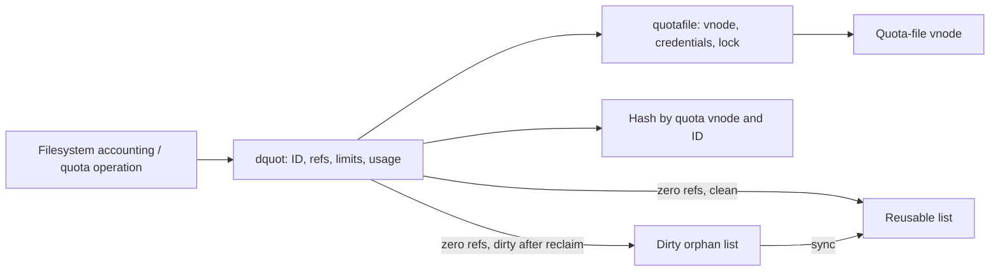

# Quota records, cache identity and filesystem boundaries

[VFS](README.md) · [Mount lifecycle](mount-lifecycle.md) · [Vnode caching](vnode-cache-identity-and-reuse.md)

The generic quota implementation caches per-identity records and reads/writes quota files. A filesystem decides where allocation is charged and which quota control operations it implements. This checkout exposes the cache and VFS dispatch but does not supply a complete APFS quota-accounting implementation.

## Control dispatch and the stored objects

`quotactl` resolves the target mount, handles operation-specific user data and permission/MAC checks, and calls `VFS_QUOTACTL`. The filesystem's registered operation is the boundary for enable/disable, retrieval and accounting policy. [Syscall dispatch](../../../xnu/bsd/vfs/vfs_syscalls.c#L3609-L3709).

A `quotafile` holds the backing vnode, stored credentials, quota-file lock, opening/closing/reference state, table dimensions and grace intervals. A `dquot` holds identity/type, reference count, flags, quota record, on-disk index and links into the hash and reusable/dirty lists. `dqblk` carries current bytes/inodes, hard/soft limits and grace deadlines. The hash key includes quota-file vnode plus ID, so user 501 on two mounts does not share one record. [Definitions](../../../xnu/bsd/sys/quota.h#L260-L319), [hash and lists](../../../xnu/bsd/vfs/vfs_quota.c#L99-L126).



## Quota-file open and close exclusion

`qf_get(QTF_OPENING)` prevents overlapping opens and waits for closing. `qf_get(QTF_CLOSING)` marks closing and drains both an in-progress open and `qf_refcnt`. New `qf_ref` requests fail while opening/closing, so a quota-off operation can stop new `dqget` users before waiting for existing ones. `qf_put` clears the transition flag and wakes waiters. These temporary file references are distinct from `dq_cnt`. [Transition protocol](../../../xnu/bsd/vfs/vfs_quota.c#L236-L361).

`dqfileopen` reads a fixed header using the quota credential, verifies magic/version, power-of-two entry count and consistency with file size, then establishes table/grace parameters. `dqfileclose` reads the header and attempts to write the updated entry count. It returns void and ignores that final write result; it is not a durability-reporting API. [Open/close](../../../xnu/bsd/vfs/vfs_quota.c#L378-L459).

## Cache lookup survives sleeping and races

`dqget` verifies initialization and input, acquires a quota-file reference under the global list lock, then searches by vnode/ID. Its per-record lock helper may sleep while dropping the global lock. Therefore a pointer found before that wait must have both list generation and identity revalidated afterward. A cached zero-reference object is removed from the clean or dirty free list before reuse as an active reference. [Hit path](../../../xnu/bsd/vfs/vfs_quota.c#L466-L565).

[bsd/vfs/vfs_quota.c, lines 514–528](../../../xnu/bsd/vfs/vfs_quota.c#L514-L528):
<!-- source-excerpt: ../../../xnu/bsd/vfs/vfs_quota.c#L514-L528 -->
```c
		dq_lock_internal(dq);
		if (dq_list_lock_changed(listlockval)) {
			dq_unlock_internal(dq);
			goto relookup;
		}

		/*
		 * dq_lock_internal may drop the quota_list_lock to msleep, so
		 * we need to re-evaluate the identity of this dq
		 */
		if (dq->dq_id != id || dq->dq_qfile == NULL ||
		    dq->dq_qfile->qf_vp != dqvp) {
			dq_unlock_internal(dq);
			goto relookup;
		}
```

On a miss the allocator drops the global lock to allocate, then searches again: another thread may have created the same identity. Reusing a clean free record also detaches old identity and restarts before publication. The cache refuses exhausted capacity with `EUSERS`. A newly inserted record remains per-record locked across `dqlookup`, so another finder cannot use incompletely loaded contents. I/O failure removes its published identity and releases the candidate. [Allocation/relookup/publication](../../../xnu/bsd/vfs/vfs_quota.c#L566-L756).

Example: A and B simultaneously request `(quota vnode Q, ID 501)`. Both can initially miss. A allocates while unlocked; B inserts the record first. A must discard its unused allocation and return B's record, otherwise two independently modified copies would represent one on-disk quota.

## The on-disk lookup and byte order

`dqlookup` serializes quota-file access with `qf_lock`, calculates a primary index and secondary probe stride, and reads fixed `dqblk` records through `VNOP_READ`. Empty ID zero means an unallocated entry: the code writes a zeroed record with the requested ID to reserve it, increments the entry count on successful write and saves its index. Existing records are converted from big-endian fields. Short reads/writes become `EIO` where checked. [Disk lookup](../../../xnu/bsd/vfs/vfs_quota.c#L762-L841).

`dqget` sets `DQ_FAKE` when all limits are zero and initializes missing grace deadlines from the quota-file intervals. Those are record initialization decisions. The actual allocation path that increments usage or rejects an allocation must come from a filesystem caller; a search for `dqget` here finds the exported implementation rather than an in-tree APFS charging routine.

## Three release routes and their different I/O rules

| Route | Last-reference behavior |
| --- | --- |
| `dqrele` | Attempts synchronization if modified, then puts the object on the reusable list |
| `dqreclaim` | Performs no I/O; moves a modified zero-reference record to the dirty-orphan list |
| `dqsync_orphans` | Takes an orphan record, revalidates it after possible sleeps, writes it and moves it to reusable state |

[Release/reclaim/orphan synchronization](../../../xnu/bsd/vfs/vfs_quota.c#L848-L957). The dirty list preserves work when reclaim context cannot write. Synchronization cannot assume identity remained fixed while locking: `dqsync_orphans` checks quota-file association and dirty state again after the per-record lock acquisition.

[bsd/vfs/vfs_quota.c, lines 890–897](../../../xnu/bsd/vfs/vfs_quota.c#L890-L897):
<!-- source-excerpt: ../../../xnu/bsd/vfs/vfs_quota.c#L890-L897 -->
```c
	if (dq->dq_flags & DQ_MOD) {
		TAILQ_INSERT_TAIL(&dqdirtylist, dq, dq_freelist);
	} else {
		TAILQ_INSERT_TAIL(&dqfreelist, dq, dq_freelist);
	}

	dq_unlock_internal(dq);
	dq_list_unlock();
```

`dqsync_locked` writes a big-endian snapshot to the stored index under record ownership and stored credentials. It reports a short write as `EIO`, but clears `DQ_MOD` even if the write failed. Callers such as `dqrele` deliberately ignore its result. Do not describe a dirty flag clearing as confirmed persistence or an automatic write retry guarantee. [Writeback](../../../xnu/bsd/vfs/vfs_quota.c#L982-L1031).

`dqflush` detaches every cache identity for a quota-file vnode and expects no live record references; a remaining count triggers a panic. Storage can remain on the reusable list after identity is gone. [Flush](../../../xnu/bsd/vfs/vfs_quota.c#L1037-L1069).

This explains the generic record/cache route. Filesystem allocation hooks, quota-file creation policy, transactional charging and APFS-specific quota domains are not bodies supplied by this source tree and should remain labeled provider boundaries.

<!-- BEGIN PLATYDOC DOCUMENTATION LICENSE -->
Original Platydoc text and diagrams are licensed under [CC BY 4.0](https://creativecommons.org/licenses/by/4.0/). Quoted source code and third-party material retain their respective licenses.
<!-- END PLATYDOC DOCUMENTATION LICENSE -->
