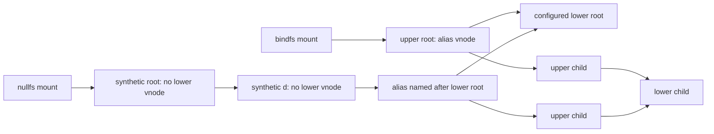
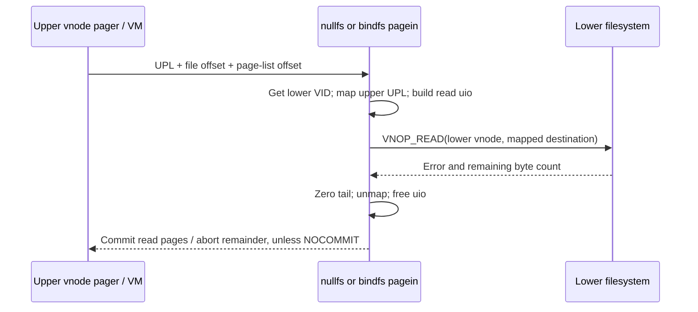

# Stacked filesystems: bindfs and nullfs

[Filesystem guide](README.md) · [Vnode lifetime](vnodes-mounts-and-dispatch.md) · [Page-in and UBC](io-and-cache.md)

A stacked filesystem gives an underlying object another vnode and mount identity. The useful question is which properties belong to the upper vnode, which operations reach the lower vnode, and which references survive between calls. In this checkout, bindfs and nullfs are concrete, restricted, read-only implementations. They are not general write-through layers or a generic operation-vector bypass facility. Both reject creation, deletion and rename in lookup and explicitly implement a selected set of vnode operations. [`bind_lookup`](../../../platydoc-data/xnu/bsd/miscfs/bindfs/bind_vnops.c#L185), [`null_lookup`](../../../platydoc-data/xnu/bsd/miscfs/nullfs/null_vnops.c#L560)

## 1. Two different namespace shapes

Bindfs mounts an alias of the configured lower root. Its upper root wraps that lower vnode, and child lookup wraps lower children. Nullfs creates a synthetic root and a synthetic `d` directory; below `d`, the lower root appears under its own name. These first two nullfs vnodes have no lower vnode. A third vnode, representing the mirrored lower root, enters the ordinary alias machinery. [`bindfs_mount`](../../../platydoc-data/xnu/bsd/miscfs/bindfs/bind_vfsops.c#L105), [`nullfs_mount`](../../../platydoc-data/xnu/bsd/miscfs/nullfs/null_vfsops.c#L104), [`null_special_lookup`](../../../platydoc-data/xnu/bsd/miscfs/nullfs/null_vnops.c#L428)



Both mount paths reject root-filesystem and update mounting, require their corresponding entitlement, resolve the configured lower path, and retain the lower root with a usecount. They force `MNT_DONTBROWSE`, `MNT_MULTILABEL`, `MNT_NOSUID`, and `MNT_RDONLY`, while selected flags such as local, quarantine, ignore-ownership and no-execute come from the lower mount. They allocate a distinct filesystem ID and copy selected lower filesystem attributes into the upper stat information. This describes the in-tree implementation, not every similarly named filesystem on other operating systems. [`bindfs_mount` flags](../../../platydoc-data/xnu/bsd/miscfs/bindfs/bind_vfsops.c#L203), [`nullfs_mount` flags and attributes](../../../platydoc-data/xnu/bsd/miscfs/nullfs/null_vfsops.c#L208)

Nullfs additionally captures the mounting credential's UID/GID and the permitted `NULLM_UNVEIL` configuration bit. The flags and synthetic namespace are therefore part of the implementation's behavior, not incidental examples of how any layer might be configured. [`nullfs_mount` credential capture](../../../platydoc-data/xnu/bsd/miscfs/nullfs/null_vfsops.c#L191)

## 2. Alias structures and three independent reference purposes

| State | Why it exists |
|---|---|
| `bind_mount` / `null_mount` lower root and saved VID | Retain the configured root across calls and detect replacement of its vnode identity. |
| Upper mount's root usecount | Keeps the upper root around until unmount. Nullfs also tracks its lazily created synthetic second vnode. |
| `bind_node` / `null_node` lower vnode and lower VID | One persistent lower reference for an ordinary alias, plus the lower identity it originally wrapped. |
| Node's upper vnode and upper VID | Recover the correct upper identity from the alias hash. |
| Hash linkage and `*_FLAG_HASHED` | Distinguish a published alias from a speculative vnode that lost a creation race. |
| Temporary vnode hold | Prevent upper vnode storage from disappearing while the hash lock is dropped to obtain an iocount. |
| Temporary iocount | Makes the relevant upper or lower vnode usable for the current operation. |

The concrete fields are in [`bindfs.h`](../../../platydoc-data/xnu/bsd/miscfs/bindfs/bindfs.h#L78) and [`nullfs.h`](../../../platydoc-data/xnu/bsd/miscfs/nullfs/nullfs.h#L79). The distinction between an enduring reference, a storage hold, and a generation-checked iocount is exercised directly by [`bind_hashget`](../../../platydoc-data/xnu/bsd/miscfs/bindfs/bind_subr.c#L129) and [`null_hashget`](../../../platydoc-data/xnu/bsd/miscfs/nullfs/null_subr.c#L136).

The alias hash key is the lower vnode pointer together with the upper mount. Two upper mounts can therefore wrap the same lower vnode independently. Under the global hash mutex, the lookup checks the saved lower VID against the current lower identity. A mismatch is `EIO`; it is not permission to reinterpret an old alias as a new lower object. If the entry matches, it saves the upper VID, holds the upper vnode, releases the hash mutex, obtains the upper iocount with `vnode_getwithvid`, and drops the hold. The hash mutex is not held across that potentially blocking vnode acquisition. [`bind_hashget`](../../../platydoc-data/xnu/bsd/miscfs/bindfs/bind_subr.c#L129)

[Alias hash handoff from a storage hold to an identity-checked iocount](../../../platydoc-data/xnu/bsd/miscfs/bindfs/bind_subr.c#L159)

<!-- source-excerpt: ../../../platydoc-data/xnu/bsd/miscfs/bindfs/bind_subr.c#L159-L170 -->
```c
	if (vp) {
		vnode_hold(vp);
	}
	lck_mtx_unlock(&bind_hashmtx);

	if (vp != NULL) {
		error = vnode_getwithvid(vp, vp_vid);
		if (error == 0) {
			*vpp = vp;
		}
		vnode_drop(vp);
	}
```

A long-term lower usecount does not remove the need for these identity checks: forced unmount/reclaim can invalidate the object the wrapper expected. Conversely, a successful upper hash lookup does not give the caller a fresh lower iocount; the subsequent operation still acquires the lower vnode for its own use. [`bind_lookup`](../../../platydoc-data/xnu/bsd/miscfs/bindfs/bind_vnops.c#L223), [`bindfs_read`](../../../platydoc-data/xnu/bsd/miscfs/bindfs/bind_vnops.c#L602)

## 3. Creation races are resolved at hash insertion

`bind_nodeget` and `null_nodeget` require a caller-held lower iocount. They first search the hash. On `ENOENT`, they take an additional persistent lower reference and create a new upper vnode. Vnode creation is deliberately outside hash serialization. Afterward, hash insertion either publishes the new node or finds a competing alias that appeared in the meantime. [`bind_nodeget`](../../../platydoc-data/xnu/bsd/miscfs/bindfs/bind_subr.c#L306), [`null_nodeget`](../../../platydoc-data/xnu/bsd/miscfs/nullfs/null_subr.c#L312)

The race loser is recycled and put; its reclaim callback releases its lower reference and private node. If an existing winner was found, the insertion helper supplies an iocount on that winner. If creation itself fails, the creator releases the lower reference directly. The `HASHED` flag prevents reclaim from trying to remove an object that never entered the table. This is a publication protocol, not a lock held throughout allocation. [`bind_hashins`](../../../platydoc-data/xnu/bsd/miscfs/bindfs/bind_subr.c#L183), [`bind_reclaim`](../../../platydoc-data/xnu/bsd/miscfs/bindfs/bind_vnops.c#L270)

[Speculative alias insertion and race-loser cleanup](../../../platydoc-data/xnu/bsd/miscfs/bindfs/bind_subr.c#L345)

<!-- source-excerpt: ../../../platydoc-data/xnu/bsd/miscfs/bindfs/bind_subr.c#L345-L355 -->
```c
	error = bind_hashins(mp, VTOBIND(vp), vpp);
	if (error || *vpp != NULL) {
		/* recycle will call reclaim which will get rid of the internals */
		vnode_recycle(vp);
		vnode_put(vp);
		/* if we found vpp, then bind_hashins put an iocount on it */
		return error;
	}

	/* vp has an iocount from bind_getnewvnode */
	*vpp = vp;
```

Upper vnode creation uses its own mount, operation vector, filesystem-private node, parent and component information, and `VNFS_ADDFSREF`. The filesystem reference is removed in reclaim. Do not mistake the initial `vnfs_filesize = 0` or an adjacent historical comment for a restriction to directories: regular-file reads and page-in are explicitly implemented below. [`bind_getnewvnode`](../../../platydoc-data/xnu/bsd/miscfs/bindfs/bind_subr.c#L259), [`bindfs_pagein`](../../../platydoc-data/xnu/bsd/miscfs/bindfs/bind_vnops.c#L503)

## 4. Lookup forwards one operation, then wraps the result

Ordinary bindfs lookup handles `.` and `..` using upper namespace relationships. For other components, it gets an iocount on the lower directory, calls `VNOP_LOOKUP` with the component and context, and releases that directory iocount. A returned lower child is either recognized as the same directory or wrapped with `bind_nodeget`. The lower lookup's child iocount is then put; the result returned to VFS is the upper vnode's iocount. Both successful lookup and the specific `EJUSTRETURN`-with-vnode condition are handled in the body. [`bind_lookup`](../../../platydoc-data/xnu/bsd/miscfs/bindfs/bind_vnops.c#L185)

Nullfs ordinary lookup follows the same basic alias discipline but obtains the possibly patched context described below. Its synthetic lookup has additional synchronization. `nullm_lock` protects root/second-vnode state. To create `d`, lookup drops that mutex before allocating a vnode, reacquires it to publish, and recycles its candidate if another thread already installed the second vnode. It does not hold the mount mutex while running arbitrary lower filesystem lookup. [`null_special_lookup`](../../../platydoc-data/xnu/bsd/miscfs/nullfs/null_vnops.c#L428)

Finding the child below `d` deliberately delegates name matching to the lower filesystem. Nullfs gets the lower root's parent, using `vnode_parent` when possible or `va_parentid` plus `VFS_VGET` when the lower mount supports `MNTK_PATH_FROM_ID`. It looks up the supplied component there and accepts it only if the returned vnode is the configured lower root. This avoids independently reimplementing Unicode and case-insensitive matching. It then wraps that lower root. [`null_get_lowerparent`](../../../platydoc-data/xnu/bsd/miscfs/nullfs/null_vnops.c#L388), [`null_special_lookup` lower-root test](../../../platydoc-data/xnu/bsd/miscfs/nullfs/null_vnops.c#L509)

## 5. Reported identity and the nullfs credential context

Forwarding attributes unchanged would expose the wrong mount identity. Bindfs forwards `VNOP_GETATTR`, then rewrites active filesystem-ID attributes to its own mount. It assigns the upper root's synthetic inode/link/parent ID and adjusts a child's parent ID when that parent is the upper root. Readdir near the root similarly rewrites `.`/`..` inode numbers and checks returned directory-record bounds before copying entries to the caller. Extended/seek-offset readdir modes are rejected by this implementation. [`bindfs_getattr`](../../../platydoc-data/xnu/bsd/miscfs/bindfs/bind_vnops.c#L95), [`bindfs_readdir`](../../../platydoc-data/xnu/bsd/miscfs/bindfs/bind_vnops.c#L305)

Nullfs generates the synthetic directory entries itself, including `.`/`..`, `d`, and the printable lower-root name. If the lower-root VID can no longer be acquired, enumeration of `d` intentionally looks empty in that branch. The lower-backed vnode's attributes can report a different inode from the synthetic directory entry: the source notes that mismatch explicitly. Treat these as upper namespace presentations, not stable lower disk inode exports. [`nullfs_special_readdir`](../../../platydoc-data/xnu/bsd/miscfs/nullfs/null_vnops.c#L734), [`nullfs_getattr`](../../../platydoc-data/xnu/bsd/miscfs/nullfs/null_vnops.c#L260)

With `NULLM_UNVEIL`, `nullfs_get_patched_context` creates a context and derives a credential using the UID/GID saved at mount. The matching cleanup releases that context; without the flag, it returns the original context and cleanup does nothing. Lower operations and selected authorization checks use this context. Attribute presentation separately adjusts reported UID/GID to the current caller and synthesizes owner read/execute mode bits from authorization against the lower object under the patched context. These are concrete credential and presentation transformations; they should not be summarized as “all lower permissions are bypassed.” [`nullfs_get_patched_context`](../../../platydoc-data/xnu/bsd/miscfs/nullfs/null_vnops.c#L123), [`nullfs_getattr` permission presentation](../../../platydoc-data/xnu/bsd/miscfs/nullfs/null_vnops.c#L288)

## 6. Reads and faults cross the layers differently

Normal reads acquire the lower vnode by its saved VID, forward the same `uio` to `VNOP_READ`, then put the lower vnode. Open/close, mmap/mnomap, readlink, and supported xattr operations each have explicit wrappers. A failure to acquire the expected lower identity propagates rather than silently selecting a replacement. Read-only mutation behavior and unsupported operation defaults remain separate from these forwarded operations. [`bindfs_read`](../../../platydoc-data/xnu/bsd/miscfs/bindfs/bind_vnops.c#L602), [`nullfs_read`](../../../platydoc-data/xnu/bsd/miscfs/nullfs/null_vnops.c#L1109), [`nullfs_mmap`](../../../platydoc-data/xnu/bsd/miscfs/nullfs/null_vnops.c#L902)

Page-in is more involved because the upper vnode has the UPL supplied for its own mapping. The implementations do not simply replace that UPL with the lower object's pages. They:

1. Require an upper regular file and acquire the saved lower identity.
2. Create a kernel-space read `uio`, map the supplied UPL, and point the `uio` at the mapped address plus the supplied UPL offset.
3. Compare upper and lower UBC sizes and attempt to update the upper size if needed.
4. Invoke lower `VNOP_READ`, adding `IO_SYNC` when requested by `UPL_IOSYNC`.
5. Zero a valid unread tail, unmap the UPL and free the temporary `uio`.
6. Unless `UPL_NOCOMMIT` leaves completion to the caller, commit the successfully read portion rounded up to a page boundary and abort any remainder; on error, abort the requested range.

[`bindfs_pagein`](../../../platydoc-data/xnu/bsd/miscfs/bindfs/bind_vnops.c#L503), [`nullfs_pagein`](../../../platydoc-data/xnu/bsd/miscfs/nullfs/null_vnops.c#L1007)



This makes the ownership boundary concrete: a lower read fills memory belonging to an upper page-in request. It does not establish a universal cache-coherence protocol for arbitrary externally modified lower files. The selected source implements size refresh and the displayed completion logic; broader behavior depends on the lower filesystem, mmap contracts and consumers. Continue with [UPLs and vnode pagers](../vm/pagers-and-upl.md) for the underlying VM ownership rules.

## 7. Reclaim and unmount release different references

Ordinary alias reclaim removes the filesystem reference, unlinks the hash entry if present, releases the persistent lower vnode reference, purges upper name-cache state, clears the filesystem-private pointer, and frees the alias node. Nullfs additionally protects its synthetic root/second pointers with `nullm_lock`; reclaim clears those pointers when reclaiming a synthetic vnode, which has no lower reference to release. [`bind_reclaim`](../../../platydoc-data/xnu/bsd/miscfs/bindfs/bind_vnops.c#L270), [`null_reclaim`](../../../platydoc-data/xnu/bsd/miscfs/nullfs/null_vnops.c#L659)

Unmount first obtains a root iocount and flushes other upper vnodes. A busy non-forced root is `EBUSY`. It then drops the mount's root usecount and temporary iocount, force-flushes the final vnode, clears mount-private state, releases the mount's separately retained lower-root reference, and frees mount state. Nullfs also destroys its mutex. This separate lower-root reference matters: reclaiming an alias child is not equivalent to releasing the mount's configured root. Mount/unmount authorization differs too: unmount accepts the relevant entitlement or superuser. [`bindfs_unmount`](../../../platydoc-data/xnu/bsd/miscfs/bindfs/bind_vfsops.c#L307), [`nullfs_unmount`](../../../platydoc-data/xnu/bsd/miscfs/nullfs/null_vfsops.c#L326)

`nullfs_getbackingvnode` is an explicit escape to the lower identity for appropriate callers. It verifies the mount type, rejects synthetic vnodes, and returns a generation-checked lower iocount. The caller must release that iocount. It does not return an unowned pointer merely because the upper vnode retains a lower reference. [`nullfs_getbackingvnode`](../../../platydoc-data/xnu/bsd/miscfs/nullfs/null_vnops.c#L1176)

Sources inspected and limits:

| Source | Inspection |
|---|---|
| `bindfs/{bind_subr,bind_vnops,bind_vfsops}.c` | Deep alias hash/create/reclaim, mount/unmount, lookup, attributes, readdir, read and page-in; selected forwarding wrappers. |
| `nullfs/{null_subr,null_vnops,null_vfsops}.c` | Deep alias protocol, synthetic namespace, context patching, mount/unmount, page-in and backing-vnode access. |
| `bindfs.h`, `nullfs.h` | Mount/node layouts and flags. |
| Other in-tree filesystem names | See [implementation inventory](filesystems-and-nfs.md). This is not a claim that routefs, mockfs or union headers implement the same stacking model. |
| External lower filesystems | Their VNOP bodies, mutation/cache invalidation guarantees, disk layout and transaction implementation are outside this audit. |

<!-- BEGIN PLATYDOC DOCUMENTATION LICENSE -->
Original Platydoc text and diagrams are licensed under [CC BY 4.0](https://creativecommons.org/licenses/by/4.0/). Quoted source code and third-party material retain their respective licenses.
<!-- END PLATYDOC DOCUMENTATION LICENSE -->
