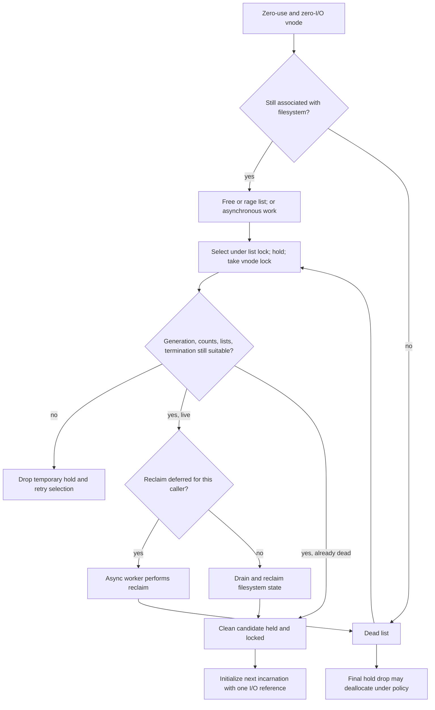
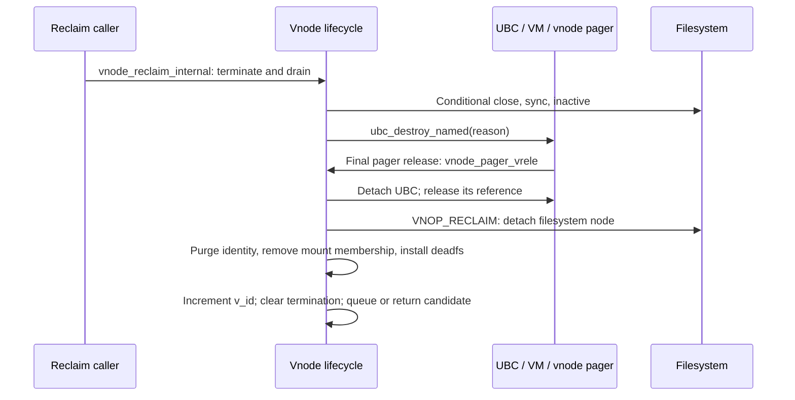

# Vnode cache identity, reclamation, and reuse

[VFS guide](README.md) · [Name-cache lookup and reclaim](name-cache-and-vnode-reclaim.md) · [File-data cache](file-data-cache-and-read-path.md) · [Vnode signatures](../security/vnode-signature-lifecycle.md)

A cached vnode can still describe a file after its last operation finishes. XNU can subsequently detach that filesystem state, reuse the vnode allocation for another object, or, under the configured deallocation policy, return the allocation to its zone. These are different transitions. In particular, the **vnode free list contains reclaim candidates that can still have filesystem state**; it is not a list of zeroed objects ready for unconditional assignment. The distinction is visible in [`vnode_list_add`](../../../xnu/bsd/vfs/vfs_subr.c#L2464-L2573), [`process_vp`](../../../xnu/bsd/vfs/vfs_subr.c#L5396-L5491), and [`vnode_drop_internal`](../../../xnu/bsd/vfs/vfs_subr.c#L6181-L6261).

The existing [name-cache chapter](name-cache-and-vnode-reclaim.md) traces SMR lookup and the reclaim callbacks. This chapter extends it with allocation policy, filesystem-side pointer recovery, the authorization cache, and the separation between cache eviction and filesystem operations. The concrete filesystem example is devfs. APFS's inode tables, metadata cache, and on-disk deletion implementation are outside this checkout's generic VFS implementation; the `v_data`/vnode-operation boundary must not be mistaken for their implementation.

## 1. What is cached, and what does eviction mean?

Several independent associations can all be described loosely as “the file cache.” Keeping their keys and ownership separate makes a failed lookup or unexpected reclaim understandable.

| Layer | Cached association | What removal means |
| --- | --- | --- |
| VFS name cache | Parent directory plus component → target vnode/`v_id`, or a negative result | Forget one namespace lookup result; a later lookup can call the filesystem again. [`namecache`](../../../xnu/bsd/sys/namei.h#L243-L260), [`cache_delete`](../../../xnu/bsd/vfs/vfs_cache.c#L3243-L3285). |
| Filesystem-private node association | Filesystem node → vnode, for example devfs `dn_vn`; vnode `v_data` points back | Disconnect the current vnode representation during the filesystem's reclaim callback. This is separate from the VFS name cache. [`devfs_dntovn`](../../../xnu/bsd/miscfs/devfs/devfs_tree.c#L1123-L1222), [`devfs_reclaim`](../../../xnu/bsd/miscfs/devfs/devfs_vnops.c#L1568-L1592). |
| Reusable vnode state | A vnode allocation plus its still-attached filesystem state | Reclaim must run before the allocation can represent another object. [`process_vp`](../../../xnu/bsd/vfs/vfs_subr.c#L5458-L5491). |
| Cached authorization | One credential identity, allowed-action bitmap, and optional TTL timestamp on the vnode | Recompute permission rather than remove a pathname or destroy file contents. [`vnode_cache_is_authorized`](../../../xnu/bsd/vfs/vfs_cache.c#L1575-L1622). |
| UBC and VM | Regular-file vnode → UBC state → memory-object control/pager and cached file pages | File data and pager lifetime follow VM/UBC protocols; this is not the name-cache entry's lifetime. [`ubc_info_init_internal`](../../../xnu/bsd/kern/ubc_subr.c#L1105-L1178), [file-data guide](file-data-cache-and-read-path.md). |
| Buffer cache | Vnode-associated clean/dirty buffers and block-I/O state | Buffer invalidation/writeback has its own locking and completion rules. [`vclean`](../../../xnu/bsd/vfs/vfs_subr.c#L3077-L3101), [buffer-cache guide](buffer-cache-and-block-io.md). |

Closing a descriptor reaches `VNOP_CLOSE` and drops its persistent vnode reference; it does not directly ask `new_vnode` to replace that vnode. A pathname removal instead dispatches `VNOP_REMOVE` to the filesystem. Reclaim calls `VNOP_RECLAIM`, whose job includes detaching filesystem-private vnode state. Thus closing, removing a directory entry, evicting a name-cache entry, reclaiming a vnode, and freeing its allocation are not interchangeable events. The filesystem owns the consequences for its underlying file record. See [`vn_close`](../../../xnu/bsd/vfs/vfs_vnops.c#L863-L924), [`VNOP_REMOVE`](../../../xnu/bsd/vfs/kpi_vfs.c#L4406-L4450), and [`vclean`](../../../xnu/bsd/vfs/vfs_subr.c#L3165-L3189).

As a conceptual example, a pathname lookup can hit an existing name entry and reacquire a vnode after the descriptor that last used it has closed. If the name entry was evicted, the filesystem can still return its existing vnode association. If the vnode was reclaimed, the filesystem may need to create a new representation. Which metadata or data reads that requires is filesystem-specific; the generic cache code does not establish an APFS disk-I/O count. These alternatives follow the [cache-hit conversion](../../../xnu/bsd/vfs/vfs_cache.c#L2780-L2800) and the [existing-or-create devfs path](../../../xnu/bsd/miscfs/devfs/devfs_tree.c#L1147-L1236).

## 2. References protect different things

The central layout is [`struct vnode`](../../../xnu/bsd/sys/vnode_internal.h#L159-L209). Its counters do not form one general-purpose reference count:

| State | Meaning in the reviewed paths |
| --- | --- |
| `v_iocount` | Active use for an operation; a successful `vnode_get*` acquisition is paired with `vnode_put`. Normal drain waits until only its own operation remains. |
| `v_usecount` | Persistent references, including open-file and mapping-related associations. Forced reclaim can leave the referenced vnode using deadfs operations. |
| `v_writecount` | Writer subset updated with `FWRITE` use-reference acquisition/release; not a dirty-page count. |
| `v_kusecount` | Updated for `O_EVTONLY` references in the reviewed APIs. `vflush` can distinguish references of only this kind. |
| `v_holdcount` | Storage lifetime while identity/reclaim synchronization proceeds. A hold alone neither preserves `v_data` nor prevents identity reuse. |
| `v_references` | Small recent-I/O-acquisition counter used for aging policy; not an outstanding-reference count. |
| `v_id` | Current vnode-content generation, checked when converting a remembered pointer to an I/O reference. |
| `VNAMED_FSHASH`, `VNAMED_UBC` | Named-association bookkeeping bits. They are not aliases for an ordinary counted hold. |

These distinctions are implemented by [`vnode_ref_ext`](../../../xnu/bsd/vfs/vfs_subr.c#L2329-L2398), [`vnode_rele_internal`](../../../xnu/bsd/vfs/vfs_subr.c#L2664-L2800), [`vnode_getiocount`](../../../xnu/bsd/vfs/vfs_subr.c#L6703-L6813), and [`vnode_addfsref`/`vnode_removefsref`](../../../xnu/bsd/vfs/vfs_subr.c#L7408-L7432). The API explicitly permits `vnode_getwithref` to encounter deadfs after forced reclaim: the persistent reference does not promise that filesystem-private state remains live. See its [contract](../../../xnu/bsd/sys/vnode.h#L1700-L1715).

The lock domains also differ: free-list links and `v_listflag` use `vnode_list_lock`; mount-list links use the mount lock; name-cache links and authorization fields use the name-cache lock; buffer lists use `buf_mtx`; most lifecycle state uses `v_lock`. Holds use atomic operations. Filesystem-private node synchronization is additional, as the devfs example below demonstrates. See the [layout's explicit lock annotations](../../../xnu/bsd/sys/vnode_internal.h#L151-L203) and [`vnode_hold`](../../../xnu/bsd/vfs/vfs_subr.c#L6120-L6134).

### A generation check is not a storage reference

A new allocation initializes `v_id` from the nanoseconds field of `nanouptime`; reclaim later increments it while holding the vnode-list lock. It is a 32-bit incarnation value, not a persistent inode number or a globally unique identifier. Correct callers need both a valid allocation to inspect and the expected generation. See [initialization](../../../xnu/bsd/vfs/vfs_subr.c#L5805-L5818), [reclaim increment](../../../xnu/bsd/vfs/vfs_subr.c#L6905-L6913), and the [`vnode_getwithvid` contract](../../../xnu/bsd/sys/vnode.h#L1660-L1691).

For name-cache SMR readers, `vnode_hold_smr` bridges from SMR protection to an ordinary hold. Non-deallocatable vnodes use an unconditional hold increment. Deallocatable vnodes instead refuse the acquisition after the special `VNODE_HOLD_NO_SMR` bit has been installed by the final-free path:

[Source: `vnode_hold_smr`, storage-lifetime acquisition](../../../xnu/bsd/vfs/vfs_subr.c#L6151-L6166)

<!-- source-excerpt: ../../../xnu/bsd/vfs/vfs_subr.c#L6151-L6166 -->
```c
	if (!(os_atomic_load(&vp->v_flag, relaxed) & VCANDEALLOC)) {
		vnode_hold(vp);
		return true;
	}

	for (;;) {
		holdcount = os_atomic_load(&vp->v_holdcount, relaxed);

		if (holdcount & VNODE_HOLD_NO_SMR) {
			return false;
		}

		if ((os_atomic_cmpxchg(&vp->v_holdcount, holdcount, holdcount + 1, relaxed) != 0)) {
			return true;
		}
	}
```

After obtaining the hold, the lookup leaves SMR, calls `vnode_getwithvid`, and drops the hold on both success and failure. A mismatched generation returns `ENOENT`; success leaves the caller's I/O reference. SMR therefore protects access during the lookup, the hold protects the allocation during conversion, and the generation test protects the requested identity. None substitutes for the other. See [`cache_lookup_ext`](../../../xnu/bsd/vfs/vfs_cache.c#L2780-L2800) and [`vnode_getiocount`](../../../xnu/bsd/vfs/vfs_subr.c#L6801-L6813).

## 3. Free, age, dead, and asynchronous queues

`vnode_list_add` initially requires zero usecount and iocount, no ongoing termination, and no existing list membership. That is an **insertion condition**, not a promise that every queued vnode remains idle: the acquisition path can leave a vnode on a list while granting transient I/O references. The allocator must recheck it after locking. See [`vnode_list_add`](../../../xnu/bsd/vfs/vfs_subr.c#L2473-L2498) and the [aging rationale](../../../xnu/bsd/vfs/vfs_subr.c#L6689-L6700).

| Queue or flag | Selection/placement rule |
| --- | --- |
| `vnode_free_list` | Still-live reusable candidates. Ordinary insertion goes to the tail; `VAGE` goes to the head and is cleared. |
| `vnode_rage_list` | Live `VRAGE` candidates, with head/tail choice according to `VAGE`. Insertion updates a shared last-insertion timestamp. |
| `vnode_dead_list` | Reclaimed candidates. Non-deallocatable vnodes go to the head; `VCANDEALLOC` vnodes go to the tail. Some carry `VLIST_NO_REUSE` and are destined for deallocation. |
| `vnode_async_work_list` | Deferred work, including live `VLIST_NO_REUSE` objects and candidates whose reclaim should run outside the requesting allocator. |

These are the actual branches in [`vnode_list_add`](../../../xnu/bsd/vfs/vfs_subr.c#L2500-L2568); “age” is not a separate fifth queue. Removal updates the corresponding counts and, for deallocatable vnodes, busy accounting in [`vnode_list_remove_locked`](../../../xnu/bsd/vfs/vfs_subr.c#L2582-L2647).

Frequent I/O acquisition removes a vnode from its age position, so its later zero-reference insertion makes it young again. The thresholds are 25 acquisitions normally and 6 for a dirty vnode; pager acquisitions do not perform this aging update. This saves a pair of global-list lock operations for every small get/put cycle:

[Source: identity validation followed by aging and I/O acquisition](../../../xnu/bsd/vfs/vfs_subr.c#L6801-L6809)

<!-- source-excerpt: ../../../xnu/bsd/vfs/vfs_subr.c#L6801-L6809 -->
```c
	if (withvid && vid != vp->v_id) {
		return ENOENT;
	}
	if (!forpager && (++vp->v_references >= UNAGE_THRESHHOLD ||
	    (vp->v_flag & VISDIRTY && vp->v_references >= UNAGE_DIRTYTHRESHHOLD))) {
		vp->v_references = 0;
		vnode_list_remove(vp);
	}
	vp->v_iocount++;
```

`VRAGE` is also caller-policy driven: creation can mark vnodes for processes or threads requesting rapid aging, while a later ordinary persistent reference can clear that policy and remove the vnode from its current list. `new_vnode` considers the rage queue once its population reaches `rage_limit` or the time since its last insertion reaches `RAGE_TIME_LIMIT`, which is five seconds here. This is not an independent per-vnode expiry timestamp. See [creation policy](../../../xnu/bsd/vfs/vfs_subr.c#L7244-L7258), [`vnode_ref_ext`](../../../xnu/bsd/vfs/vfs_subr.c#L2363-L2385), and [selection](../../../xnu/bsd/vfs/vfs_subr.c#L5847-L5854), with the [constant](../../../xnu/bsd/vfs/vfs_subr.c#L285).

### Selecting a candidate is only the start

`process_vp` is the transition between global queue selection and per-vnode validation. It arrives with the list lock, records the generation, removes the candidate, takes a storage hold, drops the list lock, and then takes `v_lock`. A new user or reclaim can win in that gap:

[Source: `process_vp` revalidates after changing lock domains](../../../xnu/bsd/vfs/vfs_subr.c#L5403-L5427)

<!-- source-excerpt: ../../../xnu/bsd/vfs/vfs_subr.c#L5403-L5427 -->
```c
	vpid = vp->v_id;

	vnode_list_remove_locked(vp);

	vnode_hold(vp);
	vnode_list_unlock();

	vnode_lock_spin(vp);

	/*
	 * We could wait for the vnode_lock after removing the vp from the freelist
	 * and the vid is bumped only at the very end of reclaim. So it is  possible
	 * that we are looking at a vnode that is being terminated. If so skip it.
	 */
	if ((vpid != vp->v_id) || (vp->v_usecount != 0) || (vp->v_iocount != 0) ||
	    VONLIST(vp) || (vp->v_lflag & VL_TERMINATE)) {
		/*
		 * we lost the race between dropping the list lock
		 * and picking up the vnode_lock... someone else
		 * used this vnode and it is now in a new state
		 */
		vnode_drop_and_unlock(vp);

		return NULLVP;
	}
```

The check includes generation, usecount, iocount, reappearance on a queue, and termination. A rejection drops its hold and returns no candidate. If an inactive callback was deferred, `process_vp` temporarily takes an iocount and drives `vnode_put_locked`, then abandons this selection: the callback may have changed the state again. See [`process_vp`](../../../xnu/bsd/vfs/vfs_subr.c#L5428-L5456).

A still-live candidate may require filesystem calls and I/O. For an allocator requesting a vnode, dirty candidates and candidates not on “reliable media” are handed to asynchronous work. Here `vnode_on_reliable_media` means no mount, or a local mount that is not virtually backed; it is a scheduling/dependency classification, not a hardware reliability test. The worker can perform reclaim without imposing those calls on the requesting thread. See [classification](../../../xnu/bsd/vfs/vfs_subr.c#L2402-L2420), [deferral](../../../xnu/bsd/vfs/vfs_subr.c#L5458-L5477), and [`async_work_continue`](../../../xnu/bsd/vfs/vfs_subr.c#L5496-L5525).

After synchronous reclaim, a returned reusable candidate is still locked and held. `process_vp` verifies that counted/named references, mount linkage, and name-cache linkage are gone. `new_vnode` resets the fields needed for the next incarnation, sets `v_iocount = 1`, and releases the temporary hold/lock. It preserves `VCANDEALLOC` only when compatible with the receiving request. See [post-reclaim assertions](../../../xnu/bsd/vfs/vfs_subr.c#L5478-L5491) and [reuse initialization](../../../xnu/bsd/vfs/vfs_subr.c#L6077-L6099).



The diagram combines the selected [`process_vp`](../../../xnu/bsd/vfs/vfs_subr.c#L5396-L5491), [`new_vnode`](../../../xnu/bsd/vfs/vfs_subr.c#L6004-L6099), and [final-drop](../../../xnu/bsd/vfs/vfs_subr.c#L6181-L6261) routes; it does not imply that all queue members are immediately available.

### Budgets, workers, and allocation failure

`vntblinit` sets the policy from `vn_dealloc_level`. The default boot argument is `DEALLOC_VNODE_NONE` on `XNU_TARGET_OS_OSX`, and `DEALLOC_VNODE_ONLY_OVERFLOW` otherwise. With no deallocation, `new_vnode` forces `can_free = false`. The alternative modes are therefore source/configuration branches, not evidence of the running policy on a particular device. See [defaults](../../../xnu/bsd/vfs/vfs_subr.c#L239-L251) and [runtime initialization](../../../xnu/bsd/vfs/vfs_subr.c#L404-L445).

| Configured level | Initial floor/ceiling and retained-state policy |
| --- | --- |
| `NONE` | `numvnodes_min = numvnodes_max = desiredvnodes`; deallocation disabled. |
| `ONLY_OVERFLOW` | Floor remains `desiredvnodes`; normal ceiling becomes twice that. |
| `ALL` | Floor is `40 * (desiredvnodes / 100)`; ceiling is twice `desiredvnodes`; reusable target is `20 * (desiredvnodes / 100) - deadvnodes_low`. |

`deadvnodes_low` is `min(desiredvnodes / 100, 300)` and `deadvnodes_high` twice that, using integer arithmetic. These are replenishment/retention thresholds, not guaranteed instantaneous counts. The laundry thread prefers async work, otherwise selects rage/free candidates subject to floor and pool thresholds. Its wake predicate includes a shortage of dead vnodes and pressure from the reusable population. See [`vntblinit`](../../../xnu/bsd/vfs/vfs_subr.c#L415-L436) and [`vn_laundry_continue`/`wakeup_laundry_thread`](../../../xnu/bsd/vfs/vfs_subr.c#L5534-L5626).

`new_vnode` first decides whether it can obtain a suitable dead vnode or grow the pool. It respects whether the receiving filesystem accepts deallocatable vnodes and skips no-reuse candidates in the applicable scan. A fresh allocation uses the vnode zone, with SMR allocation when enabled, and returns one iocount. Overflow allocations can be marked `VL_MARKTERM | VLIST_NO_REUSE` so their later idle transition leads toward reclamation/deallocation. See [dead selection and allocation](../../../xnu/bsd/vfs/vfs_subr.c#L5739-L5844).

When scanning live lists, dependency-capable processes skip virtually backed mounts that could make reclaim wait on the requesting process itself. The scan is bounded; the fallback can force a new allocation and increase the minimum pool, so `desiredvnodes` is not an absolute universal cap. If candidates were deferred, the caller waits in 10 ms intervals for a dead vnode; after 100 ms elapsed it requires a candidate it can process synchronously or reaches the forced-allocation escape. See [candidate filters](../../../xnu/bsd/vfs/vfs_subr.c#L5851-L5931), [forced allocation](../../../xnu/bsd/vfs/vfs_subr.c#L5933-L5955), and [deferred wait](../../../xnu/bsd/vfs/vfs_subr.c#L6004-L6055).

With no candidate after retries, non-jetsam builds return `ENFILE`. `CONFIG_JETSAM` builds instead attempt vnode-exhaustion killing, retry after success, and can panic if recovery is unavailable; their retry budget also differs. The vnode zone allocation itself uses `Z_WAITOK_ZERO_NOFAIL`, so the table-full error is an allocator-policy outcome rather than a `zalloc` null return. See [retry budgets](../../../xnu/bsd/vfs/vfs_subr.c#L5686-L5705), [zone allocation](../../../xnu/bsd/vfs/vfs_subr.c#L5799-L5803), and [exhaustion handling](../../../xnu/bsd/vfs/vfs_subr.c#L5958-L6001).

### Returning storage to the zone

The legacy `vnode_create` wrapper explicitly passes `VNODE_CREATE_NODEALLOC`. `vnode_create_ext` accepts the default deallocation-capable contract; the filesystem must use holds/drops appropriately, and the runtime policy can still suppress actual deallocation. See [wrapper bodies](../../../xnu/bsd/vfs/vfs_subr.c#L7357-L7374) and the [creation contract](../../../xnu/bsd/sys/vnode.h#L932-L955).

Final freeing happens in `vnode_drop_internal`, not merely when usecount becomes zero. It requires deallocation enabled, the last hold, `VCANDEALLOC`, `VL_DEAD`, and, after locking and rechecking, zero I/O/use counts. Under the list lock it requires dead-list membership and the pool/no-reuse retention condition, then atomically changes holdcount from zero to the no-new-SMR-holds sentinel:

[Source: committing final removal from the dead pool](../../../xnu/bsd/vfs/vfs_subr.c#L6223-L6234)

<!-- source-excerpt: ../../../xnu/bsd/vfs/vfs_subr.c#L6223-L6234 -->
```c
	if (VONLIST(vp) && (vp->v_listflag & VLIST_DEAD) &&
	    (numvnodes > desiredvnodes || (vp->v_listflag & VLIST_NO_REUSE) ||
	    vn_dealloc_level != DEALLOC_VNODE_ALL || deadvnodes >= deadvnodes_high) &&
	    (os_atomic_cmpxchg(&vp->v_holdcount, 0, VNODE_HOLD_NO_SMR, relaxed) != 0)) {
		VREMDEAD("vnode_list_remove", vp);
		numvnodes--;
		freeablevnodes--;
		deallocedvnodes++;
		vp->v_listflag = 0;

		send_freeable_vnodes_telemetry();
		vnode_list_unlock();
```

This CAS races safely with `vnode_hold_smr`: a reader that acquired a hold prevents the zero-to-sentinel transition; a reader that sees the sentinel cannot obtain one. The free path updates pool accounting, detaches the optional MAC label, and uses `zfree_smr` when SMR is enabled, otherwise `zfree`. The SMR callback clears the vnode memory. Once its hold is dropped, a caller cannot assume its old pointer is still readable. See [complete final-drop path](../../../xnu/bsd/vfs/vfs_subr.c#L6181-L6261) and [`vnode_smr_free`](../../../xnu/bsd/vfs/vfs_subr.c#L6171-L6178).

## 4. Filesystem lookup recovers a vnode, not just a pointer

The VFS name cache can miss while a filesystem-private node still remembers a vnode. Conversely, reclaim can clear the association while a filesystem thread is trying to acquire it. `vnode_create_internal` makes publication ordering explicit: the supplied output location is assigned before mount/name-cache publication can make the vnode discoverable:

[Source: filesystem-node association precedes generic publication](../../../xnu/bsd/vfs/vfs_subr.c#L7187-L7197)

<!-- source-excerpt: ../../../xnu/bsd/vfs/vfs_subr.c#L7187-L7197 -->
```c
	/* The file systems must pass the address of the location where
	 * they store the vnode pointer. When we add the vnode into the mount
	 * list and name cache they become discoverable. So the file system node
	 * must have the connection to vnode setup by then
	 */
	*vpp = vp;

	/* Add fs named reference. */
	if (param->vnfs_flags & VNFS_ADDFSREF) {
		vp->v_lflag |= VNAMED_FSHASH;
	}
```

`VNFS_ADDFSREF` sets `VNAMED_FSHASH`; the add/remove APIs manipulate that named-association bit under the vnode lock. They do not increment `v_holdcount` or `v_usecount`. Filesystems still need their own pointer protection and their reclaim callback must remove the association before reuse. The subsequent generic code inserts mount membership, takes a parent reference when possible, and either enters a name-cache association or retains just the name string according to creation flags. See [`vnode_addfsref`/`vnode_removefsref`](../../../xnu/bsd/vfs/vfs_subr.c#L7408-L7432) and [publication](../../../xnu/bsd/vfs/vfs_subr.c#L7198-L7241).

### Devfs: release the filesystem lock before waiting

`devfs_dntovn` enters with the devfs lock held and takes a devnode reference so that dropping that lock will not delete the node underneath the operation. If `dn_vn` already exists, it captures its generation and holds its storage before dropping the devfs lock. It then waits/acquires through `vnode_getwithvid_drainok`, releases the temporary hold, and reacquires the filesystem lock. See [entry and existing-vnode path](../../../xnu/bsd/miscfs/devfs/devfs_tree.c#L1123-L1171).

[Source: devfs deliberately waits behind vnode drain](../../../xnu/bsd/miscfs/devfs/devfs_tree.c#L1154-L1171)

<!-- source-excerpt: ../../../xnu/bsd/miscfs/devfs/devfs_tree.c#L1154-L1171 -->
```c
		vid = vnode_vid(vn_p);

		vnode_hold(vn_p);
		DEVFS_UNLOCK();

		/*
		 * We want to use the drainok variant of vnode_getwithvid
		 * because we _don't_ want to get an iocount if the vnode is
		 * is blocked in vnode_drain as it can cause infinite
		 * loops in vn_open_auth. While in use vnodes are typically
		 * only reclaimed on forced unmounts, In use devfs tty vnodes
		 * can  be quite frequently reclaimed by revoke(2) or by the
		 * exit of a controlling process.
		 */
		error = vnode_getwithvid_drainok(vn_p, vid);

		vnode_drop(vn_p);
		DEVFS_LOCK();
```

The choice matters for tty revocation: ordinary `vnode_getwithvid` may acquire an iocount ahead of drain; the `drainok` variant deliberately waits behind it. The comment identifies repeated open/revoke behavior as the reason. If deletion wins while the devfs lock is dropped, an acquired iocount is put and the result becomes `ENOENT`. An unmount-related `ENODEV` is also translated to `ENOENT`. Other acquisition errors can retry: reclaim may have cleared `dn_vn`, or another lookup may already have installed a replacement. See [failure/retry handling](../../../xnu/bsd/miscfs/devfs/devfs_tree.c#L1173-L1222) and the [generic variants](../../../xnu/bsd/vfs/vfs_subr.c#L6362-L6383).

If no vnode is associated, `DN_CREATE` serializes creators and `DN_CREATEWAIT` provides a wakeup channel. Devfs drops its lock for `vnode_create_ext`, requests `VNFS_NOCACHE | VNFS_CANTCACHE`, and marks the new vnode as needing inactive handling before retaking the lock. On ordinary success it retains the devnode until `VNOP_RECLAIM` and publishes `dn_vn`; cloning devices deliberately do not cache this pointer, giving each lookup a new vnode. See [creation serialization](../../../xnu/bsd/miscfs/devfs/devfs_tree.c#L1230-L1236) and [create/publication](../../../xnu/bsd/miscfs/devfs/devfs_tree.c#L1258-L1329).

The post-create failure branch releases an allocated clone minor number; common post-create cleanup clears `DN_CREATE` and wakes waiters. There is a separate earlier clone-allocation failure that jumps directly to `out`, so the body should not be summarized as every error executing that common cleanup. At `out` the operation drops its temporary devnode reference, and the source warns callers not to access the node after failure because this drop can delete it. See [early clone failure](../../../xnu/bsd/miscfs/devfs/devfs_tree.c#L1272-L1279) and [post-create cleanup](../../../xnu/bsd/miscfs/devfs/devfs_tree.c#L1330-L1355).

`devfs_reclaim`, under the same filesystem lock, clears `dn_vn`, clears the vnode's fsnode pointer, and releases the reference held for the vnode association. This closes the lookup/reclaim contract. It is a concrete example of the generic protocol, not a description of APFS's inode hash or locking. See [`devfs_reclaim`](../../../xnu/bsd/miscfs/devfs/devfs_vnops.c#L1568-L1592).

## 5. Name-cache replacement and its three validity checks

The name cache has its own budget: initialization sets `desiredNegNodes = desiredvnodes / 10` and `desiredNodes = desiredvnodes + desiredNegNodes`. An insertion allocates another entry below budget when appropriate; otherwise it takes the head of `nchead`, deletes its old association if valid, and reuses it. New entries go to the tail. The inspected hit path does not move each hit to the tail, so describing this as strict access-order LRU would overstate the implementation. See [initialization](../../../xnu/bsd/vfs/vfs_cache.c#L3110-L3123), [replacement](../../../xnu/bsd/vfs/vfs_cache.c#L2926-L2961), and [insertion ordering](../../../xnu/bsd/vfs/vfs_cache.c#L3000-L3005).

A positive entry records `nc_vid` and takes a vnode hold. A negative entry has `nc_vp == NULL`, joins a separate negative queue, and can trigger deletion of that queue's oldest entry when the negative budget is exceeded. The current insertion body also declines to add another positive entry when the target's `v_nclinks` is already nonempty. The presence of a linked-list field alone therefore does not imply that every hard-link name is cached concurrently. See [`cache_enter_locked`](../../../xnu/bsd/vfs/vfs_cache.c#L2913-L2925), [positive ownership](../../../xnu/bsd/vfs/vfs_cache.c#L2964-L2972), and [negative budget](../../../xnu/bsd/vfs/vfs_cache.c#L3025-L3050).

| Validation | Question answered | Failure behavior |
| --- | --- | --- |
| `nc_counter` odd and unchanged around a read | Did this entry remain published with the same fields during the snapshot? | Retry/fallback rather than trust the snapshot. |
| Pointer plus `nc_vid` against vnode `v_id` | Does the target still represent the captured incarnation? | I/O-reference conversion fails; release the temporary hold. |
| Directory `v_nc_generation` against lookup's saved generation | Is it still valid to publish a filesystem lookup result into the cache? | Skip insertion when the generation changed. |

These checks are separate in [SMR lookup](../../../xnu/bsd/vfs/vfs_cache.c#L2705-L2800) and [`cache_enter_with_gen`](../../../xnu/bsd/vfs/vfs_cache.c#L2861-L2874). A negative hit has no target vnode to acquire, and create/rename lookup cannot use it as the final namespace decision. See [negative-hit handling](../../../xnu/bsd/vfs/vfs_cache.c#L2801-L2817) and [the detailed lookup guide](name-cache-and-vnode-reclaim.md#a-single-component-cache-lookup).

Cache deletion invalidates publication before unlinking and releasing ownership. Purging a vnode removes entries naming it and entries beneath it, increments its parent's name-cache generation when present, and clears its cached credential/actions; credential unref occurs outside the cache lock. Evicting an individual name entry does not by itself invoke `VNOP_RECLAIM` or destroy the file's pager. See [`cache_delete`](../../../xnu/bsd/vfs/vfs_cache.c#L3243-L3285) and [`cache_purge_locked`/`cache_purge`](../../../xnu/bsd/vfs/vfs_cache.c#L3294-L3346).

## 6. Cached permission is a credential-specific allowed-action set

The vnode carries one `v_cred`, one `v_authorized_actions` bitmap, and `v_cred_timestamp`. The general hit test requires the exact credential object used by the context and all requested bits already allowed. Successful authorization adds allowed bits; denied results are not added. The callback bypasses its early single-vnode cache test when both target and directory vnodes are supplied because the combined action needs fuller interpretation. See [`vnode_cache_is_authorized`](../../../xnu/bsd/vfs/vfs_cache.c#L1609-L1622) and [`vnode_authorize_callback`](../../../xnu/bsd/vfs/vfs_subr.c#L10062-L10137).

Installing another credential retains it, replaces the old credential, and clears the bitmap before adding new rights. Old credential release happens after unlocking. Updates use the exclusive name-cache lock; the regular cache test uses its shared form. A credential reference keeps the credential object alive; permission freshness still depends on invalidation and mount policy. See [`vnode_cache_authorized_action`](../../../xnu/bsd/vfs/vfs_cache.c#L1661-L1691) and the [lock rationale](../../../xnu/bsd/vfs/vfs_cache.c#L1535-L1544).

| Mount policy | Rights retained by these helpers |
| --- | --- |
| Neither `MNTK_AUTH_OPAQUE` nor `MNTK_AUTH_CACHE_TTL` | Successful actions can be cached without this TTL check, subject to explicit invalidation. |
| `MNTK_AUTH_OPAQUE` without `MNTK_AUTH_CACHE_TTL` | Only directory search, with a nonzero TTL. Other actions are not cached by this path. |
| `MNTK_AUTH_CACHE_TTL`, with or without opaque authorization | Successful actions may be cached with a nonzero TTL. |
| TTL-enabled policy with `mnt_authcache_ttl == 0` | Do not use/store cached rights. |

The read and store predicates are in [`vnode_cache_is_authorized`](../../../xnu/bsd/vfs/vfs_cache.c#L1587-L1608) and [`vnode_cache_authorized_action`](../../../xnu/bsd/vfs/vfs_cache.c#L1638-L1660). A `-vnode_cache_defeat` boot argument additionally defeats the general helper's hit test; it should not be assumed to describe every independently implemented pathname fast-path predicate. See [that helper's entry](../../../xnu/bsd/vfs/vfs_cache.c#L1571-L1586) and [fast-path authorization](../../../xnu/bsd/vfs/vfs_cache.c#L1950-L1982).

### TTL is a fixed window for the accumulated rights

The timestamp is assigned when the bitmap is empty, including after clearing stale actions or replacing credentials. Adding another right to an existing bitmap does not extend its window:

[Source: timestamp initialization before accumulating allowed actions](../../../xnu/bsd/vfs/vfs_cache.c#L1674-L1685)

<!-- source-excerpt: ../../../xnu/bsd/vfs/vfs_cache.c#L1674-L1685 -->
```c
	if (ttl_active == TRUE && vp->v_authorized_actions == 0) {
		/*
		 * only reset the timestamnp on the
		 * first authorization cached after the previous
		 * timer has expired or we're switching creds...
		 * 'vnode_cache_is_authorized' will clear the
		 * authorized actions if the TTL is active and
		 * it has expired
		 */
		vp->v_cred_timestamp = (int)tv.tv_sec;
	}
	vp->v_authorized_actions |= action;
```

Staleness is tested with uptime seconds and a strict `elapsed > ttl` comparison. As a conceptual example, if search was cached at uptime second 100 with TTL 5 and another permitted bit was added at second 104, the timestamp remains 100. At second 106 the general helper regards it as stale and clears the allowed bits; the second authorization did not extend expiry to 109. This is derived from the source arithmetic, not an observed trace or a guarantee about subsecond scheduling. See [`vnode_cache_is_stale`](../../../xnu/bsd/vfs/vfs_cache.c#L1695-L1710) and [stale-action invalidation](../../../xnu/bsd/vfs/vfs_cache.c#L1600-L1603).

### Local changes invalidate; search has a specialized fast path

Successful `VNOP_SETATTR` invalidates cached rights when the filesystem reports supporting changed authorization-relevant fields: mode, UID, GID, flags, ACL, user UUID, or group UUID. Configured named-stream handling also invalidates the resource-fork vnode for opaque authorization. Successful `VNOP_SETXATTR` invalidates rights too. These are concrete invalidation sites, not a claim that the generic cache observes arbitrary remote permission changes instantly. See [`VNOP_SETATTR`](../../../xnu/bsd/vfs/kpi_vfs.c#L3977-L4001) and [`VNOP_SETXATTR`](../../../xnu/bsd/vfs/kpi_vfs.c#L6179-L6184).

[Source: clearing rights and detaching the cached credential](../../../xnu/bsd/vfs/vfs_cache.c#L1552-L1567)

<!-- source-excerpt: ../../../xnu/bsd/vfs/vfs_cache.c#L1552-L1567 -->
```c

	vp->v_authorized_actions &= ~action;

	if (action == KAUTH_INVALIDATE_CACHED_RIGHTS &&
	    IS_VALID_CRED(vp->v_cred)) {
		/*
		 * Use a temp variable to avoid kauth_cred_unref() while NAME_CACHE_LOCK is held
		 */
		tcred = vnode_cred(vp);
		vp->v_cred = NOCRED;
	}
	NAME_CACHE_UNLOCK();

	if (IS_VALID_CRED(tcred)) {
		kauth_cred_unref(&tcred);
	}
```

`cache_lookup_path` has a narrower search-authorization optimization. After its TTL check it accepts same-credential search, `KAUTH_VNODE_SEARCHBYANYONE`, or its special root case when TTL handling is not enabled. `SEARCHBYANYONE` can be synthesized after successful directory search with no relevant ACL deny and suitable mode information; the code documents a root/ACL limitation and compensating fast-path check. Read the actual predicates rather than treating the bitmap as a universal cached ACL decision. See [fast-path conditions](../../../xnu/bsd/vfs/vfs_cache.c#L1950-L1982) and [synthesis](../../../xnu/bsd/vfs/vfs_subr.c#L10423-L10439).

The resulting `dp_authorized` avoids repeating ordinary search authorization before filesystem lookup. It does not remove the configured MAC lookup call. Named streams also have explicit parent-versus-stream cache handling in the general callback, so a simplistic “one pathname, one permission entry” description is insufficient. See [`lookup_authorize_search`](../../../xnu/bsd/vfs/vfs_lookup.c#L940-L967) and [named-stream authorization](../../../xnu/bsd/vfs/vfs_subr.c#L10080-L10134).

## 7. Inactive, reclaim, UBC teardown, and mount pressure

When the final persistent reference drops but an I/O reference remains, `vnode_rele_internal` records `VL_NEEDINACTIVE` for later. With both counts zero it may call `VNOP_INACTIVE` immediately, defer filesystem reentry, or arrange asynchronous work. Its own temporary iocount protects the callback. `vnode_put_internal_locked` likewise unlocks around `VNOP_INACTIVE` and retries the state test afterward, because the callback can change references or termination state. See [release decisions](../../../xnu/bsd/vfs/vfs_subr.c#L2695-L2787) and [last-put loop](../../../xnu/bsd/vfs/vfs_subr.c#L6426-L6485).

`vnode_recycle` is a request, not an unconditional synchronous destruction API. If any iocount or usecount remains, it marks `VL_MARKTERM` and returns zero. Otherwise it can reclaim immediately and returns one. A pager-originated last put with pending termination instead queues asynchronous reclaim, avoiding a pager path trying to destroy itself. See [`vnode_recycle`](../../../xnu/bsd/vfs/vfs_subr.c#L3281-L3297) and the [pager-originated branch](../../../xnu/bsd/vfs/vfs_subr.c#L6466-L6485).

The normal reclaim route marks termination, drains other I/O users, and calls `vclean`. `vclean` performs the requested close/sync/buffer work, inactive handling, UBC destruction, filesystem reclaim, and identity cleanup. Buffer cleanup is conditional: an active vnode can retain locked buffers until later zero-reference cleanup. In the configured `-no_vnode_drain` shutdown escape there is also a timeout branch that can force the count down when no writes remain; it is not the ordinary drain contract. See [`vnode_reclaim_internal`](../../../xnu/bsd/vfs/vfs_subr.c#L6841-L6904), [`vclean`](../../../xnu/bsd/vfs/vfs_subr.c#L3029-L3104), [`vnode_list_add`](../../../xnu/bsd/vfs/vfs_subr.c#L2482-L2498), and [`vnode_drain`](../../../xnu/bsd/vfs/vfs_subr.c#L6652-L6685).

### Why UBC destruction precedes filesystem reclaim

A regular-file vnode can have a pager and UBC-owned mapping reference. `vclean` determines a VM destruction reason, distinguishing ordinary reclaim, forced unmount, its revoke/ungraft heuristic, and unmount. It invokes `ubc_destroy_named` before `VNOP_RECLAIM`. The latter callback cannot safely leave VM with an association into filesystem-private state it has just detached. See [reason selection and ordering](../../../xnu/bsd/vfs/vfs_subr.c#L3129-L3169).

`ubc_destroy_named` obtains the memory-object control and invokes `memory_object_destroy`; an unsuccessful destruction result is fatal here. On final pager-reference release, `vnode_pager_deallocate` calls back into `vnode_pager_vrele`. See [`ubc_destroy_named`](../../../xnu/bsd/kern/ubc_subr.c#L2115-L2133) and [`vnode_pager_deallocate`](../../../xnu/osfmk/vm/bsd_vm.c#L694-L710).

The callback clears `VNAMED_UBC`. For forced unmount, pager release may happen before the normal last-unmap callback, so it uses `ubc_unmap` to ensure the UBC mapping reference has gone. It then detaches `v_ubcinfo` under the vnode lock and deallocates that UBC reference after unlocking:

[Source: separating UBC detachment from deallocation](../../../xnu/bsd/vfs/vfs_subr.c#L4442-L4452)

<!-- source-excerpt: ../../../xnu/bsd/vfs/vfs_subr.c#L4442-L4452 -->
```c
		vnode_unlock(vp);
		ubc_unmap(vp);
		vnode_lock_spin(vp);
	}

	uip = vp->v_ubcinfo;
	vp->v_ubcinfo = UBC_INFO_NULL;

	vnode_unlock(vp);

	ubc_info_deallocate(uip);
```

Final `ubc_info_free` releases the credential and memory-object control, cluster state, and signature blobs before freeing the UBC allocation. Signature ownership therefore has a real vnode/UBC teardown boundary; its loading, retention, and validation are covered in [vnode signature lifecycle](../security/vnode-signature-lifecycle.md), not by the name-cache counter. See [`ubc_info_free`](../../../xnu/bsd/kern/ubc_subr.c#L1198-L1213) and [the forced-unmap explanation](../../../xnu/bsd/vfs/vfs_subr.c#L4428-L4440).



This shows the selected [reclaim ordering](../../../xnu/bsd/vfs/vfs_subr.c#L6841-L6978) and [UBC callback chain](../../../xnu/bsd/vfs/vfs_subr.c#L4416-L4453); it omits intermediate VM calls and optional callbacks. `vclean` deliberately retains mount-list membership until after teardown callbacks, so unmount can still find terminating vnodes. It then installs deadfs operations, clears `v_data`, and removes the mount association. The enclosing reclaim increments `v_id`, marks the type `VBAD`, verifies detached state, and wakes termination waiters. See [mount-list ordering](../../../xnu/bsd/vfs/vfs_subr.c#L3165-L3191) and [reclaim completion](../../../xnu/bsd/vfs/vfs_subr.c#L6905-L6978).

Mount pressure has a separate policy boundary. `vflush` can first check whether an ordinary unmount would be busy and return `EBUSY` without destroying cached state. Its main walk snapshots identity, drops the mount lock to take the vnode lock, and rechecks membership/generation. Idle or only-event-referenced vnodes can be reclaimed; forced closure has additional behavior, including special-device handling. This is another reason “cached vnode” cannot be reduced to “free allocation.” See [`vflush`](../../../xnu/bsd/vfs/vfs_subr.c#L2812-L2968) and [mount lifecycle](mount-lifecycle.md).

## 8. Reading route and inspection limits

For a first source pass, follow `vnode_create_ext → vnode_create_internal → new_vnode → process_vp`, then `vnode_put_internal_locked → vnode_reclaim_internal → vclean`. Next read the existing-pointer branch in `devfs_dntovn`, `vnode_hold_smr → vnode_drop_internal`, and finally the authorization-cache helpers. This order separates allocation lifetime from namespace and permission decisions before adding the VM/pager callback chain.

| Sources inspected | Depth and limits |
| --- | --- |
| [`vnode_internal.h`](../../../xnu/bsd/sys/vnode_internal.h#L150-L209), [`vnode.h`](../../../xnu/bsd/sys/vnode.h#L932-L955) | Layout, lock annotations, creation/get/reference contracts; not every public vnode KPI. |
| [`vfs_subr.c` allocation/queues](../../../xnu/bsd/vfs/vfs_subr.c#L5396-L6261) | Candidate validation, worker routes, configuration budgets, force-allocation/exhaustion, holds and final free read by body. No runtime queue measurements or exhaustive concurrency proof. |
| [`vfs_subr.c` references/reclaim](../../../xnu/bsd/vfs/vfs_subr.c#L2329-L3297), [get/drain/reclaim](../../../xnu/bsd/vfs/vfs_subr.c#L6362-L6978) | Selected acquire/release, inactive/recycle/drain, UBC and mount boundaries; specialized tty, lease, graft and trigger paths only where they affect those routes. |
| [`vfs_cache.c`](../../../xnu/bsd/vfs/vfs_cache.c#L1528-L1710), [name-entry management](../../../xnu/bsd/vfs/vfs_cache.c#L2705-L3346) | Permission-cache bodies, fast search predicate, entry budgets/publication/purge, and SMR conversion. Full multi-component walker is documented separately. |
| [`devfs_tree.c`](../../../xnu/bsd/miscfs/devfs/devfs_tree.c#L1123-L1356), [`devfs_vnops.c`](../../../xnu/bsd/miscfs/devfs/devfs_vnops.c#L1568-L1592) | Concrete filesystem node/vnode association, retry, creation and reclaim; not an APFS inode-cache implementation. |
| [`kpi_vfs.c`](../../../xnu/bsd/vfs/kpi_vfs.c#L3977-L4001), [`ubc_subr.c`](../../../xnu/bsd/kern/ubc_subr.c#L2115-L2133), [`bsd_vm.c`](../../../xnu/osfmk/vm/bsd_vm.c#L694-L710) | Selected authorization invalidation and UBC finalization bridges. Full file-data, buffer, VM-object and signing paths belong to the linked dedicated chapters. |

This is a source-level account of the selected paths in this checkout. No kernel execution, fault injection, filesystem benchmark, or validation of an external filesystem's cache implementation was performed.
