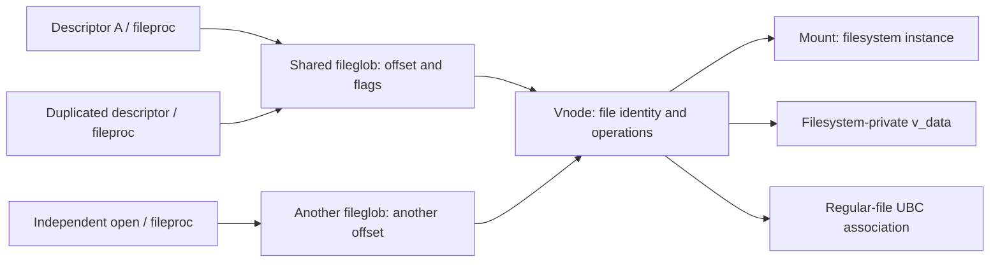

# Vnodes, mounts, open files, and operation dispatch

The detailed [vnode reclamation](name-cache-and-vnode-reclaim.md) and [mount lifecycle](mount-lifecycle.md) chapters expand drain, callback, publication, unmount and failure paths.

[Vnode cache identity and reuse](vnode-cache-identity-and-reuse.md) explains which cached associations survive closing, how filesystem lookup reacquires a vnode, and how allocation reuse differs from namespace eviction and permission-cache invalidation.

[VFS index](README.md) · [Pathnames](pathname-and-authorization.md) · [I/O](io-and-cache.md)

## Four objects with different lifetimes

[`struct vnode`](../../../xnu/bsd/sys/vnode_internal.h#L159) describes an in-memory filesystem object. Its `v_type` distinguishes `VREG`, `VDIR`, `VCHR`, `VBLK`, and other kinds; `v_op` selects vnode operations; `v_mount` identifies the containing filesystem instance; `v_data` belongs to the filesystem. A union holds type-specific state such as `v_ubcinfo`, `v_specinfo`, `v_fifoinfo` or `v_mountedhere`. `v_id` identifies the current incarnation, while `v_name` and `v_parent` assist name caching rather than defining the object's only possible pathname.

[`struct mount`](../../../xnu/bsd/sys/mount_internal.h#L108) describes a mounted instance. `mnt_op` contains filesystem-level operations, `mnt_vtable` points to registered type information, `mnt_data` is instance-private state, and `mnt_vnodecovered` is the directory hidden by the mount. The mount also carries vnode lists, lifecycle flags, root-cache identity, device vnode, transfer limits, block size and I/O accounting. One filesystem type can supply several mount instances, each containing many vnodes.

An open descriptor leads through a `fileproc` to a shared [`fileglob`](../../../xnu/bsd/sys/file_internal.h#L178). The fileglob stores `fg_ops`, `fg_data`, `fg_cred`, `fg_offset`, flags and references. For vnode-backed files, `fg_data` denotes the vnode and `fg_ops` points to [`vnops`](../../../xnu/bsd/vfs/vfs_vnops.c#L132). The offset belongs to the open-file object, not the vnode: independent opens can have different positions; descriptors sharing a fileglob share its position.

[`vfs_context`](../../../xnu/bsd/sys/user.h#L99) supplies a thread and credentials for an operation. [`vfs_context_current`](../../../xnu/bsd/vfs/kpi_vfs.c#L1683) uses the current thread's read-only context layout. `vfs_context_create` copies a context and retains credentials; `vfs_context_rele` releases owned resources. A context is not a vnode or mount reference, nor a guarantee that the caller uses its current process credentials: descriptor I/O can substitute the fileglob's stored credential.

## Iocount, usecount, holdcount and identity

The API comments in [`vnode.h`](../../../xnu/bsd/sys/vnode.h#L1660) distinguish the references precisely:

| Mechanism | What it protects | Typical pairing |
|---|---|---|
| Iocount | Short-lived active use; prevents vnode recycling during an operation | `vnode_get*` / `vnode_put` |
| Usecount | Persistent association, such as an open file; prevents reuse for a different file | `vnode_ref*` / `vnode_rele*` |
| Holdcount | Allocation storage while reclaim/reuse synchronization proceeds | `vnode_hold` / `vnode_drop` internally |
| `v_id` / vid | Detects that an old pointer now names a different incarnation | Record vid while valid; reacquire with `vnode_getwithvid` |

A usecount does not guarantee that filesystem-private state remains live after forced reclaim. [`vnode_getwithref`](../../../xnu/bsd/sys/vnode.h#L1700) can return a dead vnode with deadfs operations; those operations provide appropriate errors. Conversely, plain `vnode_get` does not verify identity if the caller had no stable reference before acquiring it. A remembered pointer plus a matching numerical address is insufficient.

[`vnode_getwithvid`](../../../xnu/bsd/vfs/vfs_subr.c#L6369) checks identity and can cut ahead of a drain to avoid filesystem-lock deadlocks. The confusingly named `vnode_getwithvid_drainok` variant actually **waits behind** drain, as its implementation comment explains. [`vnode_getiocount`](../../../xnu/bsd/vfs/vfs_subr.c#L6703) handles dead/suspended/draining/terminating states, sleeping and rechecking identity. Acquiring an iocount using the wrong variant can therefore be a lock-order bug, not merely an incorrect increment.

## From open to filesystem method

[`openat_internal`](../../../xnu/bsd/vfs/vfs_syscalls.c#L5389) prepares attributes, applies the process creation mask and initializes `nameidata`. [`open1`](../../../xnu/bsd/vfs/vfs_syscalls.c#L4904) allocates a fileproc/descriptor slot, calls `vn_open_auth`, then installs `fg_ops = &vnops`, the vnode and effective flags. [`vn_open_auth_finish`](../../../xnu/bsd/vfs/vfs_vnops.c#L185) takes the persistent vnode reference. The temporary lookup iocount is dropped before the completed descriptor is published.

`vn_open_auth` handles existing files, creation, retries and compound-open support. A filesystem may combine lookup/create/open; the generic path does not require exactly one standalone `VNOP_LOOKUP` followed by exactly one `VNOP_OPEN`. See [pathname lookup](pathname-and-authorization.md) for the compound continuation state.

For a read, [`readv_internal`](../../../xnu/bsd/kern/sys_generic.c#L327) obtains the fileproc and creates a context whose credential is `fg_cred`. [`fp_readv`](../../../xnu/bsd/kern/sys_generic.c#L264) calls `fo_read`, interprets partial completion and computes transferred bytes from the `uio` residual. The vnode method [`vn_read`](../../../xnu/bsd/vfs/vfs_vnops.c#L1220) takes an iocount using the file's usecount, serializes the shared regular-file offset when needed, calls `vn_read_common`, updates the offset, and drops the iocount. `FOF_OFFSET` identifies operations supplying an explicit offset.

[`vn_read_common`](../../../xnu/bsd/vfs/vfs_vnops.c#L1124) checks MAC policy when configured, translates descriptor flags into I/O flags, validates offsets and calls `VNOP_READ` (with a separate swapfile path). [`VNOP_READ`](../../../xnu/bsd/vfs/kpi_vfs.c#L4025) builds `vnop_read_args` and invokes `vp->v_op[vnop_read_desc.vdesc_offset]`. That indirect call is where the concrete filesystem begins. Writes use [`vn_write`](../../../xnu/bsd/vfs/vfs_vnops.c#L1274), adding append, size-limit and write-policy handling before `VNOP_WRITE`.

Closing follows [`vn_closefile`](../../../xnu/bsd/vfs/vfs_vnops.c#L1882), which reacquires an iocount, removes applicable advisory locks/leases, and calls [`vn_close`](../../../xnu/bsd/vfs/vfs_vnops.c#L863). That performs `VNOP_CLOSE` and releases the persistent vnode reference; special-device ordering differs because last-close behavior matters. Closing a descriptor is not synonymous with forcing every byte to durable storage.

## Lifecycle and lock boundaries

The vnode header's [lock-domain comment](../../../xnu/bsd/sys/vnode_internal.h#L150) assigns freelist links to the vnode-list lock, mount-list membership to the mount lock, name links to the name-cache lock, buffer lists to `buf_mtx`, and remaining state primarily to `v_lock`. Filesystem-private `v_data` needs the filesystem's own synchronization. Holding a vnode reference does not lock its contents.

[`vnode_put_internal_locked`](../../../xnu/bsd/vfs/vfs_subr.c#L6426) may trigger `VNOP_INACTIVE` on the last appropriate active reference. It drops `v_lock` for that callback and reevaluates state after reacquiring it because callbacks can change reference/lifecycle state. A pager-originated last put can defer reclaim to an asynchronous cleaner to avoid deadlocking the pager against itself.

[`vnode_reclaim_internal`](../../../xnu/bsd/vfs/vfs_subr.c#L6841) marks termination, drains I/O and invokes cleanup. [`vclean`](../../../xnu/bsd/vfs/vfs_subr.c#L3012) coordinates filesystem close/sync, buffers, UBC destruction, inactive/reclaim callbacks and identity-cache cleanup as required by flags. It installs `dead_vnodeop_p`, clears filesystem-private data and removes the vnode from its mount. Reclaim increments `v_id`, making stale cached identities fail subsequent validation. `INACTIVE` and `RECLAIM` are distinct callbacks: becoming unused need not destroy reusable cached vnode state.

Mount lifetime has its own counts and locks. [`vfs_busy`](../../../xnu/bsd/vfs/vfs_subr.c#L1037) obtains a shared mount rwlock and rechecks unmount/dead state; `vfs_unbusy` releases it. Mount references, iterator references and crossing references serve other lifetime obligations. Treating all of these as one generic “refcount” loses the conditions that make mount traversal and unmount safe.

<!-- BEGIN PLATYDOC DOCUMENTATION LICENSE -->
Original Platydoc text and diagrams are licensed under [CC BY 4.0](https://creativecommons.org/licenses/by/4.0/). Quoted source code and third-party material retain their respective licenses.
<!-- END PLATYDOC DOCUMENTATION LICENSE -->
