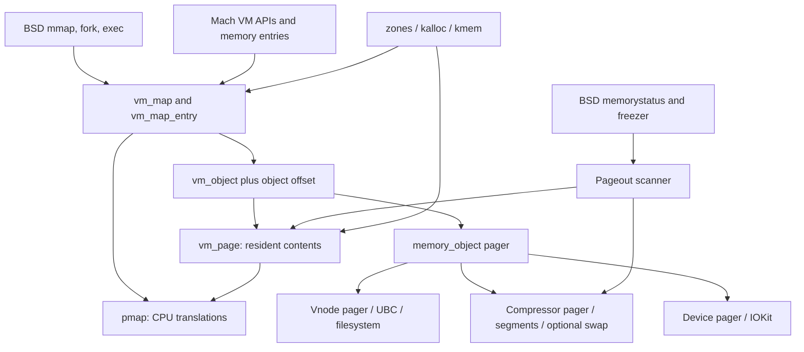
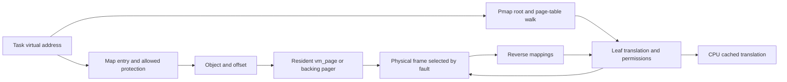

# Virtual memory and kernel allocation

[Guide index](../../README.md) · [Architecture](../../architecture.md)

XNU's VM subsystem manages address spaces, the objects supplying their contents, resident physical pages, and the work needed to make pages available under pressure. Its core is in `osfmk/vm`; process-level memory policy lives in BSD, hardware translation in architecture-specific `pmap` implementations, and small kernel allocations in `osfmk/kern`.

Start with [maps, objects, pages, and faults](maps-and-faults.md), then follow [one mapping from API request to CPU access](mapping-walkthroughs.md). The detailed chapters below separate address-space policy, content ownership, and hardware translation while tracing their interfaces.

## Detailed reading route

| Question | Guide |
| --- | --- |
| What happens during anonymous/file `mmap`, a first write, COW, `mprotect`, and `munmap`? | [Mapping walkthroughs](mapping-walkthroughs.md) |
| How are ranges found, reserved, split, protected, copied, and removed? | [Virtual address maps](virtual-address-maps.md): entry representation, B+tree storage, interlock/range/entry locks, submaps and APIs |
| Where do contents live, and what keeps them alive? | [Objects and resident pages](objects-and-pages.md): offsets, shadow/copy relationships, resident lookup, page states and object teardown |
| How does a fault obtain contents and safely install a translation? | [Fault resolution](fault-resolution.md): fast/slow cases, zero fill, COW, pager/compressor work, revalidation and pmap retries |
| What are the ARM64 tables and pmap structures? | [ARM64 pmap](pmap-arm64.md): 4 KiB/16 KiB geometry, PTEs, roots, physical apertures, PV/PTD metadata and nesting |
| How do concrete addresses become table indices, PTEs and physical bytes? | [Pmap translation walkthroughs](pmap-translation-walkthroughs.md): numeric 4 KiB/16 KiB walks, decoded PTEs, root selection and mapping changes through reuse |
| How are translations installed, changed, disconnected, and tables freed? | [Pmap mapping lifecycle](pmap-mapping-lifecycle.md): legacy/PPL and SPTM paths, locks, epochs, table pins and accounting |
| When can CPUs safely use a new translation or stop using an old one? | [Pmap TLB and cache operations](pmap-tlb-and-cache.md): ASIDs, activation, access/dirty tracking, invalidation and completion |
| How does the x86 backend differ? | [x86_64 pmap](pmap-x86.md): four-level tables, PV lists, root views, PCIDs, shootdowns and EPT boundaries |
| How does a file/device pager supply or preserve pages? | [Pagers and UPLs](pagers-and-upl.md): object-control interfaces, vnode/UBC, page-in/writeback and completion |
| How do ordinary reads share file pages with mappings, and what invalidates those pages? | [File-data caching](../vfs/file-data-cache-and-read-path.md): resident hits, missing runs, read-ahead, truncation and UBC lifetime |
| How do cached file pages become eligible for executable mappings? | [Page-signature validation](../security/page-signature-validation.md): offset/hash translation, validation/taint/NX masks, reuse, modification and monitor enforcement |
| How are pages wired or ranges exported to another task? | [Wiring and memory entries](wiring-and-memory-entries.md): wire counts, map copies, named capabilities and transfer ownership |
| How does a copy replace existing bytes, and how can a remap cross page-size boundaries? | [Copy-overwrite and remapping](copy-overwrite-and-remap.md): object substitution, physical-page revalidation, partial progress, source extraction and 4 KiB/16 KiB adjustment |
| How are physical pages recovered while logical mappings survive? | [Reclamation and pressure](reclaim-and-pressure.md): disconnect, worker ownership, compression, swap and process policy |
| How does memory pressure select a process, freeze its contents, and later resume it? | [Memorystatus and freezer](memorystatus-and-freezer.md): health/actions, referenced candidates, task/map/object freeze, budgets, packed segments and distinct frozen states |
| How do kernel allocators select storage, isolate types, and release backing? | [Kernel allocation](kernel-allocation.md): index for zone caches, kalloc routing, compiler type metadata, heap/zone assignment, kmem guards and specialized allocators |
| How is type isolation enforced, and where does sharing remain? | [Typed allocation](typed-allocation.md): fixed signature groups and zone budgets, variable heap assignment, runtime routing and compatible frees |
| Where do MTE tags live, and when can their physical backing be reused? | [MTE tag storage](mte-tag-storage-and-page-lifecycle.md): cells, free queues, activation, untagging barriers, relocation and compressor interactions |
| How did memory become available before normal allocators existed? | [ARM64 bootstrap memory](../platform/bootstrap-memory-and-lockdown.md): early tables, physical/virtual cursors, page descriptors and deferred static release |
| How do protected domains constrain mappings and page ownership? | [SPTM](../security/sptm.md), [TXM](../security/txm.md), and [Exclaves memory](../security/exclaves-resources-and-memory.md): frame types, signing policy, protected calls, donation and shared mappings |

The examples use page-size symbols where possible. Before following an address into pmap, identify the map's page size, system VM page size, and hardware translation granule; these are separate inputs in supported configurations.

## The central distinction

A mapping describes what an address **means**. A resident page holds its current contents. A hardware translation allows a CPU to access those contents. These can exist independently: an untouched anonymous mapping can have neither a resident page nor a page-table entry; a file's cached pages can outlive a particular process mapping. The public [`vm_map_create` documentation](../../../xnu/osfmk/vm/vm_map.h#L113) explicitly identifies the VM map as the source of truth for region configuration and the pmap as its machine-dependent cache.

The arrows summarize dependency and data flow, not a universal synchronous call chain. Pager dispatch is directly through operation tables in this checkout; do not assume every `memory_object_*` call sends an IPC message. See [`memory_object_data_request`](../../../xnu/osfmk/vm/memory_object.c#L1971).

### Follow one address in both directions

The upper route decides what contents an access is allowed to obtain. The lower route supplies the hardware translation once contents are ready. Reverse mappings let VM begin with a physical page and find affected translations during reclaim or protection changes. A PTE can temporarily grant less access than the map permits, for example to enforce COW or track writes. Replacing or removing a PTE must also honor invalidation completion before the old mapping's resources can be reused. [Faults](fault-resolution.md), [mapping lifecycle](pmap-mapping-lifecycle.md), [TLB completion](pmap-tlb-and-cache.md).

## Ownership and interfaces

| Component | Owns or describes | Main source entry points |
|---|---|---|
| VM map | Address ranges, permissions, inheritance, submaps, resource limits | [`struct _vm_map`, `struct vm_map_entry`](../../../xnu/osfmk/vm/vm_map_xnu.h#L320), [`vm_map_enter`](../../../xnu/osfmk/vm/vm_map.c#L3030) |
| VM object | Logical page contents indexed by object offset, pager and shadow relationships | [`struct vm_object`](../../../xnu/osfmk/vm/vm_object_xnu.h#L136), [`vm_object_shadow`](../../../xnu/osfmk/vm/vm_object.c#L4283) |
| Resident-page system | Physical-page descriptors, object lookup, free and replacement queues | [`struct vm_page`](../../../xnu/osfmk/vm/vm_page.h#L286), [`vm_page_grab_options`](../../../xnu/osfmk/vm/vm_resident.c#L5261) |
| Fault resolution | Permission checks, lookup, zero fill, copying, pager requests, pmap insertion | [`vm_fault`](../../../xnu/osfmk/vm/vm_fault.c#L4288), [`vm_fault_page`](../../../xnu/osfmk/vm/vm_fault.c#L1101) |
| Pmap | Machine translations, reference/modified tracking, mapping accounting | [ARM pmap](../../../xnu/osfmk/arm/pmap/pmap.c), [SPTM pmap](../../../xnu/osfmk/arm64/sptm/pmap/pmap.c), [x86 pmap](../../../xnu/osfmk/x86_64/pmap.c) |
| Pager/UPL interface | Supplying or returning contents; holding pages stable during I/O | [`memory_object.c`](../../../xnu/osfmk/vm/memory_object.c), [`vm_object_upl_request`](../../../xnu/osfmk/vm/vm_pageout.c#L6567), [`vm_upl.c`](../../../xnu/osfmk/vm/vm_upl.c) |
| Reclamation | Selecting victims, compression, swap, process memory policy | [`vm_pageout_scan`](../../../xnu/osfmk/vm/vm_pageout.c#L3509), [`memorystatus_thread_internal`](../../../xnu/bsd/kern/kern_memorystatus.c#L4963) |
| Kernel allocators | Fixed objects, typed size classes, page-granularity kernel allocations | [`zalloc_ext`](../../../xnu/osfmk/kern/zalloc.c#L6295), [`kalloc_ext`](../../../xnu/osfmk/kern/kalloc.c#L2513), [`kmem_alloc_guard_internal`](../../../xnu/osfmk/vm/vm_kern.c#L835) |

The most useful cross-subsystem routes are BSD `mmap` to a vnode's UBC object, VM faults to filesystem page-in, pageout to filesystem writeback, and IOKit memory descriptors to wired pages/device mappings. Continue into the [VFS documentation](../vfs/README.md) for filesystem operation dispatch. Process creation and termination determine map lifetime; scheduler waits and wakeups make faulting, pageout, and freezer work executable.

## Read the selected pmap backend

[`arm/pmap.h`](../../../xnu/osfmk/arm/pmap.h#L42) selects the SPTM or legacy ARM representation. [`files.arm64`](../../../xnu/osfmk/conf/files.arm64#L10-L25) selects matching sources; [`files.x86_64`](../../../xnu/osfmk/conf/files.x86_64#L7-L10) selects the x86 files. The same common API name is not evidence that all backends share one algorithm.

| Backend | Hardware state | Principal update/lifetime mechanisms |
| --- | --- | --- |
| Legacy ARM, optionally PPL | Per-pmap geometry, root, hardware/software ASID state, reverse mappings and table descriptors | Pmap reader/writer lock, PV-head protection, PPL allocation/retry boundaries when configured |
| ARM64 SPTM | Geometry/root/ASID and reverse/table metadata coordinated with monitor-managed page tables | Monitor update interface, PV-head locks, per-CPU epochs, leaf-table pins and condemnation before reclaim |
| x86_64 | PML4 roots, lower table pages, physical alias lists, per-CPU PCID state | Pmap reader/writer lock, PTE/PV synchronization, root activation and remote invalidation protocol |

Definitions: [`legacy pmap`](../../../xnu/osfmk/arm/pmap/pmap.h#L334), [`SPTM pmap`](../../../xnu/osfmk/arm64/sptm/pmap/pmap.h#L307), [`x86 pmap`](../../../xnu/osfmk/i386/pmap.h#L583). SPTM's implementation cannot be explained by replacing a legacy PPL function call with a different entry instruction; its local concurrency and table-lifetime machinery also differ.

| Pmap operation | Direction and purpose |
| --- | --- |
| `pmap_create_options` / `pmap_destroy` | Create and retire an address-translation context |
| `pmap_enter_options_addr` / `pmap_enter_options` | Install a selected physical address/page at a virtual address with policy supplied by VM |
| `pmap_protect*` / `pmap_remove*` | Change installed access or remove translations for a virtual range |
| `pmap_page_protect*` / `pmap_disconnect*` | Begin from a physical page and affect its aliases |
| `pmap_get_refmod` / `pmap_clear_refmod*` | Observe or reset access/dirty tracking used by VM |
| `pmap_switch*` / backend activation | Select a context and satisfy address-space tag/coherency requirements |
| `pmap_nest` / `pmap_unnest` | Share or detach selected lower-level hierarchy for supported nested mappings |

Read these as interface families; argument types, helper names, fast paths, and completion contracts differ. [`common pmap interface`](../../../xnu/osfmk/vm/pmap.h), [ARM lifecycle](pmap-mapping-lifecycle.md), [x86 implementation](pmap-x86.md).

## Details specific to this checkout

* Map lookup storage is a **B+tree**, including summaries of holes for allocation. Older descriptions of XNU's red-black VM map tree do not describe [`vm_map_store_node`](../../../xnu/osfmk/vm/vm_map_store_internal.h#L65).
* The map has an interlock and individual entries have locks. Range-lock contexts prepare and stabilize entries, including submap descent and COW resolution. A model with one map-wide lock is insufficient; see [`vm_map_lock_internal.h`](../../../xnu/osfmk/vm/vm_map_lock_internal.h#L57).
* Page size belongs to multiple layers. A map has `hdr.page_shift`, while VM objects and physical pages use system-page conventions. Code explicitly handles different sizes; never replace `VM_MAP_PAGE_SIZE(map)` with a hard-coded 4096 in your mental model. See [`vm_object_shadow`](../../../xnu/osfmk/vm/vm_object.c#L4344).
* Compressor, general swap, and freezer swap have separate runtime configuration predicates. The presence of their source does not establish that a particular product uses every facility. See [`vm_config` predicates](../../../xnu/osfmk/vm/vm_pageout.h#L227).
* VM submaps have a constrained hierarchy in the current range-lock implementation; this is separate from sharing a hardware hierarchy through pmap nesting. See [`submap rules`](../../../xnu/osfmk/vm/vm_map_lock_internal.h#L68).
* A named memory entry carries a capability to backing described by a submap or `vm_map_copy`. The current copy representation has entry-list and kernel-buffer variants. See [memory entries and copies](wiring-and-memory-entries.md).
* An invalid compressed PTE marker preserves mapping accounting; compressed contents and slot locators live in the object's compressor pager. See [compression](reclaim-and-pressure.md).

## Sources inspected and limits

“Deep” means the named data definitions and relevant multi-stage implementation paths were read, not that every line or configuration branch in a large file was audited.

| Area | Inspection | What the documentation supports / limits |
|---|---|---|
| Maps and ranges | Deep: `vm_map_xnu.h`, map-store/range-lock implementation, selected allocate/map/protect/remove/fork/remap paths and `kern_mman.c` boundaries | Entry representation, B+tree/hole lookup, lock preparation/restart, submaps and permission changes; no proof of every balancing or concurrent range operation |
| Objects and pages | Deep: `vm_object_xnu.h`, `vm_page.h`, allocation/lookup/reference/activity/termination in `vm_object.c` and `vm_resident.c` | Backing relationships, resident membership, page states and deferred teardown; specialized objects/configurations remain bounded in the detailed guide |
| Faults | Deep selected `vm_fault.c` paths: map/submap lookup, resident/COW/zero-fill/compressor/pager work, try-lock relookup and nonblocking pmap insertion retry | Common success/failure/concurrency paths; code-signing and MTE conditions are identified without claiming every policy branch |
| Copies, memory entries, wiring | Deep: current copy representations and named-entry creation/mapping; VM map/page/pmap wiring and unwiring stages; overwrite substitution/physical-copy retries and remap granule adjustment | Transfer ownership, partial-progress boundaries and residency protection; all API flag/overlapping-alias combinations and generated MIG code remain outside exhaustive review |
| File pager / UPL | Deep selected `bsd_vm.c`, `ubc_subr.c`, `memory_object.c`; UPL acquisition, commit/abort and release paths | VM/VFS handoff, busy/activity ownership, device-pager distinctions; filesystem-specific I/O below vnode operations remains with VFS |
| Reclamation | Deep scanner final ref/mod/disconnect decisions, queue-to-worker activity/busy ownership and compression cleanup in `vm_pageout.c`; page allocation in `vm_resident.c` | Replacement policy and physical-lifetime boundary; tuning constants are not universal product defaults |
| Compressor / swap | Deep pager put/get, slot/segment representation, nonblocking decompression, temporary physical mappings, and swap reserve/submit/complete paths | Offset-to-slot-to-segment-to-page relationship; codec algorithms, every compaction state and swap encryption remain narrower |
| Process policy / freezer | Deep health/action selection, priority/high-water candidate reference/restart, freeze eligibility/iterator, process/task/map/object path and packed-segment completion | [Focused chapter](memorystatus-and-freezer.md) separates task and BSD frozen states, evaluation/execution, MiB/compressed-page counter units, work budgets and asynchronous I/O. All aging/aggressive-kill rules, throttle combinations, external recommendation policy and notification filters remain bounded. |
| Allocators | Deep zone geometry/metadata/bitmap/cache/depot and refill/reclaim; kalloc classes, routing/free/realloc; fixed/variable compiler metadata and startup isolation policy; guarded kmem placement/population/free/resize; RO/SMR/perCPU/permanent modes and selected IOKit/BSD wrappers | Separate chapters trace element, zone, VA, physical and protection lifetimes. Exact generated compiler output, live heap assignments, all sanitizer configurations and external monitor enforcement are outside source verification |
| ARM64 pmap | Deep legacy/PPL and SPTM geometry, roots, PTEs/PV/PTD, enter/protect/remove/disconnect, table allocation/reclaim, ASIDs/nesting, epochs/pins, access tracking and TLB completion | Source-visible mapping/lifetime contracts; external monitor bodies and every platform/mapping type are not reconstructed |
| MTE physical backing | Deep selected `vm_mteinfo.c`, resident-page, SPTM pmap and compressor paths | [Tag-storage companion](mte-tag-storage-and-page-lifecycle.md) traces metadata geometry, allocation selection, activation/deactivation, relocation and synchronization; process tag policy, monitor internals and every codec branch remain bounded |
| x86_64 pmap | Deep create/expand/enter/remove/protect/disconnect, rooted/hashed PV, root sharing, PCID activation and invalidation; selected nesting/EPT branches | Current four-level mapping path; bootstrap, all cache-type changes, corruption heuristics and complete hypervisor behavior remain outside scope |
| Peripheral VM | Focused I/O mapping and driver memory boundaries; sanitize and shared-region interfaces | Shared-region/pager and deferred-reclamation paths are expanded in the companions below; complete IOMMU and MTE policy remain bounded |

Useful original documentation includes [pageout scan](../../../xnu/doc/vm/pageout_scan.md), [memorystatus](../../../xnu/doc/vm/memorystatus.md), [freezer](../../../xnu/doc/vm/freezer.md), [shared region](../../../xnu/doc/vm/shared_region.md), [VM sanitization](../../../xnu/doc/vm/sanitize.md), and [allocator API guidance](../../../xnu/doc/allocators/api-basics.md). Prefer implementation when an older narrative uses a superseded function or structure name.

## Backing-store and reclaim companions

- [Shared regions and transforming pagers](shared-regions-and-transforming-pagers.md): exec placeholders, shared-cache installation, submap/pmap nesting, page transformation and pager lifetime.
- [Compressor segments and swapfiles](compressor-segments-and-swapfiles.md): filling allocation, locator repair during compaction, swap workers, file creation, trim and reclamation.
- [Deferred reclamation](deferred-reclamation.md): userspace publication/cancellation, kernel gate ownership, partial progress, sampling, fork and teardown.
- [Purgeable memory](purgeable-memory.md): volatile/empty transitions, aging tokens, selection locks and resident/compressed owner accounting.
- [Phantom cache and refaults](phantom-cache-and-refaults.md): bounded eviction history and conditional pressure decisions, including the macOS ARM64 exclusion.

<!-- BEGIN PLATYDOC DOCUMENTATION LICENSE -->
Original Platydoc text and diagrams are licensed under [CC BY 4.0](https://creativecommons.org/licenses/by/4.0/). Quoted source code and third-party material retain their respective licenses.
<!-- END PLATYDOC DOCUMENTATION LICENSE -->
