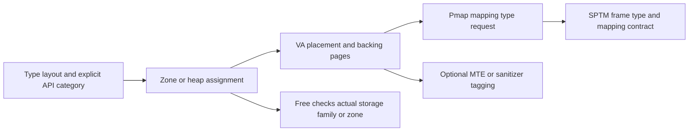

# Allocator interfaces and protected-memory categories

[Allocator overview](kernel-allocation.md) · [Kalloc routing](kalloc-heaps-and-routing.md) · [Type isolation](typed-allocation.md) · [Read-only and special zones](read-only-and-special-zones.md)

Subsystem APIs often wrap the same zone/kalloc/kmem mechanisms with different alignment, accounting, sharing or lifetime requirements. This chapter follows those wrappers and then connects allocation classification to physical-page restrictions. A wrapper name alone does not establish a separate heap, a dedicated type zone, physical contiguity or permission to share a page.

## IOKit byte and typed allocation

`IOMalloc_internal` accepts a heap, adds an optional allocation-tracking header, allocates with `Z_WAITOK` and an IOKit accounting tag, then returns the payload after that header. `IOFree_internal` recovers the header/base and frees the same augmented size through the supplied heap. Under tracking, it also removes the allocation record. [Allocation](../../../platydoc-data/xnu/iokit/Kernel/IOLib.cpp#L263-L315), [free](../../../platydoc-data/xnu/iokit/Kernel/IOLib.cpp#L318-L351).

The external wrappers select a family:

| Interface | Route |
| --- | --- |
| `IOMalloc` / `IOMallocZero` compatibility symbols | `KHEAP_DEFAULT`, with zeroing for the latter. |
| `IOMallocData` / `IOMallocZeroData` | `KHEAP_DATA_PRIVATE`. |
| `IOMallocDataShareable` / zeroed counterpart | `KHEAP_DATA_SHARED`. |
| Fixed `IOMallocType` implementation | Fixed type view → `kalloc_type_impl_external`, normally wait/zero and no-fail for eligible non-VM types. |
| Variable typed implementation | Variable view → `kalloc_type_var_impl`, wait/zero and type accounting tag. |

[Compatibility wrappers](../../../platydoc-data/xnu/iokit/Kernel/IOLib.cpp#L355-L380), [data wrappers](../../../platydoc-data/xnu/iokit/Kernel/IOLib.cpp#L1099-L1144), [typed implementations](../../../platydoc-data/xnu/iokit/Kernel/IOLib.cpp#L1153-L1231). The public/private macro expansion and the selected exported symbol matter: these are source-visible implementation routes, not a claim that every third-party ABI exposes all internal typed macros.

The fixed typed wrapper deliberately uses the external entry because a kernel extension's metadata might not have been processed during startup:

[Source: IOLib.cpp, lines 1170–1179](../../../platydoc-data/xnu/iokit/Kernel/IOLib.cpp#L1170-L1179)

<!-- source-excerpt: ../../../platydoc-data/xnu/iokit/Kernel/IOLib.cpp#L1170-L1179 -->
```cpp
	zalloc_flags_t kt_flags = (zalloc_flags_t) (Z_WAITOK | Z_ZERO);
	if (!IOMallocType_from_vm(kt_view)) {
		kt_flags = (zalloc_flags_t) (kt_flags | Z_NOFAIL);
	}
	/*
	 * Use external symbol for kalloc_type_impl as
	 * kalloc_type_views generated at some external callsites
	 * many not have been processed during boot.
	 */
	return kalloc_type_impl_external(kt_view, kt_flags);
```

`kalloc_type_impl_external` checks whether the view has an assigned zone. If it does not, it recovers the requested size and chooses the applicable heap fallback. This handles unprocessed views and permitted large external types. A metadata record's presence does not prove startup assigned it a dedicated typed zone. [Fallback](../../../platydoc-data/xnu/osfmk/kern/kalloc.c#L2720-L2743), [startup processing](typed-allocation.md).

`IOTRACKING` adds another exception: when tracking is active, fixed and variable typed wrappers can fall back to `IOMalloc_internal(KHEAP_DEFAULT, ...)` because their tracking header changes the required layout/size. Matching free wrappers take the same route. Documentation of isolation must retain that configuration boundary. [Fixed tracking branch](../../../platydoc-data/xnu/iokit/Kernel/IOLib.cpp#L1155-L1167), [variable tracking branch](../../../platydoc-data/xnu/iokit/Kernel/IOLib.cpp#L1202-L1212).

## C++ classes provide type views through generated operators

For kernel-private consumers, `OSDefineOperatorMethods` emits a static type view and passes it to typed new/delete helpers:

[Source: OSMetaClass.h, lines 2078–2088](../../../platydoc-data/xnu/libkern/libkern/c++/OSMetaClass.h#L2078-L2088)

<!-- source-excerpt: ../../../platydoc-data/xnu/libkern/libkern/c++/OSMetaClass.h#L2078-L2088 -->
```cpp
#define OSDefineOperatorMethods(className)                      \
	static KALLOC_TYPE_DEFINE(className ## _ktv, className,     \
	    KT_DEFAULT);                                            \
	void * className::operator new(size_t size) {               \
	  return OSObject_typed_operator_new(className ## _ktv,     \
	      size);                                                \
	}                                                           \
	void className::operator delete(void *mem, size_t size) {   \
	  return OSObject_typed_operator_delete(className ## _ktv,  \
	      mem, size);                                           \
	}
```

`OSObject_typed_operator_new` compares the requested allocation size with the view's fixed size. The ordinary case calls `kalloc_type_impl_external`. A subclass that inherited its parent's operators without generating its own metadata may request a larger object; that case falls back to `KHEAP_DEFAULT`. The matching delete helper chooses the corresponding typed or generic release. Tracking can select another route before this test. [Size-sensitive new](../../../platydoc-data/xnu/libkern/c++/OSObject.cpp#L312-L344), [delete](../../../platydoc-data/xnu/libkern/c++/OSObject.cpp#L364-L383).

The old `OSObject::operator new` remains a default-heap compatibility path. `OSDefineOperatorMethodsWithZone` instead uses the class's explicit zone when available and has its own matching zone free. These are distinct storage routes even though C++ syntax says `new Class`. [Compatibility operator](../../../platydoc-data/xnu/libkern/c++/OSObject.cpp#L288-L309), [zone operators](../../../platydoc-data/xnu/libkern/libkern/c++/OSMetaClass.h#L2098-L2118).

Allocation only obtains storage. Constructor execution, `init`, reference counting, teardown and eventual `delete` belong to the C++/subsystem lifetime. A type view does not automatically retain referenced objects or prevent an incorrect release protocol. See [libkern object lifetimes](../drivers/libkern-and-kext-runtime.md).

## Aligned allocation can reserve extra storage around the payload

`IOMallocAligned_internal` rounds the requested alignment to a power of two and checks the request. If payload plus header already reaches a page, it asks `kernel_memory_allocate` for an aligned VM range. Smaller requests reserve enough extra space for the header and alignment: that augmented size decides whether to use kmem or kalloc. The returned aligned address can lie inside the original allocation. [Aligned dispatch](../../../platydoc-data/xnu/iokit/Kernel/IOLib.cpp#L498-L587).

`IOLibPageMallocHeader` stores the offset back to the base and alignment mask. Under pointer authentication, the offset is signed with a discriminator incorporating the aligned address and mask. Free recovers/authenticates the offset and checks overflow, minimum header space and reconstructed alignment before choosing the matching backend. This metadata protects recovery of the original allocation; it is not a compiler type signature. [Header initialization](../../../platydoc-data/xnu/iokit/Kernel/IOLib.cpp#L419-L435), [validation](../../../platydoc-data/xnu/iokit/Kernel/IOLib.cpp#L470-L495), [aligned free](../../../platydoc-data/xnu/iokit/Kernel/IOLib.cpp#L590-L634).

The external aligned wrapper uses `KHEAP_DATA_SHARED` here. The implementation carries private/shared heap choice into `KMA_DATA`/`KMA_DATA_SHARED` for VM-backed cases. Alignment alone neither makes storage pointer-free nor authorizes sharing: the selected API's category is the contract. [External wrapper](../../../platydoc-data/xnu/iokit/Kernel/IOLib.cpp#L640-L655).

## Physically constrained and pageable IOKit allocations

`IOKernelAllocateWithPhysicalRestrict` distinguishes an alignment/size that fits inside a single physical page from requests requiring contiguous physical pages or a physical-address limit. It can satisfy small cases by overallocating a kalloc element and choosing a payload that does not cross a page. For true multi-page constraints it selects `kmem_alloc_contig`, while other cases use `kernel_memory_allocate`, potentially with `KMA_LOMEM`. Its free companion must reverse the corresponding storage/header decision. [Constraint selection](../../../platydoc-data/xnu/iokit/Kernel/IOLib.cpp#L708-L835), [VM contiguous allocation](kernel-virtual-allocation.md).

`IOMallocContiguous` has another ownership branch: when the caller requests a physical-address result, it creates an `IOBufferMemoryDescriptor`, retains it in a protected `_IOMallocContiguousEntry` list, and returns the descriptor's bytes/physical address. `IOFreeContiguous` removes that entry and releases the descriptor; without such an entry it uses `IOKernelFreePhysical`. A plain heap free would lose the descriptor's lifetime obligations. [Descriptor-backed branch](../../../platydoc-data/xnu/iokit/Kernel/IOLib.cpp#L843-L900), [matching free](../../../platydoc-data/xnu/iokit/Kernel/IOLib.cpp#L904-L935).

Pageable allocation uses the IOKit pageable map and `KMA_PAGEABLE | KMA_DATA_SHARED`. On non-x86 targets, the path uses page-granular pageable VM allocations directly, converting size zero to one byte before VM rounding; physical backing is supplied by later faults. On x86, sufficiently small requests can use the `iopa` suballocator, while larger requests use the pageable VM path. Alignment above a page is rejected by the page-level helper. [Pageable VM callback](../../../platydoc-data/xnu/iokit/Kernel/IOLib.cpp#L957-L986), [architecture split](../../../platydoc-data/xnu/iokit/Kernel/IOLib.cpp#L1017-L1090).

The x86 `iopa` allocator divides each page into 64 chunks. The last chunk holds `iopa_page_t`; its 64-bit `avail` bitmap reserves that metadata chunk. Under the allocator lock, `iopa_allocinpage` searches for a run of free bits and intersects it with an alignment mask. If none exists, allocation obtains another page outside that lock and publishes its initialized metadata. A page with no available chunks leaves the candidate list. Free restores the bits and returns the page's virtual base only when all payload chunks are free; otherwise it returns zero. `IOFreePageable` uses a nonzero result to release that page's VM allocation. [Chunk sizing](../../../platydoc-data/xnu/iokit/Kernel/IOLib.cpp#L208-L210), [bitmap allocator](../../../platydoc-data/xnu/iokit/Kernel/IOLib.cpp#L1247-L1343), [free](../../../platydoc-data/xnu/iokit/Kernel/IOLib.cpp#L1347-L1391), [VM release](../../../platydoc-data/xnu/iokit/Kernel/IOLib.cpp#L1062-L1079).

[Source: IOLib.cpp, lines 1370–1388](../../../platydoc-data/xnu/iokit/Kernel/IOLib.cpp#L1370-L1388)

<!-- source-excerpt: ../../../platydoc-data/xnu/iokit/Kernel/IOLib.cpp#L1370-L1388 -->
```cpp
	if (!pa->avail) {
		assert(!pa->link.next);
		enqueue_tail(&a->list, &pa->link);
	}
	pa->avail |= ((-1ULL << (64 - count)) >> chunk);
	if (pa->avail != -2ULL) {
		pa = NULL;
	} else {
		remque(&pa->link);
		pa->link.next = NULL;
		pa->signature = 0;
		a->pagecount--;
		// page to free
		pa = (typeof(pa))trunc_page(pa);
	}
	a->bytecount -= bytes;
	IOLockUnlock(a->lock);

	return (uintptr_t) pa;
```

This is a specialized small pageable pool, separate from zone magazines and type assignment. Its bitmap describes chunk availability, not source-language types. DMA preparation/mapping has further ownership beyond obtaining these bytes; follow [memory descriptors and DMA](../drivers/memory-and-dma.md).

## BSD compatibility interfaces do not create a malloc type heap

`kern_malloc.c` labels `_MALLOC_external`, `_FREE_external`, `STRDUP_external` and `OSMalloc` as macOS-only deprecated interfaces. `_MALLOC_external` selects `KHEAP_DEFAULT` except its `M_SONAME` case, returns null for size zero, maps supported flags, and calls `kalloc_ext`. On failure it either returns null for the permitted flags or panics. The integer `type` argument is not a compiler-generated layout signature and does not create a separate zone for each historical malloc type. [Compatibility allocation](../../../platydoc-data/xnu/bsd/kern/kern_malloc.c#L96-L151).

`OSMallocTag` is lifetime/accounting metadata. Allocations retain the tag; tag release and allocation free cooperate before destroying it. A pageable tag plus a page-sized-or-larger request routes to `kmem_alloc` with `KMA_PAGEABLE | KMA_DATA_SHARED`; other requests use the `KERN_OS_MALLOC` heap view. The nonblocking interface refuses pageable tags. `OSFree` mirrors the allocation route and drops the tag reference. [Tag ownership](../../../platydoc-data/xnu/bsd/kern/kern_malloc.c#L182-L266), [allocation/free](../../../platydoc-data/xnu/bsd/kern/kern_malloc.c#L269-L333).

A VM accounting tag, an `OSMallocTag`, a compiler type-layout signature and a hardware memory tag are different objects. In particular, diagnostic tags do not establish heap isolation.

## Kernel-extension image allocation uses a map constraint

`kext_alloc` allocates VM for extension images, rather than fixed-size objects through a typed zone. The global `g_kext_map` is either a dedicated submap or `kernel_map`. With `CONFIG_KEXT_BASEMENT`, `kext_alloc_init` reserves a fixed submap whose bounds satisfy the extension-text reachability constraint and records where post-boot allocations should begin relative to prelinked text. Without that configuration, it uses the kernel map and ordinary kernel address bounds. [Initialization](../../../platydoc-data/xnu/osfmk/kern/kext_alloc.c#L74-L144).

`kext_alloc` chooses fixed or nonfixed insertion and `VM_KERN_MEMORY_KEXT` accounting. The basement path uses `mach_vm_map_kernel` to preserve the preferred starting address for nonfixed allocation; its fileset branch uses `mach_vm_allocate_kernel`. The non-basement path also uses `mach_vm_allocate_kernel`. After insertion, it rejects an allocation extending beyond `kext_alloc_max` and removes it. `kext_free` delegates to `mach_vm_deallocate_kernel`. This is address-range policy over VM mappings, not signature-based heap isolation. The later image-loading code establishes the image's segment contents and permissions. [Allocation and release](../../../platydoc-data/xnu/osfmk/kern/kext_alloc.c#L170-L245), [extension loading context](../drivers/libkern-and-kext-runtime.md).

`get_address_from_kext_map` probes using an allocation followed immediately by a free, then returns an adjusted page-aligned address. Its return value is therefore not a live allocation or a reservation retained by that helper. The consumer must perform the subsequent mapping under its own loading protocol. [Address probe](../../../platydoc-data/xnu/osfmk/kern/kext_alloc.c#L150-L168).

## Mapping restrictions are a separate layer of isolation

Typed segregation determines which allocation classes may reuse storage. Kernel-private versus shareable classification additionally determines which mappings a physical page should permit. XNU passes this choice through `pmap_mapping_type_t`; SPTM-backed systems can use a restricted frame type.

For kmem population, the selection is:

[Source: vm_kern.c, lines 218–229](../../../platydoc-data/xnu/osfmk/vm/vm_kern.c#L218-L229)

<!-- source-excerpt: ../../../platydoc-data/xnu/osfmk/vm/vm_kern.c#L218-L229 -->
```c
static inline pmap_mapping_type_t
__kmem_mapping_type(kmem_flags_t flags)
{
	if (flags & (KMEM_COMPRESSOR | KMEM_DATA_SHARED)) {
		return PMAP_MAPPING_TYPE_DEFAULT;
	} else if (flags & KMEM_DATA) {
		return kalloc_is_restricted_data_mode_enforced() ?
		       PMAP_MAPPING_TYPE_RESTRICTED : PMAP_MAPPING_TYPE_DEFAULT;
	} else {
		return PMAP_MAPPING_TYPE_RESTRICTED;
	}
}
```

Thus kmem compressor/shared-data storage requests the default mapping type; kmem private data requests restricted mapping only in enforce mode; other ordinary kmem storage requests restricted mapping. Zone population uses a different selector based on its submap index: DATA → default, READ_ONLY → ROZONE/read-only permissions, otherwise → restricted. In this checkout, final zone creation puts both private and shared data heaps in DATA without testing `restricted_data_mode`. Consequently, the kmem private-data enforcement branch above must not be generalized to small data-zone allocations. [Zone mapping/protection](../../../platydoc-data/xnu/osfmk/kern/zalloc.c#L4782-L4810), [data-heap predicate](../../../platydoc-data/xnu/osfmk/kern/zalloc.h#L2007-L2012), [final zone placement](../../../platydoc-data/xnu/osfmk/kern/zalloc.c#L9294-L9304).



The intended `XNU_KERNEL_RESTRICTED` contract described by the in-tree [restricted-memory document](../../../platydoc-data/xnu/doc/allocators/xnu-kernel-restricted.md#xnu_kernel_restricted) allows mappings only in the kernel, excludes IOMMU/DART mappings, and permits a single mapping beyond the static physical aperture. The local SPTM pmap implementation translates a restricted request to that frame type when `use_xnu_restricted` is enabled; otherwise it selects `XNU_DEFAULT`. [Frame-type selection](../../../platydoc-data/xnu/osfmk/arm64/sptm/pmap/pmap.c#L6081-L6112), [tunable default](../../../platydoc-data/xnu/osfmk/arm64/sptm/pmap/pmap.c#L148).

The monitor's implementation is external. These pages document XNU's requests and the stated interface policy, not a source audit of its enforcement. They also do not assume that a legacy PPL/x86 build implements the SPTM frame-type mechanism merely because it accepts the same common allocation flags. See [SPTM mapping lifecycle](pmap-mapping-lifecycle.md) and [protected-execution boundaries](../platform/exception-levels-and-monitors.md).

`restricted_data_mode` is another independent switch: this checkout's declared default is NONE on x86_64, TELEMETRY for macOS/tvOS targets, and ENFORCE otherwise. It is a tunable, so source defaults are not evidence of a running product's setting. Telemetry does not provide the same enforcement as restricted frame typing. [Mode declarations](../../../platydoc-data/xnu/osfmk/kern/kalloc.c#L459-L509).

Finally, restricted mappings do not make kernel code unable to corrupt the contents of its own writable allocation. Read-only zones instead restrict writes and provide controlled mutation interfaces; MTE checks tag compatibility; type segregation limits cross-class reuse; free validation checks storage identity; guard objects and inaccessible gaps affect spatial placement. These mechanisms cooperate but their guarantees should not be merged into a claim that the allocator proves complete type or memory safety. [Read-only zones](read-only-and-special-zones.md), [typed guarantees and limits](typed-allocation.md), [VM guards](kernel-virtual-allocation.md).

## Sources and limits

This chapter traced the selected IOKit allocation/free pairs, class-operator macros, BSD compatibility wrappers, the x86 pageable suballocator, kernel-extension VM allocation, and XNU's mapping-type selection. It does not audit every IOKit client, DMA mapper, extension-loading operation or tracking callback. No allocator benchmark, live zone dump or hardware protection test was run; configuration-specific statements are derived from the guards and defaults in the cited source.

<!-- BEGIN PLATYDOC DOCUMENTATION LICENSE -->
Original Platydoc text and diagrams are licensed under [CC BY 4.0](https://creativecommons.org/licenses/by/4.0/). Quoted source code and third-party material retain their respective licenses.
<!-- END PLATYDOC DOCUMENTATION LICENSE -->
