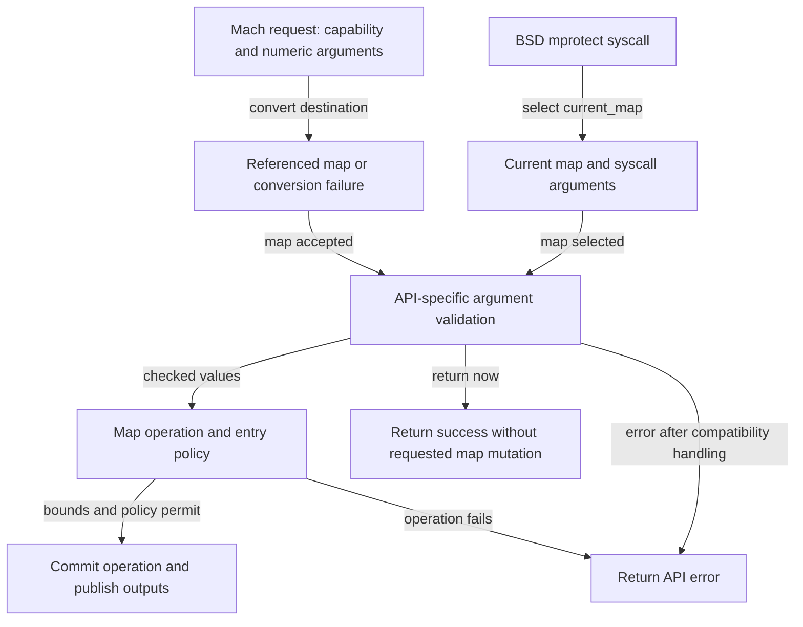
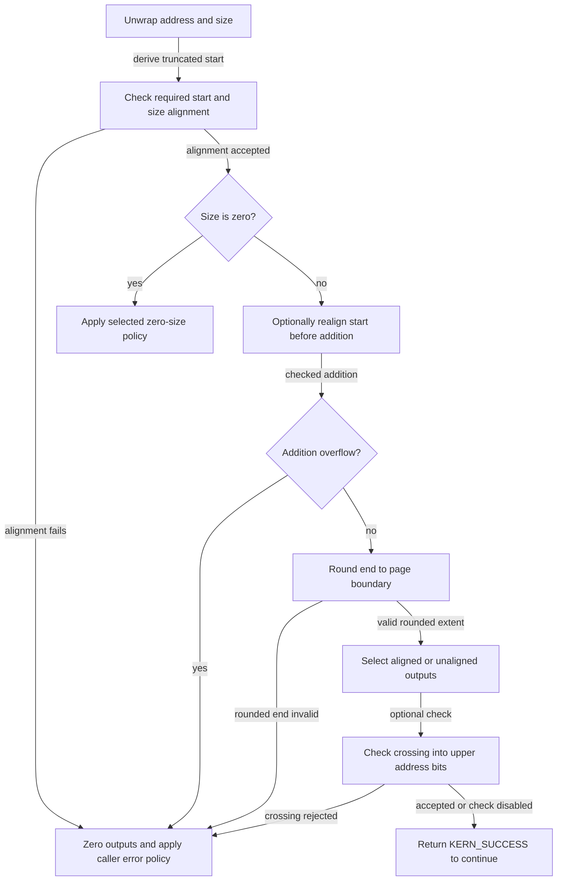
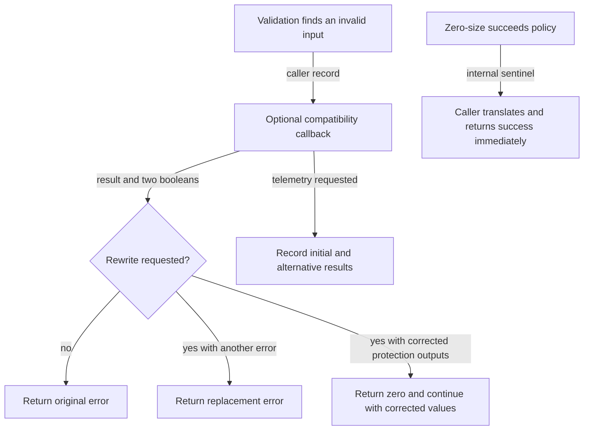

# VM API arguments: arithmetic, compatibility and map authority

VM entry points receive addresses, lengths and protection masks whose numeric representation is not yet safe for the operation they request. This chapter follows the conversion from those arguments to checked intervals and then to an authorized map operation in `xnu-12377.121.6`. It explains why page rounding needs its own overflow check, why zero length has several contracts, and why a successful sanitizer result does not establish that a mapping exists or that its permissions may change.

[VM guide](README.md) · [Virtual address maps](virtual-address-maps.md) · [Mapping walkthroughs](mapping-walkthroughs.md) · [Memory-entry capabilities](wiring-and-memory-entries.md) · [Task and thread capabilities](../security/task-and-thread-capabilities.md)

## 1. Follow three separate decisions at the API boundary

For the selected Mach allocation/protection RPCs, the destination is declared as `vm_task_entry_t`. The declaration names `convert_port_entry_to_map` as its input conversion and `vm_map_deallocate` as its destructor. The handler receives a map pointer, not a user-supplied pointer to a `vm_map`. BSD `mprotect`, by comparison, selects `current_map()` and obtains its numerical arguments from the syscall argument structure. [Mach allocation declaration](../../../platydoc-data/xnu/osfmk/mach/mach_vm.defs#L110-L115), [protection declaration](../../../platydoc-data/xnu/osfmk/mach/mach_vm.defs#L166-L172), [conversion declaration](../../../platydoc-data/xnu/osfmk/mach/mach_types.defs#L255-L261), [BSD entry](../../../platydoc-data/xnu/bsd/kern/kern_mman.c#L1163-L1197).

| Decision | State or representation examined | What success establishes |
| --- | --- | --- |
| Resolve the target | A task capability or supported named-entry capability; alternatively the current task's map | The entry path has selected and, where required, referenced a map |
| Sanitize arguments | Wrapped address/size/protection values, caller-specific flags, page mask | The selected numerical and flag checks permit the resulting values, or request an immediate return |
| Perform the operation | Map bounds, entry protections, backing capability, locks and execution policy | The particular allocation, removal or protection change can proceed |

These decisions have separate failure paths. `vm_sanitize_addr_size` can accept a mathematically valid interval containing a hole; the map operation still has to decide whether holes are permitted. A retained map reference preserves storage lifetime without locking all its entries. For ordinary protection changes, `vm_map_protect` later takes an exclusive atomic range lock and runs entry preflight before its update walk. [Range sanitizer](../../../platydoc-data/xnu/osfmk/vm/vm_sanitize.c#L528-L677), [protection range acquisition](../../../platydoc-data/xnu/osfmk/vm/vm_map.c#L5923-L5953), [map reference](../../../platydoc-data/xnu/osfmk/vm/vm_map.c#L19303-L19328).



The diagram starts after transport has delivered the arguments and abbreviates each caller's validation order. Generated MIG server bodies are not present in this inspected path; their conversion/destructor contract comes from the declarations and the local conversion implementations. [MIG dispatch boundary](../ipc/kernel-rpc-and-exceptions.md#dispatch-structures-and-split-message-storage).

## 2. Unsafe types preserve the obligation to validate

With `VM_UNSAFE_TYPES` enabled, address and size names such as `mach_vm_address_ut` and `mach_vm_size_ut` refer to separate wrapper families. Protection, inheritance and behavior also have unchecked forms. In C, the wrapper contains a scalar named `UNSAFE` in a transparent union, with a size assertion:

[Wrapper definition — `vm_types_unsafe.h`, lines 52–61](../../../platydoc-data/xnu/osfmk/mach/vm_types_unsafe.h#L52-L61).

<!-- source-excerpt: ../../../platydoc-data/xnu/osfmk/mach/vm_types_unsafe.h#L52-L61 -->
```c
#if defined(__cplusplus)
#define VM_GENERATE_UNSAFE_WRAPPER(_safe_type, _unsafe_type) \
	typedef _safe_type _unsafe_type
#else
#define VM_GENERATE_UNSAFE_WRAPPER(_safe_type, _unsafe_type) \
	typedef union { _safe_type UNSAFE; } _unsafe_type    \
	    __attribute__((transparent_union));              \
	_Static_assert(sizeof(_safe_type) == sizeof(_unsafe_type),            \
	    "Size mismatch between unsafe and safe versions of a type")
#endif
```

An expression cannot perform ordinary integer arithmetic directly on a union value. The selected VM implementation must unwrap it, call a sanitizer or use a helper that deliberately keeps the result unchecked. The macros share a 64-bit address wrapper among several address typedefs and a distinct size wrapper among size typedefs; they do not create a separate runtime object for every API type. [Wrapper families](../../../platydoc-data/xnu/osfmk/mach/vm_types_unsafe.h#L63-L66), [aliases and configuration](../../../platydoc-data/xnu/osfmk/mach/vm_types_unsafe.h#L72-L158), [unchecked VM types](../../../platydoc-data/xnu/osfmk/mach/vm_types_unsafe.h#L160-L188).

The enforcement is selected per compilation unit. The osfmk build adds `-DVM_UNSAFE_TYPES` to the C files under `osfmk/vm`; BSD enables it for `bsd/vm` and `kern_mman.c`. Without the flag, the public unchecked typedefs alias their ordinary scalar types. Enabling this mode in C++ is explicitly rejected. This is a source-level aid at selected implementation boundaries, not a proof that all kernel callers used the checks. [osfmk selection](../../../platydoc-data/xnu/osfmk/conf/Makefile.template#L131-L142), [BSD selection](../../../platydoc-data/xnu/bsd/conf/Makefile.template#L80-L92), [C++ restriction](../../../platydoc-data/xnu/osfmk/mach/vm_types_unsafe.h#L72-L79).

Several helper names describe representation changes rather than validation:

| Helper | Actual transformation | Obligation that remains |
| --- | --- | --- |
| `vm_sanitize_wrap_addr`, `vm_sanitize_wrap_size` | Put a scalar into an unchecked wrapper | All operation-specific checks |
| `vm_sanitize_expand_addr_to_64`, `vm_sanitize_trunc_addr_to_32` | Widen or explicitly truncate an unchecked value | Range validity and any information lost by the chosen conversion |
| `vm_sanitize_compute_ut_end` | Compute unchecked `address + size` using the overflow builtin while ignoring its overflow result | Validate the reconstructed range before using it |
| `vm_sanitize_compute_ut_size` | Compute unchecked `end - address` in the same manner | Validate the resulting address/size pair |
| `vm_sanitize_addr` | Truncate the unwrapped address to the supplied map's page boundary | Bounds, backing and authority checks |

Sources: [wrap and width conversion](../../../platydoc-data/xnu/osfmk/vm/vm_sanitize.c#L91-L166), [unchecked arithmetic](../../../platydoc-data/xnu/osfmk/vm/vm_sanitize.c#L208-L239), [single-address truncation](../../../platydoc-data/xnu/osfmk/vm/vm_sanitize.c#L309-L319). `vm_sanitize_mask` likewise unwraps its argument and returns success without validating the mask; its comment assigns final page alignment to the placement path. The function prefix alone does not specify a uniform contract. [Mask implementation](../../../platydoc-data/xnu/osfmk/vm/vm_sanitize.c#L349-L368).

`mach_vm_protect` demonstrates why unchecked arithmetic exists: its nonzero-size path converts `(start, size)` to unchecked `(start, end)` for `vm_map_protect`. Later, `vm_sanitize_addr_end` reconstructs the unchecked size and delegates to the checked address/size routine. An intermediate wrapped endpoint does not make an overflowing range legitimate. [Caller](../../../platydoc-data/xnu/osfmk/vm/vm_user.c#L259-L278), [checked adapter](../../../platydoc-data/xnu/osfmk/vm/vm_sanitize.c#L679-L695).

## 3. Canonicalization retains the original extent

With `CONFIG_KERNEL_TAGGING || HAS_MTE_EMULATION_SHIMS`, canonicalization helpers call `vm_map_strip_addr`, which delegates to the map's pmap. The ARM implementations choose kernel versus user address stripping from pmap identity. The operation concerns address metadata; it does not acquire a page or check a mapping's permissions. [VM wrapper](../../../platydoc-data/xnu/osfmk/vm/vm_map.c#L428-L438), [legacy ARM dispatch](../../../platydoc-data/xnu/osfmk/arm/pmap/pmap.c#L12997-L13009), [SPTM dispatch](../../../platydoc-data/xnu/osfmk/arm64/sptm/pmap/pmap.c#L12379-L12391).

For an unchecked start/end pair, the helper first derives the original modular size, strips only the start, then reconstructs the end using that same size. Independently stripping both endpoints could change the requested extent. The helper deliberately leaves any resulting arithmetic problem for the sanitizer:

[Preserve extent during canonicalization — `vm_sanitize.c`, lines 271–283](../../../platydoc-data/xnu/osfmk/vm/vm_sanitize.c#L271-L283).

<!-- source-excerpt: ../../../platydoc-data/xnu/osfmk/vm/vm_sanitize.c#L271-L283 -->
```c
	size_u = vm_sanitize_compute_ut_size(*addr_u, *end_u);
	/*
	 * VM APIs expect (addr,size) that gets turned into (start,end) along the way.
	 * Only canonicalize addr and calculate canonical_end from that. If the size
	 * was a weird value, that gets preserved.
	 *
	 * We are okay with overflows here because they will be properly sanitized later.
	 */
	canonical_addr = vm_map_strip_addr(map, addr);
	canonical_end  = vm_add_no_ubsan(canonical_addr, VM_SANITIZE_UNSAFE_UNWRAP(size_u));

	VM_SANITIZE_UT_SET(*addr_u, canonical_addr);
	VM_SANITIZE_UT_SET(*end_u, canonical_end);
```

Canonicalization policy belongs to the caller. `vm_map_protect_sanitize` canonicalizes its pair under `CONFIG_KERNEL_TAGGING || HAS_MTE_EMULATION_SHIMS`; `mach_vm_deallocate_kernel_sanitize` instead rejects a noncanonical start under `HAS_MTE || HAS_MTE_EMULATION_SHIMS`. The rejection helper compares the original value with the stripped one, optionally reports through MTE, and returns `KERN_INVALID_ARGUMENT` if they differ. There is no universal rule that every VM API accepts tagged pointers. [Protection caller](../../../platydoc-data/xnu/osfmk/vm/vm_map.c#L5664-L5672), [deallocation caller](../../../platydoc-data/xnu/osfmk/vm/vm_kern.c#L1488-L1505), [rejection helper](../../../platydoc-data/xnu/osfmk/vm/vm_sanitize.c#L288-L305).

BSD `mprotect_sanitize` has another explicit guard, `HAS_MTE || HAS_MTE_EMULATION_SHIMS`, for canonicalizing its starting address before checking alignment. Keep these guards with the path being explained; the shared helper does not choose an API's tag policy. [BSD ordering](../../../platydoc-data/xnu/bsd/kern/kern_mman.c#L1142-L1153), [MTE policy and mappings](mte-tag-storage-and-page-lifecycle.md).

## 4. Address validation checks addition and page rounding separately

The full `vm_sanitize_addr_size` accepts an explicit page mask, an optional map for compatibility handling, a caller identity and flags. Its convenience overloads supply the mask from a map when appropriate. Numerical examples below assume **64-bit unsigned values, a 16 KiB map page size and mask `0x3fff`**. They describe CPU virtual intervals unless explicitly labeled as object offsets; they do not translate a VA into a physical address. [Core signature](../../../platydoc-data/xnu/osfmk/vm/vm_sanitize.c#L528-L546), [map-based overload](../../../platydoc-data/xnu/osfmk/vm/vm_sanitize_internal.h#L913-L930).

The normal nonzero-size path has this order:

1. Unwrap start and size, and compute a truncated start.
2. Reject an unaligned start or size if the respective `CHECK_ALIGNED_*` flag requires it.
3. Handle zero size using the caller's selected policy before reaching nonzero range arithmetic.
4. If `REALIGN_START` is set, replace the start with its truncated value **before adding the size**.
5. Reject overflow from `start + size`, then round the end upward and reject an aligned end at or below the truncated start.
6. Return original unaligned values when requested; otherwise return truncated start, rounded end and their difference. Apply the optional address-bit crossing check afterward.

Sources: [alignment and zero handling](../../../platydoc-data/xnu/osfmk/vm/vm_sanitize.c#L548-L603), [nonzero range and outputs](../../../platydoc-data/xnu/osfmk/vm/vm_sanitize.c#L605-L632), [optional bit check](../../../platydoc-data/xnu/osfmk/vm/vm_sanitize.c#L634-L667).

[Addition and rounded-end checks — `vm_sanitize.c`, lines 608–619](../../../platydoc-data/xnu/osfmk/vm/vm_sanitize.c#L608-L619).

<!-- source-excerpt: ../../../platydoc-data/xnu/osfmk/vm/vm_sanitize.c#L608-L619 -->
```c
	if (flags & VM_SANITIZE_FLAGS_REALIGN_START) {
		*addr = addr_aligned;
	}
	if (__improbable(os_add_overflow(*addr, *size, &end_unaligned))) {
		kr = KERN_INVALID_ARGUMENT;
		goto unsanitary;
	}
	end_aligned = vm_map_round_page_mask(end_unaligned, pgmask);
	if (__improbable(end_aligned <= addr_aligned)) {
		kr = KERN_INVALID_ARGUMENT;
		goto unsanitary;
	}
```



The zero-policy box includes both early returns and the failure route described next; the diagram does not imply that every zero request succeeds. On the core routine's `unsanitary` path, it zeros all three numeric outputs before invoking compatibility handling with the **original unchecked inputs**. The caller must branch on the result rather than using those zero outputs as a legitimate checked range. [Failure output contract](../../../platydoc-data/xnu/osfmk/vm/vm_sanitize.c#L671-L676).

### Worked intervals with a 16 KiB map page

These are illustrative executions of the core arithmetic with a caller that does not rewrite errors. The first two rows differ only in `REALIGN_START`; they explain the allocation-versus-covering-range distinction without claiming every API chooses the same flags.

| Input and flags | Calculation | Core result |
| --- | --- | --- |
| Start `0x7fff`, size `0x2`, ordinary aligned outputs | Truncated start `0x4000`; original end `0x8001`; rounded end `0xc000` | `[0x4000, 0xc000)`, size `0x8000`: two pages cover the original bytes |
| Same input, `REALIGN_START` | Replace start with `0x4000`; end becomes `0x4002`; rounded end `0x8000` | `[0x4000, 0x8000)`, size `0x4000`: the original low address bits were discarded before addition |
| Start `0xffffffffffffc000`, size `0x4000` | Mathematical end is `2^64` | Addition overflow: `KERN_INVALID_ARGUMENT` before compatibility |
| Start `0xffffffffffffc000`, size `0x3fff` | Addition produces `0xffffffffffffffff`; rounding produces zero | Rounded end fails the ordering test: `KERN_INVALID_ARGUMENT` before compatibility |
| Start `0x7fff`, size `0x2`, `GET_UNALIGNED_VALUES` | Still check rounded extent `0x4000` to `0xc000` | Return original start `0x7fff`, end `0x8001`, size `0x2` |

The last row does not skip overflow checks. `GET_UNALIGNED_VALUES` controls outputs after the rounded extent has been checked; it cannot be combined with `REALIGN_START` in this implementation. [Output selection and incompatible flags](../../../platydoc-data/xnu/osfmk/vm/vm_sanitize.c#L548-L553), [output selection](../../../platydoc-data/xnu/osfmk/vm/vm_sanitize.c#L621-L632).

`CHECK_ADDR_RANGE` checks whether the resulting endpoints differ above bit 47, allowing an exclusive end exactly equal to `2^48`. For example, `[0x0000ffffffffc000, 0x0001000000000000)` ends at that permitted boundary; extending its end another 16 KiB crosses it and fails. The code currently uses a fixed 48-bit bound and, in selected ARM64 assertion builds outside the XNU library, asserts that large-VA support is absent. This is a crossing check, not a general canonical-address test or comparison with the target map's actual minimum/maximum. [Implementation and build guard](../../../platydoc-data/xnu/osfmk/vm/vm_sanitize.c#L634-L666).

### Size validation also distinguishes map pages from object pages

`vm_sanitize_size(offset, size, ...)` first checks `offset + size` and its rounding with the kernel's `PAGE_MASK`. It then subtracts the map-page-truncated offset and rounds that remaining extent using `vm_map_page_mask(map)`. The first calculation protects object arithmetic; the second accounts for the mapped extent. With both masks `0x3fff`, object offset `0x3fff` and length `2` require a mapped size of `0x8000`, although only two bytes were requested. `GET_UNALIGNED_VALUES` keeps the original output size after these checks. [Two rounding regimes](../../../platydoc-data/xnu/osfmk/vm/vm_sanitize.c#L409-L479).

The map and kernel page sizes need not match. `vm_map_enter_mem_object_sanitize` separately checks destination placement, rounds an object extent, and checks a port-backed object's offset using `PAGE_MASK` with unaligned outputs. Accepted arithmetic must still satisfy the memory entry's exported bounds later. [Map/object sanitization stages](../../../platydoc-data/xnu/osfmk/vm/vm_map.c#L4296-L4335), [mixed page-size transfer](copy-overwrite-and-remap.md).

## 5. Zero size controls whether the caller continues

The header requires exactly one of the three `SIZE_ZERO_*` policies for sanitizers returning a size and attaches a compiler diagnostic to invalid flag combinations. In the address/size routine, start/size alignment checks occur **before** zero handling. Thus a BSD caller requesting aligned starts can reject an unaligned zero-length request. [Flag contracts and diagnostic](../../../platydoc-data/xnu/osfmk/vm/vm_sanitize_internal.h#L160-L226), [execution order](../../../platydoc-data/xnu/osfmk/vm/vm_sanitize.c#L557-L603).

| Zero-size policy | Core address/size behavior | Selected caller |
| --- | --- | --- |
| `SIZE_ZERO_SUCCEEDS` | Set start/end to zero and return `VM_ERR_RETURN_NOW` | Fixed allocation and deallocation |
| `SIZE_ZERO_FAILS` | Enter the error path with `KERN_INVALID_ARGUMENT` | Mapping a memory object |
| `SIZE_ZERO_FALLTHROUGH` | Return `KERN_SUCCESS` with an empty interval, retaining or truncating the start according to output flags | BSD `mprotect_sanitize` |

Sources: [zero implementation](../../../platydoc-data/xnu/osfmk/vm/vm_sanitize.c#L573-L603), [allocation](../../../platydoc-data/xnu/osfmk/vm/vm_kern.c#L1386-L1403), [deallocation](../../../platydoc-data/xnu/osfmk/vm/vm_kern.c#L1503-L1505), [memory-object map](../../../platydoc-data/xnu/osfmk/vm/vm_map.c#L4296-L4314), [BSD protection](../../../platydoc-data/xnu/bsd/kern/kern_mman.c#L1142-L1159).

`VM_ERR_RETURN_NOW` is an internal control result. Its conversion to the public result is small, but the caller's surrounding branch supplies its meaning:

[Return-now translation — `vm_sanitize_internal.h`, lines 61–69](../../../platydoc-data/xnu/osfmk/vm/vm_sanitize_internal.h#L61-L69).

<!-- source-excerpt: ../../../platydoc-data/xnu/osfmk/vm/vm_sanitize_internal.h#L61-L69 -->
```c
static inline
kern_return_t
vm_sanitize_get_kr(kern_return_t kr)
{
	if (kr == VM_ERR_RETURN_NOW) {
		return KERN_SUCCESS;
	}
	return kr;
}
```

The correct pattern is to enter the non-`KERN_SUCCESS` branch, translate the result, then return. Translating the sentinel before deciding whether to continue would erase the instruction to skip the operation. The allocation example below makes the output consequence explicit. `SIZE_ZERO_FALLTHROUGH`, by contrast, intentionally continues and can encounter later policy failures. [Allocation branch](../../../platydoc-data/xnu/osfmk/vm/vm_kern.c#L1434-L1452), [BSD continuation](../../../platydoc-data/xnu/bsd/kern/kern_mman.c#L1213-L1277).

Wrapper order matters even before these policies. `mach_vm_protect` rejects a null map, then directly returns success for zero size **before** invoking `vm_map_protect` or validating `new_protection`. BSD `mprotect` first checks alignment, masks its protection bits, may invoke MAC policy and the `VM_PROT_TRUSTED` signing path, and only later calls `mach_vm_protect`. Those paths have different zero-length behavior; an internal call to `vm_map_protect` also validates protection before its own zero-size check. [Mach wrapper](../../../platydoc-data/xnu/osfmk/vm/vm_user.c#L259-L278), [internal sanitizer](../../../platydoc-data/xnu/osfmk/vm/vm_map.c#L5674-L5684), [BSD preprocessing and policy](../../../platydoc-data/xnu/bsd/kern/kern_mman.c#L1125-L1287).

## 6. Protection syntax and compatibility can transform the request

`vm_sanitize_prot` rejects bits outside `VM_PROT_ALL | VM_PROT_ALLEXEC | extra_mask`, clearing its output on failure. The caller supplies additional operation bits: protection changes allow `VM_PROT_COPY`, while memory-object mapping allows `VM_PROT_IS_MASK`. On x86, `VM_PROT_UEXEC` also requires the pmap feature. This check says which bits are admissible; it does not grant the permissions they name. [Protection implementation](../../../platydoc-data/xnu/osfmk/vm/vm_sanitize.c#L64-L64), [bit validation](../../../platydoc-data/xnu/osfmk/vm/vm_sanitize.c#L700-L723), [protect allowance](../../../platydoc-data/xnu/osfmk/vm/vm_map.c#L5674-L5678), [map allowance](../../../platydoc-data/xnu/osfmk/vm/vm_map.c#L4277-L4283).

`vm_sanitize_cur_and_max_prots` checks both masks separately, then requires current access bits to be a subset of maximum access bits. That subset relation excludes `extra_mask` bits. Invalid individual masks return directly with both outputs cleared; an inconsistent but individually valid pair reaches caller-specific compatibility handling. [Pair checking](../../../platydoc-data/xnu/osfmk/vm/vm_sanitize.c#L788-L834).

The `ENTER_MEM_OBJ` and `ENTER_MEM_OBJ_CTL` caller records install a compatibility callback that intersects current protection with maximum protection and returns `VM_SANITIZE_FALLTHROUGH`, defined as zero. This is a real continuation with adjusted output values:

[Protection-pair rewrite — `vm_sanitize_error_compat.c`, lines 251–255](../../../platydoc-data/xnu/osfmk/vm/vm_sanitize_error_compat.c#L251-L255).

<!-- source-excerpt: ../../../platydoc-data/xnu/osfmk/vm/vm_sanitize_error_compat.c#L251-L255 -->
```c
	if (__improbable((*cur_prot_inout & *max_prot_inout) != *cur_prot_inout)) {
		*cur_prot_inout &= *max_prot_inout;
		return vm_sanitize_make_policy_telemeter_and_rewrite_err(VM_SANITIZE_FALLTHROUGH);
	}
	return vm_sanitize_make_policy_dont_rewrite_err(initial_kr);
```

For example, current `READ | WRITE` and maximum `READ` become current `READ`, maximum `READ` for this caller. The compatibility dispatcher copies the adjusted outputs back only when `should_rewrite` is set. `VM_MAP_REMAP` has no equivalent pair-rewrite callback. A reader must follow the actual caller record rather than infer all mapping interfaces accept inconsistent pairs. [Fallthrough value](../../../platydoc-data/xnu/osfmk/vm/vm_sanitize_error_compat.c#L65-L65), [registration](../../../platydoc-data/xnu/osfmk/vm/vm_sanitize_error_compat.c#L258-L281), [output rewrite](../../../platydoc-data/xnu/osfmk/vm/vm_sanitize.c#L776-L783).

BSD preprocessing differs again: `vm_sanitize_prot_bsd` masks to `VM_PROT_ALL | VM_PROT_TRUSTED | VM_PROT_STRIP_READ` and cannot fail. The `mprotect` wrapper adds READ when WRITE or EXECUTE is requested, handles the TRUSTED flag separately, removes it, then invokes Mach protection. Unknown bits being masked is not the same contract as a Mach mask being rejected. [BSD mask](../../../platydoc-data/xnu/osfmk/vm/vm_sanitize.c#L836-L849), [BSD continuation](../../../platydoc-data/xnu/bsd/kern/kern_mman.c#L1224-L1277).

## 7. Error compatibility separates reporting from behavior

`vm_sanitize_caller_t` points to a constant record containing a caller ID/name, telemetry identifiers, and optional address/size and current/max-protection callbacks. A callback returns `compat_kr`, `should_rewrite` and `should_telemeter`; the latter two are independent decisions. The common address/size handler invokes the callback, optionally records telemetry, and selects the public-facing result only according to `should_rewrite`. [Record and result types](../../../platydoc-data/xnu/osfmk/vm/vm_sanitize_internal.h#L228-L269), [address/size handling](../../../platydoc-data/xnu/osfmk/vm/vm_sanitize.c#L484-L524).

| Selected case | Current behavior in this checkout | Consequence |
| --- | --- | --- |
| Certain invalid fixed-allocation ranges | Rewrite `KERN_INVALID_ARGUMENT` to `KERN_INVALID_ADDRESS` and request telemetry | Failure stays failure; its code changes |
| Certain invalid deallocation ranges | Telemeter `VM_ERR_RETURN_NOW` as an alternative, with `should_rewrite = false` | The original error is still returned |
| Inconsistent current/max protections for memory-object mapping | Adjust current protection, rewrite to zero, and request telemetry | Continue using the corrected masks |
| Zero size with `SIZE_ZERO_SUCCEEDS` | Return the sentinel directly from the sanitizer | Caller returns success without the map operation |

Sources: [fixed allocation](../../../platydoc-data/xnu/osfmk/vm/vm_sanitize_error_compat.c#L178-L201), [deallocation](../../../platydoc-data/xnu/osfmk/vm/vm_sanitize_error_compat.c#L203-L228), [protection pair](../../../platydoc-data/xnu/osfmk/vm/vm_sanitize_error_compat.c#L234-L255), [zero result](../../../platydoc-data/xnu/osfmk/vm/vm_sanitize.c#L581-L588).

In particular, the deallocation callback's use of `VM_ERR_RETURN_NOW` is **not** a current no-op-success rewrite. The helper it calls sets only the telemetry decision. Similarly, a log's alternative result is not necessarily the result delivered to the caller. The callbacks reproduce selected historical arithmetic deliberately; their overflow-sanitizer opt-out should be read with the predicates and the selected rewrite, not treated as proof that unchecked inputs reach map mutation. [Telemetry-only constructor](../../../platydoc-data/xnu/osfmk/vm/vm_sanitize_error_compat.c#L87-L105), [compatibility arithmetic annotation](../../../platydoc-data/xnu/osfmk/vm/vm_sanitize_error_compat.c#L67-L73).



The diagram shows the selected concrete behaviors above. Telemetry is a side effect of diagnosis, separate from map mutation; it does not select the control-flow branch. Its backend delivery and external collection are outside this chapter's trace.

## 8. Fixed allocation connects validation to output publication

`mach_vm_allocate_external` first rejects flags outside `VM_FLAGS_USER_ALLOCATE`, constructs internal flags, then calls `mach_vm_allocate_kernel`. That helper rejects a null map and rechecks its combined internal/user flags before sanitizing. A zero-sized request does not bypass those earlier checks. [External wrapper](../../../platydoc-data/xnu/osfmk/vm/vm_user.c#L144-L164), [kernel admission](../../../platydoc-data/xnu/osfmk/vm/vm_kern.c#L1410-L1432).

For fixed placement, the sanitizer uses `SIZE_ZERO_SUCCEEDS | REALIGN_START`. With the 16 KiB assumptions above, input address `0x7fff` and size `2` therefore request one page starting at `0x4000`; this API discards the low address bits before sizing the extent. Anywhere allocation instead initializes the candidate address to zero and validates size with object offset zero. [Branch selection](../../../platydoc-data/xnu/osfmk/vm/vm_kern.c#L1375-L1406).

[Sanitizer result and zero-address output — `vm_kern.c`, lines 1434–1452](../../../platydoc-data/xnu/osfmk/vm/vm_kern.c#L1434-L1452).

<!-- source-excerpt: ../../../platydoc-data/xnu/osfmk/vm/vm_kern.c#L1434-L1452 -->
```c
	result = mach_vm_allocate_kernel_sanitize(map,
	    *addr_u,
	    size_u,
	    vmk_flags,
	    &map_addr,
	    &map_size);
	if (__improbable(result != KERN_SUCCESS)) {
		result = vm_sanitize_get_kr(result);
		if (result == KERN_SUCCESS) {
			*addr_u = vm_sanitize_wrap_addr(0);
		} else {
			ktriage_record(thread_tid(current_thread()),
			    KDBG_TRIAGE_EVENTID(KDBG_TRIAGE_SUBSYS_VM,
			    KDBG_TRIAGE_RESERVED,
			    KDBG_TRIAGE_VM_ALLOCATE_KERNEL_BADSIZE_ERROR),
			    KERN_INVALID_ARGUMENT /* arg */);
		}
		return result;
	}
```

For size zero, translation produces success, the helper sets the caller's address output to zero and returns without calling `vm_map_enter`. For a validation error, this branch does not publish a replacement address. For a normal nonzero success, the helper selects range policy, calls `vm_map_enter` with no initial object and default current/all maximum protections, then publishes `map_addr` only when insertion succeeds. Placement collisions, bounds or allocation failures belong to this later operation. [Insertion and output](../../../platydoc-data/xnu/osfmk/vm/vm_kern.c#L1454-L1483), [map insertion mechanism](virtual-address-maps.md).

This output is the handler's in/out argument, not a proof that the final userspace reply was copied out. Transport and syscall copyout can impose further publication boundaries; the [completion chapter](../../cross-cutting/completion-and-failure.md) explains that distinction.

## 9. Checked arithmetic does not authorize the map operation

The `vm_task_entry_t` converter accepts an ordinary task route through `convert_port_to_map`, which requests `TASK_FLAVOR_CONTROL`. Its task conversion holds the port lock, checks activity, obtains a map reference while task teardown is still coordinated through IPC, then unlocks. For `IKOT_NAMED_ENTRY`, `convert_port_entry_to_map` instead requires a submap-backed entry with WRITE permission before retaining its backing map. The common declaration is not permission to operate on every named memory object. [Entry converter](../../../platydoc-data/xnu/osfmk/vm/vm_map.c#L19244-L19285), [task route and lifetime](../../../platydoc-data/xnu/osfmk/kern/ipc_tt.c#L2810-L2878).

The ordinary protection-change path then checks each locked entry against its maximum protections, with configuration-specific execution exceptions, plus JIT/TPRO and executable-lockdown policy. A request for WRITE can pass `vm_sanitize_prot` but fail with `KERN_PROTECTION_FAILURE` on a READ-only maximum. The sanitizer never substitutes for this entry-dependent decision. Some executable-policy branches can also modify the requested protection before updating entries. [Entry preflight](../../../platydoc-data/xnu/osfmk/vm/vm_map.c#L5700-L5789), [update walk](../../../platydoc-data/xnu/osfmk/vm/vm_map.c#L5950-L5995).

The later pmap work can preserve COW by withholding hardware WRITE even after a logical permission change. Argument validation therefore establishes neither immediate residency nor a particular PTE bit pattern. Follow [map protection](virtual-address-maps.md#protection-changes-are-coordinated-with-future-faults) and [pmap mapping lifecycle](pmap-mapping-lifecycle.md) for those subsequent decisions.

## 10. Source tests and reviewed boundaries

The following tests supply useful input and result models. Their bodies were inspected for this chapter; no kernel, Darwin test suite or generated MIG test binary was built or executed.

| Source | What to study | Limit of the evidence |
| --- | --- | --- |
| [Start/size trial generator](../../../platydoc-data/xnu/osfmk/tests/vm_parameter_validation.h#L2338-L2373) | Absolute and base-relative starts; sizes constructed relative to the start as well as absolute sizes | A generated trial matrix is not every possible value or map state |
| [Allocation wrappers](../../../platydoc-data/xnu/tests/vm/vm_parameter_validation.c#L1499-L1525) and [output checks](../../../platydoc-data/xnu/osfmk/tests/vm_parameter_validation.h#L4980-L5001) | Save the original output address, call fixed/anywhere allocation, inspect result-dependent output changes | Output assertions must be read with the chosen flags and map page size |
| [Protection test selection](../../../platydoc-data/xnu/tests/vm/vm_parameter_validation.c#L3579-L3607) | Exercise Mach and BSD start/size and protection-mask routes separately | Their wrapper behavior need not be interchangeable |
| [Kernel-side protection cases](../../../platydoc-data/xnu/osfmk/tests/vm_parameter_validation_kern.c#L2093-L2108) | Compare public-style calls with direct `vm_map_protect`, including `set_max` variants | Internal callers have a different boundary from userspace dispatch |

The parameter-validation suite compares results with platform-specific golden data and declares development-kernel/root requirements. It also documents generating direct MIG client calls to bypass selected libsyscall interception. Thus its results would describe the selected tested entry route, not automatically every libc wrapper. The golden assets and generated clients were not inspected here. [Test metadata and comparison contract](../../../platydoc-data/xnu/tests/vm/vm_parameter_validation.c#L53-L100).

This chapter reviews common arithmetic helpers, selected Mach allocation/deallocation/protection and memory-object mapping sanitizers, BSD `mprotect`, compatibility dispatch, local map conversion and ARM address-stripping handoff. It identifies the x86 UEXEC check without tracing x86 pmap behavior. All APIs' flag combinations, 32-bit ABI translation, the full MTE/tagging configuration matrix, telemetry delivery, generated server cleanup and external MAC/monitor policy remain outside the demonstrated paths. The existing [upstream sanitization design](../../../platydoc-data/xnu/doc/vm/sanitize.md) is a useful introduction; the caller records and bodies above determine this checkout's actual rewriting and continuation behavior.

<!-- BEGIN PLATYDOC DOCUMENTATION LICENSE -->
Original Platydoc text and diagrams are licensed under [CC BY 4.0](https://creativecommons.org/licenses/by/4.0/). Quoted source code and third-party material retain their respective licenses.
<!-- END PLATYDOC DOCUMENTATION LICENSE -->
