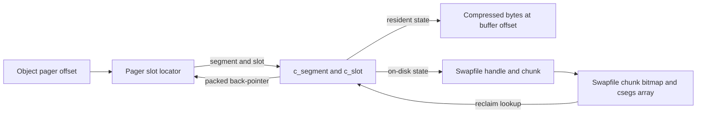
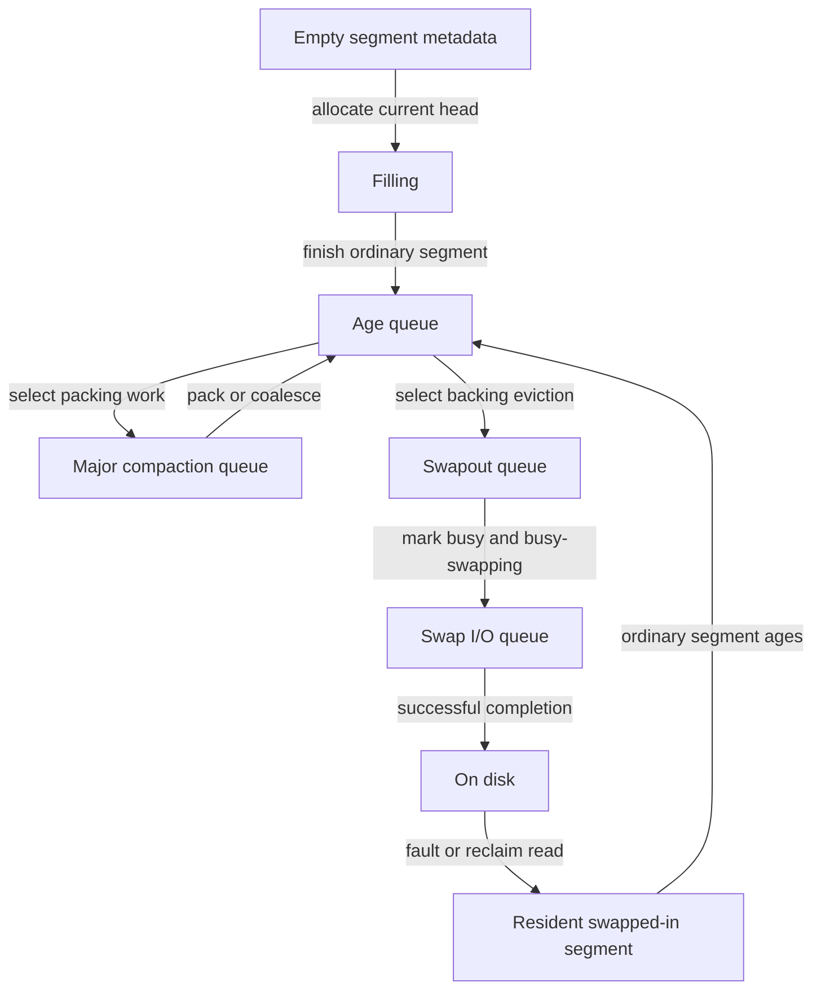

# Compressor segments, compaction and swapfile lifetime

[VM guide](README.md) · [Reclaim and pressure](reclaim-and-pressure.md) · [Freezer](memorystatus-and-freezer.md) · [Phantom history](phantom-cache-and-refaults.md)

The compressor pager answers “where are this object's bytes?” with a slot locator. The compressor must keep that answer valid while packing variable-length data, moving it between segments, swapping a segment out, and reclaiming the swapfile that holds it. This chapter follows those representation changes and the threads that perform them; the existing reclaim chapter covers the first pageout and the final fault/decompression boundary. [Slot mapping](../../../platydoc-data/xnu/osfmk/vm/vm_compressor_xnu.h#L296-L320), [state transitions](../../../platydoc-data/xnu/osfmk/vm/vm_compressor.c#L1779-L2045).

## Three coordinates, with back-pointers for relocation

| Representation | Meaning |
| --- | --- |
| Compressor pager slot | Object/pager offset → encoded segment number and slot index, or a special encoding |
| `c_slot` | Compressed byte offset/size, optional codec/tag metadata, and `c_packed_ptr` back to the pager's locator |
| `c_segment` | Slots, buffer population and occupancy, current state/queue, `c_lock`, busy/wanted flags, and resident-buffer/swap-handle union |
| `swapfile` | Vnode, chunk bitmap, segment back-pointer array, ready/reclaim/reuse flags and outstanding-I/O count |

Definitions: [`c_slot`](../../../platydoc-data/xnu/osfmk/vm/vm_compressor_xnu.h#L150-L180), [`c_segment`](../../../platydoc-data/xnu/osfmk/vm/vm_compressor_xnu.h#L211-L289), [`swapfile`](../../../platydoc-data/xnu/osfmk/vm/vm_compressor_backing_store.c#L99-L116). Neither a slot index nor a compressed buffer offset is a user virtual address. `c_offset` uses the compressor's offset units; convert through `C_SEG_OFFSET_TO_BYTES`/`C_SEG_BYTES_TO_OFFSET` before comparing it with byte counts. Page rounding uses the selected build's `PAGE_SIZE`.



These two back-pointer directions solve different problems. The slot's back-pointer lets compaction rewrite a pager locator; the swapfile's `swp_csegs` lets file reclamation find and stabilize the segment whose backing must move. Neither eliminates locking or revalidation after a wait.

## Allocating and filling a segment

`c_seg_allocate(current_chead, nearing_limits)` first checks compressed-page limits. It can return `NULL` at the hard limit and independently flag proximity to limits. If the caller has no current filling segment, it takes `c_list_lock`, waits for any segment-table expansion, and claims a free segment number. When the table needs more backing, it marks expansion busy, drops the list lock, populates a page, and rechecks/publishes under synchronization. Population is explicitly `KMA_NOFAIL`; this is different from the deliberate limit-based refusal. [Allocation](../../../platydoc-data/xnu/osfmk/vm/vm_compressor.c#L4393-L4566).

A new segment starts `C_IS_EMPTY`, transitions to `C_IS_FILLING`, receives the caller's current-head association and writable buffer state, and grows slot storage as needed. The buffer is populated in bounded increments when the remaining populated area cannot fit the next required data. The function returns with the segment lock held and page-replacement coordination established for the caller. The compressor insertion path expects precisely that contract; it does not receive an unlocked generic heap buffer. [Initialization/population](../../../platydoc-data/xnu/osfmk/vm/vm_compressor.c#L4480-L4566), [put caller](../../../platydoc-data/xnu/osfmk/vm/vm_compressor.c#L5168-L5190), [slot-array growth](../../../platydoc-data/xnu/osfmk/vm/vm_compressor.c#L2365-L2403).

`c_current_seg_filled()` moves a completed filling segment toward age/swap queues according to donation, freezer and ordinary policy, and clears the caller's filling-head association. Early/regular/late swapout queues deliberately differ by target and donation reason; “filled” does not necessarily mean immediately written to disk. [Filled-segment decisions](../../../platydoc-data/xnu/osfmk/vm/vm_compressor.c#L4580-L4756), [queue selection](../../../platydoc-data/xnu/osfmk/vm/vm_compressor.c#L1779-L1806).

## Queue state, locks and busy ownership

`c_seg_switch_state()` removes old queue membership/counters and establishes the new state under the list lock; assertions require the segment lock except for the filling transition. Its allowed transitions distinguish empty/free metadata, a filling segment, age/major-compaction queues, swapout pending, swap I/O, resident swapped-in queues and on-disk/bad states. Do not infer a legal transition just because both constants exist. [Transition assertions and publication](../../../platydoc-data/xnu/osfmk/vm/vm_compressor.c#L1779-L2045).

The segment lock protects immediate state decisions. `c_busy` lets a worker exclude competing decompression while dropping that lock to allocate, copy or perform I/O. `c_busy_swapping` identifies the outstanding swap operation. A competing fault can sleep/retry; `C_DONT_BLOCK` instead produces a retryable outcome without consuming the locator. [Busy handling](../../../platydoc-data/xnu/osfmk/vm/vm_compressor.c#L5650-L5706), [swap worker](../../../platydoc-data/xnu/osfmk/vm/vm_compressor_backing_store.c#L1280-L1356).



This diagram is the ordinary route, not every allowed edge: freezer/donation queues, bad-data states, empty-segment freeing and failed-I/O recovery have separate branches. State names describe compressor ownership, not the original process's page-table state.

## Minor compaction changes slots inside one segment

Freed slots leave holes. Minor compaction requires busy ownership; an entirely empty segment is freed immediately. Otherwise it drops `c_lock`, makes the buffer writable, moves live data toward the first empty slot, copies slot metadata, and rewrites each moved pager locator's slot index. It recomputes the rounded populated end and depopulates whole trailing pages. The `clear_busy` argument determines whether this helper also wakes busy waiters before returning. [Complete packing operation](../../../platydoc-data/xnu/osfmk/vm/vm_compressor.c#L2253-L2361).

[Source: `osfmk/vm/vm_compressor.c`, lines 2302–2322](../../../platydoc-data/xnu/osfmk/vm/vm_compressor.c#L2302-L2322).

<!-- source-excerpt: ../../../platydoc-data/xnu/osfmk/vm/vm_compressor.c#L2302-L2322 -->
```c

		c_size = UNPACK_C_SIZE(c_src);

		if (c_size == 0) {
			continue;
		}

		c_rounded_size = C_SEG_ROUND_TO_ALIGNMENT(c_size + c_slot_extra_size(c_src));

/* N.B.: This memcpy may be an overlapping copy */
		memcpy(&c_seg->c_store.c_buffer[c_offset], &c_seg->c_store.c_buffer[c_src->c_offset], c_rounded_size);

		cslot_copy(c_dst, c_src);
		c_dst->c_offset = c_offset;

		slot_ptr = C_SLOT_UNPACK_PTR(c_dst);
		slot_ptr->s_cindx = c_indx;

		c_offset += C_SEG_BYTES_TO_OFFSET(c_rounded_size);
		PACK_C_SIZE(c_src, 0);
#if HAS_MTE
```

For an illustrative segment with live slots 0 and 2 separated by an empty slot 1, packing can place old slot 2 at slot 1 and move its compressed bytes to an earlier offset. The corresponding object's pager still points to that segment, but its `s_cindx` changes. A caller caching the old buffer address or slot index across busy synchronization would read unrelated storage afterward. Whole-page depopulation recovers physical backing; merely reducing `c_bytes_unused` is not the same measurement.

## Major compaction moves content between segments

`c_seg_coalesce(dst, src)` runs with both segments busy, while their locks are not held. It grows destination backing if necessary, respects buffer/slot limits and donation compatibility, copies live data and slot metadata, clears source slots, and adjusts occupancy. Only then does it update pager locators through `c_packed_ptr` while coordinating against conversion of a locator into a segment by decompression. [Coalescing](../../../platydoc-data/xnu/osfmk/vm/vm_compressor.c#L2475-L2637).

[Source: `osfmk/vm/vm_compressor.c`, lines 2612–2633](../../../platydoc-data/xnu/osfmk/vm/vm_compressor.c#L2612-L2633).

<!-- source-excerpt: ../../../platydoc-data/xnu/osfmk/vm/vm_compressor.c#L2612-L2633 -->
```c
	C_SEG_WRITE_PROTECT(c_seg_dst);

	if (dst_slot < c_seg_dst->c_nextslot) {
		c_page_replacement_allowed_start();
		/*
		 * we've now locked out c_decompress from
		 * converting the slot passed into it into
		 * a c_segment_t which allows us to use
		 * the backptr to change which c_segment and
		 * index the slot points to
		 */
		while (dst_slot < c_seg_dst->c_nextslot) {
			c_dst = C_SEG_SLOT_FROM_INDEX(c_seg_dst, dst_slot);

			slot_ptr = C_SLOT_UNPACK_PTR(c_dst);
			/* <csegno=0,indx=0> would mean "empty slot", so use csegno+1 */
			slot_ptr->s_cseg = c_seg_dst->c_mysegno + 1;
			slot_ptr->s_cindx = dst_slot++;
		}
		c_page_replacement_allowed_end();
	}
	CDBG(VM_COMPRESSOR_EVENTID(DBG_COMPACT_COALESCE) | DBG_FUNC_END,
```

The encoded segment number is `c_mysegno + 1`: zero is reserved for the empty locator. For example, moving an object's contents from segment 8/slot 3 to segment 4/slot 7 changes its locator to encoded segment 5/index 7, even though its VM object offset is unchanged. This example uses arbitrary slot identities, not assumed compression ratios or a fixed hardware page size.

## Compactor, swapout, creation and GC are separate workers

| Worker/path | Work and synchronization boundary |
| --- | --- |
| `vm_compressor_compact_and_swap` | Coordinates compaction/eviction selection; not the final filesystem completion |
| `vm_swapout_thread_continue` | Chooses early/regular/late queues, waits for busy segments, marks busy-swapping, moves to swap-I/O state, submits and reaps completions |
| `vm_swapfile_create_thread_continue` | Handles delayed trims, checks creation policy and stop/hibernate state, creates files, records failures, then waits |
| `vm_swapfile_gc_thread_continue` | Decides defragment/reclaim work, honors busy/stop conditions, performs work outside the global swap lock, then waits |

Sources: [compaction coordinator](../../../platydoc-data/xnu/osfmk/vm/vm_compressor.c#L3962), [swapout](../../../platydoc-data/xnu/osfmk/vm/vm_compressor_backing_store.c#L1259-L1417), [creator](../../../platydoc-data/xnu/osfmk/vm/vm_compressor_backing_store.c#L821-L885), [GC](../../../platydoc-data/xnu/osfmk/vm/vm_compressor_backing_store.c#L943-L1010).

Swapout uses completion records containing the segment, offset, completion/error state and UPL callback context. It drops list/segment locks before encryption, when configured, and `vm_swap_put()`. Immediate errors call finish directly; successful asynchronous submissions retain work for the completion scan. A reserved handle is not evidence of durable completed I/O. Busy ownership persists until the appropriate finish path settles state and wakes waiters. [Submission/completion control](../../../platydoc-data/xnu/osfmk/vm/vm_compressor_backing_store.c#L1320-L1388), [reservation and completion details](reclaim-and-pressure.md).

## Creating and retiring a swapfile

`vm_swap_create_file()` reuses an inactive `SWAP_REUSE` record when available or allocates a new path/record. It opens the backing vnode, attempts preallocation from the maximum size downward by halving, allocates a chunk bitmap plus segment-pointer array, probes trim support and only then publishes `SWAP_READY` under `vm_swap_data_lock`. Failed opening frees a newly allocated record; exhausted preallocation closes the file and frees new metadata. Successful reuse preserves its namespace record. [Creation body](../../../platydoc-data/xnu/osfmk/vm/vm_compressor_backing_store.c#L1565-L1697).

`vm_swap_reclaim()` chooses a ready file with few occupied chunks, clears READY and marks RECLAIM under the swap lock. It coordinates delayed trims and waits for outstanding I/O. A busy segment may itself need the swap lock to finish freeing; reclamation drops that lock before sleeping, then re-reads the slot/segment relationship. Continuing with the pre-wait pointer would be unsafe. [Selection and retry](../../../platydoc-data/xnu/osfmk/vm/vm_compressor_backing_store.c#L2165-L2275).

[Source: `osfmk/vm/vm_compressor_backing_store.c`, lines 2214–2238](../../../platydoc-data/xnu/osfmk/vm/vm_compressor_backing_store.c#L2214-L2238).

<!-- source-excerpt: ../../../platydoc-data/xnu/osfmk/vm/vm_compressor_backing_store.c#L2214-L2238 -->
```c
	swf = smallest_swf;


	swf->swp_flags &= ~SWAP_READY;
	swf->swp_flags |= SWAP_RECLAIM;

	if (swf->swp_delayed_trim_count) {
		lck_mtx_unlock(&vm_swap_data_lock);

		vm_swap_do_delayed_trim(swf);

		lck_mtx_lock(&vm_swap_data_lock);
	}
	segidx = 0;

	while (segidx < swf->swp_nsegs) {
ReTry_for_cseg:
		/*
		 * Wait for outgoing I/Os.
		 */
		while (swf->swp_io_count) {
			swf->swp_flags |= SWAP_WANTED;

			assert_wait((event_t) &swf->swp_flags, THREAD_UNINT);
			lck_mtx_unlock(&vm_swap_data_lock);
```

For each surviving chunk, reclamation removes its old bitmap/back-pointer ownership, marks the segment busy-swapping, reads into a scratch buffer, and tries to write backing elsewhere. Failure to rewrite after a successful read reconstructs resident backing and requeues the segment; a read failure follows a different bad-data path. A successful rewrite installs the new swap handle. If reclamation yields with occupied chunks left, it restores READY. Only an empty file can close and release its bitmap/segment array; its record remains for namespace reuse. [Relocation/failures](../../../platydoc-data/xnu/osfmk/vm/vm_compressor_backing_store.c#L2276-L2417).

Delayed trim batches freed extents. It is coordinated with READY/RECLAIM selection so the trim walker and file reclaimer do not independently manipulate the same file's outstanding work. Chunk freedom, filesystem trim and deletion of a swapfile are distinct events. [Delayed-trim coordination](../../../platydoc-data/xnu/osfmk/vm/vm_compressor_backing_store.c#L1980-L2160).

## Configuration and evidence limits

The [MTE tag-storage companion](mte-tag-storage-and-page-lifecycle.md#8-compressing-tags-differs-from-borrowing-backing-for-the-compressor) distinguishes compressor-pool borrowing of tag-storage frames from compression of a data page's tag values, including replacement-page locking and tag-stream restoration.

Compressor presence, normal swap and freezer swap have separate [configuration predicates](../../../platydoc-data/xnu/osfmk/vm/vm_pageout.h#L227). MTE metadata, unmodified-anonymous backing, encryption, donation and hibernation-pinned swap add branches; a single queue diagram cannot represent every product. This chapter explains selected allocation, movement, worker and file-lifetime paths, not codec algorithms, all encryption internals or filesystem/device persistence. It does not infer that every ARM64 product uses swap, nor that all exhausted allocation conditions are disk-full errors. [Refault-history policy](phantom-cache-and-refaults.md) describes another conditional input to eviction.

<!-- BEGIN PLATYDOC DOCUMENTATION LICENSE -->
Original Platydoc text and diagrams are licensed under [CC BY 4.0](https://creativecommons.org/licenses/by/4.0/). Quoted source code and third-party material retain their respective licenses.
<!-- END PLATYDOC DOCUMENTATION LICENSE -->
