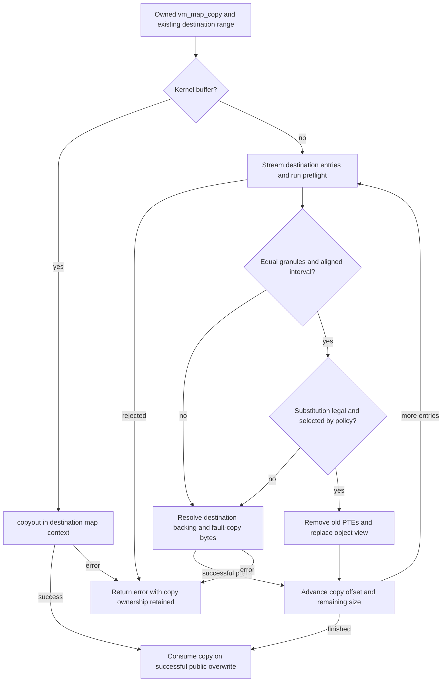
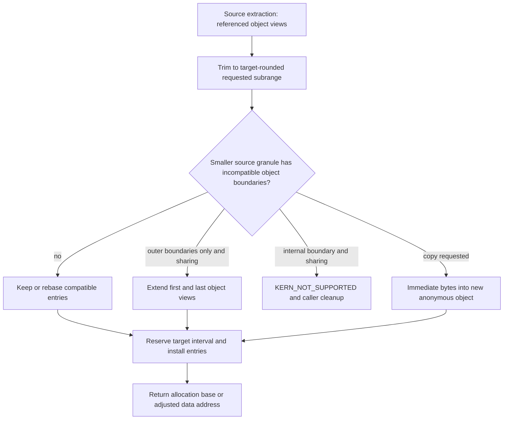

# Copy-overwrite, remapping and mixed page sizes

[VM guide](README.md) · [Transfer representations](wiring-and-memory-entries.md) · [Map and range locks](virtual-address-maps.md) · [Fault resolution](fault-resolution.md) · [Mach OOL messages](../ipc/message-send-receive.md)

Writing transferred bytes into existing memory and installing a new mapping are different operations. Both can start from a `vm_map_copy`, and both can avoid copying physical bytes, but their permission checks, destination ownership and failure behavior differ. This chapter follows the common VM implementation and its ARM64-relevant policies in `xnu-12377.121.6`. The introductory transfer chapter explains copyin and the two copy representations; the focus here is what happens after that representation exists.

## 1. Entry points select the maps and the ownership contract

| Entry | Source representation | Destination and completion |
| --- | --- | --- |
| `mach_vm_copy` | `vm_map_copyin` from a range in the supplied map | Overwrite another range in that same map. Discard the copy on failure; overwrite consumes it on success. |
| `mach_vm_read_overwrite` | Copyin from the supplied source map | Overwrite `current_thread()->map`. Publish `data_size` only after success; the handler does not report a successfully written prefix on error. |
| `mach_vm_write` | The incoming MIG `pointer_t` has already become a kernel `vm_map_copy` | Pass that copy to the destination map's overwrite routine. The visible handler returns its result directly; generated server cleanup must not be invented from this wrapper. |
| Misaligned OOL receive | A message descriptor holds the copy and a separately captured size | Allocate a rounded receive range first, adjust its returned data address, then overwrite it. Other OOL cases use `vm_map_copyout_size`. |
| `mach_vm_remap` / `mach_vm_remap_new` | Extract source map entries and their backing references | Reserve destination VA and install entries. Optional fixed overwrite replaces mappings, rather than writing into the old backing. |

Sources: [`mach_vm_copy`](../../../platydoc-data/xnu/osfmk/vm/vm_user.c#L727-L763), [`read-overwrite`](../../../platydoc-data/xnu/osfmk/vm/vm_user.c#L542-L582), [`write`](../../../platydoc-data/xnu/osfmk/vm/vm_user.c#L670-L700), [`OOL receive`](../../../platydoc-data/xnu/osfmk/ipc/ipc_kmsg.c#L3788-L3879), [`remap wrappers`](../../../platydoc-data/xnu/osfmk/vm/vm_user.c#L929-L1057). See the [Mach interface catalog](../../interfaces/mach-messages/mach_vm.md) for declarations and dispatch boundaries.

The OOL case is especially useful for separating mechanism from API intent. It invokes an overwrite helper, but the receiver did not supply an arbitrary preexisting buffer: `ipc_kmsg_copyout_ool_descriptor` allocated that range. Its address adjustment preserves the source's offset within the destination map page even for small copies, so later deallocation spans the allocated extent. The nearby historical optimization comment explains why size alone cannot decide whether to omit that adjustment. The shown failure branch discards the copy and clears the output address/size; it does not contain a general removal of the previously allocated range. Do not infer complete VA rollback from `rcv_addr = 0`. [`Allocation, adjustment and failure`](../../../platydoc-data/xnu/osfmk/ipc/ipc_kmsg.c#L3813-L3874).

### Coordinates that must remain distinct

| Coordinate | Meaning |
| --- | --- |
| Source task VA | Input to copyin or remap extraction; not necessarily retained as the copy's address origin |
| `copy->offset`, `copy->size` | Current data position and remaining byte count while overwrite advances |
| `copy_entry->vme_start/end` | Interval in the copy's own entry-list coordinates |
| `VME_OFFSET(copy_entry)` | Offset into the referenced source VM object |
| Destination VA / map entry | Existing writable interval for overwrite, newly reserved interval for remap |
| Destination object offset | `VME_OFFSET(dst_entry) + dst_addr - dst_entry->vme_start` |
| Physical page plus in-page offset | Selected only when a physical copy faults/resolves pages |
| Map page size versus `PAGE_SIZE` | Map interval granularity versus resident-object page granularity; either may affect a transfer decision |

For the slow overwrite path, the source object position is `copy->offset - copy_entry->vme_start + VME_OFFSET(copy_entry)`. A remap-extracted copy instead starts its interval coordinate at zero. Neither address is a physical address or an IOVA. [`Slow-copy coordinates`](../../../platydoc-data/xnu/osfmk/vm/vm_map.c#L9465-L9485), [`extracted copy header`](../../../platydoc-data/xnu/osfmk/vm/vm_map.c#L12170-L12190), [pmap translation examples](pmap-translation-walkthroughs.md).

## 2. Overwrite admission is checked while streaming the destination

`vm_map_copy_overwrite` accepts a null copy as a no-op, sanitizes destination address/size with unaligned values preserved and address-range checking enabled, then verifies the copy's zone identity. Sanitization checks geometry; it does not establish that all destination pages are writable. The caller's size and the copy's represented size have separate provenance; successful copyin callers assert their equality, and OOL receive validates the descriptor/copy size before dispatch. [`Overwrite entry and sanitizer`](../../../platydoc-data/xnu/osfmk/vm/vm_map.c#L10017-L10160).

For an entry list, `vm_map_copy_overwrite_impl` rounds the locking interval to the destination map page size and takes `VMRL_EX_STREAM_NO_HOLES`. A preflight runs on each entry as the stream advances. This is **not** an atomic lock over the entire transfer: a later entry can fail after an earlier entry has changed. Reacquiring an entry after faulting runs the range-lock checks again. [`Lock setup`](../../../platydoc-data/xnu/osfmk/vm/vm_map.c#L9891-L9926), [`streaming contract`](../../../platydoc-data/xnu/osfmk/vm/vm_map_lock_internal.h#L310-L327), [`preflight timing`](../../../platydoc-data/xnu/osfmk/vm/vm_map_lock_internal.h#L845-L871).

The preflight itself is short:

[Source: `osfmk/vm/vm_map.c`, lines 9308–9329](../../../platydoc-data/xnu/osfmk/vm/vm_map.c#L9308-L9329).

<!-- source-excerpt: ../../../platydoc-data/xnu/osfmk/vm/vm_map.c#L9308-L9329 -->
```c
vm_map_copy_overwrite_preflight(vm_map_t map, vm_map_entry_t entry, bool interruptible)
{
	VM_ENTRY_ASSERT_EXCL_OWNER(entry);
	if (entry->is_sub_map) {
		/* copy_overwrite(constant submap) is not supported */
		return KERN_PROTECTION_FAILURE;
	}

	if (!vm_map_entry_is_overwritable(map, entry)) {
		return KERN_PROTECTION_FAILURE;
	}

	if (interruptible &&
	    ((VME_OBJECT(entry) != VM_OBJECT_NULL) &&
	    ((!VME_OBJECT(entry)->internal) ||
	    (VME_OBJECT(entry)->true_share)))) {
		/* Not allowed to have interruptible and external objects */
		return KERN_FAILURE;
	}

	return KERN_SUCCESS;
}
```

`vm_map_entry_is_overwritable` requires WRITE. On the ARM path it also rejects a JIT entry under enforced code signing unless the map is debugged, an ARM64e TPRO entry, and `vme_permanent`. Under `HAS_MTE`, an object considered MTE-mappable is rejected by this entry-list admission check. An external file-backed object is not synonymous with a `vme_permanent` entry: eligible external backing can use physical copying, while the permanent-entry flag can deny the operation before that choice. Older prose above overwrite discussing preservation of “permanent” memory must be read against these current predicates. [`Admission predicates`](../../../platydoc-data/xnu/osfmk/vm/vm_map.c#L9252-L9303).

Transparent kernel submaps are descended into automatically and preserve VA coordinates. Constant submaps require an explicit descent mode, which overwrite does not request; its preflight rejects the remaining submap entry. Remap extraction later takes a different mode and can descend into constant submaps. This checkout supports only one VM submap level, not arbitrary recursive descent. [`Submap contract`](../../../platydoc-data/xnu/osfmk/vm/vm_map_lock_internal.h#L68-L95), [`overwrite flags`](../../../platydoc-data/xnu/osfmk/vm/vm_map.c#L9911-L9917).

The `interruptible` parameter also affects policy: it prevents splitting the copy into head/middle/tail and rejects external or true-shared destination objects. The inspected public handlers pass false; the slow-copy invocation explicitly uses `THREAD_UNINT`. Do not turn the long historical comment about interruptible atomic copies into a guarantee that the current overwrite is transactional. [`Outer selection`](../../../platydoc-data/xnu/osfmk/vm/vm_map.c#L10152-L10182), [`slow-copy invocation`](../../../platydoc-data/xnu/osfmk/vm/vm_map.c#L9500-L9516).

## 3. Alignment permits an optimization; it does not guarantee substitution

For each entry, the inner loop checks remaining size, source position, destination VA and equal source/destination map shifts. Once this invocation chooses unaligned copying, its `aligned` flag stays false:

[Source: `osfmk/vm/vm_map.c`, lines 9943–9948](../../../platydoc-data/xnu/osfmk/vm/vm_map.c#L9943-L9948).

<!-- source-excerpt: ../../../platydoc-data/xnu/osfmk/vm/vm_map.c#L9943-L9948 -->
```c
		if (!VM_MAP_PAGE_ALIGNED(copy->size, VM_MAP_PAGE_MASK(dst_map)) ||
		    !VM_MAP_PAGE_ALIGNED(copy->offset, VM_MAP_PAGE_MASK(dst_map)) ||
		    !VM_MAP_PAGE_ALIGNED(dst_addr, VM_MAP_PAGE_MASK(dst_map)) ||
		    copy_page_shift != VM_MAP_PAGE_SHIFT(dst_map)) {
			aligned = false;
		}
```

The aligned helper clips both entries to the same interval, then decides whether changing the destination's object is legal. The existing destination map entry retains its protection/inheritance and other policy; this helper is not ordinary remap installation. The eligibility predicate is:

[Source: `osfmk/vm/vm_map.c`, lines 9772–9783](../../../platydoc-data/xnu/osfmk/vm/vm_map.c#L9772-L9783).

<!-- source-excerpt: ../../../platydoc-data/xnu/osfmk/vm/vm_map.c#L9772-L9783 -->
```c
	if (!dst_entry->is_shared &&
	    dst_entry->wired_count == 0 && /* wiring affects both entry and object */
	    !dst_entry->vme_permanent &&
	    !dst_entry->used_for_jit &&
#if __arm64e__
	    !dst_entry->used_for_tpro &&
#endif /* __arm64e__ */
	    !(dst_entry->protection & VM_PROT_EXECUTE) &&
	    !pmap_has_prot_policy(dst_map->pmap, dst_entry->translated_allow_execute, dst_entry->protection) &&
	    /* can only replace object if it could not have been shared */
	    (object == VM_OBJECT_NULL ||
	    object->copy_strategy == MEMORY_OBJECT_COPY_SYMMETRIC)) {
```

A shared or wired destination must retain the semantics of its backing; replacing its object could hide the write from another observer or detach wired physical storage. Executable, JIT, TPRO and pmap-protected destinations have additional constraints. Even after eligibility succeeds, `vm_map_copy_overwrite_should_transfer_object` can choose physical copying:

- On macOS, copying at most 128 KiB from an object at least 64 MiB takes the physical route to avoid retaining that large object for a small view.
- For user malloc-tagged destinations, the helper walks the source shadow chain under object locks. It declines substitution when the backing becomes external; macOS adds true-share and copy-strategy restrictions.
- If the selected source and destination already identify the same object and offset, the aligned operation can finish without replacing or copying them.

These are this snapshot's decisions, not a portable API promise about which object IDs will match. [`Clipping and identity`](../../../platydoc-data/xnu/osfmk/vm/vm_map.c#L9726-L9807), [`policy helper`](../../../platydoc-data/xnu/osfmk/vm/vm_map.c#L9541-L9630).

`vm_map_copy_overwrite_transfer_object` removes old destination translations with `pmap_remove`, drops the old object reference, takes a reference on the source object and installs its offset and `needs_copy` value. It preserves IOKit-accounting mode when present, otherwise uses pmap accounting; the asserted unwired entry remains unwired. The copy still owns its source reference until discard, so this is not a blind pointer move. It does not eagerly install every source PTE; later destination access can fault. [`Object substitution`](../../../platydoc-data/xnu/osfmk/vm/vm_map.c#L9639-L9678), [mapping lifetime](pmap-mapping-lifecycle.md).



The outer head/middle/tail optimization is omitted from this diagram and explained below. An error does not erase completed destination work.

## 4. Physical copying must revalidate after faulting

The slow helper resolves destination `needs_copy`, allocating an object when necessary. It retains the destination object so `vm_fault_copy` can drop entry locks. The requested chunk is bounded by the current source entry, destination entry and remaining copy size. A successful call can complete less than that chunk, including zero bytes when a changed mapping needs a retry. [`Slow helper`](../../../platydoc-data/xnu/osfmk/vm/vm_map.c#L9454-L9530).

`vm_fault_copy` is an object-page algorithm with a live destination range-lock context:

1. Drop the current entry without advancing. Fault the destination for READ|WRITE first, allowing COW to select private storage before source-page acquisition.
2. Remember destination `vo_copy` and `vo_copy_version`. Wire the destination page, clear its busy state and retain paging ownership while other operations can run. Wiring protects residency; it does not freeze the entry or the object's COW relationship.
3. Resolve the source backing for READ, with paging/busy ownership for the ordinary source-fault result. A null source object has a zero-fill route. The body also has a same-page special case; the description here does not claim an independently verified overlap/alias contract for every source/destination configuration.
4. Try to reacquire the destination entry while source busy ownership exists. On entry-lock contention, release source/destination page state before doing the blocking reacquisition. This avoids waiting for an entry lock while holding the page state an opposing operation may need.
5. Check the current entry and resident page again. If they changed, release temporary state and return successful partial progress so the outer loop can resolve the new state. A preflight protection failure is an error instead.
6. Hold the destination object lock across the actual copy. Recheck destination busy state; if another operation made it busy, clean up and retry at the same position.

Sources: [`fault-copy contract and destination fault`](../../../platydoc-data/xnu/osfmk/vm/vm_fault.c#L8099-L8260), [`wire and source fault`](../../../platydoc-data/xnu/osfmk/vm/vm_fault.c#L8261-L8355), [`entry reacquisition and retries`](../../../platydoc-data/xnu/osfmk/vm/vm_fault.c#L8357-L8427).

The final revalidation is stronger than checking that the destination VA remains mapped. After resolving any newly required COW/object state and checking the offset remains inside the entry, it validates physical page identity and the object's copy generation:

[Source: `osfmk/vm/vm_map.c`, lines 9403–9421](../../../platydoc-data/xnu/osfmk/vm/vm_map.c#L9403-L9421).

<!-- source-excerpt: ../../../platydoc-data/xnu/osfmk/vm/vm_map.c#L9403-L9421 -->
```c
	vm_object_lock(object);
	entry_page = vm_page_lookup(object, vm_object_trunc_page(offset));

	/* Make sure the page is the same one */
	if (entry_page != old_page) {
		vm_object_unlock(object);
		return false;
	}

	/* And verify the CoW status of the object is unchanged */
	if (object->vo_copy != old_copy_object ||
	    object->vo_copy_version != old_copy_version) {
		vm_object_unlock(object);
		return false;
	}

	/* Return with the object locked so that the caller can safely do the copy. */
	return true;
}
```

A false return leaves the relevant object unlocked. A true return leaves it locked exclusively for the caller's page write. This closes the gap between “a page was writable when faulted” and “the current mapping still permits writing this same page without bypassing COW.” [`Complete revalidation`](../../../platydoc-data/xnu/osfmk/vm/vm_map.c#L9379-L9421).

On `CONFIG_SPTM`, a destination page with a user-executable frame type needs special treatment before its physical-aperture alias can be written. An I/O-wired page causes `KERN_MEMORY_ERROR`; an in-place cleaning operation can be waited on and retried. The successful path disconnects mappings with `PMAP_OPTIONS_RETYPE`, forcing subsequent users through fault/signature checks again. This is an additional physical-frame rule, not permission for overwrite to ignore map policy. [`Executable-frame handling`](../../../platydoc-data/xnu/osfmk/vm/vm_fault.c#L8429-L8488), [page-signature validation](../security/page-signature-validation.md).

The byte count is bounded by both source and destination resident-page boundaries:

[Source: `osfmk/vm/vm_fault.c`, lines 8497–8513](../../../platydoc-data/xnu/osfmk/vm/vm_fault.c#L8497-L8513).

<!-- source-excerpt: ../../../platydoc-data/xnu/osfmk/vm/vm_fault.c#L8497-L8513 -->
```c
		vm_object_offset_t      src_po, dst_po;

		src_po = src_offset - vm_object_trunc_page(src_offset);
		dst_po = dst_offset - vm_object_trunc_page(dst_offset);

		if (dst_po > src_po) {
			part_size = PAGE_SIZE - dst_po;
		} else {
			part_size = PAGE_SIZE - src_po;
		}
		if (part_size > (amount_left)) {
			part_size = amount_left;
		}
		assert((vm_size_t) part_size == part_size);
		assert((vm_offset_t) dst_po == dst_po);


```

The ordinary copy uses `vm_page_part_copy` and dirties the destination; zero-fill uses `vm_page_part_zero_fill`. Even a full-page chunk uses the partial-page primitive with zero offsets, avoiding the source-lock/signature-validation contract of `vm_page_copy`. Source cleanup clears busy/paging state and restores pageable eligibility as needed; destination cleanup unwires and ends paging ownership. [`Copy and cleanup`](../../../platydoc-data/xnu/osfmk/vm/vm_fault.c#L8516-L8577), [`cleanup helpers`](../../../platydoc-data/xnu/osfmk/vm/vm_fault.c#L8064-L8098).

## 5. Head, middle and tail have separate progress

The outer optimization is for noninterruptible entry-list copies whose source and destination map shifts are not below system `PAGE_SHIFT`. Its effective granule is the largest of source-map, destination-map and system page sizes. The transfer must cover at least **three effective pages**, and source/destination offsets within that granule must match. Smaller or differently misaligned operations go directly to the inner helper. This threshold concerns splitting; a fully aligned small transfer may still qualify for inner object substitution. [`Threshold definition`](../../../platydoc-data/xnu/osfmk/vm/vm_map.h#L456-L463), [`selection and sizing`](../../../platydoc-data/xnu/osfmk/vm/vm_map.c#L10177-L10237).

The wrapper separates a leading partial interval, then a trailing one, leaving an aligned middle. It moves/clips copy entries into temporary `head_copy` and `tail_copy` headers rather than copying their bytes during that bookkeeping. The head is written first, the middle second and the tail last; internal calls use `discard_on_success=false` until the outer wrapper resolves all three owners. [`Split and execution`](../../../platydoc-data/xnu/osfmk/vm/vm_map.c#L10239-L10357).

For an illustrative 16 KiB source-map, destination-map and system-page configuration, let both data positions be `0x1000` into their respective pages and request `0x10000` bytes. Assume entries do not force an earlier chunk boundary. The resulting sizes are:

| Piece | Length | Method available |
| --- | --- | --- |
| Head | `0x4000 - 0x1000 = 0x3000` | Partial physical copy |
| Middle | `0x10000 - 0x3000 - 0x1000 = 0xC000` | Three aligned pages; substitution only if the destination policy permits it |
| Tail | `(0x1000 + 0x10000) & 0x3FFF = 0x1000` | Partial physical copy |

Changing destination alignment to `0x2000` disables the split because source and destination offsets differ. Changing the source map to 4 KiB on a 16 KiB system also takes the direct inner path; entry-list overwrite does not invoke remap's mixed-granule adjustment helper. Its physical copy can still transfer bytes while preserving the existing destination granularity.

### Errors preserve cleanup ownership, not original contents

| Failure point | Observable progress and remaining ownership |
| --- | --- |
| Geometry sanitization or first entry rejection | No overwrite work has happened in this helper; incoming copy remains owned by its caller. Source copyin may already have established COW state. |
| A later streaming entry is unwritable or absent | Earlier entry substitution or byte copying can remain. The original destination is not reconstructed. |
| Fault-copy error after some page chunks | Those bytes can remain changed. `vm_fault_copy` computes its progress, but the enclosing slow helper reports `size_copied = 0` on error; there is no public precise-prefix result from this path. |
| Tail fails after head/middle succeeded | Earlier destination work remains. Temporary copy entry lists are joined back into the surviving copy for ownership/cleanup. |
| Complete success | The public overwrite consumes its copy; callers must not discard it again. |

Sources: [`stream advancement`](../../../platydoc-data/xnu/osfmk/vm/vm_map.c#L9964-L10013), [`slow error result`](../../../platydoc-data/xnu/osfmk/vm/vm_map.c#L9520-L9530), [`fault-copy progress`](../../../platydoc-data/xnu/osfmk/vm/vm_fault.c#L8569-L8577), [`outer cleanup`](../../../platydoc-data/xnu/osfmk/vm/vm_map.c#L10359-L10397).

The cleanup comment says “Re-assemble the original copy map.” The body reconnects extracted entries and adjusts sizes, while inner successful iterations have already advanced `copy->offset` and reduced `copy->size`. It does not undo destination writes or guarantee an untouched retry descriptor. The verified callers such as `mach_vm_copy` discard the surviving copy on error.

[Source: `osfmk/vm/vm_map.c`, lines 10366–10385](../../../platydoc-data/xnu/osfmk/vm/vm_map.c#L10366-L10385).

<!-- source-excerpt: ../../../platydoc-data/xnu/osfmk/vm/vm_map.c#L10366-L10385 -->
```c
	if (kr == KERN_SUCCESS) {
		/*
		 * Discard all the copy maps.
		 */
		vm_map_copy_discard(head_copy);
		vm_map_copy_discard(copy);
		vm_map_copy_discard(tail_copy);
		head_copy = copy = tail_copy = NULL;
	} else {
		/*
		 * Re-assemble the original copy map.
		 */
		if (head_copy) {
			entry = vm_map_copy_first_entry(head_copy);
			vm_map_copy_store_remove(head_copy, entry);
			vm_map_copy_store_insert_head(copy, entry);
			copy->offset -= head_size;
			copy->size += head_size;
			vm_map_copy_discard(head_copy);
			head_copy = NULL;
```

## 6. Kernel-buffer overwrite follows copyio instead

A `VM_MAP_COPY_KERNEL_BUFFER` goes directly to `vm_map_copyout_kernel_buffer` with `overwrite=true`. It neither walks destination entries with the entry-list preflight nor substitutes objects. The helper validates the kernel buffer's geometry/class, uses `copyout` for the current map or temporarily references/switches to another map, then restores the previous context. MTE-enabled foreign-map switching receives `sec_override`; `mach_vm_write` requests it, while the copy/read-overwrite handlers do not. Do not apply the entry-list MTE admission predicate as a universal statement about this other representation. [`Buffer overwrite`](../../../platydoc-data/xnu/osfmk/vm/vm_map.c#L10493-L10626), [`MTE wrapper arguments`](../../../platydoc-data/xnu/osfmk/vm/vm_user.c#L686-L698).

A copyout fault becomes `KERN_INVALID_ADDRESS`. With `overwrite=true`, this routine did not allocate the range and does not remove it on failure; partial destination bytes can remain. On successful consuming output it frees both the byte allocation and copy header. The contrasting `overwrite=false` path removes the range it allocated if copying fails. [ARM64 copyio recovery](../platform/arm64-user-memory-copy.md) explains why a recovered fault can return after modifying a prefix.

## 7. Remap extracts owned views before reserving the target

`vm_map_remap` validates maps, inheritance, current/max protection, alignment mask and source geometry. `VM_FLAGS_RETURN_DATA_ADDR` controls range rounding and the returned address; the separate `vmkf_remap_legacy_mode` controls protection interpretation. They are independent choices: legacy `mach_vm_remap` can be given RETURN_DATA_ADDR without becoming `mach_vm_remap_new`. [`Sanitizer`](../../../platydoc-data/xnu/osfmk/vm/vm_map.c#L16886-L16965), [`public wrapper distinction`](../../../platydoc-data/xnu/osfmk/vm/vm_user.c#L914-L1057).

The new wrapper always sets RETURN_DATA_ADDR, treats protection arguments as inputs/outputs, rejects a maximum containing both WRITE and EXECUTE, and converts the source port to a read map for copying or READ/NONE sharing; other sharing requests require control conversion. It drops the converted map reference after the operation and consumes the source send right on success. The legacy wrapper initializes protection outputs to NONE and requests legacy extraction. Capability conversion remains part of the [Mach message interface](../../interfaces/mach-messages/mach_vm.md), not something inferred from a source pointer.

`vm_map_copy_extract` allocates a zero-origin entry-list header with the source map's page shift. `vm_map_remap_extract` uses a shared streaming range context that explicitly descends into constant submaps and requests backing-object allocation. Its preflight asks the range-lock implementation to prepare sharing or symmetric COW under the appropriate exclusive preparation step. Source entry locks can then be dropped while referenced objects support slower copying. [`Header ownership`](../../../platydoc-data/xnu/osfmk/vm/vm_map.c#L12135-L12205), [`preflight and lock mode`](../../../platydoc-data/xnu/osfmk/vm/vm_map.c#L15750-L15820).

The extraction branches have distinct ownership effects:

| Branch | Result and ownership |
| --- | --- |
| Share | Stabilize the source backing, retain its object and mark the new view shared. JIT cross-map policy and MTE policy can reject the operation. |
| Quick symmetric COW | Preparatory source protection/`needs_copy` work precedes `vm_object_copy_quickly`; the helper takes the new copy's reference, replacing the temporary object reference. |
| Wired/strategic source | Drop the streaming entry hold while retaining the object; call slow or strategic object copying; release temporary ownership afterward. |
| Share requested through a `needs_copy` constant submap | First obtain the required COW view, then stabilize that private view for sharing. Do not simply share the original shared-cache backing and bypass the parent's COW obligation. |
| Failure | Free the entries already accumulated in the transfer; the wrapper discards its header. Changes made to prepare source sharing/COW are not described as globally rolled back. |

Sources: [`protection/ownership checks`](../../../platydoc-data/xnu/osfmk/vm/vm_map.c#L15830-L15938), [`share and COW branches`](../../../platydoc-data/xnu/osfmk/vm/vm_map.c#L15993-L16141), [`submap stabilization and unwind`](../../../platydoc-data/xnu/osfmk/vm/vm_map.c#L16143-L16211). In legacy mode returned protections are intersections across extracted entries. In new mode the requested protection is set on new entries subject to checks; copying requires source maximum READ, whereas sharing tests the requested source current/max permissions. [`Per-entry protection requirements`](../../../platydoc-data/xnu/osfmk/vm/vm_map.c#L15848-L15872).

## 8. Target adjustment reconciles interval and object geometry

When source and target map masks differ, remap passes the extracted copy to `vm_map_copy_adjust_to_target` with the requested data offset and size. It permits modifying that same owned copy. Other consumers can ask the helper to make a separate copy first: `vm_map_copy_adjust_get_target_copy_map` duplicates entries and their backing references only when the supplied target-copy pointer is null. The caller must distinguish these aliasing cases when disposing of results. [`Remap call`](../../../platydoc-data/xnu/osfmk/vm/vm_map.c#L17111-L17152), [`copy-on-adjust helper`](../../../platydoc-data/xnu/osfmk/vm/vm_map.c#L16405-L16430).

The adjustment is not a page-table operation:

1. Sanitize the requested subrange and reject an end beyond the represented copy size.
2. Round the requested end up and start down to **target map** boundaries; remove complete outer intervals with `vm_map_copy_trim`. That helper temporarily changes the clipping shift, removes/releases trimmed entries and restores the original shift.
3. When the source map granule is smaller, inspect **object offsets and entry lengths**, not just copy-relative VA. A target page must describe a coherent backed interval.
4. For sharing, only the outside start of the first entry and outside end of the last entry can be expanded by overmapping. An incompatible internal boundary returns `KERN_NOT_SUPPORTED`.
5. For copying, any such misalignment selects an immediate physical copy. Otherwise rebase remaining entries, adjust first/last extents and install the target shift where adjustment is required.

Sources: [`trim helper`](../../../platydoc-data/xnu/osfmk/vm/vm_map.c#L16438-L16479), [`sanitization and trimming`](../../../platydoc-data/xnu/osfmk/vm/vm_map.c#L16495-L16602), [`object-boundary classification`](../../../platydoc-data/xnu/osfmk/vm/vm_map.c#L16603-L16640), [`decisions and rebasing`](../../../platydoc-data/xnu/osfmk/vm/vm_map.c#L16643-L16776).

The physical-copy decision is explicit:

[Source: `osfmk/vm/vm_map.c`, lines 16680–16695](../../../platydoc-data/xnu/osfmk/vm/vm_map.c#L16680-L16695).

<!-- source-excerpt: ../../../platydoc-data/xnu/osfmk/vm/vm_map.c#L16680-L16695 -->
```c
	if (misalignments && copy) {
		vm_map_size_t target_copy_map_size;

		/*
		 * Can't do copy-on-write with misaligned mappings.
		 * Replace the mappings with a physical copy of the original
		 * mappings' contents.
		 */
		target_copy_map_size = target_copy_map->size;
		kr = vm_map_copy_to_physcopy(target_copy_map, target_map);
		if (kr != KERN_SUCCESS) {
			return kr;
		}
		*target_copy_map_p = target_copy_map;
		*overmap_start_p = 0;
		*overmap_end_p = target_copy_map->size - target_copy_map_size;
```

An unchanged/already suitable copy can return through an early branch without rewriting every header field. The essential output is an installable entry representation plus `trimmed_start`, `overmap_start` and `overmap_end`; do not infer that every invocation reconstructs every entry or always returns a newly allocated header.



### Worked 4 KiB source to 16 KiB target sharing

Assume a 16 KiB system page size, a supported 4 KiB source map, a 16 KiB target map, and one ordinary sharable source object. Let the extracted copy cover `[0, 0x2000)` and refer to object offset `0x1000`; request the entire 8 KiB range with RETURN_DATA_ADDR. The original view covers object bytes `[0x1000, 0x3000)`.

| Adjustment | Result |
| --- | --- |
| First object offset rounded down to 16 KiB | `0x0000`; `overmap_start = 0x1000` |
| Object end rounded up to 16 KiB | `0x4000`; `overmap_end = 0x1000` |
| New represented extent | One 16 KiB target interval, object `[0, 0x4000)` |
| Reserved target base | Illustrative `B = 0x800000` |
| Returned data address | `B + 0x1000 = 0x801000` |
| Requested bytes in target | `[B + 0x1000, B + 0x3000)` inside the larger mapped interval |

This illustrates **overmapping object contents**, not zero-padding the surrounding bytes. It requires suitable backing and permissions; the arithmetic does not authorize arbitrary access outside an exported capability. The first/last-only checks and subsequent mapping/pager behavior still apply. If an internal boundary instead splits incompatible objects at 4 KiB inside a 16 KiB target interval, sharing cannot represent that composition and returns `KERN_NOT_SUPPORTED`. With `copy=true`, immediate copying can create one anonymous backing instead. [`Object-offset extension`](../../../platydoc-data/xnu/osfmk/vm/vm_map.c#L16701-L16776).

### Worked 16 KiB source to 4 KiB target trimming

Assume the same 16 KiB system pages, a 16 KiB source map and supported 4 KiB target map. Request source bytes starting at `0x7000` for `0x1000` bytes with RETURN_DATA_ADDR. Extraction initially covers source `[0x4000, 0x8000)`, with `offset_in_mapping = 0x3000` and copy size `0x4000`. Target rounding keeps relative `[0x3000, 0x4000)`, removes the first `0x3000` and rebases the remaining entry to zero. The adjusted target extent is `0x1000`, and the returned data address is its allocation base because the requested data is now at relative zero.

These are source-derived arithmetic examples, not test executions or claims that every task can change its page size. The map/pmap configurations must already support the selected granules. The resident object can still use 16 KiB pages while a target map exposes a 4 KiB view. [ARM geometry](pmap-arm64.md), [translation walkthroughs](pmap-translation-walkthroughs.md).

## 9. Immediate repacking has a narrower implementation and failure boundary

`vm_map_copy_to_physcopy` asserts a 4 KiB source-copy shift. It creates a corresponding temporary pmap/map, maps the source copy without consuming it, creates a new anonymous object rounded to system `PAGE_SIZE`, and maps that destination too. A `PAGE_SIZE` kernel buffer carries chunks through `copyinmap` and `copyoutmap`; the final short chunk leaves the rest of the new demand-zero allocation untouched. Finally it frees the buffer, destroys the temporary map, releases the old copy entries and replaces them with one entry describing the new object. [`Setup`](../../../platydoc-data/xnu/osfmk/vm/vm_map.c#L16242-L16340), [`copy and replacement`](../../../platydoc-data/xnu/osfmk/vm/vm_map.c#L16342-L16401).

This is not the existing-destination `vm_fault_copy` loop. Its errors must be described from its own body: pmap allocation can return `KERN_RESOURCE_SHORTAGE`, mapping operations have success assertions, and the byte-copy error branches only emit `DEBUG4K_COPY` logging before proceeding. The helper subsequently returns `KERN_SUCCESS`. Thus the presence of `kr` checks does **not** establish propagated copy faults or transactional rollback. This source behavior is an inspection boundary, not a claim that an adverse runtime case was reproduced.

[Source: `osfmk/vm/vm_map.c`, lines 16355–16367](../../../platydoc-data/xnu/osfmk/vm/vm_map.c#L16355-L16367).

<!-- source-excerpt: ../../../platydoc-data/xnu/osfmk/vm/vm_map.c#L16355-L16367 -->
```c
		/* get bytes from src mapping */
		kr = copyinmap(new_map, src_cur, kbuf, bytes);
		if (kr != KERN_SUCCESS) {
			DEBUG4K_COPY("copyinmap(%p, 0x%llx, %p, 0x%llx) kr 0x%x\n", new_map, (uint64_t)src_cur, kbuf, (uint64_t)bytes, kr);
		}
		/* put bytes in dst mapping */
		assert(dst_cur < dst_end);
		assert(dst_cur + bytes <= dst_end);
		kr = copyoutmap(new_map, kbuf, dst_cur, bytes);
		if (kr != KERN_SUCCESS) {
			DEBUG4K_COPY("copyoutmap(%p, %p, 0x%llx, 0x%llx) kr 0x%x\n", new_map, kbuf, (uint64_t)dst_cur, (uint64_t)bytes, kr);
		}
	}
```

## 10. Destination installation and output publication

After adjustment, remap corrects the data offset by subtracting trimmed leading bytes and adding leading overmap. It rounds the target extent, checks map-size limits, then interlocks the target for fixed/anywhere placement. Extracted entries are removed from the transfer, rebased to the reservation, converted to destination entry ownership and inserted. The empty copy header is discarded after unlocking; entries still in the copy on failure are released by that same destructor. [`Offset adjustment and reservation`](../../../platydoc-data/xnu/osfmk/vm/vm_map.c#L17136-L17195), [`entry installation`](../../../platydoc-data/xnu/osfmk/vm/vm_map.c#L17195-L17280).

Fixed remap with OVERWRITE is distinct from the streaming byte overwrite above. `vm_map_locate_space_fixed` requests `VM_MAP_REMOVE_TO_OVERWRITE`; deletion uses atomic allow-holes range locking and preflight before removing entries, leaving a sentinel that reserves the interval until the map interlock is reacquired. The locator removes that sentinel and returns the reserved position. Rejected deletion leaves no detached-entry zap list in this path; successful deletion's displaced entries are disposed after target installation/unlocking. This atomic removal/reservation property is not a claim that source extraction and destination installation form one all-map atomic snapshot. [`Fixed reservation`](../../../platydoc-data/xnu/osfmk/vm/vm_map.c#L2870-L2919), [`atomic deletion setup and sentinel`](../../../platydoc-data/xnu/osfmk/vm/vm_map.c#L8758-L8848), [`post-unlock disposal`](../../../platydoc-data/xnu/osfmk/vm/vm_map.c#L17285-L17290).

The kernel body assigns address/current/max outputs only when installation succeeds. RETURN_DATA_ADDR returns reservation base plus adjusted data offset; otherwise it returns the reservation base. Legacy protection mode returns the source intersection; new mode returns the resulting requested/restricted protection. Special `VM_PROT_COPY`, resilient-signing/media and MTE flags have their own checks and entry adjustments; their existence is not permission to ignore the ordinary source/target checks. [`Output publication`](../../../platydoc-data/xnu/osfmk/vm/vm_map.c#L17292-L17320), [`special installation policy`](../../../platydoc-data/xnu/osfmk/vm/vm_map.c#L17198-L17279).

The legacy rounding distinction is visible even without mixed granules. For 4 KiB source-map pages, source address `0x1FF0` and size `0x20` cross a boundary. Without RETURN_DATA_ADDR, compatibility sanitization realigns the start before applying size and selects only `[0x1000, 0x2000)`. With it, extraction covers `[0x1000, 0x3000)` and the returned data address is `B + 0xFF0`. The implementation preserves the old behavior deliberately; `mach_vm_remap_new` always opts into data-address semantics. [`Rounding contract and implementation`](../../../platydoc-data/xnu/osfmk/vm/vm_map.c#L16926-L16961), [`data-offset selection`](../../../platydoc-data/xnu/osfmk/vm/vm_map.c#L17050-L17075).

## 11. Tests identify invariants, not results of this documentation work

| Local test | What its body checks | Related mechanism |
| --- | --- | --- |
| [`vm_copy_overwrite.c`](../../../platydoc-data/xnu/tests/vm/vm_copy_overwrite.c#L90-L163) | Destination matches source, surrounding sentinels and source remain unchanged; selected aligned cases compare object identities | Byte bounds and substitution versus physical copying |
| [`configuration matrix`](../../../platydoc-data/xnu/tests/vm/vm_copy_overwrite.c#L350-L363) | Ordinary/shared/COW-prepared destinations and external/malloc-backed combinations | Policy-sensitive route selection |
| [`vm_unaligned_copy_protection_race.c`](../../../platydoc-data/xnu/tests/vm/vm_unaligned_copy_protection_race.c#L140-L168) | Accept success or protection failure while protections race, but an earlier COW view must retain its original byte | Entry preflight plus page/COW revalidation |
| [`vm_unaligned_copy_switch_race.c`](../../../platydoc-data/xnu/tests/vm/vm_unaligned_copy_switch_race.c#L250-L275) | Accept permitted race outcomes while replacing mappings, but the read-only backing must remain unchanged | A stale destination page cannot become authority to write a replacement mapping |
| [`configurator_vm_remap.c`](../../../platydoc-data/xnu/tests/vm/configurator_vm_remap.c#L50-L110) | Fixed OVERWRITE plus RETURN_DATA_ADDR, return code, destination address and protection outputs; broader cases model source/destination entry layouts | Mapping replacement, submaps and output contract |

These test bodies were read, not executed. Their object-ID expectations are tied to selected configurations; they do not turn a COW optimization into a universal API requirement. The examples above also do not prove all supported mixed-page-size combinations. This chapter follows common VM code, ARM-relevant admission/SPTM branches and concrete public/IPC callers; generated MIG cleanup, private monitor internals, every fault-injection outcome and every overlapping-alias case remain outside the demonstrated path.

<!-- BEGIN PLATYDOC DOCUMENTATION LICENSE -->
Original Platydoc text and diagrams are licensed under [CC BY 4.0](https://creativecommons.org/licenses/by/4.0/). Quoted source code and third-party material retain their respective licenses.
<!-- END PLATYDOC DOCUMENTATION LICENSE -->
