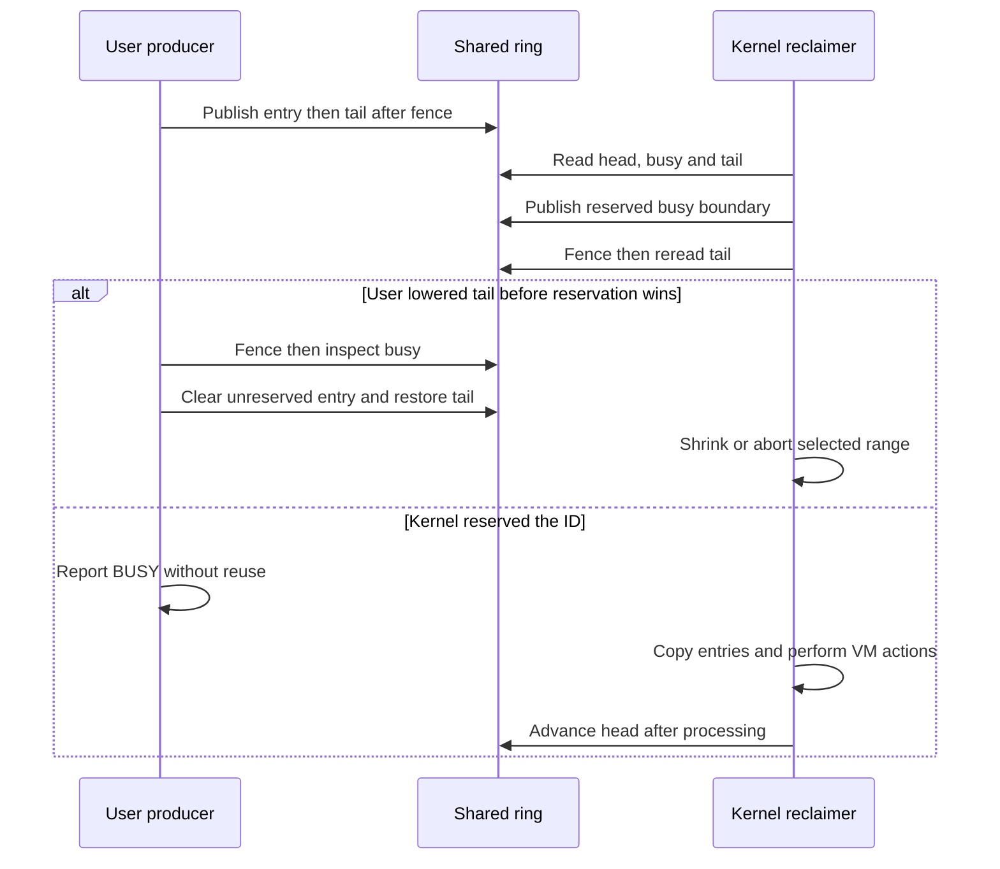

# Deferred reclamation: the shared ring and task lifetime

[VM guide](README.md) · [Map removal](virtual-address-maps.md) · [Freezer](memorystatus-and-freezer.md) · [Purgeable memory](purgeable-memory.md)

Deferred reclamation lets userspace publish ranges that the kernel may reclaim later, while retaining a protocol for canceling work before the kernel reserves it. The shared ring is not a list of `vm_page` pointers: its entries describe task virtual addresses, sizes and actions. Kernel metadata owns the map reference and serializes kernel consumers; atomic ring indices coordinate those consumers with the userspace producer. [Wire/shared structures](../../../platydoc-data/xnu/osfmk/mach/vm_reclaim_private.h#L41-L101), [kernel metadata](../../../platydoc-data/xnu/osfmk/vm/vm_reclaim.c#L168-L232).

## Two representations and three kinds of protection

| Object/field | Meaning and protection |
| --- | --- |
| `mach_vm_reclaim_ring_s.entries[]` | User-mapped entries containing address, 32-bit size and action; interpreted using the active capacity |
| `head` | Monotonic logical boundary already processed by the kernel |
| `busy` | End of the range reserved for kernel processing, possibly ahead of `head` |
| `tail` | Producer boundary; temporarily moved backward during cancellation/replacement |
| `vdrm_refcnt`, `vdrm_map` | Kernel metadata lifetime and retained map; separate from task liveness |
| `vdrm_lock`, `vdrm_gate` | Mutex protects metadata; gate provides exclusive reclaim/copy-I/O ownership while the mutex can be dropped |
| `vdrm_task` | Weak task back-pointer for policy/errors; cleared during teardown |
| `reclaim_buffers_lock` | Global registered-buffer list membership |

The older `indices` member inside the shared structure is explicitly unused; current code addresses the later `head`, `busy` and `tail` members. A reader interpreting the old compatibility fields would diagnose the wrong protocol. [Layout](../../../platydoc-data/xnu/osfmk/mach/vm_reclaim_private.h#L48-L101), [address helpers](../../../platydoc-data/xnu/osfmk/vm/vm_reclaim.c#L777-L795).

## Allocating and publishing the ring

`vm_deferred_reclamation_buffer_allocate_internal()` rejects invalid task/outputs, zero lengths, capacity overflow, excessive maximum allocation and disabled functionality. It reserves the maximum ring allocation, allocates metadata with a map reference, checks zero-initialized indices, then publishes under both the global buffer-list and task locks. A dying task or pre-existing ring is rejected at this final publication boundary. That ordering makes task termination see any successfully installed metadata. [Allocation/publication](../../../platydoc-data/xnu/osfmk/vm/vm_reclaim.c#L347-L507), [metadata allocation](../../../platydoc-data/xnu/osfmk/vm/vm_reclaim.c#L262-L294).

Read the actual mapping arguments: although a nearby comment describes an initial `VM_PROT_NONE` reservation, this checkout passes `VM_PROT_DEFAULT` for current and maximum protection. The current implementation must not be explained as if resize necessarily unprotects previously inaccessible pages. [Comment and call](../../../platydoc-data/xnu/osfmk/vm/vm_reclaim.c#L394-L420).

The fail labels also perform distinct cleanup. Publication failure passes through explicit map deallocation before common metadata release; earlier copy-I/O/initial-index failure jumps directly to the common failure label. The source-visible error contract should not be strengthened into an all-path transactional allocation guarantee. [Failure labels](../../../platydoc-data/xnu/osfmk/vm/vm_reclaim.c#L489-L507).

## Producer publication and cancellation are present in libsyscall

The checked-in `mach_vm_reclaim_try_enter()` writes an entry at `tail % capacity`, executes a sequentially consistent fence and publishes the advanced tail. A full ring returns through its capacity/error protocol rather than overwriting a kernel-owned entry. Its reusable-ID path must also coordinate with `busy`. This is local source, while the higher-level allocator's choice of what to publish remains outside this chapter. [Producer](../../../platydoc-data/xnu/libsyscall/mach/vm_reclaim.c#L175-L269).

Cancellation cannot simply zero an arbitrary queued entry. `mach_vm_reclaim_try_cancel()` temporarily moves `tail` back to the target ID, fences, and reads `busy`. If the ID is already reserved, it restores tail and reports BUSY; otherwise it validates and clears the entry, fences again and restores the original tail. An already processed ID yields an action-dependent result: a deallocated virtual range is different from a reusable range whose backing has been freed. [Cancel implementation](../../../platydoc-data/xnu/libsyscall/mach/vm_reclaim.c#L272-L365).

[Source: `libsyscall/mach/vm_reclaim.c`, lines 327–342](../../../platydoc-data/xnu/libsyscall/mach/vm_reclaim.c#L327-L342).

<!-- source-excerpt: ../../../platydoc-data/xnu/libsyscall/mach/vm_reclaim.c#L327-L342 -->
```c
	/* Attempt to move tail to idx */
	original_tail = os_atomic_load_wide(&ring->tail, relaxed);
	_assert("mach_vm_reclaim_mark_used", id < original_tail, original_tail);

	os_atomic_store_wide(&ring->tail, id, relaxed);
	/* Our write to tail must happen before our read of busy */
	os_atomic_thread_fence(seq_cst);
	busy = os_atomic_load_wide(&ring->busy, relaxed);
	if (id < busy) {
		/*
		 * This entry is in the process of being reclaimed. It is
		 * never safe to re-use while in this state.
		 */
		os_atomic_store_wide(&ring->tail, original_tail, relaxed);
		*state = VM_RECLAIM_BUSY;
		return VM_RECLAIM_SUCCESS;
```



This diagram omits userspace's own thread serialization. Kernel gate ownership does not serialize multiple application threads modifying the producer side.

## Kernel reservation, wrapped copies and partial progress

`reclaim_chunk()` requires ownership of the metadata gate while asserting that its mutex is not held. It switches to the target map, copies the indices, rejects inconsistent `busy/head` distances and recognizes `tail < head` as cancellation in progress. It publishes a bounded busy range, fences, rereads tail and shrinks/retries if userspace withdrew entries. The selected range decreases on these retries, so this loop is not an unbounded wait for a producer to cooperate. [Reservation](../../../platydoc-data/xnu/osfmk/vm/vm_reclaim.c#L987-L1116).

[Source: `osfmk/vm/vm_reclaim.c`, lines 1070–1085](../../../platydoc-data/xnu/osfmk/vm/vm_reclaim.c#L1070-L1085).

<!-- source-excerpt: ../../../platydoc-data/xnu/osfmk/vm/vm_reclaim.c#L1070-L1085 -->
```c
		kr = reclaim_copyout_busy(metadata, busy);
		if (kr != KERN_SUCCESS) {
			goto done;
		}
		os_atomic_thread_fence(seq_cst);
		kr = reclaim_copyin_tail(metadata, &new_tail);
		if (kr != KERN_SUCCESS) {
			goto done;
		}

		if (new_tail >= busy) {
			/* Got num_to_reclaim entries */
			break;
		}
		tail = new_tail;
		if (tail < head) {
```

Entries are copied into a fixed-size kernel array, splitting at the ring wrap boundary. Their logical IDs remain monotonic even when physical array slots repeat. The kernel then sanitizes ranges and executes the selected action. [Wrapped copy and entry handling](../../../platydoc-data/xnu/osfmk/vm/vm_reclaim.c#L1118-L1209).

| Action | What this implementation does |
| --- | --- |
| `VM_RECLAIM_DEALLOCATE` | Calls `vm_map_remove_guard()` with gaps-fail semantics; removes the virtual range and reports relevant guard failures |
| `VM_RECLAIM_FREE` | Calls `vm_map_behavior_set(..., VM_BEHAVIOR_REUSABLE)`; leaves the virtual range, allowing backing to age/reclaim |
| Canceled empty entry | Skips the withdrawn entry while advancing processed IDs |
| Unsupported action | Guard/error path rather than interpreting an arbitrary behavior value |

The `FREE` case contains an explicit TODO for freeing backing directly. Its reported reclaimed bytes are therefore not a direct count of physical pages already returned to the free list. [Actions](../../../platydoc-data/xnu/osfmk/vm/vm_reclaim.c#L1160-L1209).

Completion writes `head`, and if needed reduces `busy`. Copyout can fail after VM operations have occurred or after busy has been published, leaving `busy > head` for a subsequent attempt. A failure result does not restore all earlier range changes. The map switch is undone and partial byte/entry counts are reported through common cleanup. [Completion](../../../platydoc-data/xnu/osfmk/vm/vm_reclaim.c#L1210-L1240).

## Gate ownership, sampling and callers

The gate is closed under `vdrm_lock`, then the mutex is released for copy I/O and map operations. Contending owners can wait with priority propagation; `RECLAIM_NO_WAIT` refuses immediate ownership rather than sleeping. Disowning hands the gate to a waiter or opens it when no waiter exists. These rules avoid holding a short metadata mutex across faults. [Ownership helpers](../../../platydoc-data/xnu/osfmk/vm/vm_reclaim.c#L513-L602).

Explicit flush processes bounded chunks; cancellation can cause it to yield and reacquire ownership. Task drain retains metadata under the task lock, releases that lock, acquires reclaim ownership, performs the drain, then releases ownership and its reference. Suspend signals the scavenger; freezer and pressure callers use their own options. [Flush](../../../platydoc-data/xnu/osfmk/vm/vm_reclaim.c#L1320-L1381), [drain/suspend](../../../platydoc-data/xnu/osfmk/vm/vm_reclaim.c#L1840-L1876), [freezer integration](memorystatus-and-freezer.md).

Sampling combines reported current/minimum reclaimable bytes, kernel-reclaimed bytes not yet reported back, an exponential moving estimate, lifetime footprint and pressure-dependent thresholds. It must not double-count bytes the kernel already reclaimed. The sampling path can disable faults, drop the mutex while copying from the ring, then reestablish synchronization. [Threshold](../../../platydoc-data/xnu/osfmk/vm/vm_reclaim.c#L1490-L1540), [sampling and reconciliation](../../../platydoc-data/xnu/osfmk/vm/vm_reclaim.c#L1560-L1680). These are policy inputs, not permission to process beyond the reservation protocol.

## Resize, fork, task death and errors

Resize cannot exceed the original maximum allocation. With reclaim ownership, it drains the old logical contents before changing capacity: the same old ID would alias a different array slot under a new modulus. On failure, completed range actions remain reflected in partial byte counts; on success, the new active length is published under the metadata mutex. The caller must exclude competing userspace producer operations. [Resize](../../../platydoc-data/xnu/osfmk/vm/vm_reclaim.c#L1386-L1485).

Fork creates child metadata for the inherited ring address/map state while the parent ring is owned, copies accounting state and registers the child later when its address space is ready. Task teardown first removes registered metadata from the global list, then clears the weak task pointer and drops task ownership. Existing workers' references keep metadata and its map alive until final release destroys the gate/mutex and releases the map. [Fork](../../../platydoc-data/xnu/osfmk/vm/vm_reclaim.c#L1880-L1906), [teardown](../../../platydoc-data/xnu/osfmk/vm/vm_reclaim.c#L636-L659), [final free](../../../platydoc-data/xnu/osfmk/vm/vm_reclaim.c#L297-L307), [task termination caller](../../../platydoc-data/xnu/osfmk/kern/task.c#L3432).

Malformed indices, invalid actions and accounting inconsistencies can produce virtual-memory guard failures. Delivery rechecks the weak task, handles task/process identity safely and applies the deallocation-gap fatal-policy distinction; not every guard condition is automatically the same kill outcome. [Guard delivery](../../../platydoc-data/xnu/osfmk/vm/vm_reclaim.c#L663-L769).

This mechanism requires `CONFIG_DEFERRED_RECLAIM` and runtime enablement. The chapter follows supplied kernel and libsyscall protocol bodies, not an external allocator's entire cache policy or every pressure/scavenger scheduling decision. It complements [purgeability](purgeable-memory.md): ring entry ownership, object content volatility and ordinary pageout are three different mechanisms.

<!-- BEGIN PLATYDOC DOCUMENTATION LICENSE -->
Original Platydoc text and diagrams are licensed under [CC BY 4.0](https://creativecommons.org/licenses/by/4.0/). Quoted source code and third-party material retain their respective licenses.
<!-- END PLATYDOC DOCUMENTATION LICENSE -->
