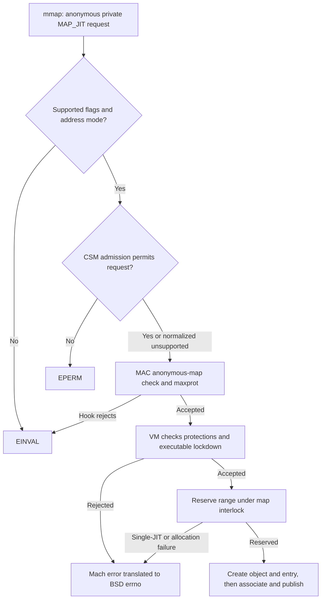
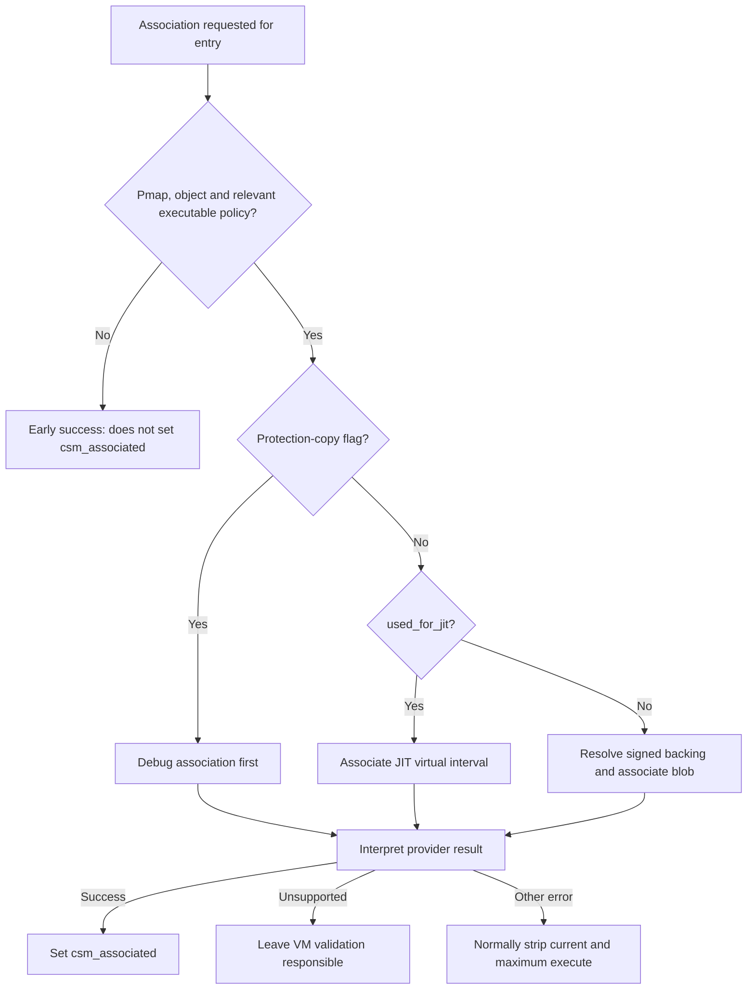
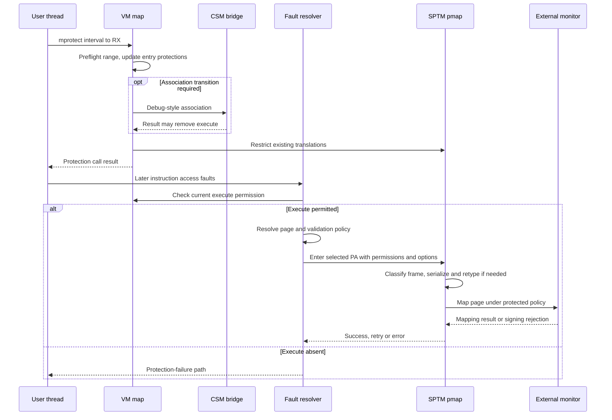

# Executable memory: mapping admission, protection changes, and ARM64 faults

[VM guide](README.md) · [Mapping walkthroughs](mapping-walkthroughs.md) · [Executable-signature policy](../security/executable-signature-policy.md)

An executable mapping passes several decisions at different times. BSD admits the API request; VM records current and maximum protections; configured code-signing machinery associates the virtual interval with an allowed use; a later fault selects a physical page and asks pmap to install a translation. `MAP_JIT`, successful `mprotect()`, and a physical frame classified as executable describe different stages. This chapter connects those stages in **xnu-12377.121.6**, concentrating on common VM and ARM64, with the SPTM backend identified explicitly.

Read [argument validation](api-argument-validation.md) for address arithmetic and [page-signature validation](../security/page-signature-validation.md) for hash validation and violation handling. Here the question is how a mapping acquires, changes, or loses permission to reach those paths. The supplied sources include policy hooks and monitor calls; they do not include the complete external MAC policy, TXM/SPTM implementation, or user-space JIT library.

For the later I/O boundary, read [Executable pages and UPL I/O](executable-pages-and-upl-io.md). It follows direction-dependent admission and the temporary-copy path through page coordinates, lock release and backing lifetime.

## Keep the representations separate

| State | Where it lives | Meaning in this operation |
| --- | --- | --- |
| Requested protection and `MAP_JIT` | BSD `mmap` arguments, then `vm_map_kernel_flags_t.vmkf_map_jit` | Input to admission and VM construction; not a PTE |
| `protection`, `max_protection` | `vm_map_entry` | Current allowed accesses and ceiling for ordinary protection changes |
| `used_for_jit`, `vme_xnu_user_debug`, `csm_associated` | `vm_map_entry` | Distinct JIT, debug-classification, and monitor-validation facts |
| `jit_entry_exists`, `single_jit`, `map_disallow_new_exec` | `vm_map` | Address-space policy/history, rather than a page's contents |
| `cs_bypass`, `csm_associated`, `fi_xnu_user_debug` | Fault information | Selected entry policy carried into page validation and mapping |
| PTE permissions and SPTM frame type | Pmap translation and protected physical-page classification | Permissions for one translation and constraints on the physical page's uses |

The entry fields are declared together, but they are set by different operations. An entry marked `used_for_jit` does not itself contain a physical page, and `csm_associated` does not mean every page has already been hashed. [Entry fields](../../../xnu/osfmk/vm/vm_map_xnu.h#L374-L416), [map flags](../../../xnu/osfmk/vm/vm_map_xnu.h#L646-L665), [BSD flag conversion](../../../xnu/bsd/kern/kern_mman.c#L737-L747), [fault-information transfer](../../../xnu/osfmk/vm/vm_fault.c#L4754-L4799).

The ceiling is normally an upper bound, not a second set of active permissions: entry insertion asserts that current protections are a subset of maximum protections. A read/write entry with `max_protection = VM_PROT_ALL` permits a later request for execute to be *considered*; policy, association and page validation still apply. [Insertion invariant](../../../xnu/osfmk/vm/vm_map_store.c#L2716-L2718), [protection preflight](../../../xnu/osfmk/vm/vm_map.c#L5700-L5789).

## MAP_JIT admission precedes entry publication

BSD rejects JIT with shared or file-backed memory and with resilient-code-signing, resilient-media, or TPRO flags. `MAP_FIXED` is normally rejected too; the explicit exception requires ARM64 mixed-page-size support, a 4 KiB map, and a non-exotic map. A 16 KiB example must not use that exception. [JIT combinations and fixed-address exception](../../../xnu/bsd/kern/kern_mman.c#L403-L424).

[Source: bsd/kern/kern_mman.c, lines 403–411](../../../xnu/bsd/kern/kern_mman.c#L403-L411)

<!-- source-excerpt: ../../../xnu/bsd/kern/kern_mman.c#L403-L411 -->
```c
	if (flags & MAP_JIT) {
		if ((flags & MAP_SHARED) ||
		    !(flags & MAP_ANON) ||
		    (flags & MAP_RESILIENT_CODESIGN) ||
		    (flags & MAP_RESILIENT_MEDIA) ||
		    (flags & MAP_TPRO)) {
			return EINVAL;
		}
		if (flags & MAP_FIXED) {
```

Admission then calls `vm_map_csm_allow_jit()`. Without `CODE_SIGNING_MONITOR`, that wrapper returns success. With it, `csm_allow_jit_region()` returns success when the monitor is disabled and also converts a provider's `KERN_NOT_SUPPORTED` to success. Those outcomes mean this gate did not reject the request. They do not establish that a later association or executable fault will succeed. A denial here becomes BSD `EPERM`. [BSD gate](../../../xnu/bsd/kern/kern_mman.c#L479-L483), [VM wrapper](../../../xnu/osfmk/vm/vm_map.c#L19888-L19899), [CSM normalization](../../../xnu/bsd/kern/kern_codesigning.c#L1298-L1319).

The provider distinction matters. PPL's admission API returns `KERN_NOT_SUPPORTED`; its association API separately calls `pmap_cs_associate(..., PMAP_CS_ASSOCIATE_JIT, ...)`. TXM's admission selector uses the pmap's shared TXM lock; association supplies the actual virtual start and length under its exclusive lock. The protected policy behind the TXM call is outside this tree. [PPL bridge](../../../xnu/bsd/kern/code_signing/ppl.c#L370-L390), [TXM admission and association](../../../xnu/bsd/kern/code_signing/txm.c#L1340-L1386).

For anonymous mappings BSD initializes `maxprot` to `VM_PROT_ALL`, then lets `mac_proc_check_map_anon()` inspect the request and modify the ceiling. A MAC-hook error on this path becomes `EINVAL`. BSD adds read when write or execute is requested, sets `vmkf_map_jit`, and calls `mach_vm_map_kernel()` with current and maximum protections separately. The source therefore supports a chain of checks, not a single universal entitlement predicate. [Anonymous policy](../../../xnu/bsd/kern/kern_mman.c#L485-L499), [flag](../../../xnu/bsd/kern/kern_mman.c#L741-L743), [protection normalization and VM call](../../../xnu/bsd/kern/kern_mman.c#L793-L811).



This diagram follows the non-fixed path. Later allocation errors remain possible, and association can remove execute permissions without aborting entry insertion. The returned address alone is therefore insufficient evidence of executable access. [Anywhere reservation](../../../xnu/osfmk/vm/vm_map.c#L2636-L2690), [insertion association](../../../xnu/osfmk/vm/vm_map_store.c#L2752-L2760).

## Common mobile policy and the macOS branch

The policy helpers use the term **alien** for maps intended to follow mobile-style rules. On non-macOS builds `VM_MAP_IS_ALIEN()` always returns true; on macOS it reads `map->is_alien`. This is distinct from `VM_MAP_IS_EXOTIC`, which appears in ARM64 compatibility checks. [Alien and exotic predicates](../../../xnu/osfmk/vm/vm_map_internal.h#L874-L921).

[Source: osfmk/vm/vm_map_internal.h, lines 905–921](../../../xnu/osfmk/vm/vm_map_internal.h#L905-L921)

<!-- source-excerpt: ../../../xnu/osfmk/vm/vm_map_internal.h#L905-L921 -->
```c
static inline bool
VM_MAP_IS_ALIEN(
	vm_map_t map __unused)
{
	/*
	 * An "alien" process/task/map/pmap should mostly behave
	 * as it currently would on iOS.
	 */
#if XNU_TARGET_OS_OSX
	if (map->is_alien) {
		return true;
	}
	return false;
#else /* XNU_TARGET_OS_OSX */
	return true;
#endif /* XNU_TARGET_OS_OSX */
}
```

| Policy helper | Alien/mobile result | Non-alien macOS result |
| --- | --- | --- |
| `WX_FAIL` / `WX_STRIP_X` | Strip execute rather than fail this W+X check | Fail the applicable W+X check |
| `ALLOW_MULTIPLE_JIT` | False | True unless `single_jit` |
| `ALLOW_JIT_RANDOM_ADDRESS` | True | False |
| `ALLOW_JIT_INHERIT` | False | True |
| `ALLOW_JIT_SHARING` / `ALLOW_JIT_COPY` | False | True |

These are the local helper results, not a promise that every preceding gate permits an operation. [Policy helper bodies](../../../xnu/osfmk/vm/vm_map_internal.h#L923-L989).

For an ordinary non-JIT W+X creation, `vm_map_enter()` applies platform/code-signing predicates, including the CSM exemption check when configured. If its W+X policy applies, it clears execute from current protection, then returns `KERN_PROTECTION_FAILURE` only for `WX_FAIL`. Thus the common non-exempt mobile branch can construct an RW mapping from an RWX request. It does not grant simultaneous write and execute just because `mmap` returns success. [Creation W+X branch](../../../xnu/osfmk/vm/vm_map.c#L3178-L3217).

JIT creation has a different rule: **on non-macOS builds the current protection must equal `VM_PROT_ALL`**. A non-RWX JIT request fails with `KERN_PROTECTION_FAILURE`, translated by `mmap` to `EACCES`. The `XNU_TARGET_OS_OSX` branch explicitly permits non-RWX JIT for compatibility. New executable mappings are also denied when `map_disallow_new_exec` is set. [JIT protection branch and lockdown](../../../xnu/osfmk/vm/vm_map.c#L3219-L3275), [BSD result conversion](../../../xnu/bsd/kern/kern_mman.c#L923-L938).

The anywhere allocator checks `jit_entry_exists` while holding the map interlock and rejects another JIT request when multiple regions are disallowed. It selects random-address placement for the alien policy. Entry construction sets `used_for_jit` and `jit_entry_exists` before inserting the entry. These are map policy/history fields; the inspected assignments do not implement a count of currently resident JIT pages. [Reservation check](../../../xnu/osfmk/vm/vm_map.c#L2648-L2685), [publication fields](../../../xnu/osfmk/vm/vm_map.c#L15433-L15448).

JIT construction eagerly creates a distinct anonymous object when none was supplied, sets `MEMORY_OBJECT_COPY_NONE` and `vo_inherit_copy_none`, and excludes the neighboring-entry coalescing path used for ordinary anonymous memory. The entry receives `VM_INHERIT_NONE` when JIT inheritance policy disallows it. These decisions prepare later copying and fork behavior before any page is faulted. [Object construction](../../../xnu/osfmk/vm/vm_map.c#L3507-L3553), [entry inheritance](../../../xnu/osfmk/vm/vm_map.c#L3704-L3710).

## mprotect changes map policy before hardware permissions catch up

BSD `mprotect()` sanitizes the range/protection, adds read to write or execute requests, invokes its MAC hook, and calls `mach_vm_protect(..., set_max = false, ...)`. `VM_PROT_TRUSTED` has a separate `CONFIG_DYNAMIC_CODE_SIGNING` path through `vm_map_sign()`; it is removed before the ordinary protection call. Without that configuration the trusted request returns `ENOTSUP`. It should not be treated as another spelling of `MAP_JIT`. [BSD protect path](../../../xnu/bsd/kern/kern_mman.c#L1186-L1287).

Ordinary `vm_map_protect()` installs a preflight callback and obtains an atomic exclusive range context before iterating entries to change their protections. Preflight compares the requested mask with each entry's maximum, applies JIT/TPRO guards, applies W+X policy, then checks executable lockdown. The W+X branch can rewrite the shared requested mask by removing execute; lockdown forbids a requested executable protection or adding write to an already executable entry. [Preflight and range acquisition](../../../xnu/osfmk/vm/vm_map.c#L5933-L5955), [policy checks](../../../xnu/osfmk/vm/vm_map.c#L5700-L5789).

Maximum protections ordinarily cannot be increased. There are explicit architecture/configuration exceptions: the CSM branch can add execute to the comparison ceiling for a `set_max` request on an exempt address space. BSD `mprotect()` does not request `set_max`. When a permitted maximum change is applied, VM intersects current protection with the new maximum. [Maximum comparison](../../../xnu/osfmk/vm/vm_map.c#L5708-L5724), [entry update](../../../xnu/osfmk/vm/vm_map.c#L5987-L5995).

[Source: osfmk/vm/vm_map.c, lines 5715–5729](../../../xnu/osfmk/vm/vm_map.c#L5715-L5729)

<!-- source-excerpt: ../../../xnu/osfmk/vm/vm_map.c#L5715-L5729 -->
```c
#elif CODE_SIGNING_MONITOR
	if (set_max && (new_prot & VM_PROT_EXECUTE) && (csm_address_space_exempt(map->pmap) == KERN_SUCCESS)) {
		new_max |= VM_PROT_EXECUTE;
	}
#else
	(void) set_max;
#endif
	if ((new_prot & new_max) != new_prot) {
		return KERN_PROTECTION_FAILURE;
	}

	if (entry->used_for_jit &&
	    pmap_has_prot_policy(map->pmap, entry->translated_allow_execute, entry->protection)) {
		return KERN_PROTECTION_FAILURE;
	}
```

### Read the supplied pmap hook, not only the surrounding comments

The JIT guard above asks about the entry's **existing** protection. However, both supplied ARM implementations of `pmap_has_prot_policy()` return `false`. Therefore this particular guard does not, by itself, reject protection changes to JIT entries in these source bodies. Nearby comments about JIT permissions or inability to downgrade after entering a protected frame type express constraints/intended behavior that must be checked against the actual pmap/monitor path; they are not evidence of an unconditional API rejection here. [Legacy/PPL-facing ARM body](../../../xnu/osfmk/arm/pmap/pmap.c#L5418-L5426), [SPTM body](../../../xnu/osfmk/arm64/sptm/pmap/pmap.c#L5545-L5553), [compatibility comment](../../../xnu/osfmk/vm/vm_map.c#L3221-L3241).

[Source: osfmk/arm64/sptm/pmap/pmap.c, lines 5549–5553](../../../xnu/osfmk/arm64/sptm/pmap/pmap.c#L5549-L5553)

<!-- source-excerpt: ../../../xnu/osfmk/arm64/sptm/pmap/pmap.c#L5549-L5553 -->
```c
bool
pmap_has_prot_policy(__unused pmap_t pmap, __unused bool translated_allow_execute, __unused vm_prot_t prot)
{
	return false;
}
```

After entry metadata changes, ordinary VM protection changes generally remove write from the protection sent to pmap. Granting write immediately would bypass the next fault's COW decision. Pmap protection APIs restrict translations; a later fault/enter grants newly allowed access. Hence changing a map from RW to RX does not necessarily make every resident translation executable during the syscall. [Map-to-pmap update](../../../xnu/osfmk/vm/vm_map.c#L6039-L6121), [pmap restriction contract](../../../xnu/osfmk/arm64/sptm/pmap/pmap.c#L5561-L5567).

`VM_PROT_COPY` is a separate operation prefix: before the ordinary range pass it remaps the interval over itself with copy-on-write and `vmkf_remap_prot_copy`, allowing the remap machinery to negotiate writable maximum protections. Do not transfer the ordinary preflight's all-before-entry-update reasoning to the entire COPY operation. [Protection-copy path](../../../xnu/osfmk/vm/vm_map.c#L5831-L5907), [copy/remap mechanics](copy-overwrite-and-remap.md).

## Association records how executable pages should be admitted

Under `CODE_SIGNING_MONITOR`, map-store insertion calls `vm_map_entry_cs_associate()` before publishing the slot. The helper first skips missing pmaps, submaps, exempt address spaces and absent objects. It normally skips a non-executable entry too, unless the protection-copy flag and executable maximum identify the debug-modification case. [Insertion order](../../../xnu/osfmk/vm/vm_map_store.c#L2752-L2760), [association entry checks](../../../xnu/osfmk/vm/vm_map.c#L21009-L21051).

The selection order is deliberate: protection-copy/debug association comes **before** JIT association. A debug association returning success or unsupported sets `vme_xnu_user_debug`; a JIT entry otherwise selects `csm_associate_jit_region()`. Ordinary signed-file association walks the backing object and blob coverage, explained in [executable-signature policy](../security/executable-signature-policy.md#8-vm-connects-a-signed-file-interval-to-a-monitor-region). [Debug then JIT branches](../../../xnu/osfmk/vm/vm_map.c#L21056-L21118).



This diagram omits the ordinary backing traversal's own early exits. On final success the helper marks `csm_associated` and may mark the entry permanent under executable-immutability configuration. Unsupported is not final success: it leaves VM validation responsible. A real association error normally strips execute from both current and maximum protection; the immutable-overwrite branch is an explicit exception. The map-store caller discards the integer result, relying on the modified entry. [Association outcomes](../../../xnu/osfmk/vm/vm_map.c#L21185-L21242).

`vm_map_protect()` repeats association when an unassociated non-executable entry becomes executable, or an associated non-writable entry becomes writable. It passes `vmkf_remap_prot_copy` to select the debug-modification contract. The metadata has already changed; the association helper can change it again, and this path ultimately returns `KERN_SUCCESS` after the range loop rather than directly returning that association result. A successful protection syscall is consequently not sufficient proof that its requested execute bit survived. [Transition triggers and association call](../../../xnu/osfmk/vm/vm_map.c#L5987-L6036), [function completion](../../../xnu/osfmk/vm/vm_map.c#L6117-L6128).

## A fault turns entry policy into a page mapping

Fault lookup checks the actual access against the entry's **current** protection; maximum permission alone cannot authorize execution. ARM64 has an explicit execute-only special case for the combined read/execute fault classification. Once access is allowed, lookup copies entry policy into fault information. [Access check](../../../xnu/osfmk/vm/vm_fault.c#L4631-L4687).

[Source: osfmk/vm/vm_fault.c, lines 4773–4789](../../../xnu/osfmk/vm/vm_fault.c#L4773-L4789)

<!-- source-excerpt: ../../../xnu/osfmk/vm/vm_fault.c#L4773-L4789 -->
```c
		fault_info->cs_bypass = ((*entry)->used_for_jit ||
#if CODE_SIGNING_MONITOR
		    (csm_address_space_exempt((*var_map)->pmap) == KERN_SUCCESS) ||
#endif
		    (*entry)->vme_resilient_codesign);
		fault_info->mark_zf_absent = FALSE;
		fault_info->batch_pmap_op = FALSE;
		/*
		 * The pmap layer will validate this page
		 * before allowing it to be executed from.
		 */
#if CODE_SIGNING_MONITOR
		fault_info->csm_associated = (*entry)->csm_associated;
#else
		fault_info->csm_associated = FALSE;
#endif
		fault_info->resilient_media = (*entry)->vme_resilient_media;
```

`cs_bypass` includes JIT, an explicitly exempt address space under CSM, and resilient-code-signing entries. It bypasses selected VM code-signing validation; it is not a replacement for map access checks or protected pmap mapping policy. `csm_associated` instead participates in a conditional deferral to the monitor: the shown branch also requires monitor enablement, no prior validated/tainted/NX state, and both permitted and requested execute access. [VM validation and deferral](../../../xnu/osfmk/vm/vm_fault.c#L2803-L2835).

Debug classification has its own qualification. `vm_fault_enter()` adds `PMAP_OPTIONS_XNU_USER_DEBUG` when `fi_xnu_user_debug` is set **and the selected object's `code_signed` flag is false**. It then passes the selected page, permitted protections, actual fault type and options to the pmap-enter wrapper. That distinction matters after shadow/COW resolution: the entry's classification and the selected object's signing state both contribute. [Fault entry](../../../xnu/osfmk/vm/vm_fault.c#L4187-L4209).



This sequence shows ordering, not a guarantee that every instruction access faults. It omits VM paging/COW waits and the pmap allocation retries detailed in [fault resolution](fault-resolution.md) and [mapping lifecycle](pmap-mapping-lifecycle.md).

### SPTM classifies the constructed PTE and physical page

`pmap_construct_pte()` combines the permitted mask, actual fault type, page attributes, and pmap geometry. A logically writable page can receive a read-only translation plus modified-fault bookkeeping until a write is observed. Consequently an RWX map entry alone is not enough to determine the exact PTE presented to the frame classifier on every fault. [PTE construction](../../../xnu/osfmk/arm64/sptm/pmap/pmap.c#L6180-L6276).

For `PMAP_MAPPING_TYPE_INFER`, `pmap_frame_type_for_pte()` applies these branches in order:

| Constructed mapping condition | Requested frame classification |
| --- | --- |
| PTE decodes as `XPRR_USER_JIT_PERM` | `XNU_USER_JIT`, before considering debug options |
| `PMAP_OPTIONS_XNU_USER_DEBUG` | `XNU_USER_DEBUG`, before the ordinary RX case |
| PTE decodes as `XPRR_USER_RX_PERM` | `XNU_USER_EXEC` |
| User RW, or read-only with the was-writable marker | May request return from a user-executable type to `XNU_DEFAULT`; `XNU_USER_DEBUG` is excluded from that reset |

Other explicit mapping types and TPRO have their own branches. The classifier selects a proposed type; it does not implement the external monitor's full transition policy. [Complete selection](../../../xnu/osfmk/arm64/sptm/pmap/pmap.c#L6075-L6160).

[Source: osfmk/arm64/sptm/pmap/pmap.c, lines 6127–6136](../../../xnu/osfmk/arm64/sptm/pmap/pmap.c#L6127-L6136)

<!-- source-excerpt: ../../../xnu/osfmk/arm64/sptm/pmap/pmap.c#L6127-L6136 -->
```c
	} else if (__improbable(options & PMAP_OPTIONS_XNU_USER_DEBUG)) {
		/*
		 * Both XNU_USER_DEBUG and XNU_USER_EXEC allow RX permissions. Given that, we must
		 * test for PMAP_OPTIONS_XNU_USER_DEBUG before we test for XNU_USER_EXEC since the
		 * XNU_USER_DEBUG type overlays the XNU_USER_EXEC type.
		 */
		*new_frame_type = XNU_USER_DEBUG;
	} else if (pte_perms == XPRR_USER_RX_PERM) {
		*new_frame_type = XNU_USER_EXEC;
	} else if ((pte_perms == XPRR_USER_RW_PERM) ||
```

`pmap_enter_pte()` reconciles type changes while holding the physical page's PVH lock. It disconnects existing aliases before retyping, reloads the prior type, and invokes `sptm_retype()` if still necessary. Executable types can require TXM synchronization: a failed shared try-lock requests a retry rather than blocking under PVH. This prevents treating another writable alias as an unrelated virtual-range detail. [Lock and retype sequence](../../../xnu/osfmk/arm64/sptm/pmap/pmap.c#L6377-L6430).

The subsequent protected mapping can still reject the operation: `SPTM_MAP_CODESIGN_ERROR` becomes `KERN_CODESIGN_ERROR`. Resource/table/flush outcomes have retry paths, while the monitor implementation deciding protected acceptance is absent. The legacy ARM pmap backend should not be described using SPTM frame types; its own CSM bridge and PTE-update implementation form a separate backend. [SPTM result handling](../../../xnu/osfmk/arm64/sptm/pmap/pmap.c#L6795-L6827), [backend comparison](pmap-mapping-lifecycle.md), [PPL bridge](../../../xnu/bsd/kern/code_signing/ppl.c#L355-L390).

## Worked 16 KiB scenarios

Assume a non-kernel ARM64 map with **16 KiB pages**, an illustrative returned base `A = 0x100000000`, and length `0x8000` (two pages). The intervals are `[A, A + 0x4000)` and `[A + 0x4000, A + 0x8000)`. Addresses here are CPU virtual addresses, not physical pages or monitor handles. The following are source-path deductions under the stated predicates, not runtime measurements.

**Ordinary anonymous RW → RX.** Suppose the anonymous policy permits current RW and maximum RWX, and the process is not exempt. A write at `A + 0x20` can fault in the first page with write access. Requesting RX for `[A, A + 0x4000)` passes the maximum-mask comparison, but still encounters the MAC hook, entry policy and configured association. If debug association rejects the transition, the helper normally removes execute from both masks; a later instruction access fails the current-protection check even if the protection syscall returned success. If RX survives, the later executable fault must still resolve/validate the page and obtain a permitted pmap mapping. The untouched second page remains a separate RW interval after necessary clipping. [Range and entry update](../../../xnu/osfmk/vm/vm_map.c#L5933-L6019), [association failure](../../../xnu/osfmk/vm/vm_map.c#L21218-L21240), [fault protection](../../../xnu/osfmk/vm/vm_fault.c#L4631-L4687).

**Ordinary anonymous RWX request on the mobile branch.** With applicable W+X policy and no exemption, VM strips execute. If all later construction succeeds, the mapping can be returned as RW; an instruction fetch is still disallowed. This differs from non-alien macOS's applicable `WX_FAIL` outcome. [Creation policy](../../../xnu/osfmk/vm/vm_map.c#L3178-L3217), [policy helpers](../../../xnu/osfmk/vm/vm_map_internal.h#L923-L941).

**Admitted MAP_JIT region.** The non-macOS path requires RWX at creation, passes the separate admission/association gates, records JIT policy and defaults to non-inheritance. Requesting RW instead at creation is rejected; requesting another anywhere JIT region is rejected once the single-region policy sees `jit_entry_exists`. Do not substitute two RW/RX aliases in different tasks for this path: cross-map sharing has its own JIT restriction below. [Creation and reservation](../../../xnu/osfmk/vm/vm_map.c#L2677-L2685), [RWX requirement](../../../xnu/osfmk/vm/vm_map.c#L3219-L3264), [inheritance](../../../xnu/osfmk/vm/vm_map.c#L3704-L3710).

The local UPL tests use `os_thread_self_restrict_rwx_to_rw()` and `...to_rx()` around accesses when supported. Those user-space calls are evidence that per-thread restrictions are a separate part of the environment; their implementation is not supplied here. A map-wide `mprotect()` trace therefore does not establish the complete per-thread JIT switching protocol. [Test use of thread restriction](../../../xnu/tests/vm/upl.c#L536-L554).

### macOS compatibility is a separate scenario

`XNU_TARGET_OS_OSX` allows a JIT entry to start non-RWX. The association comments explain why RW↔RX transitions are routed through debug classification, and the actual code gives `vmkf_remap_prot_copy` precedence over `used_for_jit`. When a constructed PTE later has JIT permissions, the SPTM classifier chooses `XNU_USER_JIT` even if a debug option remains. These mechanisms support the compatibility explanation; the comment's stronger assertion that the mapping cannot later downgrade must not be promoted to a universal `mprotect` return guarantee given the unconditional-false pmap hook in this checkout. [Compatibility branch](../../../xnu/osfmk/vm/vm_map.c#L3219-L3264), [debug-first association](../../../xnu/osfmk/vm/vm_map.c#L21056-L21118), [JIT-first frame selection](../../../xnu/osfmk/arm64/sptm/pmap/pmap.c#L6112-L6136).

## Fork, copying and remapping preserve different things

Default non-macOS JIT insertion uses `VM_INHERIT_NONE`. Ordinary fork skips such entries, but `VM_MAP_FORK_SHARE_IF_INHERIT_NONE` is an explicit special fork option and the separate inheritance API can change entry inheritance. Thus “JIT can never appear in any fork-derived map” is broader than the inspected rule. Fork also propagates the pmap's JIT-entitled property to the new pmap; entitlement state and copied mappings are different facts. [Initial inheritance](../../../xnu/osfmk/vm/vm_map.c#L3704-L3710), [fork selection](../../../xnu/osfmk/vm/vm_map.c#L12601-L12639), [inheritance preflight](../../../xnu/osfmk/vm/vm_map.c#L6170-L6194), [pmap entitlement propagation](../../../xnu/osfmk/vm/vm_map.c#L12968-L12974).

For copied entries, `vm_map_entry_reinit_after_copy()` invokes the code-signing reset helper. If JIT copying is disallowed, that helper removes execute from both protection masks and clears `used_for_jit`. Copying bytes or an entry therefore does not necessarily copy executable/JIT authority. [Copy reset](../../../xnu/osfmk/vm/vm_map.c#L892-L929).

Remap's share case separately checks a JIT source: `vmkf_copy_same_map` is exempt from the cross-address-space check, while disallowed cross-map sharing produces `KERN_INVALID_ARGUMENT`, drops the object reference and frees the temporary entry. This branch is conditional on sharing, not a universal prohibition on every remap mode. Source/destination map authority and other copy/remap checks still apply. [Sharing check and cleanup](../../../xnu/osfmk/vm/vm_map.c#L15975-L15994), [remap operation](copy-overwrite-and-remap.md).

## Tests as source evidence and remaining boundaries

| Source | What it demonstrates in the checked-in test | Limit |
| --- | --- | --- |
| [`restrict_jit.c`](../../../xnu/tests/restrict_jit.c#L9-L33) and [entitlements](../../../xnu/tests/restrict_jit.entitlements#L4-L10) | Two RWX anonymous-private JIT requests; expects the second to fail with single-JIT policy | Explicitly macOS-only; not a mobile execution-permission test |
| [`vm_region_recurse_jit_info`](../../../xnu/tests/vm_test_mach_map.c#L2695-L2749) | Queries JIT metadata on a JIT versus ordinary region | Explicitly enables macOS and skips embedded platforms; metadata is not an execution test |
| [`vm_upl_ro_on_jit`](../../../xnu/tests/vm/upl.c#L283-L320) | Creates JIT memory, uses per-thread RW restriction when supported, and distinguishes expected SPTM UPL copying | Skips when configuration disallows JIT; this tests a UPL interaction |
| [`vm_test_code_signing_helper.c`](../../../xnu/tests/vm_test_code_signing_helper.c#L45-L131) | Anonymous RX→RW→RX sequence followed by an unsigned-code execution attempt | Companion [harness](../../../xnu/tests/vm_test_code_signing.c#L84-L179) has platform/boot-condition logic; not a general permission contract |
| [`vm_upl_ro_with_write_fault_on_exec_file`](../../../xnu/tests/vm/upl.c#L576-L660) | macOS SPTM-specific file mapping transitions through RX/RW to induce debug classification | Deliberately a compatibility/UPL case; not anonymous MAP_JIT admission |

These tests were inspected, not executed. This chapter does not infer a shipping product's entitlement grant, monitor policy, or hardware register configuration from test intent. It also does not reproduce the user-space JIT runtime, translated-process policy, TPRO, DMA executable-frame rules, or the full debugger exception flow. Follow [TXM](../security/txm.md), [SPTM](../security/sptm.md), [page-signature validation](../security/page-signature-validation.md) and [copy/remap](copy-overwrite-and-remap.md) for those adjacent source boundaries.

<!-- BEGIN PLATYDOC DOCUMENTATION LICENSE -->
Original Platydoc text and diagrams are licensed under [CC BY 4.0](https://creativecommons.org/licenses/by/4.0/). Quoted source code and third-party material retain their respective licenses.
<!-- END PLATYDOC DOCUMENTATION LICENSE -->
