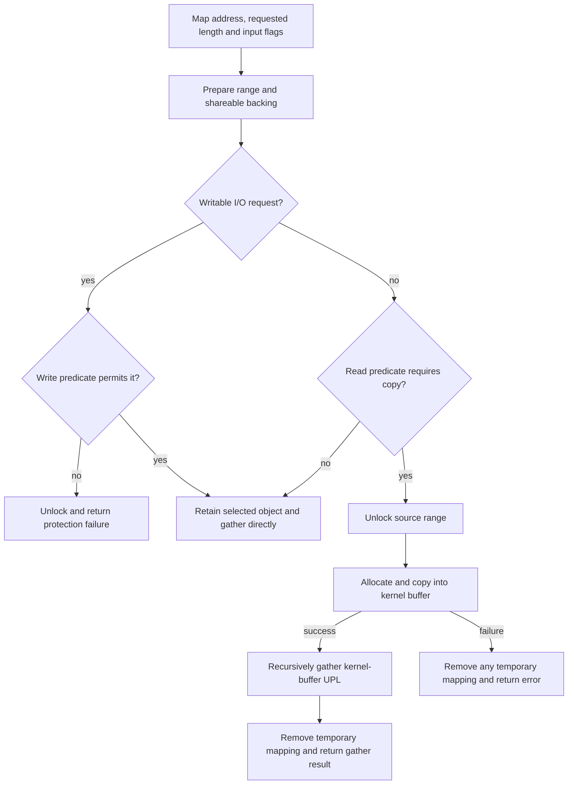
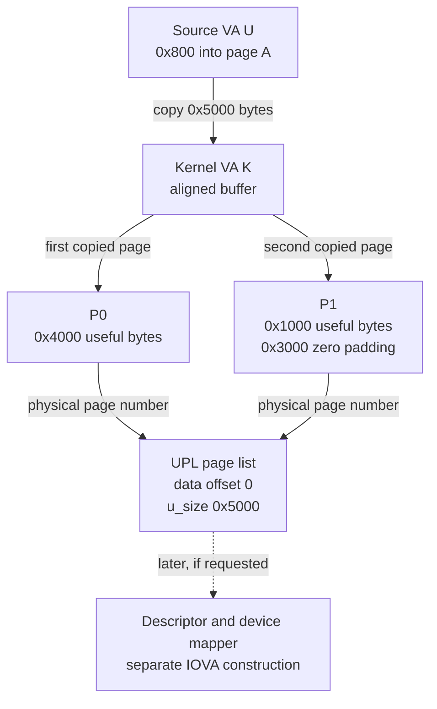
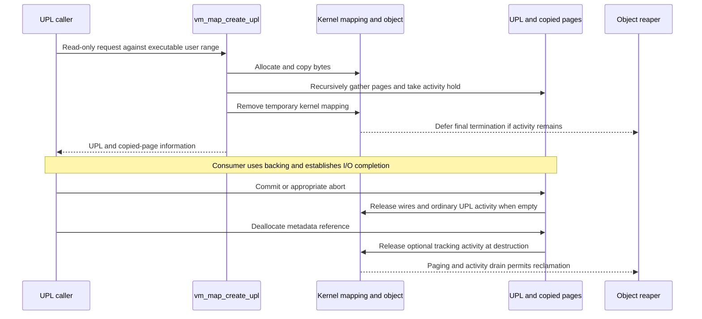

# Executable pages and UPL I/O: permission, copies, and backing lifetime

[VM index](README.md) · [Executable-memory policy](executable-memory-policy.md) · [UPL gathering and completion](upl-gather-and-completion.md) · [User buffer to DMA completion](../../cross-cutting/user-buffer-to-dma-completion.md)

Preparing executable memory for I/O can return pages containing a copy of the requested bytes rather than the physical pages underlying the original user mapping. This chapter follows that decision through `vm_map_create_upl()` in `xnu-12377.121.6`: map-entry admission, temporary kernel storage, byte-offset changes, recursive UPL gathering and completion after the temporary mapping has gone. It separates common code, `CONFIG_SPTM` and non-macOS policy; the worked example selects ARM64 with 16 KiB system VM pages and 16 KiB source-map pages.

## 1. I/O direction and CPU permission describe different operations

`vm_map_create_upl()` is an internal map-to-backing interface. Concrete callers include `IOGeneralMemoryDescriptor::wireVirtual()`, the filesystem-facing `vm_map_get_upl()` wrapper and development VM tests. It can fault, allocate and wait; it is not an interrupt-context operation merely because the resulting pages will be used by a device. The caller supplies the map in which the input address has meaning. [Descriptor call](../../../platydoc-data/xnu/iokit/Kernel/IOMemoryDescriptor.cpp#L4638-L4680), [wrapper](../../../platydoc-data/xnu/osfmk/vm/vm_upl.c#L125-L160), [test caller](../../../platydoc-data/xnu/osfmk/vm/vm_tests.c#L3315-L3350).

| I/O intention | UPL input flag | Concrete IOKit direction | Consequence for backing |
| --- | --- | --- | --- |
| Consumer reads existing host bytes | `UPL_COPYOUT_FROM` set | `kIODirectionOut`; `kIODMAMapReadAccess` | Read-only I/O request; selected executable/debug mappings require a copy |
| Consumer may write host bytes | `UPL_COPYOUT_FROM` clear | `kIODirectionIn` or `kIODirectionOutIn` | Requires map-entry write permission, with additional SPTM restrictions |

The flag describes the consumer's use of host memory. It does not mean that the CPU must execute a function named `copyout()`: the temporary-copy path uses `copyinmap()` to read user bytes into a kernel buffer. IOKit adds `UPL_SET_IO_WIRE | UPL_SET_LITE`; it obtains the UPL before a DMA command obtains device-address segments. [Direction translation](../../../platydoc-data/xnu/iokit/Kernel/IOMemoryDescriptor.cpp#L4454-L4487), [DMA operation](../../cross-cutting/user-buffer-to-dma-completion.md#3-descriptor-preparation-resolves-vm-ownership-before-device-use).

Keep four representations separate:

| Representation | What the selected code inspects or creates |
| --- | --- |
| VM map entry | Current `protection`, `vme_xnu_user_debug`, backing object and object offset |
| CPU translation | The pmap/PTE allowing a CPU access; its effective permissions can be narrower than the entry's mask |
| Physical-page state | On SPTM, a monitor-reported frame type; separately, VM's I/O-wire/cleaning state |
| I/O exposure | A UPL and page-information array, followed optionally by descriptor/mapper/device mappings |

An RWX/JIT entry does not establish that writable DMA is permitted, and a UPL page number is not a device IOVA. The [executable-memory chapter](executable-memory-policy.md#a-fault-turns-entry-policy-into-a-page-mapping) traces entry-to-PTE/frame classification; the [DMA chapter](../../cross-cutting/user-buffer-to-dma-completion.md#5-from-three-vm-pages-to-addresses-in-a-device-domain) follows physical backing into a device address space.

## 2. The entry predicates choose rejection, direct gathering, or copying

For a writable request, `vme_allows_upl_write()` first rejects an entry lacking **current** `VM_PROT_WRITE`. Under `CONFIG_SPTM`, it then rejects an executable entry or one marked `vme_xnu_user_debug`, records a VM guard exception and returns false. This second branch applies even if the entry already permits CPU writes. The caller releases its range lock and returns `KERN_PROTECTION_FAILURE`. An RX entry fails the first check; the later executable-write guard is not emitted by that already-returned branch. [Writable predicate](../../../platydoc-data/xnu/osfmk/vm/vm_pageout.c#L7407-L7430), [caller result](../../../platydoc-data/xnu/osfmk/vm/vm_pageout.c#L7658-L7663).

[SPTM's additional writable-UPL condition — `vm_pageout.c`, lines 7422–7427](../../../platydoc-data/xnu/osfmk/vm/vm_pageout.c#L7422-L7427).

<!-- source-excerpt: ../../../platydoc-data/xnu/osfmk/vm/vm_pageout.c#L7422-L7427 -->
```c
	if ((entry->protection & VM_PROT_EXECUTE) || entry->vme_xnu_user_debug) {
		vm_map_guard_exception(map, offset, kGUARD_EXC_SEC_UPL_WRITE_ON_EXEC_REGION);
		ktriage_record(thread_tid(current_thread()), KDBG_TRIAGE_EVENTID(KDBG_TRIAGE_SUBSYS_VM,
		    KDBG_TRIAGE_RESERVED, KDBG_TRIAGE_VM_UPL_WRITE_ON_EXEC_REGION), (uintptr_t)offset);
		return false;
	}
```

For a read-only request, `vme_allows_upl_read()` initializes `copy_required = false` and applies two independently compiled rules:

| Configuration and source entry | Result of the read helper |
| --- | --- |
| `CONFIG_SPTM`, non-kernel pmap, entry has execute permission **or** the debug marker | Require copying, including RWX/JIT and debug entries that currently lack execute permission |
| `!XNU_TARGET_OS_OSX`, non-kernel pmap, entry has execute permission and lacks write permission | Require copying, whether SPTM is selected or not |
| Neither condition matches | Leave `copy_required` false |

Both conditions test `map->pmap != kernel_pmap`, rather than merely comparing the map pointer with `kernel_map`. The writable helper has no corresponding kernel-pmap exemption. These are entry-policy tests, not a query for a file signature or an inspection of every resident physical frame. [Read helper](../../../platydoc-data/xnu/osfmk/vm/vm_pageout.c#L7445-L7481).

[The non-macOS read-copy predicate — `vm_pageout.c`, lines 7474–7480](../../../platydoc-data/xnu/osfmk/vm/vm_pageout.c#L7474-L7480).

<!-- source-excerpt: ../../../platydoc-data/xnu/osfmk/vm/vm_pageout.c#L7474-L7480 -->
```c
	if (map->pmap != kernel_pmap &&
	    (entry->protection & VM_PROT_EXECUTE) &&
	    !(entry->protection & VM_PROT_WRITE)) {
		*copy_required = true;
	}
#endif /* !XNU_TARGET_OS_OSX */
	return true;
```

Despite its name, the read helper always returns true in this checkout and does not test `VM_PROT_READ`. Its output chooses backing; it is not a complete user-read admission check. When copying is selected, the subsequent `copyinmap()` must actually read the address and can fail. When direct gathering is selected, the later operation faults the selected **object**, not through a new user-map read-permission check in this helper. This internal API therefore must not be described as an independent user-facing read capability. [Helper return](../../../platydoc-data/xnu/osfmk/vm/vm_pageout.c#L7451-L7481), [object fault](../../../platydoc-data/xnu/osfmk/vm/vm_pageout.c#L9020-L9032).

The non-macOS comment explains the copy's purpose: an I/O wire can proactively resolve COW into pages that do not retain the original signed backing's status. The gather's slow path really requests `prot | VM_PROT_WRITE` from `vm_fault_page()`, even for output. Copying the bytes into a separate buffer avoids using that I/O-wire operation on the selected executable mapping's backing; it does not make the copied bytes an executable or signed mapping. [Policy explanation](../../../platydoc-data/xnu/osfmk/vm/vm_pageout.c#L7467-L7473), [fault protection](../../../platydoc-data/xnu/osfmk/vm/vm_pageout.c#L8696-L8706), [gather invocation](../../../platydoc-data/xnu/osfmk/vm/vm_pageout.c#L9020-L9032).

## 3. Range preparation happens before the copy decision

The function captures the input flags in `caller_flags`, rejects unknown bits and, where tagging support is compiled, rejects a noncanonical address. `UPL_QUERY_OBJECT_TYPE` takes an early branch that reports private/contiguous object properties without creating a UPL or reaching the read/write predicates. Treat querying and preparing I/O as different operations. [Input and query branch](../../../platydoc-data/xnu/osfmk/vm/vm_pageout.c#L7509-L7561).

Normal creation requests a shared range lock with `VMRL_SH_STREAM_NO_HOLES`, constant-submap descent and COW/object resolution. Its preflight requests preparation for UPL sharing when the object is absent, a constant submap requires unnesting, or the object still uses symmetric copying. The lock machinery can allocate, clip, resolve COW and prepare the object before returning the selected entry. A later rejection therefore does not prove that no map/object preparation occurred. [Preflight and lock request](../../../platydoc-data/xnu/osfmk/vm/vm_pageout.c#L7565-L7626), [actual preparation](../../../platydoc-data/xnu/osfmk/vm/vm_map_lock.c#L2241-L2300).

The selected entry must have an object; a reserved objectless region returns protection failure. The effective range can shorten `*upl_size`, and noncontiguous backing is capped at `MAX_UPL_SIZE_BYTES`. The predicates apply to that selected region. The function does not assemble an arbitrarily large multi-entry request into one UPL; callers must honor the returned length and collect further pieces when needed. [Object and extent decisions](../../../platydoc-data/xnu/osfmk/vm/vm_pageout.c#L7628-L7656), [descriptor continuation](../../../platydoc-data/xnu/iokit/Kernel/IOMemoryDescriptor.cpp#L4733-L4752).



The diagram omits the query-only branch and the ordinary path's explicit synchronization retries. It does not imply that allocating or gathering always succeeds.

## 4. The copied path changes backing after releasing source protection

When copying is required, the function releases the source range lock and clears its saved entry/map pointers. It allocates `round_page(*upl_size)` bytes in `kernel_map` with `KMA_PAGEABLE | KMA_DATA_SHARED`, copies exactly the current requested bytes into the beginning of that allocation, and zeroes its trailing page padding. These flags select a separately allocated VM object rather than `kernel_object_default`; the allocation establishes delayed-copy strategy and true-share state. Being mapped in `kernel_map` is not the same as being backed by the special kernel object. [Allocation selection](../../../platydoc-data/xnu/osfmk/vm/vm_kern.c#L992-L1056).

[Lock release, allocation and copy — `vm_pageout.c`, lines 7680–7691](../../../platydoc-data/xnu/osfmk/vm/vm_pageout.c#L7680-L7691).

<!-- source-excerpt: ../../../platydoc-data/xnu/osfmk/vm/vm_pageout.c#L7680-L7691 -->
```c
		vm_map_range_sh_unlock(ctx, &original_map);
		entry = VM_MAP_ENTRY_NULL;
		entry_map = NULL;
		/* allocate kernel buffer */
		ksize = round_page(*upl_size);
		kaddr = 0;
		ret = kmem_alloc(kernel_map, &kaddr, ksize,
		    KMA_PAGEABLE | KMA_DATA_SHARED, tag);
		if (ret == KERN_SUCCESS) {
			/* copyin the user data */
			ret = copyinmap(original_map, offset, (void *)kaddr, *upl_size);
		}
```

`copyinmap()` uses `copyin()` directly for the current user map. For another user map, it retains the map, switches the thread's map with the security-override variant, performs the copy, switches back and releases the map. A copy failure becomes `KERN_INVALID_ADDRESS`. Its kernel-pmap branch uses `memcpy()`, but the selected non-kernel-pmap executable source takes a user-copy branch. [Copy helper](../../../platydoc-data/xnu/osfmk/vm/vm_kern.c#L3409-L3435).

The range lock is **not** held over this copy. Another thread's unmap or protection change can make it fail; mutable source contents can change during copying. The successful result is a separately held byte copy, not a promise that a concurrent source was sampled atomically. This path does not retain the earlier source object and copy from that saved object after unlocking: it calls `copyinmap(original_map, offset, ...)` using the address again. The worked example below excludes submap translation and concurrent mutation.

After zeroing the padding, the function recursively calls `vm_map_create_upl()` on the kernel buffer using the same output pointers and flags. The read-copy predicates no longer request a copy because this map uses `kernel_pmap`. The recursive call performs normal range/object gathering against the new buffer. Regardless of its result, an allocated temporary mapping is then removed with `kmem_free()`. [Recursion and removal](../../../platydoc-data/xnu/osfmk/vm/vm_pageout.c#L7692-L7708).

[Padding, recursive gathering and cleanup — `vm_pageout.c`, lines 7692–7708](../../../platydoc-data/xnu/osfmk/vm/vm_pageout.c#L7692-L7708).

<!-- source-excerpt: ../../../platydoc-data/xnu/osfmk/vm/vm_pageout.c#L7692-L7708 -->
```c
		if (ret == KERN_SUCCESS) {
			if (ksize > *upl_size) {
				/* zero out the extra space in kernel buffer */
				memset((void *)(kaddr + *upl_size),
				    0,
				    ksize - *upl_size);
			}
			/* create the UPL from the kernel buffer */
			ret = vm_map_create_upl(kernel_map,
			    (vm_map_address_t)kaddr, upl_size, upl, page_list, count, flags, tag);
		}
		if (kaddr != 0) {
			/* free the kernel buffer */
			kmem_free(kernel_map, kaddr, ksize);
			kaddr = 0;
			ksize = 0;
		}
```

This branch does not revisit the original map after the successful copy, and it contains no later copy-back to the original executable bytes. It was selected only for `UPL_COPYOUT_FROM`.

## 5. Worked 16 KiB example: the first byte moves to offset zero

Select an untagged, non-kernel ARM64 map with 16 KiB pages, an ordinary RX entry, `CONFIG_SPTM`, no submap and no concurrent source mutation. Assume the prepared entry covers `[0x100000000, 0x100008000)`, its backing object begins at offset `0x20000`, and the request is:

```text
source VA                 U = 0x100000800
requested byte length     L = 0x5000
input flags               UPL_COPYOUT_FROM | UPL_SET_IO_WIRE |
                          UPL_SET_LITE | UPL_SET_INTERNAL
```

The request occupies `[0x100000800, 0x100005800)`. In the source object this would be `[0x20800, 0x25800)`: object offset `0x20000` plus the `0x800` displacement in the entry. Let source physical page bases be `A` and `B`, with no assumed physical adjacency. These are illustrative addresses and offsets, not observations of a running kernel.

The copied path allocates `ksize = round_page(0x5000) = 0x8000`. Call its aligned kernel VA base `K`, and its two physical page bases `P0` and `P1`. The first source byte `U` is copied to **`K`**, not `K + 0x800`. New backing begins at object offset zero. Its useful byte interval is `[0,0x5000)` and the interval `[0x5000,0x8000)` is zeroed padding.

| Offset within the requested bytes | Source coordinate | Copied-backing coordinate |
| --- | --- | --- |
| `[0,0x3800)` | `A + 0x800` through the end of source page A | `P0 + 0` through `P0 + 0x37ff` |
| `[0x3800,0x4000)` | First `0x800` bytes of source page B | Last `0x800` bytes of copied page P0 |
| `[0x4000,0x5000)` | Source page B at offsets `[0x800,0x1800)` | First `0x1000` bytes of copied page P1 |
| Outside the requested bytes | No additional source bytes copied | P1 offsets `[0x1000,0x4000)` contain zero padding |

The source page boundary and the copied-buffer page boundary occur at different transfer offsets. A consumer that retained the original `0x800` displacement would start at the wrong bytes of the new backing.



`vm_object_iopl_request()` rounds the gathered extent to physical VM pages while retaining the original byte extent supplied to that recursive call. Here it gathers `[0,0x8000)`, records `u_offset = 0`, `u_size = 0x5000` and returns internal page information for P0 and P1. `upl_get_data_offset()` therefore returns zero. The caller's useful transfer length remains `0x5000`; padding does not extend it. [Gather rounding](../../../platydoc-data/xnu/osfmk/vm/vm_pageout.c#L8658-L8672), [UPL coordinates](../../../platydoc-data/xnu/osfmk/vm/vm_pageout.c#L8750-L8790), [data-offset helper](../../../platydoc-data/xnu/osfmk/vm/vm_pageout.c#L10625-L10638).

The IOKit caller handles this representation change in its byte-aligned path: after creating a UPL, it obtains `iopl.fPageOffset` from `upl_get_data_offset()` and records descriptor/page-list coordinates. It does not assert that the returned displacement equals the original user address's low bits. A named-memory-entry path and mixed page sizes require their own coordinate handling. [Byte-aligned source selection](../../../platydoc-data/xnu/iokit/Kernel/IOMemoryDescriptor.cpp#L4537-L4580), [returned offset and record](../../../platydoc-data/xnu/iokit/Kernel/IOMemoryDescriptor.cpp#L4705-L4721).

## 6. Removing the temporary mapping does not finish the UPL

The source comment says the UPL holds the last reference until commit. The concrete lifetime uses several different counters. In the ordinary lite IOPL path selected here, the UPL records `map_object`, takes an **object activity hold** and acquires page wires. It does not retain a permanent ordinary `vm_object.ref_count` reference merely because `upl->map_object` contains the pointer. The recursive map call separately takes and later drops a temporary ordinary object reference around gathering. [UPL association and activity](../../../platydoc-data/xnu/osfmk/vm/vm_pageout.c#L8750-L8790), [temporary ordinary reference](../../../platydoc-data/xnu/osfmk/vm/vm_pageout.c#L7815-L7838).

| Stage | Kernel VA mapping | Object/page obligation | UPL metadata |
| --- | --- | --- | --- |
| Allocate and copy | `[K,K+0x8000)` exists | Mapping owns the new object; bytes are initialized | No successful UPL yet |
| Recursive gather succeeds | Still exists | UPL activity and page wires hold copied backing | Own UPL reference, page list and participation bitmap |
| Outer `kmem_free()` | Temporary mapping removed | Backing remains needed by the UPL; final object termination can be deferred | Returned UPL remains usable under its protocol |
| Commit or appropriate abort | No temporary mapping to remove | Selected wires end; an empty ordinary lite UPL ends its activity hold | Header still requires deallocation |
| Final `upl_deallocate()` | Unchanged | Optional tracking hold ends at destruction | Final header/page-list/bitmap reference released |

The activity helper increments `activity_in_progress`, not `ref_count`. If releasing the mapping initiates final object termination while activity remains, `vm_object_terminate()` marks the object terminating/not alive and queues asynchronous reaping. The reaper waits for both paging and activity counts to drain before releasing the object's remaining backing. Thus logical unmapping, UPL completion and physical reclamation are different events. [Activity counters](../../../platydoc-data/xnu/osfmk/vm/vm_object_internal.h#L684-L705), [deferred termination](../../../platydoc-data/xnu/osfmk/vm/vm_object.c#L1461-L1519), [reaper wait](../../../platydoc-data/xnu/osfmk/vm/vm_object.c#L2049-L2081), [wait predicate](../../../platydoc-data/xnu/osfmk/vm/vm_object.c#L8459-L8473).



The diagram selects success and final completion, and does not impose ordering on every possible extra holder. Optional I/O tracking can add another activity hold until UPL destruction; a separately created mapping of the UPL adds its own lifecycle. [Tracking hold](../../../platydoc-data/xnu/osfmk/vm/vm_pageout.c#L8799-L8805), [tracking release](../../../platydoc-data/xnu/osfmk/vm/vm_pageout.c#L6223-L6247).

For ordinary valid copied pages, commit removes the UPL's wires. Once its entire participation bitmap is empty, the ordinary lite/non-kernel-object path ends object activity. Normal I/O-wire abort without `UPL_ABORT_DUMP_PAGES` delegates to commit with `UPL_COMMIT_FREE_ABSENT`; valid pages do not become absent merely because the I/O failed. Finally, `upl_deallocate()` releases metadata and any final tracking hold. It is not a substitute for completing the pages. [I/O-wire completion](../../../platydoc-data/xnu/osfmk/vm/vm_upl.c#L886-L1014), [empty/activity decision](../../../platydoc-data/xnu/osfmk/vm/vm_upl.c#L1320-L1363), [abort shortcut](../../../platydoc-data/xnu/osfmk/vm/vm_upl.c#L199-L201), [metadata release](../../../platydoc-data/xnu/osfmk/vm/vm_pageout.c#L6287-L6304).

## 7. Physical-page checks cover more than the original entry

Entry checks cannot describe every alias or alternate entry point. A named-memory-entry request can reach `vm_object_iopl_request()` without this executable-map copy branch, and a nonexecutable alias can refer to a physical page with an executable frame type. The gather marks delayed work with `DW_vm_page_iopl_wire`, adding `DW_vm_page_iopl_wire_write` for writable I/O. [Alternate interface](../../../platydoc-data/xnu/osfmk/vm/memory_object.c#L1231-L1330), [gather flags](../../../platydoc-data/xnu/osfmk/vm/vm_pageout.c#L9221-L9236).

Under `CONFIG_SPTM`, `vm_page_do_delayed_work()` checks writable I/O against `PMAP_PAGE_IS_USER_EXECUTABLE(m)` at the point where it would mark the page IOPL-wired. The macro translates the VM physical page number to a physical address, obtains the monitor frame type and classifies it. This differs from reading the source entry's execute bit. The worker may have dropped and reacquired the object lock to obtain page-queue protection, so the check belongs beside the state transition, not only in an earlier caller. It records protection failure while finishing the batch so the gather can unwind its completed work. [Frame query](../../../platydoc-data/xnu/osfmk/vm/pmap.h#L233-L247), [lock handoff](../../../platydoc-data/xnu/osfmk/vm/vm_resident.c#L8498-L8530), [check and transition](../../../platydoc-data/xnu/osfmk/vm/vm_resident.c#L8542-L8569).

The complementary fault-side check asks whether a proposed CPU mapping would **retype** a page that is already IOPL-wired or cleaning. An IOPL-wired page then produces `KERN_PROTECTION_FAILURE` with an execute-on-IOPL guard; cleaning instead requests a wait. This is not an unconditional ban on every CPU access during an I/O wire. Its `pmap_will_retype()` predicate matters. [Fault validation](../../../platydoc-data/xnu/osfmk/vm/vm_fault.c#L3632-L3663), [locked caller](../../../platydoc-data/xnu/osfmk/vm/vm_fault.c#L4073-L4084).

[Retyping while a UPL holds the page — `vm_fault.c`, lines 3650–3661](../../../platydoc-data/xnu/osfmk/vm/vm_fault.c#L3650-L3661).

<!-- source-excerpt: ../../../platydoc-data/xnu/osfmk/vm/vm_fault.c#L3650-L3661 -->
```c
	if (__improbable((m->vmp_cleaning || VM_PAGE_IOPL_WIRED(m)) &&
	    pmap_will_retype(pmap, vaddr, VM_PAGE_GET_PHYS_PAGE(m), prot, fault_info->pmap_options |
	    ((fault_info->fi_xnu_user_debug && !VM_PAGE_OBJECT(m)->code_signed) ? PMAP_OPTIONS_XNU_USER_DEBUG : 0),
	    PMAP_MAPPING_TYPE_INFER))) {
		if (__improbable(VM_PAGE_IOPL_WIRED(m))) {
			vm_map_guard_exception(current_map(), vaddr, kGUARD_EXC_SEC_EXEC_ON_IOPL_PAGE);
			ktriage_record(thread_tid(current_thread()), KDBG_TRIAGE_EVENTID(KDBG_TRIAGE_SUBSYS_VM,
			    KDBG_TRIAGE_RESERVED, KDBG_TRIAGE_VM_EXEC_ON_IOPL_PAGE), (uintptr_t)vaddr);
			return KERN_PROTECTION_FAILURE;
		}
		*page_sleep_needed = m->vmp_cleaning;
	}
```

The temporary copy avoids coupling the original executable frame to the selected read-only I/O wire. The UPL contains copied data-page identities; it does not transfer the original mapping's executable authority. The external monitor still implements its own frame/mapping policy, and an actual device mapper has a separate publication and invalidation protocol.

## 8. Return values, retries, and partial progress

| Stage or flag | Actual result and cleanup boundary |
| --- | --- |
| Unknown flags or noncanonical input where checked | Return before normal gathering; this function does not promise to initialize every output pointer on all early errors |
| Range preparation or entry admission fails | Release held range protection; prior object/COW preparation and a shortened `*upl_size` are not rolled back |
| Temporary allocation fails | Skip copy and recursion; remove a nonzero temporary address if one was returned |
| `copyinmap()` fails | Return its translated error, skip gathering, and remove the allocated mapping; a copied prefix is never published as a successful UPL |
| Recursive gathering fails | Remove the temporary mapping after the gather's own cleanup; no general retry of allocation/copy/gather is added by the outer branch |
| Direct-path COW/data synchronization | Retain the selected object, unlock, request synchronization, release that reference and reacquire/reselect through `create_upl_retry_entry` |
| `UPL_FORCE_DATA_SYNC` with the copied path | The copy branch runs before the ordinary synchronization branch; recursion receives the flag and applies it to copied backing |
| `UPL_REQUEST_NO_FAULT` with the copied path | The later gather receives the flag; it does not suppress the earlier allocation or `copyinmap()` and its potential faults |
| Successful recursion | Return its UPL/page information and property-output flags after removing the temporary mapping |

The copy branch is [here](../../../platydoc-data/xnu/osfmk/vm/vm_pageout.c#L7665-L7717); the two direct-path synchronization retries are [here](../../../platydoc-data/xnu/osfmk/vm/vm_pageout.c#L7719-L7766). `caller_flags` preserves each call's input controls, while `*flags` later becomes object-property output such as `UPL_DEV_MEMORY`/`UPL_PHYS_CONTIG`. The recursive call uses that same in/out storage; callers must not interpret successful output as an unchanged copy of input controls. [Flags publication and gather handoff](../../../platydoc-data/xnu/osfmk/vm/vm_pageout.c#L7767-L7838).

The general gather initializes `*upl_ptr = NULL`, and its late error path releases recorded page work, ends activity, destroys the provisional UPL and resets the pointer. Its cleanup does not restore all dirty/reference bits or undo every earlier VM-side transformation. The [gather companion](upl-gather-and-completion.md#delayed-work-executable-pages-and-failure-after-progress) also records the separate unresolved unwind boundary after a resident fast path has acquired pages out of offset order; this chapter does not turn recursive gathering into a transactional guarantee. [Initialization](../../../platydoc-data/xnu/osfmk/vm/vm_pageout.c#L8658-L8664), [late cleanup](../../../platydoc-data/xnu/osfmk/vm/vm_pageout.c#L9395-L9497).

## 9. Source tests and the remaining implementation boundary

The local `vm_upl` test helper creates a UPL, maps it into kernel space, compares it with user bytes, checks selected physical-page identities, unmaps, commits and deallocates. Its userspace cases encode configuration-dependent expectations. These are inspected test bodies, not tests executed for this documentation. [Helper operation](../../../platydoc-data/xnu/osfmk/vm/vm_tests.c#L3315-L3402), [byte and page comparison](../../../platydoc-data/xnu/osfmk/vm/vm_tests.c#L3277-L3312).

| Local case | What its body requests or checks | Boundary |
| --- | --- | --- |
| [RO UPL on RX](../../../platydoc-data/xnu/tests/vm/upl.c#L233-L262) | Expect copying except macOS without SPTM; exercise an offset request as well | No real device mapping or DMA transfer |
| [RW UPL on RX](../../../platydoc-data/xnu/tests/vm/upl.c#L264-L282) | Expect `KERN_PROTECTION_FAILURE` through the helper | Does not imply the later SPTM guard branch ran when WRITE was already absent |
| [RO UPL on JIT](../../../platydoc-data/xnu/tests/vm/upl.c#L284-L329) | Expect a copy when SPTM is enabled; compare bytes and selected physical identity | Conditional on JIT admission and thread access controls |
| [RW UPL on JIT](../../../platydoc-data/xnu/tests/vm/upl.c#L331-L383) | SPTM failure plus the selected map-entry guard; non-SPTM success expectation | Skips unsupported/translated configurations; not a general claim about every product |
| [Writable object UPL](../../../platydoc-data/xnu/tests/vm/upl.c#L462-L520) | Bypass map-copy selection and expect the physical-page guard on SPTM | Deliberately specialized object helper, not the normal map-facing route |
| [RO object UPL then execute fault](../../../platydoc-data/xnu/tests/vm/upl.c#L522-L574) | Expect rejection of a retyping fault during the UPL's lifetime | Kernel helper deliberately recycles the page's type to exercise this branch |

The specialized object helper explicitly requires caller-controlled, stable source regions because it does not retain normal map-range protection. It simulates page recycling, calls the fault path, then completes the UPL; its body must not be presented as ordinary production UPL creation. [Helper contract](../../../platydoc-data/xnu/osfmk/vm/vm_tests.c#L4492-L4501), [simulated retype and fault](../../../platydoc-data/xnu/osfmk/vm/vm_tests.c#L4561-L4610).

This chapter establishes the local entry predicates, copied-byte layout, object/activity handoff, completion obligations and complementary physical-page checks. It does not establish every submap/mixed-page-size/MTE combination, concurrent remapping interleaving, monitor transition implementation, concrete IOMMU permissions or device-stop protocol. The SPTM/TXM implementations and a particular DMA provider remain external; no kernel build, privileged test, hardware I/O experiment or HTML generation was performed.

<!-- BEGIN PLATYDOC DOCUMENTATION LICENSE -->
Original Platydoc text and diagrams are licensed under [CC BY 4.0](https://creativecommons.org/licenses/by/4.0/). Quoted source code and third-party material retain their respective licenses.
<!-- END PLATYDOC DOCUMENTATION LICENSE -->
