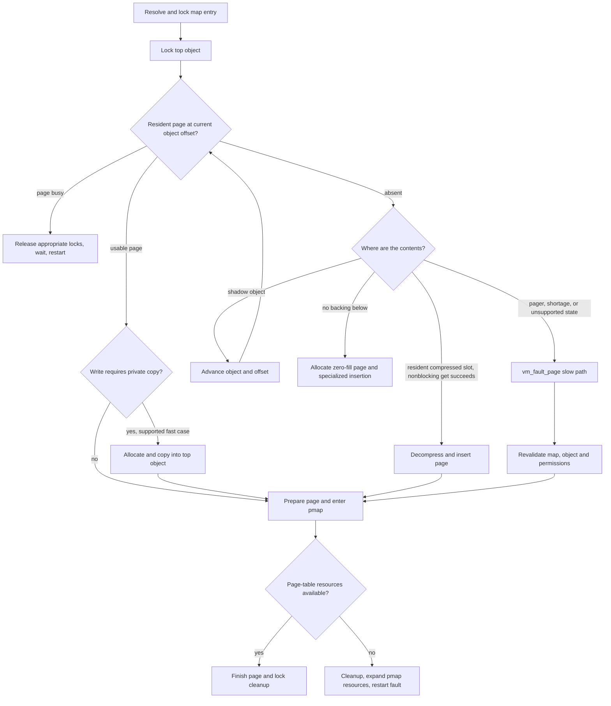
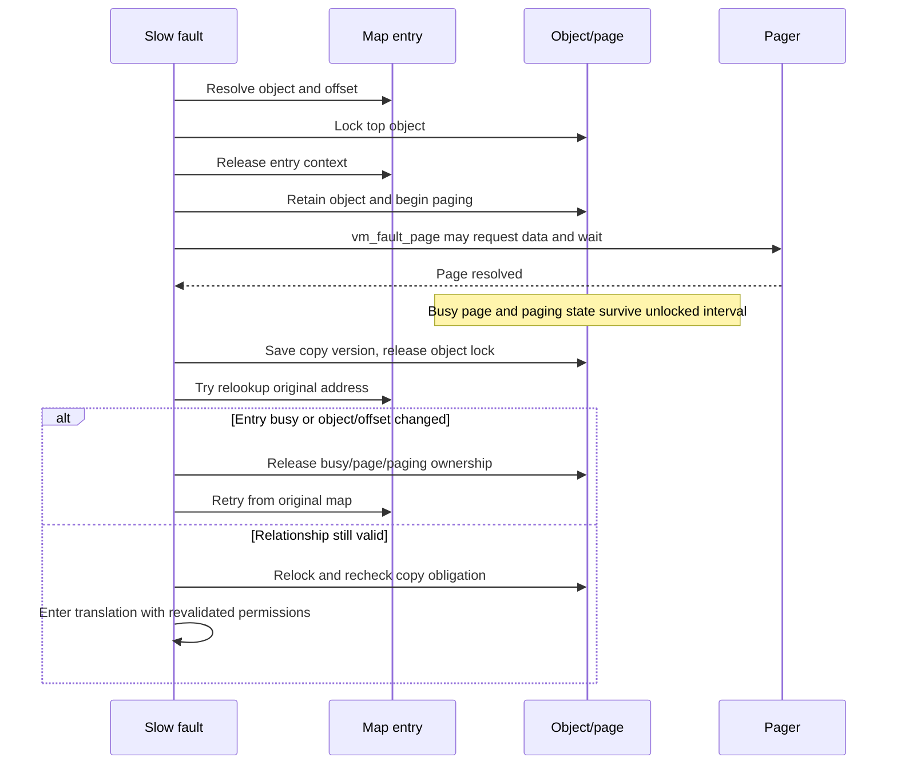
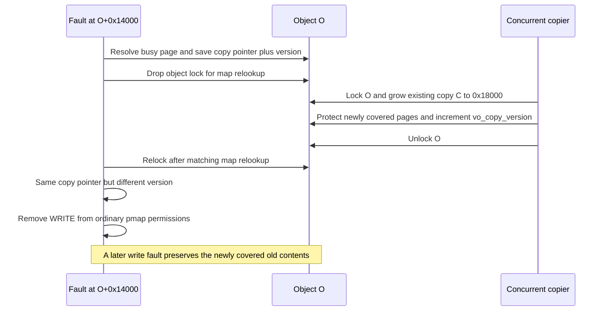
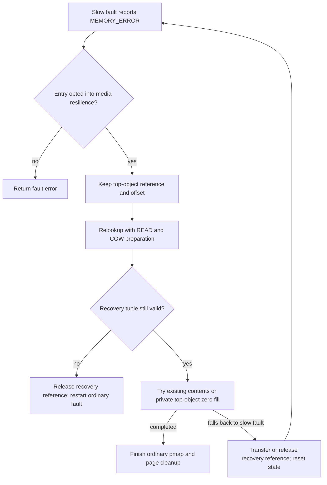

# Fault resolution: from an address to a usable translation

[VM index](README.md) · [Entry guide](maps-and-faults.md) · [Virtual address maps](virtual-address-maps.md) · [Objects and pages](objects-and-pages.md) · [Pagers and UPL](pagers-and-upl.md)

A fault must establish three facts before execution can resume: the virtual address still names the expected contents, those contents are available and safe to expose, and the target pmap has a translation with suitable permissions. The first is a map/entry problem, the second an object/page/pager problem, and the third crosses into machine-dependent pmap code. The common implementation is [`vm_fault_internal`](../../../xnu/osfmk/vm/vm_fault.c#L4806), called by [`vm_fault`](../../../xnu/osfmk/vm/vm_fault.c#L4288), external and prefault wrappers, and wiring-related operations.

## Inputs and state carried through the fault

The request provides a map, virtual address and requested access. `vm_fault` constructs a `vm_object_fault_info` record that carries interruptibility, wiring intent and other options. Entry lookup later adds paging behavior, object-offset bounds, cache hints, accounting and execution-policy information. A nonnull `caller_pmap` can direct insertion to a caller-supplied pmap/address; ordinary faults use the pmap selected by map lookup. See [`vm_fault_external`](../../../xnu/osfmk/vm/vm_fault.c#L4267) and [`vm_map_lookup_object_and_lock_entry`](../../../xnu/osfmk/vm/vm_fault.c#L4754).

The [`vm_object_fault_info` definition](../../../xnu/osfmk/vm/vm_object_xnu.h#L105-L129) names the state passed into deeper fault/pager work: `interruptible` controls waiting; `cluster_size`, `behavior`, `lo_offset` and `hi_offset` guide paging; `no_cache` and `io_sync` carry I/O preferences; `fi_change_wiring` and `fi_no_sleep` constrain the operation; `pmap_options` carries translation options. Code-signing, resilient-media, debug, and copy-on-read flags qualify specific branches. This per-fault record is distinct from the persistent map entry and from the CPU's saved exception state.

Keep these local variables distinct:

| Variable | Role |
|---|---|
| `original_map` | The original virtual namespace to relookup after a retry |
| `map` | The map containing the resolved entry, possibly a submap |
| `real_map` / `pmap` | The map whose pmap should receive this translation; it need not equal `map` |
| `object`, `offset` | Top-level object and logical offset selected by the entry |
| `cur_object`, `cur_offset` | Current location while searching the shadow chain |
| `m_object` | Object that actually owns the selected resident page |
| `fault_type` / `caller_prot` | Requested access, with additional treatment for wiring or forced copying |
| `prot` | Permissions currently safe to grant; can be narrower than the entry's logical permissions |
| `ctx` | Stabilized map-entry context; its lifetime differs between fast and slow paths |

A map marked `never_faults` rejects the fault. The routine also rejects contexts such as nonzero preemption level that cannot safely run this potentially blocking path. These are explicit checks in [`vm_fault_internal`](../../../xnu/osfmk/vm/vm_fault.c#L4896), not assumptions supplied by every caller.

## Page size is not one number

The fault's granularity is the smaller of the original map's page size and the system page size. The object/page layer uses system-page-aligned offsets, while the map and pmap may support smaller mappings. The actual selection is:

[vm_fault_internal selects fault page size — source lines 4902–4917](../../../xnu/osfmk/vm/vm_fault.c#L4902):

<!-- source-excerpt: ../../../xnu/osfmk/vm/vm_fault.c#L4902-L4917 -->
```c
	if (VM_MAP_PAGE_SIZE(original_map) < PAGE_SIZE) {
		fault_phys_offset = (vm_map_offset_t)-1;
		fault_page_size = VM_MAP_PAGE_SIZE(original_map);
		fault_page_mask = VM_MAP_PAGE_MASK(original_map);
		fault_page_shift = VM_MAP_PAGE_SHIFT(original_map);
		if (fault_page_size < PAGE_SIZE) {
			DEBUG4K_FAULT("map %p vaddr 0x%llx caller_prot 0x%x\n", map, (uint64_t)trace_real_vaddr, caller_prot);
			vaddr = vm_map_trunc_page(vaddr, fault_page_mask);
		}
	} else {
		fault_phys_offset = 0;
		fault_page_size = PAGE_SIZE;
		fault_page_mask = PAGE_MASK;
		fault_page_shift = PAGE_SHIFT;
		vaddr = vm_map_trunc_page(vaddr, PAGE_MASK);
	}
```

For a 4 KiB map on a 16 KiB system, a fault can resolve one 4 KiB mapping within a 16 KiB resident `vm_page`. `fault_phys_offset` records the subpage displacement, and changes as the search follows shadow offsets. The hardware insertion wrapper computes the physical address from the system page number plus that displacement; it asserts that a smaller-page displacement is 4 KiB aligned and less than `PAGE_SIZE`. See [`vm_fault_attempt_pmap_enter`](../../../xnu/osfmk/vm/vm_fault.c#L3813) and [`pmap_enter_object_options_check`](../../../xnu/osfmk/vm/vm_fault.c#L3670).

This distinction affects COW too: copying one resident system page may require disconnecting other smaller translations that still point to its old version. Do not assume a single map fault corresponds to a physical allocation or copy of exactly the map's page size.

## Stabilize the mapping and check permissions

[`vm_map_lookup_object_and_lock_entry`](../../../xnu/osfmk/vm/vm_fault.c#L4525) performs the address-to-object step. It chooses a shared streaming range lock, requires coverage without holes, allows descent into constant submaps and selects preparation according to the requested access:

[vm_map_lookup_object_and_lock_entry chooses preparation — source lines 4561–4574](../../../xnu/osfmk/vm/vm_fault.c#L4561):

<!-- source-excerpt: ../../../xnu/osfmk/vm/vm_fault.c#L4561-L4574 -->
```c
	bool would_resolve_cow = force_copy || (fault_type & VM_PROT_WRITE);
	vmrl_sh_flags_t flags = VMRL_SH_STREAM_NO_HOLES |
	    VMRL_SH_DESCEND_INTO_CONSTANT |
	    VMRL_SH_NO_MIN_MAX_CHECK;

	if (would_resolve_cow) {
		flags |= VMRL_SH_RESOLVE_COW_AND_OBJ;
	} else {
		flags |= VMRL_SH_VMO_ALLOCATE;
	}

	if (try_lock_entry) {
		flags |= VMRL_SH_TRY_LOCK_ENTRY;
	}
```

A read can allocate missing anonymous backing without resolving all COW. A write or explicit `VM_PROT_COPY` ensures backing is present and resolves any entry-level COW obligation first; an ordinary shared writable mapping can continue to use its shared object. Shared range ownership does not prohibit preparatory mutation: the range-lock implementation temporarily takes exclusive entry ownership when it must allocate, shadow, clip or unnest. See [Range locks](virtual-address-maps.md#range-locks-stabilize-operations-beyond-the-interlock).

The helper handles submap address conversion, reads current entry protection and verifies requested access. `VM_PROT_IS_MASK` asks for the intersection with allowed protections, rather than an absolute request that must all be satisfied. Architecture cases include ARM execute-only access handling, x86 UEXEC/NX compatibility and ARM64e TPRO. A wired entry is resolved for its full access needs. Read the conditions in the [permission checks](../../../xnu/osfmk/vm/vm_fault.c#L4632); they are more precise than a universal rule that READ is always implied by EXECUTE.

COW restrictions can reduce the permissions returned for an otherwise readable entry. A read through `needs_copy` strips WRITE; the helper also strips WRITE when a parent submap relationship is COW even though the resolved child entry itself permits writing. That ensures a later write returns through parent-level preparation rather than bypassing it through a writable child translation. See [`needs_copy` handling](../../../xnu/osfmk/vm/vm_fault.c#L4698).

Lookup returns the object and translated offset and selects the pmap owner independently:

[vm_map_lookup_object_and_lock_entry selects real_map — source lines 4741–4752](../../../xnu/osfmk/vm/vm_fault.c#L4741):

<!-- source-excerpt: ../../../xnu/osfmk/vm/vm_fault.c#L4741-L4752 -->
```c
	/*
	 * real_map is the map containing the pmap we want to use. If we're
	 * in a submap with a nested pmap, we want to use that one.
	 * Otherwise, we want to use the pmap of the original map.
	 */
	if (vm_map_lock_ctx_is_in_pmap_nested_submap(ctx)) {
		*real_map = ctx->vmlc_map;
	} else {
		*real_map = original_map;
	}
	/* var_map is the map containing the entry we currently have locked */
	*var_map = ctx->vmlc_map;
```

The ordinary fault path now has a stabilized entry and a known backing relationship. It takes the top object's lock, generally shared for reads and exclusive for writes/forced copying. It can search resident pages while relying on the entry and object locks instead of acquiring the full set of explicit references used by the slower path. See [`RetryFault` and initial object locking](../../../xnu/osfmk/vm/vm_fault.c#L5003).

## Fast paths are several distinct algorithms



This is a control-flow guide, not a statement that every absent page is zero-filled or that every busy page invokes `vm_fault_page`. [`vm_fault_internal`](../../../xnu/osfmk/vm/vm_fault.c#L5260) contains handling for all these cases, including busy-page waits inside the nominal fast path.

### Resident pages and copy-on-write

[`vm_page_lookup`](../../../xnu/osfmk/vm/vm_resident.c#L3963) searches the current object's resident pages at a system-page-aligned offset under its lock. A page's presence is only the first test: busy, absent, error, restart, guard, private-device, laundry, validation and other states constrain what may happen next. For busy pages the code obtains the necessary exclusive object ownership, releases the entry context before sleeping, and restarts on wake. Failure to upgrade a lower shadow's object lock can require a full retry because the fast path does not hold an independent reference on that lower object. See [busy-page handling](../../../xnu/osfmk/vm/vm_fault.c#L5280).

A usable page in the top object with no copy-object obligation can go directly toward insertion. A read using a lower shadow page normally withholds WRITE and retains the top object lock until pmap insertion finishes. This prevents a competing writer from installing a new private translation only to have the older reader overwrite it with the original page's translation. The race and retained `top_object` are explicit in [`vm_fault_internal`](../../../xnu/osfmk/vm/vm_fault.c#L5559).

For a supported COW write, the code holds the relevant object locks, grabs a new page, copies the source and inserts the result into the top object:

[vm_fault_internal copies a resident page — source lines 5799–5811](../../../xnu/osfmk/vm/vm_fault.c#L5799):

<!-- source-excerpt: ../../../xnu/osfmk/vm/vm_fault.c#L5799-L5811 -->
```c
			/*
			 * Now do the copy.  Mark the source page busy...
			 *
			 *	NOTE: This code holds the map lock across
			 *	the page copy.
			 */
			vm_page_copy(cur_m, m);
			vm_page_insert(m, object, vm_object_trunc_page(offset));
			if (VM_MAP_PAGE_MASK(map) != PAGE_MASK) {
				DEBUG4K_FAULT("map %p vaddr 0x%llx page %p [%p 0x%llx] copied to %p [%p 0x%llx]\n", map, (uint64_t)vaddr, cur_m, VM_PAGE_OBJECT(cur_m), cur_m->vmp_offset, m, VM_PAGE_OBJECT(m), m->vmp_offset);
			}
			m_object = object;
			SET_PAGE_DIRTY(m, FALSE);
```

The copied page becomes dirty. The source page may be disconnected from its pmaps when the top object has additional references and the source is mapped, or when smaller map pages could leave other subpage translations pointing to an object that can now be collapsed or freed. In the latter case this code uses a broad `pmap_disconnect` and comments that a narrower per-subpage strategy would be more efficient. See [COW disconnection](../../../xnu/osfmk/vm/vm_fault.c#L5813).

Entry-level COW and this page-level copying must be read together. Clearing entry `needs_copy` after shadow creation does not imply every page has been copied. Conversely, an object with a `vo_copy` relationship can have delayed-copy obligations even when the entry itself is no longer `needs_copy`. Writes that must preserve delayed-copy contents can leave this fast loop for `vm_fault_page`. Some privileged/kernel/platform mappings also request **copy-on-read** from untrusted external backing; that policy-triggered restart creates a stable private version even though the triggering operation is a read. See [copy-on-read conditions](../../../xnu/osfmk/vm/vm_fault.c#L5480) and [Objects and pages](objects-and-pages.md).

### Decompression without the full pager path

When an absent page's existence information identifies a compressor slot, the fast path attempts a nonblocking `vm_compressor_pager_get` with `C_DONT_BLOCK`. It first obtains a destination page; inability to allocate it or to complete the get moves work to the slow path. A permanent `KERN_MEMORY_FAILURE` is returned rather than endlessly retried. Kernel-map cases avoid this optimization because compressor cleanup can operate on the kernel map itself. See [fast decompression](../../../xnu/osfmk/vm/vm_fault.c#L5904).

If the compressed source lies below the top object and the request is a write, the code uses `C_KEEP` and decompresses directly into the private top object, preserving the original compressed contents for other users. For a read from a lower object, it can insert the decompressed page into that lower object and retain the top lock through insertion. Accounting changes follow the chosen ownership. See [`vm_compressor_pager_get` and insertion](../../../xnu/osfmk/vm/vm_fault.c#L6026). Compressor slot storage, compression and reclamation policy are covered in [Reclamation](reclaim-and-pressure.md).

### Zero-fill and shadow traversal

If no pager contents need fetching and there is no shadow below, an ordinary internal anonymous object can supply zero-filled contents. This is not allowed for every object: severed shadows, purgable fault-error states, and explicitly managed kernel/compressor objects produce errors instead of inventing anonymous pages. See [zero-fill eligibility](../../../xnu/osfmk/vm/vm_fault.c#L6173).

After ensuring exclusive top-object ownership, the fast path grabs a zero-fill page (unless the map explicitly requests no-zero-fill semantics) and inserts it with `VMPI_DELAY_HASH`. The hash insertion is deliberately postponed until completion while object locking still protects the page's membership:

[vm_fault_internal delays zero-fill hash insertion — source lines 6271–6275](../../../xnu/osfmk/vm/vm_fault.c#L6271):

<!-- source-excerpt: ../../../xnu/osfmk/vm/vm_fault.c#L6271-L6275 -->
```c
				m_object = object;
				vm_page_insert_internal(m, m_object,
				    vm_object_trunc_page(offset),
				    VM_KERN_MEMORY_NONE,
				    VMPI_DELAY_HASH, NULL);
```

Zero-fill then follows a specialized sequence: [`vm_fault_enter_prepare`](../../../xnu/osfmk/vm/vm_fault.c#L6372), `vm_fault_pmap_enter_with_object_lock`, queue/throttle handling, and `vm_fault_complete`. It uses the same essential validation and pmap interfaces as ordinary insertion but does **not** literally call `vm_fault_enter` at this branch. Delayed-copy obligations still restrict write permission on read faults. The code around [`zero_fill_cleanup`](../../../xnu/osfmk/vm/vm_fault.c#L6407) makes this cleanup order explicit.

If a shadow exists instead, the search adds `vo_shadow_offset`, selects the shadow object and locks it in reference-chain order. The top lock stays held while intermediate lower locks can be released. This prevents object relationships and the top-level view from changing beneath the fast fault. See [shadow descent](../../../xnu/osfmk/vm/vm_fault.c#L6463) and [Objects and pages](objects-and-pages.md) for the backing-chain invariants.

## Slow faults release and revalidate the mapping

The slow transition releases lower shadow locks, obtains exclusive top-object ownership, and releases the entry context at `handle_copy_delay`. While retaining the top-object lock it then acquires an ordinary object reference and a paging reference before calling `vm_fault_page`. This is the bridge that allows the map to change while paging work proceeds; the code's exact order is **entry-context release while object lock is held**, then explicit reference/paging setup. See [slow transition](../../../xnu/osfmk/vm/vm_fault.c#L6488) and [`vm_object_paging_begin`](../../../xnu/osfmk/vm/vm_fault.c#L6563).

`vm_fault_page` resolves resident state, zero-fill, shadow copying and pager requests with permission to wait and drop object locks as its protocol requires. Its [invariant comment](../../../xnu/osfmk/vm/vm_fault.c#L1166) describes the protection mechanisms: object lock or busy page excludes competing fills; a busy top-object placeholder protects a shadow search; paging references protect objects while locks are dropped. The implementation of pager requests and resulting page supply is developed in [Pagers and UPL](pagers-and-upl.md).

The result is not just a success boolean:

| Result | Outer fault's action |
|---|---|
| `VM_FAULT_SUCCESS` | Receives the selected busy page, its owning-object lock and paging state; a separate top placeholder may remain |
| `VM_FAULT_SUCCESS_NO_VM_PAGE` | Handles a physically contiguous object's block mapping without an ordinary resident-page result |
| `VM_FAULT_MEMORY_SHORTAGE` | Releases the ordinary object reference, waits for memory, then retries or reports interruption |
| `VM_FAULT_RETRY` | Releases the reference and restarts map lookup |
| `VM_FAULT_INTERRUPTED` | Returns `KERN_ABORTED` |
| `VM_FAULT_MEMORY_ERROR` | Returns the specific error if supplied, otherwise `KERN_MEMORY_ERROR`; resilient-media mappings have a separate guarded recovery path |
| `VM_FAULT_BUSY` | Returns `KERN_ALREADY_WAITING` |

The success/failure ownership comment and result switch are in [`vm_fault_internal`](../../../xnu/osfmk/vm/vm_fault.c#L6591). Successful slow page resolution still does not authorize insertion into the old virtual address.

The outer fault records the page owner's `vo_copy` and `vo_copy_version`, takes a temporary thread priority floor while holding the page busy across unlocked work, and releases object locks. The floor addresses the busy bit's lack of priority propagation. It then looks up the original mapping again, using a **try-lock**:

[vm_fault_internal relooks up without blocking on an entry — source lines 6735–6744](../../../xnu/osfmk/vm/vm_fault.c#L6735):

<!-- source-excerpt: ../../../xnu/osfmk/vm/vm_fault.c#L6735-L6744 -->
```c
	/*
	 * Just do a try lock, s.t. we don't try to take an entry lock
	 * while we hold the busy bit. This is because wire takes the busy bit
	 * while it holds the entry lock, so doing so in the reverse order here
	 * could cause a deadlock.
	 */
	kr = vm_map_lookup_object_and_lock_entry(&map, vaddr, fault_type,
	    &retry_object, &entry, &retry_offset, &retry_prot, &wired,
	    fault_info, &real_map, ctx, vml_ctx_for_vaddr,
	    true /* try_lock_entry */);
```

Why try instead of wait? Wiring can hold an entry lock while waiting for this same page to stop being busy. Blocking for the entry while holding busy would create the inverse dependency. On a failed relookup, the fault reacquires object protection, releases the busy page and paging state, and drops its reference. Entry-lock contention (`VMRL_ERR_LOCK_ALREADY_HELD`) then retries from the top; other lookup failures, such as a removed address, return after cleanup.

After successful relookup, the code compares **both** the top object and offset with the earlier request. A different relationship means the old page cannot simply be installed at that address; cleanup precedes a full retry. If the relationship is unchanged, it intersects the earlier permission with the newly allowed permission, except where pmap-specific protection policy requires passing the full set. Once the selected page's object is relocked, a changed `vo_copy` pointer **or version** removes WRITE to preserve any new COW obligation. Wiring access mismatch and newly required copy-on-read also restart. See [identity validation](../../../xnu/osfmk/vm/vm_fault.c#L6794) and [protection/copy validation](../../../xnu/osfmk/vm/vm_fault.c#L6830).



### A completed page-in is a result about contents, not about an address

The slow path deliberately separates content acquisition from authority to install a translation. Consider a 16 KiB map and system page, with an entry mapping virtual page `V` to `A+0x8000`. A page-in may return a busy page owned by deeper shadow `B`, but the outer relookup compares **the original top pair `(A, 0x8000)`**, not `(B, B_page_offset)`. The page's actual owner is tracked separately as `m_object`. If another thread replaces the entry with `D+0`, the old page remains a legitimate page of `B`; it simply cannot be installed at `V` by this fault. [Selected page owner](../../../xnu/osfmk/vm/vm_fault.c#L6670-L6681), [top-pair comparison and cleanup](../../../xnu/osfmk/vm/vm_fault.c#L6794-L6828).

| Protection held across the unlocked interval | What it preserves | What it does not preserve |
| --- | --- | --- |
| Ordinary reference on the original top object | Ownership of that object and its backing chain while the map is unlocked | The virtual address still naming it |
| Paging hold on the page's owner, plus top-object paging state when a placeholder remains | Object/pager lifetime required by `vm_fault_page` | The map entry's protection, pmap selection or new copy obligations |
| Busy result page | The selected page's content/identity for this operation | Permission to block acquiring any other lock |
| Busy top placeholder, when the result is lower in the shadow chain | Exclusion against a competing fill at the top offset | Ownership of a map entry or a hardware translation |
| Temporary thread priority floor | Reduces scheduling inversion while a low-priority fault holds a page busy | A turnstile or priority donation from every future page waiter |

The first two success cases and the placeholder rule are explicit in [the result ownership contract](../../../xnu/osfmk/vm/vm_fault.c#L6591-L6604); the [priority-floor comment](../../../xnu/osfmk/vm/vm_fault.c#L6706-L6724) explains why the busy bit needs additional treatment. These are independent protections, not one general “page reference.”

The retry has three different outcomes. Failure to try-lock the entry releases busy/paging/reference state and starts over; a real lookup/protection error returns after cleanup. Successful lookup of a **different object or offset** also releases that state and restarts. Successful lookup of the same pair preserves the result but recalculates permissions from the new entry. Ordinary mappings take the intersection of old and new protections; a pmap with additional protection policy receives the full revalidated set instead. [Try-lock failure](../../../xnu/osfmk/vm/vm_fault.c#L6746-L6792), [identity/protection handling](../../../xnu/osfmk/vm/vm_fault.c#L6794-L6838).

The page owner's `vo_copy` and `vo_copy_version` form a second validation axis. Here is an illustrative race with a previously reusable delayed-copy object `C`:



The numbers assume 16 KiB pages and `C` previously ending at `0x10000`. The interleaving also assumes delayed-copy preflight permits overlap with paging: for example, the paging-wait disable is enabled or `O.true_share` is set, and no page-list-request wait blocks the copier. Otherwise that preflight may serialize these operations. [Copy preflight](../../../xnu/osfmk/vm/vm_object.c#L3844-L3868). Growth does not change the copy pointer, so checking that pointer alone would grant write permission without preserving a newly covered snapshot page. The actual check uses both fields:

[Source: `vm_fault.c`, lines 6862–6869](../../../xnu/osfmk/vm/vm_fault.c#L6862-L6869).

<!-- source-excerpt: ../../../xnu/osfmk/vm/vm_fault.c#L6862-L6869 -->
```c
	if ((prot & VM_PROT_WRITE) &&
	    m != VM_PAGE_NULL &&
	    (m_object->vo_copy != old_copy_object ||
	    m_object->vo_copy_version != old_copy_version)) {
		/*
		 * The copy object changed while the top-level object
		 * was unlocked, so take away write permission.
		 */
```

The ordinary branch strips WRITE at [line 6883](../../../xnu/osfmk/vm/vm_fault.c#L6870-L6884); a mapping whose pmap policy forbids narrowing this protection instead hits an invariant panic, because such a mapping should have been established without a COW requirement. The result can therefore be a successful read-only translation even when the initial operation requested a write: the CPU's next write fault does the preservation work. This is why successful page-in, successful fault handling and completion of the original store must be kept separate. [Delayed-copy growth and preservation](objects-and-pages.md#delayed-copies-preserve-snapshots-by-pushing-old-contents-upward).

This implementation validates the locked entry's object/offset identity and fresh permissions, plus the object's copy version. It does not require that every unrelated map change invalidate the result. Conversely, the same virtual address and same resident physical page are insufficient to skip those checks.

## The common handoff to pmap

For the signing branch of this handoff, [page-signature validation](../security/page-signature-validation.md) traces `vm_fault_cs_check_violation`, busy-page hashing, subpage result masks, process invalidation, and monitor-backed pmap insertion. [Executable signing policy](../security/executable-signature-policy.md) explains how the map acquired its signature association before the fault.

For ordinary resident results, [`vm_fault_enter`](../../../xnu/osfmk/vm/vm_fault.c#L4158) requires the page's object lock and no page-queue lock on entry. Some soft faults can hold only shared object ownership. `vm_fault_enter_prepare` may narrow permissions, validates page and code-signing state, and establishes mapped/write-mapped bookkeeping; it can request sleeping or return an error. `vm_fault_enqueue_page` then handles queue/wiring consequences. Required physical data synchronization occurs before pmap insertion. See [preparation](../../../xnu/osfmk/vm/vm_fault.c#L3977) and [ordinary entry sequence](../../../xnu/osfmk/vm/vm_fault.c#L4186).

The called wrappers preserve several distinctions:

| Helper | Responsibility before the architecture backend |
|---|---|
| [`vm_fault_pmap_enter_with_object_lock`](../../../xnu/osfmk/vm/vm_fault.c#L3876) | Enforce a nonblocking insertion attempt while object locks are held; report a full-fault retry requirement |
| [`vm_fault_attempt_pmap_enter`](../../../xnu/osfmk/vm/vm_fault.c#L3813) | Validate page-size/physical-offset assumptions; handle the code-signing-monitor case where a nonexecute fault can retry without EXECUTE |
| [`pmap_enter_options_check`](../../../xnu/osfmk/vm/vm_fault.c#L3746) | Check page errors and mapped-state assumptions; propagate reusable-page state |
| [`pmap_enter_object_options_check`](../../../xnu/osfmk/vm/vm_fault.c#L3670) | Add internal-object accounting, physical displacement and applicable cache/MTE alias policy |
| [`pmap_enter_options_addr`](../../../xnu/osfmk/vm/vm_fault.c#L3733) | Architecture entry point receiving address, physical address, allowed protection, requested access, cache flags, wired state and options |

`prot` and `fault_type` are separate inputs: allowed mapping permissions are not identical to the access that triggered the fault. `PMAP_OPTIONS_ALT_ACCT`, internal/reusable status and other options carry accounting information in addition to access policy. The backend can impose architecture-specific restrictions. Continue into [ARM64 pmap structures](pmap-arm64.md), [Mapping lifecycle](pmap-mapping-lifecycle.md), and [TLB/cache handling](pmap-tlb-and-cache.md).

## Page-table shortage requires a full retry

Pmap may need memory for translation structures. Waiting for that memory with an object lock held can deadlock, so the common helper always adds `PMAP_OPTIONS_NOWAIT`:

[vm_fault_pmap_enter_with_object_lock — source lines 3901–3903](../../../xnu/osfmk/vm/vm_fault.c#L3901):

<!-- source-excerpt: ../../../xnu/osfmk/vm/vm_fault.c#L3901-L3903 -->
```c
	kr = vm_fault_attempt_pmap_enter(pmap, vaddr,
	    fault_page_size, fault_phys_offset,
	    m, prot, caller_prot, fault_type, wired, pmap_options | PMAP_OPTIONS_NOWAIT);
```

Dropping only the object lock and retrying insertion with the old page/protection assumptions would also be incorrect: `vm_object_copy_delayed` could establish a new copy obligation while the lock was absent. On `KERN_RESOURCE_SHORTAGE`, the helper asks the outer fault to clean up and retry:

[vm_fault_pmap_enter_with_object_lock shortage contract — source lines 3918–3929](../../../xnu/osfmk/vm/vm_fault.c#L3918):

<!-- source-excerpt: ../../../xnu/osfmk/vm/vm_fault.c#L3918-L3929 -->
```c
	if (kr == KERN_RESOURCE_SHORTAGE) {
		/*
		 * We can't drop the object lock(s) here to retry the pmap_enter()
		 * in a blocking way so that it can expand the page table as needed.
		 * That would allow vm_object_copy_delayed() to create a new copy object
		 * and change the copy-on-write obligations.
		 * Our only recourse is to deal with it at a higher level where we can
		 * drop both locks, expand the page table and retry the fault.
		 */
		*need_retry = true;
		vm_pmap_enter_retried++;
		goto done;
```

The fast resident and zero-fill paths complete their page/hash/busy and lock cleanup, call pmap with `PMAP_OPTIONS_NOENTER` to expand resources without entering the data page, then restart map lookup. The ordinary slow-result cleanup first clears busy state, releases paging state and the object reference, performs the NOENTER resource expansion, and **then** unlocks its range context before retrying. That exact ordering differs from the fast branch; a blanket statement that every NOENTER call occurs after all map locks are dropped would be wrong. Compare [fast retry](../../../xnu/osfmk/vm/vm_fault.c#L5709), [zero-fill retry](../../../xnu/osfmk/vm/vm_fault.c#L6445), and [slow retry](../../../xnu/osfmk/vm/vm_fault.c#L7001).

## Resilient mappings: recover selected missing contents without changing the file

`MAP_RESILIENT_MEDIA` changes the fault's response to unavailable backing contents: for an eligible private view, VM can supply a zero-filled page in an internal top object. It does not repair the file or make every memory error recoverable. `MAP_RESILIENT_CODESIGN` is a different policy: it can bypass ordinary VM code-signature checking for admitted non-executable mappings. It does not itself request replacement zero pages. These flags are independent inputs and can affect different stages of the same fault. [BSD flag handling](../../../xnu/bsd/kern/kern_mman.c#L426-L465), [entry-to-fault policy](../../../xnu/osfmk/vm/vm_fault.c#L4773-L4789).

### Admission must leave a safe object in which to recover

BSD rejects either resilience flag with anonymous, JIT or TPRO mapping requests. For `MAP_RESILIENT_CODESIGN`, private mappings cannot request execution; shared mappings additionally cannot request write. VM checks both current and maximum protections using the `needs_copy` distinction. This prevents an initially readable mapping from later acquiring rights incompatible with the admitted policy. [BSD checks](../../../xnu/bsd/kern/kern_mman.c#L426-L443), [VM checks](../../../xnu/osfmk/vm/vm_map.c#L3277-L3284).

For compatibility, BSD **clears** `MAP_RESILIENT_MEDIA` on `MAP_SHARED` rather than rejecting every historical use of that combination. VM rejects media resilience on a direct external-object mapping: injecting a zero page there could change the shared file view. The selected entry gets `vme_resilient_media` only when its top object is internal or initially absent. [Shared-flag handling](../../../xnu/bsd/kern/kern_mman.c#L444-L464), [external-object rejection](../../../xnu/osfmk/vm/vm_map.c#L3286-L3303), [entry publication](../../../xnu/osfmk/vm/vm_map.c#L3721-L3733).

Code-signing resilience reaches `fault_info->cs_bypass`, alongside other explicitly admitted bypass cases. Media resilience reaches `fault_info->resilient_media`. The former is consumed by signing validation; the latter drives the recovery state machine below. Backend executable validation remains a separate boundary; neither flag is a general way to execute arbitrary unchecked bytes. [Policy assignment](../../../xnu/osfmk/vm/vm_fault.c#L4773-L4789), [signing validation gate](../../../xnu/osfmk/vm/vm_fault.c#L2786-L2835), [page-signature guide](../security/page-signature-validation.md).

### Recovery retains a failed lookup and then proves it still applies

The trigger is `vm_fault_page` returning `VM_FAULT_MEMORY_ERROR` while the mapping's media flag is set. The outer fault retains its existing ordinary reference on the internal **top object**, saves that object and the top offset, sets `resilient_media_retry`, and goes to `RetryFault`. It does not take a reference on a stale `vm_page` or retain only the lower pager that failed. [Recovery trigger](../../../xnu/osfmk/vm/vm_fault.c#L6606-L6628).

On retry it requests COW resolution with `VM_PROT_COPY`, even for a read, so recovery cannot silently populate a shared snapshot incorrectly. It also changes the attempted access to READ for this recovery pass: if the original request was a write, another fault can satisfy delayed-copy obligations before that write is finally allowed. The top object is locked exclusively for insertion. [Recovery lookup setup](../../../xnu/osfmk/vm/vm_fault.c#L5015-L5045).

The newly looked-up object and offset must still match the retained pair, and the new entry must still opt into media resilience:

[Source: `vm_fault.c`, lines 5131–5141](../../../xnu/osfmk/vm/vm_fault.c#L5131-L5141).

<!-- source-excerpt: ../../../xnu/osfmk/vm/vm_fault.c#L5131-L5141 -->
```c
		assert(resilient_media_object != VM_OBJECT_NULL);
		assert(resilient_media_offset != (vm_object_offset_t)-1);
		if ((object != VM_OBJECT_NULL &&
		    object == resilient_media_object &&
		    offset == resilient_media_offset &&
		    fault_info->resilient_media)
#if MACH_ASSERT
		    && (vm_fault_resilient_media_inject_error1_rate == 0 ||
		    (++vm_fault_resilient_media_inject_error1 % vm_fault_resilient_media_inject_error1_rate) != 0)
#endif /* MACH_ASSERT */
		    ) {
```

A concurrent remap, a changed object offset, or COW preparation producing a different top object invalidates the recovery attempt. The code releases the saved reference, clears recovery state and retries as an ordinary fault. Current access restrictions are checked by lookup before recovery proceeds; a protection failure is not converted into readable zeroes. The debug injection predicate in the snippet can deliberately force the same abort/retry path. [Mismatch cleanup](../../../xnu/osfmk/vm/vm_fault.c#L5150-L5163), [preceding permission lookup](../../../xnu/osfmk/vm/vm_fault.c#L5042-L5087).



The diagram omits lookup errors and normal slow-fault outcomes other than memory error. It does not assert that every retry reaches zero fill. Existing resident contents can become available in the meantime; a busy page or allocation shortage can require another slow pass.

In recovery mode the no-page branch may choose zero fill even when a shadow exists. The page is inserted into the original top object, so it hides the lower unavailable contents without replacing the file pager's page. Severed-shadow, purgeable-fault-error, kernel-object and compressor-object conditions still reject this path. With an ordinary mapping, pending copy obligations remove WRITE from the inserted translation; the resident-page recovery route likewise refuses to grant WRITE prematurely. [Recovery zero-fill selection and exclusions](../../../xnu/osfmk/vm/vm_fault.c#L6173-L6207), [top-object insertion and copy restrictions](../../../xnu/osfmk/vm/vm_fault.c#L6270-L6330), [resident recovery permissions](../../../xnu/osfmk/vm/vm_fault.c#L5589-L5623).

If the attempt drops into `handle_copy_delay`/slow resolution again, it resets recovery state. When the currently locked object equals the saved one, it **transfers** the saved ordinary reference into the slow fault's required reference rather than deallocating an object while holding its lock or retaining it twice. Otherwise it releases the saved reference and acquires the new slow-path reference normally. Final completion releases any still-retained recovery object. [Reference transfer](../../../xnu/osfmk/vm/vm_fault.c#L6535-L6577), [final release](../../../xnu/osfmk/vm/vm_fault.c#L7199-L7210).

### Worked recovery and what the local tests establish

Take an ordinary 16 KiB private file mapping with an internal top object `A`, backed by a vnode object, and an access to page offset `0x8000` beyond available file contents. If page resolution reports `VM_FAULT_MEMORY_ERROR`, a stable eligible `(A, 0x8000)` retry can create `A+0x8000` containing zeroes. That page belongs to the private object; the underlying file does not gain a zero page from this operation. If the entry instead changes to object `D` at the same virtual address during the unlocked interval, the failed operation on `A` gives no authority to zero-fill `D`; normal lookup/resolution starts again. If a copied view shares the top object, COW preparation/revalidation keeps its preservation obligations in play.

[`mmap_resilient_media`](../../../xnu/tests/vm/mmap_resilient_media.c#L57-L163) creates a one-byte file and a larger private resilient mapping, checks the first byte, expects zeroes elsewhere and writes selected later pages. It attempts three debug error-injection settings but logs failed sysctl writes rather than requiring that those injections were enabled. The COW case maps an empty file, makes a copying `mach_vm_remap`, writes two values through the original and checks that the copied view remains zero. [COW body](../../../xnu/tests/vm/mmap_resilient_media.c#L191-L247).

There is a test-harness qualification: the COW wrapper's comment says SIGBUS is allowed but not required, while `allow_signal` calls `T_EXPECT_TRUE(WIFSIGNALED(status))` before its no-signal `T_PASS` branch. The assertions therefore do not cleanly express the comment's stated optional-signal behavior. These source tests identify intended scenarios; they were not executed here and do not prove recovery for all filesystem failures, configurations or concurrent remaps. [Signal helper](../../../xnu/tests/vm/mmap_resilient_media.c#L169-L188), [wrapper](../../../xnu/tests/vm/mmap_resilient_media.c#L251-L258).

## Completion and failures preserve ownership

[`vm_fault_complete`](../../../xnu/osfmk/vm/vm_fault.c#L4349) is the main fast-path cleanup helper. It records tracing and optional physical-page extraction, releases a retained top shadow lock only after insertion, performs eligible collapse/access-pattern work, completes delayed page-hash insertion, clears busy state with wakeup, and releases object and map-entry protection. An external-object write can retain paging activity for a later pager notification. The slow path performs corresponding cleanup explicitly because it owns extra object/paging references and possibly a top placeholder.

This ordering matters even when pmap insertion fails: a newly allocated page can remain valid object content without a translation, but it must not remain invisibly unhashed or permanently busy. Conversely, permission/address failure does not authorize using an earlier page resolution at a changed mapping. The [slow release macro and cleanup](../../../xnu/osfmk/vm/vm_fault.c#L6682) restore pageable state and release the correct owner before returning or retrying.

At the machine-exception boundary, a returned kernel status is interpreted by the architecture trap handler and, where appropriate, the Mach exception path. This chapter stops at common VM completion rather than assigning every `KERN_*` result a universal userspace signal. See [Platform](../platform/README.md) and [Mach exception delivery](../ipc/exception-delivery.md).

## Sources inspected and limits

| Sources | Depth |
|---|---|
| `vm_fault.c`, lookup and `vm_fault_internal` | Deep reads of map selection, permission preparation, object locking, resident/COW/compressor/zero-fill cases, slow relookup and every major retry transition described here |
| `vm_fault.c`, `vm_fault_enter*` and pmap wrappers | Deep reads of validation handoff, nonblocking pmap insertion, accounting options, resource-shortage cleanup and completion |
| `vm_fault_page`, `vm_object`, resident-page interfaces | Invariants and call contracts inspected here; object backing algorithms, pager dispatch, UPLs and wire ownership are covered in sibling chapters |
| Resilient mappings | BSD/VM admission, retained-object recovery, COW preparation, identity revalidation, zero-fill and reference-transfer exits traced; source tests inspected without execution |
| Physically contiguous/device mappings and special execution policy | Relevant branches surveyed to delimit the ordinary path; no complete audit of every device block-mapping, code-signing, MTE or TPRO configuration |

Several source comments retain broad “map lock” terminology. The described locking follows the current range contexts and object-lock operations. Exact snippets show this checkout; they should not be read as a guarantee that every architecture or build option follows the same branch.

<!-- BEGIN PLATYDOC DOCUMENTATION LICENSE -->
Original Platydoc text and diagrams are licensed under [CC BY 4.0](https://creativecommons.org/licenses/by/4.0/). Quoted source code and third-party material retain their respective licenses.
<!-- END PLATYDOC DOCUMENTATION LICENSE -->
