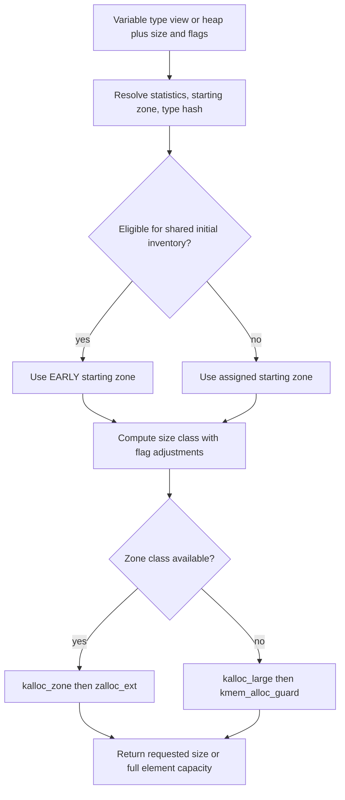

# Kalloc heaps: size classes, routing, free, and realloc

[Allocator overview](kernel-allocation.md) · [Type isolation](typed-allocation.md) · [Zone implementation](zone-allocator.md) · [Kernel VM allocation](kernel-virtual-allocation.md)

`kalloc` converts an allocation's size, content category, type view and flags into a zone allocation or a kernel VM allocation. It uses the zone allocator's elements and caches for small requests; it does not maintain an independent small-object free-list implementation. Fixed typed allocations usually bypass size selection at runtime because startup has already assigned their zone. Variable typed allocations and byte-buffer APIs enter the routing described here. [Runtime dispatcher](../../../xnu/osfmk/kern/kalloc.c#L2513), [fixed typed implementation](../../../xnu/osfmk/kern/kalloc.c#L2980).

## The heap object is a routing and accounting view

The heap's actual representation is small:

[Source: kalloc.h, lines 90–98](../../../xnu/osfmk/kern/kalloc.h#L90-L98)

<!-- source-excerpt: ../../../xnu/osfmk/kern/kalloc.h#L90-L98 -->
```c
typedef struct kalloc_heap {
	zone_stats_t        kh_stats;
	const char         *__unsafe_indexable kh_name;
	zone_kheap_id_t     kh_heap_id;
	vm_tag_t            kh_tag;
	uint16_t            kh_type_hash;
	zone_id_t           kh_zstart;
	struct kalloc_heap *kh_views;
} *kalloc_heap_t;
```

| Field | Purpose |
| --- | --- |
| `kh_zstart` | First zone ID in a contiguous sequence of size-class zones; add the size-class index to select a zone. |
| `kh_heap_id` | Coarse allocation family used in zone security metadata and free validation. It does not uniquely identify one variable-type heap. |
| `kh_stats`, `kh_views` | Per-CPU accounting and the linked views attached to a base heap. Different statistics do not imply different backing storage. |
| `kh_type_hash` | Placement input for VM-sized allocations from this heap view. It is not a runtime C type descriptor. |
| `kh_tag`, `kh_name` | Accounting tag and diagnostic name. |

There are several distinct bases in [kalloc.c](../../../xnu/osfmk/kern/kalloc.c#L172-L217):

| Family | What is routed there |
| --- | --- |
| `KHEAP_DATA_PRIVATE` | Data buffers intended to remain private to the kernel. |
| `KHEAP_DATA_SHARED` | Data buffers intended for external sharing; this is a separate heap even when both families contain no pointers. |
| `KHEAP_EARLY` | Shared initial allocation inventory used by eligible views before their allocation-volume policy selects isolated inventory. |
| `KHEAP_KT_VAR` | Common identity/accounting for the set of variable typed heaps; an individual view supplies its assigned starting zone. |
| `KHEAP_DEFAULT` | A declared view of the variable typed family used by generic/compatibility callers. It is not a separate universal allocator implementation. |

`KALLOC_HEAP_DEFINE` creates a view and startup registration. It cannot instantiate an arbitrary independent allocator. `kheap_init_data` and `kheap_init_data_shared` reuse their base's zones and allocate separate statistics. `kheap_init_var` chooses an existing flexible variable heap, copies that heap's starting zone, assigns a randomized adjusted type hash, and links the view into that heap's view list. A new name therefore does not guarantee a unique heap or unique physical pages. [Macro and contract](../../../xnu/osfmk/kern/kalloc.h#L179-L203), [view initialization](../../../xnu/osfmk/kern/kalloc.c#L3438-L3511).

The `KHEAP_KT_VAR` declaration still calls it a temporary heap awaiting variable-view support. The current dispatcher and initialization bodies already implement variable views. Likewise, old references to a data “submap” should be read with this checkout's current range selection and zone submap indices. [Historical header comment](../../../xnu/osfmk/kern/kalloc.h#L167-L177), [current variable-view dispatch](../../../xnu/osfmk/kern/kalloc.c#L2527-L2542), [VM placement](kernel-virtual-allocation.md).

## Size classes: two tables serve different purposes

Ordinary heaps and variable typed heaps have a computed size sequence. `kalloc_zsize_compute` initializes 16 and 32 bytes, then creates two classes per power-of-two step. With no classic KASAN adjustment the sequence begins:

`16, 32, 48, 64, 96, 128, 192, 256, 384, 512, 768, 1024, 1536, 2048, 3072, 4096, 6144, 8192, 12288, 16384`.

Non-x86 builds extend this sequence to 24576 and 32768. `KHEAP_MAX_SIZE` is 16 KiB on x86_64 and 32 KiB otherwise in this source; `KALLOC_SAFE_ALLOC_SIZE` is separately 16 KiB. The latter is the public safe `Z_NOFAIL` bound, not a universal statement of the last zone size. [Class constants](../../../xnu/osfmk/kern/kalloc.h#L352-L398), [safe bound](../../../xnu/osfmk/kern/kalloc.h#L75-L80), [class construction](../../../xnu/osfmk/kern/kalloc.c#L221-L246).

Fixed typed allocation uses a different `kt_zone_cfg` table. It has additional tuned sizes such as 80, 160, 288, 368 and 400. Startup groups fixed views using that table; applying the variable heap formula to a fixed type would predict the wrong zone in some cases. Classic KASAN adjusts selected class capacities through `K_SIZE_CLASS`. In the variable-heap runtime selector, a mathematical class that cannot hold the request advances to the next zone; fixed views receive their zone during startup. [Fixed class table and sanitizer transformation](../../../xnu/osfmk/kern/kalloc.c#L112-L152), [fixed assignment](typed-allocation.md).

`kalloc_zone_for_size_with_flags` computes a variable heap index without scanning every zone:

[Source: kalloc.c, lines 288–302](../../../xnu/osfmk/kern/kalloc.c#L288-L302)

<!-- source-excerpt: ../../../xnu/osfmk/kern/kalloc.c#L288-L302 -->
```c
		if (size <= KHEAP_START_SIZE) {
			zid  += (size > 16);
		} else {
			/*
			 * . log2down(size - 1) is log2up(size) - 1
			 * . (size - 1) >> (log2down(size - 1) - 1)
			 *   is either 0x2 or 0x3
			 */
			idx   = kalloc_log2down((uint32_t)(size - 1));
			zid  += KHEAP_EXTRA_ZONES +
			    2 * (idx - KHEAP_START_IDX) +
			    ((uint32_t)(size - 1) >> (idx - 1)) - 2;
		}

		zone = zone_by_id(zid);
```

For example, a 100-byte ordinary data request selects the 128-byte class, and 257 bytes select 384, under the unmodified sequence above. These are calculations from the source constants, not observations of a running kernel. The requested byte count and element capacity remain different values.

Two flags alter selection before that formula:

- `Z_KALLOC_ARRAY` rounds to `KALLOC_ARRAY_GRANULE` for the encoded-array representation.
- `Z_MAY_COPYINMAP` lowers the x86_64 zone crossover to `PAGE_SIZE - 1` for a historical sharing/remap ABI. It does not make an arbitrary zone element independently mappable into userspace. ARM follows its own backend and flag rules.

The x86 special case is explicit in [the selector](../../../xnu/osfmk/kern/kalloc.c#L248-L285). `kheap_size_from_zone` contains a corresponding reallocation distinction: a full-size return can report `PAGE_SIZE` even when the original copyin-compatible request came from a zone. It checks the address's actual zone identity in that case. [Old-allocation classification](../../../xnu/osfmk/kern/kalloc.c#L330-L359).

## Runtime allocation: resolve the view, then choose storage

`kalloc_ext` accepts either a heap pointer or a specially marked variable type-view pointer. `kt_is_var_view` and `kt_demangle_var_view` discriminate that internal calling convention. For a type view it obtains the coarse heap family from flags, takes the assigned `kt_heap_start` when present, chooses the view's statistics when available, and extracts the type hash. Heap callers supply those fields directly. [View pointer encoding](../../../xnu/osfmk/kern/kalloc.h#L1333-L1345), [variable wrapper](../../../xnu/osfmk/kern/kalloc.h#L1750-L1761), [dispatcher](../../../xnu/osfmk/kern/kalloc.c#L2513-L2555).

`kalloc_type_get_heap` routes data-only metadata to the private data family, processed nondata metadata to the typed family, and unprocessed nondata metadata to the default view. Selection of the particular variable heap comes from the view's starting zone rather than the coarse heap pointer alone. [Heap classification](../../../xnu/osfmk/kern/kalloc.c#L2288-L2304).



The final dispatch is short:

[Source: kalloc.c, lines 2549–2555](../../../xnu/osfmk/kern/kalloc.c#L2549-L2555)

<!-- source-excerpt: ../../../xnu/osfmk/kern/kalloc.c#L2549-L2555 -->
```c
	zstart = kalloc_use_early_heap(kheap, zstats, zstart, &flags);
	z = kalloc_zone_for_size_with_flags(zstart, size, flags);
	if (z) {
		return kalloc_zone(z, zstats, flags, size);
	} else {
		return kalloc_large(kheap, size, flags, kt_hash, owner);
	}
```

`kalloc_zone` calls `zalloc_ext`, using view statistics or the zone's own statistics. `struct kalloc_result` returns both address and size. Normally kalloc changes the returned size to the requested size; with `Z_FULLSIZE` or encoded-array allocation it reports the element capacity instead. KASAN tracks the requested/unused regions, and probabilistic guard-zone support can adjust the returned address within the element. Do not use allocator slack merely because a zone class is larger than the request; the selected API determines usable bounds. [Result structure](../../../xnu/osfmk/kern/zalloc.h#L503-L511), [zone wrapper](../../../xnu/osfmk/kern/kalloc.c#L2456-L2488).

### EARLY routing is based on allocation history, not only boot time

Both variable routing and fixed typed allocation consult `zs_alloc_not_early`. Data heaps set that bit at initialization and do not use this sharing optimization. Eligible nondata views initially use shared EARLY zones; ordinary `zalloc_item` increments cumulative allocated bytes in the selected per-CPU statistics. Once sharing can end and a threshold is reached, it marks all CPUs' copies of that statistics view as no-longer-early. Existing objects stay where they were allocated. [Data exclusion](../../../xnu/osfmk/kern/kalloc.c#L365-L375), [variable routing](../../../xnu/osfmk/kern/kalloc.c#L2492-L2508), [fixed routing](../../../xnu/osfmk/kern/kalloc.c#L2980-L2992).

[Source: zalloc.c, lines 6092–6103](../../../xnu/osfmk/kern/zalloc.c#L6092-L6103)

<!-- source-excerpt: ../../../xnu/osfmk/kern/zalloc.c#L6092-L6103 -->
```c
	if (__improbable(!zone_share_always &&
	    !os_atomic_load(&zs->zs_alloc_not_early, relaxed))) {
		if (flags & Z_SET_NOT_EARLY) {
			vm_size_t shared_threshold = zalloc_get_shared_threshold(zone, esize);

			if (zs->zs_mem_allocated >= shared_threshold) {
				zpercpu_foreach(zs_cpu, zstats) {
					os_atomic_store(&zs_cpu->zs_alloc_not_early, 1, relaxed);
				}
			}
		}
	}
```

The threshold depends on element size: up to 512 bytes it is a multiple of a quarter page; below 2048 it is a multiple of eight elements; otherwise it is a multiple of one chunk's element capacity. `zalloc_iokit_lockdown` permits this transition by clearing `zone_share_always`; `zalloc_first_proc_made` sets the threshold multiplier to one and enables zone caching. These are separate lifecycle events. [Threshold formula](../../../xnu/osfmk/kern/zalloc.c#L6051-L6060), [lifecycle hooks](../../../xnu/osfmk/kern/zalloc.c#L10238-L10250).

The consequence for type isolation is specific: startup's assigned destination is not necessarily where the first runtime object from that view is allocated. The free path recognizes the actual allocation and allows the EARLY family for eligible nondata frees. This sharing policy must be included when interpreting a zone dump or a statement that two types are separated. [Free-family validation](../../../xnu/osfmk/kern/kalloc.c#L2881-L2891).

## Large allocations preserve category and placement inputs

`kalloc_large` rejects `Z_NOFAIL` with a panic; rejects `Z_NOWAIT`, unrepresentable sizes and oversized encoded-array requests with an empty result; translates the other supported flags; and calls `kmem_alloc_guard` on `kernel_map`. There is no nonblocking large-allocation fallback into a different small-object pool. [Large path](../../../xnu/osfmk/kern/kalloc.c#L2340-L2433).

| Input | Large-path consequence |
| --- | --- |
| Private/shared data heap | `KMA_DATA` / `KMA_DATA_SHARED`, preserving the mapping category. |
| Ordinary non-copyin request | Adds `KMA_KOBJECT` on non-x86 builds; x86 retains its documented historical object-sharing ABI. |
| `Z_NOPAGEWAIT`, `Z_ZERO`, `Z_NOSOFTLIMIT` | Corresponding VM allocation controls. |
| Type hash and owner | Guard placement hash and hashed owner context. |
| VM tag flags | Explicit tag, optional backtrace-derived tag, or fallback heap accounting tag. |
| `Z_FULLSIZE` / `Z_KALLOC_ARRAY` | Page-rounded usable-size result, with array encoding when requested. |

The guard bundles different kinds of metadata:

[Source: kalloc.c, lines 2107–2116](../../../xnu/osfmk/kern/kalloc.c#L2107-L2116)

<!-- source-excerpt: ../../../xnu/osfmk/kern/kalloc.c#L2107-L2116 -->
```c
static kmem_guard_t
kalloc_guard(vm_tag_t tag, uint16_t type_hash, const void *owner)
{
	kmem_guard_t guard = {
		.kmg_atomic      = true,
		.kmg_tag         = tag,
		.kmg_type_hash   = type_hash,
		.kmg_context     = os_hash_kernel_pointer(owner),
	};

```

`kmg_atomic` protects the allocation as a complete map interval; `kmg_context` identifies the owner context used by applicable guarded operations; `kmg_type_hash` influences placement; `kmg_tag` accounts memory. None is an allocation's C++ RTTI or a general proof that a subsequent pointer has the expected source type. The [kernel VM chapter](kernel-virtual-allocation.md) follows the resulting range, guards and object/page population.

Memory tagging is another layer. Under `ZONE_TAGGING`, the large path can add `KMA_TAG`; on production MTE builds its policy excludes data allocations, while KASAN variants have different choices. A placement hash, a VM accounting tag, and an MTE allocation tag are three different values with different purposes. [Large tagging policy](../../../xnu/osfmk/kern/kalloc.c#L2307-L2336).

## Free validates storage identity before returning it

`kfree_ext` accepts null, rejects an absurd size, and selects its small or large path. For a small free, `zone_element_size` discovers the actual zone and element capacity from the address, including any guard-zone address adjustment. The supplied size plus adjustment must fit that element. It then passes the actual zone to `kfree_zone`. This is not simply “compute a size class and push the address into it.” [Sized free](../../../xnu/osfmk/kern/kalloc.c#L2904-L2931).

`kfree_zone` resolves the expected heap family and statistics. Calls through the base `KHEAP_DATA_PRIVATE` and `KHEAP_DATA_SHARED` pointers must match their exact coarse family. Other heap pointers may also target EARLY; this includes custom data heap views because the strict branch tests pointer equality with the two bases. Typed data views resolve to the private-data base and take its strict branch. It clears the whole element with `__nosan_bzero` and calls `zfree_ext` with the element/request sizes packed for the lower layer:

[Source: kalloc.c, lines 2884–2900](../../../xnu/osfmk/kern/kalloc.c#L2884-L2900)

<!-- source-excerpt: ../../../xnu/osfmk/kern/kalloc.c#L2884-L2900 -->
```c
	zsflags = zone_security_config(z);
	if (kheap == KHEAP_DATA_PRIVATE || kheap == KHEAP_DATA_SHARED) {
		if (kheap->kh_heap_id != zsflags.z_kheap_id) {
			kfree_heap_confusion_panic(kheap, data, size, z);
		}
	} else {
		if ((kheap->kh_heap_id != zsflags.z_kheap_id) &&
		    (zsflags.z_kheap_id != KHEAP_ID_EARLY)) {
			kfree_heap_confusion_panic(kheap, data, size, z);
		}
	}

	DTRACE_VM3(kfree, vm_size_t, size, vm_size_t, zsize, void*, data);

	/* needs to be __nosan because the user size might be partial */
	__nosan_bzero(data, zsize);
	zfree_ext(z, zstats ?: z->z_stats, data, ZFREE_PACK_SIZE(zsize, size));
```

These checks deliberately have different precision from fixed typed free. Variable frees validate coarse heap family and storage size, not the unique source-language type or the exact variable heap selected at startup. Fixed typed free supplies its assigned zone; validation also accepts supported signature-equivalent zones and the EARLY alternative. The [typed chapter](typed-allocation.md) details this distinction; allocation segregation should not be described as universal dynamic type checking.

`kfree_addr_ext` discovers the zone without a caller-supplied size. For a non-zone allocation it asks `kmem_free_guard` to infer the size using `KMF_GUESS_SIZE`. `kfree_large` applies guard/tag checks, removes the VM allocation and updates large-allocation counters and the thread ledger. The VM entry, rather than a size-class guess, describes that extent. [Address-only free](../../../xnu/osfmk/kern/kalloc.c#L2934-L2954), [large free](../../../xnu/osfmk/kern/kalloc.c#L2836-L2850).

`kalloc_data_require` illustrates a category assertion used by callers: it checks zone heap-family metadata and capacity, or containment in a private/shared data VM range. It does not inspect every byte to discover whether a caller wrote a pointer into a data buffer. Classification comes from the allocation contract. [Data assertion](../../../xnu/osfmk/kern/kalloc.c#L2644-L2664).

## Realloc is a decision tree with ownership consequences

`krealloc_ext` resolves the same view information as allocation, computes the destination class, and discovers the source's actual zone/capacity. Its main cases are:

| Case | Behavior |
| --- | --- |
| Null source | Allocate the destination size; null source plus zero size returns an empty result. |
| New size zero | Release the old allocation and return null. |
| Same zone bucket capacity | Usually retain the allocation; guard-zone address adjustment can move the visible start, and sanitizer modes may validate/retag it. |
| Same page-rounded VM capacity, without KASAN | Can retain the VM allocation without a VM resize. |
| Both allocations VM-sized and resize needed | Delegate to `krealloc_large` / `kmem_realloc_guard`. |
| Different zone classes or zone↔VM transition | Allocate the destination, copy `MIN(old_size, new_size)` bytes, then release the source on success. |
| Allocation fails | Preserve the source unless the applicable path processes `Z_REALLOCF`; read early-rejection behavior separately. |

[Complete dispatcher](../../../xnu/osfmk/kern/kalloc.c#L3220-L3410). A same-capacity decision is not a promise that the pointer bits remain unchanged under every sanitizer/guard configuration. The code uses actual old storage rather than assuming that the current view would select the same destination as when the object was created. In particular, the zone fast path compares bucket sizes, not `old_z == new_z`; it can retain EARLY storage after the view has transitioned to an assigned typed family. That early-return path checks the recovered size bounds but does not call `kfree_zone` to validate the coarse heap family.

The allocate/copy/free branch makes the ordinary failure ownership explicit:

[Source: kalloc.c, lines 3375–3387](../../../xnu/osfmk/kern/kalloc.c#L3375-L3387)

<!-- source-excerpt: ../../../xnu/osfmk/kern/kalloc.c#L3375-L3387 -->
```c
	if (addr && kr.addr) {
		__nosan_memcpy(kr.addr, addr, min_size);
	}

	if (addr && (kr.addr || (flags & Z_REALLOCF) || !new_size)) {
		if (old_z) {
			kfree_zone(kheap_or_kt_view,
			    (char *)addr - oob_offs, old_size,
			    old_z, old_bucket_size);
		} else {
			kfree_large((vm_offset_t)addr, old_size, KMF_NONE, owner);
		}
	}
```

The lower large helper passes `KMR_FREEOLD` and optionally `KMR_REALLOCF` into VM. However, its `Z_NOWAIT` and size-range rejections occur before that VM call and return immediately; those branches do not free the old address merely because `Z_REALLOCF` was present. This is why flag semantics should be read through the selected route and valid calling contract. [Large realloc checks](../../../xnu/osfmk/kern/kalloc.c#L3113-L3140), [VM flags and call](../../../xnu/osfmk/kern/kalloc.c#L3141-L3186), [VM resize ownership](kernel-virtual-allocation.md).

## Encoded arrays carry capacity separately from ordinary pointers

The `kalloc_array` family wraps storage in a representation containing both pointer and usable capacity. `Z_KALLOC_ARRAY` affects class rounding, result size and address encoding. On ARM64e or tagged-zone builds, reserved pointer bits distinguish zone from VM allocations; low bits encode a zone size class or page count. Other builds use a different high-bit encoding. The decode helper reconstructs a `kalloc_result`; an encoded value is not an ordinary address to dereference before decoding. [Array interface and contract](../../../xnu/osfmk/kern/kalloc.h#L1025-L1100), [encode/decode implementations](../../../xnu/osfmk/kern/kalloc.c#L2123-L2251).

This is separate from ordinary `kalloc_type(T, count, flags)`: both are array-oriented APIs, but the latter's type view does not by itself mean that its returned pointer contains encoded capacity. `kalloc_next_good_size` computes a growth class; VM-sized growth uses a page-rounded step derived from the requested period. Allocation, capacity growth and compiler type-layout classification are different decisions. [Growth helper](../../../xnu/osfmk/kern/kalloc.c#L2256-L2282), [API variants](../../../xnu/osfmk/kern/kalloc.h#L1252-L1325).

## Sources and boundaries

The routing, class calculation, initial-sharing policy, allocation/free/realloc bodies and array encoding above were read directly. [Type assignment](typed-allocation.md), [zone caches and reclaim](zone-allocator.md), and [VM guard allocation](kernel-virtual-allocation.md) supply the deeper storage mechanisms. [Compatibility and protected-memory interfaces](allocator-interfaces.md) follows IOKit, C++ and BSD callers into these routes.

This is a source trace for this checkout. No running kernel's zone assignment, tunable values or allocation distribution was measured. KASAN, MTE, architecture, external call sites and startup phase change the selected branches; comments describing older implementations are not treated as the current algorithm.
